# 14.3 &nbsp; Solving problems with dynamic programming

The previous two sections introduced the main properties of dynamic programming problems. Let's now consider two practical questions.

1. How can we recognize a dynamic programming problem?
2. Where should we start, and what steps should we follow to solve it?

## 14.3.1 &nbsp; Recognizing a dynamic programming problem

Problems with overlapping subproblems, optimal substructure, and the no-aftereffect property are usually good candidates for dynamic programming. These properties can be hard to spot in the problem statement. We often start with a simpler test: **could backtracking (exhaustive search) solve the problem?**

**Problems suited to backtracking usually fit a decision tree model**. Each node in the tree represents a decision, and each path represents a sequence of decisions.

In other words, when there are clearly defined choices and a solution results from a sequence of choices, the problem fits a decision tree and can usually be solved by backtracking.

Several additional clues favor dynamic programming.

- The problem asks for an optimum, such as the largest or smallest value or the greatest or least number of items.
- A list, multidimensional array, or tree can represent the states, and a recurrence relates a state to neighboring states.

Other clues make dynamic programming less likely to be suitable.

- The goal is to find every possible solution rather than an optimum.
- The problem clearly involves permutations or combinations and asks you to return multiple specific arrangements.

If a problem fits a decision tree and shows clear signs favoring dynamic programming, we can try that approach and test our assumption as we work.

## 14.3.2 &nbsp; Steps for solving the problem

The details depend on the nature and difficulty of the problem. Typically, we describe the decisions, define the states, set up a $dp$ table, derive a recurrence, and establish the boundary conditions.

Let's work through a classic example, the minimum path sum.

!!! question

    An $n \times m$ grid `grid` contains a nonnegative integer in each cell representing its cost. A robot starts at the top left and moves one cell down or right at each step until it reaches the bottom right. Return the minimum path sum from the top left to the bottom right.

In the example below, the minimum path sum is $13$.

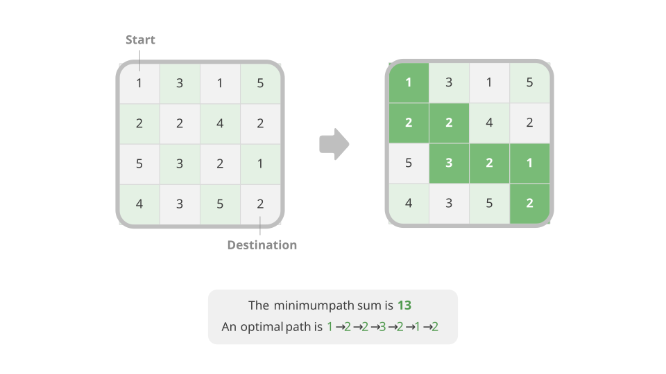{ class="animation-figure" }

<p align="center"> Figure 14-10 &nbsp; Example input for minimum path sum </p>

**Step 1: Identify the decision at each step and define the state and $dp$ table**

At each step we decide whether to move down or right from the current cell. If its row and column indices are $[i, j]$, the next cell is $[i+1, j]$ or $[i, j+1]$. The state therefore needs two variables, the row and column, written $[i, j]$.

The subproblem for state $[i, j]$ asks for the minimum path sum from the starting cell $[0, 0]$ to $[i, j]$. Denote its solution by $dp[i, j]$.

This gives us the two-dimensional $dp$ matrix below, with the same dimensions as the input grid $grid$.

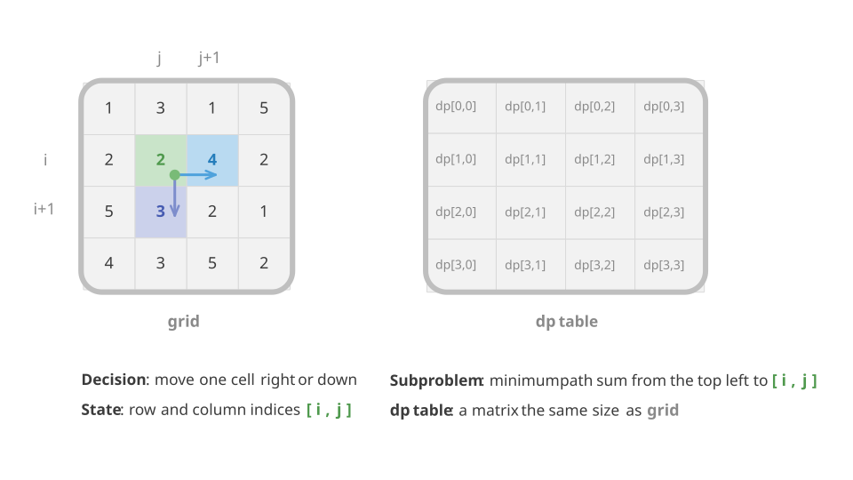{ class="animation-figure" }

<p align="center"> Figure 14-11 &nbsp; State definition and dp table </p>

!!! note

    Both dynamic programming and backtracking can be described as sequences of decisions. A state consists of the decision variables. It should include every variable needed to describe our progress and enough information to determine the next state.
    
    Each state corresponds to a subproblem. We use a $dp$ table to store their solutions, with one dimension of the $dp$ table for each independent state variable. In essence, the $dp$ table maps each state to the solution of its subproblem.

**Step 2: Identify optimal substructure and derive the recurrence**

State $[i, j]$ can be reached only from the cell above, $[i-1, j]$, or the cell to the left, $[i, j-1]$. This gives the optimal substructure: the minimum path sum to $[i, j]$ depends on the smaller of the minimum path sums to $[i, j-1]$ and $[i-1, j]$.

This gives the recurrence shown below:

$$
dp[i, j] = \min(dp[i-1, j], dp[i, j-1]) + grid[i, j]
$$

{ class="animation-figure" }

<p align="center"> Figure 14-12 &nbsp; Optimal substructure and the recurrence </p>

!!! note

    Using the $dp$ table definition, examine how the original problem relates to its subproblems. Look for a way to construct an optimal solution from optimal subproblem solutions. That is the optimal substructure.

    Once we identify the optimal substructure, we can use it to write the recurrence.

**Step 3: Determine the boundary conditions and the order of computation**

A state in the first row can only be reached from its left, and a state in the first column only from above. The first row $i = 0$ and first column $j = 0$ therefore give the boundary conditions.

As shown below, each cell depends on the cells to its left and above it. We traverse the matrix with nested loops: the outer loop visits the rows and the inner loop the columns.

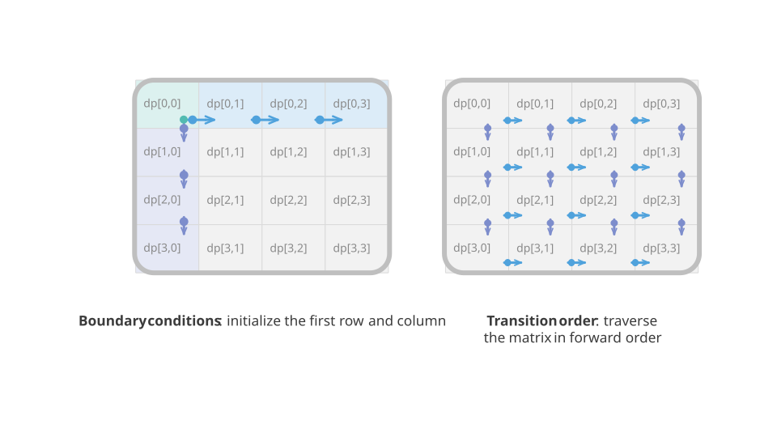{ class="animation-figure" }

<p align="center"> Figure 14-13 &nbsp; Boundary conditions and order of computation </p>

!!! note

    Boundary conditions initialize the $dp$ table in dynamic programming and prune branches in search.
    
    Choose an order that ensures every smaller subproblem a state depends on has already been solved correctly when we calculate that state.

We now have enough information to write the dynamic programming code directly. Since breaking a problem down is a top-down process, however, it is often more natural to implement the approaches in this order: brute-force search $\rightarrow$ memoized search $\rightarrow$ dynamic programming.

### 1. &nbsp; Method 1: Brute-force search

Start the search at state $[i, j]$ and recursively break it down into smaller states $[i-1, j]$ and $[i, j-1]$. The recursive function has the following parts.

- **Recursive parameters**: the state $[i, j]$.
- **Return value**: the minimum path sum $dp[i, j]$ from $[0, 0]$ to $[i, j]$.
- **Base case**: when $i = 0$ and $j = 0$, return the cost $grid[0, 0]$.
- **Pruning**: if $i < 0$ or $j < 0$, an index is out of bounds. Return cost $+\infty$ to indicate an infeasible path.

Here is the implementation:

=== "Python"

    ```python title="min_path_sum.py"
    def min_path_sum_dfs(grid: list[list[int]], i: int, j: int) -> int:
        """Minimum path sum with brute-force search"""
        # Stop searching at the top-left cell
        if i == 0 and j == 0:
            return grid[0][0]
        # Return a cost of +∞ if either index is out of bounds
        if i < 0 or j < 0:
            return inf
        # Find the minimum path costs from the top left to (i-1, j) and (i, j-1)
        up = min_path_sum_dfs(grid, i - 1, j)
        left = min_path_sum_dfs(grid, i, j - 1)
        # Return the minimum path cost from the top left to (i, j)
        return min(left, up) + grid[i][j]
    ```

=== "C++"

    ```cpp title="min_path_sum.cpp"
    /* Minimum path sum with brute-force search */
    int minPathSumDFS(vector<vector<int>> &grid, int i, int j) {
        // Stop searching at the top-left cell
        if (i == 0 && j == 0) {
            return grid[0][0];
        }
        // Return a cost of +∞ if either index is out of bounds
        if (i < 0 || j < 0) {
            return INT_MAX;
        }
        // Find the minimum path costs from the top left to (i-1, j) and (i, j-1)
        int up = minPathSumDFS(grid, i - 1, j);
        int left = minPathSumDFS(grid, i, j - 1);
        // Return the minimum path cost from the top left to (i, j)
        return min(left, up) != INT_MAX ? min(left, up) + grid[i][j] : INT_MAX;
    }
    ```

=== "Java"

    ```java title="min_path_sum.java"
    /* Minimum path sum with brute-force search */
    int minPathSumDFS(int[][] grid, int i, int j) {
        // Stop searching at the top-left cell
        if (i == 0 && j == 0) {
            return grid[0][0];
        }
        // Return a cost of +∞ if either index is out of bounds
        if (i < 0 || j < 0) {
            return Integer.MAX_VALUE;
        }
        // Find the minimum path costs from the top left to (i-1, j) and (i, j-1)
        int up = minPathSumDFS(grid, i - 1, j);
        int left = minPathSumDFS(grid, i, j - 1);
        // Return the minimum path cost from the top left to (i, j)
        return Math.min(left, up) + grid[i][j];
    }
    ```

=== "C#"

    ```csharp title="min_path_sum.cs"
    /* Minimum path sum with brute-force search */
    int MinPathSumDFS(int[][] grid, int i, int j) {
        // Stop searching at the top-left cell
        if (i == 0 && j == 0) {
            return grid[0][0];
        }
        // Return a cost of +∞ if either index is out of bounds
        if (i < 0 || j < 0) {
            return int.MaxValue;
        }
        // Find the minimum path costs from the top left to (i-1, j) and (i, j-1)
        int up = MinPathSumDFS(grid, i - 1, j);
        int left = MinPathSumDFS(grid, i, j - 1);
        // Return the minimum path cost from the top left to (i, j)
        return Math.Min(left, up) + grid[i][j];
    }
    ```

=== "Go"

    ```go title="min_path_sum.go"
    /* Minimum path sum with brute-force search */
    func minPathSumDFS(grid [][]int, i, j int) int {
        // Stop searching at the top-left cell
        if i == 0 && j == 0 {
            return grid[0][0]
        }
        // Return a cost of +∞ if either index is out of bounds
        if i < 0 || j < 0 {
            return math.MaxInt
        }
        // Find the minimum path costs from the top left to (i-1, j) and (i, j-1)
        up := minPathSumDFS(grid, i-1, j)
        left := minPathSumDFS(grid, i, j-1)
        // Return the minimum path cost from the top left to (i, j)
        return int(math.Min(float64(left), float64(up))) + grid[i][j]
    }
    ```

=== "Swift"

    ```swift title="min_path_sum.swift"
    /* Minimum path sum with brute-force search */
    func minPathSumDFS(grid: [[Int]], i: Int, j: Int) -> Int {
        // Stop searching at the top-left cell
        if i == 0, j == 0 {
            return grid[0][0]
        }
        // Return a cost of +∞ if either index is out of bounds
        if i < 0 || j < 0 {
            return .max
        }
        // Find the minimum path costs from the top left to (i-1, j) and (i, j-1)
        let up = minPathSumDFS(grid: grid, i: i - 1, j: j)
        let left = minPathSumDFS(grid: grid, i: i, j: j - 1)
        // Return the minimum path cost from the top left to (i, j)
        return min(left, up) + grid[i][j]
    }
    ```

=== "JS"

    ```javascript title="min_path_sum.js"
    /* Minimum path sum with brute-force search */
    function minPathSumDFS(grid, i, j) {
        // Stop searching at the top-left cell
        if (i === 0 && j === 0) {
            return grid[0][0];
        }
        // Return a cost of +∞ if either index is out of bounds
        if (i < 0 || j < 0) {
            return Infinity;
        }
        // Find the minimum path costs from the top left to (i-1, j) and (i, j-1)
        const up = minPathSumDFS(grid, i - 1, j);
        const left = minPathSumDFS(grid, i, j - 1);
        // Return the minimum path cost from the top left to (i, j)
        return Math.min(left, up) + grid[i][j];
    }
    ```

=== "TS"

    ```typescript title="min_path_sum.ts"
    /* Minimum path sum with brute-force search */
    function minPathSumDFS(
        grid: Array<Array<number>>,
        i: number,
        j: number
    ): number {
        // Stop searching at the top-left cell
        if (i === 0 && j == 0) {
            return grid[0][0];
        }
        // Return a cost of +∞ if either index is out of bounds
        if (i < 0 || j < 0) {
            return Infinity;
        }
        // Find the minimum path costs from the top left to (i-1, j) and (i, j-1)
        const up = minPathSumDFS(grid, i - 1, j);
        const left = minPathSumDFS(grid, i, j - 1);
        // Return the minimum path cost from the top left to (i, j)
        return Math.min(left, up) + grid[i][j];
    }
    ```

=== "Dart"

    ```dart title="min_path_sum.dart"
    /* Minimum path sum with brute-force search */
    int minPathSumDFS(List<List<int>> grid, int i, int j) {
      // Stop searching at the top-left cell
      if (i == 0 && j == 0) {
        return grid[0][0];
      }
      // Return a cost of +∞ if either index is out of bounds
      if (i < 0 || j < 0) {
        // Dart's int type has a fixed range and no value representing infinity
        return BigInt.from(2).pow(31).toInt();
      }
      // Find the minimum path costs from the top left to (i-1, j) and (i, j-1)
      int up = minPathSumDFS(grid, i - 1, j);
      int left = minPathSumDFS(grid, i, j - 1);
      // Return the minimum path cost from the top left to (i, j)
      return min(left, up) + grid[i][j];
    }
    ```

=== "Rust"

    ```rust title="min_path_sum.rs"
    /* Minimum path sum with brute-force search */
    fn min_path_sum_dfs(grid: &Vec<Vec<i32>>, i: i32, j: i32) -> i32 {
        // Stop searching at the top-left cell
        if i == 0 && j == 0 {
            return grid[0][0];
        }
        // Return a cost of +∞ if either index is out of bounds
        if i < 0 || j < 0 {
            return i32::MAX;
        }
        // Find the minimum path costs from the top left to (i-1, j) and (i, j-1)
        let up = min_path_sum_dfs(grid, i - 1, j);
        let left = min_path_sum_dfs(grid, i, j - 1);
        // Return the minimum path cost from the top left to (i, j)
        std::cmp::min(left, up) + grid[i as usize][j as usize]
    }
    ```

=== "C"

    ```c title="min_path_sum.c"
    /* Minimum path sum with brute-force search */
    int minPathSumDFS(int grid[MAX_SIZE][MAX_SIZE], int i, int j) {
        // Stop searching at the top-left cell
        if (i == 0 && j == 0) {
            return grid[0][0];
        }
        // Return a cost of +∞ if either index is out of bounds
        if (i < 0 || j < 0) {
            return INT_MAX;
        }
        // Find the minimum path costs from the top left to (i-1, j) and (i, j-1)
        int up = minPathSumDFS(grid, i - 1, j);
        int left = minPathSumDFS(grid, i, j - 1);
        // Return the minimum path cost from the top left to (i, j)
        return myMin(left, up) != INT_MAX ? myMin(left, up) + grid[i][j] : INT_MAX;
    }
    ```

=== "Kotlin"

    ```kotlin title="min_path_sum.kt"
    /* Minimum path sum with brute-force search */
    fun minPathSumDFS(grid: Array<IntArray>, i: Int, j: Int): Int {
        // Stop searching at the top-left cell
        if (i == 0 && j == 0) {
            return grid[0][0]
        }
        // Return a cost of +∞ if either index is out of bounds
        if (i < 0 || j < 0) {
            return Int.MAX_VALUE
        }
        // Find the minimum path costs from the top left to (i-1, j) and (i, j-1)
        val up = minPathSumDFS(grid, i - 1, j)
        val left = minPathSumDFS(grid, i, j - 1)
        // Return the minimum path cost from the top left to (i, j)
        return min(left, up) + grid[i][j]
    }
    ```

=== "Ruby"

    ```ruby title="min_path_sum.rb"
    ### Minimum path sum with brute-force search ###
    def min_path_sum_dfs(grid, i, j)
      # Stop searching at the top-left cell
      return grid[i][j] if i == 0 && j == 0
      # Return a cost of +∞ if either index is out of bounds
      return Float::INFINITY if i < 0 || j < 0
      # Find the minimum path costs from the top left to (i-1, j) and (i, j-1)
      up = min_path_sum_dfs(grid, i - 1, j)
      left = min_path_sum_dfs(grid, i, j - 1)
      # Return the minimum path cost from the top left to (i, j)
      [left, up].min + grid[i][j]
    end
    ```

??? pythontutor "Visualize execution"

    <div style="height: 549px; width: 100%;"><iframe class="pythontutor-iframe" title="Visualize execution" src="https://pythontutor.com/iframe-embed.html#code=from%20math%20import%20inf%0A%0Adef%20min_path_sum_dfs%28grid%3A%20list%5Blist%5Bint%5D%5D,%20i%3A%20int,%20j%3A%20int%29%20-%3E%20int%3A%0A%20%20%20%20%22%22%22Minimum%20path%20sum%20with%20brute-force%20search%22%22%22%0A%20%20%20%20%23%20Stop%20searching%20at%20the%20top-left%20cell%0A%20%20%20%20if%20i%20%3D%3D%200%20and%20j%20%3D%3D%200%3A%0A%20%20%20%20%20%20%20%20return%20grid%5B0%5D%5B0%5D%0A%20%20%20%20%23%20Return%20a%20cost%20of%20%2B%E2%88%9E%20if%20either%20index%20is%20out%20of%20bounds%0A%20%20%20%20if%20i%20%3C%200%20or%20j%20%3C%200%3A%0A%20%20%20%20%20%20%20%20return%20inf%0A%20%20%20%20%23%20Find%20the%20minimum%20path%20costs%20from%20the%20top%20left%20to%20%28i-1,%20j%29%20and%20%28i,%20j-1%29%0A%20%20%20%20up%20%3D%20min_path_sum_dfs%28grid,%20i%20-%201,%20j%29%0A%20%20%20%20left%20%3D%20min_path_sum_dfs%28grid,%20i,%20j%20-%201%29%0A%20%20%20%20%23%20Return%20the%20minimum%20path%20cost%20from%20the%20top%20left%20to%20%28i,%20j%29%0A%20%20%20%20return%20min%28left,%20up%29%20%2B%20grid%5Bi%5D%5Bj%5D%0A%0A%0A%22%22%22Driver%20Code%22%22%22%0Aif%20__name__%20%3D%3D%20%22__main__%22%3A%0A%20%20%20%20grid%20%3D%20%5B%5B1,%203,%201,%205%5D,%20%5B2,%202,%204,%202%5D,%20%5B5,%203,%202,%201%5D,%20%5B4,%203,%205,%202%5D%5D%0A%20%20%20%20n,%20m%20%3D%20len%28grid%29,%20len%28grid%5B0%5D%29%0A%0A%20%20%20%20%23%20Brute-force%20search%0A%20%20%20%20res%20%3D%20min_path_sum_dfs%28grid,%20n%20-%201,%20m%20-%201%29%0A%20%20%20%20print%28f%22Minimum%20path%20sum%20from%20the%20top%20left%20to%20the%20bottom%20right%3A%20%7Bres%7D%22%29&codeDivHeight=472&codeDivWidth=350&cumulative=false&curInstr=6&heapPrimitives=nevernest&origin=opt-frontend.js&py=311&rawInputLstJSON=%5B%5D&textReferences=false"> </iframe></div>
    <div style="margin-top: 5px;"><a href="https://pythontutor.com/iframe-embed.html#code=from%20math%20import%20inf%0A%0Adef%20min_path_sum_dfs%28grid%3A%20list%5Blist%5Bint%5D%5D,%20i%3A%20int,%20j%3A%20int%29%20-%3E%20int%3A%0A%20%20%20%20%22%22%22Minimum%20path%20sum%20with%20brute-force%20search%22%22%22%0A%20%20%20%20%23%20Stop%20searching%20at%20the%20top-left%20cell%0A%20%20%20%20if%20i%20%3D%3D%200%20and%20j%20%3D%3D%200%3A%0A%20%20%20%20%20%20%20%20return%20grid%5B0%5D%5B0%5D%0A%20%20%20%20%23%20Return%20a%20cost%20of%20%2B%E2%88%9E%20if%20either%20index%20is%20out%20of%20bounds%0A%20%20%20%20if%20i%20%3C%200%20or%20j%20%3C%200%3A%0A%20%20%20%20%20%20%20%20return%20inf%0A%20%20%20%20%23%20Find%20the%20minimum%20path%20costs%20from%20the%20top%20left%20to%20%28i-1,%20j%29%20and%20%28i,%20j-1%29%0A%20%20%20%20up%20%3D%20min_path_sum_dfs%28grid,%20i%20-%201,%20j%29%0A%20%20%20%20left%20%3D%20min_path_sum_dfs%28grid,%20i,%20j%20-%201%29%0A%20%20%20%20%23%20Return%20the%20minimum%20path%20cost%20from%20the%20top%20left%20to%20%28i,%20j%29%0A%20%20%20%20return%20min%28left,%20up%29%20%2B%20grid%5Bi%5D%5Bj%5D%0A%0A%0A%22%22%22Driver%20Code%22%22%22%0Aif%20__name__%20%3D%3D%20%22__main__%22%3A%0A%20%20%20%20grid%20%3D%20%5B%5B1,%203,%201,%205%5D,%20%5B2,%202,%204,%202%5D,%20%5B5,%203,%202,%201%5D,%20%5B4,%203,%205,%202%5D%5D%0A%20%20%20%20n,%20m%20%3D%20len%28grid%29,%20len%28grid%5B0%5D%29%0A%0A%20%20%20%20%23%20Brute-force%20search%0A%20%20%20%20res%20%3D%20min_path_sum_dfs%28grid,%20n%20-%201,%20m%20-%201%29%0A%20%20%20%20print%28f%22Minimum%20path%20sum%20from%20the%20top%20left%20to%20the%20bottom%20right%3A%20%7Bres%7D%22%29&codeDivHeight=800&codeDivWidth=600&cumulative=false&curInstr=6&heapPrimitives=nevernest&origin=opt-frontend.js&py=311&rawInputLstJSON=%5B%5D&textReferences=false" target="_blank" rel="noopener noreferrer">View full screen ></a></div>

The recursion tree rooted at $dp[2, 1]$ below contains overlapping subproblems. Their number grows rapidly with the size of the grid `grid`.

Subproblems overlap because **multiple paths can lead from the top left to the same cell**.

{ class="animation-figure" }

<p align="center"> Figure 14-14 &nbsp; Recursion tree for brute-force search </p>

Each state offers two moves, down and right. Reaching the bottom right from the top left takes $m + n - 2$ moves, so the worst-case time complexity is $O(2^{m + n})$, where $n$ and $m$ are the numbers of rows and columns. This estimate ignores the restriction at the grid boundary, where just one move remains, so the actual number of paths is smaller.

### 2. &nbsp; Method 2: Memoized search

Create a cache `mem` the same size as the grid `grid`. Store each subproblem's solution in it so we can prune repeated searches:

=== "Python"

    ```python title="min_path_sum.py"
    def min_path_sum_dfs_mem(
        grid: list[list[int]], mem: list[list[int]], i: int, j: int
    ) -> int:
        """Minimum path sum with memoized search"""
        # Stop searching at the top-left cell
        if i == 0 and j == 0:
            return grid[0][0]
        # Return a cost of +∞ if either index is out of bounds
        if i < 0 or j < 0:
            return inf
        # Return the cached result if available
        if mem[i][j] != -1:
            return mem[i][j]
        # Minimum path costs for the cells to the left and above
        up = min_path_sum_dfs_mem(grid, mem, i - 1, j)
        left = min_path_sum_dfs_mem(grid, mem, i, j - 1)
        # Cache and return the minimum path cost from the top left to (i, j)
        mem[i][j] = min(left, up) + grid[i][j]
        return mem[i][j]
    ```

=== "C++"

    ```cpp title="min_path_sum.cpp"
    /* Minimum path sum with memoized search */
    int minPathSumDFSMem(vector<vector<int>> &grid, vector<vector<int>> &mem, int i, int j) {
        // Stop searching at the top-left cell
        if (i == 0 && j == 0) {
            return grid[0][0];
        }
        // Return a cost of +∞ if either index is out of bounds
        if (i < 0 || j < 0) {
            return INT_MAX;
        }
        // Return the cached result if available
        if (mem[i][j] != -1) {
            return mem[i][j];
        }
        // Minimum path costs for the cells to the left and above
        int up = minPathSumDFSMem(grid, mem, i - 1, j);
        int left = minPathSumDFSMem(grid, mem, i, j - 1);
        // Cache and return the minimum path cost from the top left to (i, j)
        mem[i][j] = min(left, up) != INT_MAX ? min(left, up) + grid[i][j] : INT_MAX;
        return mem[i][j];
    }
    ```

=== "Java"

    ```java title="min_path_sum.java"
    /* Minimum path sum with memoized search */
    int minPathSumDFSMem(int[][] grid, int[][] mem, int i, int j) {
        // Stop searching at the top-left cell
        if (i == 0 && j == 0) {
            return grid[0][0];
        }
        // Return a cost of +∞ if either index is out of bounds
        if (i < 0 || j < 0) {
            return Integer.MAX_VALUE;
        }
        // Return the cached result if available
        if (mem[i][j] != -1) {
            return mem[i][j];
        }
        // Minimum path costs for the cells to the left and above
        int up = minPathSumDFSMem(grid, mem, i - 1, j);
        int left = minPathSumDFSMem(grid, mem, i, j - 1);
        // Cache and return the minimum path cost from the top left to (i, j)
        mem[i][j] = Math.min(left, up) + grid[i][j];
        return mem[i][j];
    }
    ```

=== "C#"

    ```csharp title="min_path_sum.cs"
    /* Minimum path sum with memoized search */
    int MinPathSumDFSMem(int[][] grid, int[][] mem, int i, int j) {
        // Stop searching at the top-left cell
        if (i == 0 && j == 0) {
            return grid[0][0];
        }
        // Return a cost of +∞ if either index is out of bounds
        if (i < 0 || j < 0) {
            return int.MaxValue;
        }
        // Return the cached result if available
        if (mem[i][j] != -1) {
            return mem[i][j];
        }
        // Minimum path costs for the cells to the left and above
        int up = MinPathSumDFSMem(grid, mem, i - 1, j);
        int left = MinPathSumDFSMem(grid, mem, i, j - 1);
        // Cache and return the minimum path cost from the top left to (i, j)
        mem[i][j] = Math.Min(left, up) + grid[i][j];
        return mem[i][j];
    }
    ```

=== "Go"

    ```go title="min_path_sum.go"
    /* Minimum path sum with memoized search */
    func minPathSumDFSMem(grid, mem [][]int, i, j int) int {
        // Stop searching at the top-left cell
        if i == 0 && j == 0 {
            return grid[0][0]
        }
        // Return a cost of +∞ if either index is out of bounds
        if i < 0 || j < 0 {
            return math.MaxInt
        }
        // Return the cached result if available
        if mem[i][j] != -1 {
            return mem[i][j]
        }
        // Minimum path costs for the cells to the left and above
        up := minPathSumDFSMem(grid, mem, i-1, j)
        left := minPathSumDFSMem(grid, mem, i, j-1)
        // Cache and return the minimum path cost from the top left to (i, j)
        mem[i][j] = int(math.Min(float64(left), float64(up))) + grid[i][j]
        return mem[i][j]
    }
    ```

=== "Swift"

    ```swift title="min_path_sum.swift"
    /* Minimum path sum with memoized search */
    func minPathSumDFSMem(grid: [[Int]], mem: inout [[Int]], i: Int, j: Int) -> Int {
        // Stop searching at the top-left cell
        if i == 0, j == 0 {
            return grid[0][0]
        }
        // Return a cost of +∞ if either index is out of bounds
        if i < 0 || j < 0 {
            return .max
        }
        // Return the cached result if available
        if mem[i][j] != -1 {
            return mem[i][j]
        }
        // Minimum path costs for the cells to the left and above
        let up = minPathSumDFSMem(grid: grid, mem: &mem, i: i - 1, j: j)
        let left = minPathSumDFSMem(grid: grid, mem: &mem, i: i, j: j - 1)
        // Cache and return the minimum path cost from the top left to (i, j)
        mem[i][j] = min(left, up) + grid[i][j]
        return mem[i][j]
    }
    ```

=== "JS"

    ```javascript title="min_path_sum.js"
    /* Minimum path sum with memoized search */
    function minPathSumDFSMem(grid, mem, i, j) {
        // Stop searching at the top-left cell
        if (i === 0 && j === 0) {
            return grid[0][0];
        }
        // Return a cost of +∞ if either index is out of bounds
        if (i < 0 || j < 0) {
            return Infinity;
        }
        // Return the cached result if available
        if (mem[i][j] !== -1) {
            return mem[i][j];
        }
        // Minimum path costs for the cells to the left and above
        const up = minPathSumDFSMem(grid, mem, i - 1, j);
        const left = minPathSumDFSMem(grid, mem, i, j - 1);
        // Cache and return the minimum path cost from the top left to (i, j)
        mem[i][j] = Math.min(left, up) + grid[i][j];
        return mem[i][j];
    }
    ```

=== "TS"

    ```typescript title="min_path_sum.ts"
    /* Minimum path sum with memoized search */
    function minPathSumDFSMem(
        grid: Array<Array<number>>,
        mem: Array<Array<number>>,
        i: number,
        j: number
    ): number {
        // Stop searching at the top-left cell
        if (i === 0 && j === 0) {
            return grid[0][0];
        }
        // Return a cost of +∞ if either index is out of bounds
        if (i < 0 || j < 0) {
            return Infinity;
        }
        // Return the cached result if available
        if (mem[i][j] != -1) {
            return mem[i][j];
        }
        // Minimum path costs for the cells to the left and above
        const up = minPathSumDFSMem(grid, mem, i - 1, j);
        const left = minPathSumDFSMem(grid, mem, i, j - 1);
        // Cache and return the minimum path cost from the top left to (i, j)
        mem[i][j] = Math.min(left, up) + grid[i][j];
        return mem[i][j];
    }
    ```

=== "Dart"

    ```dart title="min_path_sum.dart"
    /* Minimum path sum with memoized search */
    int minPathSumDFSMem(List<List<int>> grid, List<List<int>> mem, int i, int j) {
      // Stop searching at the top-left cell
      if (i == 0 && j == 0) {
        return grid[0][0];
      }
      // Return a cost of +∞ if either index is out of bounds
      if (i < 0 || j < 0) {
        // Dart's int type has a fixed range and no value representing infinity
        return BigInt.from(2).pow(31).toInt();
      }
      // Return the cached result if available
      if (mem[i][j] != -1) {
        return mem[i][j];
      }
      // Minimum path costs for the cells to the left and above
      int up = minPathSumDFSMem(grid, mem, i - 1, j);
      int left = minPathSumDFSMem(grid, mem, i, j - 1);
      // Cache and return the minimum path cost from the top left to (i, j)
      mem[i][j] = min(left, up) + grid[i][j];
      return mem[i][j];
    }
    ```

=== "Rust"

    ```rust title="min_path_sum.rs"
    /* Minimum path sum with memoized search */
    fn min_path_sum_dfs_mem(grid: &Vec<Vec<i32>>, mem: &mut Vec<Vec<i32>>, i: i32, j: i32) -> i32 {
        // Stop searching at the top-left cell
        if i == 0 && j == 0 {
            return grid[0][0];
        }
        // Return a cost of +∞ if either index is out of bounds
        if i < 0 || j < 0 {
            return i32::MAX;
        }
        // Return the cached result if available
        if mem[i as usize][j as usize] != -1 {
            return mem[i as usize][j as usize];
        }
        // Minimum path costs for the cells to the left and above
        let up = min_path_sum_dfs_mem(grid, mem, i - 1, j);
        let left = min_path_sum_dfs_mem(grid, mem, i, j - 1);
        // Cache and return the minimum path cost from the top left to (i, j)
        mem[i as usize][j as usize] = std::cmp::min(left, up) + grid[i as usize][j as usize];
        mem[i as usize][j as usize]
    }
    ```

=== "C"

    ```c title="min_path_sum.c"
    /* Minimum path sum with memoized search */
    int minPathSumDFSMem(int grid[MAX_SIZE][MAX_SIZE], int mem[MAX_SIZE][MAX_SIZE], int i, int j) {
        // Stop searching at the top-left cell
        if (i == 0 && j == 0) {
            return grid[0][0];
        }
        // Return a cost of +∞ if either index is out of bounds
        if (i < 0 || j < 0) {
            return INT_MAX;
        }
        // Return the cached result if available
        if (mem[i][j] != -1) {
            return mem[i][j];
        }
        // Minimum path costs for the cells to the left and above
        int up = minPathSumDFSMem(grid, mem, i - 1, j);
        int left = minPathSumDFSMem(grid, mem, i, j - 1);
        // Cache and return the minimum path cost from the top left to (i, j)
        mem[i][j] = myMin(left, up) != INT_MAX ? myMin(left, up) + grid[i][j] : INT_MAX;
        return mem[i][j];
    }
    ```

=== "Kotlin"

    ```kotlin title="min_path_sum.kt"
    /* Minimum path sum with memoized search */
    fun minPathSumDFSMem(
        grid: Array<IntArray>,
        mem: Array<IntArray>,
        i: Int,
        j: Int
    ): Int {
        // Stop searching at the top-left cell
        if (i == 0 && j == 0) {
            return grid[0][0]
        }
        // Return a cost of +∞ if either index is out of bounds
        if (i < 0 || j < 0) {
            return Int.MAX_VALUE
        }
        // Return the cached result if available
        if (mem[i][j] != -1) {
            return mem[i][j]
        }
        // Minimum path costs for the cells to the left and above
        val up = minPathSumDFSMem(grid, mem, i - 1, j)
        val left = minPathSumDFSMem(grid, mem, i, j - 1)
        // Cache and return the minimum path cost from the top left to (i, j)
        mem[i][j] = min(left, up) + grid[i][j]
        return mem[i][j]
    }
    ```

=== "Ruby"

    ```ruby title="min_path_sum.rb"
    ### Minimum path sum with memoized search ###
    def min_path_sum_dfs_mem(grid, mem, i, j)
      # Stop searching at the top-left cell
      return grid[0][0] if i == 0 && j == 0
      # Return a cost of +∞ if either index is out of bounds
      return Float::INFINITY if i < 0 || j < 0
      # Return the cached result if available
      return mem[i][j] if mem[i][j] != -1
      # Minimum path costs for the cells to the left and above
      up = min_path_sum_dfs_mem(grid, mem, i - 1, j)
      left = min_path_sum_dfs_mem(grid, mem, i, j - 1)
      # Cache and return the minimum path cost from the top left to (i, j)
      mem[i][j] = [left, up].min + grid[i][j]
    end
    ```

??? pythontutor "Visualize execution"

    <div style="height: 549px; width: 100%;"><iframe class="pythontutor-iframe" title="Visualize execution" src="https://pythontutor.com/iframe-embed.html#code=from%20math%20import%20inf%0A%0Adef%20min_path_sum_dfs_mem%28%0A%20%20%20%20grid%3A%20list%5Blist%5Bint%5D%5D,%20mem%3A%20list%5Blist%5Bint%5D%5D,%20i%3A%20int,%20j%3A%20int%0A%29%20-%3E%20int%3A%0A%20%20%20%20%22%22%22Minimum%20path%20sum%20with%20memoized%20search%22%22%22%0A%20%20%20%20%23%20Stop%20searching%20at%20the%20top-left%20cell%0A%20%20%20%20if%20i%20%3D%3D%200%20and%20j%20%3D%3D%200%3A%0A%20%20%20%20%20%20%20%20return%20grid%5B0%5D%5B0%5D%0A%20%20%20%20%23%20Return%20a%20cost%20of%20%2B%E2%88%9E%20if%20either%20index%20is%20out%20of%20bounds%0A%20%20%20%20if%20i%20%3C%200%20or%20j%20%3C%200%3A%0A%20%20%20%20%20%20%20%20return%20inf%0A%20%20%20%20%23%20Return%20the%20cached%20result%20if%20available%0A%20%20%20%20if%20mem%5Bi%5D%5Bj%5D%20%21%3D%20-1%3A%0A%20%20%20%20%20%20%20%20return%20mem%5Bi%5D%5Bj%5D%0A%20%20%20%20%23%20Minimum%20path%20costs%20for%20the%20cells%20to%20the%20left%20and%20above%0A%20%20%20%20up%20%3D%20min_path_sum_dfs_mem%28grid,%20mem,%20i%20-%201,%20j%29%0A%20%20%20%20left%20%3D%20min_path_sum_dfs_mem%28grid,%20mem,%20i,%20j%20-%201%29%0A%20%20%20%20%23%20Cache%20and%20return%20the%20minimum%20path%20cost%20from%20the%20top%20left%20to%20%28i,%20j%29%0A%20%20%20%20mem%5Bi%5D%5Bj%5D%20%3D%20min%28left,%20up%29%20%2B%20grid%5Bi%5D%5Bj%5D%0A%20%20%20%20return%20mem%5Bi%5D%5Bj%5D%0A%0A%0A%22%22%22Driver%20Code%22%22%22%0Aif%20__name__%20%3D%3D%20%22__main__%22%3A%0A%20%20%20%20grid%20%3D%20%5B%5B1,%203,%201,%205%5D,%20%5B2,%202,%204,%202%5D,%20%5B5,%203,%202,%201%5D,%20%5B4,%203,%205,%202%5D%5D%0A%20%20%20%20n,%20m%20%3D%20len%28grid%29,%20len%28grid%5B0%5D%29%0A%0A%20%20%20%23%20Memoized%20search%0A%20%20%20%20mem%20%3D%20%5B%5B-1%5D%20%2A%20m%20for%20_%20in%20range%28n%29%5D%0A%20%20%20%20res%20%3D%20min_path_sum_dfs_mem%28grid,%20mem,%20n%20-%201,%20m%20-%201%29%0A%20%20%20%20print%28f%22Minimum%20path%20sum%20from%20the%20top%20left%20to%20the%20bottom%20right%3A%20%7Bres%7D%22%29&codeDivHeight=472&codeDivWidth=350&cumulative=false&curInstr=16&heapPrimitives=nevernest&origin=opt-frontend.js&py=311&rawInputLstJSON=%5B%5D&textReferences=false"> </iframe></div>
    <div style="margin-top: 5px;"><a href="https://pythontutor.com/iframe-embed.html#code=from%20math%20import%20inf%0A%0Adef%20min_path_sum_dfs_mem%28%0A%20%20%20%20grid%3A%20list%5Blist%5Bint%5D%5D,%20mem%3A%20list%5Blist%5Bint%5D%5D,%20i%3A%20int,%20j%3A%20int%0A%29%20-%3E%20int%3A%0A%20%20%20%20%22%22%22Minimum%20path%20sum%20with%20memoized%20search%22%22%22%0A%20%20%20%20%23%20Stop%20searching%20at%20the%20top-left%20cell%0A%20%20%20%20if%20i%20%3D%3D%200%20and%20j%20%3D%3D%200%3A%0A%20%20%20%20%20%20%20%20return%20grid%5B0%5D%5B0%5D%0A%20%20%20%20%23%20Return%20a%20cost%20of%20%2B%E2%88%9E%20if%20either%20index%20is%20out%20of%20bounds%0A%20%20%20%20if%20i%20%3C%200%20or%20j%20%3C%200%3A%0A%20%20%20%20%20%20%20%20return%20inf%0A%20%20%20%20%23%20Return%20the%20cached%20result%20if%20available%0A%20%20%20%20if%20mem%5Bi%5D%5Bj%5D%20%21%3D%20-1%3A%0A%20%20%20%20%20%20%20%20return%20mem%5Bi%5D%5Bj%5D%0A%20%20%20%20%23%20Minimum%20path%20costs%20for%20the%20cells%20to%20the%20left%20and%20above%0A%20%20%20%20up%20%3D%20min_path_sum_dfs_mem%28grid,%20mem,%20i%20-%201,%20j%29%0A%20%20%20%20left%20%3D%20min_path_sum_dfs_mem%28grid,%20mem,%20i,%20j%20-%201%29%0A%20%20%20%20%23%20Cache%20and%20return%20the%20minimum%20path%20cost%20from%20the%20top%20left%20to%20%28i,%20j%29%0A%20%20%20%20mem%5Bi%5D%5Bj%5D%20%3D%20min%28left,%20up%29%20%2B%20grid%5Bi%5D%5Bj%5D%0A%20%20%20%20return%20mem%5Bi%5D%5Bj%5D%0A%0A%0A%22%22%22Driver%20Code%22%22%22%0Aif%20__name__%20%3D%3D%20%22__main__%22%3A%0A%20%20%20%20grid%20%3D%20%5B%5B1,%203,%201,%205%5D,%20%5B2,%202,%204,%202%5D,%20%5B5,%203,%202,%201%5D,%20%5B4,%203,%205,%202%5D%5D%0A%20%20%20%20n,%20m%20%3D%20len%28grid%29,%20len%28grid%5B0%5D%29%0A%0A%20%20%20%23%20Memoized%20search%0A%20%20%20%20mem%20%3D%20%5B%5B-1%5D%20%2A%20m%20for%20_%20in%20range%28n%29%5D%0A%20%20%20%20res%20%3D%20min_path_sum_dfs_mem%28grid,%20mem,%20n%20-%201,%20m%20-%201%29%0A%20%20%20%20print%28f%22Minimum%20path%20sum%20from%20the%20top%20left%20to%20the%20bottom%20right%3A%20%7Bres%7D%22%29&codeDivHeight=800&codeDivWidth=600&cumulative=false&curInstr=16&heapPrimitives=nevernest&origin=opt-frontend.js&py=311&rawInputLstJSON=%5B%5D&textReferences=false" target="_blank" rel="noopener noreferrer">View full screen ></a></div>

As shown below, memoization lets us solve each subproblem just once. The time complexity therefore depends on the total number of states, giving $O(nm)$ for this grid.

{ class="animation-figure" }

<p align="center"> Figure 14-15 &nbsp; Recursion tree for memoized search </p>

### 3. &nbsp; Method 3: Dynamic programming

Here is the iterative dynamic programming solution:

=== "Python"

    ```python title="min_path_sum.py"
    def min_path_sum_dp(grid: list[list[int]]) -> int:
        """Minimum path sum with dynamic programming"""
        n, m = len(grid), len(grid[0])
        # Initialize the dp table
        dp = [[0] * m for _ in range(n)]
        dp[0][0] = grid[0][0]
        # State transitions for the first row
        for j in range(1, m):
            dp[0][j] = dp[0][j - 1] + grid[0][j]
        # State transitions for the first column
        for i in range(1, n):
            dp[i][0] = dp[i - 1][0] + grid[i][0]
        # State transitions for the remaining rows and columns
        for i in range(1, n):
            for j in range(1, m):
                dp[i][j] = min(dp[i][j - 1], dp[i - 1][j]) + grid[i][j]
        return dp[n - 1][m - 1]
    ```

=== "C++"

    ```cpp title="min_path_sum.cpp"
    /* Minimum path sum with dynamic programming */
    int minPathSumDP(vector<vector<int>> &grid) {
        int n = grid.size(), m = grid[0].size();
        // Initialize the dp table
        vector<vector<int>> dp(n, vector<int>(m));
        dp[0][0] = grid[0][0];
        // State transitions for the first row
        for (int j = 1; j < m; j++) {
            dp[0][j] = dp[0][j - 1] + grid[0][j];
        }
        // State transitions for the first column
        for (int i = 1; i < n; i++) {
            dp[i][0] = dp[i - 1][0] + grid[i][0];
        }
        // State transitions for the remaining rows and columns
        for (int i = 1; i < n; i++) {
            for (int j = 1; j < m; j++) {
                dp[i][j] = min(dp[i][j - 1], dp[i - 1][j]) + grid[i][j];
            }
        }
        return dp[n - 1][m - 1];
    }
    ```

=== "Java"

    ```java title="min_path_sum.java"
    /* Minimum path sum with dynamic programming */
    int minPathSumDP(int[][] grid) {
        int n = grid.length, m = grid[0].length;
        // Initialize the dp table
        int[][] dp = new int[n][m];
        dp[0][0] = grid[0][0];
        // State transitions for the first row
        for (int j = 1; j < m; j++) {
            dp[0][j] = dp[0][j - 1] + grid[0][j];
        }
        // State transitions for the first column
        for (int i = 1; i < n; i++) {
            dp[i][0] = dp[i - 1][0] + grid[i][0];
        }
        // State transitions for the remaining rows and columns
        for (int i = 1; i < n; i++) {
            for (int j = 1; j < m; j++) {
                dp[i][j] = Math.min(dp[i][j - 1], dp[i - 1][j]) + grid[i][j];
            }
        }
        return dp[n - 1][m - 1];
    }
    ```

=== "C#"

    ```csharp title="min_path_sum.cs"
    /* Minimum path sum with dynamic programming */
    int MinPathSumDP(int[][] grid) {
        int n = grid.Length, m = grid[0].Length;
        // Initialize the dp table
        int[,] dp = new int[n, m];
        dp[0, 0] = grid[0][0];
        // State transitions for the first row
        for (int j = 1; j < m; j++) {
            dp[0, j] = dp[0, j - 1] + grid[0][j];
        }
        // State transitions for the first column
        for (int i = 1; i < n; i++) {
            dp[i, 0] = dp[i - 1, 0] + grid[i][0];
        }
        // State transitions for the remaining rows and columns
        for (int i = 1; i < n; i++) {
            for (int j = 1; j < m; j++) {
                dp[i, j] = Math.Min(dp[i, j - 1], dp[i - 1, j]) + grid[i][j];
            }
        }
        return dp[n - 1, m - 1];
    }
    ```

=== "Go"

    ```go title="min_path_sum.go"
    /* Minimum path sum with dynamic programming */
    func minPathSumDP(grid [][]int) int {
        n, m := len(grid), len(grid[0])
        // Initialize the dp table
        dp := make([][]int, n)
        for i := 0; i < n; i++ {
            dp[i] = make([]int, m)
        }
        dp[0][0] = grid[0][0]
        // State transitions for the first row
        for j := 1; j < m; j++ {
            dp[0][j] = dp[0][j-1] + grid[0][j]
        }
        // State transitions for the first column
        for i := 1; i < n; i++ {
            dp[i][0] = dp[i-1][0] + grid[i][0]
        }
        // State transitions for the remaining rows and columns
        for i := 1; i < n; i++ {
            for j := 1; j < m; j++ {
                dp[i][j] = int(math.Min(float64(dp[i][j-1]), float64(dp[i-1][j]))) + grid[i][j]
            }
        }
        return dp[n-1][m-1]
    }
    ```

=== "Swift"

    ```swift title="min_path_sum.swift"
    /* Minimum path sum with dynamic programming */
    func minPathSumDP(grid: [[Int]]) -> Int {
        let n = grid.count
        let m = grid[0].count
        // Initialize the dp table
        var dp = Array(repeating: Array(repeating: 0, count: m), count: n)
        dp[0][0] = grid[0][0]
        // State transitions for the first row
        for j in 1 ..< m {
            dp[0][j] = dp[0][j - 1] + grid[0][j]
        }
        // State transitions for the first column
        for i in 1 ..< n {
            dp[i][0] = dp[i - 1][0] + grid[i][0]
        }
        // State transitions for the remaining rows and columns
        for i in 1 ..< n {
            for j in 1 ..< m {
                dp[i][j] = min(dp[i][j - 1], dp[i - 1][j]) + grid[i][j]
            }
        }
        return dp[n - 1][m - 1]
    }
    ```

=== "JS"

    ```javascript title="min_path_sum.js"
    /* Minimum path sum with dynamic programming */
    function minPathSumDP(grid) {
        const n = grid.length,
            m = grid[0].length;
        // Initialize the dp table
        const dp = Array.from({ length: n }, () =>
            Array.from({ length: m }, () => 0)
        );
        dp[0][0] = grid[0][0];
        // State transitions for the first row
        for (let j = 1; j < m; j++) {
            dp[0][j] = dp[0][j - 1] + grid[0][j];
        }
        // State transitions for the first column
        for (let i = 1; i < n; i++) {
            dp[i][0] = dp[i - 1][0] + grid[i][0];
        }
        // State transitions for the remaining rows and columns
        for (let i = 1; i < n; i++) {
            for (let j = 1; j < m; j++) {
                dp[i][j] = Math.min(dp[i][j - 1], dp[i - 1][j]) + grid[i][j];
            }
        }
        return dp[n - 1][m - 1];
    }
    ```

=== "TS"

    ```typescript title="min_path_sum.ts"
    /* Minimum path sum with dynamic programming */
    function minPathSumDP(grid: Array<Array<number>>): number {
        const n = grid.length,
            m = grid[0].length;
        // Initialize the dp table
        const dp = Array.from({ length: n }, () =>
            Array.from({ length: m }, () => 0)
        );
        dp[0][0] = grid[0][0];
        // State transitions for the first row
        for (let j = 1; j < m; j++) {
            dp[0][j] = dp[0][j - 1] + grid[0][j];
        }
        // State transitions for the first column
        for (let i = 1; i < n; i++) {
            dp[i][0] = dp[i - 1][0] + grid[i][0];
        }
        // State transitions for the remaining rows and columns
        for (let i = 1; i < n; i++) {
            for (let j: number = 1; j < m; j++) {
                dp[i][j] = Math.min(dp[i][j - 1], dp[i - 1][j]) + grid[i][j];
            }
        }
        return dp[n - 1][m - 1];
    }
    ```

=== "Dart"

    ```dart title="min_path_sum.dart"
    /* Minimum path sum with dynamic programming */
    int minPathSumDP(List<List<int>> grid) {
      int n = grid.length, m = grid[0].length;
      // Initialize the dp table
      List<List<int>> dp = List.generate(n, (i) => List.filled(m, 0));
      dp[0][0] = grid[0][0];
      // State transitions for the first row
      for (int j = 1; j < m; j++) {
        dp[0][j] = dp[0][j - 1] + grid[0][j];
      }
      // State transitions for the first column
      for (int i = 1; i < n; i++) {
        dp[i][0] = dp[i - 1][0] + grid[i][0];
      }
      // State transitions for the remaining rows and columns
      for (int i = 1; i < n; i++) {
        for (int j = 1; j < m; j++) {
          dp[i][j] = min(dp[i][j - 1], dp[i - 1][j]) + grid[i][j];
        }
      }
      return dp[n - 1][m - 1];
    }
    ```

=== "Rust"

    ```rust title="min_path_sum.rs"
    /* Minimum path sum with dynamic programming */
    fn min_path_sum_dp(grid: &Vec<Vec<i32>>) -> i32 {
        let (n, m) = (grid.len(), grid[0].len());
        // Initialize the dp table
        let mut dp = vec![vec![0; m]; n];
        dp[0][0] = grid[0][0];
        // State transitions for the first row
        for j in 1..m {
            dp[0][j] = dp[0][j - 1] + grid[0][j];
        }
        // State transitions for the first column
        for i in 1..n {
            dp[i][0] = dp[i - 1][0] + grid[i][0];
        }
        // State transitions for the remaining rows and columns
        for i in 1..n {
            for j in 1..m {
                dp[i][j] = std::cmp::min(dp[i][j - 1], dp[i - 1][j]) + grid[i][j];
            }
        }
        dp[n - 1][m - 1]
    }
    ```

=== "C"

    ```c title="min_path_sum.c"
    /* Minimum path sum with dynamic programming */
    int minPathSumDP(int grid[MAX_SIZE][MAX_SIZE], int n, int m) {
        // Initialize the dp table
        int **dp = malloc(n * sizeof(int *));
        for (int i = 0; i < n; i++) {
            dp[i] = calloc(m, sizeof(int));
        }
        dp[0][0] = grid[0][0];
        // State transitions for the first row
        for (int j = 1; j < m; j++) {
            dp[0][j] = dp[0][j - 1] + grid[0][j];
        }
        // State transitions for the first column
        for (int i = 1; i < n; i++) {
            dp[i][0] = dp[i - 1][0] + grid[i][0];
        }
        // State transitions for the remaining rows and columns
        for (int i = 1; i < n; i++) {
            for (int j = 1; j < m; j++) {
                dp[i][j] = myMin(dp[i][j - 1], dp[i - 1][j]) + grid[i][j];
            }
        }
        int res = dp[n - 1][m - 1];
        // Free the memory
        for (int i = 0; i < n; i++) {
            free(dp[i]);
        }
        return res;
    }
    ```

=== "Kotlin"

    ```kotlin title="min_path_sum.kt"
    /* Minimum path sum with dynamic programming */
    fun minPathSumDP(grid: Array<IntArray>): Int {
        val n = grid.size
        val m = grid[0].size
        // Initialize the dp table
        val dp = Array(n) { IntArray(m) }
        dp[0][0] = grid[0][0]
        // State transitions for the first row
        for (j in 1..<m) {
            dp[0][j] = dp[0][j - 1] + grid[0][j]
        }
        // State transitions for the first column
        for (i in 1..<n) {
            dp[i][0] = dp[i - 1][0] + grid[i][0]
        }
        // State transitions for the remaining rows and columns
        for (i in 1..<n) {
            for (j in 1..<m) {
                dp[i][j] = min(dp[i][j - 1], dp[i - 1][j]) + grid[i][j]
            }
        }
        return dp[n - 1][m - 1]
    }
    ```

=== "Ruby"

    ```ruby title="min_path_sum.rb"
    ### Minimum path sum with dynamic programming ###
    def min_path_sum_dp(grid)
      n, m = grid.length, grid.first.length
      # Initialize the dp table
      dp = Array.new(n) { Array.new(m, 0) }
      dp[0][0] = grid[0][0]
      # State transitions for the first row
      (1...m).each { |j| dp[0][j] = dp[0][j - 1] + grid[0][j] }
      # State transitions for the first column
      (1...n).each { |i| dp[i][0] = dp[i - 1][0] + grid[i][0] }
      # State transitions for the remaining rows and columns
      for i in 1...n
        for j in 1...m
          dp[i][j] = [dp[i][j - 1], dp[i - 1][j]].min + grid[i][j]
        end
      end
      dp[n -1][m -1]
    end
    ```

??? pythontutor "Visualize execution"

    <div style="height: 549px; width: 100%;"><iframe class="pythontutor-iframe" title="Visualize execution" src="https://pythontutor.com/iframe-embed.html#code=from%20math%20import%20inf%0A%0Adef%20min_path_sum_dp%28grid%3A%20list%5Blist%5Bint%5D%5D%29%20-%3E%20int%3A%0A%20%20%20%20%22%22%22Minimum%20path%20sum%20with%20dynamic%20programming%22%22%22%0A%20%20%20%20n,%20m%20%3D%20len%28grid%29,%20len%28grid%5B0%5D%29%0A%20%20%20%20%23%20Initialize%20the%20dp%20table%0A%20%20%20%20dp%20%3D%20%5B%5B0%5D%20%2A%20m%20for%20_%20in%20range%28n%29%5D%0A%20%20%20%20dp%5B0%5D%5B0%5D%20%3D%20grid%5B0%5D%5B0%5D%0A%20%20%20%20%23%20State%20transitions%20for%20the%20first%20row%0A%20%20%20%20for%20j%20in%20range%281,%20m%29%3A%0A%20%20%20%20%20%20%20%20dp%5B0%5D%5Bj%5D%20%3D%20dp%5B0%5D%5Bj%20-%201%5D%20%2B%20grid%5B0%5D%5Bj%5D%0A%20%20%20%20%23%20State%20transitions%20for%20the%20first%20column%0A%20%20%20%20for%20i%20in%20range%281,%20n%29%3A%0A%20%20%20%20%20%20%20%20dp%5Bi%5D%5B0%5D%20%3D%20dp%5Bi%20-%201%5D%5B0%5D%20%2B%20grid%5Bi%5D%5B0%5D%0A%20%20%20%20%23%20State%20transitions%20for%20the%20remaining%20rows%20and%20columns%0A%20%20%20%20for%20i%20in%20range%281,%20n%29%3A%0A%20%20%20%20%20%20%20%20for%20j%20in%20range%281,%20m%29%3A%0A%20%20%20%20%20%20%20%20%20%20%20%20dp%5Bi%5D%5Bj%5D%20%3D%20min%28dp%5Bi%5D%5Bj%20-%201%5D,%20dp%5Bi%20-%201%5D%5Bj%5D%29%20%2B%20grid%5Bi%5D%5Bj%5D%0A%20%20%20%20return%20dp%5Bn%20-%201%5D%5Bm%20-%201%5D%0A%0A%0A%22%22%22Driver%20Code%22%22%22%0Aif%20__name__%20%3D%3D%20%22__main__%22%3A%0A%20%20%20%20grid%20%3D%20%5B%5B1,%203,%201,%205%5D,%20%5B2,%202,%204,%202%5D,%20%5B5,%203,%202,%201%5D,%20%5B4,%203,%205,%202%5D%5D%0A%20%20%20%20n,%20m%20%3D%20len%28grid%29,%20len%28grid%5B0%5D%29%0A%0A%20%20%20%20%23%20Dynamic%20programming%0A%20%20%20%20res%20%3D%20min_path_sum_dp%28grid%29%0A%20%20%20%20print%28f%22Minimum%20path%20sum%20from%20the%20top%20left%20to%20the%20bottom%20right%3A%20%7Bres%7D%22%29&codeDivHeight=472&codeDivWidth=350&cumulative=false&curInstr=6&heapPrimitives=nevernest&origin=opt-frontend.js&py=311&rawInputLstJSON=%5B%5D&textReferences=false"> </iframe></div>
    <div style="margin-top: 5px;"><a href="https://pythontutor.com/iframe-embed.html#code=from%20math%20import%20inf%0A%0Adef%20min_path_sum_dp%28grid%3A%20list%5Blist%5Bint%5D%5D%29%20-%3E%20int%3A%0A%20%20%20%20%22%22%22Minimum%20path%20sum%20with%20dynamic%20programming%22%22%22%0A%20%20%20%20n,%20m%20%3D%20len%28grid%29,%20len%28grid%5B0%5D%29%0A%20%20%20%20%23%20Initialize%20the%20dp%20table%0A%20%20%20%20dp%20%3D%20%5B%5B0%5D%20%2A%20m%20for%20_%20in%20range%28n%29%5D%0A%20%20%20%20dp%5B0%5D%5B0%5D%20%3D%20grid%5B0%5D%5B0%5D%0A%20%20%20%20%23%20State%20transitions%20for%20the%20first%20row%0A%20%20%20%20for%20j%20in%20range%281,%20m%29%3A%0A%20%20%20%20%20%20%20%20dp%5B0%5D%5Bj%5D%20%3D%20dp%5B0%5D%5Bj%20-%201%5D%20%2B%20grid%5B0%5D%5Bj%5D%0A%20%20%20%20%23%20State%20transitions%20for%20the%20first%20column%0A%20%20%20%20for%20i%20in%20range%281,%20n%29%3A%0A%20%20%20%20%20%20%20%20dp%5Bi%5D%5B0%5D%20%3D%20dp%5Bi%20-%201%5D%5B0%5D%20%2B%20grid%5Bi%5D%5B0%5D%0A%20%20%20%20%23%20State%20transitions%20for%20the%20remaining%20rows%20and%20columns%0A%20%20%20%20for%20i%20in%20range%281,%20n%29%3A%0A%20%20%20%20%20%20%20%20for%20j%20in%20range%281,%20m%29%3A%0A%20%20%20%20%20%20%20%20%20%20%20%20dp%5Bi%5D%5Bj%5D%20%3D%20min%28dp%5Bi%5D%5Bj%20-%201%5D,%20dp%5Bi%20-%201%5D%5Bj%5D%29%20%2B%20grid%5Bi%5D%5Bj%5D%0A%20%20%20%20return%20dp%5Bn%20-%201%5D%5Bm%20-%201%5D%0A%0A%0A%22%22%22Driver%20Code%22%22%22%0Aif%20__name__%20%3D%3D%20%22__main__%22%3A%0A%20%20%20%20grid%20%3D%20%5B%5B1,%203,%201,%205%5D,%20%5B2,%202,%204,%202%5D,%20%5B5,%203,%202,%201%5D,%20%5B4,%203,%205,%202%5D%5D%0A%20%20%20%20n,%20m%20%3D%20len%28grid%29,%20len%28grid%5B0%5D%29%0A%0A%20%20%20%20%23%20Dynamic%20programming%0A%20%20%20%20res%20%3D%20min_path_sum_dp%28grid%29%0A%20%20%20%20print%28f%22Minimum%20path%20sum%20from%20the%20top%20left%20to%20the%20bottom%20right%3A%20%7Bres%7D%22%29&codeDivHeight=800&codeDivWidth=600&cumulative=false&curInstr=6&heapPrimitives=nevernest&origin=opt-frontend.js&py=311&rawInputLstJSON=%5B%5D&textReferences=false" target="_blank" rel="noopener noreferrer">View full screen ></a></div>

The figure shows the state transitions for minimum path sum. We visit the entire grid, **so the time complexity is $O(nm)$**.

The array `dp` has dimensions $n \times m$, **so the space complexity is $O(nm)$**.

=== "<1>"
    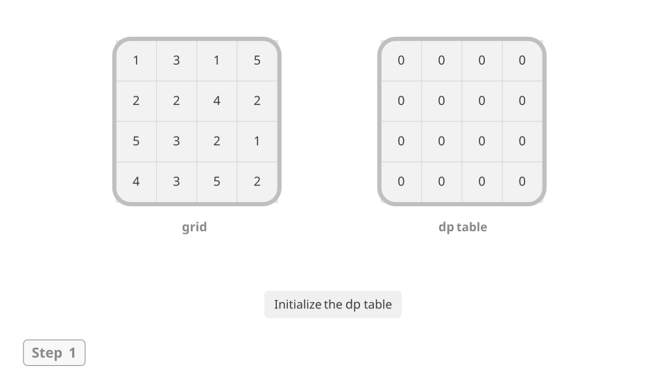{ class="animation-figure" }

=== "<2>"
    { class="animation-figure" }

=== "<3>"
    { class="animation-figure" }

=== "<4>"
    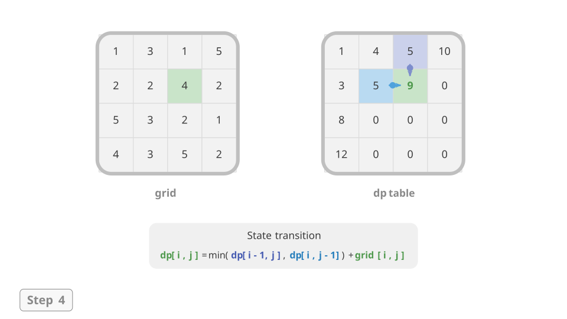{ class="animation-figure" }

=== "<5>"
    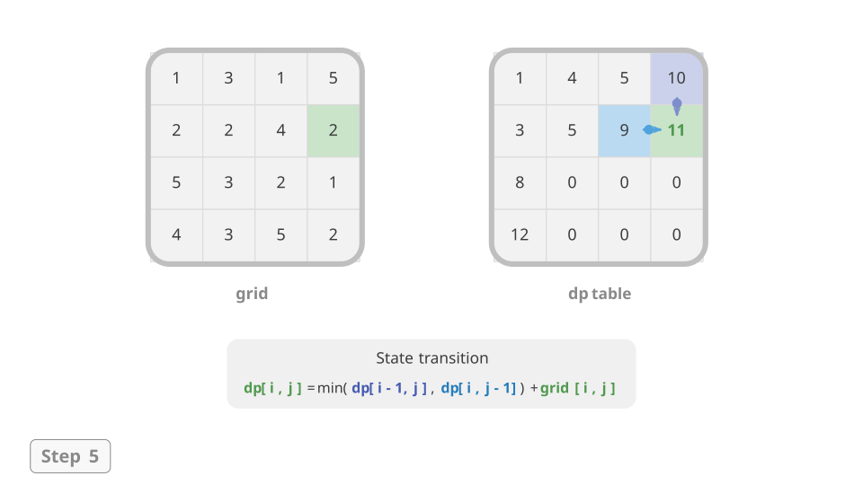{ class="animation-figure" }

=== "<6>"
    { class="animation-figure" }

=== "<7>"
    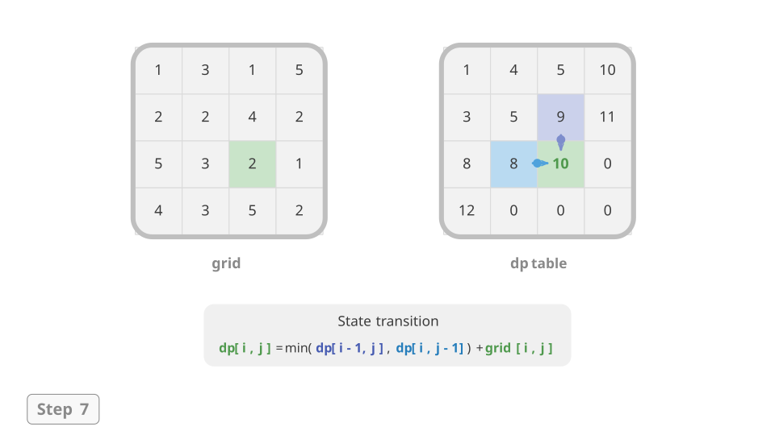{ class="animation-figure" }

=== "<8>"
    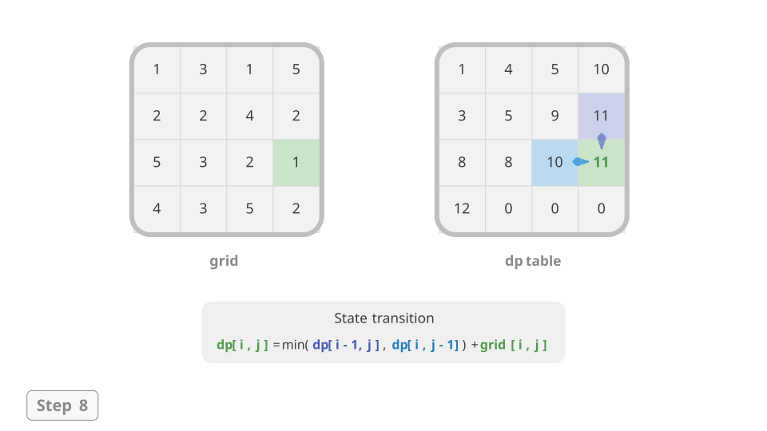{ class="animation-figure" }

=== "<9>"
    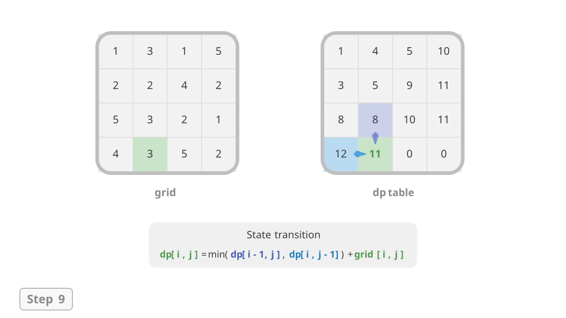{ class="animation-figure" }

=== "<10>"
    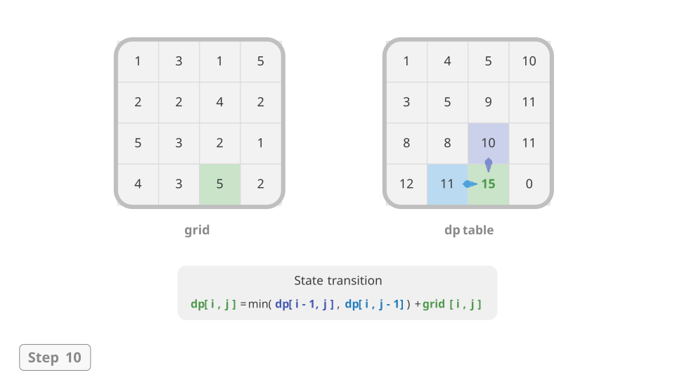{ class="animation-figure" }

=== "<11>"
    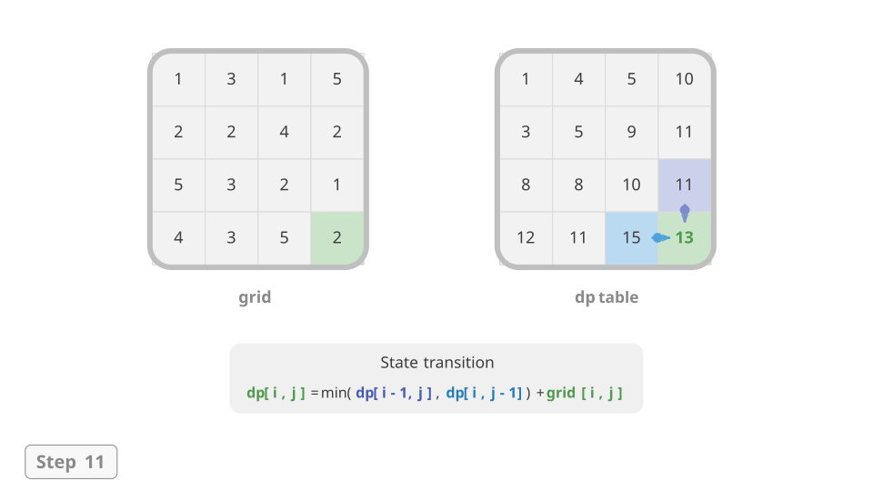{ class="animation-figure" }

=== "<12>"
    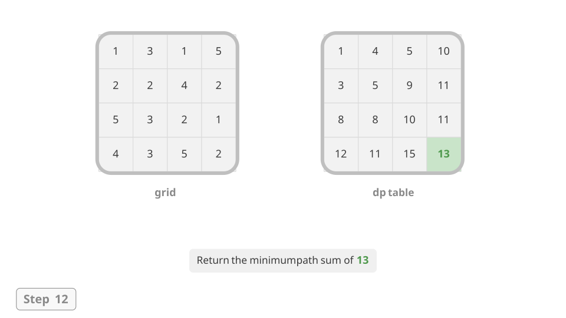{ class="animation-figure" }

<p align="center"> Figure 14-16 &nbsp; Finding the minimum path sum with dynamic programming </p>

### 4. &nbsp; Space optimization

Each cell depends only on the cells to its left and above it, so a single row of storage suffices for the $dp$ table.

Because the `dp` array holds only one row of states, we cannot initialize the entire first column in advance. Instead, we update its entry as we visit each row:

=== "Python"

    ```python title="min_path_sum.py"
    def min_path_sum_dp_comp(grid: list[list[int]]) -> int:
        """Minimum path sum with space-optimized dynamic programming"""
        n, m = len(grid), len(grid[0])
        # Initialize the dp table
        dp = [0] * m
        # State transitions for the first row
        dp[0] = grid[0][0]
        for j in range(1, m):
            dp[j] = dp[j - 1] + grid[0][j]
        # State transitions for the remaining rows
        for i in range(1, n):
            # State transitions for the first column
            dp[0] = dp[0] + grid[i][0]
            # State transitions for the remaining columns
            for j in range(1, m):
                dp[j] = min(dp[j - 1], dp[j]) + grid[i][j]
        return dp[m - 1]
    ```

=== "C++"

    ```cpp title="min_path_sum.cpp"
    /* Minimum path sum with space-optimized dynamic programming */
    int minPathSumDPComp(vector<vector<int>> &grid) {
        int n = grid.size(), m = grid[0].size();
        // Initialize the dp table
        vector<int> dp(m);
        // State transitions for the first row
        dp[0] = grid[0][0];
        for (int j = 1; j < m; j++) {
            dp[j] = dp[j - 1] + grid[0][j];
        }
        // State transitions for the remaining rows
        for (int i = 1; i < n; i++) {
            // State transitions for the first column
            dp[0] = dp[0] + grid[i][0];
            // State transitions for the remaining columns
            for (int j = 1; j < m; j++) {
                dp[j] = min(dp[j - 1], dp[j]) + grid[i][j];
            }
        }
        return dp[m - 1];
    }
    ```

=== "Java"

    ```java title="min_path_sum.java"
    /* Minimum path sum with space-optimized dynamic programming */
    int minPathSumDPComp(int[][] grid) {
        int n = grid.length, m = grid[0].length;
        // Initialize the dp table
        int[] dp = new int[m];
        // State transitions for the first row
        dp[0] = grid[0][0];
        for (int j = 1; j < m; j++) {
            dp[j] = dp[j - 1] + grid[0][j];
        }
        // State transitions for the remaining rows
        for (int i = 1; i < n; i++) {
            // State transitions for the first column
            dp[0] = dp[0] + grid[i][0];
            // State transitions for the remaining columns
            for (int j = 1; j < m; j++) {
                dp[j] = Math.min(dp[j - 1], dp[j]) + grid[i][j];
            }
        }
        return dp[m - 1];
    }
    ```

=== "C#"

    ```csharp title="min_path_sum.cs"
    /* Minimum path sum with space-optimized dynamic programming */
    int MinPathSumDPComp(int[][] grid) {
        int n = grid.Length, m = grid[0].Length;
        // Initialize the dp table
        int[] dp = new int[m];
        dp[0] = grid[0][0];
        // State transitions for the first row
        for (int j = 1; j < m; j++) {
            dp[j] = dp[j - 1] + grid[0][j];
        }
        // State transitions for the remaining rows
        for (int i = 1; i < n; i++) {
            // State transitions for the first column
            dp[0] = dp[0] + grid[i][0];
            // State transitions for the remaining columns
            for (int j = 1; j < m; j++) {
                dp[j] = Math.Min(dp[j - 1], dp[j]) + grid[i][j];
            }
        }
        return dp[m - 1];
    }
    ```

=== "Go"

    ```go title="min_path_sum.go"
    /* Minimum path sum with space-optimized dynamic programming */
    func minPathSumDPComp(grid [][]int) int {
        n, m := len(grid), len(grid[0])
        // Initialize the dp table
        dp := make([]int, m)
        // State transitions for the first row
        dp[0] = grid[0][0]
        for j := 1; j < m; j++ {
            dp[j] = dp[j-1] + grid[0][j]
        }
        // State transitions for the remaining rows and columns
        for i := 1; i < n; i++ {
            // State transitions for the first column
            dp[0] = dp[0] + grid[i][0]
            // State transitions for the remaining columns
            for j := 1; j < m; j++ {
                dp[j] = int(math.Min(float64(dp[j-1]), float64(dp[j]))) + grid[i][j]
            }
        }
        return dp[m-1]
    }
    ```

=== "Swift"

    ```swift title="min_path_sum.swift"
    /* Minimum path sum with space-optimized dynamic programming */
    func minPathSumDPComp(grid: [[Int]]) -> Int {
        let n = grid.count
        let m = grid[0].count
        // Initialize the dp table
        var dp = Array(repeating: 0, count: m)
        // State transitions for the first row
        dp[0] = grid[0][0]
        for j in 1 ..< m {
            dp[j] = dp[j - 1] + grid[0][j]
        }
        // State transitions for the remaining rows
        for i in 1 ..< n {
            // State transitions for the first column
            dp[0] = dp[0] + grid[i][0]
            // State transitions for the remaining columns
            for j in 1 ..< m {
                dp[j] = min(dp[j - 1], dp[j]) + grid[i][j]
            }
        }
        return dp[m - 1]
    }
    ```

=== "JS"

    ```javascript title="min_path_sum.js"
    /* Minimum path sum with space-optimized dynamic programming */
    function minPathSumDPComp(grid) {
        const n = grid.length,
            m = grid[0].length;
        // Initialize the dp table
        const dp = new Array(m);
        // State transitions for the first row
        dp[0] = grid[0][0];
        for (let j = 1; j < m; j++) {
            dp[j] = dp[j - 1] + grid[0][j];
        }
        // State transitions for the remaining rows
        for (let i = 1; i < n; i++) {
            // State transitions for the first column
            dp[0] = dp[0] + grid[i][0];
            // State transitions for the remaining columns
            for (let j = 1; j < m; j++) {
                dp[j] = Math.min(dp[j - 1], dp[j]) + grid[i][j];
            }
        }
        return dp[m - 1];
    }
    ```

=== "TS"

    ```typescript title="min_path_sum.ts"
    /* Minimum path sum with space-optimized dynamic programming */
    function minPathSumDPComp(grid: Array<Array<number>>): number {
        const n = grid.length,
            m = grid[0].length;
        // Initialize the dp table
        const dp = new Array(m);
        // State transitions for the first row
        dp[0] = grid[0][0];
        for (let j = 1; j < m; j++) {
            dp[j] = dp[j - 1] + grid[0][j];
        }
        // State transitions for the remaining rows
        for (let i = 1; i < n; i++) {
            // State transitions for the first column
            dp[0] = dp[0] + grid[i][0];
            // State transitions for the remaining columns
            for (let j = 1; j < m; j++) {
                dp[j] = Math.min(dp[j - 1], dp[j]) + grid[i][j];
            }
        }
        return dp[m - 1];
    }
    ```

=== "Dart"

    ```dart title="min_path_sum.dart"
    /* Minimum path sum with space-optimized dynamic programming */
    int minPathSumDPComp(List<List<int>> grid) {
      int n = grid.length, m = grid[0].length;
      // Initialize the dp table
      List<int> dp = List.filled(m, 0);
      dp[0] = grid[0][0];
      for (int j = 1; j < m; j++) {
        dp[j] = dp[j - 1] + grid[0][j];
      }
      // State transitions for the remaining rows
      for (int i = 1; i < n; i++) {
        // State transitions for the first column
        dp[0] = dp[0] + grid[i][0];
        // State transitions for the remaining columns
        for (int j = 1; j < m; j++) {
          dp[j] = min(dp[j - 1], dp[j]) + grid[i][j];
        }
      }
      return dp[m - 1];
    }
    ```

=== "Rust"

    ```rust title="min_path_sum.rs"
    /* Minimum path sum with space-optimized dynamic programming */
    fn min_path_sum_dp_comp(grid: &Vec<Vec<i32>>) -> i32 {
        let (n, m) = (grid.len(), grid[0].len());
        // Initialize the dp table
        let mut dp = vec![0; m];
        // State transitions for the first row
        dp[0] = grid[0][0];
        for j in 1..m {
            dp[j] = dp[j - 1] + grid[0][j];
        }
        // State transitions for the remaining rows
        for i in 1..n {
            // State transitions for the first column
            dp[0] = dp[0] + grid[i][0];
            // State transitions for the remaining columns
            for j in 1..m {
                dp[j] = std::cmp::min(dp[j - 1], dp[j]) + grid[i][j];
            }
        }
        dp[m - 1]
    }
    ```

=== "C"

    ```c title="min_path_sum.c"
    /* Minimum path sum with space-optimized dynamic programming */
    int minPathSumDPComp(int grid[MAX_SIZE][MAX_SIZE], int n, int m) {
        // Initialize the dp table
        int *dp = calloc(m, sizeof(int));
        // State transitions for the first row
        dp[0] = grid[0][0];
        for (int j = 1; j < m; j++) {
            dp[j] = dp[j - 1] + grid[0][j];
        }
        // State transitions for the remaining rows
        for (int i = 1; i < n; i++) {
            // State transitions for the first column
            dp[0] = dp[0] + grid[i][0];
            // State transitions for the remaining columns
            for (int j = 1; j < m; j++) {
                dp[j] = myMin(dp[j - 1], dp[j]) + grid[i][j];
            }
        }
        int res = dp[m - 1];
        // Free the memory
        free(dp);
        return res;
    }
    ```

=== "Kotlin"

    ```kotlin title="min_path_sum.kt"
    /* Minimum path sum with space-optimized dynamic programming */
    fun minPathSumDPComp(grid: Array<IntArray>): Int {
        val n = grid.size
        val m = grid[0].size
        // Initialize the dp table
        val dp = IntArray(m)
        // State transitions for the first row
        dp[0] = grid[0][0]
        for (j in 1..<m) {
            dp[j] = dp[j - 1] + grid[0][j]
        }
        // State transitions for the remaining rows
        for (i in 1..<n) {
            // State transitions for the first column
            dp[0] = dp[0] + grid[i][0]
            // State transitions for the remaining columns
            for (j in 1..<m) {
                dp[j] = min(dp[j - 1], dp[j]) + grid[i][j]
            }
        }
        return dp[m - 1]
    }
    ```

=== "Ruby"

    ```ruby title="min_path_sum.rb"
    ### Minimum path sum with space-optimized dynamic programming ###
    def min_path_sum_dp_comp(grid)
      n, m = grid.length, grid.first.length
      # Initialize the dp table
      dp = Array.new(m, 0)
      # State transitions for the first row
      dp[0] = grid[0][0]
      (1...m).each { |j| dp[j] = dp[j - 1] + grid[0][j] }
      # State transitions for the remaining rows
      for i in 1...n
        # State transitions for the first column
        dp[0] = dp[0] + grid[i][0]
        # State transitions for the remaining columns
        (1...m).each { |j| dp[j] = [dp[j - 1], dp[j]].min + grid[i][j] }
      end
      dp[m - 1]
    end
    ```

??? pythontutor "Visualize execution"

    <div style="height: 549px; width: 100%;"><iframe class="pythontutor-iframe" title="Visualize execution" src="https://pythontutor.com/iframe-embed.html#code=from%20math%20import%20inf%0A%0Adef%20min_path_sum_dp_comp%28grid%3A%20list%5Blist%5Bint%5D%5D%29%20-%3E%20int%3A%0A%20%20%20%20%22%22%22Minimum%20path%20sum%20with%20space-optimized%20dynamic%20programming%22%22%22%0A%20%20%20%20n,%20m%20%3D%20len%28grid%29,%20len%28grid%5B0%5D%29%0A%20%20%20%20%23%20Initialize%20the%20dp%20table%0A%20%20%20%20dp%20%3D%20%5B0%5D%20%2A%20m%0A%20%20%20%20%23%20State%20transitions%20for%20the%20first%20row%0A%20%20%20%20dp%5B0%5D%20%3D%20grid%5B0%5D%5B0%5D%0A%20%20%20%20for%20j%20in%20range%281,%20m%29%3A%0A%20%20%20%20%20%20%20%20dp%5Bj%5D%20%3D%20dp%5Bj%20-%201%5D%20%2B%20grid%5B0%5D%5Bj%5D%0A%20%20%20%20%23%20State%20transitions%20for%20the%20remaining%20rows%0A%20%20%20%20for%20i%20in%20range%281,%20n%29%3A%0A%20%20%20%20%20%20%20%20%23%20State%20transitions%20for%20the%20first%20column%0A%20%20%20%20%20%20%20%20dp%5B0%5D%20%3D%20dp%5B0%5D%20%2B%20grid%5Bi%5D%5B0%5D%0A%20%20%20%20%20%20%20%20%23%20State%20transitions%20for%20the%20remaining%20columns%0A%20%20%20%20%20%20%20%20for%20j%20in%20range%281,%20m%29%3A%0A%20%20%20%20%20%20%20%20%20%20%20%20dp%5Bj%5D%20%3D%20min%28dp%5Bj%20-%201%5D,%20dp%5Bj%5D%29%20%2B%20grid%5Bi%5D%5Bj%5D%0A%20%20%20%20return%20dp%5Bm%20-%201%5D%0A%0A%0A%22%22%22Driver%20Code%22%22%22%0Aif%20__name__%20%3D%3D%20%22__main__%22%3A%0A%20%20%20%20grid%20%3D%20%5B%5B1,%203,%201,%205%5D,%20%5B2,%202,%204,%202%5D,%20%5B5,%203,%202,%201%5D,%20%5B4,%203,%205,%202%5D%5D%0A%20%20%20%20n,%20m%20%3D%20len%28grid%29,%20len%28grid%5B0%5D%29%0A%0A%20%20%20%20%23%20Space-optimized%20dynamic%20programming%0A%20%20%20%20res%20%3D%20min_path_sum_dp_comp%28grid%29%0A%20%20%20%20print%28f%22Minimum%20path%20sum%20from%20the%20top%20left%20to%20the%20bottom%20right%3A%20%7Bres%7D%22%29&codeDivHeight=472&codeDivWidth=350&cumulative=false&curInstr=6&heapPrimitives=nevernest&origin=opt-frontend.js&py=311&rawInputLstJSON=%5B%5D&textReferences=false"> </iframe></div>
    <div style="margin-top: 5px;"><a href="https://pythontutor.com/iframe-embed.html#code=from%20math%20import%20inf%0A%0Adef%20min_path_sum_dp_comp%28grid%3A%20list%5Blist%5Bint%5D%5D%29%20-%3E%20int%3A%0A%20%20%20%20%22%22%22Minimum%20path%20sum%20with%20space-optimized%20dynamic%20programming%22%22%22%0A%20%20%20%20n,%20m%20%3D%20len%28grid%29,%20len%28grid%5B0%5D%29%0A%20%20%20%20%23%20Initialize%20the%20dp%20table%0A%20%20%20%20dp%20%3D%20%5B0%5D%20%2A%20m%0A%20%20%20%20%23%20State%20transitions%20for%20the%20first%20row%0A%20%20%20%20dp%5B0%5D%20%3D%20grid%5B0%5D%5B0%5D%0A%20%20%20%20for%20j%20in%20range%281,%20m%29%3A%0A%20%20%20%20%20%20%20%20dp%5Bj%5D%20%3D%20dp%5Bj%20-%201%5D%20%2B%20grid%5B0%5D%5Bj%5D%0A%20%20%20%20%23%20State%20transitions%20for%20the%20remaining%20rows%0A%20%20%20%20for%20i%20in%20range%281,%20n%29%3A%0A%20%20%20%20%20%20%20%20%23%20State%20transitions%20for%20the%20first%20column%0A%20%20%20%20%20%20%20%20dp%5B0%5D%20%3D%20dp%5B0%5D%20%2B%20grid%5Bi%5D%5B0%5D%0A%20%20%20%20%20%20%20%20%23%20State%20transitions%20for%20the%20remaining%20columns%0A%20%20%20%20%20%20%20%20for%20j%20in%20range%281,%20m%29%3A%0A%20%20%20%20%20%20%20%20%20%20%20%20dp%5Bj%5D%20%3D%20min%28dp%5Bj%20-%201%5D,%20dp%5Bj%5D%29%20%2B%20grid%5Bi%5D%5Bj%5D%0A%20%20%20%20return%20dp%5Bm%20-%201%5D%0A%0A%0A%22%22%22Driver%20Code%22%22%22%0Aif%20__name__%20%3D%3D%20%22__main__%22%3A%0A%20%20%20%20grid%20%3D%20%5B%5B1,%203,%201,%205%5D,%20%5B2,%202,%204,%202%5D,%20%5B5,%203,%202,%201%5D,%20%5B4,%203,%205,%202%5D%5D%0A%20%20%20%20n,%20m%20%3D%20len%28grid%29,%20len%28grid%5B0%5D%29%0A%0A%20%20%20%20%23%20Space-optimized%20dynamic%20programming%0A%20%20%20%20res%20%3D%20min_path_sum_dp_comp%28grid%29%0A%20%20%20%20print%28f%22Minimum%20path%20sum%20from%20the%20top%20left%20to%20the%20bottom%20right%3A%20%7Bres%7D%22%29&codeDivHeight=800&codeDivWidth=600&cumulative=false&curInstr=6&heapPrimitives=nevernest&origin=opt-frontend.js&py=311&rawInputLstJSON=%5B%5D&textReferences=false" target="_blank" rel="noopener noreferrer">View full screen ></a></div>
