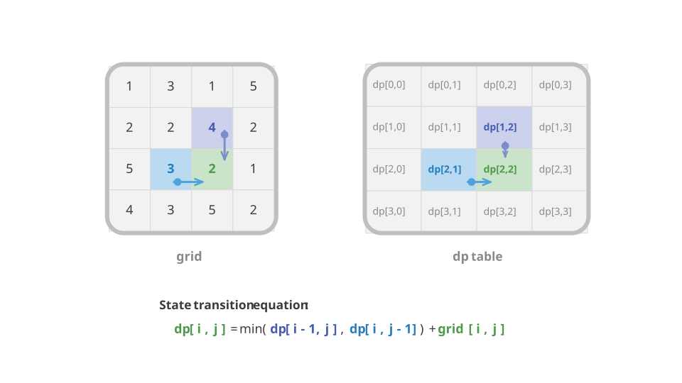
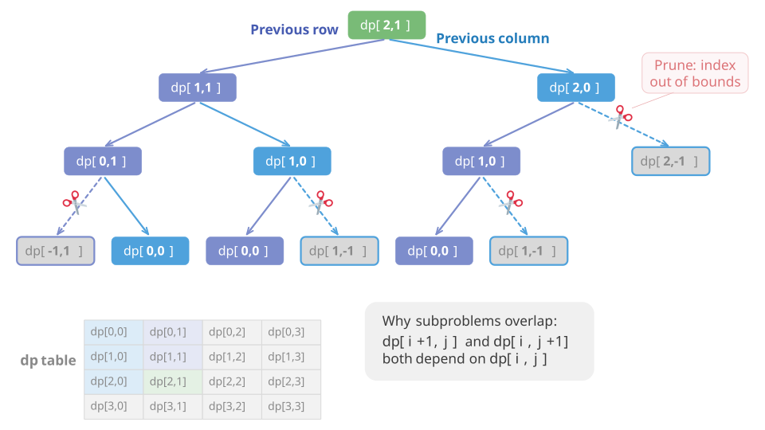
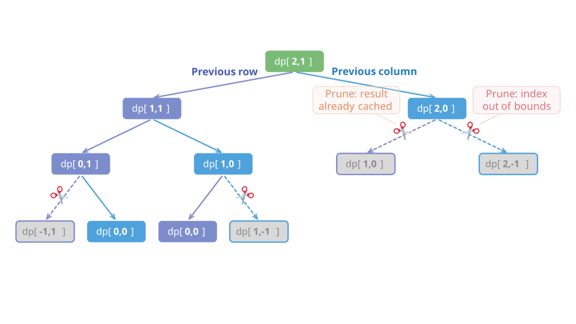
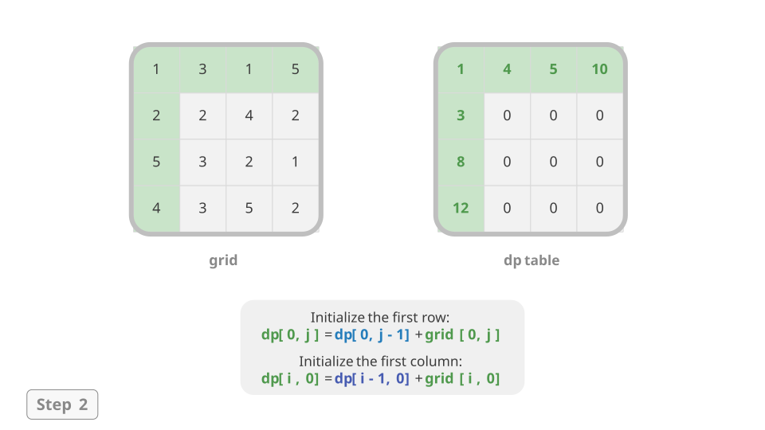
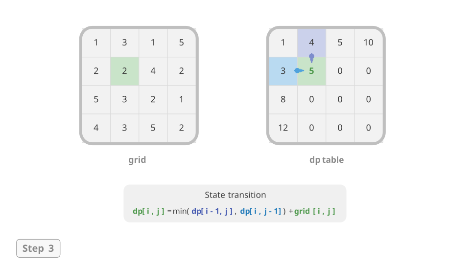
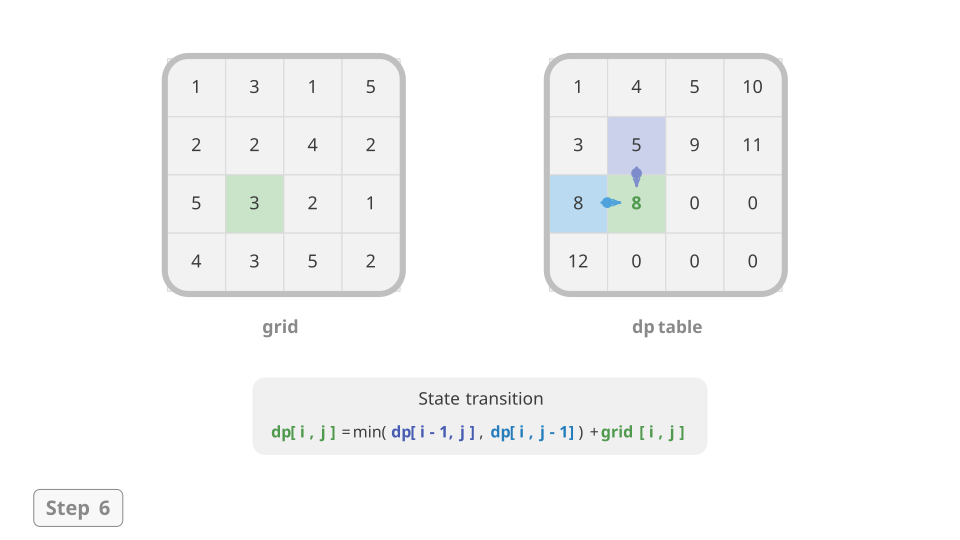

# Solving problems with dynamic programming

The previous two sections introduced the main properties of dynamic programming problems. Let's now consider two practical questions.

1. How can we recognize a dynamic programming problem?
2. Where should we start, and what steps should we follow to solve it?

## Recognizing a dynamic programming problem

Problems with overlapping subproblems, optimal substructure, and the no-aftereffect property are usually good candidates for dynamic programming. These properties can be hard to spot in the problem statement. We often start with a simpler test: **could backtracking (exhaustive search) solve the problem?**

**Problems suited to backtracking usually fit a decision tree model**. Each node in the tree represents a decision, and each path represents a sequence of decisions.

In other words, when there are clearly defined choices and a solution results from a sequence of choices, the problem fits a decision tree and can usually be solved by backtracking.

Several additional clues favor dynamic programming.

- The problem asks for an optimum, such as the largest or smallest value or the greatest or least number of items.
- A list, multidimensional array, or tree can represent the states, and a recurrence relates a state to neighboring states.

Other clues make dynamic programming less likely to be suitable.

- The goal is to find every possible solution rather than an optimum.
- The problem clearly involves permutations or combinations and asks you to return multiple specific arrangements.

If a problem fits a decision tree and shows clear signs favoring dynamic programming, we can try that approach and test our assumption as we work.

## Steps for solving the problem

The details depend on the nature and difficulty of the problem. Typically, we describe the decisions, define the states, set up a $dp$ table, derive a recurrence, and establish the boundary conditions.

Let's work through a classic example, the minimum path sum.

!!! question

    An $n \times m$ grid `grid` contains a nonnegative integer in each cell representing its cost. A robot starts at the top left and moves one cell down or right at each step until it reaches the bottom right. Return the minimum path sum from the top left to the bottom right.

In the example below, the minimum path sum is $13$.


**Step 1: Identify the decision at each step and define the state and $dp$ table**

At each step we decide whether to move down or right from the current cell. If its row and column indices are $[i, j]$, the next cell is $[i+1, j]$ or $[i, j+1]$. The state therefore needs two variables, the row and column, written $[i, j]$.

The subproblem for state $[i, j]$ asks for the minimum path sum from the starting cell $[0, 0]$ to $[i, j]$. Denote its solution by $dp[i, j]$.

This gives us the two-dimensional $dp$ matrix below, with the same dimensions as the input grid $grid$.


!!! note

    Both dynamic programming and backtracking can be described as sequences of decisions. A state consists of the decision variables. It should include every variable needed to describe our progress and enough information to determine the next state.
    
    Each state corresponds to a subproblem. We use a $dp$ table to store their solutions, with one dimension of the $dp$ table for each independent state variable. In essence, the $dp$ table maps each state to the solution of its subproblem.

**Step 2: Identify optimal substructure and derive the recurrence**

State $[i, j]$ can be reached only from the cell above, $[i-1, j]$, or the cell to the left, $[i, j-1]$. This gives the optimal substructure: the minimum path sum to $[i, j]$ depends on the smaller of the minimum path sums to $[i, j-1]$ and $[i-1, j]$.

This gives the recurrence shown below:

$$
dp[i, j] = \min(dp[i-1, j], dp[i, j-1]) + grid[i, j]
$$



!!! note

    Using the $dp$ table definition, examine how the original problem relates to its subproblems. Look for a way to construct an optimal solution from optimal subproblem solutions. That is the optimal substructure.

    Once we identify the optimal substructure, we can use it to write the recurrence.

**Step 3: Determine the boundary conditions and the order of computation**

A state in the first row can only be reached from its left, and a state in the first column only from above. The first row $i = 0$ and first column $j = 0$ therefore give the boundary conditions.

As shown below, each cell depends on the cells to its left and above it. We traverse the matrix with nested loops: the outer loop visits the rows and the inner loop the columns.


!!! note

    Boundary conditions initialize the $dp$ table in dynamic programming and prune branches in search.
    
    Choose an order that ensures every smaller subproblem a state depends on has already been solved correctly when we calculate that state.

We now have enough information to write the dynamic programming code directly. Since breaking a problem down is a top-down process, however, it is often more natural to implement the approaches in this order: brute-force search $\rightarrow$ memoized search $\rightarrow$ dynamic programming.

### Method 1: Brute-force search

Start the search at state $[i, j]$ and recursively break it down into smaller states $[i-1, j]$ and $[i, j-1]$. The recursive function has the following parts.

- **Recursive parameters**: the state $[i, j]$.
- **Return value**: the minimum path sum $dp[i, j]$ from $[0, 0]$ to $[i, j]$.
- **Base case**: when $i = 0$ and $j = 0$, return the cost $grid[0, 0]$.
- **Pruning**: if $i < 0$ or $j < 0$, an index is out of bounds. Return cost $+\infty$ to indicate an infeasible path.

Here is the implementation:

```src
[file]{min_path_sum}-[class]{}-[func]{min_path_sum_dfs}
```

The recursion tree rooted at $dp[2, 1]$ below contains overlapping subproblems. Their number grows rapidly with the size of the grid `grid`.

Subproblems overlap because **multiple paths can lead from the top left to the same cell**.



Each state offers two moves, down and right. Reaching the bottom right from the top left takes $m + n - 2$ moves, so the worst-case time complexity is $O(2^{m + n})$, where $n$ and $m$ are the numbers of rows and columns. This estimate ignores the restriction at the grid boundary, where just one move remains, so the actual number of paths is smaller.

### Method 2: Memoized search

Create a cache `mem` the same size as the grid `grid`. Store each subproblem's solution in it so we can prune repeated searches:

```src
[file]{min_path_sum}-[class]{}-[func]{min_path_sum_dfs_mem}
```

As shown below, memoization lets us solve each subproblem just once. The time complexity therefore depends on the total number of states, giving $O(nm)$ for this grid.



### Method 3: Dynamic programming

Here is the iterative dynamic programming solution:

```src
[file]{min_path_sum}-[class]{}-[func]{min_path_sum_dp}
```

The figure shows the state transitions for minimum path sum. We visit the entire grid, **so the time complexity is $O(nm)$**.

The array `dp` has dimensions $n \times m$, **so the space complexity is $O(nm)$**.

=== "<1>"
    

=== "<2>"
    

=== "<3>"
    

=== "<4>"
    

=== "<5>"
    

=== "<6>"
    

=== "<7>"
    

=== "<8>"
    

=== "<9>"
    

=== "<10>"
    

=== "<11>"
    

=== "<12>"
    

### Space optimization

Each cell depends only on the cells to its left and above it, so a single row of storage suffices for the $dp$ table.

Because the `dp` array holds only one row of states, we cannot initialize the entire first column in advance. Instead, we update its entry as we visit each row:

```src
[file]{min_path_sum}-[class]{}-[func]{min_path_sum_dp_comp}
```
