# 14.6 &nbsp; The edit distance problem

Edit distance, also called Levenshtein distance, is the fewest edits needed to transform one string into another. It is commonly used in information retrieval and natural language processing to measure the similarity of two sequences.

!!! question

    Given two strings $s$ and $t$, return the minimum number of edits needed to transform $s$ into $t$.
    
    You may insert one character, delete one character, or replace one character with any character.

As shown below, changing `kitten` to `sitting` takes 3 edits: 2 replacements and 1 insertion. Changing `hello` to `algo` also takes 3 edits: 2 replacements and 1 deletion.

{ class="animation-figure" }

<p align="center"> Figure 14-27 &nbsp; Edit distance examples </p>

**A decision tree provides a natural model for edit distance**. Each node is a string, and each edge represents a decision to make one edit.

As the figure shows, without restrictions each node can have many outgoing edges, one for each possible edit. There are therefore many paths from `hello` to `algo`.

In the decision tree, our goal is the shortest path from node `hello` to node `algo`.

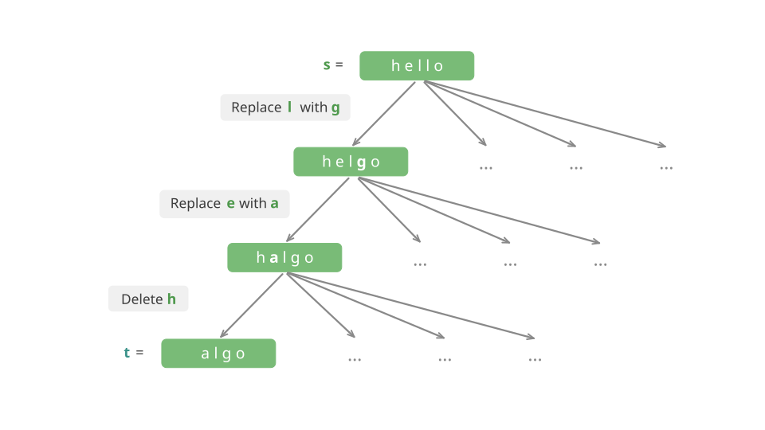{ class="animation-figure" }

<p align="center"> Figure 14-28 &nbsp; Modeling edit distance with a decision tree </p>

### 1. &nbsp; A dynamic programming approach

**Step 1: Identify the decision at each step and define the state and $dp$ table**

At each step, we choose an edit to apply to string $s$.

To form subproblems, we want each editing decision to reduce the size of the remaining problem. Let $s$ and $t$ have lengths $n$ and $m$, respectively. Consider their final characters $s[n-1]$ and $t[m-1]$.

- If $s[n-1]$ and $t[m-1]$ match, skip both and move on to $s[n-2]$ and $t[m-2]$.
- If $s[n-1]$ and $t[m-1]$ differ, we need to edit $s$ (insert, delete, or replace a character) to resolve the mismatch at the end. We can then skip the resolved characters and work on a smaller problem.

Each editing decision on $s$ changes which characters in $s$ and $t$ remain to be matched. The state therefore identifies the characters currently under consideration in $s$ and $t$ by their positions $i$ and $j$. Write the state as $[i, j]$.

The subproblem for state $[i, j]$ is **the minimum number of edits to change the first $i$ characters of $s$ into the first $j$ characters of $t$**.

This gives us a two-dimensional $dp$ table of size $(n+1) \times (m+1)$.

**Step 2: Identify optimal substructure and derive the recurrence**

For subproblem $dp[i, j]$, the two prefixes end in $s[i-1]$ and $t[j-1]$. The three possible edits give the cases shown below.

1. Insert $t[j-1]$ after $s[i-1]$. The remaining subproblem is $dp[i, j-1]$.
2. Delete $s[i-1]$. The remaining subproblem is $dp[i-1, j]$.
3. Replace $s[i-1]$ with $t[j-1]$. The remaining subproblem is $dp[i-1, j-1]$.

{ class="animation-figure" }

<p align="center"> Figure 14-29 &nbsp; State transitions for edit distance </p>

The optimal substructure now follows: the minimum edit count $dp[i, j]$ is the smallest of $dp[i, j-1]$, $dp[i-1, j]$, and $dp[i-1, j-1]$, plus $1$ for the current edit. The recurrence is:

$$
dp[i, j] = \min(dp[i, j-1], dp[i-1, j], dp[i-1, j-1]) + 1
$$

**When $s[i-1]$ and $t[j-1]$ match, the current character needs no edit**. In that case the recurrence is:

$$
dp[i, j] = dp[i-1, j-1]
$$

**Step 3: Determine the boundary conditions and the order of computation**

When both strings are empty, the edit count is $0$, so $dp[0, 0] = 0$. When $s$ is empty and $t$ is not, the minimum edit count is the length of $t$, giving the first row $dp[0, j] = j$. When $s$ is nonempty and $t$ is empty, the minimum count is the length of $s$, giving the first column $dp[i, 0] = i$.

The recurrence for $dp[i, j]$ depends on the cells to the left, above, and diagonally above to the left. Two forward loops can therefore fill the entire $dp$ table.

### 2. &nbsp; Implementation

=== "Python"

    ```python title="edit_distance.py"
    def edit_distance_dp(s: str, t: str) -> int:
        """Edit distance with dynamic programming"""
        n, m = len(s), len(t)
        dp = [[0] * (m + 1) for _ in range(n + 1)]
        # State transitions for the first row and column
        for i in range(1, n + 1):
            dp[i][0] = i
        for j in range(1, m + 1):
            dp[0][j] = j
        # State transitions for the remaining rows and columns
        for i in range(1, n + 1):
            for j in range(1, m + 1):
                if s[i - 1] == t[j - 1]:
                    # Skip both characters if they match
                    dp[i][j] = dp[i - 1][j - 1]
                else:
                    # Minimum edits = 1 + the smallest remaining edit count after an insertion, deletion, or replacement
                    dp[i][j] = min(dp[i][j - 1], dp[i - 1][j], dp[i - 1][j - 1]) + 1
        return dp[n][m]
    ```

=== "C++"

    ```cpp title="edit_distance.cpp"
    /* Edit distance with dynamic programming */
    int editDistanceDP(string s, string t) {
        int n = s.length(), m = t.length();
        vector<vector<int>> dp(n + 1, vector<int>(m + 1, 0));
        // State transitions for the first row and column
        for (int i = 1; i <= n; i++) {
            dp[i][0] = i;
        }
        for (int j = 1; j <= m; j++) {
            dp[0][j] = j;
        }
        // State transitions for the remaining rows and columns
        for (int i = 1; i <= n; i++) {
            for (int j = 1; j <= m; j++) {
                if (s[i - 1] == t[j - 1]) {
                    // Skip both characters if they match
                    dp[i][j] = dp[i - 1][j - 1];
                } else {
                    // Minimum edits = 1 + the smallest remaining edit count after an insertion, deletion, or replacement
                    dp[i][j] = min(min(dp[i][j - 1], dp[i - 1][j]), dp[i - 1][j - 1]) + 1;
                }
            }
        }
        return dp[n][m];
    }
    ```

=== "Java"

    ```java title="edit_distance.java"
    /* Edit distance with dynamic programming */
    int editDistanceDP(String s, String t) {
        int n = s.length(), m = t.length();
        int[][] dp = new int[n + 1][m + 1];
        // State transitions for the first row and column
        for (int i = 1; i <= n; i++) {
            dp[i][0] = i;
        }
        for (int j = 1; j <= m; j++) {
            dp[0][j] = j;
        }
        // State transitions for the remaining rows and columns
        for (int i = 1; i <= n; i++) {
            for (int j = 1; j <= m; j++) {
                if (s.charAt(i - 1) == t.charAt(j - 1)) {
                    // Skip both characters if they match
                    dp[i][j] = dp[i - 1][j - 1];
                } else {
                    // Minimum edits = 1 + the smallest remaining edit count after an insertion, deletion, or replacement
                    dp[i][j] = Math.min(Math.min(dp[i][j - 1], dp[i - 1][j]), dp[i - 1][j - 1]) + 1;
                }
            }
        }
        return dp[n][m];
    }
    ```

=== "C#"

    ```csharp title="edit_distance.cs"
    /* Edit distance with dynamic programming */
    int EditDistanceDP(string s, string t) {
        int n = s.Length, m = t.Length;
        int[,] dp = new int[n + 1, m + 1];
        // State transitions for the first row and column
        for (int i = 1; i <= n; i++) {
            dp[i, 0] = i;
        }
        for (int j = 1; j <= m; j++) {
            dp[0, j] = j;
        }
        // State transitions for the remaining rows and columns
        for (int i = 1; i <= n; i++) {
            for (int j = 1; j <= m; j++) {
                if (s[i - 1] == t[j - 1]) {
                    // Skip both characters if they match
                    dp[i, j] = dp[i - 1, j - 1];
                } else {
                    // Minimum edits = 1 + the smallest remaining edit count after an insertion, deletion, or replacement
                    dp[i, j] = Math.Min(Math.Min(dp[i, j - 1], dp[i - 1, j]), dp[i - 1, j - 1]) + 1;
                }
            }
        }
        return dp[n, m];
    }
    ```

=== "Go"

    ```go title="edit_distance.go"
    /* Edit distance with dynamic programming */
    func editDistanceDP(s string, t string) int {
        n := len(s)
        m := len(t)
        dp := make([][]int, n+1)
        for i := 0; i <= n; i++ {
            dp[i] = make([]int, m+1)
        }
        // State transitions for the first row and column
        for i := 1; i <= n; i++ {
            dp[i][0] = i
        }
        for j := 1; j <= m; j++ {
            dp[0][j] = j
        }
        // State transitions for the remaining rows and columns
        for i := 1; i <= n; i++ {
            for j := 1; j <= m; j++ {
                if s[i-1] == t[j-1] {
                    // Skip both characters if they match
                    dp[i][j] = dp[i-1][j-1]
                } else {
                    // Minimum edits = 1 + the smallest remaining edit count after an insertion, deletion, or replacement
                    dp[i][j] = MinInt(MinInt(dp[i][j-1], dp[i-1][j]), dp[i-1][j-1]) + 1
                }
            }
        }
        return dp[n][m]
    }
    ```

=== "Swift"

    ```swift title="edit_distance.swift"
    /* Edit distance with dynamic programming */
    func editDistanceDP(s: String, t: String) -> Int {
        let n = s.utf8CString.count
        let m = t.utf8CString.count
        var dp = Array(repeating: Array(repeating: 0, count: m + 1), count: n + 1)
        // State transitions for the first row and column
        for i in 1 ... n {
            dp[i][0] = i
        }
        for j in 1 ... m {
            dp[0][j] = j
        }
        // State transitions for the remaining rows and columns
        for i in 1 ... n {
            for j in 1 ... m {
                if s.utf8CString[i - 1] == t.utf8CString[j - 1] {
                    // Skip both characters if they match
                    dp[i][j] = dp[i - 1][j - 1]
                } else {
                    // Minimum edits = 1 + the smallest remaining edit count after an insertion, deletion, or replacement
                    dp[i][j] = min(min(dp[i][j - 1], dp[i - 1][j]), dp[i - 1][j - 1]) + 1
                }
            }
        }
        return dp[n][m]
    }
    ```

=== "JS"

    ```javascript title="edit_distance.js"
    /* Edit distance with dynamic programming */
    function editDistanceDP(s, t) {
        const n = s.length,
            m = t.length;
        const dp = Array.from({ length: n + 1 }, () => new Array(m + 1).fill(0));
        // State transitions for the first row and column
        for (let i = 1; i <= n; i++) {
            dp[i][0] = i;
        }
        for (let j = 1; j <= m; j++) {
            dp[0][j] = j;
        }
        // State transitions for the remaining rows and columns
        for (let i = 1; i <= n; i++) {
            for (let j = 1; j <= m; j++) {
                if (s.charAt(i - 1) === t.charAt(j - 1)) {
                    // Skip both characters if they match
                    dp[i][j] = dp[i - 1][j - 1];
                } else {
                    // Minimum edits = 1 + the smallest remaining edit count after an insertion, deletion, or replacement
                    dp[i][j] =
                        Math.min(dp[i][j - 1], dp[i - 1][j], dp[i - 1][j - 1]) + 1;
                }
            }
        }
        return dp[n][m];
    }
    ```

=== "TS"

    ```typescript title="edit_distance.ts"
    /* Edit distance with dynamic programming */
    function editDistanceDP(s: string, t: string): number {
        const n = s.length,
            m = t.length;
        const dp = Array.from({ length: n + 1 }, () =>
            Array.from({ length: m + 1 }, () => 0)
        );
        // State transitions for the first row and column
        for (let i = 1; i <= n; i++) {
            dp[i][0] = i;
        }
        for (let j = 1; j <= m; j++) {
            dp[0][j] = j;
        }
        // State transitions for the remaining rows and columns
        for (let i = 1; i <= n; i++) {
            for (let j = 1; j <= m; j++) {
                if (s.charAt(i - 1) === t.charAt(j - 1)) {
                    // Skip both characters if they match
                    dp[i][j] = dp[i - 1][j - 1];
                } else {
                    // Minimum edits = 1 + the smallest remaining edit count after an insertion, deletion, or replacement
                    dp[i][j] =
                        Math.min(dp[i][j - 1], dp[i - 1][j], dp[i - 1][j - 1]) + 1;
                }
            }
        }
        return dp[n][m];
    }
    ```

=== "Dart"

    ```dart title="edit_distance.dart"
    /* Edit distance with dynamic programming */
    int editDistanceDP(String s, String t) {
      int n = s.length, m = t.length;
      List<List<int>> dp = List.generate(n + 1, (_) => List.filled(m + 1, 0));
      // State transitions for the first row and column
      for (int i = 1; i <= n; i++) {
        dp[i][0] = i;
      }
      for (int j = 1; j <= m; j++) {
        dp[0][j] = j;
      }
      // State transitions for the remaining rows and columns
      for (int i = 1; i <= n; i++) {
        for (int j = 1; j <= m; j++) {
          if (s[i - 1] == t[j - 1]) {
            // Skip both characters if they match
            dp[i][j] = dp[i - 1][j - 1];
          } else {
            // Minimum edits = 1 + the smallest remaining edit count after an insertion, deletion, or replacement
            dp[i][j] = min(min(dp[i][j - 1], dp[i - 1][j]), dp[i - 1][j - 1]) + 1;
          }
        }
      }
      return dp[n][m];
    }
    ```

=== "Rust"

    ```rust title="edit_distance.rs"
    /* Edit distance with dynamic programming */
    fn edit_distance_dp(s: &str, t: &str) -> i32 {
        let (n, m) = (s.len(), t.len());
        let mut dp = vec![vec![0; m + 1]; n + 1];
        // State transitions for the first row and column
        for i in 1..=n {
            dp[i][0] = i as i32;
        }
        for j in 1..m {
            dp[0][j] = j as i32;
        }
        // State transitions for the remaining rows and columns
        for i in 1..=n {
            for j in 1..=m {
                if s.chars().nth(i - 1) == t.chars().nth(j - 1) {
                    // Skip both characters if they match
                    dp[i][j] = dp[i - 1][j - 1];
                } else {
                    // Minimum edits = 1 + the smallest remaining edit count after an insertion, deletion, or replacement
                    dp[i][j] =
                        std::cmp::min(std::cmp::min(dp[i][j - 1], dp[i - 1][j]), dp[i - 1][j - 1]) + 1;
                }
            }
        }
        dp[n][m]
    }
    ```

=== "C"

    ```c title="edit_distance.c"
    /* Edit distance with dynamic programming */
    int editDistanceDP(char *s, char *t, int n, int m) {
        int **dp = malloc((n + 1) * sizeof(int *));
        for (int i = 0; i <= n; i++) {
            dp[i] = calloc(m + 1, sizeof(int));
        }
        // State transitions for the first row and column
        for (int i = 1; i <= n; i++) {
            dp[i][0] = i;
        }
        for (int j = 1; j <= m; j++) {
            dp[0][j] = j;
        }
        // State transitions for the remaining rows and columns
        for (int i = 1; i <= n; i++) {
            for (int j = 1; j <= m; j++) {
                if (s[i - 1] == t[j - 1]) {
                    // Skip both characters if they match
                    dp[i][j] = dp[i - 1][j - 1];
                } else {
                    // Minimum edits = 1 + the smallest remaining edit count after an insertion, deletion, or replacement
                    dp[i][j] = myMin(myMin(dp[i][j - 1], dp[i - 1][j]), dp[i - 1][j - 1]) + 1;
                }
            }
        }
        int res = dp[n][m];
        // Free the memory
        for (int i = 0; i <= n; i++) {
            free(dp[i]);
        }
        return res;
    }
    ```

=== "Kotlin"

    ```kotlin title="edit_distance.kt"
    /* Edit distance with dynamic programming */
    fun editDistanceDP(s: String, t: String): Int {
        val n = s.length
        val m = t.length
        val dp = Array(n + 1) { IntArray(m + 1) }
        // State transitions for the first row and column
        for (i in 1..n) {
            dp[i][0] = i
        }
        for (j in 1..m) {
            dp[0][j] = j
        }
        // State transitions for the remaining rows and columns
        for (i in 1..n) {
            for (j in 1..m) {
                if (s[i - 1] == t[j - 1]) {
                    // Skip both characters if they match
                    dp[i][j] = dp[i - 1][j - 1]
                } else {
                    // Minimum edits = 1 + the smallest remaining edit count after an insertion, deletion, or replacement
                    dp[i][j] = min(min(dp[i][j - 1], dp[i - 1][j]), dp[i - 1][j - 1]) + 1
                }
            }
        }
        return dp[n][m]
    }
    ```

=== "Ruby"

    ```ruby title="edit_distance.rb"
    ### Edit distance with dynamic programming ###
    def edit_distance_dp(s, t)
      n, m = s.length, t.length
      dp = Array.new(n + 1) { Array.new(m + 1, 0) }
      # State transitions for the first row and column
      (1...(n + 1)).each { |i| dp[i][0] = i }
      (1...(m + 1)).each { |j| dp[0][j] = j }
      # State transitions for the remaining rows and columns
      for i in 1...(n + 1)
        for j in 1...(m +1)
          if s[i - 1] == t[j - 1]
            # Skip both characters if they match
            dp[i][j] = dp[i - 1][j - 1]
          else
            # Minimum edits = 1 + the smallest remaining edit count after an insertion, deletion, or replacement
            dp[i][j] = [dp[i][j - 1], dp[i - 1][j], dp[i - 1][j - 1]].min + 1
          end
        end
      end
      dp[n][m]
    end
    ```

??? pythontutor "Visualize execution"

    <div style="height: 549px; width: 100%;"><iframe class="pythontutor-iframe" title="Visualize execution" src="https://pythontutor.com/iframe-embed.html#code=def%20edit_distance_dp%28s%3A%20str,%20t%3A%20str%29%20-%3E%20int%3A%0A%20%20%20%20%22%22%22Edit%20distance%20with%20dynamic%20programming%22%22%22%0A%20%20%20%20n,%20m%20%3D%20len%28s%29,%20len%28t%29%0A%20%20%20%20dp%20%3D%20%5B%5B0%5D%20%2A%20%28m%20%2B%201%29%20for%20_%20in%20range%28n%20%2B%201%29%5D%0A%20%20%20%20%23%20State%20transitions%20for%20the%20first%20row%20and%20column%0A%20%20%20%20for%20i%20in%20range%281,%20n%20%2B%201%29%3A%0A%20%20%20%20%20%20%20%20dp%5Bi%5D%5B0%5D%20%3D%20i%0A%20%20%20%20for%20j%20in%20range%281,%20m%20%2B%201%29%3A%0A%20%20%20%20%20%20%20%20dp%5B0%5D%5Bj%5D%20%3D%20j%0A%20%20%20%20%23%20State%20transitions%20for%20the%20remaining%20rows%20and%20columns%0A%20%20%20%20for%20i%20in%20range%281,%20n%20%2B%201%29%3A%0A%20%20%20%20%20%20%20%20for%20j%20in%20range%281,%20m%20%2B%201%29%3A%0A%20%20%20%20%20%20%20%20%20%20%20%20if%20s%5Bi%20-%201%5D%20%3D%3D%20t%5Bj%20-%201%5D%3A%0A%20%20%20%20%20%20%20%20%20%20%20%20%20%20%20%20%23%20Skip%20both%20characters%20if%20they%20match%0A%20%20%20%20%20%20%20%20%20%20%20%20%20%20%20%20dp%5Bi%5D%5Bj%5D%20%3D%20dp%5Bi%20-%201%5D%5Bj%20-%201%5D%0A%20%20%20%20%20%20%20%20%20%20%20%20else%3A%0A%20%20%20%20%20%20%20%20%20%20%20%20%20%20%20%20%23%20Minimum%20edits%20%3D%201%20%2B%20the%20smallest%20remaining%20edit%20count%20after%20an%20insertion,%20deletion,%20or%20replacement%0A%20%20%20%20%20%20%20%20%20%20%20%20%20%20%20%20dp%5Bi%5D%5Bj%5D%20%3D%20min%28dp%5Bi%5D%5Bj%20-%201%5D,%20dp%5Bi%20-%201%5D%5Bj%5D,%20dp%5Bi%20-%201%5D%5Bj%20-%201%5D%29%20%2B%201%0A%20%20%20%20return%20dp%5Bn%5D%5Bm%5D%0A%0A%0A%22%22%22Driver%20Code%22%22%22%0Aif%20__name__%20%3D%3D%20%22__main__%22%3A%0A%20%20%20%20s%20%3D%20%22bag%22%0A%20%20%20%20t%20%3D%20%22pack%22%0A%20%20%20%20n,%20m%20%3D%20len%28s%29,%20len%28t%29%0A%0A%20%20%20%20%23%20Dynamic%20programming%0A%20%20%20%20res%20%3D%20edit_distance_dp%28s,%20t%29%0A%20%20%20%20print%28f%22Changing%20%7Bs%7D%20to%20%7Bt%7D%20requires%20at%20least%20%7Bres%7D%20edits%22%29&codeDivHeight=472&codeDivWidth=350&cumulative=false&curInstr=6&heapPrimitives=nevernest&origin=opt-frontend.js&py=311&rawInputLstJSON=%5B%5D&textReferences=false"> </iframe></div>
    <div style="margin-top: 5px;"><a href="https://pythontutor.com/iframe-embed.html#code=def%20edit_distance_dp%28s%3A%20str,%20t%3A%20str%29%20-%3E%20int%3A%0A%20%20%20%20%22%22%22Edit%20distance%20with%20dynamic%20programming%22%22%22%0A%20%20%20%20n,%20m%20%3D%20len%28s%29,%20len%28t%29%0A%20%20%20%20dp%20%3D%20%5B%5B0%5D%20%2A%20%28m%20%2B%201%29%20for%20_%20in%20range%28n%20%2B%201%29%5D%0A%20%20%20%20%23%20State%20transitions%20for%20the%20first%20row%20and%20column%0A%20%20%20%20for%20i%20in%20range%281,%20n%20%2B%201%29%3A%0A%20%20%20%20%20%20%20%20dp%5Bi%5D%5B0%5D%20%3D%20i%0A%20%20%20%20for%20j%20in%20range%281,%20m%20%2B%201%29%3A%0A%20%20%20%20%20%20%20%20dp%5B0%5D%5Bj%5D%20%3D%20j%0A%20%20%20%20%23%20State%20transitions%20for%20the%20remaining%20rows%20and%20columns%0A%20%20%20%20for%20i%20in%20range%281,%20n%20%2B%201%29%3A%0A%20%20%20%20%20%20%20%20for%20j%20in%20range%281,%20m%20%2B%201%29%3A%0A%20%20%20%20%20%20%20%20%20%20%20%20if%20s%5Bi%20-%201%5D%20%3D%3D%20t%5Bj%20-%201%5D%3A%0A%20%20%20%20%20%20%20%20%20%20%20%20%20%20%20%20%23%20Skip%20both%20characters%20if%20they%20match%0A%20%20%20%20%20%20%20%20%20%20%20%20%20%20%20%20dp%5Bi%5D%5Bj%5D%20%3D%20dp%5Bi%20-%201%5D%5Bj%20-%201%5D%0A%20%20%20%20%20%20%20%20%20%20%20%20else%3A%0A%20%20%20%20%20%20%20%20%20%20%20%20%20%20%20%20%23%20Minimum%20edits%20%3D%201%20%2B%20the%20smallest%20remaining%20edit%20count%20after%20an%20insertion,%20deletion,%20or%20replacement%0A%20%20%20%20%20%20%20%20%20%20%20%20%20%20%20%20dp%5Bi%5D%5Bj%5D%20%3D%20min%28dp%5Bi%5D%5Bj%20-%201%5D,%20dp%5Bi%20-%201%5D%5Bj%5D,%20dp%5Bi%20-%201%5D%5Bj%20-%201%5D%29%20%2B%201%0A%20%20%20%20return%20dp%5Bn%5D%5Bm%5D%0A%0A%0A%22%22%22Driver%20Code%22%22%22%0Aif%20__name__%20%3D%3D%20%22__main__%22%3A%0A%20%20%20%20s%20%3D%20%22bag%22%0A%20%20%20%20t%20%3D%20%22pack%22%0A%20%20%20%20n,%20m%20%3D%20len%28s%29,%20len%28t%29%0A%0A%20%20%20%20%23%20Dynamic%20programming%0A%20%20%20%20res%20%3D%20edit_distance_dp%28s,%20t%29%0A%20%20%20%20print%28f%22Changing%20%7Bs%7D%20to%20%7Bt%7D%20requires%20at%20least%20%7Bres%7D%20edits%22%29&codeDivHeight=800&codeDivWidth=600&cumulative=false&curInstr=6&heapPrimitives=nevernest&origin=opt-frontend.js&py=311&rawInputLstJSON=%5B%5D&textReferences=false" target="_blank" rel="noopener noreferrer">View full screen ></a></div>

As shown below, state transitions for edit distance closely resemble those for knapsack: both fill a two-dimensional grid.

=== "<1>"
    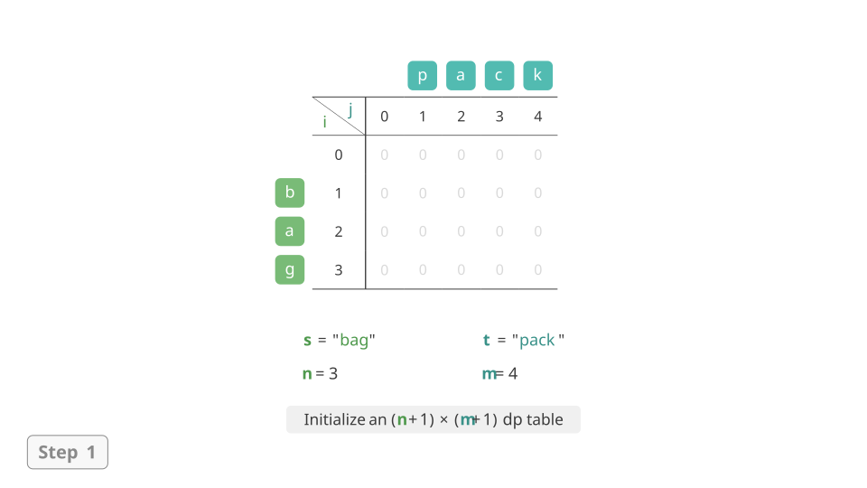{ class="animation-figure" }

=== "<2>"
    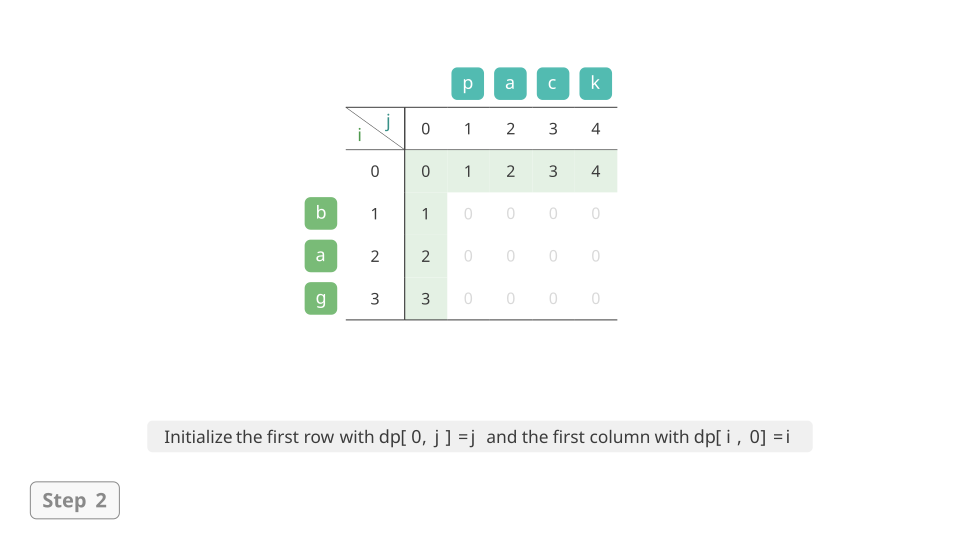{ class="animation-figure" }

=== "<3>"
    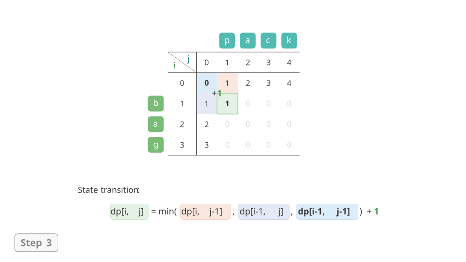{ class="animation-figure" }

=== "<4>"
    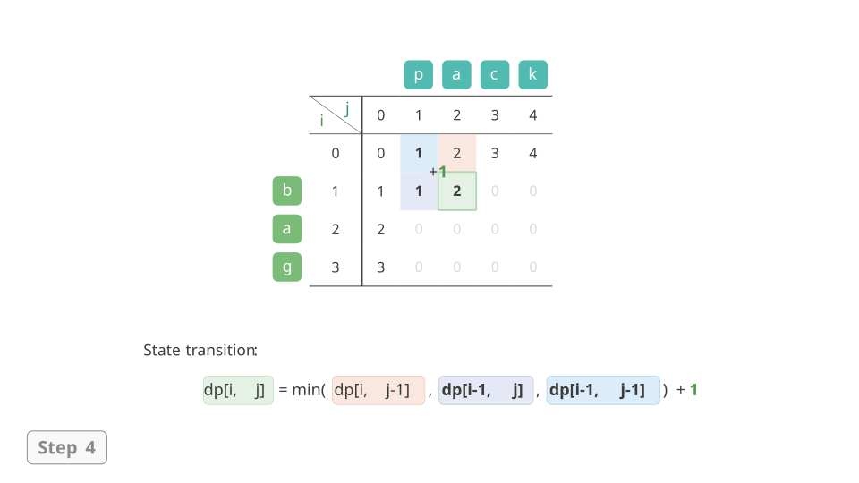{ class="animation-figure" }

=== "<5>"
    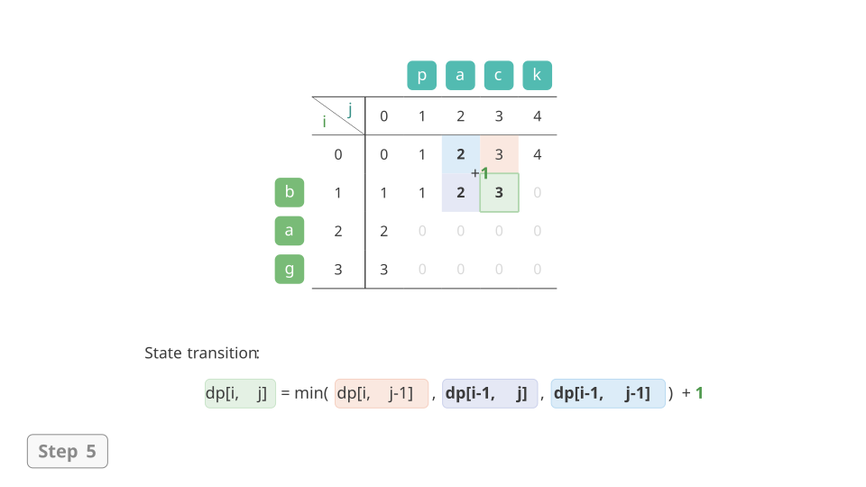{ class="animation-figure" }

=== "<6>"
    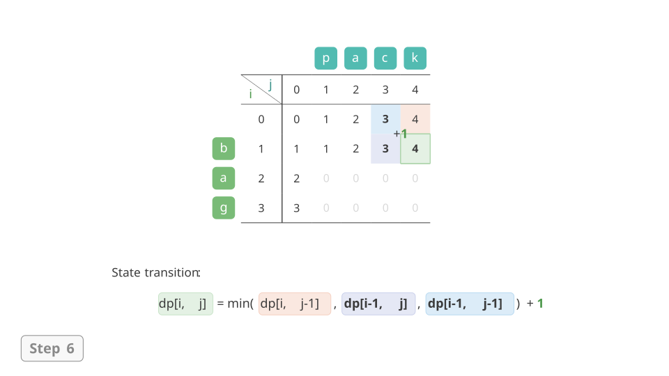{ class="animation-figure" }

=== "<7>"
    { class="animation-figure" }

=== "<8>"
    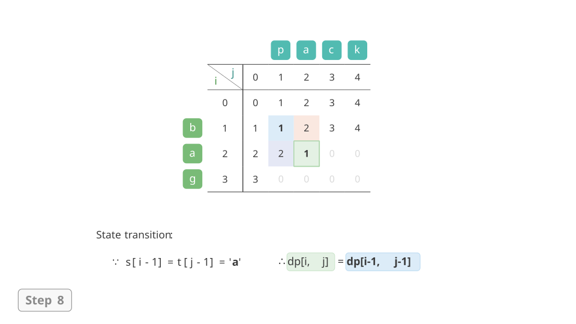{ class="animation-figure" }

=== "<9>"
    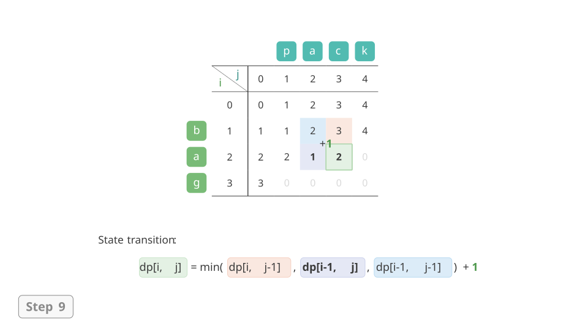{ class="animation-figure" }

=== "<10>"
    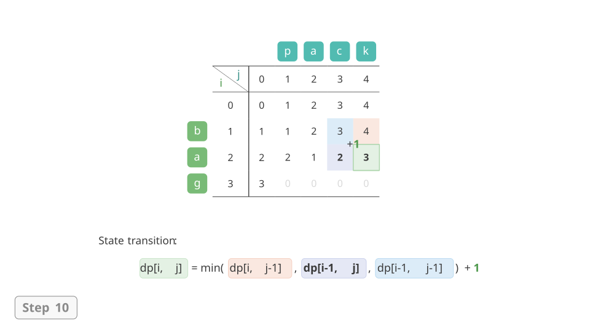{ class="animation-figure" }

=== "<11>"
    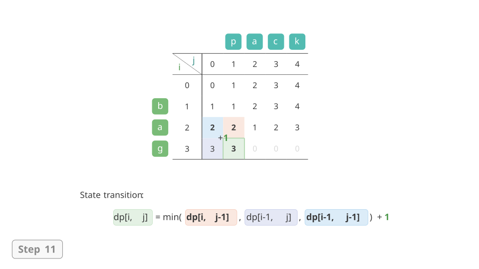{ class="animation-figure" }

=== "<12>"
    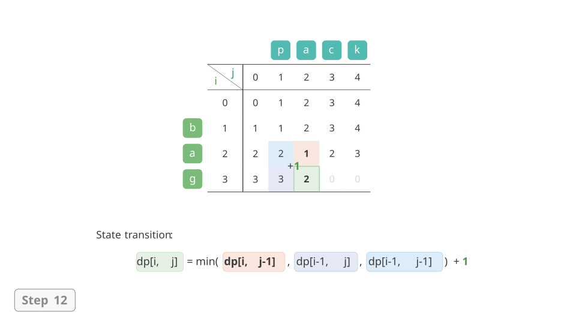{ class="animation-figure" }

=== "<13>"
    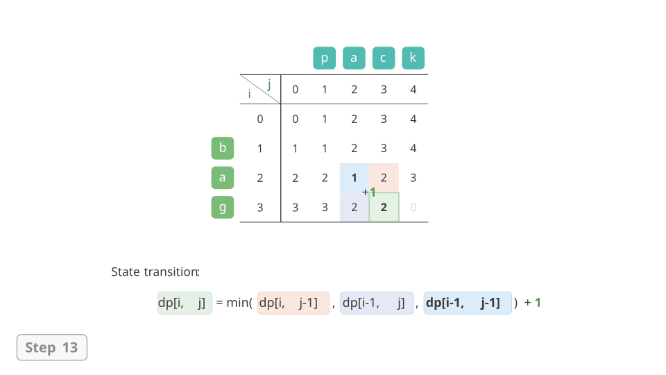{ class="animation-figure" }

=== "<14>"
    { class="animation-figure" }

=== "<15>"
    { class="animation-figure" }

<p align="center"> Figure 14-30 &nbsp; Computing edit distance with dynamic programming </p>

### 3. &nbsp; Space optimization

State $dp[i,j]$ depends on $dp[i-1, j]$ above, $dp[i, j-1]$ to the left, and $dp[i-1, j-1]$ at the upper left. With one row of storage, forward traversal loses the upper-left value $dp[i-1, j-1]$, while reverse traversal cannot compute $dp[i, j-1]$ in time. Neither order works on its own.

Save the upper-left value $dp[i-1, j-1]$ in a variable `leftup`. That leaves only the left and upper entries to track in the row, just as in unbounded knapsack, so we can traverse forward:

=== "Python"

    ```python title="edit_distance.py"
    def edit_distance_dp_comp(s: str, t: str) -> int:
        """Edit distance with space-optimized dynamic programming"""
        n, m = len(s), len(t)
        dp = [0] * (m + 1)
        # State transitions for the first row
        for j in range(1, m + 1):
            dp[j] = j
        # State transitions for the remaining rows
        for i in range(1, n + 1):
            # State transitions for the first column
            leftup = dp[0]  # Save dp[i-1, j-1] temporarily
            dp[0] += 1
            # State transitions for the remaining columns
            for j in range(1, m + 1):
                temp = dp[j]
                if s[i - 1] == t[j - 1]:
                    # Skip both characters if they match
                    dp[j] = leftup
                else:
                    # Minimum edits = 1 + the smallest remaining edit count after an insertion, deletion, or replacement
                    dp[j] = min(dp[j - 1], dp[j], leftup) + 1
                leftup = temp  # Update the saved value to hold dp[i-1, j-1] for the next iteration
        return dp[m]
    ```

=== "C++"

    ```cpp title="edit_distance.cpp"
    /* Edit distance with space-optimized dynamic programming */
    int editDistanceDPComp(string s, string t) {
        int n = s.length(), m = t.length();
        vector<int> dp(m + 1, 0);
        // State transitions for the first row
        for (int j = 1; j <= m; j++) {
            dp[j] = j;
        }
        // State transitions for the remaining rows
        for (int i = 1; i <= n; i++) {
            // State transitions for the first column
            int leftup = dp[0]; // Save dp[i-1, j-1] temporarily
            dp[0] = i;
            // State transitions for the remaining columns
            for (int j = 1; j <= m; j++) {
                int temp = dp[j];
                if (s[i - 1] == t[j - 1]) {
                    // Skip both characters if they match
                    dp[j] = leftup;
                } else {
                    // Minimum edits = 1 + the smallest remaining edit count after an insertion, deletion, or replacement
                    dp[j] = min(min(dp[j - 1], dp[j]), leftup) + 1;
                }
                leftup = temp; // Update the saved value to hold dp[i-1, j-1] for the next iteration
            }
        }
        return dp[m];
    }
    ```

=== "Java"

    ```java title="edit_distance.java"
    /* Edit distance with space-optimized dynamic programming */
    int editDistanceDPComp(String s, String t) {
        int n = s.length(), m = t.length();
        int[] dp = new int[m + 1];
        // State transitions for the first row
        for (int j = 1; j <= m; j++) {
            dp[j] = j;
        }
        // State transitions for the remaining rows
        for (int i = 1; i <= n; i++) {
            // State transitions for the first column
            int leftup = dp[0]; // Save dp[i-1, j-1] temporarily
            dp[0] = i;
            // State transitions for the remaining columns
            for (int j = 1; j <= m; j++) {
                int temp = dp[j];
                if (s.charAt(i - 1) == t.charAt(j - 1)) {
                    // Skip both characters if they match
                    dp[j] = leftup;
                } else {
                    // Minimum edits = 1 + the smallest remaining edit count after an insertion, deletion, or replacement
                    dp[j] = Math.min(Math.min(dp[j - 1], dp[j]), leftup) + 1;
                }
                leftup = temp; // Update the saved value to hold dp[i-1, j-1] for the next iteration
            }
        }
        return dp[m];
    }
    ```

=== "C#"

    ```csharp title="edit_distance.cs"
    /* Edit distance with space-optimized dynamic programming */
    int EditDistanceDPComp(string s, string t) {
        int n = s.Length, m = t.Length;
        int[] dp = new int[m + 1];
        // State transitions for the first row
        for (int j = 1; j <= m; j++) {
            dp[j] = j;
        }
        // State transitions for the remaining rows
        for (int i = 1; i <= n; i++) {
            // State transitions for the first column
            int leftup = dp[0]; // Save dp[i-1, j-1] temporarily
            dp[0] = i;
            // State transitions for the remaining columns
            for (int j = 1; j <= m; j++) {
                int temp = dp[j];
                if (s[i - 1] == t[j - 1]) {
                    // Skip both characters if they match
                    dp[j] = leftup;
                } else {
                    // Minimum edits = 1 + the smallest remaining edit count after an insertion, deletion, or replacement
                    dp[j] = Math.Min(Math.Min(dp[j - 1], dp[j]), leftup) + 1;
                }
                leftup = temp; // Update the saved value to hold dp[i-1, j-1] for the next iteration
            }
        }
        return dp[m];
    }
    ```

=== "Go"

    ```go title="edit_distance.go"
    /* Edit distance with space-optimized dynamic programming */
    func editDistanceDPComp(s string, t string) int {
        n := len(s)
        m := len(t)
        dp := make([]int, m+1)
        // State transitions for the first row
        for j := 1; j <= m; j++ {
            dp[j] = j
        }
        // State transitions for the remaining rows
        for i := 1; i <= n; i++ {
            // State transitions for the first column
            leftUp := dp[0] // Save dp[i-1, j-1] temporarily
            dp[0] = i
            // State transitions for the remaining columns
            for j := 1; j <= m; j++ {
                temp := dp[j]
                if s[i-1] == t[j-1] {
                    // Skip both characters if they match
                    dp[j] = leftUp
                } else {
                    // Minimum edits = 1 + the smallest remaining edit count after an insertion, deletion, or replacement
                    dp[j] = MinInt(MinInt(dp[j-1], dp[j]), leftUp) + 1
                }
                leftUp = temp // Update the saved value to hold dp[i-1, j-1] for the next iteration
            }
        }
        return dp[m]
    }
    ```

=== "Swift"

    ```swift title="edit_distance.swift"
    /* Edit distance with space-optimized dynamic programming */
    func editDistanceDPComp(s: String, t: String) -> Int {
        let n = s.utf8CString.count
        let m = t.utf8CString.count
        var dp = Array(repeating: 0, count: m + 1)
        // State transitions for the first row
        for j in 1 ... m {
            dp[j] = j
        }
        // State transitions for the remaining rows
        for i in 1 ... n {
            // State transitions for the first column
            var leftup = dp[0] // Save dp[i-1, j-1] temporarily
            dp[0] = i
            // State transitions for the remaining columns
            for j in 1 ... m {
                let temp = dp[j]
                if s.utf8CString[i - 1] == t.utf8CString[j - 1] {
                    // Skip both characters if they match
                    dp[j] = leftup
                } else {
                    // Minimum edits = 1 + the smallest remaining edit count after an insertion, deletion, or replacement
                    dp[j] = min(min(dp[j - 1], dp[j]), leftup) + 1
                }
                leftup = temp // Update the saved value to hold dp[i-1, j-1] for the next iteration
            }
        }
        return dp[m]
    }
    ```

=== "JS"

    ```javascript title="edit_distance.js"
    /* Edit distance with space-optimized dynamic programming */
    function editDistanceDPComp(s, t) {
        const n = s.length,
            m = t.length;
        const dp = new Array(m + 1).fill(0);
        // State transitions for the first row
        for (let j = 1; j <= m; j++) {
            dp[j] = j;
        }
        // State transitions for the remaining rows
        for (let i = 1; i <= n; i++) {
            // State transitions for the first column
            let leftup = dp[0]; // Save dp[i-1, j-1] temporarily
            dp[0] = i;
            // State transitions for the remaining columns
            for (let j = 1; j <= m; j++) {
                const temp = dp[j];
                if (s.charAt(i - 1) === t.charAt(j - 1)) {
                    // Skip both characters if they match
                    dp[j] = leftup;
                } else {
                    // Minimum edits = 1 + the smallest remaining edit count after an insertion, deletion, or replacement
                    dp[j] = Math.min(dp[j - 1], dp[j], leftup) + 1;
                }
                leftup = temp; // Update the saved value to hold dp[i-1, j-1] for the next iteration
            }
        }
        return dp[m];
    }
    ```

=== "TS"

    ```typescript title="edit_distance.ts"
    /* Edit distance with space-optimized dynamic programming */
    function editDistanceDPComp(s: string, t: string): number {
        const n = s.length,
            m = t.length;
        const dp = new Array(m + 1).fill(0);
        // State transitions for the first row
        for (let j = 1; j <= m; j++) {
            dp[j] = j;
        }
        // State transitions for the remaining rows
        for (let i = 1; i <= n; i++) {
            // State transitions for the first column
            let leftup = dp[0]; // Save dp[i-1, j-1] temporarily
            dp[0] = i;
            // State transitions for the remaining columns
            for (let j = 1; j <= m; j++) {
                const temp = dp[j];
                if (s.charAt(i - 1) === t.charAt(j - 1)) {
                    // Skip both characters if they match
                    dp[j] = leftup;
                } else {
                    // Minimum edits = 1 + the smallest remaining edit count after an insertion, deletion, or replacement
                    dp[j] = Math.min(dp[j - 1], dp[j], leftup) + 1;
                }
                leftup = temp; // Update the saved value to hold dp[i-1, j-1] for the next iteration
            }
        }
        return dp[m];
    }
    ```

=== "Dart"

    ```dart title="edit_distance.dart"
    /* Edit distance with space-optimized dynamic programming */
    int editDistanceDPComp(String s, String t) {
      int n = s.length, m = t.length;
      List<int> dp = List.filled(m + 1, 0);
      // State transitions for the first row
      for (int j = 1; j <= m; j++) {
        dp[j] = j;
      }
      // State transitions for the remaining rows
      for (int i = 1; i <= n; i++) {
        // State transitions for the first column
        int leftup = dp[0]; // Save dp[i-1, j-1] temporarily
        dp[0] = i;
        // State transitions for the remaining columns
        for (int j = 1; j <= m; j++) {
          int temp = dp[j];
          if (s[i - 1] == t[j - 1]) {
            // Skip both characters if they match
            dp[j] = leftup;
          } else {
            // Minimum edits = 1 + the smallest remaining edit count after an insertion, deletion, or replacement
            dp[j] = min(min(dp[j - 1], dp[j]), leftup) + 1;
          }
          leftup = temp; // Update the saved value to hold dp[i-1, j-1] for the next iteration
        }
      }
      return dp[m];
    }
    ```

=== "Rust"

    ```rust title="edit_distance.rs"
    /* Edit distance with space-optimized dynamic programming */
    fn edit_distance_dp_comp(s: &str, t: &str) -> i32 {
        let (n, m) = (s.len(), t.len());
        let mut dp = vec![0; m + 1];
        // State transitions for the first row
        for j in 1..m {
            dp[j] = j as i32;
        }
        // State transitions for the remaining rows
        for i in 1..=n {
            // State transitions for the first column
            let mut leftup = dp[0]; // Save dp[i-1, j-1] temporarily
            dp[0] = i as i32;
            // State transitions for the remaining columns
            for j in 1..=m {
                let temp = dp[j];
                if s.chars().nth(i - 1) == t.chars().nth(j - 1) {
                    // Skip both characters if they match
                    dp[j] = leftup;
                } else {
                    // Minimum edits = 1 + the smallest remaining edit count after an insertion, deletion, or replacement
                    dp[j] = std::cmp::min(std::cmp::min(dp[j - 1], dp[j]), leftup) + 1;
                }
                leftup = temp; // Update the saved value to hold dp[i-1, j-1] for the next iteration
            }
        }
        dp[m]
    }
    ```

=== "C"

    ```c title="edit_distance.c"
    /* Edit distance with space-optimized dynamic programming */
    int editDistanceDPComp(char *s, char *t, int n, int m) {
        int *dp = calloc(m + 1, sizeof(int));
        // State transitions for the first row
        for (int j = 1; j <= m; j++) {
            dp[j] = j;
        }
        // State transitions for the remaining rows
        for (int i = 1; i <= n; i++) {
            // State transitions for the first column
            int leftup = dp[0]; // Save dp[i-1, j-1] temporarily
            dp[0] = i;
            // State transitions for the remaining columns
            for (int j = 1; j <= m; j++) {
                int temp = dp[j];
                if (s[i - 1] == t[j - 1]) {
                    // Skip both characters if they match
                    dp[j] = leftup;
                } else {
                    // Minimum edits = 1 + the smallest remaining edit count after an insertion, deletion, or replacement
                    dp[j] = myMin(myMin(dp[j - 1], dp[j]), leftup) + 1;
                }
                leftup = temp; // Update the saved value to hold dp[i-1, j-1] for the next iteration
            }
        }
        int res = dp[m];
        // Free the memory
        free(dp);
        return res;
    }
    ```

=== "Kotlin"

    ```kotlin title="edit_distance.kt"
    /* Edit distance with space-optimized dynamic programming */
    fun editDistanceDPComp(s: String, t: String): Int {
        val n = s.length
        val m = t.length
        val dp = IntArray(m + 1)
        // State transitions for the first row
        for (j in 1..m) {
            dp[j] = j
        }
        // State transitions for the remaining rows
        for (i in 1..n) {
            // State transitions for the first column
            var leftup = dp[0] // Save dp[i-1, j-1] temporarily
            dp[0] = i
            // State transitions for the remaining columns
            for (j in 1..m) {
                val temp = dp[j]
                if (s[i - 1] == t[j - 1]) {
                    // Skip both characters if they match
                    dp[j] = leftup
                } else {
                    // Minimum edits = 1 + the smallest remaining edit count after an insertion, deletion, or replacement
                    dp[j] = min(min(dp[j - 1], dp[j]), leftup) + 1
                }
                leftup = temp // Update the saved value to hold dp[i-1, j-1] for the next iteration
            }
        }
        return dp[m]
    }
    ```

=== "Ruby"

    ```ruby title="edit_distance.rb"
    ### Edit distance with space-optimized dynamic programming ###
    def edit_distance_dp_comp(s, t)
      n, m = s.length, t.length
      dp = Array.new(m + 1, 0)
      # State transitions for the first row
      (1...(m + 1)).each { |j| dp[j] = j }
      # State transitions for the remaining rows
      for i in 1...(n + 1)
        # State transitions for the first column
        leftup = dp.first # Save dp[i-1, j-1] temporarily
        dp[0] += 1
        # State transitions for the remaining columns
        for j in 1...(m + 1)
          temp = dp[j]
          if s[i - 1] == t[j - 1]
            # Skip both characters if they match
            dp[j] = leftup
          else
            # Minimum edits = 1 + the smallest remaining edit count after an insertion, deletion, or replacement
            dp[j] = [dp[j - 1], dp[j], leftup].min + 1
          end
          leftup = temp # Update the saved value to hold dp[i-1, j-1] for the next iteration
        end
      end
      dp[m]
    end
    ```

??? pythontutor "Visualize execution"

    <div style="height: 549px; width: 100%;"><iframe class="pythontutor-iframe" title="Visualize execution" src="https://pythontutor.com/iframe-embed.html#code=def%20edit_distance_dp_comp%28s%3A%20str,%20t%3A%20str%29%20-%3E%20int%3A%0A%20%20%20%20%22%22%22Edit%20distance%20with%20space-optimized%20dynamic%20programming%22%22%22%0A%20%20%20%20n,%20m%20%3D%20len%28s%29,%20len%28t%29%0A%20%20%20%20dp%20%3D%20%5B0%5D%20%2A%20%28m%20%2B%201%29%0A%20%20%20%20%23%20State%20transitions%20for%20the%20first%20row%0A%20%20%20%20for%20j%20in%20range%281,%20m%20%2B%201%29%3A%0A%20%20%20%20%20%20%20%20dp%5Bj%5D%20%3D%20j%0A%20%20%20%20%23%20State%20transitions%20for%20the%20remaining%20rows%0A%20%20%20%20for%20i%20in%20range%281,%20n%20%2B%201%29%3A%0A%20%20%20%20%20%20%20%20%23%20State%20transitions%20for%20the%20first%20column%0A%20%20%20%20%20%20%20%20leftup%20%3D%20dp%5B0%5D%20%20%23%20Save%20dp%5Bi-1,%20j-1%5D%20temporarily%0A%20%20%20%20%20%20%20%20dp%5B0%5D%20%2B%3D%201%0A%20%20%20%20%20%20%20%20%23%20State%20transitions%20for%20the%20remaining%20columns%0A%20%20%20%20%20%20%20%20for%20j%20in%20range%281,%20m%20%2B%201%29%3A%0A%20%20%20%20%20%20%20%20%20%20%20%20temp%20%3D%20dp%5Bj%5D%0A%20%20%20%20%20%20%20%20%20%20%20%20if%20s%5Bi%20-%201%5D%20%3D%3D%20t%5Bj%20-%201%5D%3A%0A%20%20%20%20%20%20%20%20%20%20%20%20%20%20%20%20%23%20Skip%20both%20characters%20if%20they%20match%0A%20%20%20%20%20%20%20%20%20%20%20%20%20%20%20%20dp%5Bj%5D%20%3D%20leftup%0A%20%20%20%20%20%20%20%20%20%20%20%20else%3A%0A%20%20%20%20%20%20%20%20%20%20%20%20%20%20%20%20%23%20Minimum%20edits%20%3D%201%20%2B%20the%20smallest%20remaining%20edit%20count%20after%20an%20insertion,%20deletion,%20or%20replacement%0A%20%20%20%20%20%20%20%20%20%20%20%20%20%20%20%20dp%5Bj%5D%20%3D%20min%28dp%5Bj%20-%201%5D,%20dp%5Bj%5D,%20leftup%29%20%2B%201%0A%20%20%20%20%20%20%20%20%20%20%20%20leftup%20%3D%20temp%20%20%23%20Update%20the%20saved%20value%20to%20hold%20dp%5Bi-1,%20j-1%5D%20for%20the%20next%20iteration%0A%20%20%20%20return%20dp%5Bm%5D%0A%0A%0A%22%22%22Driver%20Code%22%22%22%0Aif%20__name__%20%3D%3D%20%22__main__%22%3A%0A%20%20%20%20s%20%3D%20%22bag%22%0A%20%20%20%20t%20%3D%20%22pack%22%0A%20%20%20%20n,%20m%20%3D%20len%28s%29,%20len%28t%29%0A%0A%20%20%20%20%23%20Space-optimized%20dynamic%20programming%0A%20%20%20%20res%20%3D%20edit_distance_dp_comp%28s,%20t%29%0A%20%20%20%20print%28f%22Changing%20%7Bs%7D%20to%20%7Bt%7D%20requires%20at%20least%20%7Bres%7D%20edits%22%29&codeDivHeight=472&codeDivWidth=350&cumulative=false&curInstr=6&heapPrimitives=nevernest&origin=opt-frontend.js&py=311&rawInputLstJSON=%5B%5D&textReferences=false"> </iframe></div>
    <div style="margin-top: 5px;"><a href="https://pythontutor.com/iframe-embed.html#code=def%20edit_distance_dp_comp%28s%3A%20str,%20t%3A%20str%29%20-%3E%20int%3A%0A%20%20%20%20%22%22%22Edit%20distance%20with%20space-optimized%20dynamic%20programming%22%22%22%0A%20%20%20%20n,%20m%20%3D%20len%28s%29,%20len%28t%29%0A%20%20%20%20dp%20%3D%20%5B0%5D%20%2A%20%28m%20%2B%201%29%0A%20%20%20%20%23%20State%20transitions%20for%20the%20first%20row%0A%20%20%20%20for%20j%20in%20range%281,%20m%20%2B%201%29%3A%0A%20%20%20%20%20%20%20%20dp%5Bj%5D%20%3D%20j%0A%20%20%20%20%23%20State%20transitions%20for%20the%20remaining%20rows%0A%20%20%20%20for%20i%20in%20range%281,%20n%20%2B%201%29%3A%0A%20%20%20%20%20%20%20%20%23%20State%20transitions%20for%20the%20first%20column%0A%20%20%20%20%20%20%20%20leftup%20%3D%20dp%5B0%5D%20%20%23%20Save%20dp%5Bi-1,%20j-1%5D%20temporarily%0A%20%20%20%20%20%20%20%20dp%5B0%5D%20%2B%3D%201%0A%20%20%20%20%20%20%20%20%23%20State%20transitions%20for%20the%20remaining%20columns%0A%20%20%20%20%20%20%20%20for%20j%20in%20range%281,%20m%20%2B%201%29%3A%0A%20%20%20%20%20%20%20%20%20%20%20%20temp%20%3D%20dp%5Bj%5D%0A%20%20%20%20%20%20%20%20%20%20%20%20if%20s%5Bi%20-%201%5D%20%3D%3D%20t%5Bj%20-%201%5D%3A%0A%20%20%20%20%20%20%20%20%20%20%20%20%20%20%20%20%23%20Skip%20both%20characters%20if%20they%20match%0A%20%20%20%20%20%20%20%20%20%20%20%20%20%20%20%20dp%5Bj%5D%20%3D%20leftup%0A%20%20%20%20%20%20%20%20%20%20%20%20else%3A%0A%20%20%20%20%20%20%20%20%20%20%20%20%20%20%20%20%23%20Minimum%20edits%20%3D%201%20%2B%20the%20smallest%20remaining%20edit%20count%20after%20an%20insertion,%20deletion,%20or%20replacement%0A%20%20%20%20%20%20%20%20%20%20%20%20%20%20%20%20dp%5Bj%5D%20%3D%20min%28dp%5Bj%20-%201%5D,%20dp%5Bj%5D,%20leftup%29%20%2B%201%0A%20%20%20%20%20%20%20%20%20%20%20%20leftup%20%3D%20temp%20%20%23%20Update%20the%20saved%20value%20to%20hold%20dp%5Bi-1,%20j-1%5D%20for%20the%20next%20iteration%0A%20%20%20%20return%20dp%5Bm%5D%0A%0A%0A%22%22%22Driver%20Code%22%22%22%0Aif%20__name__%20%3D%3D%20%22__main__%22%3A%0A%20%20%20%20s%20%3D%20%22bag%22%0A%20%20%20%20t%20%3D%20%22pack%22%0A%20%20%20%20n,%20m%20%3D%20len%28s%29,%20len%28t%29%0A%0A%20%20%20%20%23%20Space-optimized%20dynamic%20programming%0A%20%20%20%20res%20%3D%20edit_distance_dp_comp%28s,%20t%29%0A%20%20%20%20print%28f%22Changing%20%7Bs%7D%20to%20%7Bt%7D%20requires%20at%20least%20%7Bres%7D%20edits%22%29&codeDivHeight=800&codeDivWidth=600&cumulative=false&curInstr=6&heapPrimitives=nevernest&origin=opt-frontend.js&py=311&rawInputLstJSON=%5B%5D&textReferences=false" target="_blank" rel="noopener noreferrer">View full screen ></a></div>
