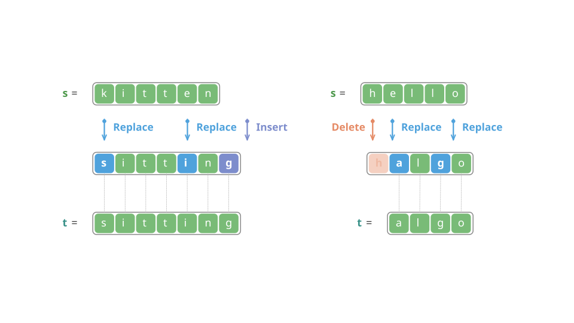
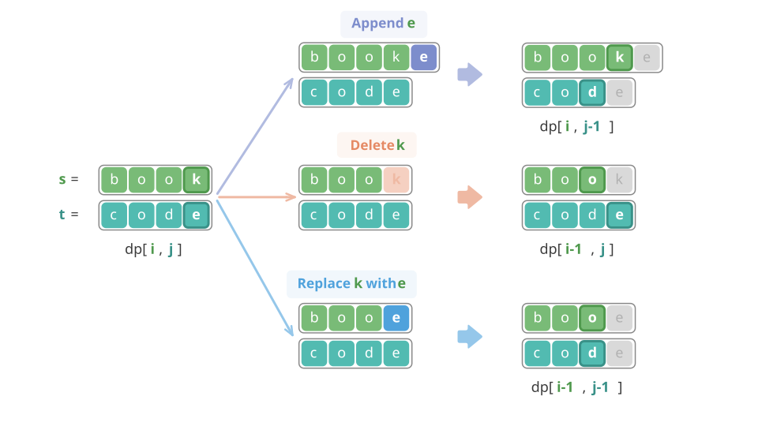
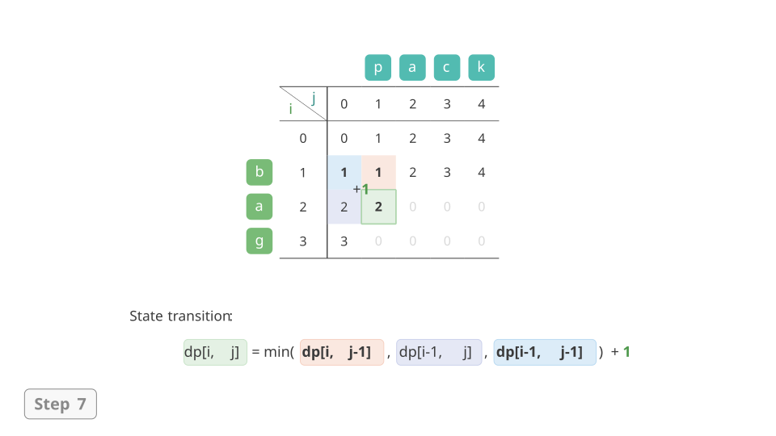
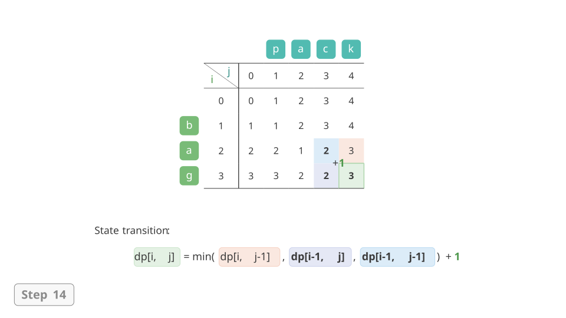
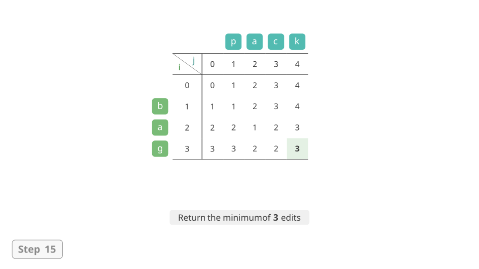

# The edit distance problem

Edit distance, also called Levenshtein distance, is the fewest edits needed to transform one string into another. It is commonly used in information retrieval and natural language processing to measure the similarity of two sequences.

!!! question

    Given two strings $s$ and $t$, return the minimum number of edits needed to transform $s$ into $t$.
    
    You may insert one character, delete one character, or replace one character with any character.

As shown below, changing `kitten` to `sitting` takes 3 edits: 2 replacements and 1 insertion. Changing `hello` to `algo` also takes 3 edits: 2 replacements and 1 deletion.



**A decision tree provides a natural model for edit distance**. Each node is a string, and each edge represents a decision to make one edit.

As the figure shows, without restrictions each node can have many outgoing edges, one for each possible edit. There are therefore many paths from `hello` to `algo`.

In the decision tree, our goal is the shortest path from node `hello` to node `algo`.


### A dynamic programming approach

**Step 1: Identify the decision at each step and define the state and $dp$ table**

At each step, we choose an edit to apply to string $s$.

To form subproblems, we want each editing decision to reduce the size of the remaining problem. Let $s$ and $t$ have lengths $n$ and $m$, respectively. Consider their final characters $s[n-1]$ and $t[m-1]$.

- If $s[n-1]$ and $t[m-1]$ match, skip both and move on to $s[n-2]$ and $t[m-2]$.
- If $s[n-1]$ and $t[m-1]$ differ, we need to edit $s$ (insert, delete, or replace a character) to resolve the mismatch at the end. We can then skip the resolved characters and work on a smaller problem.

Each editing decision on $s$ changes which characters in $s$ and $t$ remain to be matched. The state therefore identifies the characters currently under consideration in $s$ and $t$ by their positions $i$ and $j$. Write the state as $[i, j]$.

The subproblem for state $[i, j]$ is **the minimum number of edits to change the first $i$ characters of $s$ into the first $j$ characters of $t$**.

This gives us a two-dimensional $dp$ table of size $(n+1) \times (m+1)$.

**Step 2: Identify optimal substructure and derive the recurrence**

For subproblem $dp[i, j]$, the two prefixes end in $s[i-1]$ and $t[j-1]$. The three possible edits give the cases shown below.

1. Insert $t[j-1]$ after $s[i-1]$. The remaining subproblem is $dp[i, j-1]$.
2. Delete $s[i-1]$. The remaining subproblem is $dp[i-1, j]$.
3. Replace $s[i-1]$ with $t[j-1]$. The remaining subproblem is $dp[i-1, j-1]$.



The optimal substructure now follows: the minimum edit count $dp[i, j]$ is the smallest of $dp[i, j-1]$, $dp[i-1, j]$, and $dp[i-1, j-1]$, plus $1$ for the current edit. The recurrence is:

$$
dp[i, j] = \min(dp[i, j-1], dp[i-1, j], dp[i-1, j-1]) + 1
$$

**When $s[i-1]$ and $t[j-1]$ match, the current character needs no edit**. In that case the recurrence is:

$$
dp[i, j] = dp[i-1, j-1]
$$

**Step 3: Determine the boundary conditions and the order of computation**

When both strings are empty, the edit count is $0$, so $dp[0, 0] = 0$. When $s$ is empty and $t$ is not, the minimum edit count is the length of $t$, giving the first row $dp[0, j] = j$. When $s$ is nonempty and $t$ is empty, the minimum count is the length of $s$, giving the first column $dp[i, 0] = i$.

The recurrence for $dp[i, j]$ depends on the cells to the left, above, and diagonally above to the left. Two forward loops can therefore fill the entire $dp$ table.

### Implementation

```src
[file]{edit_distance}-[class]{}-[func]{edit_distance_dp}
```

As shown below, state transitions for edit distance closely resemble those for knapsack: both fill a two-dimensional grid.

=== "<1>"
    

=== "<2>"
    

=== "<3>"
    

=== "<4>"
    

=== "<5>"
    

=== "<6>"
    

=== "<7>"
    

=== "<8>"
    

=== "<9>"
    

=== "<10>"
    

=== "<11>"
    

=== "<12>"
    

=== "<13>"
    

=== "<14>"
    

=== "<15>"
    

### Space optimization

State $dp[i,j]$ depends on $dp[i-1, j]$ above, $dp[i, j-1]$ to the left, and $dp[i-1, j-1]$ at the upper left. With one row of storage, forward traversal loses the upper-left value $dp[i-1, j-1]$, while reverse traversal cannot compute $dp[i, j-1]$ in time. Neither order works on its own.

Save the upper-left value $dp[i-1, j-1]$ in a variable `leftup`. That leaves only the left and upper entries to track in the row, just as in unbounded knapsack, so we can traverse forward:

```src
[file]{edit_distance}-[class]{}-[func]{edit_distance_dp_comp}
```
