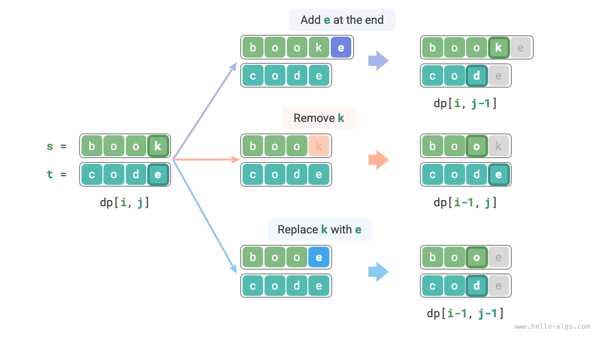
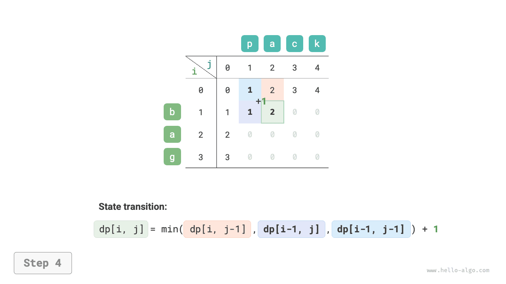
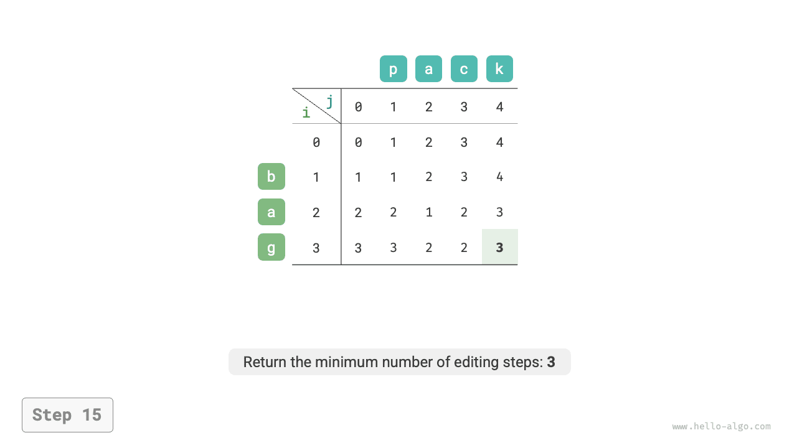

# 14.6 &nbsp; Edit distance problem

Edit distance, also called Levenshtein distance, is the minimum number of edits needed to transform one string into another. It is commonly used in information retrieval and natural language processing to measure similarity between sequences.

!!! question

    Given two strings $s$ and $t$, return the minimum number of edits needed to transform $s$ into $t$.
    
    Three edits are allowed: insert a character, delete a character, or replace a character with any other character.

As shown in Figure 14-27, transforming `kitten` into `sitting` takes 3 edits: 2 replacements and 1 insertion. Transforming `hello` into `algo` also takes 3 edits: 2 replacements and 1 deletion.

{ class="animation-figure" }

<p align="center"> Figure 14-27 &nbsp; Examples of edit distance </p>

**Edit distance fits naturally into a decision tree model**. Strings are nodes, and each decision (an edit) is an edge.

As shown in Figure 14-28, without restrictions on the edits, each node can have many outgoing edges, one for each possible operation. Thus, many paths can transform `hello` into `algo`.

From the decision tree perspective, the goal is to find the shortest path between nodes `hello` and `algo`.

{ class="animation-figure" }

<p align="center"> Figure 14-28 &nbsp; Edit distance as a decision tree </p>

### 1. &nbsp; Dynamic programming approach

**Step 1: Identify each decision, define the state, and establish the $dp$ table**

Each decision applies one edit to string $s$.

We want each edit to reduce the problem's size so that we can form subproblems. Let the lengths of $s$ and $t$ be $n$ and $m$. First consider their last characters, $s[n-1]$ and $t[m-1]$.

- If $s[n-1]$ and $t[m-1]$ match, skip them and consider $s[n-2]$ and $t[m-2]$.
- If $s[n-1]$ and $t[m-1]$ differ, apply an edit to $s$ (insertion, deletion, or replacement) to match the endings, allowing us to move on to a smaller problem.

Each decision (edit) in $s$ changes the characters still to be matched in $s$ and $t$. The state therefore specifies the $i$-th and $j$-th characters currently under consideration in $s$ and $t$, denoted by $[i, j]$.

State $[i, j]$ represents the subproblem of finding **the minimum number of edits needed to transform the first $i$ characters of $s$ into the first $j$ characters of $t$**.

This gives a two-dimensional $dp$ table of size $(n+1) \times (m+1)$.

**Step 2: Identify optimal substructure and derive the state transition equation**

For subproblem $dp[i, j]$, the final characters are $s[i-1]$ and $t[j-1]$. The three possible edits give the cases shown in Figure 14-29.

1. Insert $t[j-1]$ after $s[i-1]$, leaving subproblem $dp[i, j-1]$.
2. Delete $s[i-1]$, leaving subproblem $dp[i-1, j]$.
3. Replace $s[i-1]$ with $t[j-1]$, leaving subproblem $dp[i-1, j-1]$.

{ class="animation-figure" }

<p align="center"> Figure 14-29 &nbsp; State transitions for edit distance </p>

The optimal substructure follows: the minimum edit count $dp[i, j]$ is the smallest of $dp[i, j-1]$, $dp[i-1, j]$, and $dp[i-1, j-1]$, plus $1$ for the current edit. The state transition equation is:

$$
dp[i, j] = \min(dp[i, j-1], dp[i-1, j], dp[i-1, j-1]) + 1
$$

When **$s[i-1]$ and $t[j-1]$ match, no edit is needed for the current characters**, and the state transition equation becomes:

$$
dp[i, j] = dp[i-1, j-1]
$$

**Step 3: Determine the boundary conditions and evaluation order**

If both strings are empty, $0$ edits are needed, so $dp[0, 0] = 0$. If $s$ is empty but $t$ is not, the minimum edit count is the length of $t$, giving the first row $dp[0, j] = j$. If $s$ is nonempty but $t$ is empty, the count is the length of $s$, giving the first column $dp[i, 0] = i$.

The solution $dp[i, j]$ depends on entries to its left, above, and upper left, so two nested loops can traverse the $dp$ table in increasing index order.

### 2. &nbsp; Code implementation

=== "Python"

    ```python title="edit_distance.py"
    def edit_distance_dp(s: str, t: str) -> int:
        """Edit distance: dynamic programming"""
        n, m = len(s), len(t)
        dp = [[0] * (m + 1) for _ in range(n + 1)]
        # State transitions: first row and first column
        for i in range(1, n + 1):
            dp[i][0] = i
        for j in range(1, m + 1):
            dp[0][j] = j
        # State transitions: remaining rows and columns
        for i in range(1, n + 1):
            for j in range(1, m + 1):
                if s[i - 1] == t[j - 1]:
                    # If the two characters are equal, skip both of them
                    dp[i][j] = dp[i - 1][j - 1]
                else:
                    # Minimum edits = the minimum among the insertion, deletion, and replacement subproblems + 1
                    dp[i][j] = min(dp[i][j - 1], dp[i - 1][j], dp[i - 1][j - 1]) + 1
        return dp[n][m]
    ```

=== "C++"

    ```cpp title="edit_distance.cpp"
    /* Edit distance: dynamic programming */
    int editDistanceDP(string s, string t) {
        int n = s.length(), m = t.length();
        vector<vector<int>> dp(n + 1, vector<int>(m + 1, 0));
        // State transitions: first row and first column
        for (int i = 1; i <= n; i++) {
            dp[i][0] = i;
        }
        for (int j = 1; j <= m; j++) {
            dp[0][j] = j;
        }
        // State transitions: remaining rows and columns
        for (int i = 1; i <= n; i++) {
            for (int j = 1; j <= m; j++) {
                if (s[i - 1] == t[j - 1]) {
                    // If the two characters are equal, skip both of them
                    dp[i][j] = dp[i - 1][j - 1];
                } else {
                    // Minimum edits = the minimum among the insertion, deletion, and replacement subproblems + 1
                    dp[i][j] = min(min(dp[i][j - 1], dp[i - 1][j]), dp[i - 1][j - 1]) + 1;
                }
            }
        }
        return dp[n][m];
    }
    ```

=== "Java"

    ```java title="edit_distance.java"
    /* Edit distance: dynamic programming */
    int editDistanceDP(String s, String t) {
        int n = s.length(), m = t.length();
        int[][] dp = new int[n + 1][m + 1];
        // State transitions: first row and first column
        for (int i = 1; i <= n; i++) {
            dp[i][0] = i;
        }
        for (int j = 1; j <= m; j++) {
            dp[0][j] = j;
        }
        // State transitions: remaining rows and columns
        for (int i = 1; i <= n; i++) {
            for (int j = 1; j <= m; j++) {
                if (s.charAt(i - 1) == t.charAt(j - 1)) {
                    // If the two characters are equal, skip both of them
                    dp[i][j] = dp[i - 1][j - 1];
                } else {
                    // Minimum edits = the minimum among the insertion, deletion, and replacement subproblems + 1
                    dp[i][j] = Math.min(Math.min(dp[i][j - 1], dp[i - 1][j]), dp[i - 1][j - 1]) + 1;
                }
            }
        }
        return dp[n][m];
    }
    ```

=== "C#"

    ```csharp title="edit_distance.cs"
    /* Edit distance: dynamic programming */
    int EditDistanceDP(string s, string t) {
        int n = s.Length, m = t.Length;
        int[,] dp = new int[n + 1, m + 1];
        // State transitions: first row and first column
        for (int i = 1; i <= n; i++) {
            dp[i, 0] = i;
        }
        for (int j = 1; j <= m; j++) {
            dp[0, j] = j;
        }
        // State transitions: remaining rows and columns
        for (int i = 1; i <= n; i++) {
            for (int j = 1; j <= m; j++) {
                if (s[i - 1] == t[j - 1]) {
                    // If the two characters are equal, skip both of them
                    dp[i, j] = dp[i - 1, j - 1];
                } else {
                    // Minimum edits = the minimum among the insertion, deletion, and replacement subproblems + 1
                    dp[i, j] = Math.Min(Math.Min(dp[i, j - 1], dp[i - 1, j]), dp[i - 1, j - 1]) + 1;
                }
            }
        }
        return dp[n, m];
    }
    ```

=== "Go"

    ```go title="edit_distance.go"
    /* Edit distance: dynamic programming */
    func editDistanceDP(s string, t string) int {
        n := len(s)
        m := len(t)
        dp := make([][]int, n+1)
        for i := 0; i <= n; i++ {
            dp[i] = make([]int, m+1)
        }
        // State transitions: first row and first column
        for i := 1; i <= n; i++ {
            dp[i][0] = i
        }
        for j := 1; j <= m; j++ {
            dp[0][j] = j
        }
        // State transitions: remaining rows and columns
        for i := 1; i <= n; i++ {
            for j := 1; j <= m; j++ {
                if s[i-1] == t[j-1] {
                    // If the two bytes are equal, skip both (each byte is one character for ASCII input)
                    dp[i][j] = dp[i-1][j-1]
                } else {
                    // Minimum edits = the minimum among the insertion, deletion, and replacement subproblems + 1
                    dp[i][j] = MinInt(MinInt(dp[i][j-1], dp[i-1][j]), dp[i-1][j-1]) + 1
                }
            }
        }
        return dp[n][m]
    }
    ```

=== "Swift"

    ```swift title="edit_distance.swift"
    /* Edit distance: dynamic programming */
    func editDistanceDP(s: String, t: String) -> Int {
        let n = s.utf8CString.count
        let m = t.utf8CString.count
        var dp = Array(repeating: Array(repeating: 0, count: m + 1), count: n + 1)
        // State transitions: first row and first column
        for i in 1 ... n {
            dp[i][0] = i
        }
        for j in 1 ... m {
            dp[0][j] = j
        }
        // State transitions: remaining rows and columns
        for i in 1 ... n {
            for j in 1 ... m {
                if s.utf8CString[i - 1] == t.utf8CString[j - 1] {
                    // If the two current UTF-8 bytes match, skip both
                    dp[i][j] = dp[i - 1][j - 1]
                } else {
                    // Minimum edits = the minimum among the insertion, deletion, and replacement subproblems + 1
                    dp[i][j] = min(min(dp[i][j - 1], dp[i - 1][j]), dp[i - 1][j - 1]) + 1
                }
            }
        }
        return dp[n][m]
    }
    ```

=== "JS"

    ```javascript title="edit_distance.js"
    /* Edit distance: dynamic programming */
    function editDistanceDP(s, t) {
        const n = s.length,
            m = t.length;
        const dp = Array.from({ length: n + 1 }, () => new Array(m + 1).fill(0));
        // State transitions: first row and first column
        for (let i = 1; i <= n; i++) {
            dp[i][0] = i;
        }
        for (let j = 1; j <= m; j++) {
            dp[0][j] = j;
        }
        // State transitions: remaining rows and columns
        for (let i = 1; i <= n; i++) {
            for (let j = 1; j <= m; j++) {
                if (s.charAt(i - 1) === t.charAt(j - 1)) {
                    // If the two characters are equal, skip both of them
                    dp[i][j] = dp[i - 1][j - 1];
                } else {
                    // Minimum edits = the minimum among the insertion, deletion, and replacement subproblems + 1
                    dp[i][j] =
                        Math.min(dp[i][j - 1], dp[i - 1][j], dp[i - 1][j - 1]) + 1;
                }
            }
        }
        return dp[n][m];
    }
    ```

=== "TS"

    ```typescript title="edit_distance.ts"
    /* Edit distance: dynamic programming */
    function editDistanceDP(s: string, t: string): number {
        const n = s.length,
            m = t.length;
        const dp = Array.from({ length: n + 1 }, () =>
            Array.from({ length: m + 1 }, () => 0)
        );
        // State transitions: first row and first column
        for (let i = 1; i <= n; i++) {
            dp[i][0] = i;
        }
        for (let j = 1; j <= m; j++) {
            dp[0][j] = j;
        }
        // State transitions: remaining rows and columns
        for (let i = 1; i <= n; i++) {
            for (let j = 1; j <= m; j++) {
                if (s.charAt(i - 1) === t.charAt(j - 1)) {
                    // If the two characters are equal, skip both of them
                    dp[i][j] = dp[i - 1][j - 1];
                } else {
                    // Minimum edits = the minimum among the insertion, deletion, and replacement subproblems + 1
                    dp[i][j] =
                        Math.min(dp[i][j - 1], dp[i - 1][j], dp[i - 1][j - 1]) + 1;
                }
            }
        }
        return dp[n][m];
    }
    ```

=== "Dart"

    ```dart title="edit_distance.dart"
    /* Edit distance: dynamic programming */
    int editDistanceDP(String s, String t) {
      int n = s.length, m = t.length;
      List<List<int>> dp = List.generate(n + 1, (_) => List.filled(m + 1, 0));
      // State transitions: first row and first column
      for (int i = 1; i <= n; i++) {
        dp[i][0] = i;
      }
      for (int j = 1; j <= m; j++) {
        dp[0][j] = j;
      }
      // State transitions: remaining rows and columns
      for (int i = 1; i <= n; i++) {
        for (int j = 1; j <= m; j++) {
          if (s[i - 1] == t[j - 1]) {
            // If the two characters are equal, skip both of them
            dp[i][j] = dp[i - 1][j - 1];
          } else {
            // Minimum edits = the minimum among the insertion, deletion, and replacement subproblems + 1
            dp[i][j] = min(min(dp[i][j - 1], dp[i - 1][j]), dp[i - 1][j - 1]) + 1;
          }
        }
      }
      return dp[n][m];
    }
    ```

=== "Rust"

    ```rust title="edit_distance.rs"
    /* Edit distance: dynamic programming */
    fn edit_distance_dp(s: &str, t: &str) -> i32 {
        let (n, m) = (s.len(), t.len());
        let mut dp = vec![vec![0; m + 1]; n + 1];
        // State transitions: first row and first column
        for i in 1..=n {
            dp[i][0] = i as i32;
        }
        for j in 1..m {
            dp[0][j] = j as i32;
        }
        // State transitions: remaining rows and columns
        for i in 1..=n {
            for j in 1..=m {
                if s.chars().nth(i - 1) == t.chars().nth(j - 1) {
                    // If the two characters are equal, skip both of them
                    dp[i][j] = dp[i - 1][j - 1];
                } else {
                    // Minimum edits = the minimum among the insertion, deletion, and replacement subproblems + 1
                    dp[i][j] =
                        std::cmp::min(std::cmp::min(dp[i][j - 1], dp[i - 1][j]), dp[i - 1][j - 1]) + 1;
                }
            }
        }
        dp[n][m]
    }
    ```

=== "C"

    ```c title="edit_distance.c"
    /* Edit distance: dynamic programming */
    int editDistanceDP(char *s, char *t, int n, int m) {
        int **dp = malloc((n + 1) * sizeof(int *));
        for (int i = 0; i <= n; i++) {
            dp[i] = calloc(m + 1, sizeof(int));
        }
        // State transitions: first row and first column
        for (int i = 1; i <= n; i++) {
            dp[i][0] = i;
        }
        for (int j = 1; j <= m; j++) {
            dp[0][j] = j;
        }
        // State transitions: remaining rows and columns
        for (int i = 1; i <= n; i++) {
            for (int j = 1; j <= m; j++) {
                if (s[i - 1] == t[j - 1]) {
                    // If the two characters are equal, skip both of them
                    dp[i][j] = dp[i - 1][j - 1];
                } else {
                    // Minimum edits = the minimum among the insertion, deletion, and replacement subproblems + 1
                    dp[i][j] = myMin(myMin(dp[i][j - 1], dp[i - 1][j]), dp[i - 1][j - 1]) + 1;
                }
            }
        }
        int res = dp[n][m];
        // Free memory
        for (int i = 0; i <= n; i++) {
            free(dp[i]);
        }
        return res;
    }
    ```

=== "Kotlin"

    ```kotlin title="edit_distance.kt"
    /* Edit distance: dynamic programming */
    fun editDistanceDP(s: String, t: String): Int {
        val n = s.length
        val m = t.length
        val dp = Array(n + 1) { IntArray(m + 1) }
        // State transitions: first row and first column
        for (i in 1..n) {
            dp[i][0] = i
        }
        for (j in 1..m) {
            dp[0][j] = j
        }
        // State transitions: remaining rows and columns
        for (i in 1..n) {
            for (j in 1..m) {
                if (s[i - 1] == t[j - 1]) {
                    // If the two characters are equal, skip both of them
                    dp[i][j] = dp[i - 1][j - 1]
                } else {
                    // Minimum edits = the minimum among the insertion, deletion, and replacement subproblems + 1
                    dp[i][j] = min(min(dp[i][j - 1], dp[i - 1][j]), dp[i - 1][j - 1]) + 1
                }
            }
        }
        return dp[n][m]
    }
    ```

=== "Ruby"

    ```ruby title="edit_distance.rb"
    ### Edit distance: dynamic programming ###
    def edit_distance_dp(s, t)
      n, m = s.length, t.length
      dp = Array.new(n + 1) { Array.new(m + 1, 0) }
      # State transitions: first row and first column
      (1...(n + 1)).each { |i| dp[i][0] = i }
      (1...(m + 1)).each { |j| dp[0][j] = j }
      # State transitions: remaining rows and columns
      for i in 1...(n + 1)
        for j in 1...(m +1)
          if s[i - 1] == t[j - 1]
            # If the two characters are equal, skip both of them
            dp[i][j] = dp[i - 1][j - 1]
          else
            # Minimum edits = the minimum among the insertion, deletion, and replacement subproblems + 1
            dp[i][j] = [dp[i][j - 1], dp[i - 1][j], dp[i - 1][j - 1]].min + 1
          end
        end
      end
      dp[n][m]
    end
    ```

??? pythontutor "Visualize execution"

    <div style="height: 549px; width: 100%;"><iframe class="pythontutor-iframe" title="Visualize execution" src="https://pythontutor.com/iframe-embed.html#code=def%20edit_distance_dp%28s%3A%20str,%20t%3A%20str%29%20-%3E%20int%3A%0A%20%20%20%20%22%22%22Edit%20distance%3A%20dynamic%20programming%22%22%22%0A%20%20%20%20n,%20m%20%3D%20len%28s%29,%20len%28t%29%0A%20%20%20%20dp%20%3D%20%5B%5B0%5D%20%2A%20%28m%20%2B%201%29%20for%20_%20in%20range%28n%20%2B%201%29%5D%0A%20%20%20%20%23%20State%20transitions%3A%20first%20row%20and%20first%20column%0A%20%20%20%20for%20i%20in%20range%281,%20n%20%2B%201%29%3A%0A%20%20%20%20%20%20%20%20dp%5Bi%5D%5B0%5D%20%3D%20i%0A%20%20%20%20for%20j%20in%20range%281,%20m%20%2B%201%29%3A%0A%20%20%20%20%20%20%20%20dp%5B0%5D%5Bj%5D%20%3D%20j%0A%20%20%20%20%23%20State%20transitions%3A%20remaining%20rows%20and%20columns%0A%20%20%20%20for%20i%20in%20range%281,%20n%20%2B%201%29%3A%0A%20%20%20%20%20%20%20%20for%20j%20in%20range%281,%20m%20%2B%201%29%3A%0A%20%20%20%20%20%20%20%20%20%20%20%20if%20s%5Bi%20-%201%5D%20%3D%3D%20t%5Bj%20-%201%5D%3A%0A%20%20%20%20%20%20%20%20%20%20%20%20%20%20%20%20%23%20If%20the%20two%20characters%20are%20equal,%20skip%20both%20of%20them%0A%20%20%20%20%20%20%20%20%20%20%20%20%20%20%20%20dp%5Bi%5D%5Bj%5D%20%3D%20dp%5Bi%20-%201%5D%5Bj%20-%201%5D%0A%20%20%20%20%20%20%20%20%20%20%20%20else%3A%0A%20%20%20%20%20%20%20%20%20%20%20%20%20%20%20%20%23%20Minimum%20edits%20%3D%20the%20minimum%20among%20the%20insertion,%20deletion,%20and%20replacement%20subproblems%20%2B%201%0A%20%20%20%20%20%20%20%20%20%20%20%20%20%20%20%20dp%5Bi%5D%5Bj%5D%20%3D%20min%28dp%5Bi%5D%5Bj%20-%201%5D,%20dp%5Bi%20-%201%5D%5Bj%5D,%20dp%5Bi%20-%201%5D%5Bj%20-%201%5D%29%20%2B%201%0A%20%20%20%20return%20dp%5Bn%5D%5Bm%5D%0A%0A%0A%22%22%22Driver%20code%22%22%22%0Aif%20__name__%20%3D%3D%20%22__main__%22%3A%0A%20%20%20%20s%20%3D%20%22bag%22%0A%20%20%20%20t%20%3D%20%22pack%22%0A%20%20%20%20n,%20m%20%3D%20len%28s%29,%20len%28t%29%0A%0A%20%20%20%20%23%20Dynamic%20programming%0A%20%20%20%20res%20%3D%20edit_distance_dp%28s,%20t%29%0A%20%20%20%20print%28f%22Changing%20%7Bs%7D%20to%20%7Bt%7D%20requires%20at%20least%20%7Bres%7D%20edits%22%29&codeDivHeight=472&codeDivWidth=350&cumulative=false&curInstr=6&heapPrimitives=nevernest&origin=opt-frontend.js&py=311&rawInputLstJSON=%5B%5D&textReferences=false"> </iframe></div>
    <div style="margin-top: 5px;"><a href="https://pythontutor.com/iframe-embed.html#code=def%20edit_distance_dp%28s%3A%20str,%20t%3A%20str%29%20-%3E%20int%3A%0A%20%20%20%20%22%22%22Edit%20distance%3A%20dynamic%20programming%22%22%22%0A%20%20%20%20n,%20m%20%3D%20len%28s%29,%20len%28t%29%0A%20%20%20%20dp%20%3D%20%5B%5B0%5D%20%2A%20%28m%20%2B%201%29%20for%20_%20in%20range%28n%20%2B%201%29%5D%0A%20%20%20%20%23%20State%20transitions%3A%20first%20row%20and%20first%20column%0A%20%20%20%20for%20i%20in%20range%281,%20n%20%2B%201%29%3A%0A%20%20%20%20%20%20%20%20dp%5Bi%5D%5B0%5D%20%3D%20i%0A%20%20%20%20for%20j%20in%20range%281,%20m%20%2B%201%29%3A%0A%20%20%20%20%20%20%20%20dp%5B0%5D%5Bj%5D%20%3D%20j%0A%20%20%20%20%23%20State%20transitions%3A%20remaining%20rows%20and%20columns%0A%20%20%20%20for%20i%20in%20range%281,%20n%20%2B%201%29%3A%0A%20%20%20%20%20%20%20%20for%20j%20in%20range%281,%20m%20%2B%201%29%3A%0A%20%20%20%20%20%20%20%20%20%20%20%20if%20s%5Bi%20-%201%5D%20%3D%3D%20t%5Bj%20-%201%5D%3A%0A%20%20%20%20%20%20%20%20%20%20%20%20%20%20%20%20%23%20If%20the%20two%20characters%20are%20equal,%20skip%20both%20of%20them%0A%20%20%20%20%20%20%20%20%20%20%20%20%20%20%20%20dp%5Bi%5D%5Bj%5D%20%3D%20dp%5Bi%20-%201%5D%5Bj%20-%201%5D%0A%20%20%20%20%20%20%20%20%20%20%20%20else%3A%0A%20%20%20%20%20%20%20%20%20%20%20%20%20%20%20%20%23%20Minimum%20edits%20%3D%20the%20minimum%20among%20the%20insertion,%20deletion,%20and%20replacement%20subproblems%20%2B%201%0A%20%20%20%20%20%20%20%20%20%20%20%20%20%20%20%20dp%5Bi%5D%5Bj%5D%20%3D%20min%28dp%5Bi%5D%5Bj%20-%201%5D,%20dp%5Bi%20-%201%5D%5Bj%5D,%20dp%5Bi%20-%201%5D%5Bj%20-%201%5D%29%20%2B%201%0A%20%20%20%20return%20dp%5Bn%5D%5Bm%5D%0A%0A%0A%22%22%22Driver%20code%22%22%22%0Aif%20__name__%20%3D%3D%20%22__main__%22%3A%0A%20%20%20%20s%20%3D%20%22bag%22%0A%20%20%20%20t%20%3D%20%22pack%22%0A%20%20%20%20n,%20m%20%3D%20len%28s%29,%20len%28t%29%0A%0A%20%20%20%20%23%20Dynamic%20programming%0A%20%20%20%20res%20%3D%20edit_distance_dp%28s,%20t%29%0A%20%20%20%20print%28f%22Changing%20%7Bs%7D%20to%20%7Bt%7D%20requires%20at%20least%20%7Bres%7D%20edits%22%29&codeDivHeight=800&codeDivWidth=600&cumulative=false&curInstr=6&heapPrimitives=nevernest&origin=opt-frontend.js&py=311&rawInputLstJSON=%5B%5D&textReferences=false" target="_blank" rel="noopener noreferrer">View full screen ></a></div>

As shown in Figure 14-30, the state transition process resembles that of the knapsack problem: both fill a two-dimensional grid.

=== "<1>"
    { class="animation-figure" }

=== "<2>"
    { class="animation-figure" }

=== "<3>"
    { class="animation-figure" }

=== "<4>"
    { class="animation-figure" }

=== "<5>"
    { class="animation-figure" }

=== "<6>"
    { class="animation-figure" }

=== "<7>"
    { class="animation-figure" }

=== "<8>"
    { class="animation-figure" }

=== "<9>"
    { class="animation-figure" }

=== "<10>"
    { class="animation-figure" }

=== "<11>"
    { class="animation-figure" }

=== "<12>"
    { class="animation-figure" }

=== "<13>"
    { class="animation-figure" }

=== "<14>"
    { class="animation-figure" }

=== "<15>"
    { class="animation-figure" }

<p align="center"> Figure 14-30 &nbsp; Dynamic programming for edit distance </p>

### 3. &nbsp; Space optimization

The state $dp[i,j]$ depends on $dp[i-1, j]$ above, $dp[i, j-1]$ to the left, and $dp[i-1, j-1]$ at the upper left. Forward iteration loses $dp[i-1, j-1]$, while backward iteration cannot compute $dp[i, j-1]$ in advance. Neither order alone is sufficient.

We can use a variable `leftup` to preserve the upper-left solution $dp[i-1, j-1]$, leaving only the left and upper entries to consider. The situation then matches unbounded knapsack, and forward iteration works. The code is as follows:

=== "Python"

    ```python title="edit_distance.py"
    def edit_distance_dp_comp(s: str, t: str) -> int:
        """Edit distance: space-optimized dynamic programming"""
        n, m = len(s), len(t)
        dp = [0] * (m + 1)
        # State transitions: first row
        for j in range(1, m + 1):
            dp[j] = j
        # State transitions: remaining rows
        for i in range(1, n + 1):
            # State transitions: first column
            leftup = dp[0]  # Temporarily store dp[i-1, j-1]
            dp[0] += 1
            # State transitions: remaining columns
            for j in range(1, m + 1):
                temp = dp[j]
                if s[i - 1] == t[j - 1]:
                    # If the two characters are equal, skip both of them
                    dp[j] = leftup
                else:
                    # Minimum edits = the minimum among the insertion, deletion, and replacement subproblems + 1
                    dp[j] = min(dp[j - 1], dp[j], leftup) + 1
                leftup = temp  # Update to dp[i-1, j-1] for the next iteration
        return dp[m]
    ```

=== "C++"

    ```cpp title="edit_distance.cpp"
    /* Edit distance: space-optimized dynamic programming */
    int editDistanceDPComp(string s, string t) {
        int n = s.length(), m = t.length();
        vector<int> dp(m + 1, 0);
        // State transitions: first row
        for (int j = 1; j <= m; j++) {
            dp[j] = j;
        }
        // State transitions: remaining rows
        for (int i = 1; i <= n; i++) {
            // State transitions: first column
            int leftup = dp[0]; // Temporarily store dp[i-1, j-1]
            dp[0] = i;
            // State transitions: remaining columns
            for (int j = 1; j <= m; j++) {
                int temp = dp[j];
                if (s[i - 1] == t[j - 1]) {
                    // If the two characters are equal, skip both of them
                    dp[j] = leftup;
                } else {
                    // Minimum edits = the minimum among the insertion, deletion, and replacement subproblems + 1
                    dp[j] = min(min(dp[j - 1], dp[j]), leftup) + 1;
                }
                leftup = temp; // Update to dp[i-1, j-1] for the next iteration
            }
        }
        return dp[m];
    }
    ```

=== "Java"

    ```java title="edit_distance.java"
    /* Edit distance: space-optimized dynamic programming */
    int editDistanceDPComp(String s, String t) {
        int n = s.length(), m = t.length();
        int[] dp = new int[m + 1];
        // State transitions: first row
        for (int j = 1; j <= m; j++) {
            dp[j] = j;
        }
        // State transitions: remaining rows
        for (int i = 1; i <= n; i++) {
            // State transitions: first column
            int leftup = dp[0]; // Temporarily store dp[i-1, j-1]
            dp[0] = i;
            // State transitions: remaining columns
            for (int j = 1; j <= m; j++) {
                int temp = dp[j];
                if (s.charAt(i - 1) == t.charAt(j - 1)) {
                    // If the two characters are equal, skip both of them
                    dp[j] = leftup;
                } else {
                    // Minimum edits = the minimum among the insertion, deletion, and replacement subproblems + 1
                    dp[j] = Math.min(Math.min(dp[j - 1], dp[j]), leftup) + 1;
                }
                leftup = temp; // Update to dp[i-1, j-1] for the next iteration
            }
        }
        return dp[m];
    }
    ```

=== "C#"

    ```csharp title="edit_distance.cs"
    /* Edit distance: space-optimized dynamic programming */
    int EditDistanceDPComp(string s, string t) {
        int n = s.Length, m = t.Length;
        int[] dp = new int[m + 1];
        // State transitions: first row
        for (int j = 1; j <= m; j++) {
            dp[j] = j;
        }
        // State transitions: remaining rows
        for (int i = 1; i <= n; i++) {
            // State transitions: first column
            int leftup = dp[0]; // Temporarily store dp[i-1, j-1]
            dp[0] = i;
            // State transitions: remaining columns
            for (int j = 1; j <= m; j++) {
                int temp = dp[j];
                if (s[i - 1] == t[j - 1]) {
                    // If the two characters are equal, skip both of them
                    dp[j] = leftup;
                } else {
                    // Minimum edits = the minimum among the insertion, deletion, and replacement subproblems + 1
                    dp[j] = Math.Min(Math.Min(dp[j - 1], dp[j]), leftup) + 1;
                }
                leftup = temp; // Update to dp[i-1, j-1] for the next iteration
            }
        }
        return dp[m];
    }
    ```

=== "Go"

    ```go title="edit_distance.go"
    /* Edit distance: space-optimized dynamic programming */
    func editDistanceDPComp(s string, t string) int {
        n := len(s)
        m := len(t)
        dp := make([]int, m+1)
        // State transitions: first row
        for j := 1; j <= m; j++ {
            dp[j] = j
        }
        // State transitions: remaining rows
        for i := 1; i <= n; i++ {
            // State transitions: first column
            leftUp := dp[0] // Temporarily store dp[i-1, j-1]
            dp[0] = i
            // State transitions: remaining columns
            for j := 1; j <= m; j++ {
                temp := dp[j]
                if s[i-1] == t[j-1] {
                    // If the two bytes are equal, skip both (each byte is one character for ASCII input)
                    dp[j] = leftUp
                } else {
                    // Minimum edits = the minimum among the insertion, deletion, and replacement subproblems + 1
                    dp[j] = MinInt(MinInt(dp[j-1], dp[j]), leftUp) + 1
                }
                leftUp = temp // Update to dp[i-1, j-1] for the next iteration
            }
        }
        return dp[m]
    }
    ```

=== "Swift"

    ```swift title="edit_distance.swift"
    /* Edit distance: space-optimized dynamic programming */
    func editDistanceDPComp(s: String, t: String) -> Int {
        let n = s.utf8CString.count
        let m = t.utf8CString.count
        var dp = Array(repeating: 0, count: m + 1)
        // State transitions: first row
        for j in 1 ... m {
            dp[j] = j
        }
        // State transitions: remaining rows
        for i in 1 ... n {
            // State transitions: first column
            var leftup = dp[0] // Temporarily store dp[i-1, j-1]
            dp[0] = i
            // State transitions: remaining columns
            for j in 1 ... m {
                let temp = dp[j]
                if s.utf8CString[i - 1] == t.utf8CString[j - 1] {
                    // If the two current UTF-8 bytes match, skip both
                    dp[j] = leftup
                } else {
                    // Minimum edits = the minimum among the insertion, deletion, and replacement subproblems + 1
                    dp[j] = min(min(dp[j - 1], dp[j]), leftup) + 1
                }
                leftup = temp // Update to dp[i-1, j-1] for the next iteration
            }
        }
        return dp[m]
    }
    ```

=== "JS"

    ```javascript title="edit_distance.js"
    /* Edit distance: space-optimized dynamic programming */
    function editDistanceDPComp(s, t) {
        const n = s.length,
            m = t.length;
        const dp = new Array(m + 1).fill(0);
        // State transitions: first row
        for (let j = 1; j <= m; j++) {
            dp[j] = j;
        }
        // State transitions: remaining rows
        for (let i = 1; i <= n; i++) {
            // State transitions: first column
            let leftup = dp[0]; // Temporarily store dp[i-1, j-1]
            dp[0] = i;
            // State transitions: remaining columns
            for (let j = 1; j <= m; j++) {
                const temp = dp[j];
                if (s.charAt(i - 1) === t.charAt(j - 1)) {
                    // If the two characters are equal, skip both of them
                    dp[j] = leftup;
                } else {
                    // Minimum edits = the minimum among the insertion, deletion, and replacement subproblems + 1
                    dp[j] = Math.min(dp[j - 1], dp[j], leftup) + 1;
                }
                leftup = temp; // Update to dp[i-1, j-1] for the next iteration
            }
        }
        return dp[m];
    }
    ```

=== "TS"

    ```typescript title="edit_distance.ts"
    /* Edit distance: space-optimized dynamic programming */
    function editDistanceDPComp(s: string, t: string): number {
        const n = s.length,
            m = t.length;
        const dp = new Array(m + 1).fill(0);
        // State transitions: first row
        for (let j = 1; j <= m; j++) {
            dp[j] = j;
        }
        // State transitions: remaining rows
        for (let i = 1; i <= n; i++) {
            // State transitions: first column
            let leftup = dp[0]; // Temporarily store dp[i-1, j-1]
            dp[0] = i;
            // State transitions: remaining columns
            for (let j = 1; j <= m; j++) {
                const temp = dp[j];
                if (s.charAt(i - 1) === t.charAt(j - 1)) {
                    // If the two characters are equal, skip both of them
                    dp[j] = leftup;
                } else {
                    // Minimum edits = the minimum among the insertion, deletion, and replacement subproblems + 1
                    dp[j] = Math.min(dp[j - 1], dp[j], leftup) + 1;
                }
                leftup = temp; // Update to dp[i-1, j-1] for the next iteration
            }
        }
        return dp[m];
    }
    ```

=== "Dart"

    ```dart title="edit_distance.dart"
    /* Edit distance: space-optimized dynamic programming */
    int editDistanceDPComp(String s, String t) {
      int n = s.length, m = t.length;
      List<int> dp = List.filled(m + 1, 0);
      // State transitions: first row
      for (int j = 1; j <= m; j++) {
        dp[j] = j;
      }
      // State transitions: remaining rows
      for (int i = 1; i <= n; i++) {
        // State transitions: first column
        int leftup = dp[0]; // Temporarily store dp[i-1, j-1]
        dp[0] = i;
        // State transitions: remaining columns
        for (int j = 1; j <= m; j++) {
          int temp = dp[j];
          if (s[i - 1] == t[j - 1]) {
            // If the two characters are equal, skip both of them
            dp[j] = leftup;
          } else {
            // Minimum edits = the minimum among the insertion, deletion, and replacement subproblems + 1
            dp[j] = min(min(dp[j - 1], dp[j]), leftup) + 1;
          }
          leftup = temp; // Update to dp[i-1, j-1] for the next iteration
        }
      }
      return dp[m];
    }
    ```

=== "Rust"

    ```rust title="edit_distance.rs"
    /* Edit distance: space-optimized dynamic programming */
    fn edit_distance_dp_comp(s: &str, t: &str) -> i32 {
        let (n, m) = (s.len(), t.len());
        let mut dp = vec![0; m + 1];
        // State transitions: first row
        for j in 1..m {
            dp[j] = j as i32;
        }
        // State transitions: remaining rows
        for i in 1..=n {
            // State transitions: first column
            let mut leftup = dp[0]; // Temporarily store dp[i-1, j-1]
            dp[0] = i as i32;
            // State transitions: remaining columns
            for j in 1..=m {
                let temp = dp[j];
                if s.chars().nth(i - 1) == t.chars().nth(j - 1) {
                    // If the two characters are equal, skip both of them
                    dp[j] = leftup;
                } else {
                    // Minimum edits = the minimum among the insertion, deletion, and replacement subproblems + 1
                    dp[j] = std::cmp::min(std::cmp::min(dp[j - 1], dp[j]), leftup) + 1;
                }
                leftup = temp; // Update to dp[i-1, j-1] for the next iteration
            }
        }
        dp[m]
    }
    ```

=== "C"

    ```c title="edit_distance.c"
    /* Edit distance: space-optimized dynamic programming */
    int editDistanceDPComp(char *s, char *t, int n, int m) {
        int *dp = calloc(m + 1, sizeof(int));
        // State transitions: first row
        for (int j = 1; j <= m; j++) {
            dp[j] = j;
        }
        // State transitions: remaining rows
        for (int i = 1; i <= n; i++) {
            // State transitions: first column
            int leftup = dp[0]; // Temporarily store dp[i-1, j-1]
            dp[0] = i;
            // State transitions: remaining columns
            for (int j = 1; j <= m; j++) {
                int temp = dp[j];
                if (s[i - 1] == t[j - 1]) {
                    // If the two characters are equal, skip both of them
                    dp[j] = leftup;
                } else {
                    // Minimum edits = the minimum among the insertion, deletion, and replacement subproblems + 1
                    dp[j] = myMin(myMin(dp[j - 1], dp[j]), leftup) + 1;
                }
                leftup = temp; // Update to dp[i-1, j-1] for the next iteration
            }
        }
        int res = dp[m];
        // Free memory
        free(dp);
        return res;
    }
    ```

=== "Kotlin"

    ```kotlin title="edit_distance.kt"
    /* Edit distance: space-optimized dynamic programming */
    fun editDistanceDPComp(s: String, t: String): Int {
        val n = s.length
        val m = t.length
        val dp = IntArray(m + 1)
        // State transitions: first row
        for (j in 1..m) {
            dp[j] = j
        }
        // State transitions: remaining rows
        for (i in 1..n) {
            // State transitions: first column
            var leftup = dp[0] // Temporarily store dp[i-1, j-1]
            dp[0] = i
            // State transitions: remaining columns
            for (j in 1..m) {
                val temp = dp[j]
                if (s[i - 1] == t[j - 1]) {
                    // If the two characters are equal, skip both of them
                    dp[j] = leftup
                } else {
                    // Minimum edits = the minimum among the insertion, deletion, and replacement subproblems + 1
                    dp[j] = min(min(dp[j - 1], dp[j]), leftup) + 1
                }
                leftup = temp // Update to dp[i-1, j-1] for the next iteration
            }
        }
        return dp[m]
    }
    ```

=== "Ruby"

    ```ruby title="edit_distance.rb"
    ### Edit distance: space-optimized dynamic programming ###
    def edit_distance_dp_comp(s, t)
      n, m = s.length, t.length
      dp = Array.new(m + 1, 0)
      # State transitions: first row
      (1...(m + 1)).each { |j| dp[j] = j }
      # State transitions: remaining rows
      for i in 1...(n + 1)
        # State transitions: first column
        leftup = dp.first # Temporarily store dp[i-1, j-1]
        dp[0] += 1
        # State transitions: remaining columns
        for j in 1...(m + 1)
          temp = dp[j]
          if s[i - 1] == t[j - 1]
            # If the two characters are equal, skip both of them
            dp[j] = leftup
          else
            # Minimum edits = the minimum among the insertion, deletion, and replacement subproblems + 1
            dp[j] = [dp[j - 1], dp[j], leftup].min + 1
          end
          leftup = temp # Update to dp[i-1, j-1] for the next iteration
        end
      end
      dp[m]
    end
    ```

??? pythontutor "Visualize execution"

    <div style="height: 549px; width: 100%;"><iframe class="pythontutor-iframe" title="Visualize execution" src="https://pythontutor.com/iframe-embed.html#code=def%20edit_distance_dp_comp%28s%3A%20str,%20t%3A%20str%29%20-%3E%20int%3A%0A%20%20%20%20%22%22%22Edit%20distance%3A%20space-optimized%20dynamic%20programming%22%22%22%0A%20%20%20%20n,%20m%20%3D%20len%28s%29,%20len%28t%29%0A%20%20%20%20dp%20%3D%20%5B0%5D%20%2A%20%28m%20%2B%201%29%0A%20%20%20%20%23%20State%20transitions%3A%20first%20row%0A%20%20%20%20for%20j%20in%20range%281,%20m%20%2B%201%29%3A%0A%20%20%20%20%20%20%20%20dp%5Bj%5D%20%3D%20j%0A%20%20%20%20%23%20State%20transitions%3A%20remaining%20rows%0A%20%20%20%20for%20i%20in%20range%281,%20n%20%2B%201%29%3A%0A%20%20%20%20%20%20%20%20%23%20State%20transitions%3A%20first%20column%0A%20%20%20%20%20%20%20%20leftup%20%3D%20dp%5B0%5D%20%20%23%20Temporarily%20store%20dp%5Bi-1,%20j-1%5D%0A%20%20%20%20%20%20%20%20dp%5B0%5D%20%2B%3D%201%0A%20%20%20%20%20%20%20%20%23%20State%20transitions%3A%20remaining%20columns%0A%20%20%20%20%20%20%20%20for%20j%20in%20range%281,%20m%20%2B%201%29%3A%0A%20%20%20%20%20%20%20%20%20%20%20%20temp%20%3D%20dp%5Bj%5D%0A%20%20%20%20%20%20%20%20%20%20%20%20if%20s%5Bi%20-%201%5D%20%3D%3D%20t%5Bj%20-%201%5D%3A%0A%20%20%20%20%20%20%20%20%20%20%20%20%20%20%20%20%23%20If%20the%20two%20characters%20are%20equal,%20skip%20both%20of%20them%0A%20%20%20%20%20%20%20%20%20%20%20%20%20%20%20%20dp%5Bj%5D%20%3D%20leftup%0A%20%20%20%20%20%20%20%20%20%20%20%20else%3A%0A%20%20%20%20%20%20%20%20%20%20%20%20%20%20%20%20%23%20Minimum%20edits%20%3D%20the%20minimum%20among%20the%20insertion,%20deletion,%20and%20replacement%20subproblems%20%2B%201%0A%20%20%20%20%20%20%20%20%20%20%20%20%20%20%20%20dp%5Bj%5D%20%3D%20min%28dp%5Bj%20-%201%5D,%20dp%5Bj%5D,%20leftup%29%20%2B%201%0A%20%20%20%20%20%20%20%20%20%20%20%20leftup%20%3D%20temp%20%20%23%20Update%20to%20dp%5Bi-1,%20j-1%5D%20for%20the%20next%20iteration%0A%20%20%20%20return%20dp%5Bm%5D%0A%0A%0A%22%22%22Driver%20code%22%22%22%0Aif%20__name__%20%3D%3D%20%22__main__%22%3A%0A%20%20%20%20s%20%3D%20%22bag%22%0A%20%20%20%20t%20%3D%20%22pack%22%0A%20%20%20%20n,%20m%20%3D%20len%28s%29,%20len%28t%29%0A%0A%20%20%20%20%23%20Space-optimized%20dynamic%20programming%0A%20%20%20%20res%20%3D%20edit_distance_dp_comp%28s,%20t%29%0A%20%20%20%20print%28f%22Changing%20%7Bs%7D%20to%20%7Bt%7D%20requires%20at%20least%20%7Bres%7D%20edits%22%29&codeDivHeight=472&codeDivWidth=350&cumulative=false&curInstr=6&heapPrimitives=nevernest&origin=opt-frontend.js&py=311&rawInputLstJSON=%5B%5D&textReferences=false"> </iframe></div>
    <div style="margin-top: 5px;"><a href="https://pythontutor.com/iframe-embed.html#code=def%20edit_distance_dp_comp%28s%3A%20str,%20t%3A%20str%29%20-%3E%20int%3A%0A%20%20%20%20%22%22%22Edit%20distance%3A%20space-optimized%20dynamic%20programming%22%22%22%0A%20%20%20%20n,%20m%20%3D%20len%28s%29,%20len%28t%29%0A%20%20%20%20dp%20%3D%20%5B0%5D%20%2A%20%28m%20%2B%201%29%0A%20%20%20%20%23%20State%20transitions%3A%20first%20row%0A%20%20%20%20for%20j%20in%20range%281,%20m%20%2B%201%29%3A%0A%20%20%20%20%20%20%20%20dp%5Bj%5D%20%3D%20j%0A%20%20%20%20%23%20State%20transitions%3A%20remaining%20rows%0A%20%20%20%20for%20i%20in%20range%281,%20n%20%2B%201%29%3A%0A%20%20%20%20%20%20%20%20%23%20State%20transitions%3A%20first%20column%0A%20%20%20%20%20%20%20%20leftup%20%3D%20dp%5B0%5D%20%20%23%20Temporarily%20store%20dp%5Bi-1,%20j-1%5D%0A%20%20%20%20%20%20%20%20dp%5B0%5D%20%2B%3D%201%0A%20%20%20%20%20%20%20%20%23%20State%20transitions%3A%20remaining%20columns%0A%20%20%20%20%20%20%20%20for%20j%20in%20range%281,%20m%20%2B%201%29%3A%0A%20%20%20%20%20%20%20%20%20%20%20%20temp%20%3D%20dp%5Bj%5D%0A%20%20%20%20%20%20%20%20%20%20%20%20if%20s%5Bi%20-%201%5D%20%3D%3D%20t%5Bj%20-%201%5D%3A%0A%20%20%20%20%20%20%20%20%20%20%20%20%20%20%20%20%23%20If%20the%20two%20characters%20are%20equal,%20skip%20both%20of%20them%0A%20%20%20%20%20%20%20%20%20%20%20%20%20%20%20%20dp%5Bj%5D%20%3D%20leftup%0A%20%20%20%20%20%20%20%20%20%20%20%20else%3A%0A%20%20%20%20%20%20%20%20%20%20%20%20%20%20%20%20%23%20Minimum%20edits%20%3D%20the%20minimum%20among%20the%20insertion,%20deletion,%20and%20replacement%20subproblems%20%2B%201%0A%20%20%20%20%20%20%20%20%20%20%20%20%20%20%20%20dp%5Bj%5D%20%3D%20min%28dp%5Bj%20-%201%5D,%20dp%5Bj%5D,%20leftup%29%20%2B%201%0A%20%20%20%20%20%20%20%20%20%20%20%20leftup%20%3D%20temp%20%20%23%20Update%20to%20dp%5Bi-1,%20j-1%5D%20for%20the%20next%20iteration%0A%20%20%20%20return%20dp%5Bm%5D%0A%0A%0A%22%22%22Driver%20code%22%22%22%0Aif%20__name__%20%3D%3D%20%22__main__%22%3A%0A%20%20%20%20s%20%3D%20%22bag%22%0A%20%20%20%20t%20%3D%20%22pack%22%0A%20%20%20%20n,%20m%20%3D%20len%28s%29,%20len%28t%29%0A%0A%20%20%20%20%23%20Space-optimized%20dynamic%20programming%0A%20%20%20%20res%20%3D%20edit_distance_dp_comp%28s,%20t%29%0A%20%20%20%20print%28f%22Changing%20%7Bs%7D%20to%20%7Bt%7D%20requires%20at%20least%20%7Bres%7D%20edits%22%29&codeDivHeight=800&codeDivWidth=600&cumulative=false&curInstr=6&heapPrimitives=nevernest&origin=opt-frontend.js&py=311&rawInputLstJSON=%5B%5D&textReferences=false" target="_blank" rel="noopener noreferrer">View full screen ></a></div>
