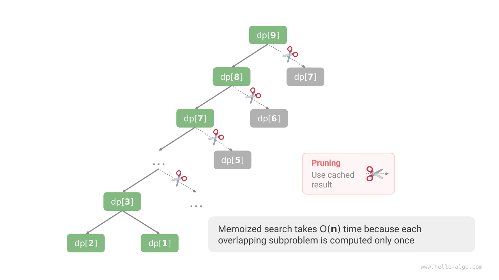

# 14.1 &nbsp; Introduction to dynamic programming

<u>Dynamic programming</u> is an important algorithmic paradigm. It breaks a problem into smaller subproblems and stores their solutions to avoid repeated computation, greatly improving time efficiency.

We will start with a classic example, give a brute-force backtracking solution, identify its overlapping subproblems, and gradually derive a more efficient dynamic programming solution.

!!! question "Climbing stairs"

    Given a staircase with $n$ steps, you may climb $1$ or $2$ steps at a time. How many ways are there to reach the top?

As shown in Figure 14-1, a staircase with $3$ steps has $3$ possible ways to reach the top.

{ class="animation-figure" }

<p align="center"> Figure 14-1 &nbsp; Number of ways to reach step 3 </p>

The goal is to count solutions, so **we can use backtracking to enumerate every possibility**. View climbing as a sequence of choices: starting from the ground, choose to climb $1$ or $2$ steps each time. Add $1$ to the count whenever we reach the top, and prune any branch that goes beyond it. The code is as follows:

=== "Python"

    ```python title="climbing_stairs_backtrack.py"
    def backtrack(choices: list[int], state: int, n: int, res: list[int]) -> int:
        """Backtracking"""
        # When step n is reached, increase the number of ways by 1
        if state == n:
            res[0] += 1
        # Iterate over all choices
        for choice in choices:
            # Prune: do not go beyond step n
            if state + choice > n:
                continue
            # Try: make a choice and update the state
            backtrack(choices, state + choice, n, res)
            # Backtrack

    def climbing_stairs_backtrack(n: int) -> int:
        """Climbing stairs: backtracking"""
        choices = [1, 2]  # Choose to climb 1 or 2 steps
        state = 0  # Start climbing from step 0
        res = [0]  # Use res[0] to record the number of ways
        backtrack(choices, state, n, res)
        return res[0]
    ```

=== "C++"

    ```cpp title="climbing_stairs_backtrack.cpp"
    /* Backtracking */
    void backtrack(vector<int> &choices, int state, int n, vector<int> &res) {
        // When step n is reached, increase the number of ways by 1
        if (state == n)
            res[0]++;
        // Iterate over all choices
        for (auto &choice : choices) {
            // Prune: do not go beyond step n
            if (state + choice > n)
                continue;
            // Try: make a choice and update the state
            backtrack(choices, state + choice, n, res);
            // Backtrack
        }
    }

    /* Climbing stairs: backtracking */
    int climbingStairsBacktrack(int n) {
        vector<int> choices = {1, 2}; // Choose to climb 1 or 2 steps
        int state = 0;                // Start climbing from step 0
        vector<int> res = {0};        // Use res[0] to record the number of ways
        backtrack(choices, state, n, res);
        return res[0];
    }
    ```

=== "Java"

    ```java title="climbing_stairs_backtrack.java"
    /* Backtracking */
    void backtrack(List<Integer> choices, int state, int n, List<Integer> res) {
        // When step n is reached, increase the number of ways by 1
        if (state == n)
            res.set(0, res.get(0) + 1);
        // Iterate over all choices
        for (Integer choice : choices) {
            // Prune: do not go beyond step n
            if (state + choice > n)
                continue;
            // Try: make a choice and update the state
            backtrack(choices, state + choice, n, res);
            // Backtrack
        }
    }

    /* Climbing stairs: backtracking */
    int climbingStairsBacktrack(int n) {
        List<Integer> choices = Arrays.asList(1, 2); // Choose to climb 1 or 2 steps
        int state = 0; // Start climbing from step 0
        List<Integer> res = new ArrayList<>();
        res.add(0); // Use res[0] to record the number of ways
        backtrack(choices, state, n, res);
        return res.get(0);
    }
    ```

=== "C#"

    ```csharp title="climbing_stairs_backtrack.cs"
    /* Backtracking */
    void Backtrack(List<int> choices, int state, int n, List<int> res) {
        // When step n is reached, increase the number of ways by 1
        if (state == n)
            res[0]++;
        // Iterate over all choices
        foreach (int choice in choices) {
            // Prune: do not go beyond step n
            if (state + choice > n)
                continue;
            // Try: make a choice and update the state
            Backtrack(choices, state + choice, n, res);
            // Backtrack
        }
    }

    /* Climbing stairs: backtracking */
    int ClimbingStairsBacktrack(int n) {
        List<int> choices = [1, 2]; // Choose to climb 1 or 2 steps
        int state = 0; // Start climbing from step 0
        List<int> res = [0]; // Use res[0] to record the number of ways
        Backtrack(choices, state, n, res);
        return res[0];
    }
    ```

=== "Go"

    ```go title="climbing_stairs_backtrack.go"
    /* Backtracking */
    func backtrack(choices []int, state, n int, res []int) {
        // When step n is reached, increase the number of ways by 1
        if state == n {
            res[0] = res[0] + 1
        }
        // Iterate over all choices
        for _, choice := range choices {
            // Prune: do not go beyond step n
            if state+choice > n {
                continue
            }
            // Try: make a choice and update the state
            backtrack(choices, state+choice, n, res)
            // Backtrack
        }
    }

    /* Climbing stairs: backtracking */
    func climbingStairsBacktrack(n int) int {
        // Choose to climb 1 or 2 steps
        choices := []int{1, 2}
        // Start climbing from step 0
        state := 0
        res := make([]int, 1)
        // Use res[0] to record the number of ways
        res[0] = 0
        backtrack(choices, state, n, res)
        return res[0]
    }
    ```

=== "Swift"

    ```swift title="climbing_stairs_backtrack.swift"
    /* Backtracking */
    func backtrack(choices: [Int], state: Int, n: Int, res: inout [Int]) {
        // When step n is reached, increase the number of ways by 1
        if state == n {
            res[0] += 1
        }
        // Iterate over all choices
        for choice in choices {
            // Prune: do not go beyond step n
            if state + choice > n {
                continue
            }
            // Try: make a choice and update the state
            backtrack(choices: choices, state: state + choice, n: n, res: &res)
            // Backtrack
        }
    }

    /* Climbing stairs: backtracking */
    func climbingStairsBacktrack(n: Int) -> Int {
        let choices = [1, 2] // Choose to climb 1 or 2 steps
        let state = 0 // Start climbing from step 0
        var res: [Int] = []
        res.append(0) // Use res[0] to record the number of ways
        backtrack(choices: choices, state: state, n: n, res: &res)
        return res[0]
    }
    ```

=== "JS"

    ```javascript title="climbing_stairs_backtrack.js"
    /* Backtracking */
    function backtrack(choices, state, n, res) {
        // When step n is reached, increase the number of ways by 1
        if (state === n) res.set(0, res.get(0) + 1);
        // Iterate over all choices
        for (const choice of choices) {
            // Prune: do not go beyond step n
            if (state + choice > n) continue;
            // Try: make a choice and update the state
            backtrack(choices, state + choice, n, res);
            // Backtrack
        }
    }

    /* Climbing stairs: backtracking */
    function climbingStairsBacktrack(n) {
        const choices = [1, 2]; // Choose to climb 1 or 2 steps
        const state = 0; // Start climbing from step 0
        const res = new Map();
        res.set(0, 0); // Store the number of ways at key 0 in res
        backtrack(choices, state, n, res);
        return res.get(0);
    }
    ```

=== "TS"

    ```typescript title="climbing_stairs_backtrack.ts"
    /* Backtracking */
    function backtrack(
        choices: number[],
        state: number,
        n: number,
        res: Map<0, any>
    ): void {
        // When step n is reached, increase the number of ways by 1
        if (state === n) res.set(0, res.get(0) + 1);
        // Iterate over all choices
        for (const choice of choices) {
            // Prune: do not go beyond step n
            if (state + choice > n) continue;
            // Try: make a choice and update the state
            backtrack(choices, state + choice, n, res);
            // Backtrack
        }
    }

    /* Climbing stairs: backtracking */
    function climbingStairsBacktrack(n: number): number {
        const choices = [1, 2]; // Choose to climb 1 or 2 steps
        const state = 0; // Start climbing from step 0
        const res = new Map();
        res.set(0, 0); // Store the number of ways at key 0 in res
        backtrack(choices, state, n, res);
        return res.get(0);
    }
    ```

=== "Dart"

    ```dart title="climbing_stairs_backtrack.dart"
    /* Backtracking */
    void backtrack(List<int> choices, int state, int n, List<int> res) {
      // When step n is reached, increase the number of ways by 1
      if (state == n) {
        res[0]++;
      }
      // Iterate over all choices
      for (int choice in choices) {
        // Prune: do not go beyond step n
        if (state + choice > n) continue;
        // Try: make a choice and update the state
        backtrack(choices, state + choice, n, res);
        // Backtrack
      }
    }

    /* Climbing stairs: backtracking */
    int climbingStairsBacktrack(int n) {
      List<int> choices = [1, 2]; // Choose to climb 1 or 2 steps
      int state = 0; // Start climbing from step 0
      List<int> res = [];
      res.add(0); // Use res[0] to record the number of ways
      backtrack(choices, state, n, res);
      return res[0];
    }
    ```

=== "Rust"

    ```rust title="climbing_stairs_backtrack.rs"
    /* Backtracking */
    fn backtrack(choices: &[i32], state: i32, n: i32, res: &mut [i32]) {
        // When step n is reached, increase the number of ways by 1
        if state == n {
            res[0] = res[0] + 1;
        }
        // Iterate over all choices
        for &choice in choices {
            // Prune: do not go beyond step n
            if state + choice > n {
                continue;
            }
            // Try: make a choice and update the state
            backtrack(choices, state + choice, n, res);
            // Backtrack
        }
    }

    /* Climbing stairs: backtracking */
    fn climbing_stairs_backtrack(n: usize) -> i32 {
        let choices = vec![1, 2]; // Choose to climb 1 or 2 steps
        let state = 0; // Start climbing from step 0
        let mut res = Vec::new();
        res.push(0); // Use res[0] to record the number of ways
        backtrack(&choices, state, n as i32, &mut res);
        res[0]
    }
    ```

=== "C"

    ```c title="climbing_stairs_backtrack.c"
    /* Backtracking */
    void backtrack(int *choices, int state, int n, int *res, int len) {
        // When step n is reached, increase the number of ways by 1
        if (state == n)
            res[0]++;
        // Iterate over all choices
        for (int i = 0; i < len; i++) {
            int choice = choices[i];
            // Prune: do not go beyond step n
            if (state + choice > n)
                continue;
            // Try: make a choice and update the state
            backtrack(choices, state + choice, n, res, len);
            // Backtrack
        }
    }

    /* Climbing stairs: backtracking */
    int climbingStairsBacktrack(int n) {
        int choices[2] = {1, 2}; // Choose to climb 1 or 2 steps
        int state = 0;           // Start climbing from step 0
        int *res = (int *)malloc(sizeof(int));
        *res = 0; // Use res[0] to record the number of ways
        int len = sizeof(choices) / sizeof(int);
        backtrack(choices, state, n, res, len);
        int result = *res;
        free(res);
        return result;
    }
    ```

=== "Kotlin"

    ```kotlin title="climbing_stairs_backtrack.kt"
    /* Backtracking */
    fun backtrack(
        choices: MutableList<Int>,
        state: Int,
        n: Int,
        res: MutableList<Int>
    ) {
        // When step n is reached, increase the number of ways by 1
        if (state == n)
            res[0] = res[0] + 1
        // Iterate over all choices
        for (choice in choices) {
            // Prune: do not go beyond step n
            if (state + choice > n) continue
            // Try: make a choice and update the state
            backtrack(choices, state + choice, n, res)
            // Backtrack
        }
    }

    /* Climbing stairs: backtracking */
    fun climbingStairsBacktrack(n: Int): Int {
        val choices = mutableListOf(1, 2) // Choose to climb 1 or 2 steps
        val state = 0 // Start climbing from step 0
        val res = mutableListOf<Int>()
        res.add(0) // Use res[0] to record the number of ways
        backtrack(choices, state, n, res)
        return res[0]
    }
    ```

=== "Ruby"

    ```ruby title="climbing_stairs_backtrack.rb"
    ### Backtracking ###
    def backtrack(choices, state, n, res)
      # When step n is reached, increase the number of ways by 1
      res[0] += 1 if state == n
      # Iterate over all choices
      for choice in choices
        # Prune: do not go beyond step n
        next if state + choice > n

        # Try: make a choice and update the state
        backtrack(choices, state + choice, n, res)
      end
      # Backtrack
    end

    ### Climbing stairs: backtracking ###
    def climbing_stairs_backtrack(n)
      choices = [1, 2] # Choose to climb 1 or 2 steps
      state = 0 # Start climbing from step 0
      res = [0] # Use res[0] to record the number of ways
      backtrack(choices, state, n, res)
      res.first
    end
    ```

??? pythontutor "Visualize execution"

    <div style="height: 549px; width: 100%;"><iframe class="pythontutor-iframe" title="Visualize execution" src="https://pythontutor.com/iframe-embed.html#code=def%20backtrack%28choices%3A%20list%5Bint%5D,%20state%3A%20int,%20n%3A%20int,%20res%3A%20list%5Bint%5D%29%20-%3E%20int%3A%0A%20%20%20%20%22%22%22Backtracking%22%22%22%0A%20%20%20%20%23%20When%20step%20n%20is%20reached,%20increase%20the%20number%20of%20ways%20by%201%0A%20%20%20%20if%20state%20%3D%3D%20n%3A%0A%20%20%20%20%20%20%20%20res%5B0%5D%20%2B%3D%201%0A%20%20%20%20%23%20Iterate%20over%20all%20choices%0A%20%20%20%20for%20choice%20in%20choices%3A%0A%20%20%20%20%20%20%20%20%23%20Prune%3A%20do%20not%20go%20beyond%20step%20n%0A%20%20%20%20%20%20%20%20if%20state%20%2B%20choice%20%3E%20n%3A%0A%20%20%20%20%20%20%20%20%20%20%20%20continue%0A%20%20%20%20%20%20%20%20%23%20Try%3A%20make%20a%20choice%20and%20update%20the%20state%0A%20%20%20%20%20%20%20%20backtrack%28choices,%20state%20%2B%20choice,%20n,%20res%29%0A%20%20%20%20%20%20%20%20%23%20Backtrack%0A%0A%0Adef%20climbing_stairs_backtrack%28n%3A%20int%29%20-%3E%20int%3A%0A%20%20%20%20%22%22%22Climbing%20stairs%3A%20backtracking%22%22%22%0A%20%20%20%20choices%20%3D%20%5B1,%202%5D%20%20%23%20Choose%20to%20climb%201%20or%202%20steps%0A%20%20%20%20state%20%3D%200%20%20%23%20Start%20climbing%20from%20step%200%0A%20%20%20%20res%20%3D%20%5B0%5D%20%20%23%20Use%20res%5B0%5D%20to%20record%20the%20number%20of%20ways%0A%20%20%20%20backtrack%28choices,%20state,%20n,%20res%29%0A%20%20%20%20return%20res%5B0%5D%0A%0A%0A%22%22%22Driver%20code%22%22%22%0Aif%20__name__%20%3D%3D%20%22__main__%22%3A%0A%20%20%20%20n%20%3D%204%0A%0A%20%20%20%20res%20%3D%20climbing_stairs_backtrack%28n%29%0A%20%20%20%20print%28f%22Number%20of%20ways%20to%20climb%20%7Bn%7D%20stairs%3A%20%7Bres%7D%22%29&codeDivHeight=472&codeDivWidth=350&cumulative=false&curInstr=5&heapPrimitives=nevernest&origin=opt-frontend.js&py=311&rawInputLstJSON=%5B%5D&textReferences=false"> </iframe></div>
    <div style="margin-top: 5px;"><a href="https://pythontutor.com/iframe-embed.html#code=def%20backtrack%28choices%3A%20list%5Bint%5D,%20state%3A%20int,%20n%3A%20int,%20res%3A%20list%5Bint%5D%29%20-%3E%20int%3A%0A%20%20%20%20%22%22%22Backtracking%22%22%22%0A%20%20%20%20%23%20When%20step%20n%20is%20reached,%20increase%20the%20number%20of%20ways%20by%201%0A%20%20%20%20if%20state%20%3D%3D%20n%3A%0A%20%20%20%20%20%20%20%20res%5B0%5D%20%2B%3D%201%0A%20%20%20%20%23%20Iterate%20over%20all%20choices%0A%20%20%20%20for%20choice%20in%20choices%3A%0A%20%20%20%20%20%20%20%20%23%20Prune%3A%20do%20not%20go%20beyond%20step%20n%0A%20%20%20%20%20%20%20%20if%20state%20%2B%20choice%20%3E%20n%3A%0A%20%20%20%20%20%20%20%20%20%20%20%20continue%0A%20%20%20%20%20%20%20%20%23%20Try%3A%20make%20a%20choice%20and%20update%20the%20state%0A%20%20%20%20%20%20%20%20backtrack%28choices,%20state%20%2B%20choice,%20n,%20res%29%0A%20%20%20%20%20%20%20%20%23%20Backtrack%0A%0A%0Adef%20climbing_stairs_backtrack%28n%3A%20int%29%20-%3E%20int%3A%0A%20%20%20%20%22%22%22Climbing%20stairs%3A%20backtracking%22%22%22%0A%20%20%20%20choices%20%3D%20%5B1,%202%5D%20%20%23%20Choose%20to%20climb%201%20or%202%20steps%0A%20%20%20%20state%20%3D%200%20%20%23%20Start%20climbing%20from%20step%200%0A%20%20%20%20res%20%3D%20%5B0%5D%20%20%23%20Use%20res%5B0%5D%20to%20record%20the%20number%20of%20ways%0A%20%20%20%20backtrack%28choices,%20state,%20n,%20res%29%0A%20%20%20%20return%20res%5B0%5D%0A%0A%0A%22%22%22Driver%20code%22%22%22%0Aif%20__name__%20%3D%3D%20%22__main__%22%3A%0A%20%20%20%20n%20%3D%204%0A%0A%20%20%20%20res%20%3D%20climbing_stairs_backtrack%28n%29%0A%20%20%20%20print%28f%22Number%20of%20ways%20to%20climb%20%7Bn%7D%20stairs%3A%20%7Bres%7D%22%29&codeDivHeight=800&codeDivWidth=600&cumulative=false&curInstr=5&heapPrimitives=nevernest&origin=opt-frontend.js&py=311&rawInputLstJSON=%5B%5D&textReferences=false" target="_blank" rel="noopener noreferrer">View full screen ></a></div>

## 14.1.1 &nbsp; Method 1: Brute-force search

Backtracking usually does not explicitly decompose the problem. Instead, it treats a solution as a sequence of decisions and searches all possible solutions through trial and pruning.

Let's analyze this problem through decomposition. Let $dp[i]$ be the number of ways to reach step $i$. The original problem is $dp[i]$, and its subproblems include:

$$
dp[i-1], dp[i-2], \dots, dp[2], dp[1]
$$

Since each move climbs $1$ or $2$ steps, when we stand on step $i$, we must previously have been on step $i - 1$ or $i - 2$. In other words, step $i$ can only be reached from step $i -1$ or $i - 2$.

This gives an important result: **the number of ways to reach step $i - 1$ plus the number of ways to reach step $i - 2$ equals the number of ways to reach step $i$**. In symbols:

$$
dp[i] = dp[i-1] + dp[i-2]
$$

Thus, the subproblems are linked by a recurrence: **the solution to the original problem can be constructed from subproblem solutions**. Figure 14-2 illustrates this relationship.

{ class="animation-figure" }

<p align="center"> Figure 14-2 &nbsp; Recurrence for the number of ways </p>

The recurrence gives a brute-force search solution. Starting at $dp[n]$, **recursively express a larger problem as the sum of two smaller ones** until reaching $dp[1]$ or $dp[2]$. Their solutions are known: $dp[1] = 1$ and $dp[2] = 2$, meaning steps $1$ and $2$ can be reached in $1$ and $2$ ways, respectively.

Like the standard backtracking code, the following code performs depth-first search, but is more concise:

=== "Python"

    ```python title="climbing_stairs_dfs.py"
    def dfs(i: int) -> int:
        """Search"""
        # The values of dp[1] and dp[2] are known; return the corresponding value
        if i == 1 or i == 2:
            return i
        # dp[i] = dp[i-1] + dp[i-2]
        count = dfs(i - 1) + dfs(i - 2)
        return count

    def climbing_stairs_dfs(n: int) -> int:
        """Climbing stairs: search"""
        return dfs(n)
    ```

=== "C++"

    ```cpp title="climbing_stairs_dfs.cpp"
    /* Search */
    int dfs(int i) {
        // The values of dp[1] and dp[2] are known; return them
        if (i == 1 || i == 2)
            return i;
        // dp[i] = dp[i-1] + dp[i-2]
        int count = dfs(i - 1) + dfs(i - 2);
        return count;
    }

    /* Climbing stairs: search */
    int climbingStairsDFS(int n) {
        return dfs(n);
    }
    ```

=== "Java"

    ```java title="climbing_stairs_dfs.java"
    /* Search */
    int dfs(int i) {
        // The values of dp[1] and dp[2] are known; return them
        if (i == 1 || i == 2)
            return i;
        // dp[i] = dp[i-1] + dp[i-2]
        int count = dfs(i - 1) + dfs(i - 2);
        return count;
    }

    /* Climbing stairs: search */
    int climbingStairsDFS(int n) {
        return dfs(n);
    }
    ```

=== "C#"

    ```csharp title="climbing_stairs_dfs.cs"
    /* Search */
    int DFS(int i) {
        // The values of dp[1] and dp[2] are known; return them
        if (i == 1 || i == 2)
            return i;
        // dp[i] = dp[i-1] + dp[i-2]
        int count = DFS(i - 1) + DFS(i - 2);
        return count;
    }

    /* Climbing stairs: search */
    int ClimbingStairsDFS(int n) {
        return DFS(n);
    }
    ```

=== "Go"

    ```go title="climbing_stairs_dfs.go"
    /* Search */
    func dfs(i int) int {
        // The values of dp[1] and dp[2] are known; return them
        if i == 1 || i == 2 {
            return i
        }
        // dp[i] = dp[i-1] + dp[i-2]
        count := dfs(i-1) + dfs(i-2)
        return count
    }

    /* Climbing stairs: search */
    func climbingStairsDFS(n int) int {
        return dfs(n)
    }
    ```

=== "Swift"

    ```swift title="climbing_stairs_dfs.swift"
    /* Search */
    func dfs(i: Int) -> Int {
        // The values of dp[1] and dp[2] are known; return them
        if i == 1 || i == 2 {
            return i
        }
        // dp[i] = dp[i-1] + dp[i-2]
        let count = dfs(i: i - 1) + dfs(i: i - 2)
        return count
    }

    /* Climbing stairs: search */
    func climbingStairsDFS(n: Int) -> Int {
        dfs(i: n)
    }
    ```

=== "JS"

    ```javascript title="climbing_stairs_dfs.js"
    /* Search */
    function dfs(i) {
        // The values of dp[1] and dp[2] are known; return them
        if (i === 1 || i === 2) return i;
        // dp[i] = dp[i-1] + dp[i-2]
        const count = dfs(i - 1) + dfs(i - 2);
        return count;
    }

    /* Climbing stairs: search */
    function climbingStairsDFS(n) {
        return dfs(n);
    }
    ```

=== "TS"

    ```typescript title="climbing_stairs_dfs.ts"
    /* Search */
    function dfs(i: number): number {
        // The values of dp[1] and dp[2] are known; return them
        if (i === 1 || i === 2) return i;
        // dp[i] = dp[i-1] + dp[i-2]
        const count = dfs(i - 1) + dfs(i - 2);
        return count;
    }

    /* Climbing stairs: search */
    function climbingStairsDFS(n: number): number {
        return dfs(n);
    }
    ```

=== "Dart"

    ```dart title="climbing_stairs_dfs.dart"
    /* Search */
    int dfs(int i) {
      // The values of dp[1] and dp[2] are known; return them
      if (i == 1 || i == 2) return i;
      // dp[i] = dp[i-1] + dp[i-2]
      int count = dfs(i - 1) + dfs(i - 2);
      return count;
    }

    /* Climbing stairs: search */
    int climbingStairsDFS(int n) {
      return dfs(n);
    }
    ```

=== "Rust"

    ```rust title="climbing_stairs_dfs.rs"
    /* Search */
    fn dfs(i: usize) -> i32 {
        // The values of dp[1] and dp[2] are known; return them
        if i == 1 || i == 2 {
            return i as i32;
        }
        // dp[i] = dp[i-1] + dp[i-2]
        let count = dfs(i - 1) + dfs(i - 2);
        count
    }

    /* Climbing stairs: search */
    fn climbing_stairs_dfs(n: usize) -> i32 {
        dfs(n)
    }
    ```

=== "C"

    ```c title="climbing_stairs_dfs.c"
    /* Search */
    int dfs(int i) {
        // The values of dp[1] and dp[2] are known; return them
        if (i == 1 || i == 2)
            return i;
        // dp[i] = dp[i-1] + dp[i-2]
        int count = dfs(i - 1) + dfs(i - 2);
        return count;
    }

    /* Climbing stairs: search */
    int climbingStairsDFS(int n) {
        return dfs(n);
    }
    ```

=== "Kotlin"

    ```kotlin title="climbing_stairs_dfs.kt"
    /* Search */
    fun dfs(i: Int): Int {
        // The values of dp[1] and dp[2] are known; return them
        if (i == 1 || i == 2) return i
        // dp[i] = dp[i-1] + dp[i-2]
        val count = dfs(i - 1) + dfs(i - 2)
        return count
    }

    /* Climbing stairs: search */
    fun climbingStairsDFS(n: Int): Int {
        return dfs(n)
    }
    ```

=== "Ruby"

    ```ruby title="climbing_stairs_dfs.rb"
    ### Search ###
    def dfs(i)
      # The values of dp[1] and dp[2] are known; return them
      return i if i == 1 || i == 2
      # dp[i] = dp[i-1] + dp[i-2]
      dfs(i - 1) + dfs(i - 2)
    end

    ### Climbing stairs: search ###
    def climbing_stairs_dfs(n)
      dfs(n)
    end
    ```

??? pythontutor "Visualize execution"

    <div style="height: 549px; width: 100%;"><iframe class="pythontutor-iframe" title="Visualize execution" src="https://pythontutor.com/iframe-embed.html#code=def%20dfs%28i%3A%20int%29%20-%3E%20int%3A%0A%20%20%20%20%22%22%22Search%22%22%22%0A%20%20%20%20%23%20The%20values%20of%20dp%5B1%5D%20and%20dp%5B2%5D%20are%20known%3B%20return%20the%20corresponding%20value%0A%20%20%20%20if%20i%20%3D%3D%201%20or%20i%20%3D%3D%202%3A%0A%20%20%20%20%20%20%20%20return%20i%0A%20%20%20%20%23%20dp%5Bi%5D%20%3D%20dp%5Bi-1%5D%20%2B%20dp%5Bi-2%5D%0A%20%20%20%20count%20%3D%20dfs%28i%20-%201%29%20%2B%20dfs%28i%20-%202%29%0A%20%20%20%20return%20count%0A%0A%0Adef%20climbing_stairs_dfs%28n%3A%20int%29%20-%3E%20int%3A%0A%20%20%20%20%22%22%22Climbing%20stairs%3A%20search%22%22%22%0A%20%20%20%20return%20dfs%28n%29%0A%0A%0A%22%22%22Driver%20code%22%22%22%0Aif%20__name__%20%3D%3D%20%22__main__%22%3A%0A%20%20%20%20n%20%3D%209%0A%0A%20%20%20%20res%20%3D%20climbing_stairs_dfs%28n%29%0A%20%20%20%20print%28f%22Number%20of%20ways%20to%20climb%20%7Bn%7D%20stairs%3A%20%7Bres%7D%22%29&codeDivHeight=472&codeDivWidth=350&cumulative=false&curInstr=5&heapPrimitives=nevernest&origin=opt-frontend.js&py=311&rawInputLstJSON=%5B%5D&textReferences=false"> </iframe></div>
    <div style="margin-top: 5px;"><a href="https://pythontutor.com/iframe-embed.html#code=def%20dfs%28i%3A%20int%29%20-%3E%20int%3A%0A%20%20%20%20%22%22%22Search%22%22%22%0A%20%20%20%20%23%20The%20values%20of%20dp%5B1%5D%20and%20dp%5B2%5D%20are%20known%3B%20return%20the%20corresponding%20value%0A%20%20%20%20if%20i%20%3D%3D%201%20or%20i%20%3D%3D%202%3A%0A%20%20%20%20%20%20%20%20return%20i%0A%20%20%20%20%23%20dp%5Bi%5D%20%3D%20dp%5Bi-1%5D%20%2B%20dp%5Bi-2%5D%0A%20%20%20%20count%20%3D%20dfs%28i%20-%201%29%20%2B%20dfs%28i%20-%202%29%0A%20%20%20%20return%20count%0A%0A%0Adef%20climbing_stairs_dfs%28n%3A%20int%29%20-%3E%20int%3A%0A%20%20%20%20%22%22%22Climbing%20stairs%3A%20search%22%22%22%0A%20%20%20%20return%20dfs%28n%29%0A%0A%0A%22%22%22Driver%20code%22%22%22%0Aif%20__name__%20%3D%3D%20%22__main__%22%3A%0A%20%20%20%20n%20%3D%209%0A%0A%20%20%20%20res%20%3D%20climbing_stairs_dfs%28n%29%0A%20%20%20%20print%28f%22Number%20of%20ways%20to%20climb%20%7Bn%7D%20stairs%3A%20%7Bres%7D%22%29&codeDivHeight=800&codeDivWidth=600&cumulative=false&curInstr=5&heapPrimitives=nevernest&origin=opt-frontend.js&py=311&rawInputLstJSON=%5B%5D&textReferences=false" target="_blank" rel="noopener noreferrer">View full screen ></a></div>

Figure 14-3 shows the recursion tree for brute-force search. For $dp[n]$, its depth is $n$, and the time complexity is $O(2^n)$. Exponential growth is explosive, so a relatively large $n$ leads to a very long wait.

{ class="animation-figure" }

<p align="center"> Figure 14-3 &nbsp; Recursion tree for climbing stairs </p>

As Figure 14-3 shows, **overlapping subproblems cause the exponential time complexity**. For example, $dp[9]$ splits into $dp[8]$ and $dp[7]$, while $dp[8]$ splits into $dp[7]$ and $dp[6]$. Both contain $dp[7]$.

These subproblems in turn contain smaller overlapping subproblems, and the pattern repeats at deeper levels of the recursion tree. Most of the computation is wasted on solving the same subproblems repeatedly.

## 14.1.2 &nbsp; Method 2: Memoized search

To improve efficiency, **we want every overlapping subproblem to be solved only once**. Introduce an array `mem` to record each solution and prune repeated subproblems during the search.

1. The first time we calculate $dp[i]$, store it in `mem[i]` for later use.
2. When $dp[i]$ is needed again, retrieve it directly from `mem[i]` instead of recomputing it.

The code is as follows:

=== "Python"

    ```python title="climbing_stairs_dfs_mem.py"
    def dfs(i: int, mem: list[int]) -> int:
        """Memoized search"""
        # The values of dp[1] and dp[2] are known; return the corresponding value
        if i == 1 or i == 2:
            return i
        # If dp[i] has been recorded, return it directly
        if mem[i] != -1:
            return mem[i]
        # dp[i] = dp[i-1] + dp[i-2]
        count = dfs(i - 1, mem) + dfs(i - 2, mem)
        # Record dp[i]
        mem[i] = count
        return count

    def climbing_stairs_dfs_mem(n: int) -> int:
        """Climbing stairs: memoized search"""
        # mem[i] stores the number of ways to reach step i; -1 means no result has been recorded
        mem = [-1] * (n + 1)
        return dfs(n, mem)
    ```

=== "C++"

    ```cpp title="climbing_stairs_dfs_mem.cpp"
    /* Memoized search */
    int dfs(int i, vector<int> &mem) {
        // The values of dp[1] and dp[2] are known; return them
        if (i == 1 || i == 2)
            return i;
        // If dp[i] has been recorded, return it directly
        if (mem[i] != -1)
            return mem[i];
        // dp[i] = dp[i-1] + dp[i-2]
        int count = dfs(i - 1, mem) + dfs(i - 2, mem);
        // Record dp[i]
        mem[i] = count;
        return count;
    }

    /* Climbing stairs: memoized search */
    int climbingStairsDFSMem(int n) {
        // mem[i] stores the number of ways to reach step i; -1 means no result has been recorded
        vector<int> mem(n + 1, -1);
        return dfs(n, mem);
    }
    ```

=== "Java"

    ```java title="climbing_stairs_dfs_mem.java"
    /* Memoized search */
    int dfs(int i, int[] mem) {
        // The values of dp[1] and dp[2] are known; return them
        if (i == 1 || i == 2)
            return i;
        // If dp[i] has been recorded, return it directly
        if (mem[i] != -1)
            return mem[i];
        // dp[i] = dp[i-1] + dp[i-2]
        int count = dfs(i - 1, mem) + dfs(i - 2, mem);
        // Record dp[i]
        mem[i] = count;
        return count;
    }

    /* Climbing stairs: memoized search */
    int climbingStairsDFSMem(int n) {
        // mem[i] stores the number of ways to reach step i; -1 means no result has been recorded
        int[] mem = new int[n + 1];
        Arrays.fill(mem, -1);
        return dfs(n, mem);
    }
    ```

=== "C#"

    ```csharp title="climbing_stairs_dfs_mem.cs"
    /* Memoized search */
    int DFS(int i, int[] mem) {
        // The values of dp[1] and dp[2] are known; return them
        if (i == 1 || i == 2)
            return i;
        // If dp[i] has been recorded, return it directly
        if (mem[i] != -1)
            return mem[i];
        // dp[i] = dp[i-1] + dp[i-2]
        int count = DFS(i - 1, mem) + DFS(i - 2, mem);
        // Record dp[i]
        mem[i] = count;
        return count;
    }

    /* Climbing stairs: memoized search */
    int ClimbingStairsDFSMem(int n) {
        // mem[i] stores the number of ways to reach step i; -1 means no result has been recorded
        int[] mem = new int[n + 1];
        Array.Fill(mem, -1);
        return DFS(n, mem);
    }
    ```

=== "Go"

    ```go title="climbing_stairs_dfs_mem.go"
    /* Memoized search */
    func dfsMem(i int, mem []int) int {
        // The values of dp[1] and dp[2] are known; return them
        if i == 1 || i == 2 {
            return i
        }
        // If dp[i] has been recorded, return it directly
        if mem[i] != -1 {
            return mem[i]
        }
        // dp[i] = dp[i-1] + dp[i-2]
        count := dfsMem(i-1, mem) + dfsMem(i-2, mem)
        // Record dp[i]
        mem[i] = count
        return count
    }

    /* Climbing stairs: memoized search */
    func climbingStairsDFSMem(n int) int {
        // mem[i] stores the number of ways to reach step i; -1 means no result has been recorded
        mem := make([]int, n+1)
        for i := range mem {
            mem[i] = -1
        }
        return dfsMem(n, mem)
    }
    ```

=== "Swift"

    ```swift title="climbing_stairs_dfs_mem.swift"
    /* Memoized search */
    func dfs(i: Int, mem: inout [Int]) -> Int {
        // The values of dp[1] and dp[2] are known; return them
        if i == 1 || i == 2 {
            return i
        }
        // If dp[i] has been recorded, return it directly
        if mem[i] != -1 {
            return mem[i]
        }
        // dp[i] = dp[i-1] + dp[i-2]
        let count = dfs(i: i - 1, mem: &mem) + dfs(i: i - 2, mem: &mem)
        // Record dp[i]
        mem[i] = count
        return count
    }

    /* Climbing stairs: memoized search */
    func climbingStairsDFSMem(n: Int) -> Int {
        // mem[i] stores the number of ways to reach step i; -1 means no result has been recorded
        var mem = Array(repeating: -1, count: n + 1)
        return dfs(i: n, mem: &mem)
    }
    ```

=== "JS"

    ```javascript title="climbing_stairs_dfs_mem.js"
    /* Memoized search */
    function dfs(i, mem) {
        // The values of dp[1] and dp[2] are known; return them
        if (i === 1 || i === 2) return i;
        // If dp[i] has been recorded, return it directly
        if (mem[i] != -1) return mem[i];
        // dp[i] = dp[i-1] + dp[i-2]
        const count = dfs(i - 1, mem) + dfs(i - 2, mem);
        // Record dp[i]
        mem[i] = count;
        return count;
    }

    /* Climbing stairs: memoized search */
    function climbingStairsDFSMem(n) {
        // mem[i] stores the number of ways to reach step i; -1 means no result has been recorded
        const mem = new Array(n + 1).fill(-1);
        return dfs(n, mem);
    }
    ```

=== "TS"

    ```typescript title="climbing_stairs_dfs_mem.ts"
    /* Memoized search */
    function dfs(i: number, mem: number[]): number {
        // The values of dp[1] and dp[2] are known; return them
        if (i === 1 || i === 2) return i;
        // If dp[i] has been recorded, return it directly
        if (mem[i] != -1) return mem[i];
        // dp[i] = dp[i-1] + dp[i-2]
        const count = dfs(i - 1, mem) + dfs(i - 2, mem);
        // Record dp[i]
        mem[i] = count;
        return count;
    }

    /* Climbing stairs: memoized search */
    function climbingStairsDFSMem(n: number): number {
        // mem[i] stores the number of ways to reach step i; -1 means no result has been recorded
        const mem = new Array(n + 1).fill(-1);
        return dfs(n, mem);
    }
    ```

=== "Dart"

    ```dart title="climbing_stairs_dfs_mem.dart"
    /* Memoized search */
    int dfs(int i, List<int> mem) {
      // The values of dp[1] and dp[2] are known; return them
      if (i == 1 || i == 2) return i;
      // If dp[i] has been recorded, return it directly
      if (mem[i] != -1) return mem[i];
      // dp[i] = dp[i-1] + dp[i-2]
      int count = dfs(i - 1, mem) + dfs(i - 2, mem);
      // Record dp[i]
      mem[i] = count;
      return count;
    }

    /* Climbing stairs: memoized search */
    int climbingStairsDFSMem(int n) {
      // mem[i] stores the number of ways to reach step i; -1 means no result has been recorded
      List<int> mem = List.filled(n + 1, -1);
      return dfs(n, mem);
    }
    ```

=== "Rust"

    ```rust title="climbing_stairs_dfs_mem.rs"
    /* Memoized search */
    fn dfs(i: usize, mem: &mut [i32]) -> i32 {
        // The values of dp[1] and dp[2] are known; return them
        if i == 1 || i == 2 {
            return i as i32;
        }
        // If dp[i] has been recorded, return it directly
        if mem[i] != -1 {
            return mem[i];
        }
        // dp[i] = dp[i-1] + dp[i-2]
        let count = dfs(i - 1, mem) + dfs(i - 2, mem);
        // Record dp[i]
        mem[i] = count;
        count
    }

    /* Climbing stairs: memoized search */
    fn climbing_stairs_dfs_mem(n: usize) -> i32 {
        // mem[i] stores the number of ways to reach step i; -1 means no result has been recorded
        let mut mem = vec![-1; n + 1];
        dfs(n, &mut mem)
    }
    ```

=== "C"

    ```c title="climbing_stairs_dfs_mem.c"
    /* Memoized search */
    int dfs(int i, int *mem) {
        // The values of dp[1] and dp[2] are known; return them
        if (i == 1 || i == 2)
            return i;
        // If dp[i] has been recorded, return it directly
        if (mem[i] != -1)
            return mem[i];
        // dp[i] = dp[i-1] + dp[i-2]
        int count = dfs(i - 1, mem) + dfs(i - 2, mem);
        // Record dp[i]
        mem[i] = count;
        return count;
    }

    /* Climbing stairs: memoized search */
    int climbingStairsDFSMem(int n) {
        // mem[i] stores the number of ways to reach step i; -1 means no result has been recorded
        int *mem = (int *)malloc((n + 1) * sizeof(int));
        for (int i = 0; i <= n; i++) {
            mem[i] = -1;
        }
        int result = dfs(n, mem);
        free(mem);
        return result;
    }
    ```

=== "Kotlin"

    ```kotlin title="climbing_stairs_dfs_mem.kt"
    /* Memoized search */
    fun dfs(i: Int, mem: IntArray): Int {
        // The values of dp[1] and dp[2] are known; return them
        if (i == 1 || i == 2) return i
        // If dp[i] has been recorded, return it directly
        if (mem[i] != -1) return mem[i]
        // dp[i] = dp[i-1] + dp[i-2]
        val count = dfs(i - 1, mem) + dfs(i - 2, mem)
        // Record dp[i]
        mem[i] = count
        return count
    }

    /* Climbing stairs: memoized search */
    fun climbingStairsDFSMem(n: Int): Int {
        // mem[i] stores the number of ways to reach step i; -1 means no result has been recorded
        val mem = IntArray(n + 1)
        mem.fill(-1)
        return dfs(n, mem)
    }
    ```

=== "Ruby"

    ```ruby title="climbing_stairs_dfs_mem.rb"
    ### Memoized search ###
    def dfs(i, mem)
      # The values of dp[1] and dp[2] are known; return them
      return i if i == 1 || i == 2
      # If dp[i] has been recorded, return it directly
      return mem[i] if mem[i] != -1

      # dp[i] = dp[i-1] + dp[i-2]
      count = dfs(i - 1, mem) + dfs(i - 2, mem)
      # Record dp[i]
      mem[i] = count
    end

    ### Climbing stairs: memoized search ###
    def climbing_stairs_dfs_mem(n)
      # mem[i] stores the number of ways to reach step i; -1 means no result has been recorded
      mem = Array.new(n + 1, -1)
      dfs(n, mem)
    end
    ```

??? pythontutor "Visualize execution"

    <div style="height: 549px; width: 100%;"><iframe class="pythontutor-iframe" title="Visualize execution" src="https://pythontutor.com/iframe-embed.html#code=def%20dfs%28i%3A%20int,%20mem%3A%20list%5Bint%5D%29%20-%3E%20int%3A%0A%20%20%20%20%22%22%22Memoized%20search%22%22%22%0A%20%20%20%20%23%20The%20values%20of%20dp%5B1%5D%20and%20dp%5B2%5D%20are%20known%3B%20return%20the%20corresponding%20value%0A%20%20%20%20if%20i%20%3D%3D%201%20or%20i%20%3D%3D%202%3A%0A%20%20%20%20%20%20%20%20return%20i%0A%20%20%20%20%23%20If%20dp%5Bi%5D%20has%20been%20recorded,%20return%20it%20directly%0A%20%20%20%20if%20mem%5Bi%5D%20%21%3D%20-1%3A%0A%20%20%20%20%20%20%20%20return%20mem%5Bi%5D%0A%20%20%20%20%23%20dp%5Bi%5D%20%3D%20dp%5Bi-1%5D%20%2B%20dp%5Bi-2%5D%0A%20%20%20%20count%20%3D%20dfs%28i%20-%201,%20mem%29%20%2B%20dfs%28i%20-%202,%20mem%29%0A%20%20%20%20%23%20Record%20dp%5Bi%5D%0A%20%20%20%20mem%5Bi%5D%20%3D%20count%0A%20%20%20%20return%20count%0A%0A%0Adef%20climbing_stairs_dfs_mem%28n%3A%20int%29%20-%3E%20int%3A%0A%20%20%20%20%22%22%22Climbing%20stairs%3A%20memoized%20search%22%22%22%0A%20%20%20%20%23%20mem%5Bi%5D%20stores%20the%20number%20of%20ways%20to%20reach%20step%20i%3B%20-1%20means%20no%20result%20has%20been%20recorded%0A%20%20%20%20mem%20%3D%20%5B-1%5D%20%2A%20%28n%20%2B%201%29%0A%20%20%20%20return%20dfs%28n,%20mem%29%0A%0A%0A%22%22%22Driver%20code%22%22%22%0Aif%20__name__%20%3D%3D%20%22__main__%22%3A%0A%20%20%20%20n%20%3D%209%0A%0A%20%20%20%20res%20%3D%20climbing_stairs_dfs_mem%28n%29%0A%20%20%20%20print%28f%22Number%20of%20ways%20to%20climb%20%7Bn%7D%20stairs%3A%20%7Bres%7D%22%29&codeDivHeight=472&codeDivWidth=350&cumulative=false&curInstr=5&heapPrimitives=nevernest&origin=opt-frontend.js&py=311&rawInputLstJSON=%5B%5D&textReferences=false"> </iframe></div>
    <div style="margin-top: 5px;"><a href="https://pythontutor.com/iframe-embed.html#code=def%20dfs%28i%3A%20int,%20mem%3A%20list%5Bint%5D%29%20-%3E%20int%3A%0A%20%20%20%20%22%22%22Memoized%20search%22%22%22%0A%20%20%20%20%23%20The%20values%20of%20dp%5B1%5D%20and%20dp%5B2%5D%20are%20known%3B%20return%20the%20corresponding%20value%0A%20%20%20%20if%20i%20%3D%3D%201%20or%20i%20%3D%3D%202%3A%0A%20%20%20%20%20%20%20%20return%20i%0A%20%20%20%20%23%20If%20dp%5Bi%5D%20has%20been%20recorded,%20return%20it%20directly%0A%20%20%20%20if%20mem%5Bi%5D%20%21%3D%20-1%3A%0A%20%20%20%20%20%20%20%20return%20mem%5Bi%5D%0A%20%20%20%20%23%20dp%5Bi%5D%20%3D%20dp%5Bi-1%5D%20%2B%20dp%5Bi-2%5D%0A%20%20%20%20count%20%3D%20dfs%28i%20-%201,%20mem%29%20%2B%20dfs%28i%20-%202,%20mem%29%0A%20%20%20%20%23%20Record%20dp%5Bi%5D%0A%20%20%20%20mem%5Bi%5D%20%3D%20count%0A%20%20%20%20return%20count%0A%0A%0Adef%20climbing_stairs_dfs_mem%28n%3A%20int%29%20-%3E%20int%3A%0A%20%20%20%20%22%22%22Climbing%20stairs%3A%20memoized%20search%22%22%22%0A%20%20%20%20%23%20mem%5Bi%5D%20stores%20the%20number%20of%20ways%20to%20reach%20step%20i%3B%20-1%20means%20no%20result%20has%20been%20recorded%0A%20%20%20%20mem%20%3D%20%5B-1%5D%20%2A%20%28n%20%2B%201%29%0A%20%20%20%20return%20dfs%28n,%20mem%29%0A%0A%0A%22%22%22Driver%20code%22%22%22%0Aif%20__name__%20%3D%3D%20%22__main__%22%3A%0A%20%20%20%20n%20%3D%209%0A%0A%20%20%20%20res%20%3D%20climbing_stairs_dfs_mem%28n%29%0A%20%20%20%20print%28f%22Number%20of%20ways%20to%20climb%20%7Bn%7D%20stairs%3A%20%7Bres%7D%22%29&codeDivHeight=800&codeDivWidth=600&cumulative=false&curInstr=5&heapPrimitives=nevernest&origin=opt-frontend.js&py=311&rawInputLstJSON=%5B%5D&textReferences=false" target="_blank" rel="noopener noreferrer">View full screen ></a></div>

As shown in Figure 14-4, **memoization makes every overlapping subproblem require only one computation, reducing the time complexity to $O(n)$**: a major improvement.

{ class="animation-figure" }

<p align="center"> Figure 14-4 &nbsp; Recursion tree for memoized search </p>

## 14.1.3 &nbsp; Method 3: Dynamic programming

**Memoized search is a top-down approach**: start with the original problem (the root), recursively divide larger subproblems into smaller ones until reaching the smallest subproblems with known solutions (the leaves), then collect their solutions as recursion returns to construct the solution to the original problem.

In contrast, **dynamic programming is a bottom-up approach**: start with the smallest subproblem solutions and iteratively build solutions to larger subproblems until the original problem is solved.

Because this dynamic programming process does not backtrack, it needs only iterative loops, not recursion. In the following code, the array `dp` stores subproblem solutions, serving the same role as `mem` in memoized search:

=== "Python"

    ```python title="climbing_stairs_dp.py"
    def climbing_stairs_dp(n: int) -> int:
        """Climbing stairs: dynamic programming"""
        if n == 1 or n == 2:
            return n
        # Initialize the dp table to store subproblem solutions
        dp = [0] * (n + 1)
        # Initial states: set the solutions to the smallest subproblems
        dp[1], dp[2] = 1, 2
        # State transitions: solve progressively larger subproblems using smaller ones
        for i in range(3, n + 1):
            dp[i] = dp[i - 1] + dp[i - 2]
        return dp[n]
    ```

=== "C++"

    ```cpp title="climbing_stairs_dp.cpp"
    /* Climbing stairs: dynamic programming */
    int climbingStairsDP(int n) {
        if (n == 1 || n == 2)
            return n;
        // Initialize the dp table to store subproblem solutions
        vector<int> dp(n + 1);
        // Initial states: set the solutions to the smallest subproblems
        dp[1] = 1;
        dp[2] = 2;
        // State transitions: solve progressively larger subproblems using smaller ones
        for (int i = 3; i <= n; i++) {
            dp[i] = dp[i - 1] + dp[i - 2];
        }
        return dp[n];
    }
    ```

=== "Java"

    ```java title="climbing_stairs_dp.java"
    /* Climbing stairs: dynamic programming */
    int climbingStairsDP(int n) {
        if (n == 1 || n == 2)
            return n;
        // Initialize the dp table to store subproblem solutions
        int[] dp = new int[n + 1];
        // Initial states: set the solutions to the smallest subproblems
        dp[1] = 1;
        dp[2] = 2;
        // State transitions: solve progressively larger subproblems using smaller ones
        for (int i = 3; i <= n; i++) {
            dp[i] = dp[i - 1] + dp[i - 2];
        }
        return dp[n];
    }
    ```

=== "C#"

    ```csharp title="climbing_stairs_dp.cs"
    /* Climbing stairs: dynamic programming */
    int ClimbingStairsDP(int n) {
        if (n == 1 || n == 2)
            return n;
        // Initialize the dp table to store subproblem solutions
        int[] dp = new int[n + 1];
        // Initial states: set the solutions to the smallest subproblems
        dp[1] = 1;
        dp[2] = 2;
        // State transitions: solve progressively larger subproblems using smaller ones
        for (int i = 3; i <= n; i++) {
            dp[i] = dp[i - 1] + dp[i - 2];
        }
        return dp[n];
    }
    ```

=== "Go"

    ```go title="climbing_stairs_dp.go"
    /* Climbing stairs: dynamic programming */
    func climbingStairsDP(n int) int {
        if n == 1 || n == 2 {
            return n
        }
        // Initialize the dp table to store subproblem solutions
        dp := make([]int, n+1)
        // Initial states: set the solutions to the smallest subproblems
        dp[1] = 1
        dp[2] = 2
        // State transitions: solve progressively larger subproblems using smaller ones
        for i := 3; i <= n; i++ {
            dp[i] = dp[i-1] + dp[i-2]
        }
        return dp[n]
    }
    ```

=== "Swift"

    ```swift title="climbing_stairs_dp.swift"
    /* Climbing stairs: dynamic programming */
    func climbingStairsDP(n: Int) -> Int {
        if n == 1 || n == 2 {
            return n
        }
        // Initialize the dp table to store subproblem solutions
        var dp = Array(repeating: 0, count: n + 1)
        // Initial states: set the solutions to the smallest subproblems
        dp[1] = 1
        dp[2] = 2
        // State transitions: solve progressively larger subproblems using smaller ones
        for i in 3 ... n {
            dp[i] = dp[i - 1] + dp[i - 2]
        }
        return dp[n]
    }
    ```

=== "JS"

    ```javascript title="climbing_stairs_dp.js"
    /* Climbing stairs: dynamic programming */
    function climbingStairsDP(n) {
        if (n === 1 || n === 2) return n;
        // Initialize the dp table to store subproblem solutions
        const dp = new Array(n + 1).fill(-1);
        // Initial states: set the solutions to the smallest subproblems
        dp[1] = 1;
        dp[2] = 2;
        // State transitions: solve progressively larger subproblems using smaller ones
        for (let i = 3; i <= n; i++) {
            dp[i] = dp[i - 1] + dp[i - 2];
        }
        return dp[n];
    }
    ```

=== "TS"

    ```typescript title="climbing_stairs_dp.ts"
    /* Climbing stairs: dynamic programming */
    function climbingStairsDP(n: number): number {
        if (n === 1 || n === 2) return n;
        // Initialize the dp table to store subproblem solutions
        const dp = new Array(n + 1).fill(-1);
        // Initial states: set the solutions to the smallest subproblems
        dp[1] = 1;
        dp[2] = 2;
        // State transitions: solve progressively larger subproblems using smaller ones
        for (let i = 3; i <= n; i++) {
            dp[i] = dp[i - 1] + dp[i - 2];
        }
        return dp[n];
    }
    ```

=== "Dart"

    ```dart title="climbing_stairs_dp.dart"
    /* Climbing stairs: dynamic programming */
    int climbingStairsDP(int n) {
      if (n == 1 || n == 2) return n;
      // Initialize the dp table to store subproblem solutions
      List<int> dp = List.filled(n + 1, 0);
      // Initial states: set the solutions to the smallest subproblems
      dp[1] = 1;
      dp[2] = 2;
      // State transitions: solve progressively larger subproblems using smaller ones
      for (int i = 3; i <= n; i++) {
        dp[i] = dp[i - 1] + dp[i - 2];
      }
      return dp[n];
    }
    ```

=== "Rust"

    ```rust title="climbing_stairs_dp.rs"
    /* Climbing stairs: dynamic programming */
    fn climbing_stairs_dp(n: usize) -> i32 {
        // The values of dp[1] and dp[2] are known; return them
        if n == 1 || n == 2 {
            return n as i32;
        }
        // Initialize the dp table to store subproblem solutions
        let mut dp = vec![-1; n + 1];
        // Initial states: set the solutions to the smallest subproblems
        dp[1] = 1;
        dp[2] = 2;
        // State transitions: solve progressively larger subproblems using smaller ones
        for i in 3..=n {
            dp[i] = dp[i - 1] + dp[i - 2];
        }
        dp[n]
    }
    ```

=== "C"

    ```c title="climbing_stairs_dp.c"
    /* Climbing stairs: dynamic programming */
    int climbingStairsDP(int n) {
        if (n == 1 || n == 2)
            return n;
        // Initialize the dp table to store subproblem solutions
        int *dp = (int *)malloc((n + 1) * sizeof(int));
        // Initial states: set the solutions to the smallest subproblems
        dp[1] = 1;
        dp[2] = 2;
        // State transitions: solve progressively larger subproblems using smaller ones
        for (int i = 3; i <= n; i++) {
            dp[i] = dp[i - 1] + dp[i - 2];
        }
        int result = dp[n];
        free(dp);
        return result;
    }
    ```

=== "Kotlin"

    ```kotlin title="climbing_stairs_dp.kt"
    /* Climbing stairs: dynamic programming */
    fun climbingStairsDP(n: Int): Int {
        if (n == 1 || n == 2) return n
        // Initialize the dp table to store subproblem solutions
        val dp = IntArray(n + 1)
        // Initial states: set the solutions to the smallest subproblems
        dp[1] = 1
        dp[2] = 2
        // State transitions: solve progressively larger subproblems using smaller ones
        for (i in 3..n) {
            dp[i] = dp[i - 1] + dp[i - 2]
        }
        return dp[n]
    }
    ```

=== "Ruby"

    ```ruby title="climbing_stairs_dp.rb"
    ### Climbing stairs: dynamic programming ###
    def climbing_stairs_dp(n)
      return n  if n == 1 || n == 2

      # Initialize the dp table to store subproblem solutions
      dp = Array.new(n + 1, 0)
      # Initial states: set the solutions to the smallest subproblems
      dp[1], dp[2] = 1, 2
      # State transitions: solve progressively larger subproblems using smaller ones
      (3...(n + 1)).each { |i| dp[i] = dp[i - 1] + dp[i - 2] }

      dp[n]
    end
    ```

??? pythontutor "Visualize execution"

    <div style="height: 549px; width: 100%;"><iframe class="pythontutor-iframe" title="Visualize execution" src="https://pythontutor.com/iframe-embed.html#code=def%20climbing_stairs_dp%28n%3A%20int%29%20-%3E%20int%3A%0A%20%20%20%20%22%22%22Climbing%20stairs%3A%20dynamic%20programming%22%22%22%0A%20%20%20%20if%20n%20%3D%3D%201%20or%20n%20%3D%3D%202%3A%0A%20%20%20%20%20%20%20%20return%20n%0A%20%20%20%20%23%20Initialize%20the%20dp%20table%20to%20store%20subproblem%20solutions%0A%20%20%20%20dp%20%3D%20%5B0%5D%20%2A%20%28n%20%2B%201%29%0A%20%20%20%20%23%20Initial%20states%3A%20set%20the%20solutions%20to%20the%20smallest%20subproblems%0A%20%20%20%20dp%5B1%5D,%20dp%5B2%5D%20%3D%201,%202%0A%20%20%20%20%23%20State%20transitions%3A%20solve%20progressively%20larger%20subproblems%20using%20smaller%20ones%0A%20%20%20%20for%20i%20in%20range%283,%20n%20%2B%201%29%3A%0A%20%20%20%20%20%20%20%20dp%5Bi%5D%20%3D%20dp%5Bi%20-%201%5D%20%2B%20dp%5Bi%20-%202%5D%0A%20%20%20%20return%20dp%5Bn%5D%0A%0A%0A%22%22%22Driver%20code%22%22%22%0Aif%20__name__%20%3D%3D%20%22__main__%22%3A%0A%20%20%20%20n%20%3D%209%0A%0A%20%20%20%20res%20%3D%20climbing_stairs_dp%28n%29%0A%20%20%20%20print%28f%22Number%20of%20ways%20to%20climb%20%7Bn%7D%20stairs%3A%20%7Bres%7D%22%29&codeDivHeight=472&codeDivWidth=350&cumulative=false&curInstr=4&heapPrimitives=nevernest&origin=opt-frontend.js&py=311&rawInputLstJSON=%5B%5D&textReferences=false"> </iframe></div>
    <div style="margin-top: 5px;"><a href="https://pythontutor.com/iframe-embed.html#code=def%20climbing_stairs_dp%28n%3A%20int%29%20-%3E%20int%3A%0A%20%20%20%20%22%22%22Climbing%20stairs%3A%20dynamic%20programming%22%22%22%0A%20%20%20%20if%20n%20%3D%3D%201%20or%20n%20%3D%3D%202%3A%0A%20%20%20%20%20%20%20%20return%20n%0A%20%20%20%20%23%20Initialize%20the%20dp%20table%20to%20store%20subproblem%20solutions%0A%20%20%20%20dp%20%3D%20%5B0%5D%20%2A%20%28n%20%2B%201%29%0A%20%20%20%20%23%20Initial%20states%3A%20set%20the%20solutions%20to%20the%20smallest%20subproblems%0A%20%20%20%20dp%5B1%5D,%20dp%5B2%5D%20%3D%201,%202%0A%20%20%20%20%23%20State%20transitions%3A%20solve%20progressively%20larger%20subproblems%20using%20smaller%20ones%0A%20%20%20%20for%20i%20in%20range%283,%20n%20%2B%201%29%3A%0A%20%20%20%20%20%20%20%20dp%5Bi%5D%20%3D%20dp%5Bi%20-%201%5D%20%2B%20dp%5Bi%20-%202%5D%0A%20%20%20%20return%20dp%5Bn%5D%0A%0A%0A%22%22%22Driver%20code%22%22%22%0Aif%20__name__%20%3D%3D%20%22__main__%22%3A%0A%20%20%20%20n%20%3D%209%0A%0A%20%20%20%20res%20%3D%20climbing_stairs_dp%28n%29%0A%20%20%20%20print%28f%22Number%20of%20ways%20to%20climb%20%7Bn%7D%20stairs%3A%20%7Bres%7D%22%29&codeDivHeight=800&codeDivWidth=600&cumulative=false&curInstr=4&heapPrimitives=nevernest&origin=opt-frontend.js&py=311&rawInputLstJSON=%5B%5D&textReferences=false" target="_blank" rel="noopener noreferrer">View full screen ></a></div>

Figure 14-5 traces the code's execution.

{ class="animation-figure" }

<p align="center"> Figure 14-5 &nbsp; Dynamic programming for climbing stairs </p>

Like backtracking, dynamic programming uses states to represent stages of solving a problem. Each state corresponds to a subproblem and its locally optimal solution. For climbing stairs, the state is the current step number $i$.

We can now summarize some common dynamic programming terminology.

- The array `dp` is called the <u>dp table</u>, and $dp[i]$ stores the solution to the subproblem for state $i$.
- The states for the smallest subproblems (steps $1$ and $2$) are called the <u>initial states</u>.
- The recurrence $dp[i] = dp[i-1] + dp[i-2]$ is called the <u>state transition equation</u>.

## 14.1.4 &nbsp; Space optimization

You may have noticed that **$dp[i]$ depends only on $dp[i-1]$ and $dp[i-2]$, so we do not need an entire `dp` array storing every subproblem solution**. Two variables updated as we proceed are enough. The code is as follows:

=== "Python"

    ```python title="climbing_stairs_dp.py"
    def climbing_stairs_dp_comp(n: int) -> int:
        """Climbing stairs: space-optimized dynamic programming"""
        if n == 1 or n == 2:
            return n
        a, b = 1, 2
        for _ in range(3, n + 1):
            a, b = b, a + b
        return b
    ```

=== "C++"

    ```cpp title="climbing_stairs_dp.cpp"
    /* Climbing stairs: space-optimized dynamic programming */
    int climbingStairsDPComp(int n) {
        if (n == 1 || n == 2)
            return n;
        int a = 1, b = 2;
        for (int i = 3; i <= n; i++) {
            int tmp = b;
            b = a + b;
            a = tmp;
        }
        return b;
    }
    ```

=== "Java"

    ```java title="climbing_stairs_dp.java"
    /* Climbing stairs: space-optimized dynamic programming */
    int climbingStairsDPComp(int n) {
        if (n == 1 || n == 2)
            return n;
        int a = 1, b = 2;
        for (int i = 3; i <= n; i++) {
            int tmp = b;
            b = a + b;
            a = tmp;
        }
        return b;
    }
    ```

=== "C#"

    ```csharp title="climbing_stairs_dp.cs"
    /* Climbing stairs: space-optimized dynamic programming */
    int ClimbingStairsDPComp(int n) {
        if (n == 1 || n == 2)
            return n;
        int a = 1, b = 2;
        for (int i = 3; i <= n; i++) {
            int tmp = b;
            b = a + b;
            a = tmp;
        }
        return b;
    }
    ```

=== "Go"

    ```go title="climbing_stairs_dp.go"
    /* Climbing stairs: space-optimized dynamic programming */
    func climbingStairsDPComp(n int) int {
        if n == 1 || n == 2 {
            return n
        }
        a, b := 1, 2
        // State transitions: solve progressively larger subproblems using smaller ones
        for i := 3; i <= n; i++ {
            a, b = b, a+b
        }
        return b
    }
    ```

=== "Swift"

    ```swift title="climbing_stairs_dp.swift"
    /* Climbing stairs: space-optimized dynamic programming */
    func climbingStairsDPComp(n: Int) -> Int {
        if n == 1 || n == 2 {
            return n
        }
        var a = 1
        var b = 2
        for _ in 3 ... n {
            (a, b) = (b, a + b)
        }
        return b
    }
    ```

=== "JS"

    ```javascript title="climbing_stairs_dp.js"
    /* Climbing stairs: space-optimized dynamic programming */
    function climbingStairsDPComp(n) {
        if (n === 1 || n === 2) return n;
        let a = 1,
            b = 2;
        for (let i = 3; i <= n; i++) {
            const tmp = b;
            b = a + b;
            a = tmp;
        }
        return b;
    }
    ```

=== "TS"

    ```typescript title="climbing_stairs_dp.ts"
    /* Climbing stairs: space-optimized dynamic programming */
    function climbingStairsDPComp(n: number): number {
        if (n === 1 || n === 2) return n;
        let a = 1,
            b = 2;
        for (let i = 3; i <= n; i++) {
            const tmp = b;
            b = a + b;
            a = tmp;
        }
        return b;
    }
    ```

=== "Dart"

    ```dart title="climbing_stairs_dp.dart"
    /* Climbing stairs: space-optimized dynamic programming */
    int climbingStairsDPComp(int n) {
      if (n == 1 || n == 2) return n;
      int a = 1, b = 2;
      for (int i = 3; i <= n; i++) {
        int tmp = b;
        b = a + b;
        a = tmp;
      }
      return b;
    }
    ```

=== "Rust"

    ```rust title="climbing_stairs_dp.rs"
    /* Climbing stairs: space-optimized dynamic programming */
    fn climbing_stairs_dp_comp(n: usize) -> i32 {
        if n == 1 || n == 2 {
            return n as i32;
        }
        let (mut a, mut b) = (1, 2);
        for _ in 3..=n {
            let tmp = b;
            b = a + b;
            a = tmp;
        }
        b
    }
    ```

=== "C"

    ```c title="climbing_stairs_dp.c"
    /* Climbing stairs: space-optimized dynamic programming */
    int climbingStairsDPComp(int n) {
        if (n == 1 || n == 2)
            return n;
        int a = 1, b = 2;
        for (int i = 3; i <= n; i++) {
            int tmp = b;
            b = a + b;
            a = tmp;
        }
        return b;
    }
    ```

=== "Kotlin"

    ```kotlin title="climbing_stairs_dp.kt"
    /* Climbing stairs: space-optimized dynamic programming */
    fun climbingStairsDPComp(n: Int): Int {
        if (n == 1 || n == 2) return n
        var a = 1
        var b = 2
        for (i in 3..n) {
            val temp = b
            b += a
            a = temp
        }
        return b
    }
    ```

=== "Ruby"

    ```ruby title="climbing_stairs_dp.rb"
    ### Climbing stairs: space-optimized dynamic programming ###
    def climbing_stairs_dp_comp(n)
      return n if n == 1 || n == 2

      a, b = 1, 2
      (3...(n + 1)).each { a, b = b, a + b }

      b
    end
    ```

??? pythontutor "Visualize execution"

    <div style="height: 477px; width: 100%;"><iframe class="pythontutor-iframe" title="Visualize execution" src="https://pythontutor.com/iframe-embed.html#code=def%20climbing_stairs_dp_comp%28n%3A%20int%29%20-%3E%20int%3A%0A%20%20%20%20%22%22%22Climbing%20stairs%3A%20space-optimized%20dynamic%20programming%22%22%22%0A%20%20%20%20if%20n%20%3D%3D%201%20or%20n%20%3D%3D%202%3A%0A%20%20%20%20%20%20%20%20return%20n%0A%20%20%20%20a,%20b%20%3D%201,%202%0A%20%20%20%20for%20_%20in%20range%283,%20n%20%2B%201%29%3A%0A%20%20%20%20%20%20%20%20a,%20b%20%3D%20b,%20a%20%2B%20b%0A%20%20%20%20return%20b%0A%0A%0A%22%22%22Driver%20code%22%22%22%0Aif%20__name__%20%3D%3D%20%22__main__%22%3A%0A%20%20%20%20n%20%3D%209%0A%0A%20%20%20%20res%20%3D%20climbing_stairs_dp_comp%28n%29%0A%20%20%20%20print%28f%22Number%20of%20ways%20to%20climb%20%7Bn%7D%20stairs%3A%20%7Bres%7D%22%29&codeDivHeight=472&codeDivWidth=350&cumulative=false&curInstr=4&heapPrimitives=nevernest&origin=opt-frontend.js&py=311&rawInputLstJSON=%5B%5D&textReferences=false"> </iframe></div>
    <div style="margin-top: 5px;"><a href="https://pythontutor.com/iframe-embed.html#code=def%20climbing_stairs_dp_comp%28n%3A%20int%29%20-%3E%20int%3A%0A%20%20%20%20%22%22%22Climbing%20stairs%3A%20space-optimized%20dynamic%20programming%22%22%22%0A%20%20%20%20if%20n%20%3D%3D%201%20or%20n%20%3D%3D%202%3A%0A%20%20%20%20%20%20%20%20return%20n%0A%20%20%20%20a,%20b%20%3D%201,%202%0A%20%20%20%20for%20_%20in%20range%283,%20n%20%2B%201%29%3A%0A%20%20%20%20%20%20%20%20a,%20b%20%3D%20b,%20a%20%2B%20b%0A%20%20%20%20return%20b%0A%0A%0A%22%22%22Driver%20code%22%22%22%0Aif%20__name__%20%3D%3D%20%22__main__%22%3A%0A%20%20%20%20n%20%3D%209%0A%0A%20%20%20%20res%20%3D%20climbing_stairs_dp_comp%28n%29%0A%20%20%20%20print%28f%22Number%20of%20ways%20to%20climb%20%7Bn%7D%20stairs%3A%20%7Bres%7D%22%29&codeDivHeight=800&codeDivWidth=600&cumulative=false&curInstr=4&heapPrimitives=nevernest&origin=opt-frontend.js&py=311&rawInputLstJSON=%5B%5D&textReferences=false" target="_blank" rel="noopener noreferrer">View full screen ></a></div>

Removing the `dp` array reduces space complexity from $O(n)$ to $O(1)$.

In dynamic programming, a state often depends on only a limited number of preceding states. We can keep just those needed, reducing the storage dimensions to save memory. **This technique is called using rolling variables or a rolling array**.
