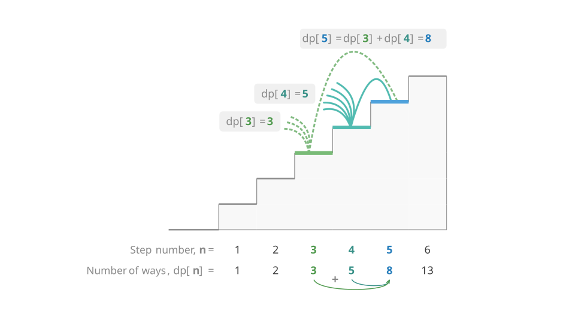
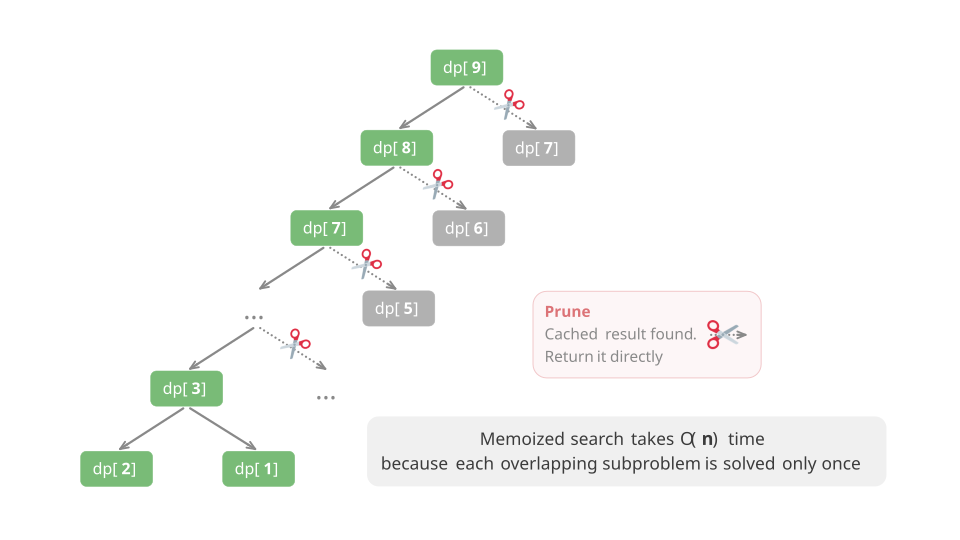
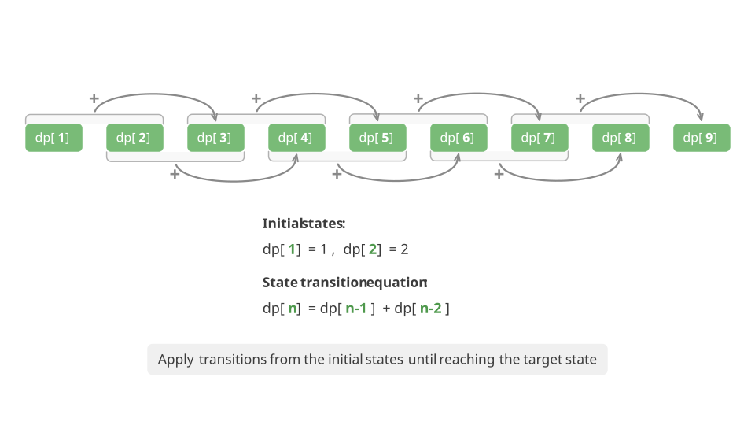

# 14.1 &nbsp; Introduction to dynamic programming

<u>Dynamic programming</u> is an important algorithmic paradigm. It breaks a problem into smaller subproblems and stores their solutions to avoid repeated work, often saving a great deal of time.

We'll start with a classic example, solve it by brute-force backtracking, identify the overlapping subproblems, and gradually derive a more efficient dynamic programming solution.

!!! question "Climbing stairs"

    A staircase has $n$ stairs. Each move takes you up either $1$ or $2$ stairs. How many ways can you reach the top?

As Figure 14-1 shows, a staircase with $3$ stairs has $3$ ways to reach the top.

{ class="animation-figure" }

<p align="center"> Figure 14-1 &nbsp; Number of ways to reach stair 3 </p>

We want the number of ways, so **we can enumerate all possibilities by backtracking**. Think of climbing as a series of choices. Start on the ground and choose to climb $1$ or $2$ stairs at each move. Add $1$ to the count whenever you reach the top, and prune moves that would overshoot it. Here is the code:

=== "Python"

    ```python title="climbing_stairs_backtrack.py"
    def backtrack(choices: list[int], state: int, n: int, res: list[int]) -> int:
        """Backtracking"""
        # Count one more way when we reach stair n
        if state == n:
            res[0] += 1
        # Iterate over all choices
        for choice in choices:
            # Prune moves that would overshoot stair n
            if state + choice > n:
                continue
            # Try a choice and update the state
            backtrack(choices, state + choice, n, res)
            # Undo the choice

    def climbing_stairs_backtrack(n: int) -> int:
        """Climbing stairs with backtracking"""
        choices = [1, 2]  # Each move can climb 1 or 2 stairs
        state = 0  # Start at stair 0
        res = [0]  # Store the number of ways in res[0]
        backtrack(choices, state, n, res)
        return res[0]
    ```

=== "C++"

    ```cpp title="climbing_stairs_backtrack.cpp"
    /* Backtracking */
    void backtrack(vector<int> &choices, int state, int n, vector<int> &res) {
        // Count one more way when we reach stair n
        if (state == n)
            res[0]++;
        // Iterate over all choices
        for (auto &choice : choices) {
            // Prune moves that would overshoot stair n
            if (state + choice > n)
                continue;
            // Try a choice and update the state
            backtrack(choices, state + choice, n, res);
            // Undo the choice
        }
    }

    /* Climbing stairs with backtracking */
    int climbingStairsBacktrack(int n) {
        vector<int> choices = {1, 2}; // Each move can climb 1 or 2 stairs
        int state = 0;                // Start at stair 0
        vector<int> res = {0};        // Store the number of ways in res[0]
        backtrack(choices, state, n, res);
        return res[0];
    }
    ```

=== "Java"

    ```java title="climbing_stairs_backtrack.java"
    /* Backtracking */
    void backtrack(List<Integer> choices, int state, int n, List<Integer> res) {
        // Count one more way when we reach stair n
        if (state == n)
            res.set(0, res.get(0) + 1);
        // Iterate over all choices
        for (Integer choice : choices) {
            // Prune moves that would overshoot stair n
            if (state + choice > n)
                continue;
            // Try a choice and update the state
            backtrack(choices, state + choice, n, res);
            // Undo the choice
        }
    }

    /* Climbing stairs with backtracking */
    int climbingStairsBacktrack(int n) {
        List<Integer> choices = Arrays.asList(1, 2); // Each move can climb 1 or 2 stairs
        int state = 0; // Start at stair 0
        List<Integer> res = new ArrayList<>();
        res.add(0); // Store the number of ways in res[0]
        backtrack(choices, state, n, res);
        return res.get(0);
    }
    ```

=== "C#"

    ```csharp title="climbing_stairs_backtrack.cs"
    /* Backtracking */
    void Backtrack(List<int> choices, int state, int n, List<int> res) {
        // Count one more way when we reach stair n
        if (state == n)
            res[0]++;
        // Iterate over all choices
        foreach (int choice in choices) {
            // Prune moves that would overshoot stair n
            if (state + choice > n)
                continue;
            // Try a choice and update the state
            Backtrack(choices, state + choice, n, res);
            // Undo the choice
        }
    }

    /* Climbing stairs with backtracking */
    int ClimbingStairsBacktrack(int n) {
        List<int> choices = [1, 2]; // Each move can climb 1 or 2 stairs
        int state = 0; // Start at stair 0
        List<int> res = [0]; // Store the number of ways in res[0]
        Backtrack(choices, state, n, res);
        return res[0];
    }
    ```

=== "Go"

    ```go title="climbing_stairs_backtrack.go"
    /* Backtracking */
    func backtrack(choices []int, state, n int, res []int) {
        // Count one more way when we reach stair n
        if state == n {
            res[0] = res[0] + 1
        }
        // Iterate over all choices
        for _, choice := range choices {
            // Prune moves that would overshoot stair n
            if state+choice > n {
                continue
            }
            // Try a choice and update the state
            backtrack(choices, state+choice, n, res)
            // Undo the choice
        }
    }

    /* Climbing stairs with backtracking */
    func climbingStairsBacktrack(n int) int {
        // Each move can climb 1 or 2 stairs
        choices := []int{1, 2}
        // Start at stair 0
        state := 0
        res := make([]int, 1)
        // Store the number of ways in res[0]
        res[0] = 0
        backtrack(choices, state, n, res)
        return res[0]
    }
    ```

=== "Swift"

    ```swift title="climbing_stairs_backtrack.swift"
    /* Backtracking */
    func backtrack(choices: [Int], state: Int, n: Int, res: inout [Int]) {
        // Count one more way when we reach stair n
        if state == n {
            res[0] += 1
        }
        // Iterate over all choices
        for choice in choices {
            // Prune moves that would overshoot stair n
            if state + choice > n {
                continue
            }
            // Try a choice and update the state
            backtrack(choices: choices, state: state + choice, n: n, res: &res)
            // Undo the choice
        }
    }

    /* Climbing stairs with backtracking */
    func climbingStairsBacktrack(n: Int) -> Int {
        let choices = [1, 2] // Each move can climb 1 or 2 stairs
        let state = 0 // Start at stair 0
        var res: [Int] = []
        res.append(0) // Store the number of ways in res[0]
        backtrack(choices: choices, state: state, n: n, res: &res)
        return res[0]
    }
    ```

=== "JS"

    ```javascript title="climbing_stairs_backtrack.js"
    /* Backtracking */
    function backtrack(choices, state, n, res) {
        // Count one more way when we reach stair n
        if (state === n) res.set(0, res.get(0) + 1);
        // Iterate over all choices
        for (const choice of choices) {
            // Prune moves that would overshoot stair n
            if (state + choice > n) continue;
            // Try a choice and update the state
            backtrack(choices, state + choice, n, res);
            // Undo the choice
        }
    }

    /* Climbing stairs with backtracking */
    function climbingStairsBacktrack(n) {
        const choices = [1, 2]; // Each move can climb 1 or 2 stairs
        const state = 0; // Start at stair 0
        const res = new Map();
        res.set(0, 0); // Store the number of ways in res[0]
        backtrack(choices, state, n, res);
        return res.get(0);
    }
    ```

=== "TS"

    ```typescript title="climbing_stairs_backtrack.ts"
    /* Backtracking */
    function backtrack(
        choices: number[],
        state: number,
        n: number,
        res: Map<0, any>
    ): void {
        // Count one more way when we reach stair n
        if (state === n) res.set(0, res.get(0) + 1);
        // Iterate over all choices
        for (const choice of choices) {
            // Prune moves that would overshoot stair n
            if (state + choice > n) continue;
            // Try a choice and update the state
            backtrack(choices, state + choice, n, res);
            // Undo the choice
        }
    }

    /* Climbing stairs with backtracking */
    function climbingStairsBacktrack(n: number): number {
        const choices = [1, 2]; // Each move can climb 1 or 2 stairs
        const state = 0; // Start at stair 0
        const res = new Map();
        res.set(0, 0); // Store the number of ways in res[0]
        backtrack(choices, state, n, res);
        return res.get(0);
    }
    ```

=== "Dart"

    ```dart title="climbing_stairs_backtrack.dart"
    /* Backtracking */
    void backtrack(List<int> choices, int state, int n, List<int> res) {
      // Count one more way when we reach stair n
      if (state == n) {
        res[0]++;
      }
      // Iterate over all choices
      for (int choice in choices) {
        // Prune moves that would overshoot stair n
        if (state + choice > n) continue;
        // Try a choice and update the state
        backtrack(choices, state + choice, n, res);
        // Undo the choice
      }
    }

    /* Climbing stairs with backtracking */
    int climbingStairsBacktrack(int n) {
      List<int> choices = [1, 2]; // Each move can climb 1 or 2 stairs
      int state = 0; // Start at stair 0
      List<int> res = [];
      res.add(0); // Store the number of ways in res[0]
      backtrack(choices, state, n, res);
      return res[0];
    }
    ```

=== "Rust"

    ```rust title="climbing_stairs_backtrack.rs"
    /* Backtracking */
    fn backtrack(choices: &[i32], state: i32, n: i32, res: &mut [i32]) {
        // Count one more way when we reach stair n
        if state == n {
            res[0] = res[0] + 1;
        }
        // Iterate over all choices
        for &choice in choices {
            // Prune moves that would overshoot stair n
            if state + choice > n {
                continue;
            }
            // Try a choice and update the state
            backtrack(choices, state + choice, n, res);
            // Undo the choice
        }
    }

    /* Climbing stairs with backtracking */
    fn climbing_stairs_backtrack(n: usize) -> i32 {
        let choices = vec![1, 2]; // Each move can climb 1 or 2 stairs
        let state = 0; // Start at stair 0
        let mut res = Vec::new();
        res.push(0); // Store the number of ways in res[0]
        backtrack(&choices, state, n as i32, &mut res);
        res[0]
    }
    ```

=== "C"

    ```c title="climbing_stairs_backtrack.c"
    /* Backtracking */
    void backtrack(int *choices, int state, int n, int *res, int len) {
        // Count one more way when we reach stair n
        if (state == n)
            res[0]++;
        // Iterate over all choices
        for (int i = 0; i < len; i++) {
            int choice = choices[i];
            // Prune moves that would overshoot stair n
            if (state + choice > n)
                continue;
            // Try a choice and update the state
            backtrack(choices, state + choice, n, res, len);
            // Undo the choice
        }
    }

    /* Climbing stairs with backtracking */
    int climbingStairsBacktrack(int n) {
        int choices[2] = {1, 2}; // Each move can climb 1 or 2 stairs
        int state = 0;           // Start at stair 0
        int *res = (int *)malloc(sizeof(int));
        *res = 0; // Store the number of ways in res[0]
        int len = sizeof(choices) / sizeof(int);
        backtrack(choices, state, n, res, len);
        int result = *res;
        free(res);
        return result;
    }
    ```

=== "Kotlin"

    ```kotlin title="climbing_stairs_backtrack.kt"
    /* Backtracking */
    fun backtrack(
        choices: MutableList<Int>,
        state: Int,
        n: Int,
        res: MutableList<Int>
    ) {
        // Count one more way when we reach stair n
        if (state == n)
            res[0] = res[0] + 1
        // Iterate over all choices
        for (choice in choices) {
            // Prune moves that would overshoot stair n
            if (state + choice > n) continue
            // Try a choice and update the state
            backtrack(choices, state + choice, n, res)
            // Undo the choice
        }
    }

    /* Climbing stairs with backtracking */
    fun climbingStairsBacktrack(n: Int): Int {
        val choices = mutableListOf(1, 2) // Each move can climb 1 or 2 stairs
        val state = 0 // Start at stair 0
        val res = mutableListOf<Int>()
        res.add(0) // Store the number of ways in res[0]
        backtrack(choices, state, n, res)
        return res[0]
    }
    ```

=== "Ruby"

    ```ruby title="climbing_stairs_backtrack.rb"
    ### Backtracking ###
    def backtrack(choices, state, n, res)
      # Count one more way when we reach stair n
      res[0] += 1 if state == n
      # Iterate over all choices
      for choice in choices
        # Prune moves that would overshoot stair n
        next if state + choice > n

        # Try a choice and update the state
        backtrack(choices, state + choice, n, res)
      end
      # Undo the choice
    end

    ### Climbing stairs with backtracking ###
    def climbing_stairs_backtrack(n)
      choices = [1, 2] # Each move can climb 1 or 2 stairs
      state = 0 # Start at stair 0
      res = [0] # Store the number of ways in res[0]
      backtrack(choices, state, n, res)
      res.first
    end
    ```

??? pythontutor "Visualize execution"

    <div style="height: 549px; width: 100%;"><iframe class="pythontutor-iframe" title="Visualize execution" src="https://pythontutor.com/iframe-embed.html#code=def%20backtrack%28choices%3A%20list%5Bint%5D,%20state%3A%20int,%20n%3A%20int,%20res%3A%20list%5Bint%5D%29%20-%3E%20int%3A%0A%20%20%20%20%22%22%22Backtracking%22%22%22%0A%20%20%20%20%23%20Count%20one%20more%20way%20when%20we%20reach%20stair%20n%0A%20%20%20%20if%20state%20%3D%3D%20n%3A%0A%20%20%20%20%20%20%20%20res%5B0%5D%20%2B%3D%201%0A%20%20%20%20%23%20Iterate%20over%20all%20choices%0A%20%20%20%20for%20choice%20in%20choices%3A%0A%20%20%20%20%20%20%20%20%23%20Prune%20moves%20that%20would%20overshoot%20stair%20n%0A%20%20%20%20%20%20%20%20if%20state%20%2B%20choice%20%3E%20n%3A%0A%20%20%20%20%20%20%20%20%20%20%20%20continue%0A%20%20%20%20%20%20%20%20%23%20Try%20a%20choice%20and%20update%20the%20state%0A%20%20%20%20%20%20%20%20backtrack%28choices,%20state%20%2B%20choice,%20n,%20res%29%0A%20%20%20%20%20%20%20%20%23%20Undo%20the%20choice%0A%0A%0Adef%20climbing_stairs_backtrack%28n%3A%20int%29%20-%3E%20int%3A%0A%20%20%20%20%22%22%22Climbing%20stairs%20with%20backtracking%22%22%22%0A%20%20%20%20choices%20%3D%20%5B1,%202%5D%20%20%23%20Each%20move%20can%20climb%201%20or%202%20stairs%0A%20%20%20%20state%20%3D%200%20%20%23%20Start%20at%20stair%200%0A%20%20%20%20res%20%3D%20%5B0%5D%20%20%23%20Store%20the%20number%20of%20ways%20in%20res%5B0%5D%0A%20%20%20%20backtrack%28choices,%20state,%20n,%20res%29%0A%20%20%20%20return%20res%5B0%5D%0A%0A%0A%22%22%22Driver%20Code%22%22%22%0Aif%20__name__%20%3D%3D%20%22__main__%22%3A%0A%20%20%20%20n%20%3D%204%0A%0A%20%20%20%20res%20%3D%20climbing_stairs_backtrack%28n%29%0A%20%20%20%20print%28f%22Climbing%20%7Bn%7D%20stairs%3A%20%7Bres%7D%20ways%22%29&codeDivHeight=472&codeDivWidth=350&cumulative=false&curInstr=5&heapPrimitives=nevernest&origin=opt-frontend.js&py=311&rawInputLstJSON=%5B%5D&textReferences=false"> </iframe></div>
    <div style="margin-top: 5px;"><a href="https://pythontutor.com/iframe-embed.html#code=def%20backtrack%28choices%3A%20list%5Bint%5D,%20state%3A%20int,%20n%3A%20int,%20res%3A%20list%5Bint%5D%29%20-%3E%20int%3A%0A%20%20%20%20%22%22%22Backtracking%22%22%22%0A%20%20%20%20%23%20Count%20one%20more%20way%20when%20we%20reach%20stair%20n%0A%20%20%20%20if%20state%20%3D%3D%20n%3A%0A%20%20%20%20%20%20%20%20res%5B0%5D%20%2B%3D%201%0A%20%20%20%20%23%20Iterate%20over%20all%20choices%0A%20%20%20%20for%20choice%20in%20choices%3A%0A%20%20%20%20%20%20%20%20%23%20Prune%20moves%20that%20would%20overshoot%20stair%20n%0A%20%20%20%20%20%20%20%20if%20state%20%2B%20choice%20%3E%20n%3A%0A%20%20%20%20%20%20%20%20%20%20%20%20continue%0A%20%20%20%20%20%20%20%20%23%20Try%20a%20choice%20and%20update%20the%20state%0A%20%20%20%20%20%20%20%20backtrack%28choices,%20state%20%2B%20choice,%20n,%20res%29%0A%20%20%20%20%20%20%20%20%23%20Undo%20the%20choice%0A%0A%0Adef%20climbing_stairs_backtrack%28n%3A%20int%29%20-%3E%20int%3A%0A%20%20%20%20%22%22%22Climbing%20stairs%20with%20backtracking%22%22%22%0A%20%20%20%20choices%20%3D%20%5B1,%202%5D%20%20%23%20Each%20move%20can%20climb%201%20or%202%20stairs%0A%20%20%20%20state%20%3D%200%20%20%23%20Start%20at%20stair%200%0A%20%20%20%20res%20%3D%20%5B0%5D%20%20%23%20Store%20the%20number%20of%20ways%20in%20res%5B0%5D%0A%20%20%20%20backtrack%28choices,%20state,%20n,%20res%29%0A%20%20%20%20return%20res%5B0%5D%0A%0A%0A%22%22%22Driver%20Code%22%22%22%0Aif%20__name__%20%3D%3D%20%22__main__%22%3A%0A%20%20%20%20n%20%3D%204%0A%0A%20%20%20%20res%20%3D%20climbing_stairs_backtrack%28n%29%0A%20%20%20%20print%28f%22Climbing%20%7Bn%7D%20stairs%3A%20%7Bres%7D%20ways%22%29&codeDivHeight=800&codeDivWidth=600&cumulative=false&curInstr=5&heapPrimitives=nevernest&origin=opt-frontend.js&py=311&rawInputLstJSON=%5B%5D&textReferences=false" target="_blank" rel="noopener noreferrer">View full screen ></a></div>

## 14.1.1 &nbsp; Method 1: Brute-force search

Backtracking usually does not explicitly split the problem into subproblems. It treats the solution as a sequence of decisions and searches for all possible solutions by trying choices and pruning branches.

We can also view the problem in terms of subproblems. Let $dp[i]$ be the number of ways to reach stair $i$. Then $dp[i]$ is the original problem, with subproblems including the following:

$$
dp[i-1], dp[i-2], \dots, dp[2], dp[1]
$$

Each move climbs $1$ or $2$ stairs. If we are now on stair $i$, we must previously have been on stair $i - 1$ or $i - 2$. In other words, only stairs $i -1$ and $i - 2$ can lead directly to stair $i$.

This gives an important result: **the number of ways to reach stair $i - 1$ plus the number of ways to reach stair $i - 2$ equals the number of ways to reach stair $i$**. In symbols:

$$
dp[i] = dp[i-1] + dp[i-2]
$$

The stair-climbing subproblems are related by a recurrence, and **we can build the original solution from the subproblem solutions**. Figure 14-2 illustrates this relationship.

{ class="animation-figure" }

<p align="center"> Figure 14-2 &nbsp; Recurrence for the number of ways </p>

The recurrence gives us a brute-force search. Start at $dp[n]$ and **recursively break each larger problem into the sum of two smaller ones** until reaching the smallest subproblems $dp[1]$ and $dp[2]$. Their solutions are known: $dp[1] = 1$ and $dp[2] = 2$. There are $1$ and $2$ ways to reach stairs $1$ and $2$, respectively.

Like the standard backtracking code, the following code performs a depth-first search, but it is more concise:

=== "Python"

    ```python title="climbing_stairs_dfs.py"
    def dfs(i: int) -> int:
        """Search"""
        # Return the known value for dp[1] or dp[2]
        if i == 1 or i == 2:
            return i
        # dp[i] = dp[i-1] + dp[i-2]
        count = dfs(i - 1) + dfs(i - 2)
        return count

    def climbing_stairs_dfs(n: int) -> int:
        """Climbing stairs with search"""
        return dfs(n)
    ```

=== "C++"

    ```cpp title="climbing_stairs_dfs.cpp"
    /* Search */
    int dfs(int i) {
        // Return the known value for dp[1] or dp[2]
        if (i == 1 || i == 2)
            return i;
        // dp[i] = dp[i-1] + dp[i-2]
        int count = dfs(i - 1) + dfs(i - 2);
        return count;
    }

    /* Climbing stairs with search */
    int climbingStairsDFS(int n) {
        return dfs(n);
    }
    ```

=== "Java"

    ```java title="climbing_stairs_dfs.java"
    /* Search */
    int dfs(int i) {
        // Return the known value for dp[1] or dp[2]
        if (i == 1 || i == 2)
            return i;
        // dp[i] = dp[i-1] + dp[i-2]
        int count = dfs(i - 1) + dfs(i - 2);
        return count;
    }

    /* Climbing stairs with search */
    int climbingStairsDFS(int n) {
        return dfs(n);
    }
    ```

=== "C#"

    ```csharp title="climbing_stairs_dfs.cs"
    /* Search */
    int DFS(int i) {
        // Return the known value for dp[1] or dp[2]
        if (i == 1 || i == 2)
            return i;
        // dp[i] = dp[i-1] + dp[i-2]
        int count = DFS(i - 1) + DFS(i - 2);
        return count;
    }

    /* Climbing stairs with search */
    int ClimbingStairsDFS(int n) {
        return DFS(n);
    }
    ```

=== "Go"

    ```go title="climbing_stairs_dfs.go"
    /* Search */
    func dfs(i int) int {
        // Return the known value for dp[1] or dp[2]
        if i == 1 || i == 2 {
            return i
        }
        // dp[i] = dp[i-1] + dp[i-2]
        count := dfs(i-1) + dfs(i-2)
        return count
    }

    /* Climbing stairs with search */
    func climbingStairsDFS(n int) int {
        return dfs(n)
    }
    ```

=== "Swift"

    ```swift title="climbing_stairs_dfs.swift"
    /* Search */
    func dfs(i: Int) -> Int {
        // Return the known value for dp[1] or dp[2]
        if i == 1 || i == 2 {
            return i
        }
        // dp[i] = dp[i-1] + dp[i-2]
        let count = dfs(i: i - 1) + dfs(i: i - 2)
        return count
    }

    /* Climbing stairs with search */
    func climbingStairsDFS(n: Int) -> Int {
        dfs(i: n)
    }
    ```

=== "JS"

    ```javascript title="climbing_stairs_dfs.js"
    /* Search */
    function dfs(i) {
        // Return the known value for dp[1] or dp[2]
        if (i === 1 || i === 2) return i;
        // dp[i] = dp[i-1] + dp[i-2]
        const count = dfs(i - 1) + dfs(i - 2);
        return count;
    }

    /* Climbing stairs with search */
    function climbingStairsDFS(n) {
        return dfs(n);
    }
    ```

=== "TS"

    ```typescript title="climbing_stairs_dfs.ts"
    /* Search */
    function dfs(i: number): number {
        // Return the known value for dp[1] or dp[2]
        if (i === 1 || i === 2) return i;
        // dp[i] = dp[i-1] + dp[i-2]
        const count = dfs(i - 1) + dfs(i - 2);
        return count;
    }

    /* Climbing stairs with search */
    function climbingStairsDFS(n: number): number {
        return dfs(n);
    }
    ```

=== "Dart"

    ```dart title="climbing_stairs_dfs.dart"
    /* Search */
    int dfs(int i) {
      // Return the known value for dp[1] or dp[2]
      if (i == 1 || i == 2) return i;
      // dp[i] = dp[i-1] + dp[i-2]
      int count = dfs(i - 1) + dfs(i - 2);
      return count;
    }

    /* Climbing stairs with search */
    int climbingStairsDFS(int n) {
      return dfs(n);
    }
    ```

=== "Rust"

    ```rust title="climbing_stairs_dfs.rs"
    /* Search */
    fn dfs(i: usize) -> i32 {
        // Return the known value for dp[1] or dp[2]
        if i == 1 || i == 2 {
            return i as i32;
        }
        // dp[i] = dp[i-1] + dp[i-2]
        let count = dfs(i - 1) + dfs(i - 2);
        count
    }

    /* Climbing stairs with search */
    fn climbing_stairs_dfs(n: usize) -> i32 {
        dfs(n)
    }
    ```

=== "C"

    ```c title="climbing_stairs_dfs.c"
    /* Search */
    int dfs(int i) {
        // Return the known value for dp[1] or dp[2]
        if (i == 1 || i == 2)
            return i;
        // dp[i] = dp[i-1] + dp[i-2]
        int count = dfs(i - 1) + dfs(i - 2);
        return count;
    }

    /* Climbing stairs with search */
    int climbingStairsDFS(int n) {
        return dfs(n);
    }
    ```

=== "Kotlin"

    ```kotlin title="climbing_stairs_dfs.kt"
    /* Search */
    fun dfs(i: Int): Int {
        // Return the known value for dp[1] or dp[2]
        if (i == 1 || i == 2) return i
        // dp[i] = dp[i-1] + dp[i-2]
        val count = dfs(i - 1) + dfs(i - 2)
        return count
    }

    /* Climbing stairs with search */
    fun climbingStairsDFS(n: Int): Int {
        return dfs(n)
    }
    ```

=== "Ruby"

    ```ruby title="climbing_stairs_dfs.rb"
    ### Search ###
    def dfs(i)
      # Return the known value for dp[1] or dp[2]
      return i if i == 1 || i == 2
      # dp[i] = dp[i-1] + dp[i-2]
      dfs(i - 1) + dfs(i - 2)
    end

    ### Climbing stairs with search ###
    def climbing_stairs_dfs(n)
      dfs(n)
    end
    ```

??? pythontutor "Visualize execution"

    <div style="height: 549px; width: 100%;"><iframe class="pythontutor-iframe" title="Visualize execution" src="https://pythontutor.com/iframe-embed.html#code=def%20dfs%28i%3A%20int%29%20-%3E%20int%3A%0A%20%20%20%20%22%22%22Search%22%22%22%0A%20%20%20%20%23%20Return%20the%20known%20value%20for%20dp%5B1%5D%20or%20dp%5B2%5D%0A%20%20%20%20if%20i%20%3D%3D%201%20or%20i%20%3D%3D%202%3A%0A%20%20%20%20%20%20%20%20return%20i%0A%20%20%20%20%23%20dp%5Bi%5D%20%3D%20dp%5Bi-1%5D%20%2B%20dp%5Bi-2%5D%0A%20%20%20%20count%20%3D%20dfs%28i%20-%201%29%20%2B%20dfs%28i%20-%202%29%0A%20%20%20%20return%20count%0A%0A%0Adef%20climbing_stairs_dfs%28n%3A%20int%29%20-%3E%20int%3A%0A%20%20%20%20%22%22%22Climbing%20stairs%20with%20search%22%22%22%0A%20%20%20%20return%20dfs%28n%29%0A%0A%0A%22%22%22Driver%20Code%22%22%22%0Aif%20__name__%20%3D%3D%20%22__main__%22%3A%0A%20%20%20%20n%20%3D%209%0A%0A%20%20%20%20res%20%3D%20climbing_stairs_dfs%28n%29%0A%20%20%20%20print%28f%22Climbing%20%7Bn%7D%20stairs%3A%20%7Bres%7D%20ways%22%29&codeDivHeight=472&codeDivWidth=350&cumulative=false&curInstr=5&heapPrimitives=nevernest&origin=opt-frontend.js&py=311&rawInputLstJSON=%5B%5D&textReferences=false"> </iframe></div>
    <div style="margin-top: 5px;"><a href="https://pythontutor.com/iframe-embed.html#code=def%20dfs%28i%3A%20int%29%20-%3E%20int%3A%0A%20%20%20%20%22%22%22Search%22%22%22%0A%20%20%20%20%23%20Return%20the%20known%20value%20for%20dp%5B1%5D%20or%20dp%5B2%5D%0A%20%20%20%20if%20i%20%3D%3D%201%20or%20i%20%3D%3D%202%3A%0A%20%20%20%20%20%20%20%20return%20i%0A%20%20%20%20%23%20dp%5Bi%5D%20%3D%20dp%5Bi-1%5D%20%2B%20dp%5Bi-2%5D%0A%20%20%20%20count%20%3D%20dfs%28i%20-%201%29%20%2B%20dfs%28i%20-%202%29%0A%20%20%20%20return%20count%0A%0A%0Adef%20climbing_stairs_dfs%28n%3A%20int%29%20-%3E%20int%3A%0A%20%20%20%20%22%22%22Climbing%20stairs%20with%20search%22%22%22%0A%20%20%20%20return%20dfs%28n%29%0A%0A%0A%22%22%22Driver%20Code%22%22%22%0Aif%20__name__%20%3D%3D%20%22__main__%22%3A%0A%20%20%20%20n%20%3D%209%0A%0A%20%20%20%20res%20%3D%20climbing_stairs_dfs%28n%29%0A%20%20%20%20print%28f%22Climbing%20%7Bn%7D%20stairs%3A%20%7Bres%7D%20ways%22%29&codeDivHeight=800&codeDivWidth=600&cumulative=false&curInstr=5&heapPrimitives=nevernest&origin=opt-frontend.js&py=311&rawInputLstJSON=%5B%5D&textReferences=false" target="_blank" rel="noopener noreferrer">View full screen ></a></div>

Figure 14-3 shows the recursion tree for brute-force search. For $dp[n]$, the tree has depth $n$ and time complexity $O(2^n)$. Exponential growth is explosive: even a moderately large $n$ can mean a long wait.

{ class="animation-figure" }

<p align="center"> Figure 14-3 &nbsp; Recursion tree for climbing stairs </p>

In the figure, **overlapping subproblems cause the exponential time complexity**. For example, $dp[9]$ splits into $dp[8]$ and $dp[7]$, while $dp[8]$ splits into $dp[7]$ and $dp[6]$. Both include $dp[7]$.

Those subproblems contain still smaller overlapping subproblems, and so on down the tree. These repeated calculations consume most of the computational effort.

## 14.1.2 &nbsp; Method 2: Memoized search

For better efficiency, **we want to solve each overlapping subproblem just once**. We can store each result in an array `mem` and prune repeated subproblems during the search.

1. The first time we calculate $dp[i]$, store it in `mem[i]` for later use.
2. When we need $dp[i]$ again, read the result from `mem[i]` and avoid solving the same subproblem again.

Here is the code:

=== "Python"

    ```python title="climbing_stairs_dfs_mem.py"
    def dfs(i: int, mem: list[int]) -> int:
        """Memoized search"""
        # Return the known value for dp[1] or dp[2]
        if i == 1 or i == 2:
            return i
        # Return dp[i] directly if it is cached
        if mem[i] != -1:
            return mem[i]
        # dp[i] = dp[i-1] + dp[i-2]
        count = dfs(i - 1, mem) + dfs(i - 2, mem)
        # Cache dp[i]
        mem[i] = count
        return count

    def climbing_stairs_dfs_mem(n: int) -> int:
        """Climbing stairs with memoized search"""
        # mem[i] stores the number of ways to reach stair i. A value of -1 means no result is cached
        mem = [-1] * (n + 1)
        return dfs(n, mem)
    ```

=== "C++"

    ```cpp title="climbing_stairs_dfs_mem.cpp"
    /* Memoized search */
    int dfs(int i, vector<int> &mem) {
        // Return the known value for dp[1] or dp[2]
        if (i == 1 || i == 2)
            return i;
        // Return dp[i] directly if it is cached
        if (mem[i] != -1)
            return mem[i];
        // dp[i] = dp[i-1] + dp[i-2]
        int count = dfs(i - 1, mem) + dfs(i - 2, mem);
        // Cache dp[i]
        mem[i] = count;
        return count;
    }

    /* Climbing stairs with memoized search */
    int climbingStairsDFSMem(int n) {
        // mem[i] stores the number of ways to reach stair i. A value of -1 means no result is cached
        vector<int> mem(n + 1, -1);
        return dfs(n, mem);
    }
    ```

=== "Java"

    ```java title="climbing_stairs_dfs_mem.java"
    /* Memoized search */
    int dfs(int i, int[] mem) {
        // Return the known value for dp[1] or dp[2]
        if (i == 1 || i == 2)
            return i;
        // Return dp[i] directly if it is cached
        if (mem[i] != -1)
            return mem[i];
        // dp[i] = dp[i-1] + dp[i-2]
        int count = dfs(i - 1, mem) + dfs(i - 2, mem);
        // Cache dp[i]
        mem[i] = count;
        return count;
    }

    /* Climbing stairs with memoized search */
    int climbingStairsDFSMem(int n) {
        // mem[i] stores the number of ways to reach stair i. A value of -1 means no result is cached
        int[] mem = new int[n + 1];
        Arrays.fill(mem, -1);
        return dfs(n, mem);
    }
    ```

=== "C#"

    ```csharp title="climbing_stairs_dfs_mem.cs"
    /* Memoized search */
    int DFS(int i, int[] mem) {
        // Return the known value for dp[1] or dp[2]
        if (i == 1 || i == 2)
            return i;
        // Return dp[i] directly if it is cached
        if (mem[i] != -1)
            return mem[i];
        // dp[i] = dp[i-1] + dp[i-2]
        int count = DFS(i - 1, mem) + DFS(i - 2, mem);
        // Cache dp[i]
        mem[i] = count;
        return count;
    }

    /* Climbing stairs with memoized search */
    int ClimbingStairsDFSMem(int n) {
        // mem[i] stores the number of ways to reach stair i. A value of -1 means no result is cached
        int[] mem = new int[n + 1];
        Array.Fill(mem, -1);
        return DFS(n, mem);
    }
    ```

=== "Go"

    ```go title="climbing_stairs_dfs_mem.go"
    /* Memoized search */
    func dfsMem(i int, mem []int) int {
        // Return the known value for dp[1] or dp[2]
        if i == 1 || i == 2 {
            return i
        }
        // Return dp[i] directly if it is cached
        if mem[i] != -1 {
            return mem[i]
        }
        // dp[i] = dp[i-1] + dp[i-2]
        count := dfsMem(i-1, mem) + dfsMem(i-2, mem)
        // Cache dp[i]
        mem[i] = count
        return count
    }

    /* Climbing stairs with memoized search */
    func climbingStairsDFSMem(n int) int {
        // mem[i] stores the number of ways to reach stair i. A value of -1 means no result is cached
        mem := make([]int, n+1)
        for i := range mem {
            mem[i] = -1
        }
        return dfsMem(n, mem)
    }
    ```

=== "Swift"

    ```swift title="climbing_stairs_dfs_mem.swift"
    /* Memoized search */
    func dfs(i: Int, mem: inout [Int]) -> Int {
        // Return the known value for dp[1] or dp[2]
        if i == 1 || i == 2 {
            return i
        }
        // Return dp[i] directly if it is cached
        if mem[i] != -1 {
            return mem[i]
        }
        // dp[i] = dp[i-1] + dp[i-2]
        let count = dfs(i: i - 1, mem: &mem) + dfs(i: i - 2, mem: &mem)
        // Cache dp[i]
        mem[i] = count
        return count
    }

    /* Climbing stairs with memoized search */
    func climbingStairsDFSMem(n: Int) -> Int {
        // mem[i] stores the number of ways to reach stair i. A value of -1 means no result is cached
        var mem = Array(repeating: -1, count: n + 1)
        return dfs(i: n, mem: &mem)
    }
    ```

=== "JS"

    ```javascript title="climbing_stairs_dfs_mem.js"
    /* Memoized search */
    function dfs(i, mem) {
        // Return the known value for dp[1] or dp[2]
        if (i === 1 || i === 2) return i;
        // Return dp[i] directly if it is cached
        if (mem[i] != -1) return mem[i];
        // dp[i] = dp[i-1] + dp[i-2]
        const count = dfs(i - 1, mem) + dfs(i - 2, mem);
        // Cache dp[i]
        mem[i] = count;
        return count;
    }

    /* Climbing stairs with memoized search */
    function climbingStairsDFSMem(n) {
        // mem[i] stores the number of ways to reach stair i. A value of -1 means no result is cached
        const mem = new Array(n + 1).fill(-1);
        return dfs(n, mem);
    }
    ```

=== "TS"

    ```typescript title="climbing_stairs_dfs_mem.ts"
    /* Memoized search */
    function dfs(i: number, mem: number[]): number {
        // Return the known value for dp[1] or dp[2]
        if (i === 1 || i === 2) return i;
        // Return dp[i] directly if it is cached
        if (mem[i] != -1) return mem[i];
        // dp[i] = dp[i-1] + dp[i-2]
        const count = dfs(i - 1, mem) + dfs(i - 2, mem);
        // Cache dp[i]
        mem[i] = count;
        return count;
    }

    /* Climbing stairs with memoized search */
    function climbingStairsDFSMem(n: number): number {
        // mem[i] stores the number of ways to reach stair i. A value of -1 means no result is cached
        const mem = new Array(n + 1).fill(-1);
        return dfs(n, mem);
    }
    ```

=== "Dart"

    ```dart title="climbing_stairs_dfs_mem.dart"
    /* Memoized search */
    int dfs(int i, List<int> mem) {
      // Return the known value for dp[1] or dp[2]
      if (i == 1 || i == 2) return i;
      // Return dp[i] directly if it is cached
      if (mem[i] != -1) return mem[i];
      // dp[i] = dp[i-1] + dp[i-2]
      int count = dfs(i - 1, mem) + dfs(i - 2, mem);
      // Cache dp[i]
      mem[i] = count;
      return count;
    }

    /* Climbing stairs with memoized search */
    int climbingStairsDFSMem(int n) {
      // mem[i] stores the number of ways to reach stair i. A value of -1 means no result is cached
      List<int> mem = List.filled(n + 1, -1);
      return dfs(n, mem);
    }
    ```

=== "Rust"

    ```rust title="climbing_stairs_dfs_mem.rs"
    /* Memoized search */
    fn dfs(i: usize, mem: &mut [i32]) -> i32 {
        // Return the known value for dp[1] or dp[2]
        if i == 1 || i == 2 {
            return i as i32;
        }
        // Return dp[i] directly if it is cached
        if mem[i] != -1 {
            return mem[i];
        }
        // dp[i] = dp[i-1] + dp[i-2]
        let count = dfs(i - 1, mem) + dfs(i - 2, mem);
        // Cache dp[i]
        mem[i] = count;
        count
    }

    /* Climbing stairs with memoized search */
    fn climbing_stairs_dfs_mem(n: usize) -> i32 {
        // mem[i] stores the number of ways to reach stair i. A value of -1 means no result is cached
        let mut mem = vec![-1; n + 1];
        dfs(n, &mut mem)
    }
    ```

=== "C"

    ```c title="climbing_stairs_dfs_mem.c"
    /* Memoized search */
    int dfs(int i, int *mem) {
        // Return the known value for dp[1] or dp[2]
        if (i == 1 || i == 2)
            return i;
        // Return dp[i] directly if it is cached
        if (mem[i] != -1)
            return mem[i];
        // dp[i] = dp[i-1] + dp[i-2]
        int count = dfs(i - 1, mem) + dfs(i - 2, mem);
        // Cache dp[i]
        mem[i] = count;
        return count;
    }

    /* Climbing stairs with memoized search */
    int climbingStairsDFSMem(int n) {
        // mem[i] stores the number of ways to reach stair i. A value of -1 means no result is cached
        int *mem = (int *)malloc((n + 1) * sizeof(int));
        for (int i = 0; i <= n; i++) {
            mem[i] = -1;
        }
        int result = dfs(n, mem);
        free(mem);
        return result;
    }
    ```

=== "Kotlin"

    ```kotlin title="climbing_stairs_dfs_mem.kt"
    /* Memoized search */
    fun dfs(i: Int, mem: IntArray): Int {
        // Return the known value for dp[1] or dp[2]
        if (i == 1 || i == 2) return i
        // Return dp[i] directly if it is cached
        if (mem[i] != -1) return mem[i]
        // dp[i] = dp[i-1] + dp[i-2]
        val count = dfs(i - 1, mem) + dfs(i - 2, mem)
        // Cache dp[i]
        mem[i] = count
        return count
    }

    /* Climbing stairs with memoized search */
    fun climbingStairsDFSMem(n: Int): Int {
        // mem[i] stores the number of ways to reach stair i. A value of -1 means no result is cached
        val mem = IntArray(n + 1)
        mem.fill(-1)
        return dfs(n, mem)
    }
    ```

=== "Ruby"

    ```ruby title="climbing_stairs_dfs_mem.rb"
    ### Memoized search ###
    def dfs(i, mem)
      # Return the known value for dp[1] or dp[2]
      return i if i == 1 || i == 2
      # Return dp[i] directly if it is cached
      return mem[i] if mem[i] != -1

      # dp[i] = dp[i-1] + dp[i-2]
      count = dfs(i - 1, mem) + dfs(i - 2, mem)
      # Cache dp[i]
      mem[i] = count
    end

    ### Climbing stairs with memoized search ###
    def climbing_stairs_dfs_mem(n)
      # mem[i] stores the number of ways to reach stair i. A value of -1 means no result is cached
      mem = Array.new(n + 1, -1)
      dfs(n, mem)
    end
    ```

??? pythontutor "Visualize execution"

    <div style="height: 549px; width: 100%;"><iframe class="pythontutor-iframe" title="Visualize execution" src="https://pythontutor.com/iframe-embed.html#code=def%20dfs%28i%3A%20int,%20mem%3A%20list%5Bint%5D%29%20-%3E%20int%3A%0A%20%20%20%20%22%22%22Memoized%20search%22%22%22%0A%20%20%20%20%23%20Return%20the%20known%20value%20for%20dp%5B1%5D%20or%20dp%5B2%5D%0A%20%20%20%20if%20i%20%3D%3D%201%20or%20i%20%3D%3D%202%3A%0A%20%20%20%20%20%20%20%20return%20i%0A%20%20%20%20%23%20Return%20dp%5Bi%5D%20directly%20if%20it%20is%20cached%0A%20%20%20%20if%20mem%5Bi%5D%20%21%3D%20-1%3A%0A%20%20%20%20%20%20%20%20return%20mem%5Bi%5D%0A%20%20%20%20%23%20dp%5Bi%5D%20%3D%20dp%5Bi-1%5D%20%2B%20dp%5Bi-2%5D%0A%20%20%20%20count%20%3D%20dfs%28i%20-%201,%20mem%29%20%2B%20dfs%28i%20-%202,%20mem%29%0A%20%20%20%20%23%20Cache%20dp%5Bi%5D%0A%20%20%20%20mem%5Bi%5D%20%3D%20count%0A%20%20%20%20return%20count%0A%0A%0Adef%20climbing_stairs_dfs_mem%28n%3A%20int%29%20-%3E%20int%3A%0A%20%20%20%20%22%22%22Climbing%20stairs%20with%20memoized%20search%22%22%22%0A%20%20%20%20%23%20mem%5Bi%5D%20stores%20the%20number%20of%20ways%20to%20reach%20stair%20i.%20A%20value%20of%20-1%20means%20no%20result%20is%20cached%0A%20%20%20%20mem%20%3D%20%5B-1%5D%20%2A%20%28n%20%2B%201%29%0A%20%20%20%20return%20dfs%28n,%20mem%29%0A%0A%0A%22%22%22Driver%20Code%22%22%22%0Aif%20__name__%20%3D%3D%20%22__main__%22%3A%0A%20%20%20%20n%20%3D%209%0A%0A%20%20%20%20res%20%3D%20climbing_stairs_dfs_mem%28n%29%0A%20%20%20%20print%28f%22Climbing%20%7Bn%7D%20stairs%3A%20%7Bres%7D%20ways%22%29&codeDivHeight=472&codeDivWidth=350&cumulative=false&curInstr=5&heapPrimitives=nevernest&origin=opt-frontend.js&py=311&rawInputLstJSON=%5B%5D&textReferences=false"> </iframe></div>
    <div style="margin-top: 5px;"><a href="https://pythontutor.com/iframe-embed.html#code=def%20dfs%28i%3A%20int,%20mem%3A%20list%5Bint%5D%29%20-%3E%20int%3A%0A%20%20%20%20%22%22%22Memoized%20search%22%22%22%0A%20%20%20%20%23%20Return%20the%20known%20value%20for%20dp%5B1%5D%20or%20dp%5B2%5D%0A%20%20%20%20if%20i%20%3D%3D%201%20or%20i%20%3D%3D%202%3A%0A%20%20%20%20%20%20%20%20return%20i%0A%20%20%20%20%23%20Return%20dp%5Bi%5D%20directly%20if%20it%20is%20cached%0A%20%20%20%20if%20mem%5Bi%5D%20%21%3D%20-1%3A%0A%20%20%20%20%20%20%20%20return%20mem%5Bi%5D%0A%20%20%20%20%23%20dp%5Bi%5D%20%3D%20dp%5Bi-1%5D%20%2B%20dp%5Bi-2%5D%0A%20%20%20%20count%20%3D%20dfs%28i%20-%201,%20mem%29%20%2B%20dfs%28i%20-%202,%20mem%29%0A%20%20%20%20%23%20Cache%20dp%5Bi%5D%0A%20%20%20%20mem%5Bi%5D%20%3D%20count%0A%20%20%20%20return%20count%0A%0A%0Adef%20climbing_stairs_dfs_mem%28n%3A%20int%29%20-%3E%20int%3A%0A%20%20%20%20%22%22%22Climbing%20stairs%20with%20memoized%20search%22%22%22%0A%20%20%20%20%23%20mem%5Bi%5D%20stores%20the%20number%20of%20ways%20to%20reach%20stair%20i.%20A%20value%20of%20-1%20means%20no%20result%20is%20cached%0A%20%20%20%20mem%20%3D%20%5B-1%5D%20%2A%20%28n%20%2B%201%29%0A%20%20%20%20return%20dfs%28n,%20mem%29%0A%0A%0A%22%22%22Driver%20Code%22%22%22%0Aif%20__name__%20%3D%3D%20%22__main__%22%3A%0A%20%20%20%20n%20%3D%209%0A%0A%20%20%20%20res%20%3D%20climbing_stairs_dfs_mem%28n%29%0A%20%20%20%20print%28f%22Climbing%20%7Bn%7D%20stairs%3A%20%7Bres%7D%20ways%22%29&codeDivHeight=800&codeDivWidth=600&cumulative=false&curInstr=5&heapPrimitives=nevernest&origin=opt-frontend.js&py=311&rawInputLstJSON=%5B%5D&textReferences=false" target="_blank" rel="noopener noreferrer">View full screen ></a></div>

As shown below, **memoization solves each overlapping subproblem just once, reducing the time complexity to $O(n)$**. This is a substantial improvement.

{ class="animation-figure" }

<p align="center"> Figure 14-4 &nbsp; Recursion tree for memoized search </p>

## 14.1.3 &nbsp; Method 3: Dynamic programming

**Memoized search works from the top down**. Start with the original problem (the root) and recursively split larger subproblems into smaller ones until reaching the smallest subproblems with known answers (the leaves). As the calls return, combine their solutions level by level to solve the original problem.

Conversely, **dynamic programming works from the bottom up**. Start with the solutions to the smallest subproblems and iteratively build solutions to larger ones until reaching the original problem.

This dynamic programming approach requires no backtracking. A loop suffices, with no need for recursion. In the code below, an array `dp` stores the subproblem solutions, much as the array `mem` did in memoized search:

=== "Python"

    ```python title="climbing_stairs_dp.py"
    def climbing_stairs_dp(n: int) -> int:
        """Climbing stairs with dynamic programming"""
        if n == 1 or n == 2:
            return n
        # Initialize the dp table to store subproblem solutions
        dp = [0] * (n + 1)
        # Base cases: set the solutions to the smallest subproblems
        dp[1], dp[2] = 1, 2
        # State transition: solve larger subproblems using smaller ones
        for i in range(3, n + 1):
            dp[i] = dp[i - 1] + dp[i - 2]
        return dp[n]
    ```

=== "C++"

    ```cpp title="climbing_stairs_dp.cpp"
    /* Climbing stairs with dynamic programming */
    int climbingStairsDP(int n) {
        if (n == 1 || n == 2)
            return n;
        // Initialize the dp table to store subproblem solutions
        vector<int> dp(n + 1);
        // Base cases: set the solutions to the smallest subproblems
        dp[1] = 1;
        dp[2] = 2;
        // State transition: solve larger subproblems using smaller ones
        for (int i = 3; i <= n; i++) {
            dp[i] = dp[i - 1] + dp[i - 2];
        }
        return dp[n];
    }
    ```

=== "Java"

    ```java title="climbing_stairs_dp.java"
    /* Climbing stairs with dynamic programming */
    int climbingStairsDP(int n) {
        if (n == 1 || n == 2)
            return n;
        // Initialize the dp table to store subproblem solutions
        int[] dp = new int[n + 1];
        // Base cases: set the solutions to the smallest subproblems
        dp[1] = 1;
        dp[2] = 2;
        // State transition: solve larger subproblems using smaller ones
        for (int i = 3; i <= n; i++) {
            dp[i] = dp[i - 1] + dp[i - 2];
        }
        return dp[n];
    }
    ```

=== "C#"

    ```csharp title="climbing_stairs_dp.cs"
    /* Climbing stairs with dynamic programming */
    int ClimbingStairsDP(int n) {
        if (n == 1 || n == 2)
            return n;
        // Initialize the dp table to store subproblem solutions
        int[] dp = new int[n + 1];
        // Base cases: set the solutions to the smallest subproblems
        dp[1] = 1;
        dp[2] = 2;
        // State transition: solve larger subproblems using smaller ones
        for (int i = 3; i <= n; i++) {
            dp[i] = dp[i - 1] + dp[i - 2];
        }
        return dp[n];
    }
    ```

=== "Go"

    ```go title="climbing_stairs_dp.go"
    /* Climbing stairs with dynamic programming */
    func climbingStairsDP(n int) int {
        if n == 1 || n == 2 {
            return n
        }
        // Initialize the dp table to store subproblem solutions
        dp := make([]int, n+1)
        // Base cases: set the solutions to the smallest subproblems
        dp[1] = 1
        dp[2] = 2
        // State transition: solve larger subproblems using smaller ones
        for i := 3; i <= n; i++ {
            dp[i] = dp[i-1] + dp[i-2]
        }
        return dp[n]
    }
    ```

=== "Swift"

    ```swift title="climbing_stairs_dp.swift"
    /* Climbing stairs with dynamic programming */
    func climbingStairsDP(n: Int) -> Int {
        if n == 1 || n == 2 {
            return n
        }
        // Initialize the dp table to store subproblem solutions
        var dp = Array(repeating: 0, count: n + 1)
        // Base cases: set the solutions to the smallest subproblems
        dp[1] = 1
        dp[2] = 2
        // State transition: solve larger subproblems using smaller ones
        for i in 3 ... n {
            dp[i] = dp[i - 1] + dp[i - 2]
        }
        return dp[n]
    }
    ```

=== "JS"

    ```javascript title="climbing_stairs_dp.js"
    /* Climbing stairs with dynamic programming */
    function climbingStairsDP(n) {
        if (n === 1 || n === 2) return n;
        // Initialize the dp table to store subproblem solutions
        const dp = new Array(n + 1).fill(-1);
        // Base cases: set the solutions to the smallest subproblems
        dp[1] = 1;
        dp[2] = 2;
        // State transition: solve larger subproblems using smaller ones
        for (let i = 3; i <= n; i++) {
            dp[i] = dp[i - 1] + dp[i - 2];
        }
        return dp[n];
    }
    ```

=== "TS"

    ```typescript title="climbing_stairs_dp.ts"
    /* Climbing stairs with dynamic programming */
    function climbingStairsDP(n: number): number {
        if (n === 1 || n === 2) return n;
        // Initialize the dp table to store subproblem solutions
        const dp = new Array(n + 1).fill(-1);
        // Base cases: set the solutions to the smallest subproblems
        dp[1] = 1;
        dp[2] = 2;
        // State transition: solve larger subproblems using smaller ones
        for (let i = 3; i <= n; i++) {
            dp[i] = dp[i - 1] + dp[i - 2];
        }
        return dp[n];
    }
    ```

=== "Dart"

    ```dart title="climbing_stairs_dp.dart"
    /* Climbing stairs with dynamic programming */
    int climbingStairsDP(int n) {
      if (n == 1 || n == 2) return n;
      // Initialize the dp table to store subproblem solutions
      List<int> dp = List.filled(n + 1, 0);
      // Base cases: set the solutions to the smallest subproblems
      dp[1] = 1;
      dp[2] = 2;
      // State transition: solve larger subproblems using smaller ones
      for (int i = 3; i <= n; i++) {
        dp[i] = dp[i - 1] + dp[i - 2];
      }
      return dp[n];
    }
    ```

=== "Rust"

    ```rust title="climbing_stairs_dp.rs"
    /* Climbing stairs with dynamic programming */
    fn climbing_stairs_dp(n: usize) -> i32 {
        // Return the known value for dp[1] or dp[2]
        if n == 1 || n == 2 {
            return n as i32;
        }
        // Initialize the dp table to store subproblem solutions
        let mut dp = vec![-1; n + 1];
        // Base cases: set the solutions to the smallest subproblems
        dp[1] = 1;
        dp[2] = 2;
        // State transition: solve larger subproblems using smaller ones
        for i in 3..=n {
            dp[i] = dp[i - 1] + dp[i - 2];
        }
        dp[n]
    }
    ```

=== "C"

    ```c title="climbing_stairs_dp.c"
    /* Climbing stairs with dynamic programming */
    int climbingStairsDP(int n) {
        if (n == 1 || n == 2)
            return n;
        // Initialize the dp table to store subproblem solutions
        int *dp = (int *)malloc((n + 1) * sizeof(int));
        // Base cases: set the solutions to the smallest subproblems
        dp[1] = 1;
        dp[2] = 2;
        // State transition: solve larger subproblems using smaller ones
        for (int i = 3; i <= n; i++) {
            dp[i] = dp[i - 1] + dp[i - 2];
        }
        int result = dp[n];
        free(dp);
        return result;
    }
    ```

=== "Kotlin"

    ```kotlin title="climbing_stairs_dp.kt"
    /* Climbing stairs with dynamic programming */
    fun climbingStairsDP(n: Int): Int {
        if (n == 1 || n == 2) return n
        // Initialize the dp table to store subproblem solutions
        val dp = IntArray(n + 1)
        // Base cases: set the solutions to the smallest subproblems
        dp[1] = 1
        dp[2] = 2
        // State transition: solve larger subproblems using smaller ones
        for (i in 3..n) {
            dp[i] = dp[i - 1] + dp[i - 2]
        }
        return dp[n]
    }
    ```

=== "Ruby"

    ```ruby title="climbing_stairs_dp.rb"
    ### Climbing stairs with dynamic programming ###
    def climbing_stairs_dp(n)
      return n  if n == 1 || n == 2

      # Initialize the dp table to store subproblem solutions
      dp = Array.new(n + 1, 0)
      # Base cases: set the solutions to the smallest subproblems
      dp[1], dp[2] = 1, 2
      # State transition: solve larger subproblems using smaller ones
      (3...(n + 1)).each { |i| dp[i] = dp[i - 1] + dp[i - 2] }

      dp[n]
    end
    ```

??? pythontutor "Visualize execution"

    <div style="height: 549px; width: 100%;"><iframe class="pythontutor-iframe" title="Visualize execution" src="https://pythontutor.com/iframe-embed.html#code=def%20climbing_stairs_dp%28n%3A%20int%29%20-%3E%20int%3A%0A%20%20%20%20%22%22%22Climbing%20stairs%20with%20dynamic%20programming%22%22%22%0A%20%20%20%20if%20n%20%3D%3D%201%20or%20n%20%3D%3D%202%3A%0A%20%20%20%20%20%20%20%20return%20n%0A%20%20%20%20%23%20Initialize%20the%20dp%20table%20to%20store%20subproblem%20solutions%0A%20%20%20%20dp%20%3D%20%5B0%5D%20%2A%20%28n%20%2B%201%29%0A%20%20%20%20%23%20Base%20cases%3A%20set%20the%20solutions%20to%20the%20smallest%20subproblems%0A%20%20%20%20dp%5B1%5D,%20dp%5B2%5D%20%3D%201,%202%0A%20%20%20%20%23%20State%20transition%3A%20solve%20larger%20subproblems%20using%20smaller%20ones%0A%20%20%20%20for%20i%20in%20range%283,%20n%20%2B%201%29%3A%0A%20%20%20%20%20%20%20%20dp%5Bi%5D%20%3D%20dp%5Bi%20-%201%5D%20%2B%20dp%5Bi%20-%202%5D%0A%20%20%20%20return%20dp%5Bn%5D%0A%0A%0A%22%22%22Driver%20Code%22%22%22%0Aif%20__name__%20%3D%3D%20%22__main__%22%3A%0A%20%20%20%20n%20%3D%209%0A%0A%20%20%20%20res%20%3D%20climbing_stairs_dp%28n%29%0A%20%20%20%20print%28f%22Climbing%20%7Bn%7D%20stairs%3A%20%7Bres%7D%20ways%22%29&codeDivHeight=472&codeDivWidth=350&cumulative=false&curInstr=4&heapPrimitives=nevernest&origin=opt-frontend.js&py=311&rawInputLstJSON=%5B%5D&textReferences=false"> </iframe></div>
    <div style="margin-top: 5px;"><a href="https://pythontutor.com/iframe-embed.html#code=def%20climbing_stairs_dp%28n%3A%20int%29%20-%3E%20int%3A%0A%20%20%20%20%22%22%22Climbing%20stairs%20with%20dynamic%20programming%22%22%22%0A%20%20%20%20if%20n%20%3D%3D%201%20or%20n%20%3D%3D%202%3A%0A%20%20%20%20%20%20%20%20return%20n%0A%20%20%20%20%23%20Initialize%20the%20dp%20table%20to%20store%20subproblem%20solutions%0A%20%20%20%20dp%20%3D%20%5B0%5D%20%2A%20%28n%20%2B%201%29%0A%20%20%20%20%23%20Base%20cases%3A%20set%20the%20solutions%20to%20the%20smallest%20subproblems%0A%20%20%20%20dp%5B1%5D,%20dp%5B2%5D%20%3D%201,%202%0A%20%20%20%20%23%20State%20transition%3A%20solve%20larger%20subproblems%20using%20smaller%20ones%0A%20%20%20%20for%20i%20in%20range%283,%20n%20%2B%201%29%3A%0A%20%20%20%20%20%20%20%20dp%5Bi%5D%20%3D%20dp%5Bi%20-%201%5D%20%2B%20dp%5Bi%20-%202%5D%0A%20%20%20%20return%20dp%5Bn%5D%0A%0A%0A%22%22%22Driver%20Code%22%22%22%0Aif%20__name__%20%3D%3D%20%22__main__%22%3A%0A%20%20%20%20n%20%3D%209%0A%0A%20%20%20%20res%20%3D%20climbing_stairs_dp%28n%29%0A%20%20%20%20print%28f%22Climbing%20%7Bn%7D%20stairs%3A%20%7Bres%7D%20ways%22%29&codeDivHeight=800&codeDivWidth=600&cumulative=false&curInstr=4&heapPrimitives=nevernest&origin=opt-frontend.js&py=311&rawInputLstJSON=%5B%5D&textReferences=false" target="_blank" rel="noopener noreferrer">View full screen ></a></div>

Figure 14-5 traces the code's execution.

{ class="animation-figure" }

<p align="center"> Figure 14-5 &nbsp; Counting ways to climb stairs with dynamic programming </p>

Like backtracking, dynamic programming uses a state to represent a particular stage of a solution. Each state corresponds to a subproblem and its local optimum. In stair climbing, for example, the state is the current stair number $i$.

This example illustrates several common dynamic programming terms.

- The array `dp` is the <u>dp table</u>. Its entry $dp[i]$ holds the solution to the subproblem for state $i$.
- The states for the smallest subproblems (stairs $1$ and $2$) are the <u>initial states</u>.
- The recurrence $dp[i] = dp[i-1] + dp[i-2]$ is called the <u>state transition equation</u>.

## 14.1.4 &nbsp; Space optimization

Notice that **because $dp[i]$ depends only on $dp[i-1]$ and $dp[i-2]$, we do not need an array `dp` to store all the subproblem solutions**. We can carry just two variables forward, as shown here:

=== "Python"

    ```python title="climbing_stairs_dp.py"
    def climbing_stairs_dp_comp(n: int) -> int:
        """Climbing stairs with space-optimized dynamic programming"""
        if n == 1 or n == 2:
            return n
        a, b = 1, 2
        for _ in range(3, n + 1):
            a, b = b, a + b
        return b
    ```

=== "C++"

    ```cpp title="climbing_stairs_dp.cpp"
    /* Climbing stairs with space-optimized dynamic programming */
    int climbingStairsDPComp(int n) {
        if (n == 1 || n == 2)
            return n;
        int a = 1, b = 2;
        for (int i = 3; i <= n; i++) {
            int tmp = b;
            b = a + b;
            a = tmp;
        }
        return b;
    }
    ```

=== "Java"

    ```java title="climbing_stairs_dp.java"
    /* Climbing stairs with space-optimized dynamic programming */
    int climbingStairsDPComp(int n) {
        if (n == 1 || n == 2)
            return n;
        int a = 1, b = 2;
        for (int i = 3; i <= n; i++) {
            int tmp = b;
            b = a + b;
            a = tmp;
        }
        return b;
    }
    ```

=== "C#"

    ```csharp title="climbing_stairs_dp.cs"
    /* Climbing stairs with space-optimized dynamic programming */
    int ClimbingStairsDPComp(int n) {
        if (n == 1 || n == 2)
            return n;
        int a = 1, b = 2;
        for (int i = 3; i <= n; i++) {
            int tmp = b;
            b = a + b;
            a = tmp;
        }
        return b;
    }
    ```

=== "Go"

    ```go title="climbing_stairs_dp.go"
    /* Climbing stairs with space-optimized dynamic programming */
    func climbingStairsDPComp(n int) int {
        if n == 1 || n == 2 {
            return n
        }
        a, b := 1, 2
        // State transition: solve larger subproblems using smaller ones
        for i := 3; i <= n; i++ {
            a, b = b, a+b
        }
        return b
    }
    ```

=== "Swift"

    ```swift title="climbing_stairs_dp.swift"
    /* Climbing stairs with space-optimized dynamic programming */
    func climbingStairsDPComp(n: Int) -> Int {
        if n == 1 || n == 2 {
            return n
        }
        var a = 1
        var b = 2
        for _ in 3 ... n {
            (a, b) = (b, a + b)
        }
        return b
    }
    ```

=== "JS"

    ```javascript title="climbing_stairs_dp.js"
    /* Climbing stairs with space-optimized dynamic programming */
    function climbingStairsDPComp(n) {
        if (n === 1 || n === 2) return n;
        let a = 1,
            b = 2;
        for (let i = 3; i <= n; i++) {
            const tmp = b;
            b = a + b;
            a = tmp;
        }
        return b;
    }
    ```

=== "TS"

    ```typescript title="climbing_stairs_dp.ts"
    /* Climbing stairs with space-optimized dynamic programming */
    function climbingStairsDPComp(n: number): number {
        if (n === 1 || n === 2) return n;
        let a = 1,
            b = 2;
        for (let i = 3; i <= n; i++) {
            const tmp = b;
            b = a + b;
            a = tmp;
        }
        return b;
    }
    ```

=== "Dart"

    ```dart title="climbing_stairs_dp.dart"
    /* Climbing stairs with space-optimized dynamic programming */
    int climbingStairsDPComp(int n) {
      if (n == 1 || n == 2) return n;
      int a = 1, b = 2;
      for (int i = 3; i <= n; i++) {
        int tmp = b;
        b = a + b;
        a = tmp;
      }
      return b;
    }
    ```

=== "Rust"

    ```rust title="climbing_stairs_dp.rs"
    /* Climbing stairs with space-optimized dynamic programming */
    fn climbing_stairs_dp_comp(n: usize) -> i32 {
        if n == 1 || n == 2 {
            return n as i32;
        }
        let (mut a, mut b) = (1, 2);
        for _ in 3..=n {
            let tmp = b;
            b = a + b;
            a = tmp;
        }
        b
    }
    ```

=== "C"

    ```c title="climbing_stairs_dp.c"
    /* Climbing stairs with space-optimized dynamic programming */
    int climbingStairsDPComp(int n) {
        if (n == 1 || n == 2)
            return n;
        int a = 1, b = 2;
        for (int i = 3; i <= n; i++) {
            int tmp = b;
            b = a + b;
            a = tmp;
        }
        return b;
    }
    ```

=== "Kotlin"

    ```kotlin title="climbing_stairs_dp.kt"
    /* Climbing stairs with space-optimized dynamic programming */
    fun climbingStairsDPComp(n: Int): Int {
        if (n == 1 || n == 2) return n
        var a = 1
        var b = 2
        for (i in 3..n) {
            val temp = b
            b += a
            a = temp
        }
        return b
    }
    ```

=== "Ruby"

    ```ruby title="climbing_stairs_dp.rb"
    ### Climbing stairs with space-optimized dynamic programming ###
    def climbing_stairs_dp_comp(n)
      return n if n == 1 || n == 2

      a, b = 1, 2
      (3...(n + 1)).each { a, b = b, a + b }

      b
    end
    ```

??? pythontutor "Visualize execution"

    <div style="height: 477px; width: 100%;"><iframe class="pythontutor-iframe" title="Visualize execution" src="https://pythontutor.com/iframe-embed.html#code=def%20climbing_stairs_dp_comp%28n%3A%20int%29%20-%3E%20int%3A%0A%20%20%20%20%22%22%22Climbing%20stairs%20with%20space-optimized%20dynamic%20programming%22%22%22%0A%20%20%20%20if%20n%20%3D%3D%201%20or%20n%20%3D%3D%202%3A%0A%20%20%20%20%20%20%20%20return%20n%0A%20%20%20%20a,%20b%20%3D%201,%202%0A%20%20%20%20for%20_%20in%20range%283,%20n%20%2B%201%29%3A%0A%20%20%20%20%20%20%20%20a,%20b%20%3D%20b,%20a%20%2B%20b%0A%20%20%20%20return%20b%0A%0A%0A%22%22%22Driver%20Code%22%22%22%0Aif%20__name__%20%3D%3D%20%22__main__%22%3A%0A%20%20%20%20n%20%3D%209%0A%0A%20%20%20%20res%20%3D%20climbing_stairs_dp_comp%28n%29%0A%20%20%20%20print%28f%22Climbing%20%7Bn%7D%20stairs%3A%20%7Bres%7D%20ways%22%29&codeDivHeight=472&codeDivWidth=350&cumulative=false&curInstr=4&heapPrimitives=nevernest&origin=opt-frontend.js&py=311&rawInputLstJSON=%5B%5D&textReferences=false"> </iframe></div>
    <div style="margin-top: 5px;"><a href="https://pythontutor.com/iframe-embed.html#code=def%20climbing_stairs_dp_comp%28n%3A%20int%29%20-%3E%20int%3A%0A%20%20%20%20%22%22%22Climbing%20stairs%20with%20space-optimized%20dynamic%20programming%22%22%22%0A%20%20%20%20if%20n%20%3D%3D%201%20or%20n%20%3D%3D%202%3A%0A%20%20%20%20%20%20%20%20return%20n%0A%20%20%20%20a,%20b%20%3D%201,%202%0A%20%20%20%20for%20_%20in%20range%283,%20n%20%2B%201%29%3A%0A%20%20%20%20%20%20%20%20a,%20b%20%3D%20b,%20a%20%2B%20b%0A%20%20%20%20return%20b%0A%0A%0A%22%22%22Driver%20Code%22%22%22%0Aif%20__name__%20%3D%3D%20%22__main__%22%3A%0A%20%20%20%20n%20%3D%209%0A%0A%20%20%20%20res%20%3D%20climbing_stairs_dp_comp%28n%29%0A%20%20%20%20print%28f%22Climbing%20%7Bn%7D%20stairs%3A%20%7Bres%7D%20ways%22%29&codeDivHeight=800&codeDivWidth=600&cumulative=false&curInstr=4&heapPrimitives=nevernest&origin=opt-frontend.js&py=311&rawInputLstJSON=%5B%5D&textReferences=false" target="_blank" rel="noopener noreferrer">View full screen ></a></div>

Eliminating the array `dp` reduces the space complexity from $O(n)$ to $O(1)$.

In dynamic programming, a state often depends on only a limited number of earlier states. Keeping just those states reduces the dimension of the table and saves memory. **This space optimization is called using rolling variables or a rolling array**.
