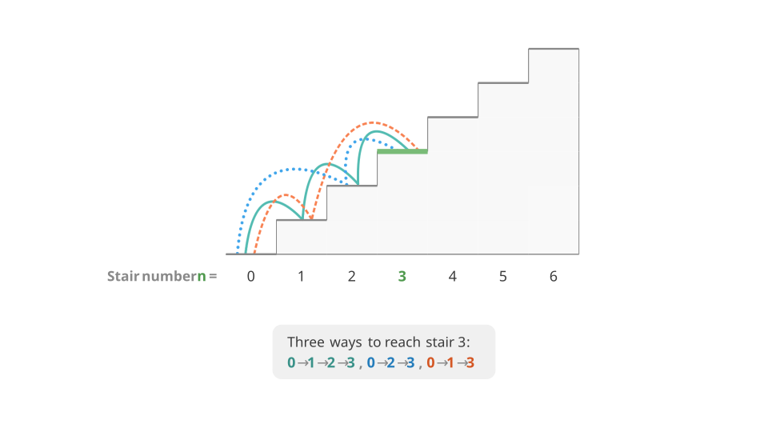
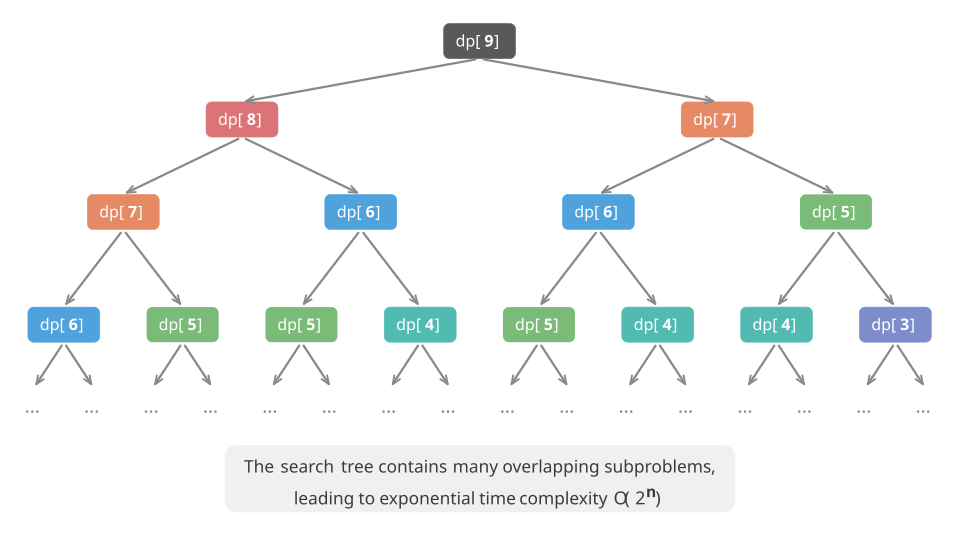

# Introduction to dynamic programming

<u>Dynamic programming</u> is an important algorithmic paradigm. It breaks a problem into smaller subproblems and stores their solutions to avoid repeated work, often saving a great deal of time.

We'll start with a classic example, solve it by brute-force backtracking, identify the overlapping subproblems, and gradually derive a more efficient dynamic programming solution.

!!! question "Climbing stairs"

    A staircase has $n$ stairs. Each move takes you up either $1$ or $2$ stairs. How many ways can you reach the top?

As the figure below shows, a staircase with $3$ stairs has $3$ ways to reach the top.



We want the number of ways, so **we can enumerate all possibilities by backtracking**. Think of climbing as a series of choices. Start on the ground and choose to climb $1$ or $2$ stairs at each move. Add $1$ to the count whenever you reach the top, and prune moves that would overshoot it. Here is the code:

```src
[file]{climbing_stairs_backtrack}-[class]{}-[func]{climbing_stairs_backtrack}
```

## Method 1: Brute-force search

Backtracking usually does not explicitly split the problem into subproblems. It treats the solution as a sequence of decisions and searches for all possible solutions by trying choices and pruning branches.

We can also view the problem in terms of subproblems. Let $dp[i]$ be the number of ways to reach stair $i$. Then $dp[i]$ is the original problem, with subproblems including the following:

$$
dp[i-1], dp[i-2], \dots, dp[2], dp[1]
$$

Each move climbs $1$ or $2$ stairs. If we are now on stair $i$, we must previously have been on stair $i - 1$ or $i - 2$. In other words, only stairs $i -1$ and $i - 2$ can lead directly to stair $i$.

This gives an important result: **the number of ways to reach stair $i - 1$ plus the number of ways to reach stair $i - 2$ equals the number of ways to reach stair $i$**. In symbols:

$$
dp[i] = dp[i-1] + dp[i-2]
$$

The stair-climbing subproblems are related by a recurrence, and **we can build the original solution from the subproblem solutions**. The figure below illustrates this relationship.


The recurrence gives us a brute-force search. Start at $dp[n]$ and **recursively break each larger problem into the sum of two smaller ones** until reaching the smallest subproblems $dp[1]$ and $dp[2]$. Their solutions are known: $dp[1] = 1$ and $dp[2] = 2$. There are $1$ and $2$ ways to reach stairs $1$ and $2$, respectively.

Like the standard backtracking code, the following code performs a depth-first search, but it is more concise:

```src
[file]{climbing_stairs_dfs}-[class]{}-[func]{climbing_stairs_dfs}
```

The figure below shows the recursion tree for brute-force search. For $dp[n]$, the tree has depth $n$ and time complexity $O(2^n)$. Exponential growth is explosive: even a moderately large $n$ can mean a long wait.



In the figure, **overlapping subproblems cause the exponential time complexity**. For example, $dp[9]$ splits into $dp[8]$ and $dp[7]$, while $dp[8]$ splits into $dp[7]$ and $dp[6]$. Both include $dp[7]$.

Those subproblems contain still smaller overlapping subproblems, and so on down the tree. These repeated calculations consume most of the computational effort.

## Method 2: Memoized search

For better efficiency, **we want to solve each overlapping subproblem just once**. We can store each result in an array `mem` and prune repeated subproblems during the search.

1. The first time we calculate $dp[i]$, store it in `mem[i]` for later use.
2. When we need $dp[i]$ again, read the result from `mem[i]` and avoid solving the same subproblem again.

Here is the code:

```src
[file]{climbing_stairs_dfs_mem}-[class]{}-[func]{climbing_stairs_dfs_mem}
```

As shown below, **memoization solves each overlapping subproblem just once, reducing the time complexity to $O(n)$**. This is a substantial improvement.


## Method 3: Dynamic programming

**Memoized search works from the top down**. Start with the original problem (the root) and recursively split larger subproblems into smaller ones until reaching the smallest subproblems with known answers (the leaves). As the calls return, combine their solutions level by level to solve the original problem.

Conversely, **dynamic programming works from the bottom up**. Start with the solutions to the smallest subproblems and iteratively build solutions to larger ones until reaching the original problem.

This dynamic programming approach requires no backtracking. A loop suffices, with no need for recursion. In the code below, an array `dp` stores the subproblem solutions, much as the array `mem` did in memoized search:

```src
[file]{climbing_stairs_dp}-[class]{}-[func]{climbing_stairs_dp}
```

The figure below traces the code's execution.


Like backtracking, dynamic programming uses a state to represent a particular stage of a solution. Each state corresponds to a subproblem and its local optimum. In stair climbing, for example, the state is the current stair number $i$.

This example illustrates several common dynamic programming terms.

- The array `dp` is the <u>dp table</u>. Its entry $dp[i]$ holds the solution to the subproblem for state $i$.
- The states for the smallest subproblems (stairs $1$ and $2$) are the <u>initial states</u>.
- The recurrence $dp[i] = dp[i-1] + dp[i-2]$ is called the <u>state transition equation</u>.

## Space optimization

Notice that **because $dp[i]$ depends only on $dp[i-1]$ and $dp[i-2]$, we do not need an array `dp` to store all the subproblem solutions**. We can carry just two variables forward, as shown here:

```src
[file]{climbing_stairs_dp}-[class]{}-[func]{climbing_stairs_dp_comp}
```

Eliminating the array `dp` reduces the space complexity from $O(n)$ to $O(1)$.

In dynamic programming, a state often depends on only a limited number of earlier states. Keeping just those states reduces the dimension of the table and saves memory. **This space optimization is called using rolling variables or a rolling array**.
