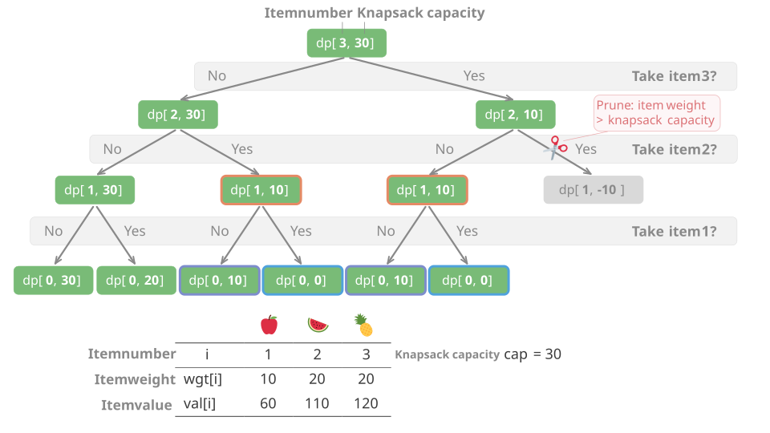
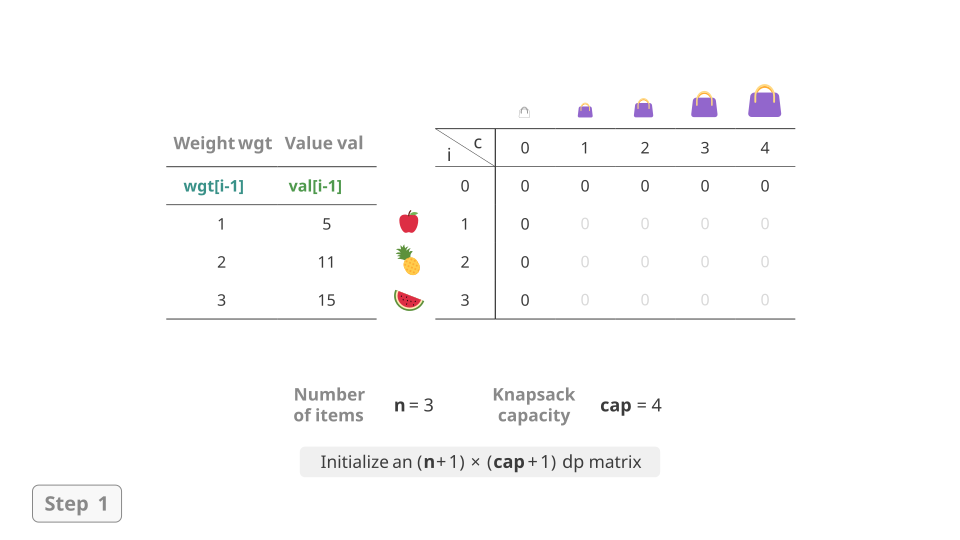
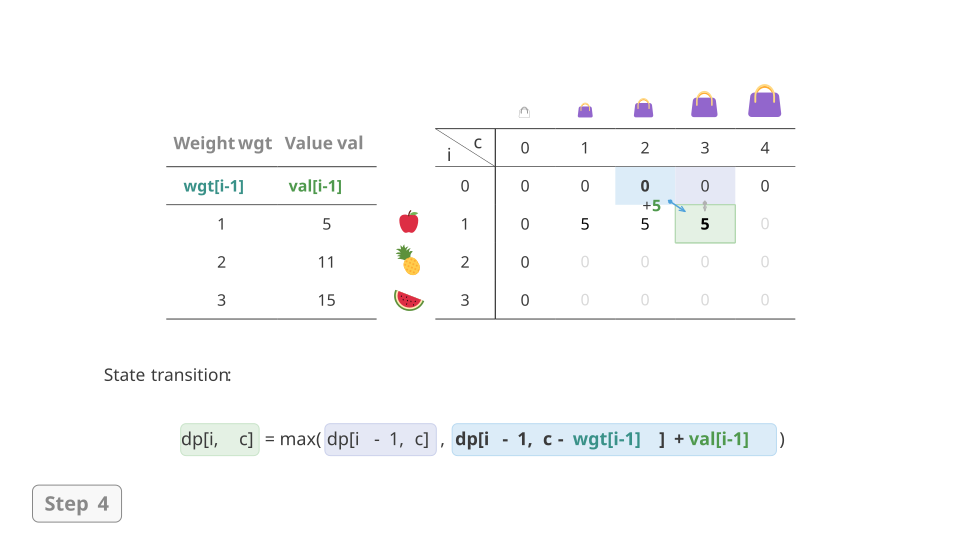
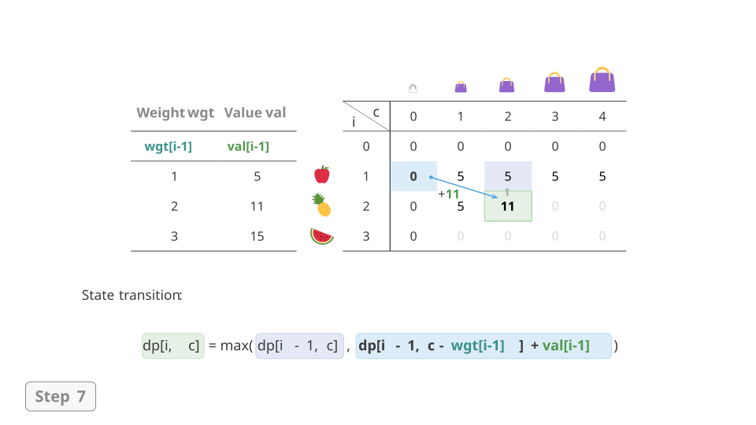
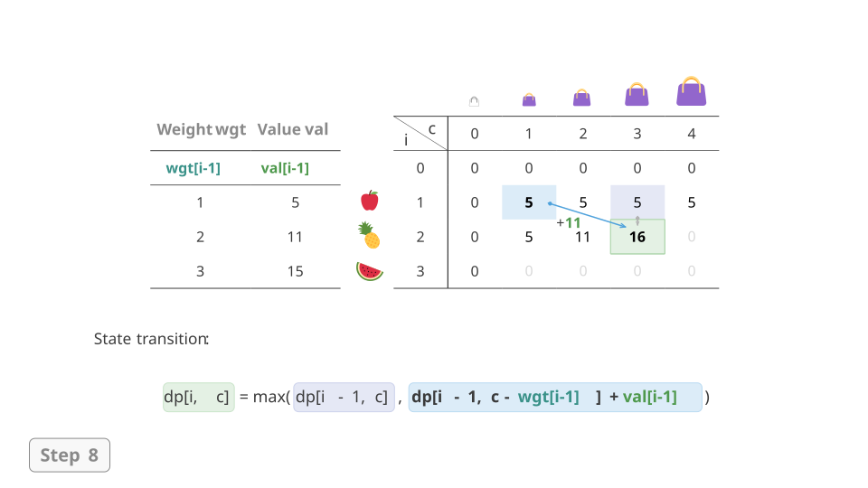
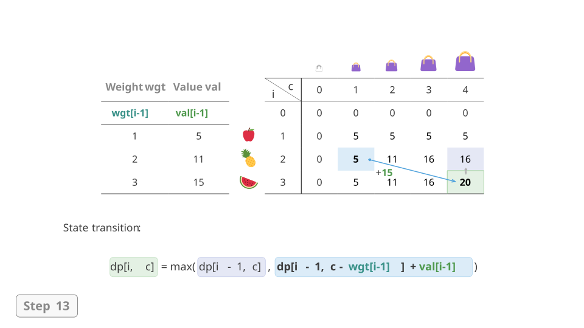
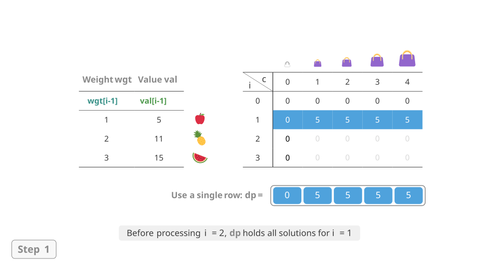
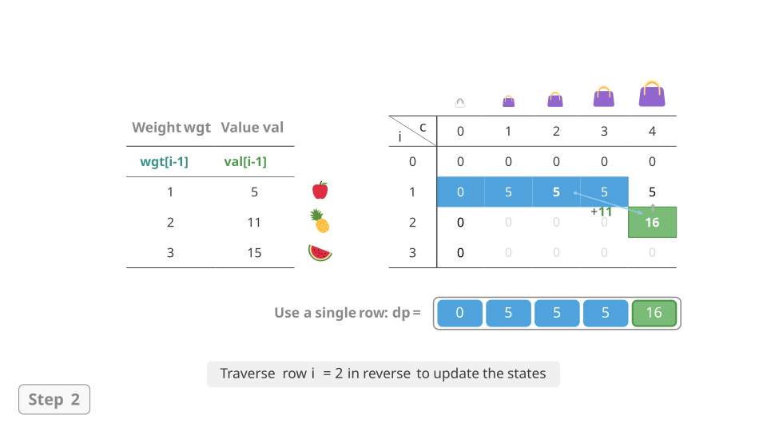
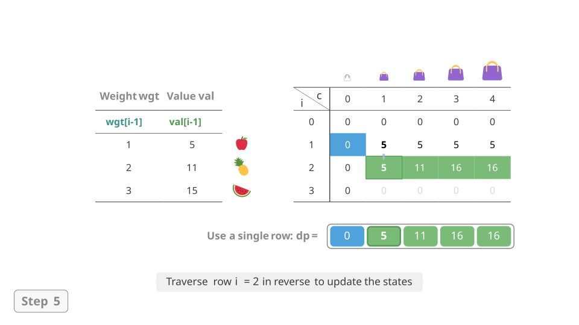

# The 0-1 knapsack problem

Knapsack is a good introduction to dynamic programming and one of its most common problem types. Variants include 0-1 knapsack, unbounded knapsack, and bounded knapsack.

We'll start with the most common variant, 0-1 knapsack.

!!! question

    Given $n$ items, where item $i$ weighs $wgt[i-1]$ and has value $val[i-1]$, and a knapsack of capacity $cap$, find the maximum total value you can pack without exceeding capacity. Each item can be taken at most once.

In the figure below, item numbers $i$ start at $1$, while array indices start at $0$. Thus item $i$ has weight $wgt[i-1]$ and value $val[i-1]$.


We can view 0-1 knapsack as $n$ successive decisions. Each item has two choices, skip or take, so the problem fits a decision tree.

The goal is to maximize the value packed within a capacity limit, making dynamic programming a likely fit.

**Step 1: Identify the decision at each step and define the state and $dp$ table**

Skipping an item leaves the available capacity unchanged. Taking it reduces that capacity. We can therefore define the state by the current item number $i$ and available capacity $c$, written $[i, c]$.

The subproblem for state $[i, c]$ is **the maximum value obtainable from the first $i$ items with a knapsack of capacity $c$**. Denote this value by $dp[i, c]$.

We want $dp[n, cap]$, so we need a two-dimensional $dp$ table of size $(n+1) \times (cap+1)$.

**Step 2: Identify optimal substructure and derive the recurrence**

After deciding on item $i$, we have a subproblem involving the first $i-1$ items. There are two cases.

- **Skip item $i$**. Capacity stays the same, leaving state $[i-1, c]$.
- **Take item $i$**. Capacity decreases by $wgt[i-1]$, value increases by $val[i-1]$, and the remaining state is $[i-1, c-wgt[i-1]]$.

This gives the optimal substructure: **the maximum value $dp[i, c]$ is the larger of the values for skipping item $i$ and taking item $i$**. The recurrence is:

$$
dp[i, c] = \max(dp[i-1, c], dp[i-1, c - wgt[i-1]] + val[i-1])
$$

If the current item's weight $wgt[i - 1]$ exceeds the remaining capacity $c$, we can only skip it.

**Step 3: Determine the boundary conditions and the order of computation**

With no items or a capacity of $0$, the maximum value is $0$. Thus the first column $dp[i, 0]$ and first row $dp[0, c]$ both contain $0$.

The current state $[i, c]$ depends on $[i-1, c]$ directly above and $[i-1, c-wgt[i-1]]$ above and to the left. We can therefore traverse the entire $dp$ table in increasing order with two nested loops.

We'll now implement brute-force search, memoized search, and dynamic programming in that order.

### Method 1: Brute-force search

The search has the following components.

- **Recursive parameters**: the state $[i, c]$.
- **Return value**: the subproblem solution $dp[i, c]$.
- **Base case**: when we run out of items ($i = 0$) or the remaining capacity is $0$, stop recursing and return value $0$.
- **Pruning**: if the current item weighs more than the remaining capacity, we can only skip it.

```src
[file]{knapsack}-[class]{}-[func]{knapsack_dfs}
```

As the figure shows, each item gives rise to two search branches, skip and take, so the time complexity is $O(2^n)$.

The recursion tree contains overlapping subproblems such as $dp[1, 10]$. Their number grows substantially with more items and larger capacity, especially when many items share a weight.



### Method 2: Memoized search

To solve each overlapping subproblem just once, store its solution in a cache `mem`, where `mem[i][c]` corresponds to $dp[i, c]$.

With memoization, **time complexity depends on the number of subproblems**, giving $O(n \times cap)$. Here is the implementation:

```src
[file]{knapsack}-[class]{}-[func]{knapsack_dfs_mem}
```

The figure below shows the branches pruned by memoized search.


### Method 3: Dynamic programming

Dynamic programming fills the $dp$ table by applying state transitions, as in the following code:

```src
[file]{knapsack}-[class]{}-[func]{knapsack_dp}
```

As shown below, the size of the array `dp` determines both time and space complexity, giving $O(n \times cap)$ for each.

=== "<1>"
    

=== "<2>"
    

=== "<3>"
    

=== "<4>"
    

=== "<5>"
    

=== "<6>"
    

=== "<7>"
    

=== "<8>"
    

=== "<9>"
    

=== "<10>"
    

=== "<11>"
    

=== "<12>"
    

=== "<13>"
    

=== "<14>"
    

### Space optimization

Each state depends only on the previous row, so we can alternate between two arrays and reduce space complexity from $O(n \times cap)$ to $O(cap)$.

Can we go further and use just one array? Each state comes from a cell directly above or above and to the left. With one array, when we start row $i$, the array still holds the states from row $i-1$.

- In forward order, by the time we reach $dp[i, j]$, the upper-left values from $dp[i-1, 1]$ through $dp[i-1, j-1]$ may already have been overwritten. The transition can then give the wrong result.
- Reverse order preserves the old values until they are needed, so the transition works correctly.

The figure shows one array changing from row $i = 1$ to row $i = 2$. Consider how forward and reverse traversal differ.

=== "<1>"
    

=== "<2>"
    

=== "<3>"
    

=== "<4>"
    

=== "<5>"
    

=== "<6>"
    

In the code, remove the first dimension $i$ from the array `dp` and run the inner loop in reverse:

```src
[file]{knapsack}-[class]{}-[func]{knapsack_dp_comp}
```
