# 14.4 &nbsp; The 0-1 knapsack problem

Knapsack is a good introduction to dynamic programming and one of its most common problem types. Variants include 0-1 knapsack, unbounded knapsack, and bounded knapsack.

We'll start with the most common variant, 0-1 knapsack.

!!! question

    Given $n$ items, where item $i$ weighs $wgt[i-1]$ and has value $val[i-1]$, and a knapsack of capacity $cap$, find the maximum total value you can pack without exceeding capacity. Each item can be taken at most once.

In Figure 14-17, item numbers $i$ start at $1$, while array indices start at $0$. Thus item $i$ has weight $wgt[i-1]$ and value $val[i-1]$.

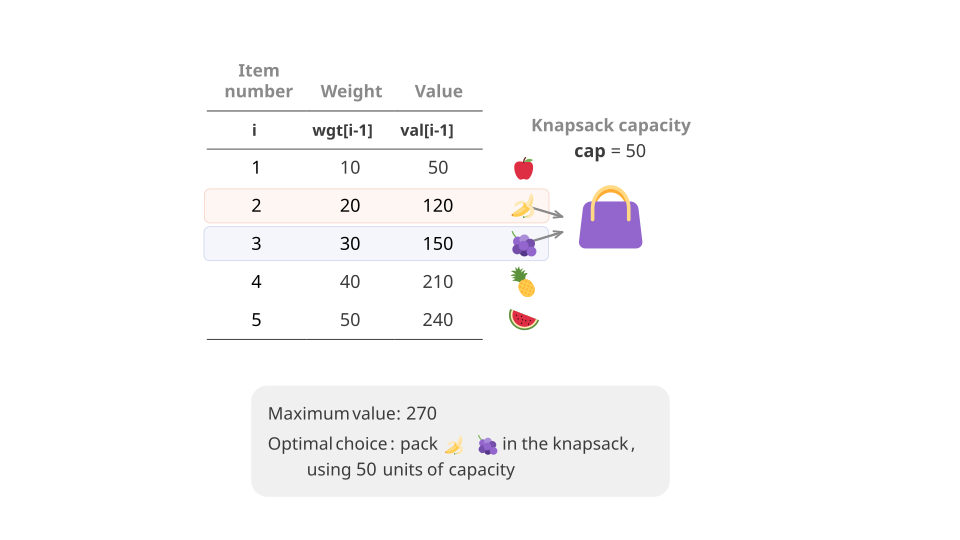{ class="animation-figure" }

<p align="center"> Figure 14-17 &nbsp; Example input for 0-1 knapsack </p>

We can view 0-1 knapsack as $n$ successive decisions. Each item has two choices, skip or take, so the problem fits a decision tree.

The goal is to maximize the value packed within a capacity limit, making dynamic programming a likely fit.

**Step 1: Identify the decision at each step and define the state and $dp$ table**

Skipping an item leaves the available capacity unchanged. Taking it reduces that capacity. We can therefore define the state by the current item number $i$ and available capacity $c$, written $[i, c]$.

The subproblem for state $[i, c]$ is **the maximum value obtainable from the first $i$ items with a knapsack of capacity $c$**. Denote this value by $dp[i, c]$.

We want $dp[n, cap]$, so we need a two-dimensional $dp$ table of size $(n+1) \times (cap+1)$.

**Step 2: Identify optimal substructure and derive the recurrence**

After deciding on item $i$, we have a subproblem involving the first $i-1$ items. There are two cases.

- **Skip item $i$**. Capacity stays the same, leaving state $[i-1, c]$.
- **Take item $i$**. Capacity decreases by $wgt[i-1]$, value increases by $val[i-1]$, and the remaining state is $[i-1, c-wgt[i-1]]$.

This gives the optimal substructure: **the maximum value $dp[i, c]$ is the larger of the values for skipping item $i$ and taking item $i$**. The recurrence is:

$$
dp[i, c] = \max(dp[i-1, c], dp[i-1, c - wgt[i-1]] + val[i-1])
$$

If the current item's weight $wgt[i - 1]$ exceeds the remaining capacity $c$, we can only skip it.

**Step 3: Determine the boundary conditions and the order of computation**

With no items or a capacity of $0$, the maximum value is $0$. Thus the first column $dp[i, 0]$ and first row $dp[0, c]$ both contain $0$.

The current state $[i, c]$ depends on $[i-1, c]$ directly above and $[i-1, c-wgt[i-1]]$ above and to the left. We can therefore traverse the entire $dp$ table in increasing order with two nested loops.

We'll now implement brute-force search, memoized search, and dynamic programming in that order.

### 1. &nbsp; Method 1: Brute-force search

The search has the following components.

- **Recursive parameters**: the state $[i, c]$.
- **Return value**: the subproblem solution $dp[i, c]$.
- **Base case**: when we run out of items ($i = 0$) or the remaining capacity is $0$, stop recursing and return value $0$.
- **Pruning**: if the current item weighs more than the remaining capacity, we can only skip it.

=== "Python"

    ```python title="knapsack.py"
    def knapsack_dfs(wgt: list[int], val: list[int], i: int, c: int) -> int:
        """0-1 knapsack with brute-force search"""
        # Return a value of 0 if all items have been considered or no capacity remains
        if i == 0 or c == 0:
            return 0
        # If the item exceeds the remaining capacity, we can only skip it
        if wgt[i - 1] > c:
            return knapsack_dfs(wgt, val, i - 1, c)
        # Compute the maximum values for skipping and taking item i
        no = knapsack_dfs(wgt, val, i - 1, c)
        yes = knapsack_dfs(wgt, val, i - 1, c - wgt[i - 1]) + val[i - 1]
        # Return the larger of the two values
        return max(no, yes)
    ```

=== "C++"

    ```cpp title="knapsack.cpp"
    /* 0-1 knapsack with brute-force search */
    int knapsackDFS(vector<int> &wgt, vector<int> &val, int i, int c) {
        // Return a value of 0 if all items have been considered or no capacity remains
        if (i == 0 || c == 0) {
            return 0;
        }
        // If the item exceeds the remaining capacity, we can only skip it
        if (wgt[i - 1] > c) {
            return knapsackDFS(wgt, val, i - 1, c);
        }
        // Compute the maximum values for skipping and taking item i
        int no = knapsackDFS(wgt, val, i - 1, c);
        int yes = knapsackDFS(wgt, val, i - 1, c - wgt[i - 1]) + val[i - 1];
        // Return the larger of the two values
        return max(no, yes);
    }
    ```

=== "Java"

    ```java title="knapsack.java"
    /* 0-1 knapsack with brute-force search */
    int knapsackDFS(int[] wgt, int[] val, int i, int c) {
        // Return a value of 0 if all items have been considered or no capacity remains
        if (i == 0 || c == 0) {
            return 0;
        }
        // If the item exceeds the remaining capacity, we can only skip it
        if (wgt[i - 1] > c) {
            return knapsackDFS(wgt, val, i - 1, c);
        }
        // Compute the maximum values for skipping and taking item i
        int no = knapsackDFS(wgt, val, i - 1, c);
        int yes = knapsackDFS(wgt, val, i - 1, c - wgt[i - 1]) + val[i - 1];
        // Return the larger of the two values
        return Math.max(no, yes);
    }
    ```

=== "C#"

    ```csharp title="knapsack.cs"
    /* 0-1 knapsack with brute-force search */
    int KnapsackDFS(int[] weight, int[] val, int i, int c) {
        // Return a value of 0 if all items have been considered or no capacity remains
        if (i == 0 || c == 0) {
            return 0;
        }
        // If the item exceeds the remaining capacity, we can only skip it
        if (weight[i - 1] > c) {
            return KnapsackDFS(weight, val, i - 1, c);
        }
        // Compute the maximum values for skipping and taking item i
        int no = KnapsackDFS(weight, val, i - 1, c);
        int yes = KnapsackDFS(weight, val, i - 1, c - weight[i - 1]) + val[i - 1];
        // Return the larger of the two values
        return Math.Max(no, yes);
    }
    ```

=== "Go"

    ```go title="knapsack.go"
    /* 0-1 knapsack with brute-force search */
    func knapsackDFS(wgt, val []int, i, c int) int {
        // Return a value of 0 if all items have been considered or no capacity remains
        if i == 0 || c == 0 {
            return 0
        }
        // If the item exceeds the remaining capacity, we can only skip it
        if wgt[i-1] > c {
            return knapsackDFS(wgt, val, i-1, c)
        }
        // Compute the maximum values for skipping and taking item i
        no := knapsackDFS(wgt, val, i-1, c)
        yes := knapsackDFS(wgt, val, i-1, c-wgt[i-1]) + val[i-1]
        // Return the larger of the two values
        return int(math.Max(float64(no), float64(yes)))
    }
    ```

=== "Swift"

    ```swift title="knapsack.swift"
    /* 0-1 knapsack with brute-force search */
    func knapsackDFS(wgt: [Int], val: [Int], i: Int, c: Int) -> Int {
        // Return a value of 0 if all items have been considered or no capacity remains
        if i == 0 || c == 0 {
            return 0
        }
        // If the item exceeds the remaining capacity, we can only skip it
        if wgt[i - 1] > c {
            return knapsackDFS(wgt: wgt, val: val, i: i - 1, c: c)
        }
        // Compute the maximum values for skipping and taking item i
        let no = knapsackDFS(wgt: wgt, val: val, i: i - 1, c: c)
        let yes = knapsackDFS(wgt: wgt, val: val, i: i - 1, c: c - wgt[i - 1]) + val[i - 1]
        // Return the larger of the two values
        return max(no, yes)
    }
    ```

=== "JS"

    ```javascript title="knapsack.js"
    /* 0-1 knapsack with brute-force search */
    function knapsackDFS(wgt, val, i, c) {
        // Return a value of 0 if all items have been considered or no capacity remains
        if (i === 0 || c === 0) {
            return 0;
        }
        // If the item exceeds the remaining capacity, we can only skip it
        if (wgt[i - 1] > c) {
            return knapsackDFS(wgt, val, i - 1, c);
        }
        // Compute the maximum values for skipping and taking item i
        const no = knapsackDFS(wgt, val, i - 1, c);
        const yes = knapsackDFS(wgt, val, i - 1, c - wgt[i - 1]) + val[i - 1];
        // Return the larger of the two values
        return Math.max(no, yes);
    }
    ```

=== "TS"

    ```typescript title="knapsack.ts"
    /* 0-1 knapsack with brute-force search */
    function knapsackDFS(
        wgt: Array<number>,
        val: Array<number>,
        i: number,
        c: number
    ): number {
        // Return a value of 0 if all items have been considered or no capacity remains
        if (i === 0 || c === 0) {
            return 0;
        }
        // If the item exceeds the remaining capacity, we can only skip it
        if (wgt[i - 1] > c) {
            return knapsackDFS(wgt, val, i - 1, c);
        }
        // Compute the maximum values for skipping and taking item i
        const no = knapsackDFS(wgt, val, i - 1, c);
        const yes = knapsackDFS(wgt, val, i - 1, c - wgt[i - 1]) + val[i - 1];
        // Return the larger of the two values
        return Math.max(no, yes);
    }
    ```

=== "Dart"

    ```dart title="knapsack.dart"
    /* 0-1 knapsack with brute-force search */
    int knapsackDFS(List<int> wgt, List<int> val, int i, int c) {
      // Return a value of 0 if all items have been considered or no capacity remains
      if (i == 0 || c == 0) {
        return 0;
      }
      // If the item exceeds the remaining capacity, we can only skip it
      if (wgt[i - 1] > c) {
        return knapsackDFS(wgt, val, i - 1, c);
      }
      // Compute the maximum values for skipping and taking item i
      int no = knapsackDFS(wgt, val, i - 1, c);
      int yes = knapsackDFS(wgt, val, i - 1, c - wgt[i - 1]) + val[i - 1];
      // Return the larger of the two values
      return max(no, yes);
    }
    ```

=== "Rust"

    ```rust title="knapsack.rs"
    /* 0-1 knapsack with brute-force search */
    fn knapsack_dfs(wgt: &[i32], val: &[i32], i: usize, c: usize) -> i32 {
        // Return a value of 0 if all items have been considered or no capacity remains
        if i == 0 || c == 0 {
            return 0;
        }
        // If the item exceeds the remaining capacity, we can only skip it
        if wgt[i - 1] > c as i32 {
            return knapsack_dfs(wgt, val, i - 1, c);
        }
        // Compute the maximum values for skipping and taking item i
        let no = knapsack_dfs(wgt, val, i - 1, c);
        let yes = knapsack_dfs(wgt, val, i - 1, c - wgt[i - 1] as usize) + val[i - 1];
        // Return the larger of the two values
        std::cmp::max(no, yes)
    }
    ```

=== "C"

    ```c title="knapsack.c"
    /* 0-1 knapsack with brute-force search */
    int knapsackDFS(int wgt[], int val[], int i, int c) {
        // Return a value of 0 if all items have been considered or no capacity remains
        if (i == 0 || c == 0) {
            return 0;
        }
        // If the item exceeds the remaining capacity, we can only skip it
        if (wgt[i - 1] > c) {
            return knapsackDFS(wgt, val, i - 1, c);
        }
        // Compute the maximum values for skipping and taking item i
        int no = knapsackDFS(wgt, val, i - 1, c);
        int yes = knapsackDFS(wgt, val, i - 1, c - wgt[i - 1]) + val[i - 1];
        // Return the larger of the two values
        return myMax(no, yes);
    }
    ```

=== "Kotlin"

    ```kotlin title="knapsack.kt"
    /* 0-1 knapsack with brute-force search */
    fun knapsackDFS(
        wgt: IntArray,
        _val: IntArray,
        i: Int,
        c: Int
    ): Int {
        // Return a value of 0 if all items have been considered or no capacity remains
        if (i == 0 || c == 0) {
            return 0
        }
        // If the item exceeds the remaining capacity, we can only skip it
        if (wgt[i - 1] > c) {
            return knapsackDFS(wgt, _val, i - 1, c)
        }
        // Compute the maximum values for skipping and taking item i
        val no = knapsackDFS(wgt, _val, i - 1, c)
        val yes = knapsackDFS(wgt, _val, i - 1, c - wgt[i - 1]) + _val[i - 1]
        // Return the larger of the two values
        return max(no, yes)
    }
    ```

=== "Ruby"

    ```ruby title="knapsack.rb"
    ### 0-1 knapsack with brute-force search ###
    def knapsack_dfs(wgt, val, i, c)
      # Return a value of 0 if all items have been considered or no capacity remains
      return 0 if i == 0 || c == 0
      # If the item exceeds the remaining capacity, we can only skip it
      return knapsack_dfs(wgt, val, i - 1, c) if wgt[i - 1] > c
      # Compute the maximum values for skipping and taking item i
      no = knapsack_dfs(wgt, val, i - 1, c)
      yes = knapsack_dfs(wgt, val, i - 1, c - wgt[i - 1]) + val[i - 1]
      # Return the larger of the two values
      [no, yes].max
    end
    ```

??? pythontutor "Visualize execution"

    <div style="height: 549px; width: 100%;"><iframe class="pythontutor-iframe" title="Visualize execution" src="https://pythontutor.com/iframe-embed.html#code=def%20knapsack_dfs%28wgt%3A%20list%5Bint%5D,%20val%3A%20list%5Bint%5D,%20i%3A%20int,%20c%3A%20int%29%20-%3E%20int%3A%0A%20%20%20%20%22%22%220-1%20knapsack%20with%20brute-force%20search%22%22%22%0A%20%20%20%20%23%20Return%20a%20value%20of%200%20if%20all%20items%20have%20been%20considered%20or%20no%20capacity%20remains%0A%20%20%20%20if%20i%20%3D%3D%200%20or%20c%20%3D%3D%200%3A%0A%20%20%20%20%20%20%20%20return%200%0A%20%20%20%20%23%20If%20the%20item%20exceeds%20the%20remaining%20capacity,%20we%20can%20only%20skip%20it%0A%20%20%20%20if%20wgt%5Bi%20-%201%5D%20%3E%20c%3A%0A%20%20%20%20%20%20%20%20return%20knapsack_dfs%28wgt,%20val,%20i%20-%201,%20c%29%0A%20%20%20%20%23%20Compute%20the%20maximum%20values%20for%20skipping%20and%20taking%20item%20i%0A%20%20%20%20no%20%3D%20knapsack_dfs%28wgt,%20val,%20i%20-%201,%20c%29%0A%20%20%20%20yes%20%3D%20knapsack_dfs%28wgt,%20val,%20i%20-%201,%20c%20-%20wgt%5Bi%20-%201%5D%29%20%2B%20val%5Bi%20-%201%5D%0A%20%20%20%20%23%20Return%20the%20larger%20of%20the%20two%20values%0A%20%20%20%20return%20max%28no,%20yes%29%0A%0A%0A%22%22%22Driver%20Code%22%22%22%0Aif%20__name__%20%3D%3D%20%22__main__%22%3A%0A%20%20%20%20wgt%20%3D%20%5B10,%2020,%2030,%2040,%2050%5D%0A%20%20%20%20val%20%3D%20%5B50,%20120,%20150,%20210,%20240%5D%0A%20%20%20%20cap%20%3D%2050%0A%20%20%20%20n%20%3D%20len%28wgt%29%0A%0A%20%20%20%20%23%20Brute-force%20search%0A%20%20%20%20res%20%3D%20knapsack_dfs%28wgt,%20val,%20n,%20cap%29%0A%20%20%20%20print%28f%22Maximum%20total%20item%20value%20within%20the%20weight%20limit%3A%20%7Bres%7D%22%29&codeDivHeight=472&codeDivWidth=350&cumulative=false&curInstr=7&heapPrimitives=nevernest&origin=opt-frontend.js&py=311&rawInputLstJSON=%5B%5D&textReferences=false"> </iframe></div>
    <div style="margin-top: 5px;"><a href="https://pythontutor.com/iframe-embed.html#code=def%20knapsack_dfs%28wgt%3A%20list%5Bint%5D,%20val%3A%20list%5Bint%5D,%20i%3A%20int,%20c%3A%20int%29%20-%3E%20int%3A%0A%20%20%20%20%22%22%220-1%20knapsack%20with%20brute-force%20search%22%22%22%0A%20%20%20%20%23%20Return%20a%20value%20of%200%20if%20all%20items%20have%20been%20considered%20or%20no%20capacity%20remains%0A%20%20%20%20if%20i%20%3D%3D%200%20or%20c%20%3D%3D%200%3A%0A%20%20%20%20%20%20%20%20return%200%0A%20%20%20%20%23%20If%20the%20item%20exceeds%20the%20remaining%20capacity,%20we%20can%20only%20skip%20it%0A%20%20%20%20if%20wgt%5Bi%20-%201%5D%20%3E%20c%3A%0A%20%20%20%20%20%20%20%20return%20knapsack_dfs%28wgt,%20val,%20i%20-%201,%20c%29%0A%20%20%20%20%23%20Compute%20the%20maximum%20values%20for%20skipping%20and%20taking%20item%20i%0A%20%20%20%20no%20%3D%20knapsack_dfs%28wgt,%20val,%20i%20-%201,%20c%29%0A%20%20%20%20yes%20%3D%20knapsack_dfs%28wgt,%20val,%20i%20-%201,%20c%20-%20wgt%5Bi%20-%201%5D%29%20%2B%20val%5Bi%20-%201%5D%0A%20%20%20%20%23%20Return%20the%20larger%20of%20the%20two%20values%0A%20%20%20%20return%20max%28no,%20yes%29%0A%0A%0A%22%22%22Driver%20Code%22%22%22%0Aif%20__name__%20%3D%3D%20%22__main__%22%3A%0A%20%20%20%20wgt%20%3D%20%5B10,%2020,%2030,%2040,%2050%5D%0A%20%20%20%20val%20%3D%20%5B50,%20120,%20150,%20210,%20240%5D%0A%20%20%20%20cap%20%3D%2050%0A%20%20%20%20n%20%3D%20len%28wgt%29%0A%0A%20%20%20%20%23%20Brute-force%20search%0A%20%20%20%20res%20%3D%20knapsack_dfs%28wgt,%20val,%20n,%20cap%29%0A%20%20%20%20print%28f%22Maximum%20total%20item%20value%20within%20the%20weight%20limit%3A%20%7Bres%7D%22%29&codeDivHeight=800&codeDivWidth=600&cumulative=false&curInstr=7&heapPrimitives=nevernest&origin=opt-frontend.js&py=311&rawInputLstJSON=%5B%5D&textReferences=false" target="_blank" rel="noopener noreferrer">View full screen ></a></div>

As the figure shows, each item gives rise to two search branches, skip and take, so the time complexity is $O(2^n)$.

The recursion tree contains overlapping subproblems such as $dp[1, 10]$. Their number grows substantially with more items and larger capacity, especially when many items share a weight.

{ class="animation-figure" }

<p align="center"> Figure 14-18 &nbsp; Brute-force recursion tree for 0-1 knapsack </p>

### 2. &nbsp; Method 2: Memoized search

To solve each overlapping subproblem just once, store its solution in a cache `mem`, where `mem[i][c]` corresponds to $dp[i, c]$.

With memoization, **time complexity depends on the number of subproblems**, giving $O(n \times cap)$. Here is the implementation:

=== "Python"

    ```python title="knapsack.py"
    def knapsack_dfs_mem(
        wgt: list[int], val: list[int], mem: list[list[int]], i: int, c: int
    ) -> int:
        """0-1 knapsack with memoized search"""
        # Return a value of 0 if all items have been considered or no capacity remains
        if i == 0 or c == 0:
            return 0
        # Return the cached result if available
        if mem[i][c] != -1:
            return mem[i][c]
        # If the item exceeds the remaining capacity, we can only skip it
        if wgt[i - 1] > c:
            return knapsack_dfs_mem(wgt, val, mem, i - 1, c)
        # Compute the maximum values for skipping and taking item i
        no = knapsack_dfs_mem(wgt, val, mem, i - 1, c)
        yes = knapsack_dfs_mem(wgt, val, mem, i - 1, c - wgt[i - 1]) + val[i - 1]
        # Cache and return the larger of the two values
        mem[i][c] = max(no, yes)
        return mem[i][c]
    ```

=== "C++"

    ```cpp title="knapsack.cpp"
    /* 0-1 knapsack with memoized search */
    int knapsackDFSMem(vector<int> &wgt, vector<int> &val, vector<vector<int>> &mem, int i, int c) {
        // Return a value of 0 if all items have been considered or no capacity remains
        if (i == 0 || c == 0) {
            return 0;
        }
        // Return the cached result if available
        if (mem[i][c] != -1) {
            return mem[i][c];
        }
        // If the item exceeds the remaining capacity, we can only skip it
        if (wgt[i - 1] > c) {
            return knapsackDFSMem(wgt, val, mem, i - 1, c);
        }
        // Compute the maximum values for skipping and taking item i
        int no = knapsackDFSMem(wgt, val, mem, i - 1, c);
        int yes = knapsackDFSMem(wgt, val, mem, i - 1, c - wgt[i - 1]) + val[i - 1];
        // Cache and return the larger of the two values
        mem[i][c] = max(no, yes);
        return mem[i][c];
    }
    ```

=== "Java"

    ```java title="knapsack.java"
    /* 0-1 knapsack with memoized search */
    int knapsackDFSMem(int[] wgt, int[] val, int[][] mem, int i, int c) {
        // Return a value of 0 if all items have been considered or no capacity remains
        if (i == 0 || c == 0) {
            return 0;
        }
        // Return the cached result if available
        if (mem[i][c] != -1) {
            return mem[i][c];
        }
        // If the item exceeds the remaining capacity, we can only skip it
        if (wgt[i - 1] > c) {
            return knapsackDFSMem(wgt, val, mem, i - 1, c);
        }
        // Compute the maximum values for skipping and taking item i
        int no = knapsackDFSMem(wgt, val, mem, i - 1, c);
        int yes = knapsackDFSMem(wgt, val, mem, i - 1, c - wgt[i - 1]) + val[i - 1];
        // Cache and return the larger of the two values
        mem[i][c] = Math.max(no, yes);
        return mem[i][c];
    }
    ```

=== "C#"

    ```csharp title="knapsack.cs"
    /* 0-1 knapsack with memoized search */
    int KnapsackDFSMem(int[] weight, int[] val, int[][] mem, int i, int c) {
        // Return a value of 0 if all items have been considered or no capacity remains
        if (i == 0 || c == 0) {
            return 0;
        }
        // Return the cached result if available
        if (mem[i][c] != -1) {
            return mem[i][c];
        }
        // If the item exceeds the remaining capacity, we can only skip it
        if (weight[i - 1] > c) {
            return KnapsackDFSMem(weight, val, mem, i - 1, c);
        }
        // Compute the maximum values for skipping and taking item i
        int no = KnapsackDFSMem(weight, val, mem, i - 1, c);
        int yes = KnapsackDFSMem(weight, val, mem, i - 1, c - weight[i - 1]) + val[i - 1];
        // Cache and return the larger of the two values
        mem[i][c] = Math.Max(no, yes);
        return mem[i][c];
    }
    ```

=== "Go"

    ```go title="knapsack.go"
    /* 0-1 knapsack with memoized search */
    func knapsackDFSMem(wgt, val []int, mem [][]int, i, c int) int {
        // Return a value of 0 if all items have been considered or no capacity remains
        if i == 0 || c == 0 {
            return 0
        }
        // Return the cached result if available
        if mem[i][c] != -1 {
            return mem[i][c]
        }
        // If the item exceeds the remaining capacity, we can only skip it
        if wgt[i-1] > c {
            return knapsackDFSMem(wgt, val, mem, i-1, c)
        }
        // Compute the maximum values for skipping and taking item i
        no := knapsackDFSMem(wgt, val, mem, i-1, c)
        yes := knapsackDFSMem(wgt, val, mem, i-1, c-wgt[i-1]) + val[i-1]
        // Return the larger of the two values
        mem[i][c] = int(math.Max(float64(no), float64(yes)))
        return mem[i][c]
    }
    ```

=== "Swift"

    ```swift title="knapsack.swift"
    /* 0-1 knapsack with memoized search */
    func knapsackDFSMem(wgt: [Int], val: [Int], mem: inout [[Int]], i: Int, c: Int) -> Int {
        // Return a value of 0 if all items have been considered or no capacity remains
        if i == 0 || c == 0 {
            return 0
        }
        // Return the cached result if available
        if mem[i][c] != -1 {
            return mem[i][c]
        }
        // If the item exceeds the remaining capacity, we can only skip it
        if wgt[i - 1] > c {
            return knapsackDFSMem(wgt: wgt, val: val, mem: &mem, i: i - 1, c: c)
        }
        // Compute the maximum values for skipping and taking item i
        let no = knapsackDFSMem(wgt: wgt, val: val, mem: &mem, i: i - 1, c: c)
        let yes = knapsackDFSMem(wgt: wgt, val: val, mem: &mem, i: i - 1, c: c - wgt[i - 1]) + val[i - 1]
        // Cache and return the larger of the two values
        mem[i][c] = max(no, yes)
        return mem[i][c]
    }
    ```

=== "JS"

    ```javascript title="knapsack.js"
    /* 0-1 knapsack with memoized search */
    function knapsackDFSMem(wgt, val, mem, i, c) {
        // Return a value of 0 if all items have been considered or no capacity remains
        if (i === 0 || c === 0) {
            return 0;
        }
        // Return the cached result if available
        if (mem[i][c] !== -1) {
            return mem[i][c];
        }
        // If the item exceeds the remaining capacity, we can only skip it
        if (wgt[i - 1] > c) {
            return knapsackDFSMem(wgt, val, mem, i - 1, c);
        }
        // Compute the maximum values for skipping and taking item i
        const no = knapsackDFSMem(wgt, val, mem, i - 1, c);
        const yes =
            knapsackDFSMem(wgt, val, mem, i - 1, c - wgt[i - 1]) + val[i - 1];
        // Cache and return the larger of the two values
        mem[i][c] = Math.max(no, yes);
        return mem[i][c];
    }
    ```

=== "TS"

    ```typescript title="knapsack.ts"
    /* 0-1 knapsack with memoized search */
    function knapsackDFSMem(
        wgt: Array<number>,
        val: Array<number>,
        mem: Array<Array<number>>,
        i: number,
        c: number
    ): number {
        // Return a value of 0 if all items have been considered or no capacity remains
        if (i === 0 || c === 0) {
            return 0;
        }
        // Return the cached result if available
        if (mem[i][c] !== -1) {
            return mem[i][c];
        }
        // If the item exceeds the remaining capacity, we can only skip it
        if (wgt[i - 1] > c) {
            return knapsackDFSMem(wgt, val, mem, i - 1, c);
        }
        // Compute the maximum values for skipping and taking item i
        const no = knapsackDFSMem(wgt, val, mem, i - 1, c);
        const yes =
            knapsackDFSMem(wgt, val, mem, i - 1, c - wgt[i - 1]) + val[i - 1];
        // Cache and return the larger of the two values
        mem[i][c] = Math.max(no, yes);
        return mem[i][c];
    }
    ```

=== "Dart"

    ```dart title="knapsack.dart"
    /* 0-1 knapsack with memoized search */
    int knapsackDFSMem(
      List<int> wgt,
      List<int> val,
      List<List<int>> mem,
      int i,
      int c,
    ) {
      // Return a value of 0 if all items have been considered or no capacity remains
      if (i == 0 || c == 0) {
        return 0;
      }
      // Return the cached result if available
      if (mem[i][c] != -1) {
        return mem[i][c];
      }
      // If the item exceeds the remaining capacity, we can only skip it
      if (wgt[i - 1] > c) {
        return knapsackDFSMem(wgt, val, mem, i - 1, c);
      }
      // Compute the maximum values for skipping and taking item i
      int no = knapsackDFSMem(wgt, val, mem, i - 1, c);
      int yes = knapsackDFSMem(wgt, val, mem, i - 1, c - wgt[i - 1]) + val[i - 1];
      // Cache and return the larger of the two values
      mem[i][c] = max(no, yes);
      return mem[i][c];
    }
    ```

=== "Rust"

    ```rust title="knapsack.rs"
    /* 0-1 knapsack with memoized search */
    fn knapsack_dfs_mem(wgt: &[i32], val: &[i32], mem: &mut Vec<Vec<i32>>, i: usize, c: usize) -> i32 {
        // Return a value of 0 if all items have been considered or no capacity remains
        if i == 0 || c == 0 {
            return 0;
        }
        // Return the cached result if available
        if mem[i][c] != -1 {
            return mem[i][c];
        }
        // If the item exceeds the remaining capacity, we can only skip it
        if wgt[i - 1] > c as i32 {
            return knapsack_dfs_mem(wgt, val, mem, i - 1, c);
        }
        // Compute the maximum values for skipping and taking item i
        let no = knapsack_dfs_mem(wgt, val, mem, i - 1, c);
        let yes = knapsack_dfs_mem(wgt, val, mem, i - 1, c - wgt[i - 1] as usize) + val[i - 1];
        // Cache and return the larger of the two values
        mem[i][c] = std::cmp::max(no, yes);
        mem[i][c]
    }
    ```

=== "C"

    ```c title="knapsack.c"
    /* 0-1 knapsack with memoized search */
    int knapsackDFSMem(int wgt[], int val[], int memCols, int **mem, int i, int c) {
        // Return a value of 0 if all items have been considered or no capacity remains
        if (i == 0 || c == 0) {
            return 0;
        }
        // Return the cached result if available
        if (mem[i][c] != -1) {
            return mem[i][c];
        }
        // If the item exceeds the remaining capacity, we can only skip it
        if (wgt[i - 1] > c) {
            return knapsackDFSMem(wgt, val, memCols, mem, i - 1, c);
        }
        // Compute the maximum values for skipping and taking item i
        int no = knapsackDFSMem(wgt, val, memCols, mem, i - 1, c);
        int yes = knapsackDFSMem(wgt, val, memCols, mem, i - 1, c - wgt[i - 1]) + val[i - 1];
        // Cache and return the larger of the two values
        mem[i][c] = myMax(no, yes);
        return mem[i][c];
    }
    ```

=== "Kotlin"

    ```kotlin title="knapsack.kt"
    /* 0-1 knapsack with memoized search */
    fun knapsackDFSMem(
        wgt: IntArray,
        _val: IntArray,
        mem: Array<IntArray>,
        i: Int,
        c: Int
    ): Int {
        // Return a value of 0 if all items have been considered or no capacity remains
        if (i == 0 || c == 0) {
            return 0
        }
        // Return the cached result if available
        if (mem[i][c] != -1) {
            return mem[i][c]
        }
        // If the item exceeds the remaining capacity, we can only skip it
        if (wgt[i - 1] > c) {
            return knapsackDFSMem(wgt, _val, mem, i - 1, c)
        }
        // Compute the maximum values for skipping and taking item i
        val no = knapsackDFSMem(wgt, _val, mem, i - 1, c)
        val yes = knapsackDFSMem(wgt, _val, mem, i - 1, c - wgt[i - 1]) + _val[i - 1]
        // Cache and return the larger of the two values
        mem[i][c] = max(no, yes)
        return mem[i][c]
    }
    ```

=== "Ruby"

    ```ruby title="knapsack.rb"
    ### 0-1 knapsack with memoized search ###
    def knapsack_dfs_mem(wgt, val, mem, i, c)
      # Return a value of 0 if all items have been considered or no capacity remains
      return 0 if i == 0 || c == 0
      # Return the cached result if available
      return mem[i][c] if mem[i][c] != -1
      # If the item exceeds the remaining capacity, we can only skip it
      return knapsack_dfs_mem(wgt, val, mem, i - 1, c) if wgt[i - 1] > c
      # Compute the maximum values for skipping and taking item i
      no = knapsack_dfs_mem(wgt, val, mem, i - 1, c)
      yes = knapsack_dfs_mem(wgt, val, mem, i - 1, c - wgt[i - 1]) + val[i - 1]
      # Cache and return the larger of the two values
      mem[i][c] = [no, yes].max
    end
    ```

??? pythontutor "Visualize execution"

    <div style="height: 549px; width: 100%;"><iframe class="pythontutor-iframe" title="Visualize execution" src="https://pythontutor.com/iframe-embed.html#code=def%20knapsack_dfs_mem%28%0A%20%20%20%20wgt%3A%20list%5Bint%5D,%20val%3A%20list%5Bint%5D,%20mem%3A%20list%5Blist%5Bint%5D%5D,%20i%3A%20int,%20c%3A%20int%0A%29%20-%3E%20int%3A%0A%20%20%20%20%22%22%220-1%20knapsack%20with%20memoized%20search%22%22%22%0A%20%20%20%20%23%20Return%20a%20value%20of%200%20if%20all%20items%20have%20been%20considered%20or%20no%20capacity%20remains%0A%20%20%20%20if%20i%20%3D%3D%200%20or%20c%20%3D%3D%200%3A%0A%20%20%20%20%20%20%20%20return%200%0A%20%20%20%20%23%20Return%20the%20cached%20result%20if%20available%0A%20%20%20%20if%20mem%5Bi%5D%5Bc%5D%20%21%3D%20-1%3A%0A%20%20%20%20%20%20%20%20return%20mem%5Bi%5D%5Bc%5D%0A%20%20%20%20%23%20If%20the%20item%20exceeds%20the%20remaining%20capacity,%20we%20can%20only%20skip%20it%0A%20%20%20%20if%20wgt%5Bi%20-%201%5D%20%3E%20c%3A%0A%20%20%20%20%20%20%20%20return%20knapsack_dfs_mem%28wgt,%20val,%20mem,%20i%20-%201,%20c%29%0A%20%20%20%20%23%20Compute%20the%20maximum%20values%20for%20skipping%20and%20taking%20item%20i%0A%20%20%20%20no%20%3D%20knapsack_dfs_mem%28wgt,%20val,%20mem,%20i%20-%201,%20c%29%0A%20%20%20%20yes%20%3D%20knapsack_dfs_mem%28wgt,%20val,%20mem,%20i%20-%201,%20c%20-%20wgt%5Bi%20-%201%5D%29%20%2B%20val%5Bi%20-%201%5D%0A%20%20%20%20%23%20Cache%20and%20return%20the%20larger%20of%20the%20two%20values%0A%20%20%20%20mem%5Bi%5D%5Bc%5D%20%3D%20max%28no,%20yes%29%0A%20%20%20%20return%20mem%5Bi%5D%5Bc%5D%0A%0A%0A%22%22%22Driver%20Code%22%22%22%0Aif%20__name__%20%3D%3D%20%22__main__%22%3A%0A%20%20%20%20wgt%20%3D%20%5B10,%2020,%2030,%2040,%2050%5D%0A%20%20%20%20val%20%3D%20%5B50,%20120,%20150,%20210,%20240%5D%0A%20%20%20%20cap%20%3D%2050%0A%20%20%20%20n%20%3D%20len%28wgt%29%0A%0A%20%20%20%20%23%20Memoized%20search%0A%20%20%20%20mem%20%3D%20%5B%5B-1%5D%20%2A%20%28cap%20%2B%201%29%20for%20_%20in%20range%28n%20%2B%201%29%5D%0A%20%20%20%20res%20%3D%20knapsack_dfs_mem%28wgt,%20val,%20mem,%20n,%20cap%29%0A%20%20%20%20print%28f%22Maximum%20total%20item%20value%20within%20the%20weight%20limit%3A%20%7Bres%7D%22%29&codeDivHeight=472&codeDivWidth=350&cumulative=false&curInstr=20&heapPrimitives=nevernest&origin=opt-frontend.js&py=311&rawInputLstJSON=%5B%5D&textReferences=false"> </iframe></div>
    <div style="margin-top: 5px;"><a href="https://pythontutor.com/iframe-embed.html#code=def%20knapsack_dfs_mem%28%0A%20%20%20%20wgt%3A%20list%5Bint%5D,%20val%3A%20list%5Bint%5D,%20mem%3A%20list%5Blist%5Bint%5D%5D,%20i%3A%20int,%20c%3A%20int%0A%29%20-%3E%20int%3A%0A%20%20%20%20%22%22%220-1%20knapsack%20with%20memoized%20search%22%22%22%0A%20%20%20%20%23%20Return%20a%20value%20of%200%20if%20all%20items%20have%20been%20considered%20or%20no%20capacity%20remains%0A%20%20%20%20if%20i%20%3D%3D%200%20or%20c%20%3D%3D%200%3A%0A%20%20%20%20%20%20%20%20return%200%0A%20%20%20%20%23%20Return%20the%20cached%20result%20if%20available%0A%20%20%20%20if%20mem%5Bi%5D%5Bc%5D%20%21%3D%20-1%3A%0A%20%20%20%20%20%20%20%20return%20mem%5Bi%5D%5Bc%5D%0A%20%20%20%20%23%20If%20the%20item%20exceeds%20the%20remaining%20capacity,%20we%20can%20only%20skip%20it%0A%20%20%20%20if%20wgt%5Bi%20-%201%5D%20%3E%20c%3A%0A%20%20%20%20%20%20%20%20return%20knapsack_dfs_mem%28wgt,%20val,%20mem,%20i%20-%201,%20c%29%0A%20%20%20%20%23%20Compute%20the%20maximum%20values%20for%20skipping%20and%20taking%20item%20i%0A%20%20%20%20no%20%3D%20knapsack_dfs_mem%28wgt,%20val,%20mem,%20i%20-%201,%20c%29%0A%20%20%20%20yes%20%3D%20knapsack_dfs_mem%28wgt,%20val,%20mem,%20i%20-%201,%20c%20-%20wgt%5Bi%20-%201%5D%29%20%2B%20val%5Bi%20-%201%5D%0A%20%20%20%20%23%20Cache%20and%20return%20the%20larger%20of%20the%20two%20values%0A%20%20%20%20mem%5Bi%5D%5Bc%5D%20%3D%20max%28no,%20yes%29%0A%20%20%20%20return%20mem%5Bi%5D%5Bc%5D%0A%0A%0A%22%22%22Driver%20Code%22%22%22%0Aif%20__name__%20%3D%3D%20%22__main__%22%3A%0A%20%20%20%20wgt%20%3D%20%5B10,%2020,%2030,%2040,%2050%5D%0A%20%20%20%20val%20%3D%20%5B50,%20120,%20150,%20210,%20240%5D%0A%20%20%20%20cap%20%3D%2050%0A%20%20%20%20n%20%3D%20len%28wgt%29%0A%0A%20%20%20%20%23%20Memoized%20search%0A%20%20%20%20mem%20%3D%20%5B%5B-1%5D%20%2A%20%28cap%20%2B%201%29%20for%20_%20in%20range%28n%20%2B%201%29%5D%0A%20%20%20%20res%20%3D%20knapsack_dfs_mem%28wgt,%20val,%20mem,%20n,%20cap%29%0A%20%20%20%20print%28f%22Maximum%20total%20item%20value%20within%20the%20weight%20limit%3A%20%7Bres%7D%22%29&codeDivHeight=800&codeDivWidth=600&cumulative=false&curInstr=20&heapPrimitives=nevernest&origin=opt-frontend.js&py=311&rawInputLstJSON=%5B%5D&textReferences=false" target="_blank" rel="noopener noreferrer">View full screen ></a></div>

Figure 14-19 shows the branches pruned by memoized search.

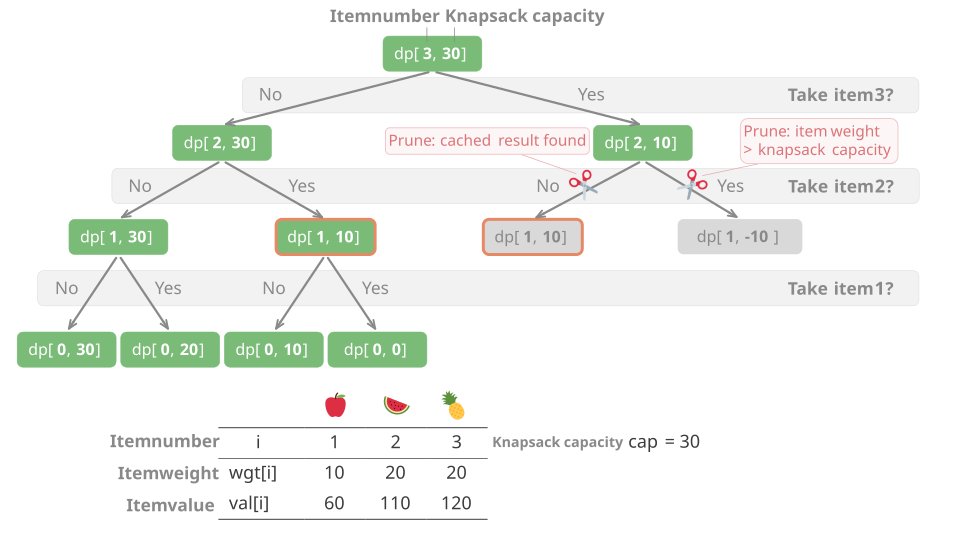{ class="animation-figure" }

<p align="center"> Figure 14-19 &nbsp; Memoized recursion tree for 0-1 knapsack </p>

### 3. &nbsp; Method 3: Dynamic programming

Dynamic programming fills the $dp$ table by applying state transitions, as in the following code:

=== "Python"

    ```python title="knapsack.py"
    def knapsack_dp(wgt: list[int], val: list[int], cap: int) -> int:
        """0-1 knapsack with dynamic programming"""
        n = len(wgt)
        # Initialize the dp table
        dp = [[0] * (cap + 1) for _ in range(n + 1)]
        # State transition
        for i in range(1, n + 1):
            for c in range(1, cap + 1):
                if wgt[i - 1] > c:
                    # Skip item i if its weight exceeds the capacity
                    dp[i][c] = dp[i - 1][c]
                else:
                    # Take the larger value from skipping or taking item i
                    dp[i][c] = max(dp[i - 1][c], dp[i - 1][c - wgt[i - 1]] + val[i - 1])
        return dp[n][cap]
    ```

=== "C++"

    ```cpp title="knapsack.cpp"
    /* 0-1 knapsack with dynamic programming */
    int knapsackDP(vector<int> &wgt, vector<int> &val, int cap) {
        int n = wgt.size();
        // Initialize the dp table
        vector<vector<int>> dp(n + 1, vector<int>(cap + 1, 0));
        // State transition
        for (int i = 1; i <= n; i++) {
            for (int c = 1; c <= cap; c++) {
                if (wgt[i - 1] > c) {
                    // Skip item i if its weight exceeds the capacity
                    dp[i][c] = dp[i - 1][c];
                } else {
                    // Take the larger value from skipping or taking item i
                    dp[i][c] = max(dp[i - 1][c], dp[i - 1][c - wgt[i - 1]] + val[i - 1]);
                }
            }
        }
        return dp[n][cap];
    }
    ```

=== "Java"

    ```java title="knapsack.java"
    /* 0-1 knapsack with dynamic programming */
    int knapsackDP(int[] wgt, int[] val, int cap) {
        int n = wgt.length;
        // Initialize the dp table
        int[][] dp = new int[n + 1][cap + 1];
        // State transition
        for (int i = 1; i <= n; i++) {
            for (int c = 1; c <= cap; c++) {
                if (wgt[i - 1] > c) {
                    // Skip item i if its weight exceeds the capacity
                    dp[i][c] = dp[i - 1][c];
                } else {
                    // Take the larger value from skipping or taking item i
                    dp[i][c] = Math.max(dp[i - 1][c], dp[i - 1][c - wgt[i - 1]] + val[i - 1]);
                }
            }
        }
        return dp[n][cap];
    }
    ```

=== "C#"

    ```csharp title="knapsack.cs"
    /* 0-1 knapsack with dynamic programming */
    int KnapsackDP(int[] weight, int[] val, int cap) {
        int n = weight.Length;
        // Initialize the dp table
        int[,] dp = new int[n + 1, cap + 1];
        // State transition
        for (int i = 1; i <= n; i++) {
            for (int c = 1; c <= cap; c++) {
                if (weight[i - 1] > c) {
                    // Skip item i if its weight exceeds the capacity
                    dp[i, c] = dp[i - 1, c];
                } else {
                    // Take the larger value from skipping or taking item i
                    dp[i, c] = Math.Max(dp[i - 1, c - weight[i - 1]] + val[i - 1], dp[i - 1, c]);
                }
            }
        }
        return dp[n, cap];
    }
    ```

=== "Go"

    ```go title="knapsack.go"
    /* 0-1 knapsack with dynamic programming */
    func knapsackDP(wgt, val []int, cap int) int {
        n := len(wgt)
        // Initialize the dp table
        dp := make([][]int, n+1)
        for i := 0; i <= n; i++ {
            dp[i] = make([]int, cap+1)
        }
        // State transition
        for i := 1; i <= n; i++ {
            for c := 1; c <= cap; c++ {
                if wgt[i-1] > c {
                    // Skip item i if its weight exceeds the capacity
                    dp[i][c] = dp[i-1][c]
                } else {
                    // Take the larger value from skipping or taking item i
                    dp[i][c] = int(math.Max(float64(dp[i-1][c]), float64(dp[i-1][c-wgt[i-1]]+val[i-1])))
                }
            }
        }
        return dp[n][cap]
    }
    ```

=== "Swift"

    ```swift title="knapsack.swift"
    /* 0-1 knapsack with dynamic programming */
    func knapsackDP(wgt: [Int], val: [Int], cap: Int) -> Int {
        let n = wgt.count
        // Initialize the dp table
        var dp = Array(repeating: Array(repeating: 0, count: cap + 1), count: n + 1)
        // State transition
        for i in 1 ... n {
            for c in 1 ... cap {
                if wgt[i - 1] > c {
                    // Skip item i if its weight exceeds the capacity
                    dp[i][c] = dp[i - 1][c]
                } else {
                    // Take the larger value from skipping or taking item i
                    dp[i][c] = max(dp[i - 1][c], dp[i - 1][c - wgt[i - 1]] + val[i - 1])
                }
            }
        }
        return dp[n][cap]
    }
    ```

=== "JS"

    ```javascript title="knapsack.js"
    /* 0-1 knapsack with dynamic programming */
    function knapsackDP(wgt, val, cap) {
        const n = wgt.length;
        // Initialize the dp table
        const dp = Array(n + 1)
            .fill(0)
            .map(() => Array(cap + 1).fill(0));
        // State transition
        for (let i = 1; i <= n; i++) {
            for (let c = 1; c <= cap; c++) {
                if (wgt[i - 1] > c) {
                    // Skip item i if its weight exceeds the capacity
                    dp[i][c] = dp[i - 1][c];
                } else {
                    // Take the larger value from skipping or taking item i
                    dp[i][c] = Math.max(
                        dp[i - 1][c],
                        dp[i - 1][c - wgt[i - 1]] + val[i - 1]
                    );
                }
            }
        }
        return dp[n][cap];
    }
    ```

=== "TS"

    ```typescript title="knapsack.ts"
    /* 0-1 knapsack with dynamic programming */
    function knapsackDP(
        wgt: Array<number>,
        val: Array<number>,
        cap: number
    ): number {
        const n = wgt.length;
        // Initialize the dp table
        const dp = Array.from({ length: n + 1 }, () =>
            Array.from({ length: cap + 1 }, () => 0)
        );
        // State transition
        for (let i = 1; i <= n; i++) {
            for (let c = 1; c <= cap; c++) {
                if (wgt[i - 1] > c) {
                    // Skip item i if its weight exceeds the capacity
                    dp[i][c] = dp[i - 1][c];
                } else {
                    // Take the larger value from skipping or taking item i
                    dp[i][c] = Math.max(
                        dp[i - 1][c],
                        dp[i - 1][c - wgt[i - 1]] + val[i - 1]
                    );
                }
            }
        }
        return dp[n][cap];
    }
    ```

=== "Dart"

    ```dart title="knapsack.dart"
    /* 0-1 knapsack with dynamic programming */
    int knapsackDP(List<int> wgt, List<int> val, int cap) {
      int n = wgt.length;
      // Initialize the dp table
      List<List<int>> dp = List.generate(n + 1, (index) => List.filled(cap + 1, 0));
      // State transition
      for (int i = 1; i <= n; i++) {
        for (int c = 1; c <= cap; c++) {
          if (wgt[i - 1] > c) {
            // Skip item i if its weight exceeds the capacity
            dp[i][c] = dp[i - 1][c];
          } else {
            // Take the larger value from skipping or taking item i
            dp[i][c] = max(dp[i - 1][c], dp[i - 1][c - wgt[i - 1]] + val[i - 1]);
          }
        }
      }
      return dp[n][cap];
    }
    ```

=== "Rust"

    ```rust title="knapsack.rs"
    /* 0-1 knapsack with dynamic programming */
    fn knapsack_dp(wgt: &[i32], val: &[i32], cap: usize) -> i32 {
        let n = wgt.len();
        // Initialize the dp table
        let mut dp = vec![vec![0; cap + 1]; n + 1];
        // State transition
        for i in 1..=n {
            for c in 1..=cap {
                if wgt[i - 1] > c as i32 {
                    // Skip item i if its weight exceeds the capacity
                    dp[i][c] = dp[i - 1][c];
                } else {
                    // Take the larger value from skipping or taking item i
                    dp[i][c] = std::cmp::max(
                        dp[i - 1][c],
                        dp[i - 1][c - wgt[i - 1] as usize] + val[i - 1],
                    );
                }
            }
        }
        dp[n][cap]
    }
    ```

=== "C"

    ```c title="knapsack.c"
    /* 0-1 knapsack with dynamic programming */
    int knapsackDP(int wgt[], int val[], int cap, int wgtSize) {
        int n = wgtSize;
        // Initialize the dp table
        int **dp = malloc((n + 1) * sizeof(int *));
        for (int i = 0; i <= n; i++) {
            dp[i] = calloc(cap + 1, sizeof(int));
        }
        // State transition
        for (int i = 1; i <= n; i++) {
            for (int c = 1; c <= cap; c++) {
                if (wgt[i - 1] > c) {
                    // Skip item i if its weight exceeds the capacity
                    dp[i][c] = dp[i - 1][c];
                } else {
                    // Take the larger value from skipping or taking item i
                    dp[i][c] = myMax(dp[i - 1][c], dp[i - 1][c - wgt[i - 1]] + val[i - 1]);
                }
            }
        }
        int res = dp[n][cap];
        // Free the memory
        for (int i = 0; i <= n; i++) {
            free(dp[i]);
        }
        return res;
    }
    ```

=== "Kotlin"

    ```kotlin title="knapsack.kt"
    /* 0-1 knapsack with dynamic programming */
    fun knapsackDP(wgt: IntArray, _val: IntArray, cap: Int): Int {
        val n = wgt.size
        // Initialize the dp table
        val dp = Array(n + 1) { IntArray(cap + 1) }
        // State transition
        for (i in 1..n) {
            for (c in 1..cap) {
                if (wgt[i - 1] > c) {
                    // Skip item i if its weight exceeds the capacity
                    dp[i][c] = dp[i - 1][c]
                } else {
                    // Take the larger value from skipping or taking item i
                    dp[i][c] = max(dp[i - 1][c], dp[i - 1][c - wgt[i - 1]] + _val[i - 1])
                }
            }
        }
        return dp[n][cap]
    }
    ```

=== "Ruby"

    ```ruby title="knapsack.rb"
    ### 0-1 knapsack with dynamic programming ###
    def knapsack_dp(wgt, val, cap)
      n = wgt.length
      # Initialize the dp table
      dp = Array.new(n + 1) { Array.new(cap + 1, 0) }
      # State transition
      for i in 1...(n + 1)
        for c in 1...(cap + 1)
          if wgt[i - 1] > c
            # Skip item i if its weight exceeds the capacity
            dp[i][c] = dp[i - 1][c]
          else
            # Take the larger value from skipping or taking item i
            dp[i][c] = [dp[i - 1][c], dp[i - 1][c - wgt[i - 1]] + val[i - 1]].max
          end
        end
      end
      dp[n][cap]
    end
    ```

??? pythontutor "Visualize execution"

    <div style="height: 549px; width: 100%;"><iframe class="pythontutor-iframe" title="Visualize execution" src="https://pythontutor.com/iframe-embed.html#code=def%20knapsack_dp%28wgt%3A%20list%5Bint%5D,%20val%3A%20list%5Bint%5D,%20cap%3A%20int%29%20-%3E%20int%3A%0A%20%20%20%20%22%22%220-1%20knapsack%20with%20dynamic%20programming%22%22%22%0A%20%20%20%20n%20%3D%20len%28wgt%29%0A%20%20%20%20%23%20Initialize%20the%20dp%20table%0A%20%20%20%20dp%20%3D%20%5B%5B0%5D%20%2A%20%28cap%20%2B%201%29%20for%20_%20in%20range%28n%20%2B%201%29%5D%0A%20%20%20%20%23%20State%20transition%0A%20%20%20%20for%20i%20in%20range%281,%20n%20%2B%201%29%3A%0A%20%20%20%20%20%20%20%20for%20c%20in%20range%281,%20cap%20%2B%201%29%3A%0A%20%20%20%20%20%20%20%20%20%20%20%20if%20wgt%5Bi%20-%201%5D%20%3E%20c%3A%0A%20%20%20%20%20%20%20%20%20%20%20%20%20%20%20%20%23%20Skip%20item%20i%20if%20its%20weight%20exceeds%20the%20capacity%0A%20%20%20%20%20%20%20%20%20%20%20%20%20%20%20%20dp%5Bi%5D%5Bc%5D%20%3D%20dp%5Bi%20-%201%5D%5Bc%5D%0A%20%20%20%20%20%20%20%20%20%20%20%20else%3A%0A%20%20%20%20%20%20%20%20%20%20%20%20%20%20%20%20%23%20Take%20the%20larger%20value%20from%20skipping%20or%20taking%20item%20i%0A%20%20%20%20%20%20%20%20%20%20%20%20%20%20%20%20dp%5Bi%5D%5Bc%5D%20%3D%20max%28dp%5Bi%20-%201%5D%5Bc%5D,%20dp%5Bi%20-%201%5D%5Bc%20-%20wgt%5Bi%20-%201%5D%5D%20%2B%20val%5Bi%20-%201%5D%29%0A%20%20%20%20return%20dp%5Bn%5D%5Bcap%5D%0A%0A%0A%22%22%22Driver%20Code%22%22%22%0Aif%20__name__%20%3D%3D%20%22__main__%22%3A%0A%20%20%20%20wgt%20%3D%20%5B10,%2020,%2030,%2040,%2050%5D%0A%20%20%20%20val%20%3D%20%5B50,%20120,%20150,%20210,%20240%5D%0A%20%20%20%20cap%20%3D%2050%0A%20%20%20%20n%20%3D%20len%28wgt%29%0A%0A%20%20%20%20%23%20Dynamic%20programming%0A%20%20%20%20res%20%3D%20knapsack_dp%28wgt,%20val,%20cap%29%0A%20%20%20%20print%28f%22Maximum%20total%20item%20value%20within%20the%20weight%20limit%3A%20%7Bres%7D%22%29&codeDivHeight=472&codeDivWidth=350&cumulative=false&curInstr=7&heapPrimitives=nevernest&origin=opt-frontend.js&py=311&rawInputLstJSON=%5B%5D&textReferences=false"> </iframe></div>
    <div style="margin-top: 5px;"><a href="https://pythontutor.com/iframe-embed.html#code=def%20knapsack_dp%28wgt%3A%20list%5Bint%5D,%20val%3A%20list%5Bint%5D,%20cap%3A%20int%29%20-%3E%20int%3A%0A%20%20%20%20%22%22%220-1%20knapsack%20with%20dynamic%20programming%22%22%22%0A%20%20%20%20n%20%3D%20len%28wgt%29%0A%20%20%20%20%23%20Initialize%20the%20dp%20table%0A%20%20%20%20dp%20%3D%20%5B%5B0%5D%20%2A%20%28cap%20%2B%201%29%20for%20_%20in%20range%28n%20%2B%201%29%5D%0A%20%20%20%20%23%20State%20transition%0A%20%20%20%20for%20i%20in%20range%281,%20n%20%2B%201%29%3A%0A%20%20%20%20%20%20%20%20for%20c%20in%20range%281,%20cap%20%2B%201%29%3A%0A%20%20%20%20%20%20%20%20%20%20%20%20if%20wgt%5Bi%20-%201%5D%20%3E%20c%3A%0A%20%20%20%20%20%20%20%20%20%20%20%20%20%20%20%20%23%20Skip%20item%20i%20if%20its%20weight%20exceeds%20the%20capacity%0A%20%20%20%20%20%20%20%20%20%20%20%20%20%20%20%20dp%5Bi%5D%5Bc%5D%20%3D%20dp%5Bi%20-%201%5D%5Bc%5D%0A%20%20%20%20%20%20%20%20%20%20%20%20else%3A%0A%20%20%20%20%20%20%20%20%20%20%20%20%20%20%20%20%23%20Take%20the%20larger%20value%20from%20skipping%20or%20taking%20item%20i%0A%20%20%20%20%20%20%20%20%20%20%20%20%20%20%20%20dp%5Bi%5D%5Bc%5D%20%3D%20max%28dp%5Bi%20-%201%5D%5Bc%5D,%20dp%5Bi%20-%201%5D%5Bc%20-%20wgt%5Bi%20-%201%5D%5D%20%2B%20val%5Bi%20-%201%5D%29%0A%20%20%20%20return%20dp%5Bn%5D%5Bcap%5D%0A%0A%0A%22%22%22Driver%20Code%22%22%22%0Aif%20__name__%20%3D%3D%20%22__main__%22%3A%0A%20%20%20%20wgt%20%3D%20%5B10,%2020,%2030,%2040,%2050%5D%0A%20%20%20%20val%20%3D%20%5B50,%20120,%20150,%20210,%20240%5D%0A%20%20%20%20cap%20%3D%2050%0A%20%20%20%20n%20%3D%20len%28wgt%29%0A%0A%20%20%20%20%23%20Dynamic%20programming%0A%20%20%20%20res%20%3D%20knapsack_dp%28wgt,%20val,%20cap%29%0A%20%20%20%20print%28f%22Maximum%20total%20item%20value%20within%20the%20weight%20limit%3A%20%7Bres%7D%22%29&codeDivHeight=800&codeDivWidth=600&cumulative=false&curInstr=7&heapPrimitives=nevernest&origin=opt-frontend.js&py=311&rawInputLstJSON=%5B%5D&textReferences=false" target="_blank" rel="noopener noreferrer">View full screen ></a></div>

As shown below, the size of the array `dp` determines both time and space complexity, giving $O(n \times cap)$ for each.

=== "<1>"
    { class="animation-figure" }

=== "<2>"
    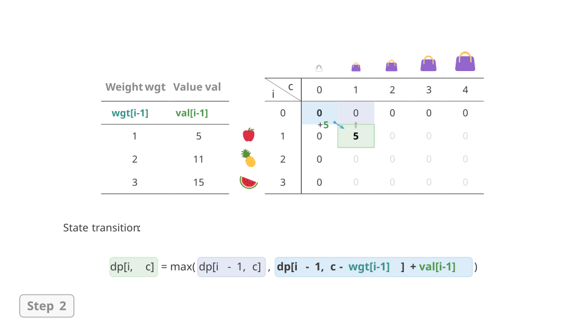{ class="animation-figure" }

=== "<3>"
    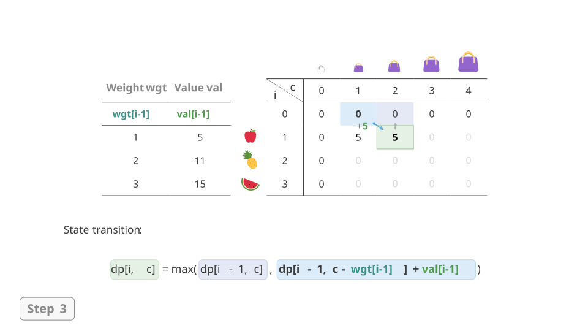{ class="animation-figure" }

=== "<4>"
    { class="animation-figure" }

=== "<5>"
    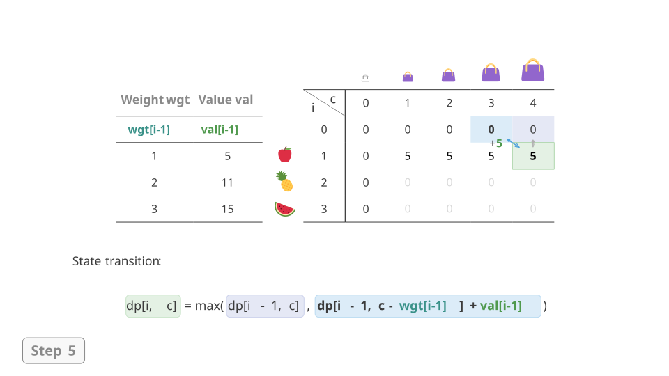{ class="animation-figure" }

=== "<6>"
    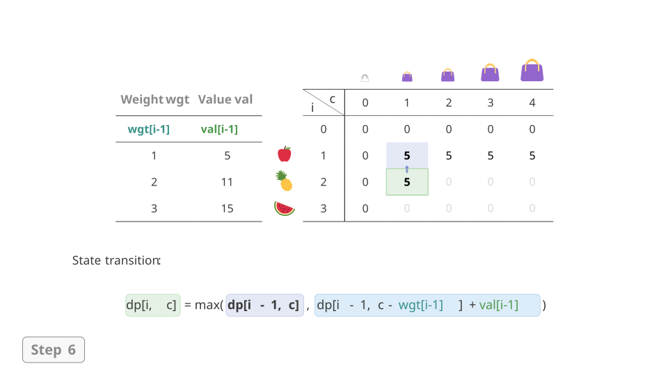{ class="animation-figure" }

=== "<7>"
    { class="animation-figure" }

=== "<8>"
    { class="animation-figure" }

=== "<9>"
    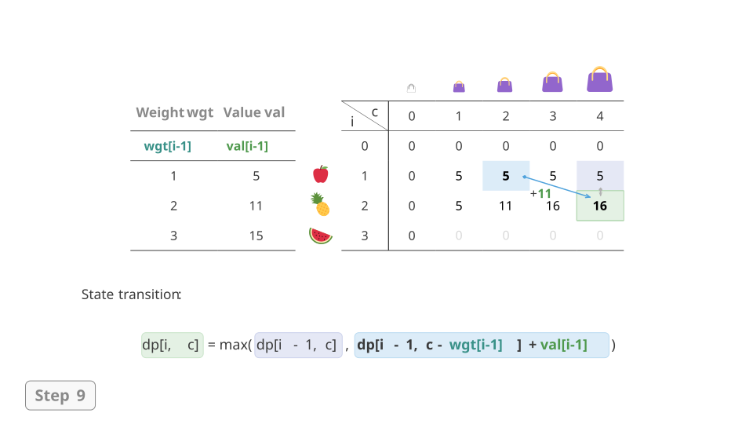{ class="animation-figure" }

=== "<10>"
    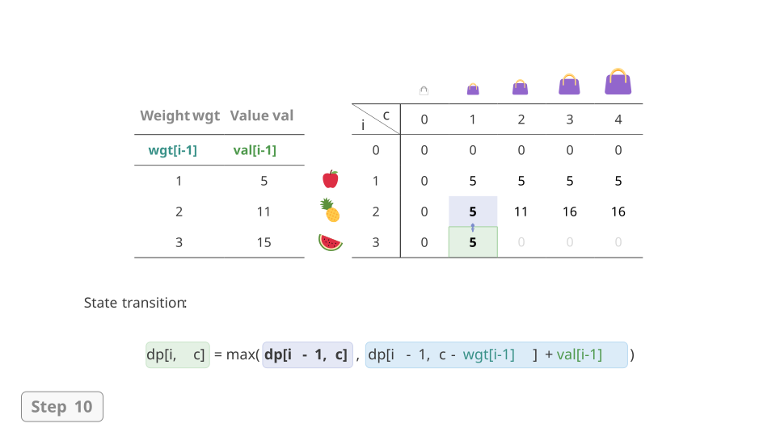{ class="animation-figure" }

=== "<11>"
    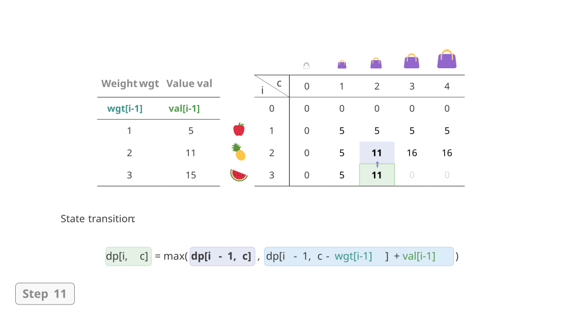{ class="animation-figure" }

=== "<12>"
    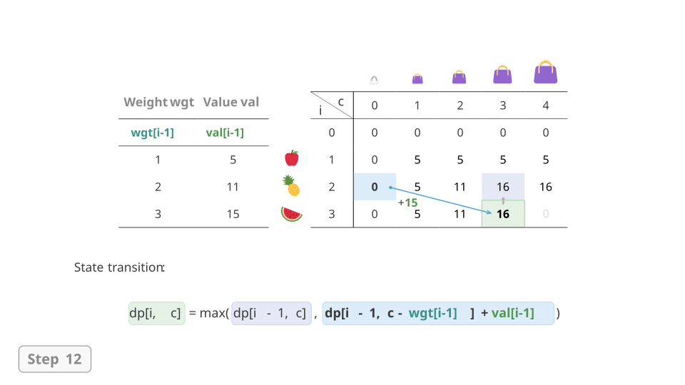{ class="animation-figure" }

=== "<13>"
    { class="animation-figure" }

=== "<14>"
    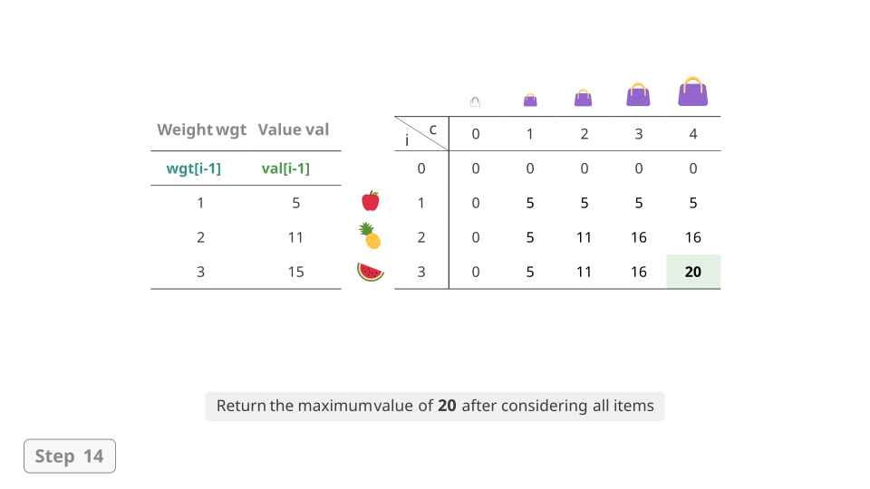{ class="animation-figure" }

<p align="center"> Figure 14-20 &nbsp; Solving 0-1 knapsack with dynamic programming </p>

### 4. &nbsp; Space optimization

Each state depends only on the previous row, so we can alternate between two arrays and reduce space complexity from $O(n \times cap)$ to $O(cap)$.

Can we go further and use just one array? Each state comes from a cell directly above or above and to the left. With one array, when we start row $i$, the array still holds the states from row $i-1$.

- When capacities are processed in increasing order, the previous-row value $dp[i-1, c-wgt[i-1]]$ needed for $dp[i, c]$ may already have been overwritten. This can count the same item more than once.
- Reverse order preserves the old values until they are needed, so the transition works correctly.

The figure shows one array changing from row $i = 1$ to row $i = 2$. Consider how forward and reverse traversal differ.

=== "<1>"
    { class="animation-figure" }

=== "<2>"
    { class="animation-figure" }

=== "<3>"
    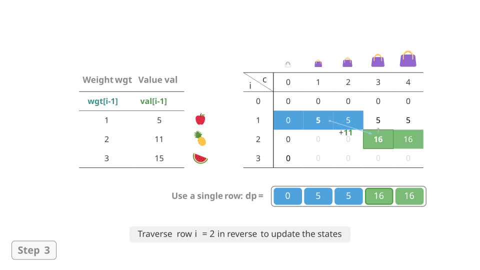{ class="animation-figure" }

=== "<4>"
    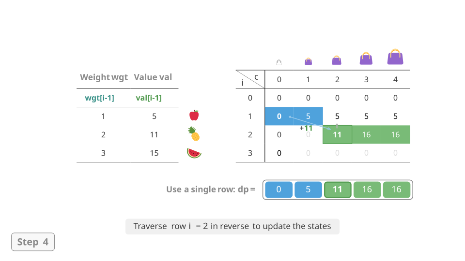{ class="animation-figure" }

=== "<5>"
    { class="animation-figure" }

=== "<6>"
    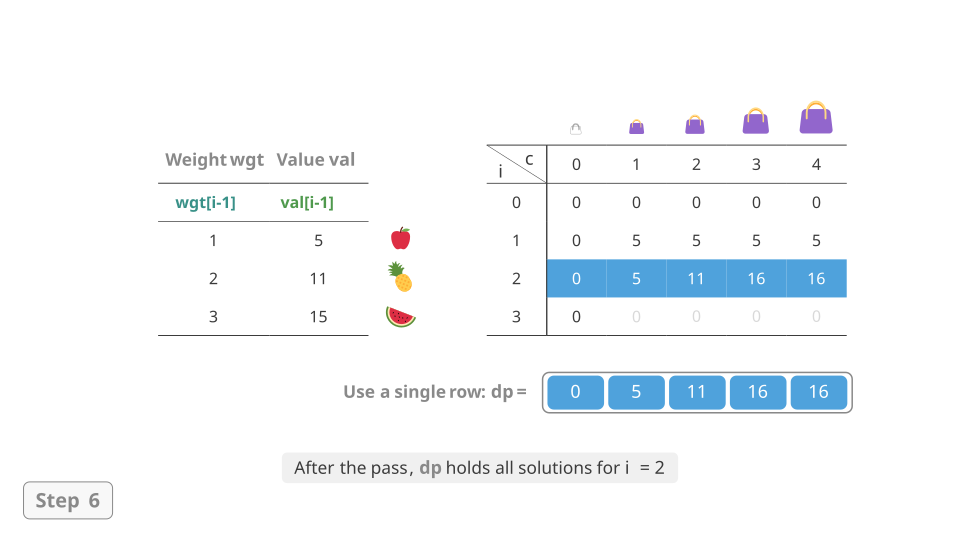{ class="animation-figure" }

<p align="center"> Figure 14-21 &nbsp; Solving 0-1 knapsack with a space-optimized dp table </p>

In the code, remove the first dimension $i$ from the array `dp` and run the inner loop in reverse:

=== "Python"

    ```python title="knapsack.py"
    def knapsack_dp_comp(wgt: list[int], val: list[int], cap: int) -> int:
        """0-1 knapsack with space-optimized dynamic programming"""
        n = len(wgt)
        # Initialize the dp table
        dp = [0] * (cap + 1)
        # State transition
        for i in range(1, n + 1):
            # Iterate in descending order
            for c in range(cap, 0, -1):
                if wgt[i - 1] > c:
                    # Skip item i if its weight exceeds the capacity
                    dp[c] = dp[c]
                else:
                    # Take the larger value from skipping or taking item i
                    dp[c] = max(dp[c], dp[c - wgt[i - 1]] + val[i - 1])
        return dp[cap]
    ```

=== "C++"

    ```cpp title="knapsack.cpp"
    /* 0-1 knapsack with space-optimized dynamic programming */
    int knapsackDPComp(vector<int> &wgt, vector<int> &val, int cap) {
        int n = wgt.size();
        // Initialize the dp table
        vector<int> dp(cap + 1, 0);
        // State transition
        for (int i = 1; i <= n; i++) {
            // Iterate in descending order
            for (int c = cap; c >= 1; c--) {
                if (wgt[i - 1] <= c) {
                    // Take the larger value from skipping or taking item i
                    dp[c] = max(dp[c], dp[c - wgt[i - 1]] + val[i - 1]);
                }
            }
        }
        return dp[cap];
    }
    ```

=== "Java"

    ```java title="knapsack.java"
    /* 0-1 knapsack with space-optimized dynamic programming */
    int knapsackDPComp(int[] wgt, int[] val, int cap) {
        int n = wgt.length;
        // Initialize the dp table
        int[] dp = new int[cap + 1];
        // State transition
        for (int i = 1; i <= n; i++) {
            // Iterate in descending order
            for (int c = cap; c >= 1; c--) {
                if (wgt[i - 1] <= c) {
                    // Take the larger value from skipping or taking item i
                    dp[c] = Math.max(dp[c], dp[c - wgt[i - 1]] + val[i - 1]);
                }
            }
        }
        return dp[cap];
    }
    ```

=== "C#"

    ```csharp title="knapsack.cs"
    /* 0-1 knapsack with space-optimized dynamic programming */
    int KnapsackDPComp(int[] weight, int[] val, int cap) {
        int n = weight.Length;
        // Initialize the dp table
        int[] dp = new int[cap + 1];
        // State transition
        for (int i = 1; i <= n; i++) {
            // Iterate in descending order
            for (int c = cap; c > 0; c--) {
                if (weight[i - 1] > c) {
                    // Skip item i if its weight exceeds the capacity
                    dp[c] = dp[c];
                } else {
                    // Take the larger value from skipping or taking item i
                    dp[c] = Math.Max(dp[c], dp[c - weight[i - 1]] + val[i - 1]);
                }
            }
        }
        return dp[cap];
    }
    ```

=== "Go"

    ```go title="knapsack.go"
    /* 0-1 knapsack with space-optimized dynamic programming */
    func knapsackDPComp(wgt, val []int, cap int) int {
        n := len(wgt)
        // Initialize the dp table
        dp := make([]int, cap+1)
        // State transition
        for i := 1; i <= n; i++ {
            // Iterate in descending order
            for c := cap; c >= 1; c-- {
                if wgt[i-1] <= c {
                    // Take the larger value from skipping or taking item i
                    dp[c] = int(math.Max(float64(dp[c]), float64(dp[c-wgt[i-1]]+val[i-1])))
                }
            }
        }
        return dp[cap]
    }
    ```

=== "Swift"

    ```swift title="knapsack.swift"
    /* 0-1 knapsack with space-optimized dynamic programming */
    func knapsackDPComp(wgt: [Int], val: [Int], cap: Int) -> Int {
        let n = wgt.count
        // Initialize the dp table
        var dp = Array(repeating: 0, count: cap + 1)
        // State transition
        for i in 1 ... n {
            // Iterate in descending order
            for c in (1 ... cap).reversed() {
                if wgt[i - 1] <= c {
                    // Take the larger value from skipping or taking item i
                    dp[c] = max(dp[c], dp[c - wgt[i - 1]] + val[i - 1])
                }
            }
        }
        return dp[cap]
    }
    ```

=== "JS"

    ```javascript title="knapsack.js"
    /* 0-1 knapsack with space-optimized dynamic programming */
    function knapsackDPComp(wgt, val, cap) {
        const n = wgt.length;
        // Initialize the dp table
        const dp = Array(cap + 1).fill(0);
        // State transition
        for (let i = 1; i <= n; i++) {
            // Iterate in descending order
            for (let c = cap; c >= 1; c--) {
                if (wgt[i - 1] <= c) {
                    // Take the larger value from skipping or taking item i
                    dp[c] = Math.max(dp[c], dp[c - wgt[i - 1]] + val[i - 1]);
                }
            }
        }
        return dp[cap];
    }
    ```

=== "TS"

    ```typescript title="knapsack.ts"
    /* 0-1 knapsack with space-optimized dynamic programming */
    function knapsackDPComp(
        wgt: Array<number>,
        val: Array<number>,
        cap: number
    ): number {
        const n = wgt.length;
        // Initialize the dp table
        const dp = Array(cap + 1).fill(0);
        // State transition
        for (let i = 1; i <= n; i++) {
            // Iterate in descending order
            for (let c = cap; c >= 1; c--) {
                if (wgt[i - 1] <= c) {
                    // Take the larger value from skipping or taking item i
                    dp[c] = Math.max(dp[c], dp[c - wgt[i - 1]] + val[i - 1]);
                }
            }
        }
        return dp[cap];
    }
    ```

=== "Dart"

    ```dart title="knapsack.dart"
    /* 0-1 knapsack with space-optimized dynamic programming */
    int knapsackDPComp(List<int> wgt, List<int> val, int cap) {
      int n = wgt.length;
      // Initialize the dp table
      List<int> dp = List.filled(cap + 1, 0);
      // State transition
      for (int i = 1; i <= n; i++) {
        // Iterate in descending order
        for (int c = cap; c >= 1; c--) {
          if (wgt[i - 1] <= c) {
            // Take the larger value from skipping or taking item i
            dp[c] = max(dp[c], dp[c - wgt[i - 1]] + val[i - 1]);
          }
        }
      }
      return dp[cap];
    }
    ```

=== "Rust"

    ```rust title="knapsack.rs"
    /* 0-1 knapsack with space-optimized dynamic programming */
    fn knapsack_dp_comp(wgt: &[i32], val: &[i32], cap: usize) -> i32 {
        let n = wgt.len();
        // Initialize the dp table
        let mut dp = vec![0; cap + 1];
        // State transition
        for i in 1..=n {
            // Iterate in descending order
            for c in (1..=cap).rev() {
                if wgt[i - 1] <= c as i32 {
                    // Take the larger value from skipping or taking item i
                    dp[c] = std::cmp::max(dp[c], dp[c - wgt[i - 1] as usize] + val[i - 1]);
                }
            }
        }
        dp[cap]
    }
    ```

=== "C"

    ```c title="knapsack.c"
    /* 0-1 knapsack with space-optimized dynamic programming */
    int knapsackDPComp(int wgt[], int val[], int cap, int wgtSize) {
        int n = wgtSize;
        // Initialize the dp table
        int *dp = calloc(cap + 1, sizeof(int));
        // State transition
        for (int i = 1; i <= n; i++) {
            // Iterate in descending order
            for (int c = cap; c >= 1; c--) {
                if (wgt[i - 1] <= c) {
                    // Take the larger value from skipping or taking item i
                    dp[c] = myMax(dp[c], dp[c - wgt[i - 1]] + val[i - 1]);
                }
            }
        }
        int res = dp[cap];
        // Free the memory
        free(dp);
        return res;
    }
    ```

=== "Kotlin"

    ```kotlin title="knapsack.kt"
    /* 0-1 knapsack with space-optimized dynamic programming */
    fun knapsackDPComp(wgt: IntArray, _val: IntArray, cap: Int): Int {
        val n = wgt.size
        // Initialize the dp table
        val dp = IntArray(cap + 1)
        // State transition
        for (i in 1..n) {
            // Iterate in descending order
            for (c in cap downTo 1) {
                if (wgt[i - 1] <= c) {
                    // Take the larger value from skipping or taking item i
                    dp[c] = max(dp[c], dp[c - wgt[i - 1]] + _val[i - 1])
                }
            }
        }
        return dp[cap]
    }
    ```

=== "Ruby"

    ```ruby title="knapsack.rb"
    ### 0-1 knapsack with space-optimized dynamic programming ###
    def knapsack_dp_comp(wgt, val, cap)
      n = wgt.length
      # Initialize the dp table
      dp = Array.new(cap + 1, 0)
      # State transition
      for i in 1...(n + 1)
        # Iterate in descending order
        for c in cap.downto(1)
          if wgt[i - 1] > c
            # Skip item i if its weight exceeds the capacity
            dp[c] = dp[c]
          else
            # Take the larger value from skipping or taking item i
            dp[c] = [dp[c], dp[c - wgt[i - 1]] + val[i - 1]].max
          end
        end
      end
      dp[cap]
    end
    ```

??? pythontutor "Visualize execution"

    <div style="height: 549px; width: 100%;"><iframe class="pythontutor-iframe" title="Visualize execution" src="https://pythontutor.com/iframe-embed.html#code=def%20knapsack_dp_comp%28wgt%3A%20list%5Bint%5D,%20val%3A%20list%5Bint%5D,%20cap%3A%20int%29%20-%3E%20int%3A%0A%20%20%20%20%22%22%220-1%20knapsack%20with%20space-optimized%20dynamic%20programming%22%22%22%0A%20%20%20%20n%20%3D%20len%28wgt%29%0A%20%20%20%20%23%20Initialize%20the%20dp%20table%0A%20%20%20%20dp%20%3D%20%5B0%5D%20%2A%20%28cap%20%2B%201%29%0A%20%20%20%20%23%20State%20transition%0A%20%20%20%20for%20i%20in%20range%281,%20n%20%2B%201%29%3A%0A%20%20%20%20%20%20%20%20%23%20Iterate%20in%20descending%20order%0A%20%20%20%20%20%20%20%20for%20c%20in%20range%28cap,%200,%20-1%29%3A%0A%20%20%20%20%20%20%20%20%20%20%20%20if%20wgt%5Bi%20-%201%5D%20%3E%20c%3A%0A%20%20%20%20%20%20%20%20%20%20%20%20%20%20%20%20%23%20Skip%20item%20i%20if%20its%20weight%20exceeds%20the%20capacity%0A%20%20%20%20%20%20%20%20%20%20%20%20%20%20%20%20dp%5Bc%5D%20%3D%20dp%5Bc%5D%0A%20%20%20%20%20%20%20%20%20%20%20%20else%3A%0A%20%20%20%20%20%20%20%20%20%20%20%20%20%20%20%20%23%20Take%20the%20larger%20value%20from%20skipping%20or%20taking%20item%20i%0A%20%20%20%20%20%20%20%20%20%20%20%20%20%20%20%20dp%5Bc%5D%20%3D%20max%28dp%5Bc%5D,%20dp%5Bc%20-%20wgt%5Bi%20-%201%5D%5D%20%2B%20val%5Bi%20-%201%5D%29%0A%20%20%20%20return%20dp%5Bcap%5D%0A%0A%0A%22%22%22Driver%20Code%22%22%22%0Aif%20__name__%20%3D%3D%20%22__main__%22%3A%0A%20%20%20%20wgt%20%3D%20%5B10,%2020,%2030,%2040,%2050%5D%0A%20%20%20%20val%20%3D%20%5B50,%20120,%20150,%20210,%20240%5D%0A%20%20%20%20cap%20%3D%2050%0A%20%20%20%20n%20%3D%20len%28wgt%29%0A%0A%20%20%20%20%23%20Space-optimized%20dynamic%20programming%0A%20%20%20%20res%20%3D%20knapsack_dp_comp%28wgt,%20val,%20cap%29%0A%20%20%20%20print%28f%22Maximum%20total%20item%20value%20within%20the%20weight%20limit%3A%20%7Bres%7D%22%29&codeDivHeight=472&codeDivWidth=350&cumulative=false&curInstr=7&heapPrimitives=nevernest&origin=opt-frontend.js&py=311&rawInputLstJSON=%5B%5D&textReferences=false"> </iframe></div>
    <div style="margin-top: 5px;"><a href="https://pythontutor.com/iframe-embed.html#code=def%20knapsack_dp_comp%28wgt%3A%20list%5Bint%5D,%20val%3A%20list%5Bint%5D,%20cap%3A%20int%29%20-%3E%20int%3A%0A%20%20%20%20%22%22%220-1%20knapsack%20with%20space-optimized%20dynamic%20programming%22%22%22%0A%20%20%20%20n%20%3D%20len%28wgt%29%0A%20%20%20%20%23%20Initialize%20the%20dp%20table%0A%20%20%20%20dp%20%3D%20%5B0%5D%20%2A%20%28cap%20%2B%201%29%0A%20%20%20%20%23%20State%20transition%0A%20%20%20%20for%20i%20in%20range%281,%20n%20%2B%201%29%3A%0A%20%20%20%20%20%20%20%20%23%20Iterate%20in%20descending%20order%0A%20%20%20%20%20%20%20%20for%20c%20in%20range%28cap,%200,%20-1%29%3A%0A%20%20%20%20%20%20%20%20%20%20%20%20if%20wgt%5Bi%20-%201%5D%20%3E%20c%3A%0A%20%20%20%20%20%20%20%20%20%20%20%20%20%20%20%20%23%20Skip%20item%20i%20if%20its%20weight%20exceeds%20the%20capacity%0A%20%20%20%20%20%20%20%20%20%20%20%20%20%20%20%20dp%5Bc%5D%20%3D%20dp%5Bc%5D%0A%20%20%20%20%20%20%20%20%20%20%20%20else%3A%0A%20%20%20%20%20%20%20%20%20%20%20%20%20%20%20%20%23%20Take%20the%20larger%20value%20from%20skipping%20or%20taking%20item%20i%0A%20%20%20%20%20%20%20%20%20%20%20%20%20%20%20%20dp%5Bc%5D%20%3D%20max%28dp%5Bc%5D,%20dp%5Bc%20-%20wgt%5Bi%20-%201%5D%5D%20%2B%20val%5Bi%20-%201%5D%29%0A%20%20%20%20return%20dp%5Bcap%5D%0A%0A%0A%22%22%22Driver%20Code%22%22%22%0Aif%20__name__%20%3D%3D%20%22__main__%22%3A%0A%20%20%20%20wgt%20%3D%20%5B10,%2020,%2030,%2040,%2050%5D%0A%20%20%20%20val%20%3D%20%5B50,%20120,%20150,%20210,%20240%5D%0A%20%20%20%20cap%20%3D%2050%0A%20%20%20%20n%20%3D%20len%28wgt%29%0A%0A%20%20%20%20%23%20Space-optimized%20dynamic%20programming%0A%20%20%20%20res%20%3D%20knapsack_dp_comp%28wgt,%20val,%20cap%29%0A%20%20%20%20print%28f%22Maximum%20total%20item%20value%20within%20the%20weight%20limit%3A%20%7Bres%7D%22%29&codeDivHeight=800&codeDivWidth=600&cumulative=false&curInstr=7&heapPrimitives=nevernest&origin=opt-frontend.js&py=311&rawInputLstJSON=%5B%5D&textReferences=false" target="_blank" rel="noopener noreferrer">View full screen ></a></div>
