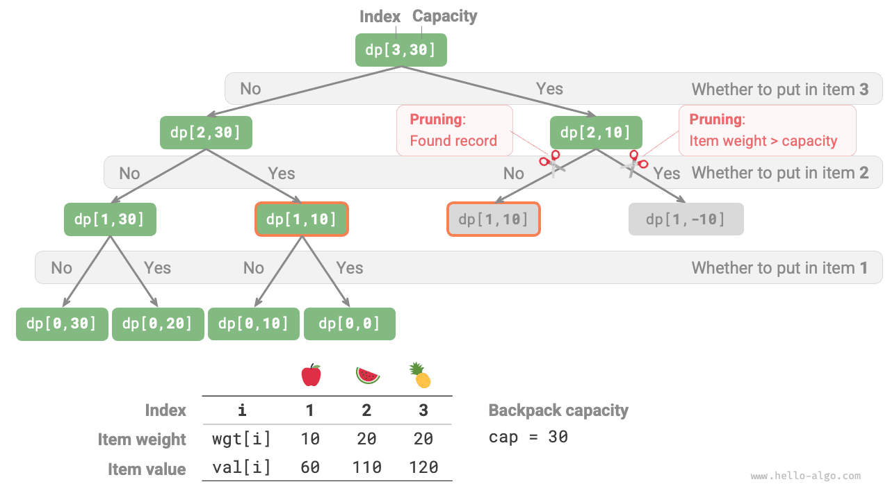
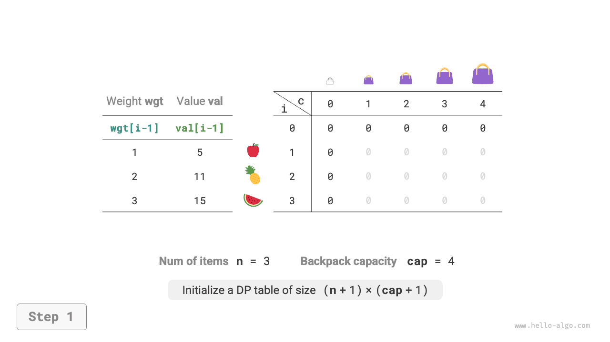
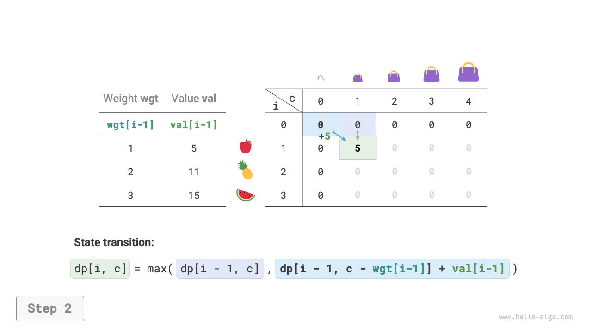
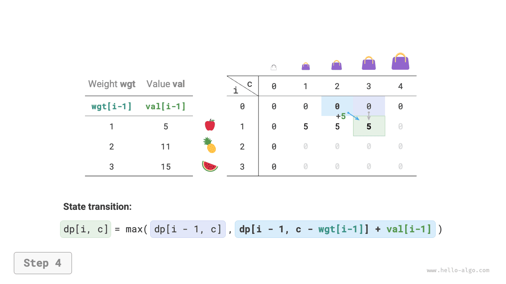
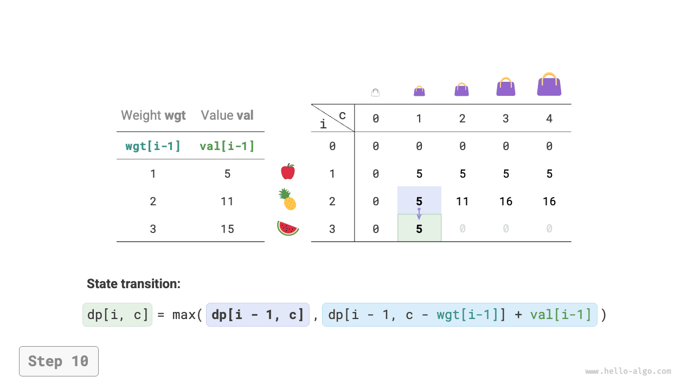
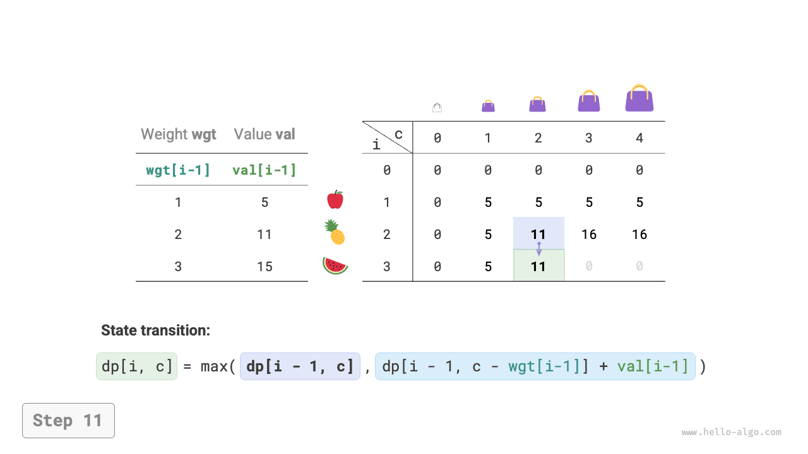
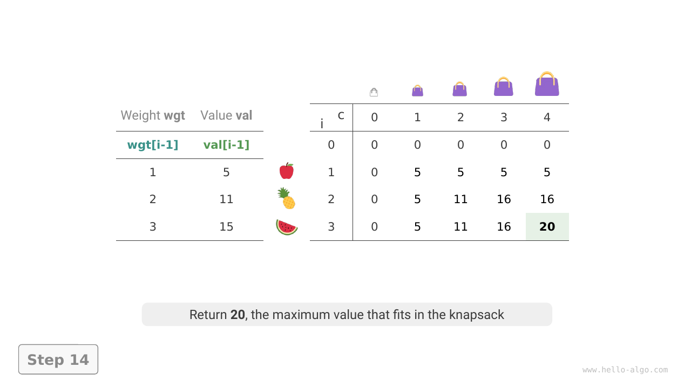
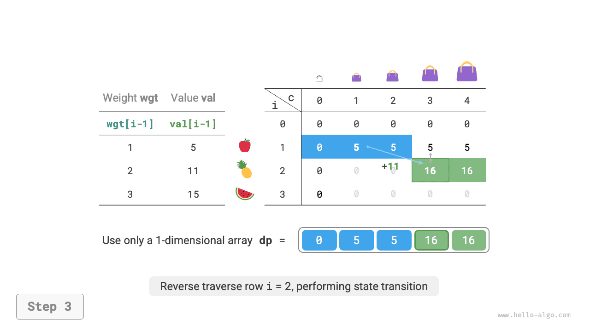
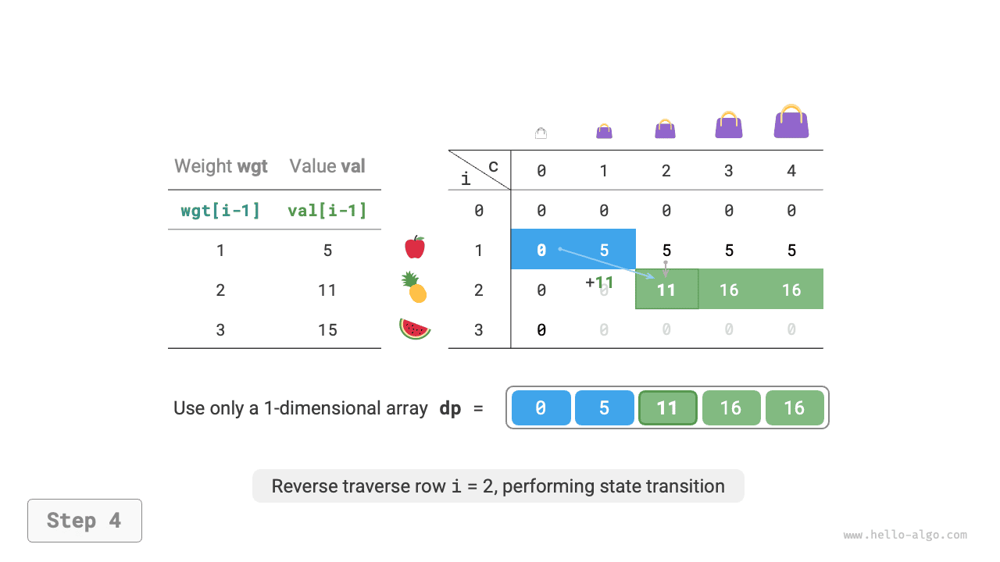
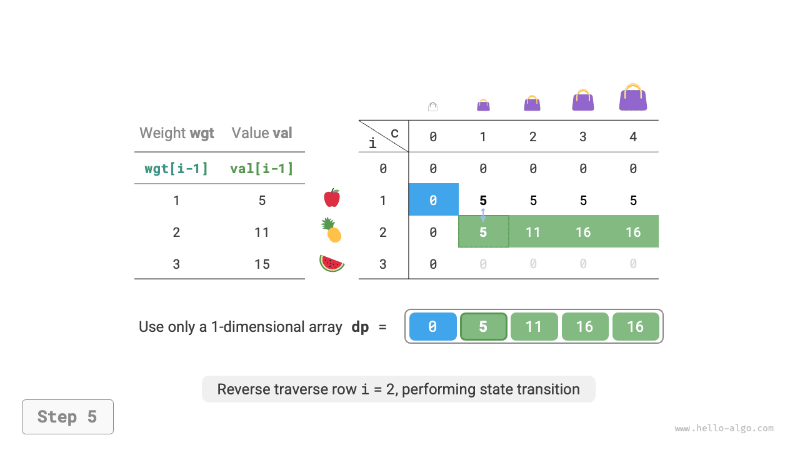

# 0-1 knapsack problem

The knapsack problem is an excellent introduction to dynamic programming and one of its most common problem families. Variants include 0-1 knapsack, unbounded knapsack, and bounded knapsack.

We will begin with the most common variant, 0-1 knapsack.

!!! question

    Given $n$ items, where item $i$ has weight $wgt[i-1]$ and value $val[i-1]$, and a knapsack of capacity $cap$, each item may be chosen only once. What is the maximum total value that fits within the capacity?

As shown in the figure below, item numbers $i$ start at $1$, while array indices start at $0$. Item $i$ therefore has weight $wgt[i-1]$ and value $val[i-1]$.


We can view 0-1 knapsack as $n$ rounds of decisions, with two choices for each item: leave it out or put it in. It therefore fits the decision tree model.

The objective is to maximize value within a capacity limit, making dynamic programming a promising approach.

**Step 1: Identify each decision, define the state, and establish the $dp$ table**

Leaving an item out keeps the available capacity unchanged; putting it in reduces the capacity. The state therefore consists of the current item number $i$ and capacity $c$, denoted by $[i, c]$.

State $[i, c]$ represents the subproblem of finding **the maximum value obtainable from the first $i$ items with capacity $c$**, denoted by $dp[i, c]$.

We seek $dp[n, cap]$, so we need a two-dimensional $dp$ table of size $(n+1) \times (cap+1)$.

**Step 2: Identify optimal substructure and derive the state transition equation**

After deciding what to do with item $i$, the remaining subproblem concerns the first $i-1$ items. There are two cases.

- **Leave item $i$ out**: Capacity stays unchanged, and the remaining state is $[i-1, c]$.
- **Put item $i$ in**: Capacity decreases by $wgt[i-1]$, value increases by $val[i-1]$, and the remaining state is $[i-1, c-wgt[i-1]]$.

This reveals the optimal substructure: **the maximum value $dp[i, c]$ is the larger value obtained by leaving item $i$ out or putting item $i$ in**. The state transition equation is:

$$
dp[i, c] = \max(dp[i-1, c], dp[i-1, c - wgt[i-1]] + val[i-1])
$$

If the current item's weight $wgt[i - 1]$ exceeds the remaining capacity $c$, the only option is to leave it out.

**Step 3: Determine the boundary conditions and evaluation order**

With no items or capacity $0$, the maximum value is $0$. Thus, the first column $dp[i, 0]$ and first row $dp[0, c]$ are both $0$.

The current state $[i, c]$ depends on $[i-1, c]$ above and $[i-1, c-wgt[i-1]]$ to the upper left, so two nested loops can traverse the $dp$ table in increasing index order.

We will now implement brute-force search, memoized search, and dynamic programming in that order.

### Method 1: Brute-force search

The search has the following elements.

- **Parameters**: The state $[i, c]$.
- **Return value**: The subproblem solution $dp[i, c]$.
- **Base case**: If there are no items left, $i = 0$, or the remaining capacity is $0$, stop recursion and return value $0$.
- **Pruning**: If the current item is heavier than the remaining capacity, only the choice to leave it out is allowed.

```src
[file]{knapsack}-[class]{}-[func]{knapsack_dfs}
```

As shown in the figure below, each item creates two branches, excluding it or including it, so the time complexity is $O(2^n)$.

The recursion tree contains overlapping subproblems, such as $dp[1, 10]$. Their number grows substantially with more items and larger capacity, especially when many items share the same weight.


### Method 2: Memoized search

To solve each overlapping subproblem only once, use a memoization table `mem`, where `mem[i][c]` stores $dp[i, c]$.

With memoization, **the time complexity depends on the number of subproblems**, giving $O(n \times cap)$. The code is as follows:

```src
[file]{knapsack}-[class]{}-[func]{knapsack_dfs_mem}
```

The figure below shows the branches pruned by memoized search.



### Method 3: Dynamic programming

Dynamic programming essentially fills the $dp$ table using state transitions, as shown in the code below:

```src
[file]{knapsack}-[class]{}-[func]{knapsack_dp}
```

As shown in the figure below, both time and space complexity are determined by the size of `dp`: $O(n \times cap)$.

=== "<1>"
    

=== "<2>"
    

=== "<3>"
    

=== "<4>"
    

=== "<5>"
    

=== "<6>"
    

=== "<7>"
    

=== "<8>"
    

=== "<9>"
    

=== "<10>"
    

=== "<11>"
    

=== "<12>"
    

=== "<13>"
    

=== "<14>"
    

### Space optimization

Each state depends only on the previous row, so two rolling arrays reduce space complexity from $O(n \times cap)$ to $O(cap)$.

Can we go further and use just one array? Each state depends on entries directly above or to the upper left. With one array, when we begin processing row $i$, it still holds the states from row $i-1$.

- With forward iteration, by the time we reach $dp[i, j]$, the upper-left values $dp[i-1, 1]$ ~ $dp[i-1, j-1]$ may have been overwritten, making the transition incorrect.
- With backward iteration, these values are not overwritten before they are needed, so transitions remain correct.

The figure below shows one array changing from row $i = 1$ to row $i = 2$. Consider how forward and backward iteration differ.

=== "<1>"
    

=== "<2>"
    

=== "<3>"
    

=== "<4>"
    

=== "<5>"
    

=== "<6>"
    

In the implementation, simply remove the first dimension $i$ from `dp` and reverse the inner loop:

```src
[file]{knapsack}-[class]{}-[func]{knapsack_dp_comp}
```
