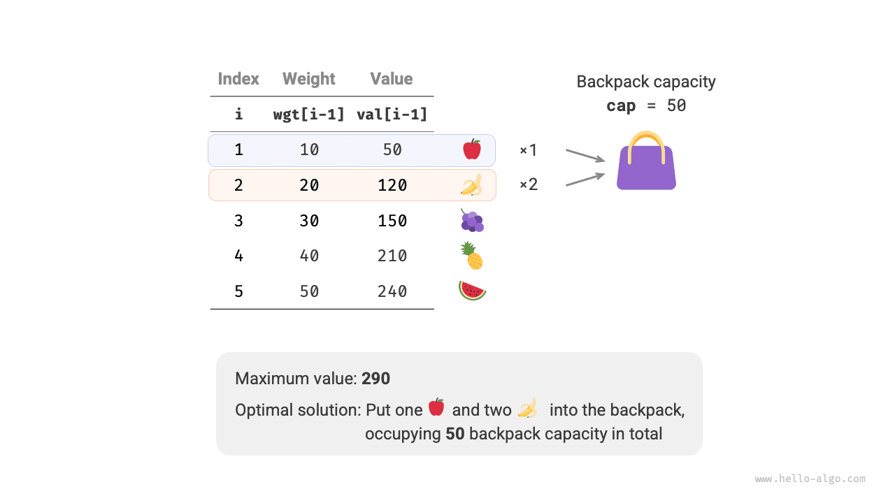
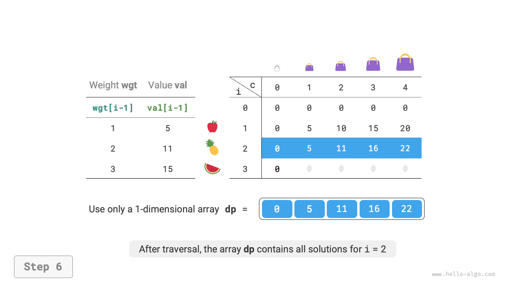
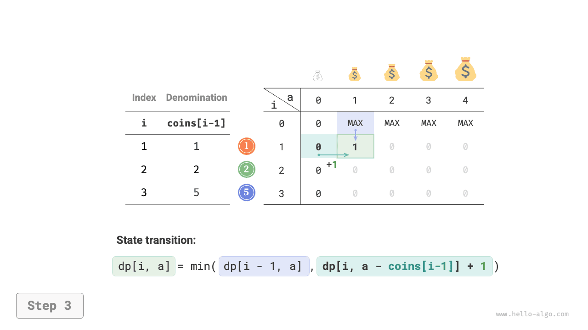
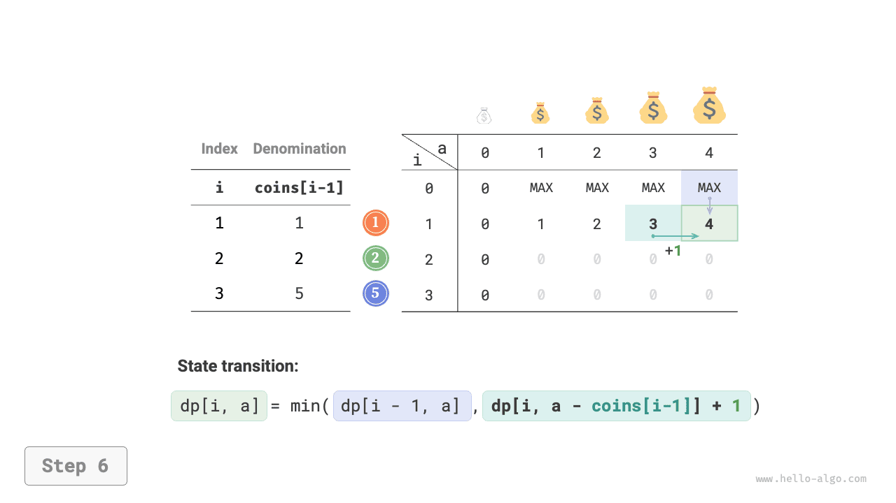
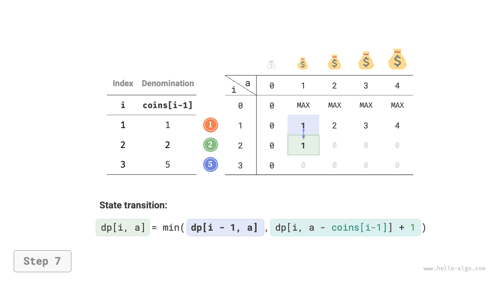
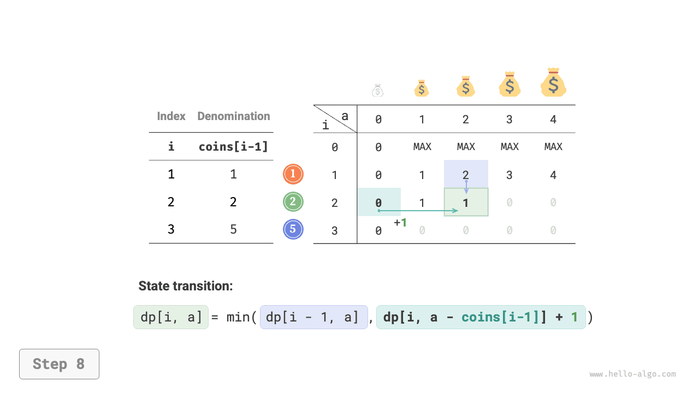
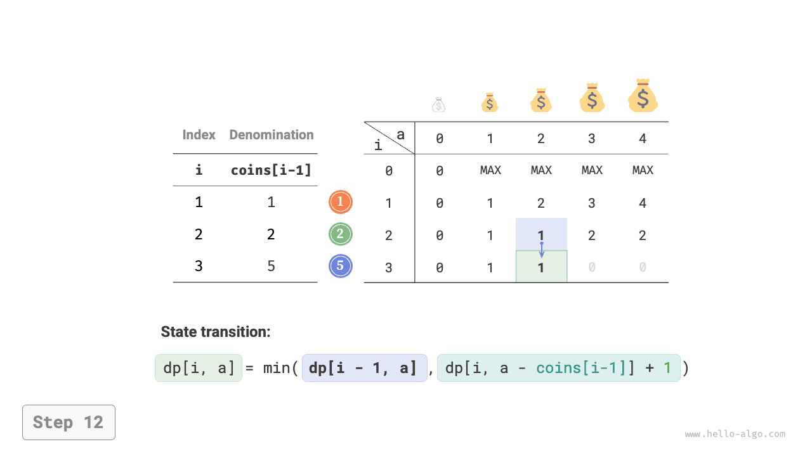
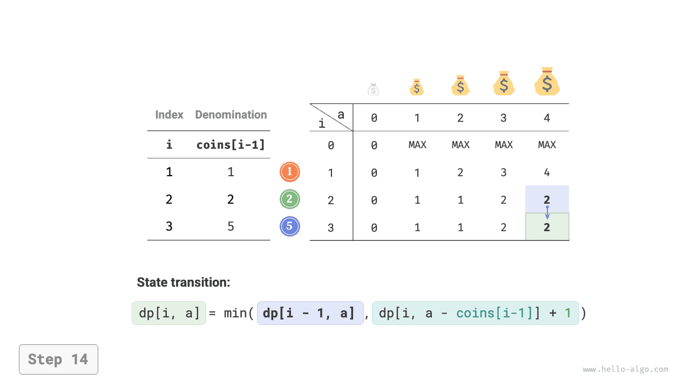
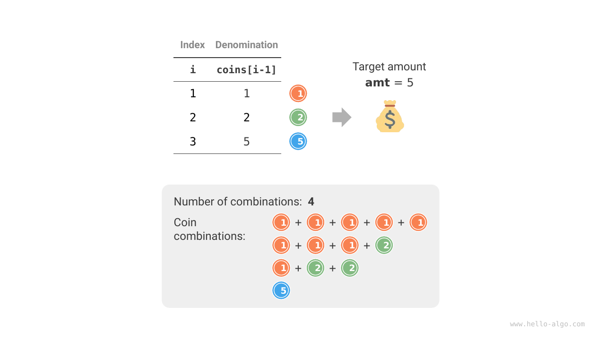

# Unbounded knapsack problem

We will now solve another common knapsack variant, unbounded knapsack, and then examine a special case: coin change.

## Unbounded knapsack

!!! question

    Given $n$ items, where item $i$ has weight $wgt[i-1]$ and value $val[i-1]$, and a knapsack of capacity $cap$, **each item may be chosen repeatedly**. What is the maximum value that fits within the capacity? An example is shown in the figure below.



### Dynamic programming approach

Unbounded knapsack is very similar to 0-1 knapsack. **The only difference is that there is no limit on how many times an item may be chosen**.

- In 0-1 knapsack, there is only one of each item, so after including item $i$, we can choose only from the first $i-1$ items.
- In unbounded knapsack, each item has an unlimited supply, so after including item $i$, **we can still choose from the first $i$ items**.

For unbounded knapsack, state $[i, c]$ has two cases.

- **Leave item $i$ out**: As in 0-1 knapsack, the remaining state is $[i-1, c]$.
- **Put item $i$ in**: Unlike 0-1 knapsack, the remaining state is $[i, c-wgt[i-1]]$.

The state transition equation becomes:

$$
dp[i, c] = \max(dp[i-1, c], dp[i, c - wgt[i-1]] + val[i-1])
$$

### Code implementation

Compared with 0-1 knapsack, only one $i-1$ in the transition changes to $i$; the rest of the code is identical:

```src
[file]{unbounded_knapsack}-[class]{}-[func]{unbounded_knapsack_dp}
```

### Space optimization

The current state depends on states to its left and above, **so after space optimization, each row of the $dp$ table must be processed in forward order**.

This is the opposite of 0-1 knapsack. Use the figure below to understand the difference.

=== "<1>"
    

=== "<2>"
    

=== "<3>"
    

=== "<4>"
    

=== "<5>"
    

=== "<6>"
    

The implementation simply removes the first dimension of `dp`:

```src
[file]{unbounded_knapsack}-[class]{}-[func]{unbounded_knapsack_dp_comp}
```

## Coin change problem

Knapsack represents a broad family of dynamic programming problems, with many variants such as coin change.

!!! question

    Given $n$ coin denominations, where denomination $i$ has value $coins[i - 1]$, and a target amount $amt$, **each denomination may be used repeatedly**. What is the minimum number of coins needed to make the target? Return $-1$ if it cannot be made. An example is shown in the figure below.


### Dynamic programming approach

**Coin change can be viewed as a special case of unbounded knapsack**, with the following connections and differences.

- The two problems can be translated into one another: items correspond to coins, item weights to coin denominations, and knapsack capacity to the target amount.
- The optimization objectives are opposite: unbounded knapsack maximizes item value, while coin change minimizes the number of coins.
- Unbounded knapsack must stay within a capacity limit, whereas coin change must reach the target amount exactly.

**Step 1: Identify each decision, define the state, and establish the $dp$ table**

State $[i, a]$ represents the subproblem of finding **the minimum number of coins needed to make amount $a$ using the first $i$ denominations**, denoted by $dp[i, a]$.

The two-dimensional $dp$ table has size $(n+1) \times (amt+1)$.

**Step 2: Identify optimal substructure and derive the state transition equation**

The state transition differs from unbounded knapsack in two ways.

- We want a minimum, so replace $\max()$ with $\min()$.
- We optimize the coin count rather than item value, so choosing a coin adds $+1$.

$$
dp[i, a] = \min(dp[i-1, a], dp[i, a - coins[i-1]] + 1)
$$

**Step 3: Determine the boundary conditions and evaluation order**

A target amount of $0$ requires $0$ coins, so every entry $dp[i, 0]$ in the first column is $0$.

With no coins, **any target amount $> 0$ is impossible**. To let $\min()$ recognize and discard these infeasible solutions, represent them by $+ \infty$: set the first-row entries $dp[0, a]$ to $+ \infty$.

### Code implementation

Most programming languages do not provide an integer value for $+ \infty$, so the maximum `int` value is used instead. However, the $+ 1$ in the transition may then overflow.

Instead, use $amt + 1$ to represent an infeasible solution, since making $amt$ requires at most $amt$ coins. Before returning, check whether $dp[n, amt]$ equals $amt + 1$. If so, return $-1$ to indicate that the target cannot be made. The code is as follows:

```src
[file]{coin_change}-[class]{}-[func]{coin_change_dp}
```

The figure below shows dynamic programming for coin change, which closely resembles unbounded knapsack.

=== "<1>"
    

=== "<2>"
    

=== "<3>"
    

=== "<4>"
    

=== "<5>"
    

=== "<6>"
    

=== "<7>"
    

=== "<8>"
    

=== "<9>"
    

=== "<10>"
    

=== "<11>"
    

=== "<12>"
    

=== "<13>"
    

=== "<14>"
    

=== "<15>"
    

### Space optimization

Space optimization is the same as for unbounded knapsack:

```src
[file]{coin_change}-[class]{}-[func]{coin_change_dp_comp}
```

## Coin change problem II

!!! question

    Given $n$ coin denominations, where denomination $i$ has value $coins[i - 1]$, and a target amount $amt$, each denomination may be used repeatedly. **How many combinations of coins make the target amount**? An example is shown in the figure below.



### Dynamic programming approach

This time, we count combinations, so the subproblem becomes **the number of combinations that make amount $a$ using the first $i$ denominations**. The $dp$ table remains a two-dimensional matrix of size $(n+1) \times (amt + 1)$.

The number of combinations for the current state is the sum of those that exclude the current coin and those that include it. The state transition equation is:

$$
dp[i, a] = dp[i-1, a] + dp[i, a - coins[i-1]]
$$

A target of $0$ can be made by choosing no coins, so initialize every first-column entry $dp[i, 0]$ to $1$. With no coins, any target $>0$ is impossible, so the first-row entries $dp[0, a]$ are $0$.

### Code implementation

```src
[file]{coin_change_ii}-[class]{}-[func]{coin_change_ii_dp}
```

### Space optimization

The space optimization is the same: remove the coin dimension:

```src
[file]{coin_change_ii}-[class]{}-[func]{coin_change_ii_dp_comp}
```
