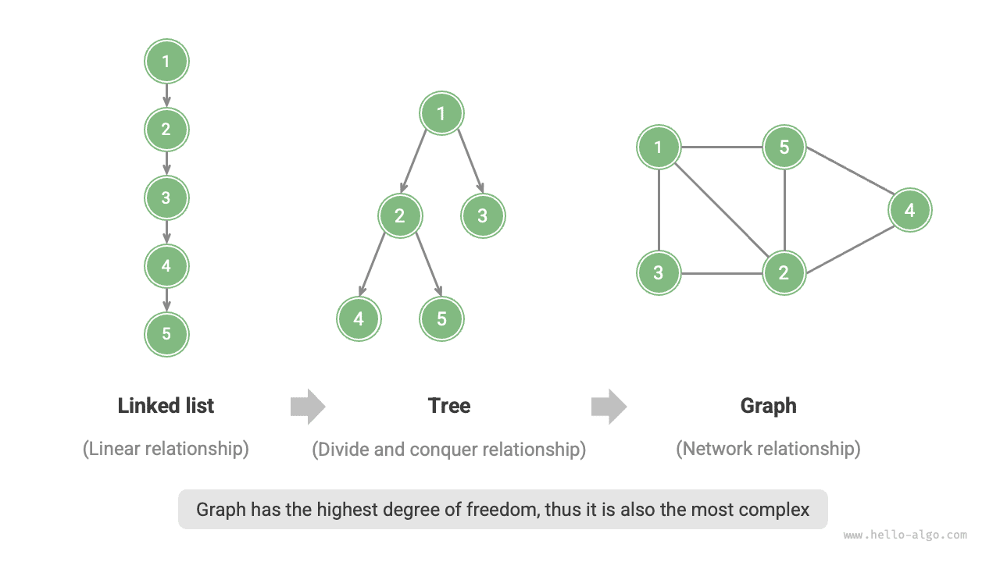
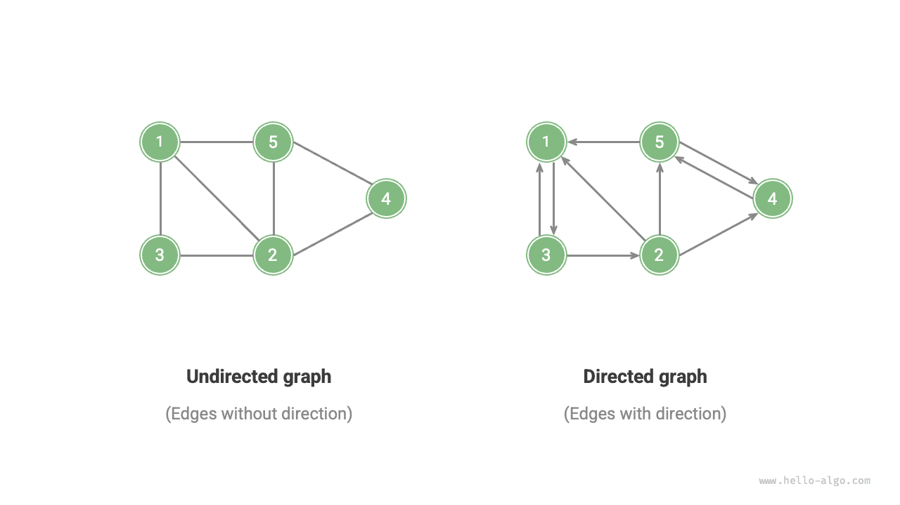

# 9.1 &nbsp; Graphs

A <u>graph</u> is a nonlinear data structure made up of <u>vertices</u> and <u>edges</u>. We can represent a graph $G$ abstractly using a set of vertices $V$ and a set of edges $E$. The following example describes a graph with 5 vertices and 7 edges.

$$
\begin{aligned}
V & = \{ 1, 2, 3, 4, 5 \} \newline
E & = \{ (1,2), (1,3), (1,5), (2,3), (2,4), (2,5), (4,5) \} \newline
G & = \{ V, E \} \newline
\end{aligned}
$$

If we think of vertices as nodes and edges as references (pointers) connecting those nodes, a graph can be viewed as an extension of a linked list. As Figure 9-1 shows, **network relationships (graphs) allow more freedom than linear relationships (linked lists) or divide-and-conquer relationships (trees)**, making them more complex.

{ class="animation-figure" }

 Figure 9-1 &nbsp; Relationships between linked lists, trees, and graphs 

## 9.1.1 &nbsp; Common graph types and terminology

Depending on whether their edges have a direction, graphs are classified as <u>undirected graphs</u> or <u>directed graphs</u>, as shown in Figure 9-2.

- In an undirected graph, an edge represents a two-way connection between two vertices, such as a friendship on WeChat or QQ.
- In a directed graph, edges have a direction: the edges $A \rightarrow B$ and $A \leftarrow B$ are independent of each other. Examples include following and being followed on Weibo or Douyin.

{ class="animation-figure" }

 Figure 9-2 &nbsp; Directed and undirected graphs 

Depending on whether all vertices are connected, graphs are classified as <u>connected graphs</u> or <u>disconnected graphs</u>, as shown in Figure 9-3.

- In a connected graph, every other vertex can be reached from any starting vertex.
- In a disconnected graph, at least one vertex cannot be reached from a given starting vertex.

{ class="animation-figure" }

 Figure 9-3 &nbsp; Connected and disconnected graphs 

We can also assign a weight to each edge to obtain a <u>weighted graph</u>, as shown in Figure 9-4. For example, mobile games such as Honor of Kings calculate an affinity score between players based on the time they spend playing together. A weighted graph can represent this network of affinities.

{ class="animation-figure" }

 Figure 9-4 &nbsp; Weighted and unweighted graphs 

The following terms are commonly used when discussing graphs.

- <u>Adjacency</u>: Two vertices are adjacent if an edge connects them. In Figure 9-4, the vertices adjacent to vertex 1 are 2, 3, and 5.
- <u>Path</u>: A sequence of edges followed from vertex A to vertex B is called a path from A to B. In Figure 9-4, the edge sequence 1-5-2-4 forms a path from vertex 1 to vertex 4.
- <u>Degree</u>: The number of edges incident to a vertex. In a directed graph, the <u>in-degree</u> is the number of edges pointing to the vertex, and the <u>out-degree</u> is the number of edges pointing away from it.

## 9.1.2 &nbsp; Representing a graph

Two common ways to represent a graph are an adjacency matrix and an adjacency list. We will use undirected graphs in the following examples.

### 1. &nbsp; Adjacency matrix

For a graph with $n$ vertices, an <u>adjacency matrix</u> represents the graph using an $n \times n$ matrix. Each row (or column) represents a vertex, and the matrix entries represent edges: $1$ or $0$ indicates whether an edge exists between two vertices.

As shown in Figure 9-5, let $M$ be the adjacency matrix and $V$ the vertex list. The entry $M[i, j] = 1$ means that an edge connects vertices $V[i]$ and $V[j]$, whereas $M[i, j] = 0$ means that no edge connects them.

{ class="animation-figure" }

 Figure 9-5 &nbsp; Representing a graph with an adjacency matrix 

An adjacency matrix has the following properties.

- In a simple graph, a vertex cannot connect to itself, so the entries on the main diagonal do not represent meaningful connections.
- In an undirected graph, edges in the two directions are equivalent, so the adjacency matrix is symmetric about its main diagonal.
- Replacing the $1$ and $0$ entries with weights allows the matrix to represent a weighted graph.

With an adjacency matrix, we can access a matrix entry directly to retrieve an edge. Adding, removing, looking up, and modifying edges are therefore efficient, each taking $O(1)$ time. However, the matrix requires $O(n^2)$ space and uses a substantial amount of memory.

### 2. &nbsp; Adjacency list

An <u>adjacency list</u> represents a graph using $n$ linked lists whose nodes represent vertices. The $i$-th linked list corresponds to vertex $i$ and stores all of its adjacent vertices (the vertices connected to it). Figure 9-6 shows an example of a graph stored as an adjacency list.

{ class="animation-figure" }

 Figure 9-6 &nbsp; Representing a graph with an adjacency list 

An adjacency list stores only edges that actually exist. Since the total number of edges is usually much smaller than $n^2$, it saves space. However, finding an edge requires traversing a linked list, so lookups are slower than with an adjacency matrix.

As Figure 9-6 shows, **an adjacency list closely resembles separate chaining in a hash table, so similar techniques can improve its efficiency**. For example, a long linked list can be replaced with an AVL tree or a red-black tree to improve lookup time from $O(n)$ to $O(\log n)$. Replacing it with a hash table can further reduce the time complexity to $O(1)$.

## 9.1.3 &nbsp; Common applications of graphs

As shown in Table 9-1, many real-world systems can be modeled as graphs, and their associated problems can be reduced to graph computation problems.

 Table 9-1 &nbsp; Common graphs in everyday life 

|          | Vertices | Edges                   | Graph computation problem   |
| -------- | ---- | -------------------- | ------------ |
| Social network | Users | Friendships             | Recommending potential friends |
| Subway network | Stations | Connections between stations       | Recommending the shortest route |
| Solar system   | Celestial bodies | Gravitational interactions between bodies | Calculating planetary orbits |

