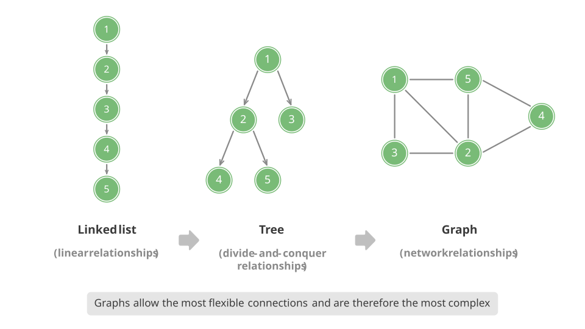
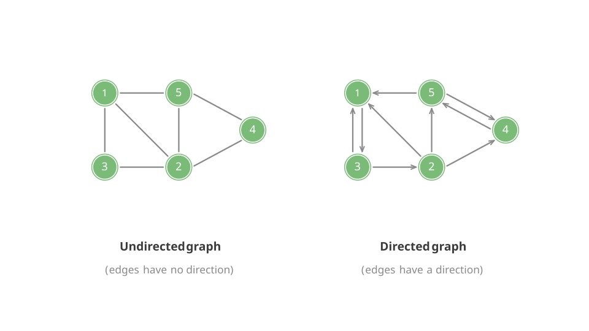
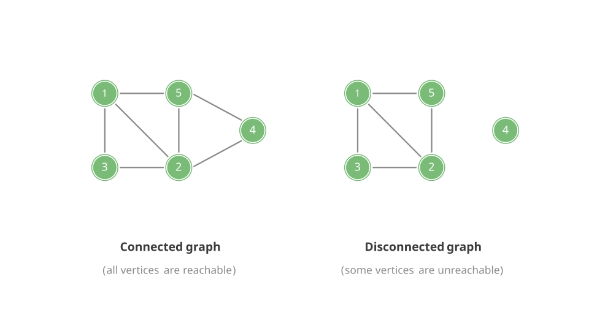
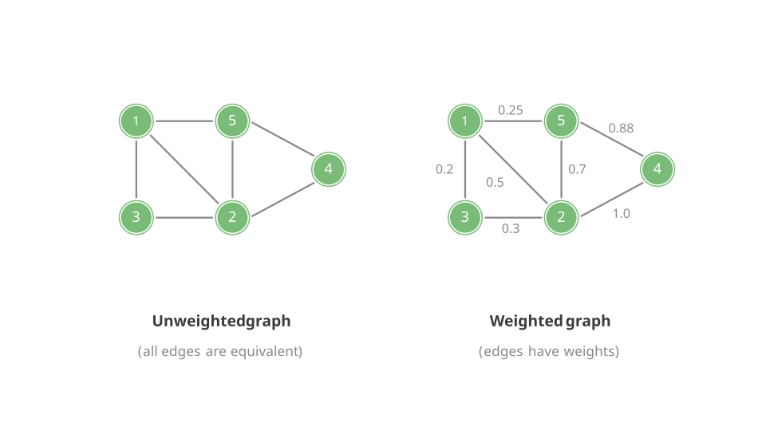
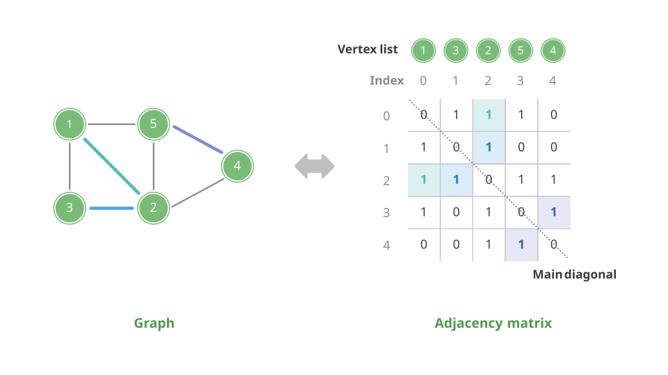
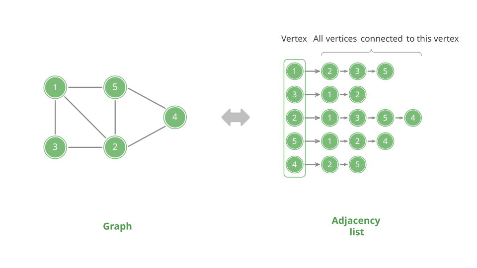

# Graph

A <u>graph</u> is a nonlinear data structure made up of <u>vertices</u> and <u>edges</u>. We can describe a graph $G$ in terms of a set of vertices $V$ and a set of edges $E$. The following example shows a graph with five vertices and seven edges.

$$
\begin{aligned}
V & = \{ 1, 2, 3, 4, 5 \} \newline
E & = \{ (1,2), (1,3), (1,5), (2,3), (2,4), (2,5), (4,5) \} \newline
G & = \{ V, E \} \newline
\end{aligned}
$$

If we think of vertices as nodes and edges as references (pointers) connecting them, we can view a graph as an extension of a linked list. As the figure below shows, **a network (graph) allows more flexible connections than a linear structure (linked list) or a branching, divide-and-conquer structure (tree)**, making it more complex.

## Common graph types and terminology

We distinguish between <u>undirected graphs</u> and <u>directed graphs</u> according to whether their edges have a direction, as shown below.

- In an undirected graph, each edge represents a two-way connection between two vertices, such as a friendship on WeChat or QQ.
- In a directed graph, each edge has a direction. An edge $A \rightarrow B$ is independent of an edge $A \leftarrow B$, just as following someone on Weibo or Douyin is independent of being followed by them.

Depending on whether all vertices are mutually reachable, a graph is either a <u>connected graph</u> or a <u>disconnected graph</u>, as shown below.

- In a connected graph, you can start at any vertex and reach every other vertex.
- In a disconnected graph, at least one vertex is unreachable from a given starting vertex.

We can also assign a weight to each edge to obtain a <u>weighted graph</u>, as shown below. For example, mobile games such as Honor of Kings calculate how close two players are based on how long they play together. A weighted graph can represent this network of relationships.

The following terms are commonly used to describe graphs.

- <u>Adjacency</u>: Two vertices are adjacent if an edge connects them. In the graph above, vertices 2, 3, and 5 are adjacent to vertex 1.
- <u>Path</u>: A path from A to B is a sequence of edges that takes you from vertex A to vertex B. In the graph above, 1-5-2-4 describes a path from vertex 1 to vertex 4.
- <u>Degree</u>: The number of edges incident to a vertex. In a directed graph, the <u>in-degree</u> counts the edges pointing into the vertex, and the <u>out-degree</u> counts the edges pointing out of it.

## Graph representations

Two common ways to represent a graph are an adjacency matrix and an adjacency list. We use undirected graphs in the following examples.

### Adjacency matrix

For a graph with $n$ vertices, an <u>adjacency matrix</u> uses a matrix of size $n \times n$. Each row and each column represents a vertex. The entries represent edges, with $1$ or $0$ indicating whether an edge exists between two vertices.

In the figure below, $M$ is the adjacency matrix and $V$ is the vertex list. The entry $M[i, j] = 1$ means there is an edge from vertex $V[i]$ to vertex $V[j]$, while $M[i, j] = 0$ means there is no edge between them.

An adjacency matrix has the following properties.

- In a simple graph, vertices cannot connect to themselves, so the main diagonal carries no information about connections.
- In an undirected graph, an edge is equivalent in either direction, so the adjacency matrix is symmetric across its main diagonal.
- Replacing the entries $1$ and $0$ with weights lets the matrix represent a weighted graph.

An adjacency matrix gives direct access to the entry for an edge, so adding, removing, looking up, or updating an edge takes $O(1)$ time. However, the matrix takes $O(n^2)$ space, which can require substantial memory.

### Adjacency list

An <u>adjacency list</u> represents a graph using $n$ linked lists whose nodes represent vertices. List $i$ corresponds to vertex $i$ and stores all its neighbors (vertices connected to it by an edge). The figure below shows a graph stored as an adjacency list.

An adjacency list stores only edges that exist. Since the number of edges is usually much smaller than $n^2$, this representation saves space. Looking up an edge, however, requires scanning a linked list, which takes longer than a lookup in an adjacency matrix.

As the figure above shows, **an adjacency list resembles separate chaining in a hash table, so similar optimizations apply**. For example, replacing a long linked list with an AVL tree or a red-black tree can reduce lookup time from $O(n)$ to $O(\log n)$. Replacing it with a hash table can reduce lookup time to $O(1)$.

## Common applications of graphs

As the table below shows, many real-world systems can be modeled as graphs, and problems involving those systems can be expressed as graph computations.

 Table <id> &nbsp; Graphs in everyday life 

|          | Vertex | Edge                   | Graph problem   |
| -------- | ---- | -------------------- | ------------ |
| Social network | User | Friendship             | Suggest potential friends |
| Subway network | Station | Connection between stations       | Recommend the shortest route |
| Solar system   | Celestial body | Gravitational attraction between bodies | Calculate planetary orbits |
