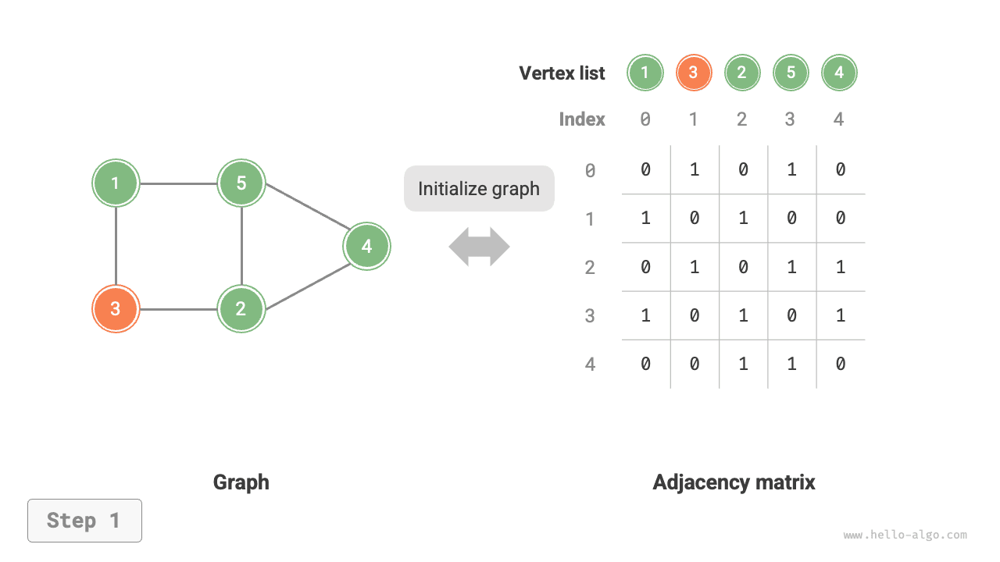
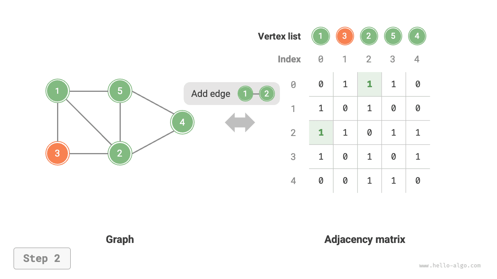
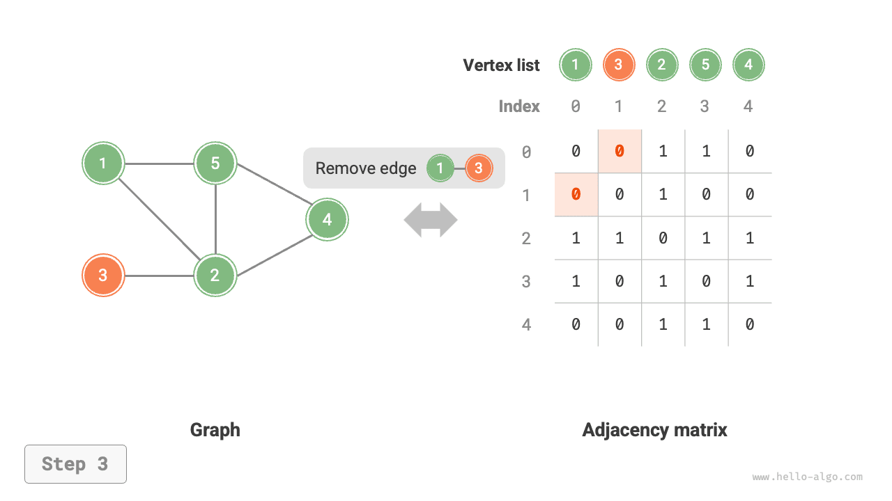
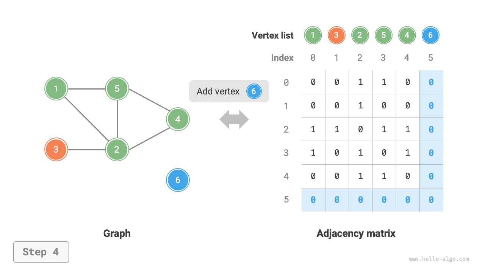
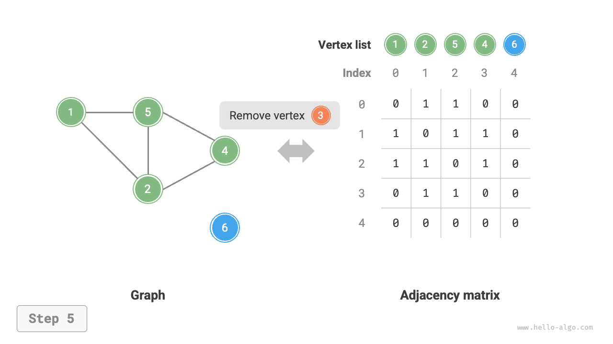

# Basic graph operations

Basic graph operations fall into two categories: operations on edges and operations on vertices. Their implementations differ depending on whether the graph is represented by an adjacency matrix or an adjacency list.

## Adjacency matrix implementation

For an undirected graph with $n$ vertices, the operations are implemented as shown in the figure below.

- **Add or remove an edge**: Modify the corresponding entry in the adjacency matrix directly, taking $O(1)$ time. Since the graph is undirected, update the edge in both directions.
- **Add a vertex**: Append one row and one column to the adjacency matrix and fill them with $0$, taking $O(n)$ time.
- **Remove a vertex**: Delete the corresponding row and column from the adjacency matrix. The worst case occurs when deleting the first row and column: $(n-1)^2$ entries must be shifted up and to the left, taking $O(n^2)$ time.
- **Initialize the graph**: Given $n$ vertices, initialize the vertex list `vertices` of length $n$ in $O(n)$ time, then initialize the $n \times n$ adjacency matrix `adjMat` in $O(n^2)$ time.

=== "<1>"
    

=== "<2>"
    

=== "<3>"
    

=== "<4>"
    

=== "<5>"
    

The following code implements a graph using an adjacency matrix:

```src
[file]{graph_adjacency_matrix}-[class]{graph_adj_mat}-[func]{}
```

## Adjacency list implementation

For an undirected graph with $n$ vertices and $m$ edges, the operations can be implemented as shown in the figure below.

- **Add an edge**: Append the edge to the linked list of the corresponding vertex, taking $O(1)$ time. Since the graph is undirected, add the edge in both directions.
- **Remove an edge**: Find and remove the specified edge in the corresponding vertex's linked list, taking $O(m)$ time. For an undirected graph, remove the edge in both directions.
- **Add a vertex**: Add a linked list to the adjacency list with the new vertex as its head node, taking $O(1)$ time.
- **Remove a vertex**: Traverse the entire adjacency list and remove every edge involving the specified vertex, taking $O(n + m)$ time.
- **Initialize the graph**: Create $n$ vertices and $2m$ edge entries in the adjacency list, taking $O(n + m)$ time.

=== "<1>"
    

=== "<2>"
    

=== "<3>"
    

=== "<4>"
    

=== "<5>"
    

The following code implements an adjacency list, with these differences from the figure above.

- To make adding and removing vertices easier and simplify the code, we use lists (dynamic arrays) in place of linked lists.
- A hash table stores the adjacency list. Each `key` is a vertex instance, and its `value` is the list (linked list) of adjacent vertices.

We also use the `Vertex` class to represent vertices in the adjacency list. If we identified vertices by list indices, as in the adjacency matrix, deleting the vertex at index $i$ would require traversing the entire adjacency list and subtracting $1$ from every index greater than $i$. This would be inefficient. When each vertex is a unique `Vertex` instance, deleting one vertex requires no changes to the other vertices.

```src
[file]{graph_adjacency_list}-[class]{graph_adj_list}-[func]{}
```

## Comparing efficiency

For a graph with $n$ vertices and $m$ edges, the table below compares the time and space efficiency of adjacency matrices and adjacency lists. Here, "adjacency list (linked lists)" refers to the implementation in this section, while "adjacency list (hash tables)" specifically refers to an implementation in which every linked list is replaced by a hash table.

<p align="center"> Table <id> &nbsp; Comparing adjacency matrices and adjacency lists </p>

|              | Adjacency matrix | Adjacency list (linked lists) | Adjacency list (hash tables) |
| ------------ | -------- | -------------- | ---------------- |
| Check adjacency | $O(1)$   | $O(n)$         | $O(1)$           |
| Add an edge       | $O(1)$   | $O(1)$         | $O(1)$           |
| Remove an edge       | $O(1)$   | $O(n)$         | $O(1)$           |
| Add a vertex     | $O(n)$   | $O(1)$         | $O(1)$           |
| Remove a vertex     | $O(n^2)$ | $O(n + m)$     | $O(n)$           |
| Memory usage | $O(n^2)$ | $O(n + m)$     | $O(n + m)$       |

The table above suggests that an adjacency list using hash tables is the most efficient in both time and space. In practice, however, edge operations in an adjacency matrix are faster: each requires only a single array access or assignment. Overall, an adjacency matrix trades space for time, while an adjacency list trades time for space.
