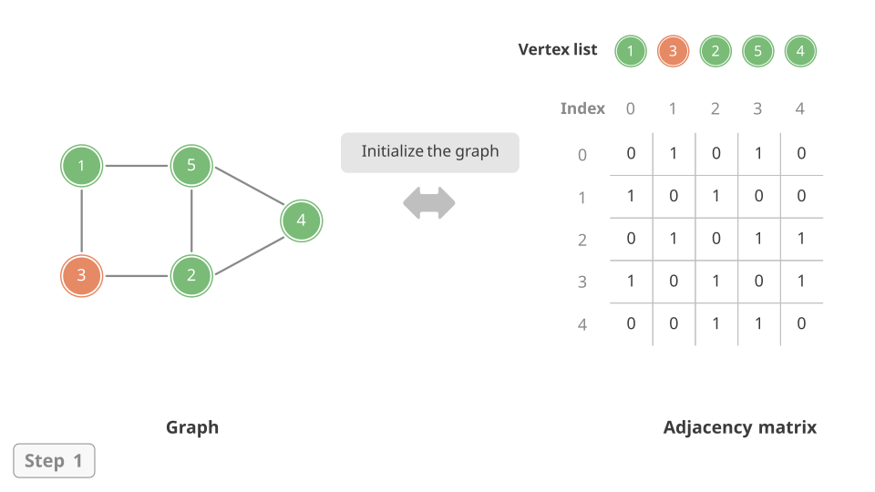
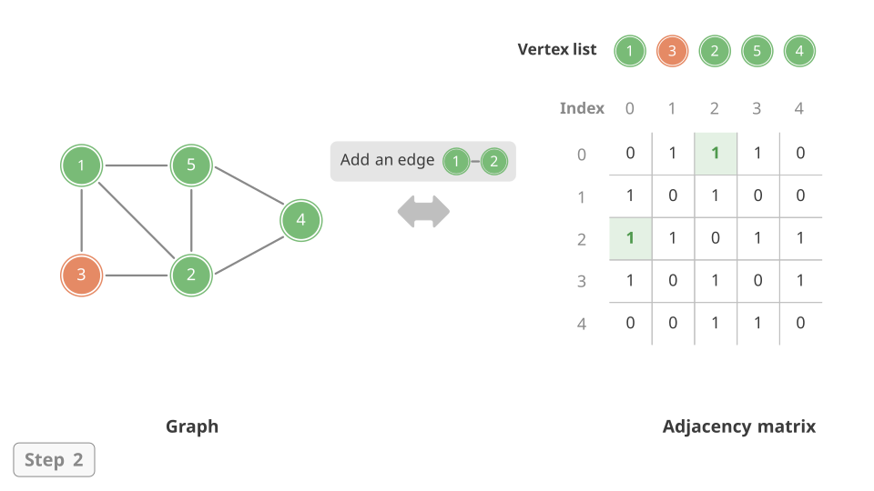
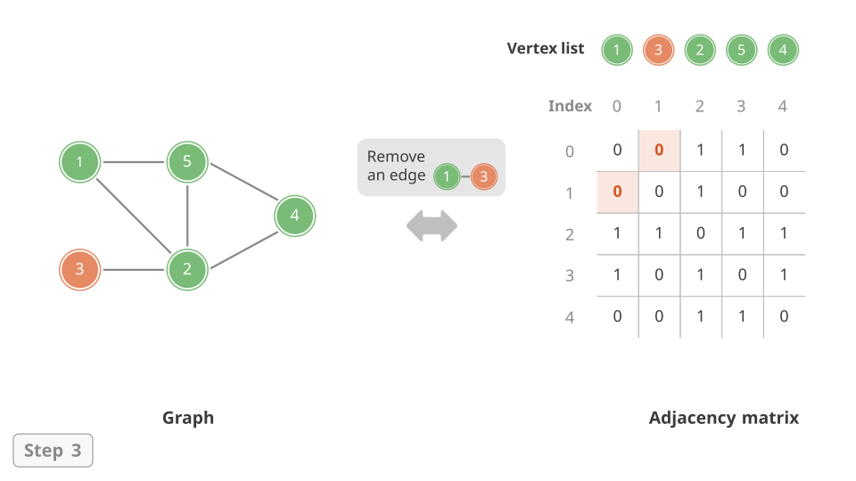
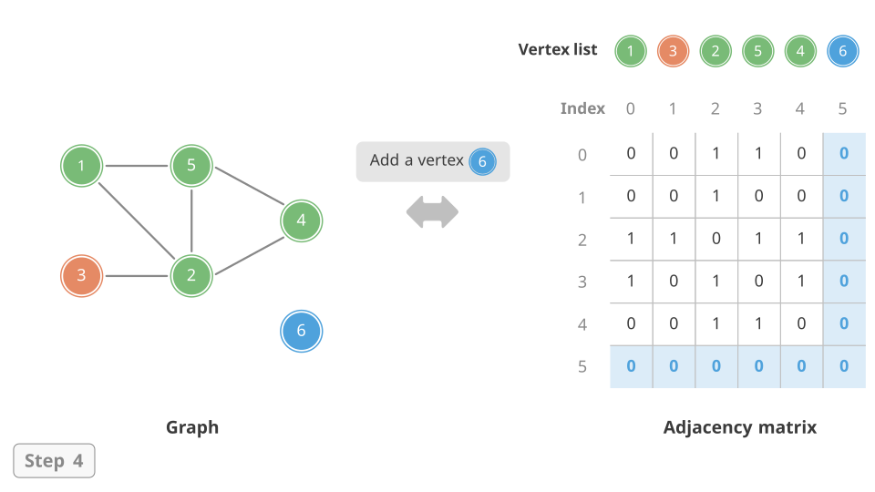
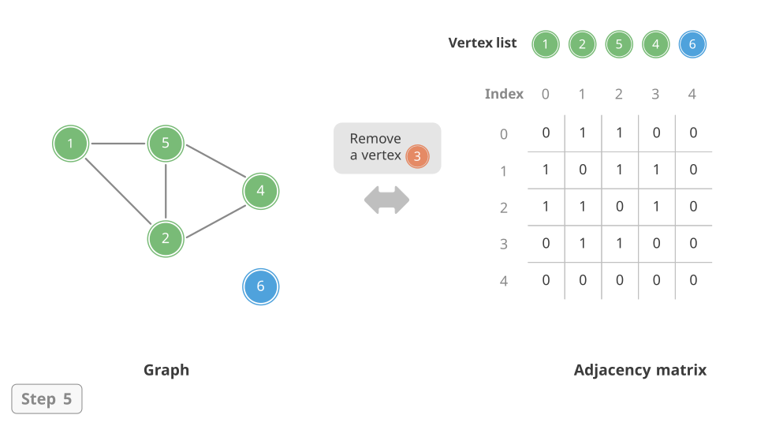
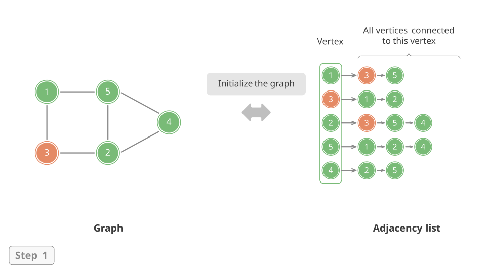
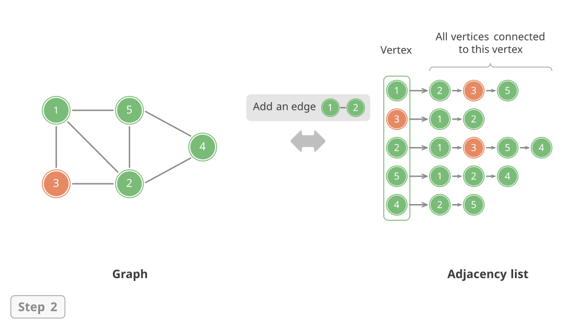
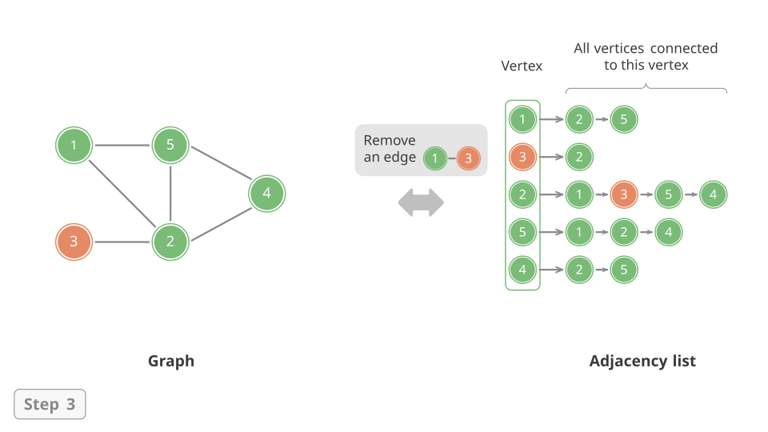
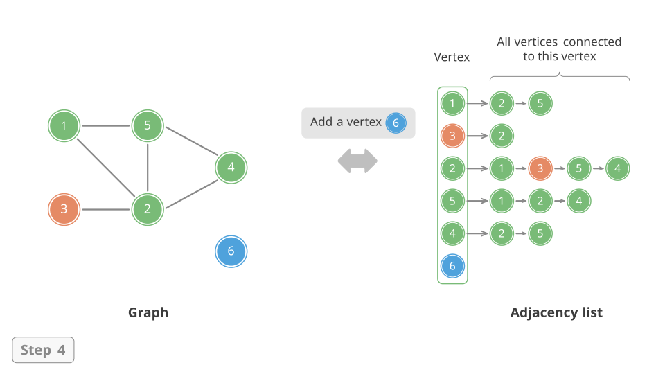
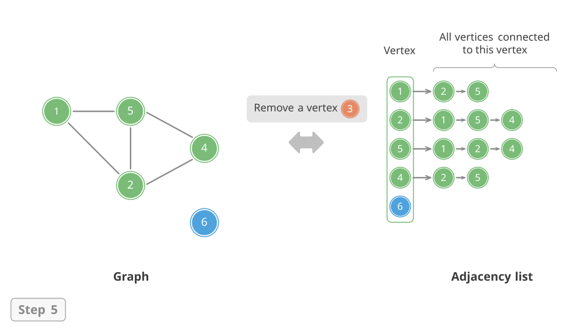

# Basic graph operations

Basic graph operations act on either edges or vertices. Their implementations depend on whether we use an adjacency matrix or an adjacency list.

## Adjacency matrix implementation

For an undirected graph with $n$ vertices, the figure below illustrates the following operations.

- **Add or remove an edge**: Update the corresponding adjacency matrix entries directly in $O(1)$ time. Since the graph is undirected, update the entries for both directions.
- **Add a vertex**: Append a row and a column to the adjacency matrix, filling both with $0$. This takes $O(n)$ time.
- **Remove a vertex**: Remove its row and column from the adjacency matrix. The worst case is removing the first row and column, which shifts $(n-1)^2$ elements up and to the left and takes $O(n^2)$ time.
- **Initialize**: Given $n$ vertices, initialize the vertex list `vertices` of length $n$ in $O(n)$ time and the $n \times n$ adjacency matrix `adjMat` in $O(n^2)$ time.

=== "<1>"
    

=== "<2>"
    

=== "<3>"
    

=== "<4>"
    

=== "<5>"
    

The following code implements a graph using an adjacency matrix.

```src
[file]{graph_adjacency_matrix}-[class]{graph_adj_mat}-[func]{}
```

## Adjacency list implementation

For an undirected graph with $n$ vertices and $m$ edges, we can implement each operation as shown below.

- **Add an edge**: Append the edge to the list for each endpoint in $O(1)$ time. Since the graph is undirected, add entries in both directions.
- **Remove an edge**: Find and remove the specified edge in the corresponding lists in $O(m)$ time. In an undirected graph, remove the entries for both directions.
- **Add a vertex**: Add a linked list to the adjacency list, using the new vertex as its head. This takes $O(1)$ time.
- **Remove a vertex**: Traverse the entire adjacency list and remove every edge incident to the vertex. This takes $O(n + m)$ time.
- **Initialize**: Create $n$ vertices and $2m$ edges in the adjacency list in $O(n + m)$ time.

=== "<1>"
    

=== "<2>"
    

=== "<3>"
    

=== "<4>"
    

=== "<5>"
    

The following code implements an adjacency list. It differs from the figure above in two ways.

- To simplify the code and make vertices easy to add and remove, we use lists (dynamic arrays) in place of linked lists.
- We store the adjacency list in a hash table. Each `key` is a vertex instance, and its `value` is the list of adjacent vertices (the linked list in the figure).

We also use the `Vertex` class to represent vertices in the adjacency list. Suppose we identified vertices by list index, as we did in the adjacency matrix. Removing the vertex at index $i$ would require scanning the entire adjacency list and decreasing every index greater than $i$ by $1$, which is inefficient. When each vertex is a distinct `Vertex` instance, removing one vertex leaves the identities of all others unchanged.

```src
[file]{graph_adjacency_list}-[class]{graph_adj_list}-[func]{}
```

## Efficiency comparison

Consider a graph with $n$ vertices and $m$ edges. The table below compares the time and space costs of an adjacency matrix and an adjacency list. “Adjacency list (linked lists)” corresponds to the implementation described here. “Adjacency list (hash tables)” means that every linked list has been replaced with a hash table.

<p align="center"> Table <id> &nbsp; Comparing adjacency matrices and adjacency lists </p>

|              | Adjacency matrix | Adjacency list (linked lists) | Adjacency list (hash tables) |
| ------------ | -------- | -------------- | ---------------- |
| Check adjacency | $O(1)$   | $O(n)$         | $O(1)$           |
| Add an edge       | $O(1)$   | $O(1)$         | $O(1)$           |
| Remove an edge       | $O(1)$   | $O(n)$         | $O(1)$           |
| Add a vertex     | $O(n)$   | $O(1)$         | $O(1)$           |
| Remove a vertex     | $O(n^2)$ | $O(n + m)$     | $O(n)$           |
| Memory usage | $O(n^2)$ | $O(n + m)$     | $O(n + m)$       |

The adjacency list with hash tables appears to offer the best time and space efficiency in the table. In practice, however, edge operations are faster in an adjacency matrix because each takes just one array access or assignment. Overall, an adjacency matrix trades space for time, while an adjacency list trades time for space.
