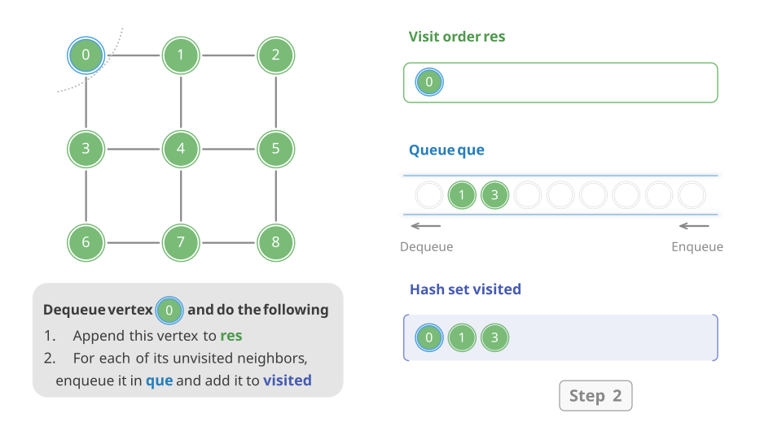
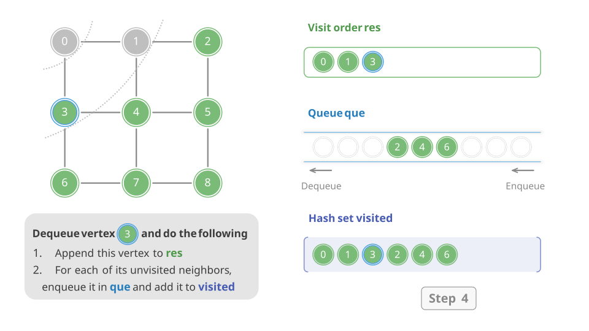
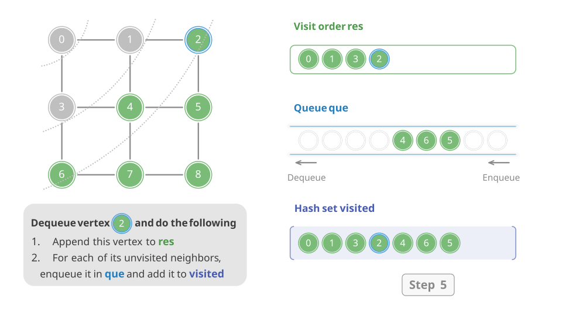
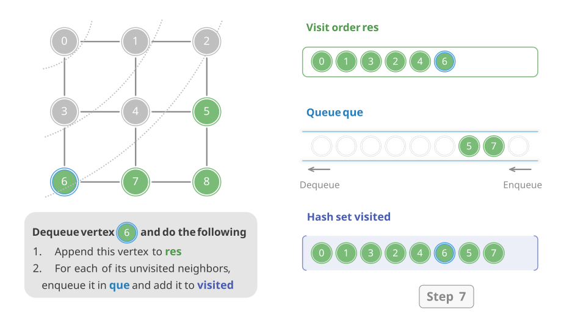
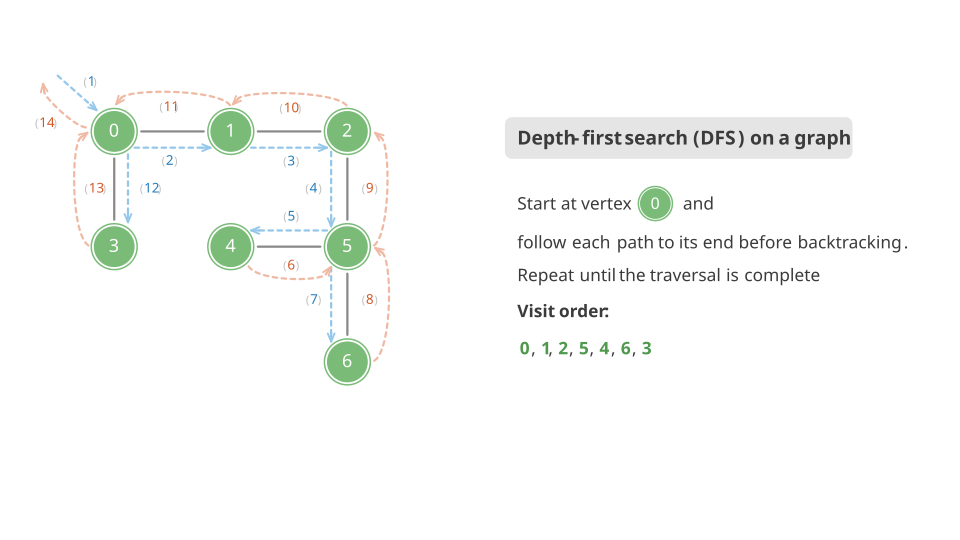
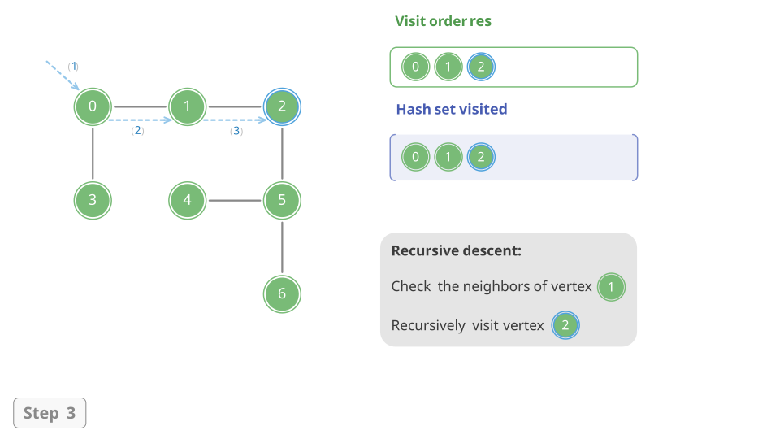
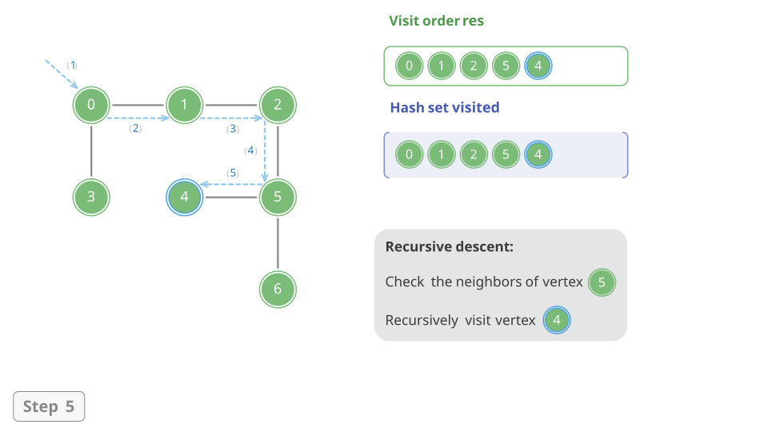
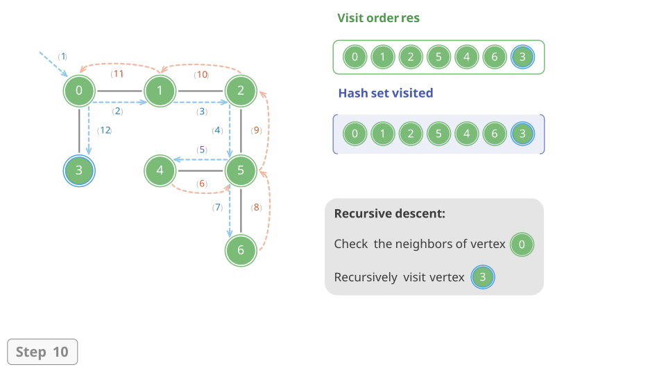

# Graph traversal

A tree describes one-to-many relationships. A graph allows more flexible connections and can represent arbitrary many-to-many relationships. We can therefore view a tree as a special case of a graph. For the same reason, **tree traversal is a special case of graph traversal**.

Both trees and graphs use search algorithms for traversal. Graph traversal also has two main approaches: <u>breadth-first traversal</u> and <u>depth-first traversal</u>.

## Breadth-first traversal

**Breadth-first traversal starts at a vertex and visits the nearest vertices first, expanding outward one layer at a time**. In the figure below, we start at the upper-left vertex and visit all its neighbors. We then visit the neighbors of the next vertex and continue until every vertex has been visited.


### Implementation

BFS usually uses a queue, as in the code below. Its first-in, first-out order fits the way BFS visits nearby vertices before more distant ones.

1. Enqueue the starting vertex `startVet` and begin the loop.
2. On each iteration, dequeue the front vertex and record the visit, then add its unvisited neighbors to the back of the queue.
3. Repeat step `2.` until all vertices have been visited.

To avoid repeated visits, use a hash set `visited` to record which vertices have already been visited.

!!! tip

    Think of a hash set as a hash table that stores only a `key`, without an associated `value`. Adding, removing, looking up, or updating a `key` takes $O(1)$ time. Since each `key` is unique, hash sets are often used to remove duplicates.

```src
[file]{graph_bfs}-[class]{}-[func]{graph_bfs}
```

Follow the code alongside the figure below to see how each step changes the traversal state.

=== "<1>"
    

=== "<2>"
    

=== "<3>"
    

=== "<4>"
    

=== "<5>"
    

=== "<6>"
    

=== "<7>"
    

=== "<8>"
    

=== "<9>"
    

=== "<10>"
    

=== "<11>"
    

!!! question "Is the breadth-first traversal order unique?"

    No. Breadth-first traversal requires only that nearer vertices be visited before farther ones. **Vertices at the same distance can be visited in any order**. In the figure above, vertices $1$ and $3$ can switch places, and vertices $2$, $4$, and $6$ can also be reordered.

### Complexity analysis

**Time complexity**: Each vertex enters and leaves the queue once, taking $O(|V|)$ time in total. When checking neighbors in an undirected graph, we examine every edge $2$ times, taking $O(2|E|)$ time. The total is $O(|V| + |E|)$.

**Space complexity**: The list `res`, hash set `visited`, and queue `que` each hold at most $|V|$ vertices, so the space complexity is $O(|V|)$.

## Depth-first traversal

**Depth-first traversal follows a path as far as it can before backtracking**. In the figure below, we start at the upper-left vertex and follow a neighbor of the current vertex. When we reach a dead end, we return and follow another branch as far as possible. We repeat this process until every vertex has been visited.



### Implementation

Recursion is a natural way to explore a path to its end and then return. As in breadth-first traversal, we use a hash set `visited` to record visited vertices and avoid revisiting them.

```src
[file]{graph_dfs}-[class]{}-[func]{graph_dfs}
```

The figure below shows the steps of depth-first traversal.

- **A straight dashed line represents a recursive descent**. A new recursive call begins to visit a new vertex.
- **A curved dashed line represents backtracking**. The recursive call has returned to the point where it was made.

Trace the figure below alongside the code, either mentally or on paper. Follow the entire DFS and note when each call begins and when it returns.

=== "<1>"
    

=== "<2>"
    

=== "<3>"
    

=== "<4>"
    

=== "<5>"
    

=== "<6>"
    

=== "<7>"
    

=== "<8>"
    

=== "<9>"
    

=== "<10>"
    

=== "<11>"
    

!!! question "Is the depth-first traversal order unique?"

    As with breadth-first traversal, there is more than one valid depth-first order. At any vertex, we can choose which direction to explore first. Reordering the neighbors still gives a depth-first traversal.
    
    For example, the tree traversals “root $\rightarrow$ left $\rightarrow$ right,” “left $\rightarrow$ root $\rightarrow$ right,” and “left $\rightarrow$ right $\rightarrow$ root” are preorder, inorder, and postorder, respectively. They give different priorities to the visits, yet all three are depth-first traversals.

### Complexity analysis

**Time complexity**: Each vertex is visited exactly $1$ time, taking $O(|V|)$ time overall. Each edge is examined $2$ times, taking $O(2|E|)$ time overall. The total is $O(|V| + |E|)$.

**Space complexity**: The list `res` and hash set `visited` each hold at most $|V|$ vertices, and the recursion depth is at most $|V|$, giving $O(|V|)$ space.
