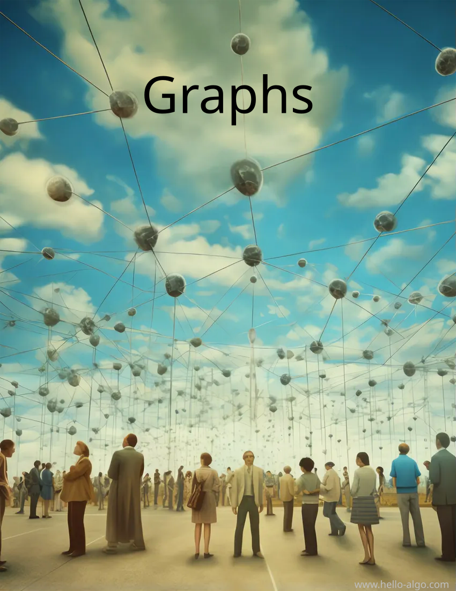

# Chapter 9. &nbsp; Graphs

{ class="cover-image" }

!!! abstract

    On life's journey, each of us is a node connected to others by countless invisible edges.
    
    Every meeting and every parting leaves its own mark on this vast network.

## In this chapter

- [9.1 &nbsp; Graph](graph.md)
- [9.2 &nbsp; Basic graph operations](graph_operations.md)
- [9.3 &nbsp; Graph traversal](graph_traversal.md)
- [9.4 &nbsp; Summary](summary.md)
- [9.5 &nbsp; Exercises](exercises.md)
