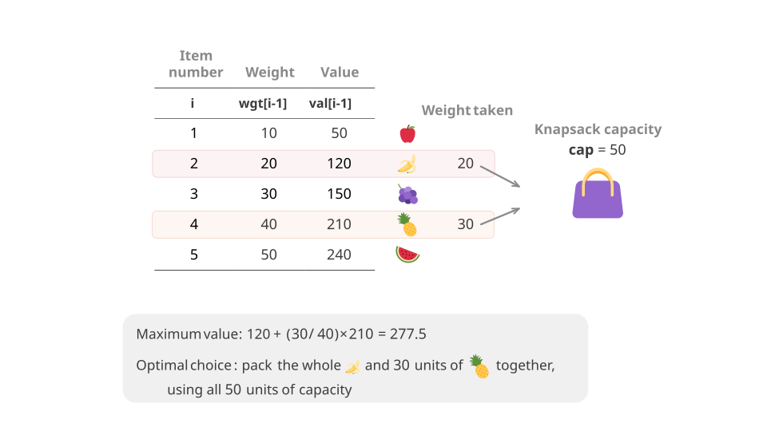
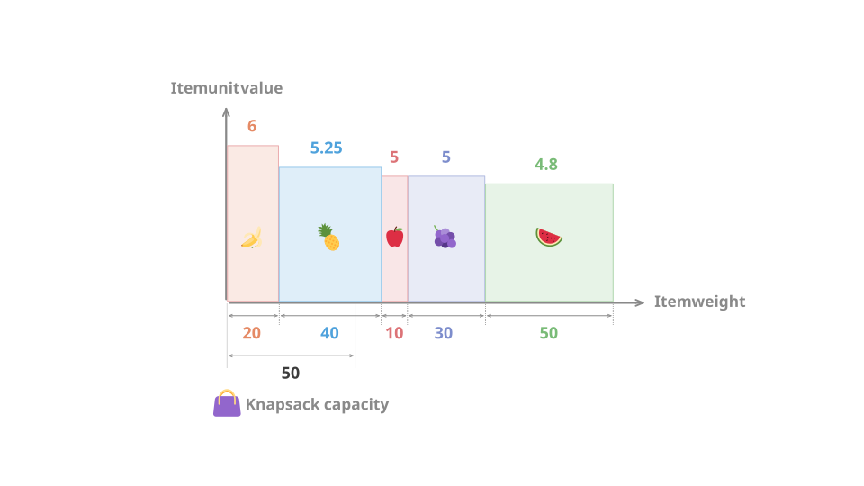

# Fractional knapsack problem

!!! question

    You are given $n$ items and a knapsack of capacity $cap$. Item $i$ has weight $wgt[i-1]$ and value $val[i-1]$. You can select each item only once, **but you may take a fraction of it and receive the corresponding fraction of its value**. What is the maximum total value you can pack within the weight limit? The figure below shows an example.



Fractional knapsack closely resembles 0-1 knapsack. The state includes the current item $i$ and capacity $c$, and the goal is to maximize total value within the capacity limit.

Here, however, we can take just part of an item. As the figure below shows, **we can divide an item at any point and calculate the value of the portion in proportion to its weight**.

1. For item $i$, the value per unit of weight is $val[i-1] / wgt[i-1]$. We call this its unit value.
2. If we take a portion of item $i$ that weighs $w$, it adds $w \times val[i-1] / wgt[i-1]$ to the value in the knapsack.


### Choosing a greedy strategy

To maximize total value in the knapsack, **we want the greatest possible value for each unit of weight**. This leads to the greedy strategy shown below.

1. Sort the items in descending order of unit value.
2. Go through the items, **choosing the one with the highest remaining unit value at each step**.
3. If the current item does not fit, take just enough of it to fill the knapsack.


### Implementation

We define an `Item` class so we can sort the items by unit value. The loop makes one greedy choice at a time. Once the knapsack is full, we exit the loop and return the result:

```src
[file]{fractional_knapsack}-[class]{}-[func]{fractional_knapsack}
```

A built-in sort typically takes $O(n \log n)$ time and $O(\log n)$ or $O(n)$ space, depending on the language's implementation.

After sorting, we may have to scan the entire list in the worst case, **so the scan takes $O(n)$ time**, where $n$ is the number of items.

We create a list of `Item` objects, **so the space complexity is $O(n)$**.

### Proof of correctness

We use proof by contradiction. Suppose item $x$ has the highest unit value and some algorithm finds a maximum value of `res` without including item $x$.

Remove one unit of weight of any item in the knapsack and replace it with one unit of item $x$. Since item $x$ has the highest unit value, the new total must exceed `res`. **This contradicts the assumption that `res` is optimal, so an optimal solution must include item $x$**.

We can make the same argument for the other items in the solution. In short, **an item with a higher unit value is always a better choice**, which establishes the greedy strategy.

The figure below plots weight on the horizontal axis and unit value on the vertical axis. In these terms, the fractional knapsack problem asks how much area we can cover within a fixed horizontal interval. This gives us a geometric way to see why the greedy strategy works.


