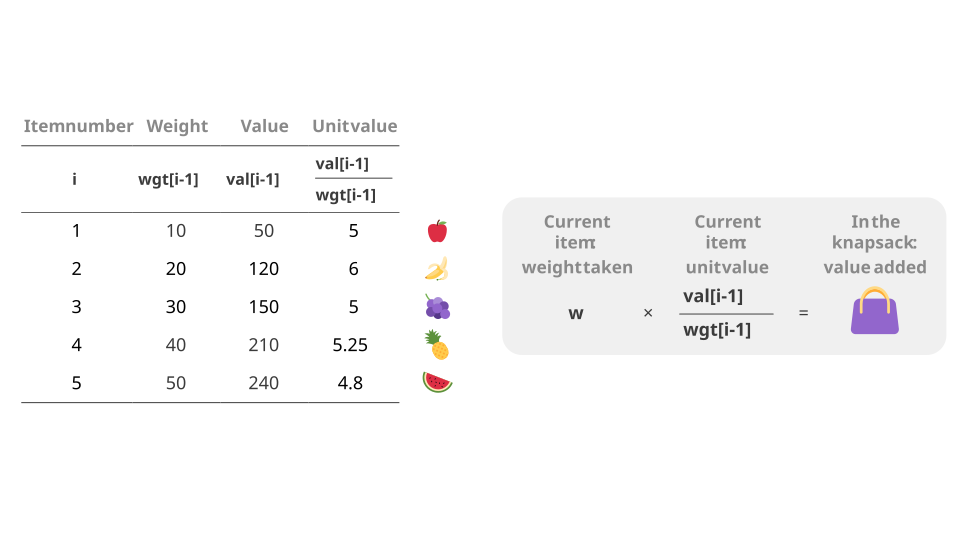
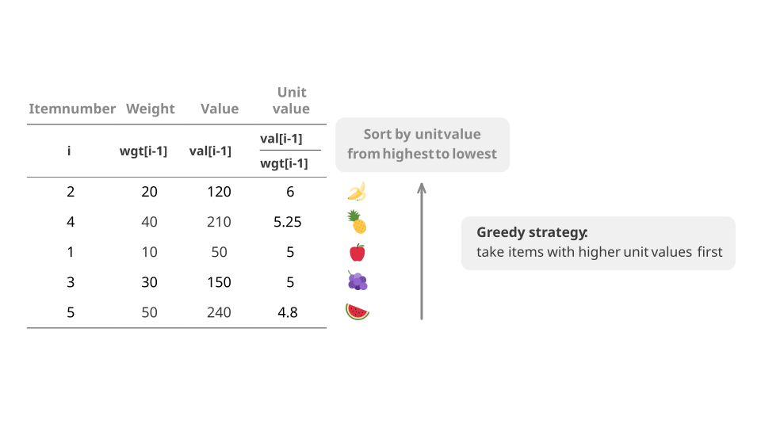

# 15.2 &nbsp; Fractional knapsack problem

!!! question

    You are given $n$ items and a knapsack of capacity $cap$. Item $i$ has weight $wgt[i-1]$ and value $val[i-1]$. You can select each item only once, **but you may take a fraction of it and receive the corresponding fraction of its value**. What is the maximum total value you can pack within the weight limit? Figure 15-3 shows an example.

{ class="animation-figure" }

<p align="center"> Figure 15-3 &nbsp; Example data for fractional knapsack </p>

Fractional knapsack closely resembles 0-1 knapsack. The state includes the current item $i$ and capacity $c$, and the goal is to maximize total value within the capacity limit.

Here, however, we can take just part of an item. As Figure 15-4 shows, **we can divide an item at any point and calculate the value of the portion in proportion to its weight**.

1. For item $i$, the value per unit of weight is $val[i-1] / wgt[i-1]$. We call this its unit value.
2. If we take a portion of item $i$ that weighs $w$, it adds $w \times val[i-1] / wgt[i-1]$ to the value in the knapsack.

{ class="animation-figure" }

<p align="center"> Figure 15-4 &nbsp; Value per unit of weight </p>

### 1. &nbsp; Choosing a greedy strategy

To maximize total value in the knapsack, **we want the greatest possible value for each unit of weight**. This leads to the greedy strategy shown below.

1. Sort the items in descending order of unit value.
2. Go through the items, **choosing the one with the highest remaining unit value at each step**.
3. If the current item does not fit, take just enough of it to fill the knapsack.

{ class="animation-figure" }

<p align="center"> Figure 15-5 &nbsp; Greedy strategy for fractional knapsack </p>

### 2. &nbsp; Implementation

We define an `Item` class so we can sort the items by unit value. The loop makes one greedy choice at a time. Once the knapsack is full, we exit the loop and return the result:

=== "Python"

    ```python title="fractional_knapsack.py"
    class Item:
        """Item"""

        def __init__(self, w: int, v: int):
            self.w = w  # Item weight
            self.v = v  # Item value

    def fractional_knapsack(wgt: list[int], val: list[int], cap: int) -> int:
        """Greedy fractional knapsack"""
        # Create a list of items, each with a weight and a value
        items = [Item(w, v) for w, v in zip(wgt, val)]
        # Sort by value per unit of weight, item.v / item.w, in descending order
        items.sort(key=lambda item: item.v / item.w, reverse=True)
        # Make greedy choices in a loop
        res = 0
        for item in items:
            if item.w <= cap:
                # If the whole item fits, put it in the knapsack
                res += item.v
                cap -= item.w
            else:
                # If the whole item does not fit, take a fraction of it
                res += (item.v / item.w) * cap
                # The knapsack is full, so exit the loop
                break
        return res
    ```

=== "C++"

    ```cpp title="fractional_knapsack.cpp"
    /* Item */
    class Item {
      public:
        int w; // Item weight
        int v; // Item value

        Item(int w, int v) : w(w), v(v) {
        }
    };

    /* Greedy fractional knapsack */
    double fractionalKnapsack(vector<int> &wgt, vector<int> &val, int cap) {
        // Create a list of items, each with a weight and a value
        vector<Item> items;
        for (int i = 0; i < wgt.size(); i++) {
            items.push_back(Item(wgt[i], val[i]));
        }
        // Sort by value per unit of weight, item.v / item.w, in descending order
        sort(items.begin(), items.end(), [](Item &a, Item &b) { return (double)a.v / a.w > (double)b.v / b.w; });
        // Make greedy choices in a loop
        double res = 0;
        for (auto &item : items) {
            if (item.w <= cap) {
                // If the whole item fits, put it in the knapsack
                res += item.v;
                cap -= item.w;
            } else {
                // If the whole item does not fit, take a fraction of it
                res += (double)item.v / item.w * cap;
                // The knapsack is full, so exit the loop
                break;
            }
        }
        return res;
    }
    ```

=== "Java"

    ```java title="fractional_knapsack.java"
    /* Item */
    class Item {
        int w; // Item weight
        int v; // Item value

        public Item(int w, int v) {
            this.w = w;
            this.v = v;
        }
    }

    /* Greedy fractional knapsack */
    double fractionalKnapsack(int[] wgt, int[] val, int cap) {
        // Create a list of items, each with a weight and a value
        Item[] items = new Item[wgt.length];
        for (int i = 0; i < wgt.length; i++) {
            items[i] = new Item(wgt[i], val[i]);
        }
        // Sort by value per unit of weight, item.v / item.w, in descending order
        Arrays.sort(items, Comparator.comparingDouble(item -> -((double) item.v / item.w)));
        // Make greedy choices in a loop
        double res = 0;
        for (Item item : items) {
            if (item.w <= cap) {
                // If the whole item fits, put it in the knapsack
                res += item.v;
                cap -= item.w;
            } else {
                // If the whole item does not fit, take a fraction of it
                res += (double) item.v / item.w * cap;
                // The knapsack is full, so exit the loop
                break;
            }
        }
        return res;
    }
    ```

=== "C#"

    ```csharp title="fractional_knapsack.cs"
    /* Item */
    class Item(int w, int v) {
        public int w = w; // Item weight
        public int v = v; // Item value
    }

    /* Greedy fractional knapsack */
    double FractionalKnapsack(int[] wgt, int[] val, int cap) {
        // Create a list of items, each with a weight and a value
        Item[] items = new Item[wgt.Length];
        for (int i = 0; i < wgt.Length; i++) {
            items[i] = new Item(wgt[i], val[i]);
        }
        // Sort by value per unit of weight, item.v / item.w, in descending order
        Array.Sort(items, (x, y) => ((double)y.v / y.w).CompareTo((double)x.v / x.w));
        // Make greedy choices in a loop
        double res = 0;
        foreach (Item item in items) {
            if (item.w <= cap) {
                // If the whole item fits, put it in the knapsack
                res += item.v;
                cap -= item.w;
            } else {
                // If the whole item does not fit, take a fraction of it
                res += (double)item.v / item.w * cap;
                // The knapsack is full, so exit the loop
                break;
            }
        }
        return res;
    }
    ```

=== "Go"

    ```go title="fractional_knapsack.go"
    /* Item */
    type Item struct {
        w int // Item weight
        v int // Item value
    }

    /* Greedy fractional knapsack */
    func fractionalKnapsack(wgt []int, val []int, cap int) float64 {
        // Create a list of items, each with a weight and a value
        items := make([]Item, len(wgt))
        for i := 0; i < len(wgt); i++ {
            items[i] = Item{wgt[i], val[i]}
        }
        // Sort by value per unit of weight, item.v / item.w, in descending order
        sort.Slice(items, func(i, j int) bool {
            return float64(items[i].v)/float64(items[i].w) > float64(items[j].v)/float64(items[j].w)
        })
        // Make greedy choices in a loop
        res := 0.0
        for _, item := range items {
            if item.w <= cap {
                // If the whole item fits, put it in the knapsack
                res += float64(item.v)
                cap -= item.w
            } else {
                // If the whole item does not fit, take a fraction of it
                res += float64(item.v) / float64(item.w) * float64(cap)
                // The knapsack is full, so exit the loop
                break
            }
        }
        return res
    }
    ```

=== "Swift"

    ```swift title="fractional_knapsack.swift"
    /* Item */
    class Item {
        var w: Int // Item weight
        var v: Int // Item value

        init(w: Int, v: Int) {
            self.w = w
            self.v = v
        }
    }

    /* Greedy fractional knapsack */
    func fractionalKnapsack(wgt: [Int], val: [Int], cap: Int) -> Double {
        // Create a list of items, each with a weight and a value
        var items = zip(wgt, val).map { Item(w: $0, v: $1) }
        // Sort by value per unit of weight, item.v / item.w, in descending order
        items.sort { -(Double($0.v) / Double($0.w)) < -(Double($1.v) / Double($1.w)) }
        // Make greedy choices in a loop
        var res = 0.0
        var cap = cap
        for item in items {
            if item.w <= cap {
                // If the whole item fits, put it in the knapsack
                res += Double(item.v)
                cap -= item.w
            } else {
                // If the whole item does not fit, take a fraction of it
                res += Double(item.v) / Double(item.w) * Double(cap)
                // The knapsack is full, so exit the loop
                break
            }
        }
        return res
    }
    ```

=== "JS"

    ```javascript title="fractional_knapsack.js"
    /* Item */
    class Item {
        constructor(w, v) {
            this.w = w; // Item weight
            this.v = v; // Item value
        }
    }

    /* Greedy fractional knapsack */
    function fractionalKnapsack(wgt, val, cap) {
        // Create a list of items, each with a weight and a value
        const items = wgt.map((w, i) => new Item(w, val[i]));
        // Sort by value per unit of weight, item.v / item.w, in descending order
        items.sort((a, b) => b.v / b.w - a.v / a.w);
        // Make greedy choices in a loop
        let res = 0;
        for (const item of items) {
            if (item.w <= cap) {
                // If the whole item fits, put it in the knapsack
                res += item.v;
                cap -= item.w;
            } else {
                // If the whole item does not fit, take a fraction of it
                res += (item.v / item.w) * cap;
                // The knapsack is full, so exit the loop
                break;
            }
        }
        return res;
    }
    ```

=== "TS"

    ```typescript title="fractional_knapsack.ts"
    /* Item */
    class Item {
        w: number; // Item weight
        v: number; // Item value

        constructor(w: number, v: number) {
            this.w = w;
            this.v = v;
        }
    }

    /* Greedy fractional knapsack */
    function fractionalKnapsack(wgt: number[], val: number[], cap: number): number {
        // Create a list of items, each with a weight and a value
        const items: Item[] = wgt.map((w, i) => new Item(w, val[i]));
        // Sort by value per unit of weight, item.v / item.w, in descending order
        items.sort((a, b) => b.v / b.w - a.v / a.w);
        // Make greedy choices in a loop
        let res = 0;
        for (const item of items) {
            if (item.w <= cap) {
                // If the whole item fits, put it in the knapsack
                res += item.v;
                cap -= item.w;
            } else {
                // If the whole item does not fit, take a fraction of it
                res += (item.v / item.w) * cap;
                // The knapsack is full, so exit the loop
                break;
            }
        }
        return res;
    }
    ```

=== "Dart"

    ```dart title="fractional_knapsack.dart"
    /* Item */
    class Item {
      int w; // Item weight
      int v; // Item value

      Item(this.w, this.v);
    }

    /* Greedy fractional knapsack */
    double fractionalKnapsack(List<int> wgt, List<int> val, int cap) {
      // Create a list of items, each with a weight and a value
      List<Item> items = List.generate(wgt.length, (i) => Item(wgt[i], val[i]));
      // Sort by value per unit of weight, item.v / item.w, in descending order
      items.sort((a, b) => (b.v / b.w).compareTo(a.v / a.w));
      // Make greedy choices in a loop
      double res = 0;
      for (Item item in items) {
        if (item.w <= cap) {
          // If the whole item fits, put it in the knapsack
          res += item.v;
          cap -= item.w;
        } else {
          // If the whole item does not fit, take a fraction of it
          res += item.v / item.w * cap;
          // The knapsack is full, so exit the loop
          break;
        }
      }
      return res;
    }
    ```

=== "Rust"

    ```rust title="fractional_knapsack.rs"
    /* Item */
    struct Item {
        w: i32, // Item weight
        v: i32, // Item value
    }

    impl Item {
        fn new(w: i32, v: i32) -> Self {
            Self { w, v }
        }
    }

    /* Greedy fractional knapsack */
    fn fractional_knapsack(wgt: &[i32], val: &[i32], mut cap: i32) -> f64 {
        // Create a list of items, each with a weight and a value
        let mut items = wgt
            .iter()
            .zip(val.iter())
            .map(|(&w, &v)| Item::new(w, v))
            .collect::<Vec<Item>>();
        // Sort by value per unit of weight, item.v / item.w, in descending order
        items.sort_by(|a, b| {
            (b.v as f64 / b.w as f64)
                .partial_cmp(&(a.v as f64 / a.w as f64))
                .unwrap()
        });
        // Make greedy choices in a loop
        let mut res = 0.0;
        for item in &items {
            if item.w <= cap {
                // If the whole item fits, put it in the knapsack
                res += item.v as f64;
                cap -= item.w;
            } else {
                // If the whole item does not fit, take a fraction of it
                res += item.v as f64 / item.w as f64 * cap as f64;
                // The knapsack is full, so exit the loop
                break;
            }
        }
        res
    }
    ```

=== "C"

    ```c title="fractional_knapsack.c"
    /* Item */
    typedef struct {
        int w; // Item weight
        int v; // Item value
    } Item;

    /* Greedy fractional knapsack */
    float fractionalKnapsack(int wgt[], int val[], int itemCount, int cap) {
        // Create a list of items, each with a weight and a value
        Item *items = malloc(sizeof(Item) * itemCount);
        for (int i = 0; i < itemCount; i++) {
            items[i] = (Item){.w = wgt[i], .v = val[i]};
        }
        // Sort by value per unit of weight, item.v / item.w, in descending order
        qsort(items, (size_t)itemCount, sizeof(Item), sortByValueDensity);
        // Make greedy choices in a loop
        float res = 0.0;
        for (int i = 0; i < itemCount; i++) {
            if (items[i].w <= cap) {
                // If the whole item fits, put it in the knapsack
                res += items[i].v;
                cap -= items[i].w;
            } else {
                // If the whole item does not fit, take a fraction of it
                res += (float)cap / items[i].w * items[i].v;
                cap = 0;
                break;
            }
        }
        free(items);
        return res;
    }
    ```

=== "Kotlin"

    ```kotlin title="fractional_knapsack.kt"
    /* Item */
    class Item(
        val w: Int, // Item weight
        val v: Int  // Item value
    )

    /* Greedy fractional knapsack */
    fun fractionalKnapsack(wgt: IntArray, _val: IntArray, c: Int): Double {
        // Create a list of items, each with a weight and a value
        var cap = c
        val items = arrayOfNulls<Item>(wgt.size)
        for (i in wgt.indices) {
            items[i] = Item(wgt[i], _val[i])
        }
        // Sort by value per unit of weight, item.v / item.w, in descending order
        items.sortBy { item: Item? -> -(item!!.v.toDouble() / item.w) }
        // Make greedy choices in a loop
        var res = 0.0
        for (item in items) {
            if (item!!.w <= cap) {
                // If the whole item fits, put it in the knapsack
                res += item.v
                cap -= item.w
            } else {
                // If the whole item does not fit, take a fraction of it
                res += item.v.toDouble() / item.w * cap
                // The knapsack is full, so exit the loop
                break
            }
        }
        return res
    }
    ```

=== "Ruby"

    ```ruby title="fractional_knapsack.rb"
    ### Item ###
    class Item
      attr_accessor :w # Item weight
      attr_accessor :v # Item value

      def initialize(w, v)
        @w = w
        @v = v
      end
    end

    ### Greedy fractional knapsack ###
    def fractional_knapsack(wgt, val, cap)
      # Create a list of items, each with a weight and a value
      items = wgt.each_with_index.map { |w, i| Item.new(w, val[i]) }
      # Sort by value per unit of weight, item.v / item.w, in descending order
      items.sort! { |a, b| (b.v.to_f / b.w) <=> (a.v.to_f / a.w) }
      # Make greedy choices in a loop
      res = 0
      for item in items
        if item.w <= cap
          # If the whole item fits, put it in the knapsack
          res += item.v
          cap -= item.w
        else
          # If the whole item does not fit, take a fraction of it
          res += (item.v.to_f / item.w) * cap
          # The knapsack is full, so exit the loop
          break
        end
      end
      res
    end
    ```

??? pythontutor "Visualize execution"

    <div style="height: 549px; width: 100%;"><iframe class="pythontutor-iframe" title="Visualize execution" src="https://pythontutor.com/iframe-embed.html#code=class%20Item%3A%0A%20%20%20%20%22%22%22Item%22%22%22%0A%20%20%20%20def%20__init__%28self,%20w%3A%20int,%20v%3A%20int%29%3A%0A%20%20%20%20%20%20%20%20self.w%20%3D%20w%20%20%23%20Item%20weight%0A%20%20%20%20%20%20%20%20self.v%20%3D%20v%20%20%23%20Item%20value%0A%0Adef%20fractional_knapsack%28wgt%3A%20list%5Bint%5D,%20val%3A%20list%5Bint%5D,%20cap%3A%20int%29%20-%3E%20int%3A%0A%20%20%20%20%22%22%22Greedy%20fractional%20knapsack%22%22%22%0A%20%20%20%20%23%20Create%20a%20list%20of%20items,%20each%20with%20a%20weight%20and%20a%20value%0A%20%20%20%20items%20%3D%20%5BItem%28w,%20v%29%20for%20w,%20v%20in%20zip%28wgt,%20val%29%5D%0A%20%20%20%20%23%20Sort%20by%20value%20per%20unit%20of%20weight,%20item.v%20/%20item.w,%20in%20descending%20order%0A%20%20%20%20items.sort%28key%3Dlambda%20item%3A%20item.v%20/%20item.w,%20reverse%3DTrue%29%0A%20%20%20%20%23%20Make%20greedy%20choices%20in%20a%20loop%0A%20%20%20%20res%20%3D%200%0A%20%20%20%20for%20item%20in%20items%3A%0A%20%20%20%20%20%20%20%20if%20item.w%20%3C%3D%20cap%3A%0A%20%20%20%20%20%20%20%20%20%20%20%20%23%20If%20the%20whole%20item%20fits,%20put%20it%20in%20the%20knapsack%0A%20%20%20%20%20%20%20%20%20%20%20%20res%20%2B%3D%20item.v%0A%20%20%20%20%20%20%20%20%20%20%20%20cap%20-%3D%20item.w%0A%20%20%20%20%20%20%20%20else%3A%0A%20%20%20%20%20%20%20%20%20%20%20%20%23%20If%20the%20whole%20item%20does%20not%20fit,%20take%20a%20fraction%20of%20it%0A%20%20%20%20%20%20%20%20%20%20%20%20res%20%2B%3D%20%28item.v%20/%20item.w%29%20%2A%20cap%0A%20%20%20%20%20%20%20%20%20%20%20%20%23%20The%20knapsack%20is%20full,%20so%20exit%20the%20loop%0A%20%20%20%20%20%20%20%20%20%20%20%20break%0A%20%20%20%20return%20res%0A%0A%22%22%22Driver%20Code%22%22%22%0Aif%20__name__%20%3D%3D%20%22__main__%22%3A%0A%20%20%20%20wgt%20%3D%20%5B10,%2020,%2030,%2040,%2050%5D%0A%20%20%20%20val%20%3D%20%5B50,%20120,%20150,%20210,%20240%5D%0A%20%20%20%20cap%20%3D%2050%0A%20%20%20%20n%20%3D%20len%28wgt%29%0A%0A%20%20%20%20%23%20Greedy%20algorithm%0A%20%20%20%20res%20%3D%20fractional_knapsack%28wgt,%20val,%20cap%29%0A%20%20%20%20print%28f%22The%20maximum%20total%20value%20within%20the%20weight%20limit%20is%20%7Bres%7D%22%29&codeDivHeight=472&codeDivWidth=350&cumulative=false&curInstr=8&heapPrimitives=nevernest&origin=opt-frontend.js&py=311&rawInputLstJSON=%5B%5D&textReferences=false"> </iframe></div>
    <div style="margin-top: 5px;"><a href="https://pythontutor.com/iframe-embed.html#code=class%20Item%3A%0A%20%20%20%20%22%22%22Item%22%22%22%0A%20%20%20%20def%20__init__%28self,%20w%3A%20int,%20v%3A%20int%29%3A%0A%20%20%20%20%20%20%20%20self.w%20%3D%20w%20%20%23%20Item%20weight%0A%20%20%20%20%20%20%20%20self.v%20%3D%20v%20%20%23%20Item%20value%0A%0Adef%20fractional_knapsack%28wgt%3A%20list%5Bint%5D,%20val%3A%20list%5Bint%5D,%20cap%3A%20int%29%20-%3E%20int%3A%0A%20%20%20%20%22%22%22Greedy%20fractional%20knapsack%22%22%22%0A%20%20%20%20%23%20Create%20a%20list%20of%20items,%20each%20with%20a%20weight%20and%20a%20value%0A%20%20%20%20items%20%3D%20%5BItem%28w,%20v%29%20for%20w,%20v%20in%20zip%28wgt,%20val%29%5D%0A%20%20%20%20%23%20Sort%20by%20value%20per%20unit%20of%20weight,%20item.v%20/%20item.w,%20in%20descending%20order%0A%20%20%20%20items.sort%28key%3Dlambda%20item%3A%20item.v%20/%20item.w,%20reverse%3DTrue%29%0A%20%20%20%20%23%20Make%20greedy%20choices%20in%20a%20loop%0A%20%20%20%20res%20%3D%200%0A%20%20%20%20for%20item%20in%20items%3A%0A%20%20%20%20%20%20%20%20if%20item.w%20%3C%3D%20cap%3A%0A%20%20%20%20%20%20%20%20%20%20%20%20%23%20If%20the%20whole%20item%20fits,%20put%20it%20in%20the%20knapsack%0A%20%20%20%20%20%20%20%20%20%20%20%20res%20%2B%3D%20item.v%0A%20%20%20%20%20%20%20%20%20%20%20%20cap%20-%3D%20item.w%0A%20%20%20%20%20%20%20%20else%3A%0A%20%20%20%20%20%20%20%20%20%20%20%20%23%20If%20the%20whole%20item%20does%20not%20fit,%20take%20a%20fraction%20of%20it%0A%20%20%20%20%20%20%20%20%20%20%20%20res%20%2B%3D%20%28item.v%20/%20item.w%29%20%2A%20cap%0A%20%20%20%20%20%20%20%20%20%20%20%20%23%20The%20knapsack%20is%20full,%20so%20exit%20the%20loop%0A%20%20%20%20%20%20%20%20%20%20%20%20break%0A%20%20%20%20return%20res%0A%0A%22%22%22Driver%20Code%22%22%22%0Aif%20__name__%20%3D%3D%20%22__main__%22%3A%0A%20%20%20%20wgt%20%3D%20%5B10,%2020,%2030,%2040,%2050%5D%0A%20%20%20%20val%20%3D%20%5B50,%20120,%20150,%20210,%20240%5D%0A%20%20%20%20cap%20%3D%2050%0A%20%20%20%20n%20%3D%20len%28wgt%29%0A%0A%20%20%20%20%23%20Greedy%20algorithm%0A%20%20%20%20res%20%3D%20fractional_knapsack%28wgt,%20val,%20cap%29%0A%20%20%20%20print%28f%22The%20maximum%20total%20value%20within%20the%20weight%20limit%20is%20%7Bres%7D%22%29&codeDivHeight=800&codeDivWidth=600&cumulative=false&curInstr=8&heapPrimitives=nevernest&origin=opt-frontend.js&py=311&rawInputLstJSON=%5B%5D&textReferences=false" target="_blank" rel="noopener noreferrer">View full screen ></a></div>

A built-in sort typically takes $O(n \log n)$ time and $O(\log n)$ or $O(n)$ space, depending on the language's implementation.

After sorting, we may have to scan the entire list in the worst case, **so the scan takes $O(n)$ time**, where $n$ is the number of items.

We create a list of `Item` objects, **so the space complexity is $O(n)$**.

### 3. &nbsp; Proof of correctness

We use proof by contradiction. Suppose item $x$ has the highest unit value and some algorithm finds a maximum value of `res` without including item $x$.

Remove one unit of weight of any item in the knapsack and replace it with one unit of item $x$. Since item $x$ has the highest unit value, the new total must exceed `res`. **This contradicts the assumption that `res` is optimal, so an optimal solution must include item $x$**.

We can make the same argument for the other items in the solution. In short, **an item with a higher unit value is always a better choice**, which establishes the greedy strategy.

Figure 15-6 plots weight on the horizontal axis and unit value on the vertical axis. In these terms, the fractional knapsack problem asks how much area we can cover within a fixed horizontal interval. This gives us a geometric way to see why the greedy strategy works.

{ class="animation-figure" }

<p align="center"> Figure 15-6 &nbsp; A geometric view of fractional knapsack </p>
