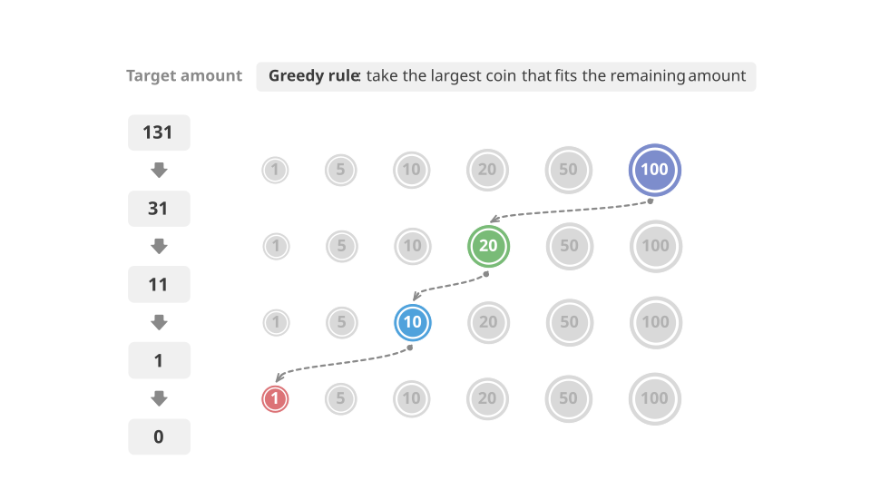
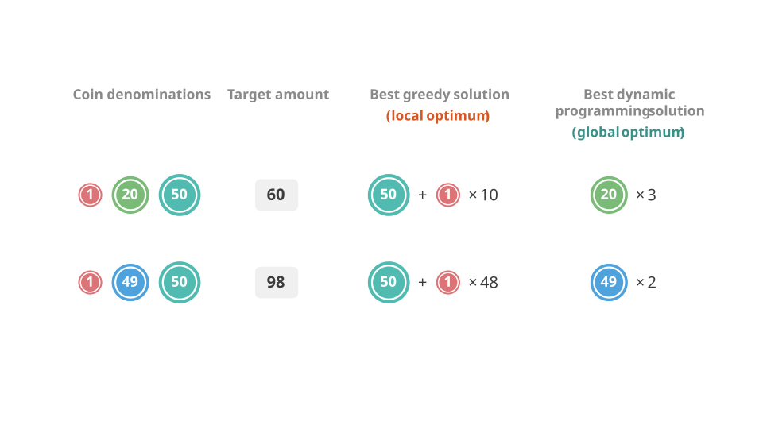

# Greedy algorithms

A <u>greedy algorithm</u> is a common way to solve optimization problems. At each decision point, it takes the option that looks best at that moment. The aim is to reach a globally optimal solution through locally optimal choices. Greedy algorithms are simple and efficient and have many practical applications.

Greedy algorithms and dynamic programming are both common approaches to optimization. They share some features, such as relying on optimal substructure, but they work differently.

- Dynamic programming considers the full range of earlier decisions when making a decision at the current stage. It builds the solution to the current subproblem from solutions to earlier subproblems.
- A greedy algorithm moves forward without reconsidering earlier decisions. Each greedy choice reduces the size of the remaining problem until the problem is solved.

Let's see how a greedy algorithm works by revisiting coin change, a problem we met in the section on unbounded knapsack.

!!! question

    You are given $n$ coin denominations. Denomination $i$ is worth $coins[i - 1]$, and the target amount is $amt$. You may use each denomination repeatedly. What is the minimum number of coins needed to make the target amount? Return $-1$ if the amount cannot be made.

The figure below shows the greedy strategy. Starting with the target amount, **choose the largest coin that does not exceed the remaining amount**. Repeat until the coins add up to the target.



Here is the implementation:

```src
[file]{coin_change_greedy}-[class]{}-[func]{coin_change_greedy}
```

Look how little code that takes! The greedy algorithm handles coin change in about ten lines.

## Strengths and limitations of greedy algorithms

**Greedy algorithms are straightforward to use, simple to implement, and often very efficient**. In the code above, let $\min(coins)$ be the smallest denomination. The greedy choice repeats at most $amt / \min(coins)$ times, giving a time complexity of $O(amt / \min(coins))$. This is an order of magnitude lower than the $O(n \times amt)$ time complexity of the dynamic programming solution.

However, **for some sets of denominations, the greedy algorithm fails to find an optimal solution**. The figure below shows two examples.

- **Where greedy succeeds: $coins = [1, 5, 10, 20, 50, 100]$**. With these denominations, the greedy algorithm finds an optimal solution for any $amt$.
- **Counterexample: $coins = [1, 20, 50]$**. Suppose $amt = 60$. The greedy algorithm chooses $50 + 1 \times 10$, using $11$ coins. Dynamic programming finds the optimal combination $20 + 20 + 20$, which takes only $3$ coins.
- **Counterexample: $coins = [1, 49, 50]$**. Suppose $amt = 98$. The greedy algorithm chooses $50 + 1 \times 48$, using $49$ coins. Dynamic programming finds the optimal combination $49 + 49$, which takes only $2$ coins.



For coin change in general, a greedy algorithm cannot guarantee a global optimum and may give a very poor solution. Dynamic programming is a better fit for the general problem.

Greedy algorithms are generally useful in two situations.

1. **An optimal solution is guaranteed**. A greedy algorithm is often the best choice here because it is usually more efficient than backtracking or dynamic programming.
2. **A near-optimal solution is possible**. A greedy algorithm can still be useful here. For many complex problems, finding a global optimum is difficult, and an efficient way to get a good suboptimal solution is valuable.

## Properties of greedy algorithms

What kinds of problems are good candidates for a greedy algorithm? In particular, when can we guarantee that it will find an optimal solution?

Greedy algorithms have stricter requirements than dynamic programming. Two properties of the problem are particularly important.

- **Greedy-choice property**. A greedy algorithm can guarantee an optimal solution only if a locally optimal choice can always lead to a globally optimal solution.
- **Optimal substructure**. An optimal solution to the original problem contains optimal solutions to its subproblems.

We covered optimal substructure in the chapter on dynamic programming. One point worth keeping in mind is that some problems admit a greedy solution even when their optimal substructure is hard to see.

Let's focus on how to recognize the greedy-choice property. The property is simple to state, **but for many problems it is difficult to prove**.

Take coin change. It is easy to give a counterexample that disproves the greedy-choice property, but proving the property is harder. **What conditions must a set of denominations satisfy for greedy coin change to work**? Intuition and examples may suggest an answer, but turning it into a rigorous mathematical proof is difficult.

!!! quote

    One paper gives an $O(n^3)$-time algorithm for deciding whether greedy coin change is optimal for every amount with a given set of denominations.

    Pearson, D. A polynomial-time algorithm for the change-making problem[J]. Operations Research Letters, 2005, 33(3): 231-234.

## Steps for solving a problem with a greedy algorithm

Solving a problem with a greedy algorithm generally involves three steps.

1. **Analyze the problem**. Identify the states, the objective to optimize, and the constraints. This step also comes up in backtracking and dynamic programming.
2. **Choose a greedy strategy**. Decide how to make the greedy choice at each step. Each choice should reduce the size of the remaining problem until the entire problem is solved.
3. **Prove correctness**. Typically, you need to show that the problem has the greedy-choice property and optimal substructure. This may require a mathematical proof, for example by induction or contradiction.

Choosing the greedy strategy is central to solving the problem, but it can be difficult for two main reasons.

- **Greedy strategies vary widely from one problem to another**. For many problems, a little thought and experimentation reveal a straightforward strategy. For more complex problems, the strategy can be hard to spot, putting your problem-solving experience and algorithm design skills to the test.
- **Some greedy strategies are deceptive**. You may feel confident in a strategy, implement it, and submit the code only to find that it fails some test cases. Such a strategy works only some of the time. Coin change is a classic example.

To establish correctness, we should give a rigorous mathematical proof of the greedy strategy, **typically by contradiction or induction**.

Finding a proof can itself be difficult. When we are stuck, we often debug the code against test cases, revising and checking the strategy one step at a time.

## Common greedy algorithm problems

Greedy algorithms often solve optimization problems with the greedy-choice property and optimal substructure. Here are some typical examples.

- **Coin change**. For certain sets of denominations, the greedy algorithm always gives an optimal solution.
- **Interval scheduling**. Each task occupies a time interval, and you want to complete as many tasks as possible. Always choosing the available task that finishes earliest gives an optimal schedule.
- **Fractional knapsack**. Given items and a weight limit, choose items to maximize total value without exceeding that limit. In some settings, always taking the item with the greatest value-to-weight ratio (value / weight) gives an optimal solution.
- **Buying and selling stock**. Given a stock's historical prices, you may buy and sell multiple times. Once you buy, you must sell before buying again. The goal is to maximize profit.
- **Huffman coding**. This greedy algorithm performs lossless data compression. To build a Huffman tree, repeatedly merge the two nodes with the lowest frequencies. The resulting tree minimizes the weighted path length (the encoded length).
- **Dijkstra's algorithm**. In a graph with nonnegative edge weights, this greedy algorithm finds the shortest paths from a given source vertex to all other vertices.
