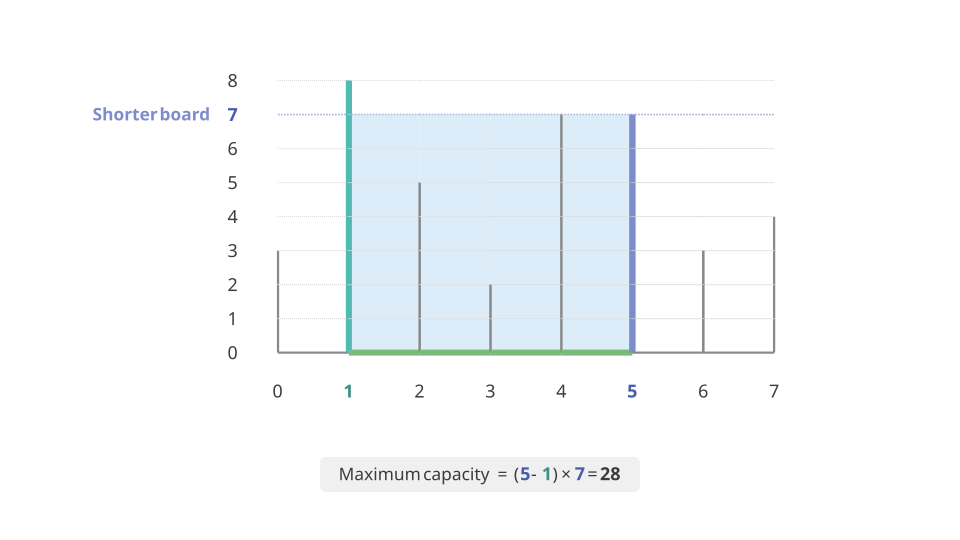
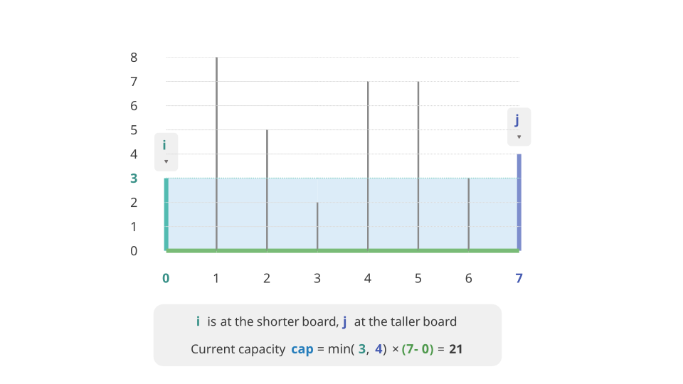
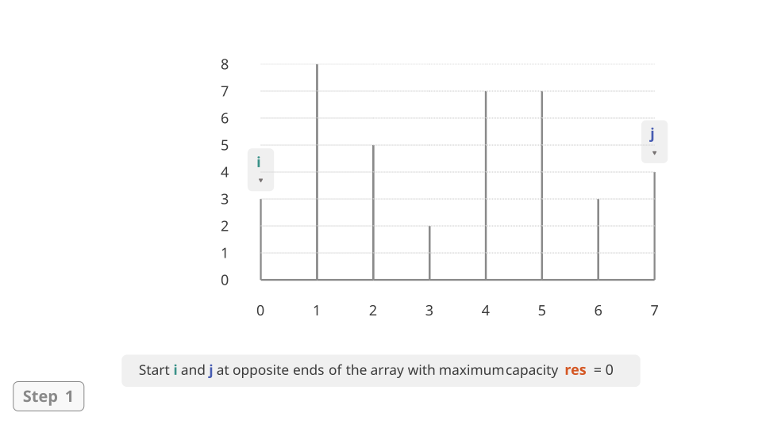
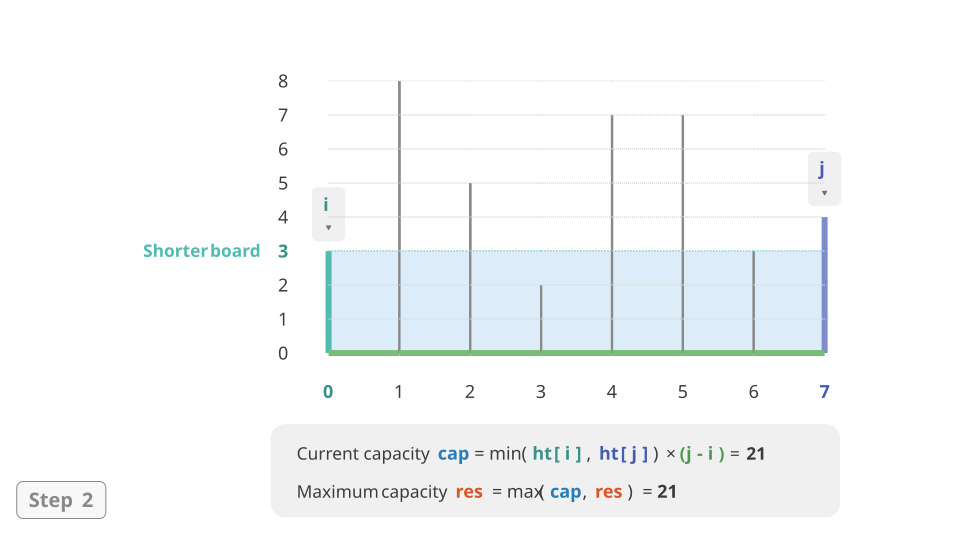
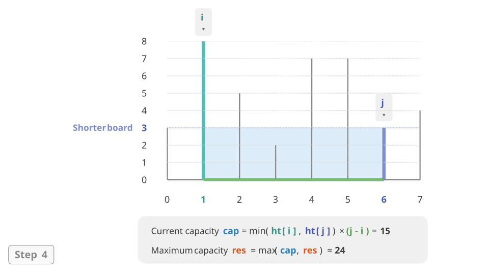
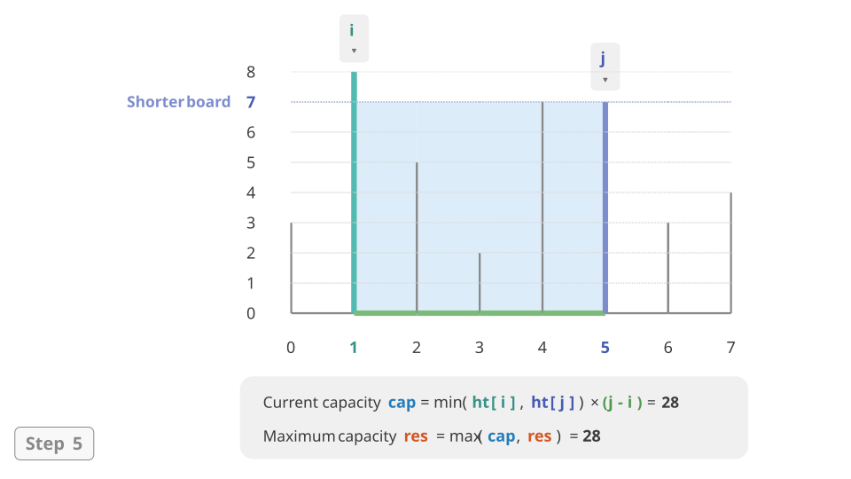
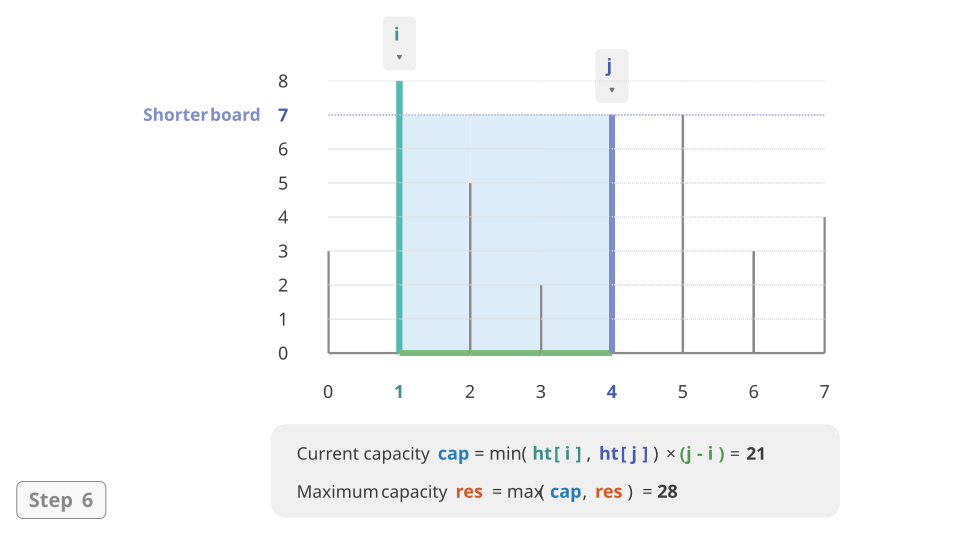
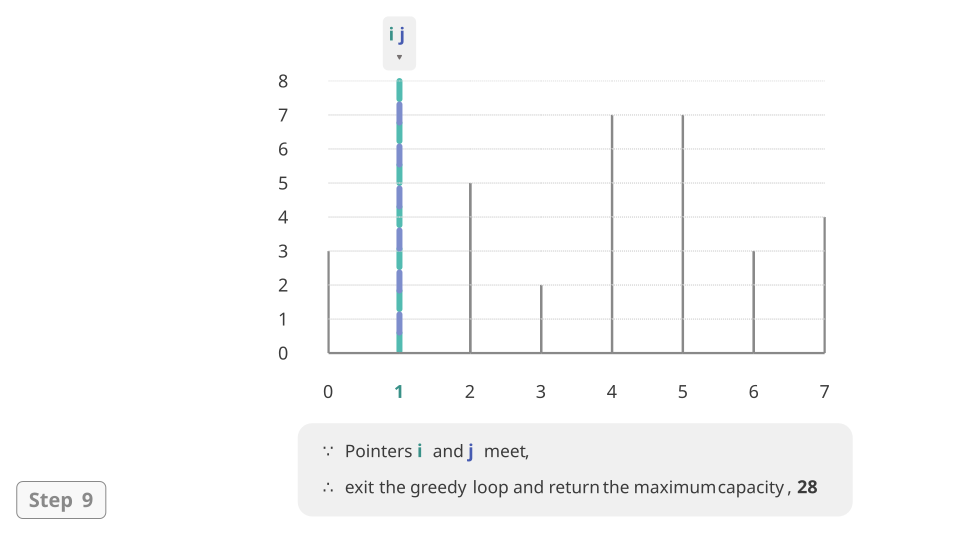
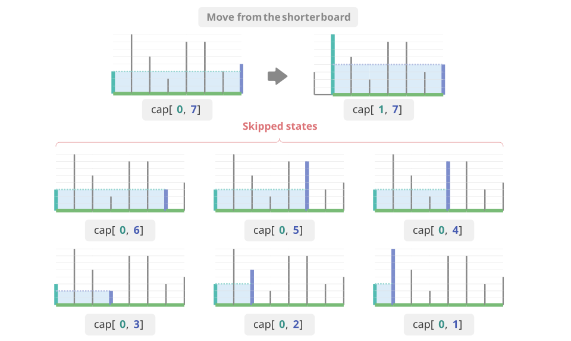

# 15.3 &nbsp; Maximum capacity problem

!!! question

    You are given an array $ht$ in which each element is the height of a vertical board. Any two boards and the space between them form a container.
    
    The container's capacity is its area: height times width. The shorter board sets the height, and the difference between the boards' array indices gives the width.
    
    Choose two boards that form a container of maximum capacity and return that capacity. Figure 15-7 shows an example.

{ class="animation-figure" }

<p align="center"> Figure 15-7 &nbsp; Example data for the maximum capacity problem </p>

Any pair of boards forms a container, **so the state is the pair of board indices, denoted by $[i, j]$**.

Capacity is height times width. The shorter board sets the height, and the difference between the board indices gives the width. Writing the capacity as $cap[i, j]$ gives the formula:

$$
cap[i, j] = \min(ht[i], ht[j]) \times (j - i)
$$

For an array of length $n$, there are $C_n^2 = \frac{n(n - 1)}{2}$ pairs of boards, one for each possible state. The most direct approach is to **try every state** and return the largest capacity. This takes $O(n^2)$ time.

### 1. &nbsp; Choosing a greedy strategy

There is a more efficient solution. Consider a state $[i, j]$ with indices $i < j$ and heights $ht[i] < ht[j]$, as shown below. The board at $i$ is shorter and the one at $j$ is taller.

{ class="animation-figure" }

<p align="center"> Figure 15-8 &nbsp; Initial state </p>

As Figure 15-9 shows, **moving inward from the taller board at $j$ toward the shorter board at $i$ must reduce capacity**.

Moving the pointer at the taller board $j$ reduces the width $j-i$. The shorter board sets the height, so the height can only stay the same (if $i$ is still the shorter board) or decrease (if the new board at $j$ is shorter).

{ class="animation-figure" }

<p align="center"> Figure 15-9 &nbsp; State after moving inward from the taller board </p>

Conversely, **the only move that can increase capacity is to move inward from the shorter board at $i$**. Although the width must decrease, **the height might increase** if the new board at $i$ is taller. In Figure 15-10, for example, moving from the shorter board increases the area.

{ class="animation-figure" }

<p align="center"> Figure 15-10 &nbsp; State after moving inward from the shorter board </p>

This gives us a greedy strategy. Start the two pointers at opposite ends of the container. At each step, move the pointer at the shorter board inward until the pointers meet.

Figure 15-11 shows the greedy strategy in action.

1. Start with the pointers $i$ and $j$ at opposite ends of the array.
2. Calculate the capacity $cap[i, j]$ for the current state and update the maximum capacity so far.
3. Compare the heights of boards $i$ and $j$ and move the pointer at the shorter board one position inward.
4. Repeat steps `2.` and `3.` until $i$ and $j$ meet.

=== "<1>"
    { class="animation-figure" }

=== "<2>"
    { class="animation-figure" }

=== "<3>"
    { class="animation-figure" }

=== "<4>"
    { class="animation-figure" }

=== "<5>"
    { class="animation-figure" }

=== "<6>"
    { class="animation-figure" }

=== "<7>"
    { class="animation-figure" }

=== "<8>"
    { class="animation-figure" }

=== "<9>"
    { class="animation-figure" }

<p align="center"> Figure 15-11 &nbsp; Greedy search for maximum capacity </p>

### 2. &nbsp; Implementation

The loop runs at most $n$ times, **so the time complexity is $O(n)$**.

The variables $i$, $j$, and $res$ use a constant amount of extra space, **so the space complexity is $O(1)$**.

=== "Python"

    ```python title="max_capacity.py"
    def max_capacity(ht: list[int]) -> int:
        """Greedy maximum capacity algorithm"""
        # Start i and j at opposite ends of the array
        i, j = 0, len(ht) - 1
        # The initial maximum capacity is 0
        res = 0
        # Make greedy choices until the two pointers meet
        while i < j:
            # Update the maximum capacity
            cap = min(ht[i], ht[j]) * (j - i)
            res = max(res, cap)
            # Move the pointer at the shorter board inward
            if ht[i] < ht[j]:
                i += 1
            else:
                j -= 1
        return res
    ```

=== "C++"

    ```cpp title="max_capacity.cpp"
    /* Greedy maximum capacity algorithm */
    int maxCapacity(vector<int> &ht) {
        // Start i and j at opposite ends of the array
        int i = 0, j = ht.size() - 1;
        // The initial maximum capacity is 0
        int res = 0;
        // Make greedy choices until the two pointers meet
        while (i < j) {
            // Update the maximum capacity
            int cap = min(ht[i], ht[j]) * (j - i);
            res = max(res, cap);
            // Move the pointer at the shorter board inward
            if (ht[i] < ht[j]) {
                i++;
            } else {
                j--;
            }
        }
        return res;
    }
    ```

=== "Java"

    ```java title="max_capacity.java"
    /* Greedy maximum capacity algorithm */
    int maxCapacity(int[] ht) {
        // Start i and j at opposite ends of the array
        int i = 0, j = ht.length - 1;
        // The initial maximum capacity is 0
        int res = 0;
        // Make greedy choices until the two pointers meet
        while (i < j) {
            // Update the maximum capacity
            int cap = Math.min(ht[i], ht[j]) * (j - i);
            res = Math.max(res, cap);
            // Move the pointer at the shorter board inward
            if (ht[i] < ht[j]) {
                i++;
            } else {
                j--;
            }
        }
        return res;
    }
    ```

=== "C#"

    ```csharp title="max_capacity.cs"
    /* Greedy maximum capacity algorithm */
    int MaxCapacity(int[] ht) {
        // Start i and j at opposite ends of the array
        int i = 0, j = ht.Length - 1;
        // The initial maximum capacity is 0
        int res = 0;
        // Make greedy choices until the two pointers meet
        while (i < j) {
            // Update the maximum capacity
            int cap = Math.Min(ht[i], ht[j]) * (j - i);
            res = Math.Max(res, cap);
            // Move the pointer at the shorter board inward
            if (ht[i] < ht[j]) {
                i++;
            } else {
                j--;
            }
        }
        return res;
    }
    ```

=== "Go"

    ```go title="max_capacity.go"
    /* Greedy maximum capacity algorithm */
    func maxCapacity(ht []int) int {
        // Start i and j at opposite ends of the array
        i, j := 0, len(ht)-1
        // The initial maximum capacity is 0
        res := 0
        // Make greedy choices until the two pointers meet
        for i < j {
            // Update the maximum capacity
            capacity := int(math.Min(float64(ht[i]), float64(ht[j]))) * (j - i)
            res = int(math.Max(float64(res), float64(capacity)))
            // Move the pointer at the shorter board inward
            if ht[i] < ht[j] {
                i++
            } else {
                j--
            }
        }
        return res
    }
    ```

=== "Swift"

    ```swift title="max_capacity.swift"
    /* Greedy maximum capacity algorithm */
    func maxCapacity(ht: [Int]) -> Int {
        // Start i and j at opposite ends of the array
        var i = ht.startIndex, j = ht.endIndex - 1
        // The initial maximum capacity is 0
        var res = 0
        // Make greedy choices until the two pointers meet
        while i < j {
            // Update the maximum capacity
            let cap = min(ht[i], ht[j]) * (j - i)
            res = max(res, cap)
            // Move the pointer at the shorter board inward
            if ht[i] < ht[j] {
                i += 1
            } else {
                j -= 1
            }
        }
        return res
    }
    ```

=== "JS"

    ```javascript title="max_capacity.js"
    /* Greedy maximum capacity algorithm */
    function maxCapacity(ht) {
        // Start i and j at opposite ends of the array
        let i = 0,
            j = ht.length - 1;
        // The initial maximum capacity is 0
        let res = 0;
        // Make greedy choices until the two pointers meet
        while (i < j) {
            // Update the maximum capacity
            const cap = Math.min(ht[i], ht[j]) * (j - i);
            res = Math.max(res, cap);
            // Move the pointer at the shorter board inward
            if (ht[i] < ht[j]) {
                i += 1;
            } else {
                j -= 1;
            }
        }
        return res;
    }
    ```

=== "TS"

    ```typescript title="max_capacity.ts"
    /* Greedy maximum capacity algorithm */
    function maxCapacity(ht: number[]): number {
        // Start i and j at opposite ends of the array
        let i = 0,
            j = ht.length - 1;
        // The initial maximum capacity is 0
        let res = 0;
        // Make greedy choices until the two pointers meet
        while (i < j) {
            // Update the maximum capacity
            const cap: number = Math.min(ht[i], ht[j]) * (j - i);
            res = Math.max(res, cap);
            // Move the pointer at the shorter board inward
            if (ht[i] < ht[j]) {
                i += 1;
            } else {
                j -= 1;
            }
        }
        return res;
    }
    ```

=== "Dart"

    ```dart title="max_capacity.dart"
    /* Greedy maximum capacity algorithm */
    int maxCapacity(List<int> ht) {
      // Start i and j at opposite ends of the array
      int i = 0, j = ht.length - 1;
      // The initial maximum capacity is 0
      int res = 0;
      // Make greedy choices until the two pointers meet
      while (i < j) {
        // Update the maximum capacity
        int cap = min(ht[i], ht[j]) * (j - i);
        res = max(res, cap);
        // Move the pointer at the shorter board inward
        if (ht[i] < ht[j]) {
          i++;
        } else {
          j--;
        }
      }
      return res;
    }
    ```

=== "Rust"

    ```rust title="max_capacity.rs"
    /* Greedy maximum capacity algorithm */
    fn max_capacity(ht: &[i32]) -> i32 {
        // Start i and j at opposite ends of the array
        let mut i = 0;
        let mut j = ht.len() - 1;
        // The initial maximum capacity is 0
        let mut res = 0;
        // Make greedy choices until the two pointers meet
        while i < j {
            // Update the maximum capacity
            let cap = std::cmp::min(ht[i], ht[j]) * (j - i) as i32;
            res = std::cmp::max(res, cap);
            // Move the pointer at the shorter board inward
            if ht[i] < ht[j] {
                i += 1;
            } else {
                j -= 1;
            }
        }
        res
    }
    ```

=== "C"

    ```c title="max_capacity.c"
    /* Greedy maximum capacity algorithm */
    int maxCapacity(int ht[], int htLength) {
        // Start i and j at opposite ends of the array
        int i = 0;
        int j = htLength - 1;
        // The initial maximum capacity is 0
        int res = 0;
        // Make greedy choices until the two pointers meet
        while (i < j) {
            // Update the maximum capacity
            int capacity = myMin(ht[i], ht[j]) * (j - i);
            res = myMax(res, capacity);
            // Move the pointer at the shorter board inward
            if (ht[i] < ht[j]) {
                i++;
            } else {
                j--;
            }
        }
        return res;
    }
    ```

=== "Kotlin"

    ```kotlin title="max_capacity.kt"
    /* Greedy maximum capacity algorithm */
    fun maxCapacity(ht: IntArray): Int {
        // Start i and j at opposite ends of the array
        var i = 0
        var j = ht.size - 1
        // The initial maximum capacity is 0
        var res = 0
        // Make greedy choices until the two pointers meet
        while (i < j) {
            // Update the maximum capacity
            val cap = min(ht[i], ht[j]) * (j - i)
            res = max(res, cap)
            // Move the pointer at the shorter board inward
            if (ht[i] < ht[j]) {
                i++
            } else {
                j--
            }
        }
        return res
    }
    ```

=== "Ruby"

    ```ruby title="max_capacity.rb"
    ### Greedy maximum capacity algorithm ###
    def max_capacity(ht)
      # Start i and j at opposite ends of the array
      i, j = 0, ht.length - 1
      # The initial maximum capacity is 0
      res = 0

      # Make greedy choices until the two pointers meet
      while i < j
        # Update the maximum capacity
        cap = [ht[i], ht[j]].min * (j - i)
        res = [res, cap].max
        # Move the pointer at the shorter board inward
        if ht[i] < ht[j]
          i += 1
        else
          j -= 1
        end
      end

      res
    end
    ```

??? pythontutor "Visualize execution"

    <div style="height: 549px; width: 100%;"><iframe class="pythontutor-iframe" title="Visualize execution" src="https://pythontutor.com/iframe-embed.html#code=def%20max_capacity%28ht%3A%20list%5Bint%5D%29%20-%3E%20int%3A%0A%20%20%20%20%22%22%22Greedy%20maximum%20capacity%20algorithm%22%22%22%0A%20%20%20%20%23%20Start%20i%20and%20j%20at%20opposite%20ends%20of%20the%20array%0A%20%20%20%20i,%20j%20%3D%200,%20len%28ht%29%20-%201%0A%20%20%20%20%23%20The%20initial%20maximum%20capacity%20is%200%0A%20%20%20%20res%20%3D%200%0A%20%20%20%20%23%20Make%20greedy%20choices%20until%20the%20two%20pointers%20meet%0A%20%20%20%20while%20i%20%3C%20j%3A%0A%20%20%20%20%20%20%20%20%23%20Update%20the%20maximum%20capacity%0A%20%20%20%20%20%20%20%20cap%20%3D%20min%28ht%5Bi%5D,%20ht%5Bj%5D%29%20%2A%20%28j%20-%20i%29%0A%20%20%20%20%20%20%20%20res%20%3D%20max%28res,%20cap%29%0A%20%20%20%20%20%20%20%20%23%20Move%20the%20pointer%20at%20the%20shorter%20board%20inward%0A%20%20%20%20%20%20%20%20if%20ht%5Bi%5D%20%3C%20ht%5Bj%5D%3A%0A%20%20%20%20%20%20%20%20%20%20%20%20i%20%2B%3D%201%0A%20%20%20%20%20%20%20%20else%3A%0A%20%20%20%20%20%20%20%20%20%20%20%20j%20-%3D%201%0A%20%20%20%20return%20res%0A%0A%0A%22%22%22Driver%20Code%22%22%22%0Aif%20__name__%20%3D%3D%20%22__main__%22%3A%0A%20%20%20%20ht%20%3D%20%5B3,%208,%205,%202,%207,%207,%203,%204%5D%0A%0A%20%20%20%20%23%20Greedy%20algorithm%0A%20%20%20%20res%20%3D%20max_capacity%28ht%29%0A%20%20%20%20print%28f%22The%20maximum%20capacity%20is%20%7Bres%7D%22%29&codeDivHeight=472&codeDivWidth=350&cumulative=false&curInstr=4&heapPrimitives=nevernest&origin=opt-frontend.js&py=311&rawInputLstJSON=%5B%5D&textReferences=false"> </iframe></div>
    <div style="margin-top: 5px;"><a href="https://pythontutor.com/iframe-embed.html#code=def%20max_capacity%28ht%3A%20list%5Bint%5D%29%20-%3E%20int%3A%0A%20%20%20%20%22%22%22Greedy%20maximum%20capacity%20algorithm%22%22%22%0A%20%20%20%20%23%20Start%20i%20and%20j%20at%20opposite%20ends%20of%20the%20array%0A%20%20%20%20i,%20j%20%3D%200,%20len%28ht%29%20-%201%0A%20%20%20%20%23%20The%20initial%20maximum%20capacity%20is%200%0A%20%20%20%20res%20%3D%200%0A%20%20%20%20%23%20Make%20greedy%20choices%20until%20the%20two%20pointers%20meet%0A%20%20%20%20while%20i%20%3C%20j%3A%0A%20%20%20%20%20%20%20%20%23%20Update%20the%20maximum%20capacity%0A%20%20%20%20%20%20%20%20cap%20%3D%20min%28ht%5Bi%5D,%20ht%5Bj%5D%29%20%2A%20%28j%20-%20i%29%0A%20%20%20%20%20%20%20%20res%20%3D%20max%28res,%20cap%29%0A%20%20%20%20%20%20%20%20%23%20Move%20the%20pointer%20at%20the%20shorter%20board%20inward%0A%20%20%20%20%20%20%20%20if%20ht%5Bi%5D%20%3C%20ht%5Bj%5D%3A%0A%20%20%20%20%20%20%20%20%20%20%20%20i%20%2B%3D%201%0A%20%20%20%20%20%20%20%20else%3A%0A%20%20%20%20%20%20%20%20%20%20%20%20j%20-%3D%201%0A%20%20%20%20return%20res%0A%0A%0A%22%22%22Driver%20Code%22%22%22%0Aif%20__name__%20%3D%3D%20%22__main__%22%3A%0A%20%20%20%20ht%20%3D%20%5B3,%208,%205,%202,%207,%207,%203,%204%5D%0A%0A%20%20%20%20%23%20Greedy%20algorithm%0A%20%20%20%20res%20%3D%20max_capacity%28ht%29%0A%20%20%20%20print%28f%22The%20maximum%20capacity%20is%20%7Bres%7D%22%29&codeDivHeight=800&codeDivWidth=600&cumulative=false&curInstr=4&heapPrimitives=nevernest&origin=opt-frontend.js&py=311&rawInputLstJSON=%5B%5D&textReferences=false" target="_blank" rel="noopener noreferrer">View full screen ></a></div>

### 3. &nbsp; Proof of correctness

The greedy search is faster than exhaustive search because each greedy choice skips some states.

For example, in state $cap[i, j]$, the board at $i$ is shorter than the one at $j$. Moving one position inward from the shorter board at $i$ skips the states shown below. **The algorithm can no longer check the capacities of those states**.

$$
cap[i, i+1], cap[i, i+2], \dots, cap[i, j-2], cap[i, j-1]
$$

{ class="animation-figure" }

<p align="center"> Figure 15-12 &nbsp; States skipped when moving inward from the shorter board </p>

The **skipped states are exactly the ones we would reach by moving inward from the taller board at $j$**. We have already shown that such a move reduces capacity. None of these states can be optimal, so **skipping them cannot cause us to miss the optimum**.

Moving inward from the shorter board is therefore safe, and the greedy strategy is valid.
