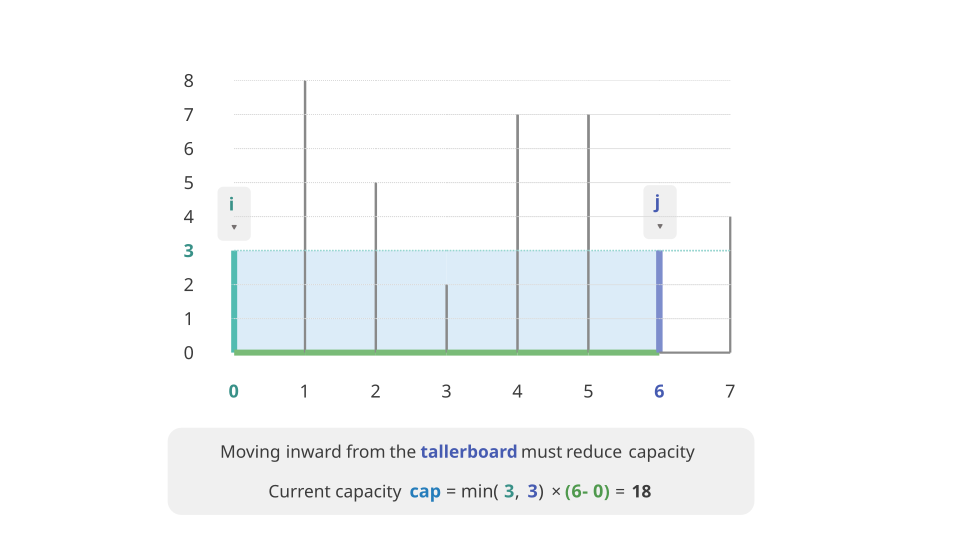
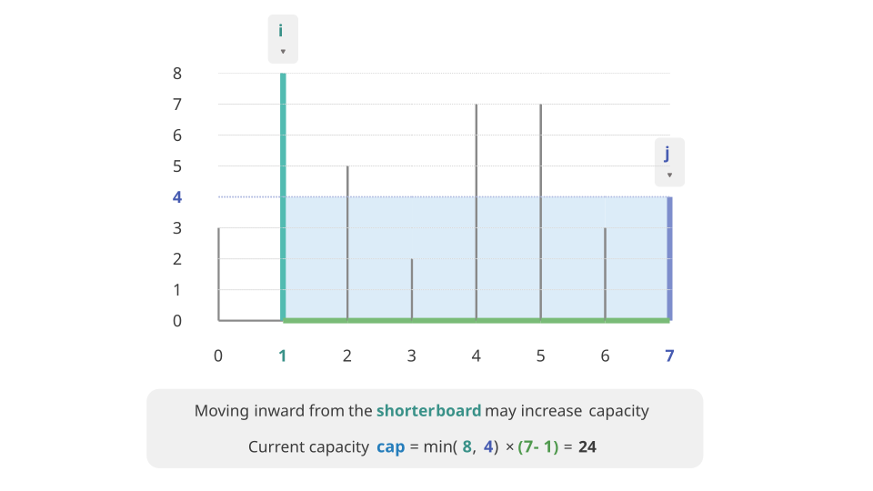
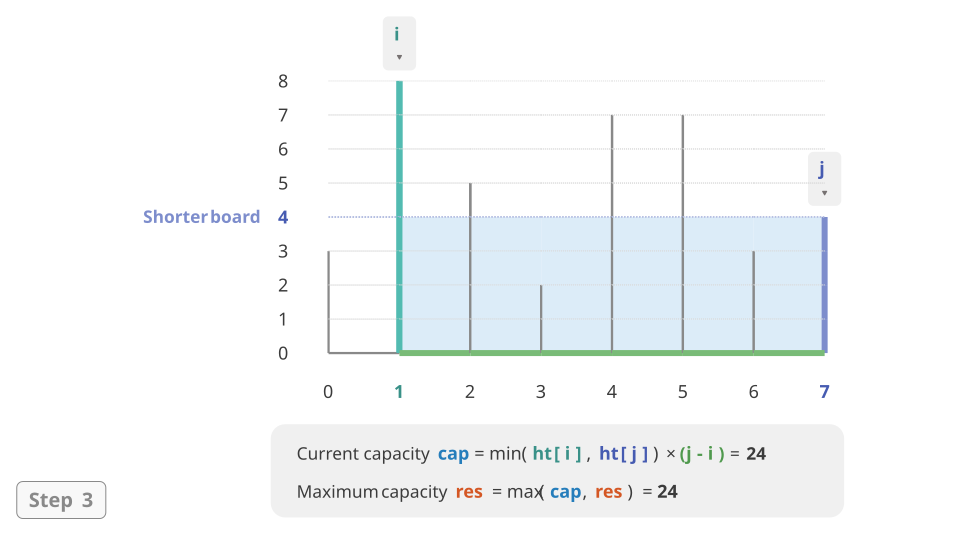
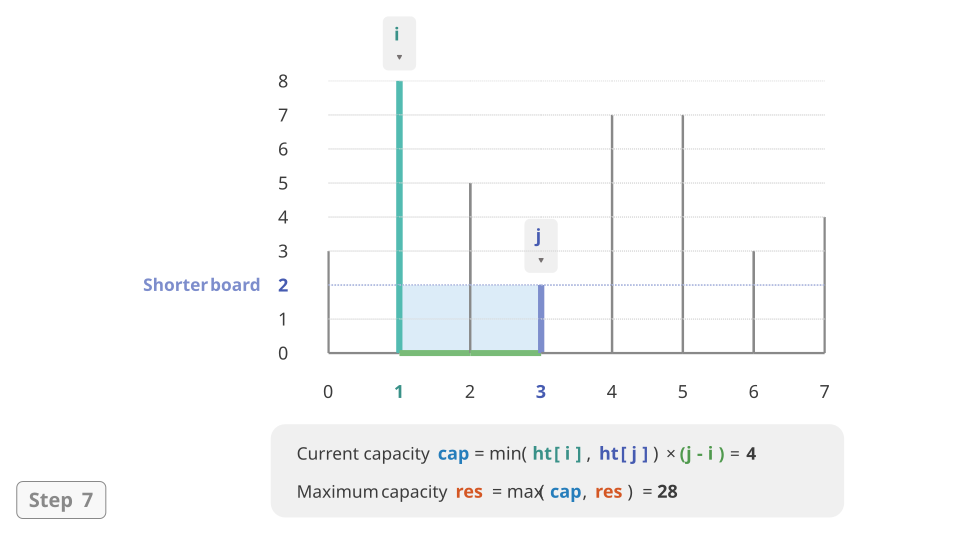
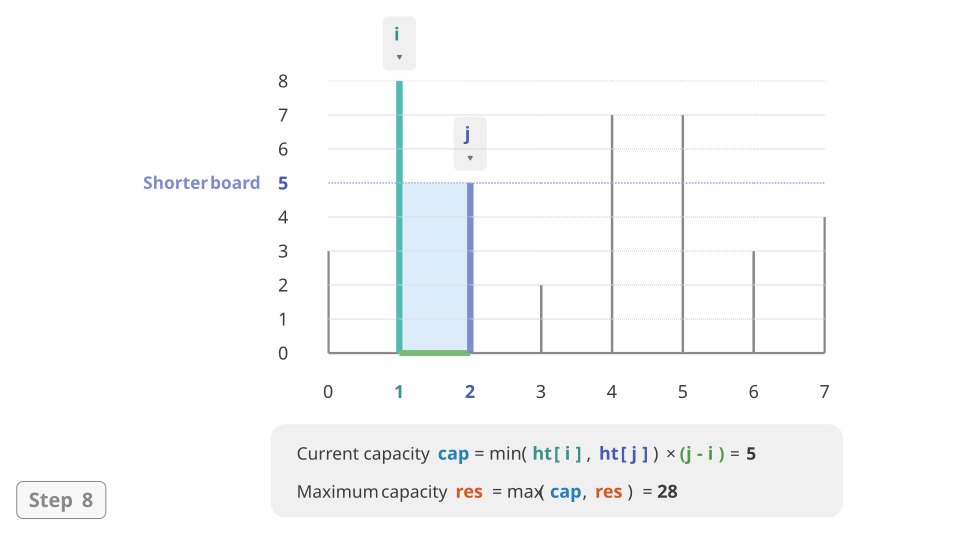

# Maximum capacity problem

!!! question

    You are given an array $ht$ in which each element is the height of a vertical board. Any two boards and the space between them form a container.
    
    The container's capacity is its area: height times width. The shorter board sets the height, and the difference between the boards' array indices gives the width.
    
    Choose two boards that form a container of maximum capacity and return that capacity. The figure below shows an example.


Any pair of boards forms a container, **so the state is the pair of board indices, denoted by $[i, j]$**.

Capacity is height times width. The shorter board sets the height, and the difference between the board indices gives the width. Writing the capacity as $cap[i, j]$ gives the formula:

$$
cap[i, j] = \min(ht[i], ht[j]) \times (j - i)
$$

For an array of length $n$, there are $C_n^2 = \frac{n(n - 1)}{2}$ pairs of boards, one for each possible state. The most direct approach is to **try every state** and return the largest capacity. This takes $O(n^2)$ time.

### Choosing a greedy strategy

There is a more efficient solution. Consider a state $[i, j]$ with indices $i < j$ and heights $ht[i] < ht[j]$, as shown below. The board at $i$ is shorter and the one at $j$ is taller.


As the figure below shows, **moving inward from the taller board at $j$ toward the shorter board at $i$ must reduce capacity**.

Moving the pointer at the taller board $j$ reduces the width $j-i$. The shorter board sets the height, so the height can only stay the same (if $i$ is still the shorter board) or decrease (if the new board at $j$ is shorter).



Conversely, **the only move that can increase capacity is to move inward from the shorter board at $i$**. Although the width must decrease, **the height might increase** if the new board at $i$ is taller. In the figure below, for example, moving from the shorter board increases the area.



This gives us a greedy strategy. Start the two pointers at opposite ends of the container. At each step, move the pointer at the shorter board inward until the pointers meet.

The figure below shows the greedy strategy in action.

1. Start with the pointers $i$ and $j$ at opposite ends of the array.
2. Calculate the capacity $cap[i, j]$ for the current state and update the maximum capacity so far.
3. Compare the heights of boards $i$ and $j$ and move the pointer at the shorter board one position inward.
4. Repeat steps `2.` and `3.` until $i$ and $j$ meet.

=== "<1>"
    

=== "<2>"
    

=== "<3>"
    

=== "<4>"
    

=== "<5>"
    

=== "<6>"
    

=== "<7>"
    

=== "<8>"
    

=== "<9>"
    

### Implementation

The loop runs at most $n$ times, **so the time complexity is $O(n)$**.

The variables $i$, $j$, and $res$ use a constant amount of extra space, **so the space complexity is $O(1)$**.

```src
[file]{max_capacity}-[class]{}-[func]{max_capacity}
```

### Proof of correctness

The greedy search is faster than exhaustive search because each greedy choice skips some states.

For example, in state $cap[i, j]$, the board at $i$ is shorter than the one at $j$. Moving one position inward from the shorter board at $i$ skips the states shown below. **The algorithm can no longer check the capacities of those states**.

$$
cap[i, i+1], cap[i, i+2], \dots, cap[i, j-2], cap[i, j-1]
$$


The **skipped states are exactly the ones we would reach by moving inward from the taller board at $j$**. We have already shown that such a move reduces capacity. None of these states can be optimal, so **skipping them cannot cause us to miss the optimum**.

Moving inward from the shorter board is therefore safe, and the greedy strategy is valid.
