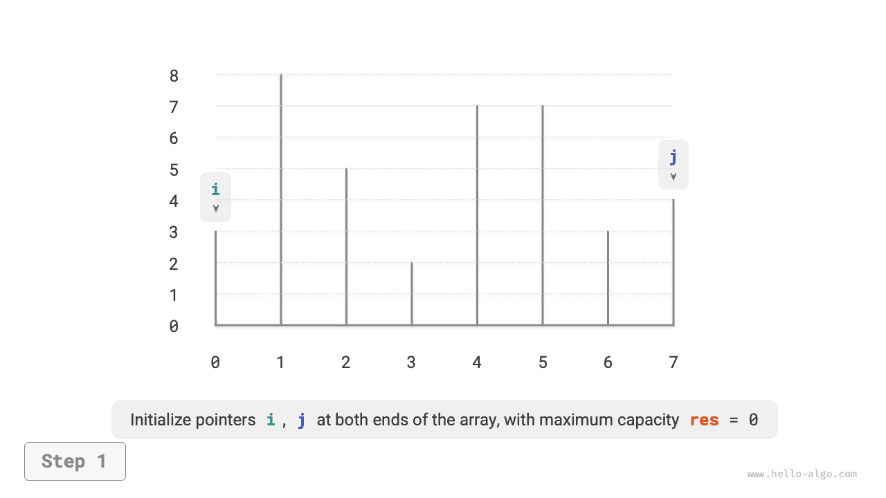

# 15.3 &nbsp; Maximum capacity problem

!!! question

    Given an array $ht$, each element represents the height of a vertical wall. Any two walls, together with the space between them, form a container.
    
    The container's capacity is its height multiplied by its width (an area). Its height is determined by the shorter wall, and its width is the difference between the two walls' array indices.
    
    Choose two walls from the array to maximize the container's capacity, and return that maximum capacity. An example is shown in Figure 15-7.

{ class="animation-figure" }

<p align="center"> Figure 15-7 &nbsp; Example input for the maximum capacity problem </p>

A container is formed by two walls, **so the state of this problem is the pair of wall indices, denoted by $[i, j]$**.

Capacity is height times width, with the height determined by the shorter wall and the width equal to the difference between the wall indices. Writing the capacity as $cap[i, j]$, we have:

$$
cap[i, j] = \min(ht[i], ht[j]) \times (j - i)
$$

For an array of length $n$, there are $C_n^2 = \frac{n(n - 1)}{2}$ pairs of walls (possible states). The most direct approach is to **enumerate all states** and find the maximum capacity, taking $O(n^2)$ time.

### 1. &nbsp; Choosing a greedy strategy

A more efficient solution is possible. Consider the state $[i, j]$ in Figure 15-8, where $i < j$ and $ht[i] < ht[j]$: wall $i$ is shorter and wall $j$ is taller.

{ class="animation-figure" }

<p align="center"> Figure 15-8 &nbsp; Initial state </p>

As shown in Figure 15-9, **moving the taller wall $j$ inward toward the shorter wall $i$ must reduce the capacity**.

Moving wall $j$ inward always reduces the width $j-i$. Since the shorter wall determines the height, the height can only stay the same (if $i$ remains shorter) or decrease (if the new wall $j$ is shorter).

{ class="animation-figure" }

<p align="center"> Figure 15-9 &nbsp; State after moving the taller wall inward </p>

Conversely, **only moving the shorter wall $i$ inward can potentially increase the capacity**. Although the width must decrease, **the height may increase** if the new wall $i$ is taller. Figure 15-10 shows an example where moving the shorter wall increases the area.

{ class="animation-figure" }

<p align="center"> Figure 15-10 &nbsp; State after moving the shorter wall inward </p>

This gives us a greedy strategy: initialize two pointers at opposite ends of the container. At each step, move the pointer at the shorter wall inward until the pointers meet.

Figure 15-11 illustrates the greedy process.

1. Initially, pointers $i$ and $j$ are at opposite ends of the array.
2. Calculate the current capacity $cap[i, j]$ and update the maximum capacity.
3. Compare the heights of walls $i$ and $j$, and move the shorter wall inward by one position.
4. Repeat steps `2.` and `3.` until $i$ and $j$ meet.

=== "<1>"
    { class="animation-figure" }

=== "<2>"
    { class="animation-figure" }

=== "<3>"
    { class="animation-figure" }

=== "<4>"
    { class="animation-figure" }

=== "<5>"
    { class="animation-figure" }

=== "<6>"
    { class="animation-figure" }

=== "<7>"
    { class="animation-figure" }

=== "<8>"
    { class="animation-figure" }

=== "<9>"
    { class="animation-figure" }

<p align="center"> Figure 15-11 &nbsp; Greedy steps for the maximum capacity problem </p>

### 2. &nbsp; Code implementation

The loop runs at most $n$ times, **so the time complexity is $O(n)$**.

The variables $i$, $j$, and $res$ require constant extra space, **so the space complexity is $O(1)$**.

=== "Python"

    ```python title="max_capacity.py"
    def max_capacity(ht: list[int]) -> int:
        """Maximum container capacity: greedy algorithm"""
        # Initialize i and j at opposite ends of the array
        i, j = 0, len(ht) - 1
        # The initial maximum capacity is 0
        res = 0
        # Repeatedly make greedy choices until the two sides meet
        while i < j:
            # Update the maximum capacity
            cap = min(ht[i], ht[j]) * (j - i)
            res = max(res, cap)
            # Move the shorter side inward
            if ht[i] < ht[j]:
                i += 1
            else:
                j -= 1
        return res
    ```

=== "C++"

    ```cpp title="max_capacity.cpp"
    /* Maximum container capacity: greedy algorithm */
    int maxCapacity(vector<int> &ht) {
        // Initialize i and j at opposite ends of the array
        int i = 0, j = ht.size() - 1;
        // The initial maximum capacity is 0
        int res = 0;
        // Repeatedly make greedy choices until the two sides meet
        while (i < j) {
            // Update the maximum capacity
            int cap = min(ht[i], ht[j]) * (j - i);
            res = max(res, cap);
            // Move the shorter side inward
            if (ht[i] < ht[j]) {
                i++;
            } else {
                j--;
            }
        }
        return res;
    }
    ```

=== "Java"

    ```java title="max_capacity.java"
    /* Maximum container capacity: greedy algorithm */
    int maxCapacity(int[] ht) {
        // Initialize i and j at opposite ends of the array
        int i = 0, j = ht.length - 1;
        // The initial maximum capacity is 0
        int res = 0;
        // Repeatedly make greedy choices until the two sides meet
        while (i < j) {
            // Update the maximum capacity
            int cap = Math.min(ht[i], ht[j]) * (j - i);
            res = Math.max(res, cap);
            // Move the shorter side inward
            if (ht[i] < ht[j]) {
                i++;
            } else {
                j--;
            }
        }
        return res;
    }
    ```

=== "C#"

    ```csharp title="max_capacity.cs"
    /* Maximum container capacity: greedy algorithm */
    int MaxCapacity(int[] ht) {
        // Initialize i and j at opposite ends of the array
        int i = 0, j = ht.Length - 1;
        // The initial maximum capacity is 0
        int res = 0;
        // Repeatedly make greedy choices until the two sides meet
        while (i < j) {
            // Update the maximum capacity
            int cap = Math.Min(ht[i], ht[j]) * (j - i);
            res = Math.Max(res, cap);
            // Move the shorter side inward
            if (ht[i] < ht[j]) {
                i++;
            } else {
                j--;
            }
        }
        return res;
    }
    ```

=== "Go"

    ```go title="max_capacity.go"
    /* Maximum container capacity: greedy algorithm */
    func maxCapacity(ht []int) int {
        // Initialize i and j at opposite ends of the array
        i, j := 0, len(ht)-1
        // The initial maximum capacity is 0
        res := 0
        // Repeatedly make greedy choices until the two sides meet
        for i < j {
            // Update the maximum capacity
            capacity := int(math.Min(float64(ht[i]), float64(ht[j]))) * (j - i)
            res = int(math.Max(float64(res), float64(capacity)))
            // Move the shorter side inward
            if ht[i] < ht[j] {
                i++
            } else {
                j--
            }
        }
        return res
    }
    ```

=== "Swift"

    ```swift title="max_capacity.swift"
    /* Maximum container capacity: greedy algorithm */
    func maxCapacity(ht: [Int]) -> Int {
        // Initialize i and j at opposite ends of the array
        var i = ht.startIndex, j = ht.endIndex - 1
        // The initial maximum capacity is 0
        var res = 0
        // Repeatedly make greedy choices until the two sides meet
        while i < j {
            // Update the maximum capacity
            let cap = min(ht[i], ht[j]) * (j - i)
            res = max(res, cap)
            // Move the shorter side inward
            if ht[i] < ht[j] {
                i += 1
            } else {
                j -= 1
            }
        }
        return res
    }
    ```

=== "JS"

    ```javascript title="max_capacity.js"
    /* Maximum container capacity: greedy algorithm */
    function maxCapacity(ht) {
        // Initialize i and j at opposite ends of the array
        let i = 0,
            j = ht.length - 1;
        // The initial maximum capacity is 0
        let res = 0;
        // Repeatedly make greedy choices until the two sides meet
        while (i < j) {
            // Update the maximum capacity
            const cap = Math.min(ht[i], ht[j]) * (j - i);
            res = Math.max(res, cap);
            // Move the shorter side inward
            if (ht[i] < ht[j]) {
                i += 1;
            } else {
                j -= 1;
            }
        }
        return res;
    }
    ```

=== "TS"

    ```typescript title="max_capacity.ts"
    /* Maximum container capacity: greedy algorithm */
    function maxCapacity(ht: number[]): number {
        // Initialize i and j at opposite ends of the array
        let i = 0,
            j = ht.length - 1;
        // The initial maximum capacity is 0
        let res = 0;
        // Repeatedly make greedy choices until the two sides meet
        while (i < j) {
            // Update the maximum capacity
            const cap: number = Math.min(ht[i], ht[j]) * (j - i);
            res = Math.max(res, cap);
            // Move the shorter side inward
            if (ht[i] < ht[j]) {
                i += 1;
            } else {
                j -= 1;
            }
        }
        return res;
    }
    ```

=== "Dart"

    ```dart title="max_capacity.dart"
    /* Maximum container capacity: greedy algorithm */
    int maxCapacity(List<int> ht) {
      // Initialize i and j at opposite ends of the array
      int i = 0, j = ht.length - 1;
      // The initial maximum capacity is 0
      int res = 0;
      // Repeatedly make greedy choices until the two sides meet
      while (i < j) {
        // Update the maximum capacity
        int cap = min(ht[i], ht[j]) * (j - i);
        res = max(res, cap);
        // Move the shorter side inward
        if (ht[i] < ht[j]) {
          i++;
        } else {
          j--;
        }
      }
      return res;
    }
    ```

=== "Rust"

    ```rust title="max_capacity.rs"
    /* Maximum container capacity: greedy algorithm */
    fn max_capacity(ht: &[i32]) -> i32 {
        // Initialize i and j at opposite ends of the array
        let mut i = 0;
        let mut j = ht.len() - 1;
        // The initial maximum capacity is 0
        let mut res = 0;
        // Repeatedly make greedy choices until the two sides meet
        while i < j {
            // Update the maximum capacity
            let cap = std::cmp::min(ht[i], ht[j]) * (j - i) as i32;
            res = std::cmp::max(res, cap);
            // Move the shorter side inward
            if ht[i] < ht[j] {
                i += 1;
            } else {
                j -= 1;
            }
        }
        res
    }
    ```

=== "C"

    ```c title="max_capacity.c"
    /* Maximum container capacity: greedy algorithm */
    int maxCapacity(int ht[], int htLength) {
        // Initialize i and j at opposite ends of the array
        int i = 0;
        int j = htLength - 1;
        // The initial maximum capacity is 0
        int res = 0;
        // Repeatedly make greedy choices until the two sides meet
        while (i < j) {
            // Update the maximum capacity
            int capacity = myMin(ht[i], ht[j]) * (j - i);
            res = myMax(res, capacity);
            // Move the shorter side inward
            if (ht[i] < ht[j]) {
                i++;
            } else {
                j--;
            }
        }
        return res;
    }
    ```

=== "Kotlin"

    ```kotlin title="max_capacity.kt"
    /* Maximum container capacity: greedy algorithm */
    fun maxCapacity(ht: IntArray): Int {
        // Initialize i and j at opposite ends of the array
        var i = 0
        var j = ht.size - 1
        // The initial maximum capacity is 0
        var res = 0
        // Repeatedly make greedy choices until the two sides meet
        while (i < j) {
            // Update the maximum capacity
            val cap = min(ht[i], ht[j]) * (j - i)
            res = max(res, cap)
            // Move the shorter side inward
            if (ht[i] < ht[j]) {
                i++
            } else {
                j--
            }
        }
        return res
    }
    ```

=== "Ruby"

    ```ruby title="max_capacity.rb"
    ### Maximum container capacity: greedy algorithm ###
    def max_capacity(ht)
      # Initialize i and j at opposite ends of the array
      i, j = 0, ht.length - 1
      # The initial maximum capacity is 0
      res = 0

      # Repeatedly make greedy choices until the two sides meet
      while i < j
        # Update the maximum capacity
        cap = [ht[i], ht[j]].min * (j - i)
        res = [res, cap].max
        # Move the shorter side inward
        if ht[i] < ht[j]
          i += 1
        else
          j -= 1
        end
      end

      res
    end
    ```

??? pythontutor "Visualize execution"

    <div style="height: 549px; width: 100%;"><iframe class="pythontutor-iframe" title="Visualize execution" src="https://pythontutor.com/iframe-embed.html#code=def%20max_capacity%28ht%3A%20list%5Bint%5D%29%20-%3E%20int%3A%0A%20%20%20%20%22%22%22Maximum%20container%20capacity%3A%20greedy%20algorithm%22%22%22%0A%20%20%20%20%23%20Initialize%20i%20and%20j%20at%20opposite%20ends%20of%20the%20array%0A%20%20%20%20i,%20j%20%3D%200,%20len%28ht%29%20-%201%0A%20%20%20%20%23%20The%20initial%20maximum%20capacity%20is%200%0A%20%20%20%20res%20%3D%200%0A%20%20%20%20%23%20Repeatedly%20make%20greedy%20choices%20until%20the%20two%20sides%20meet%0A%20%20%20%20while%20i%20%3C%20j%3A%0A%20%20%20%20%20%20%20%20%23%20Update%20the%20maximum%20capacity%0A%20%20%20%20%20%20%20%20cap%20%3D%20min%28ht%5Bi%5D,%20ht%5Bj%5D%29%20%2A%20%28j%20-%20i%29%0A%20%20%20%20%20%20%20%20res%20%3D%20max%28res,%20cap%29%0A%20%20%20%20%20%20%20%20%23%20Move%20the%20shorter%20side%20inward%0A%20%20%20%20%20%20%20%20if%20ht%5Bi%5D%20%3C%20ht%5Bj%5D%3A%0A%20%20%20%20%20%20%20%20%20%20%20%20i%20%2B%3D%201%0A%20%20%20%20%20%20%20%20else%3A%0A%20%20%20%20%20%20%20%20%20%20%20%20j%20-%3D%201%0A%20%20%20%20return%20res%0A%0A%0A%22%22%22Driver%20code%22%22%22%0Aif%20__name__%20%3D%3D%20%22__main__%22%3A%0A%20%20%20%20ht%20%3D%20%5B3,%208,%205,%202,%207,%207,%203,%204%5D%0A%0A%20%20%20%20%23%20Greedy%20algorithm%0A%20%20%20%20res%20%3D%20max_capacity%28ht%29%0A%20%20%20%20print%28f%22Maximum%20capacity%3A%20%7Bres%7D%22%29&codeDivHeight=472&codeDivWidth=350&cumulative=false&curInstr=4&heapPrimitives=nevernest&origin=opt-frontend.js&py=311&rawInputLstJSON=%5B%5D&textReferences=false"> </iframe></div>
    <div style="margin-top: 5px;"><a href="https://pythontutor.com/iframe-embed.html#code=def%20max_capacity%28ht%3A%20list%5Bint%5D%29%20-%3E%20int%3A%0A%20%20%20%20%22%22%22Maximum%20container%20capacity%3A%20greedy%20algorithm%22%22%22%0A%20%20%20%20%23%20Initialize%20i%20and%20j%20at%20opposite%20ends%20of%20the%20array%0A%20%20%20%20i,%20j%20%3D%200,%20len%28ht%29%20-%201%0A%20%20%20%20%23%20The%20initial%20maximum%20capacity%20is%200%0A%20%20%20%20res%20%3D%200%0A%20%20%20%20%23%20Repeatedly%20make%20greedy%20choices%20until%20the%20two%20sides%20meet%0A%20%20%20%20while%20i%20%3C%20j%3A%0A%20%20%20%20%20%20%20%20%23%20Update%20the%20maximum%20capacity%0A%20%20%20%20%20%20%20%20cap%20%3D%20min%28ht%5Bi%5D,%20ht%5Bj%5D%29%20%2A%20%28j%20-%20i%29%0A%20%20%20%20%20%20%20%20res%20%3D%20max%28res,%20cap%29%0A%20%20%20%20%20%20%20%20%23%20Move%20the%20shorter%20side%20inward%0A%20%20%20%20%20%20%20%20if%20ht%5Bi%5D%20%3C%20ht%5Bj%5D%3A%0A%20%20%20%20%20%20%20%20%20%20%20%20i%20%2B%3D%201%0A%20%20%20%20%20%20%20%20else%3A%0A%20%20%20%20%20%20%20%20%20%20%20%20j%20-%3D%201%0A%20%20%20%20return%20res%0A%0A%0A%22%22%22Driver%20code%22%22%22%0Aif%20__name__%20%3D%3D%20%22__main__%22%3A%0A%20%20%20%20ht%20%3D%20%5B3,%208,%205,%202,%207,%207,%203,%204%5D%0A%0A%20%20%20%20%23%20Greedy%20algorithm%0A%20%20%20%20res%20%3D%20max_capacity%28ht%29%0A%20%20%20%20print%28f%22Maximum%20capacity%3A%20%7Bres%7D%22%29&codeDivHeight=800&codeDivWidth=600&cumulative=false&curInstr=4&heapPrimitives=nevernest&origin=opt-frontend.js&py=311&rawInputLstJSON=%5B%5D&textReferences=false" target="_blank" rel="noopener noreferrer">View full screen ></a></div>

### 3. &nbsp; Proof of correctness

The greedy algorithm is faster than exhaustive search because each greedy choice skips some states.

For example, in state $cap[i, j]$, suppose $i$ is the shorter wall and $j$ the taller one. Moving the shorter wall $i$ inward by one position skips the states shown in Figure 15-12. **Their capacities will never be checked later**.

$$
cap[i, i+1], cap[i, i+2], \dots, cap[i, j-2], cap[i, j-1]
$$

{ class="animation-figure" }

<p align="center"> Figure 15-12 &nbsp; States skipped by moving the shorter wall </p>

Observe that **the skipped states are precisely those obtained by moving the taller wall $j$ inward**. We have already shown that moving the taller wall inward must reduce capacity. None of these skipped states can therefore be optimal, and **skipping them cannot cause us to miss the optimal solution**.

This shows that moving the shorter wall is safe, and that the greedy strategy is valid.
