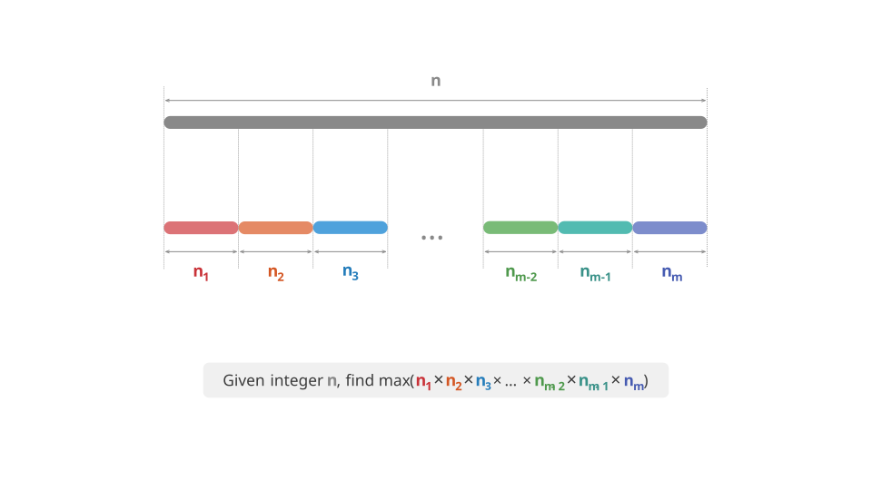
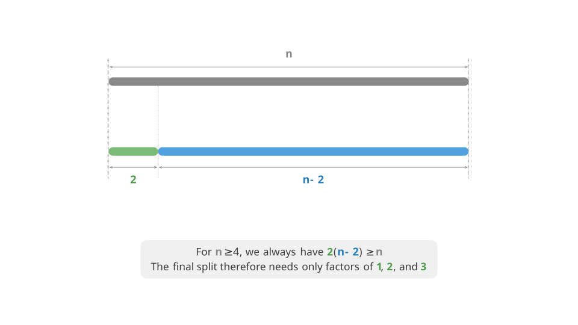
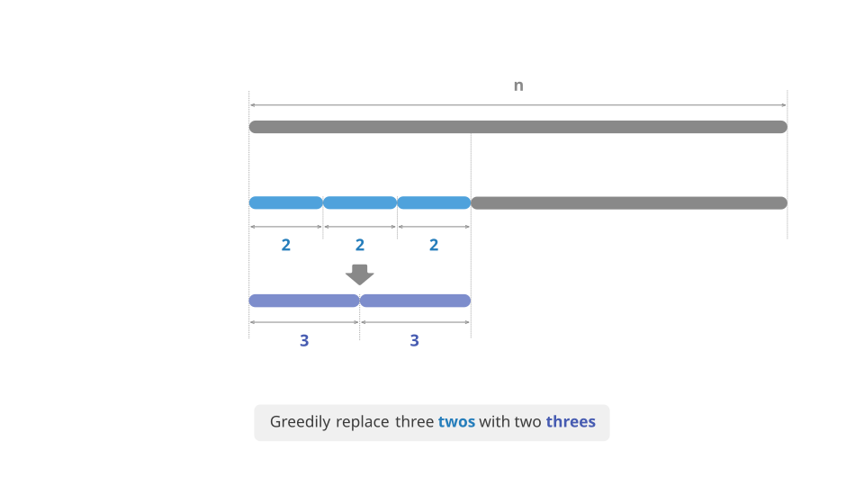
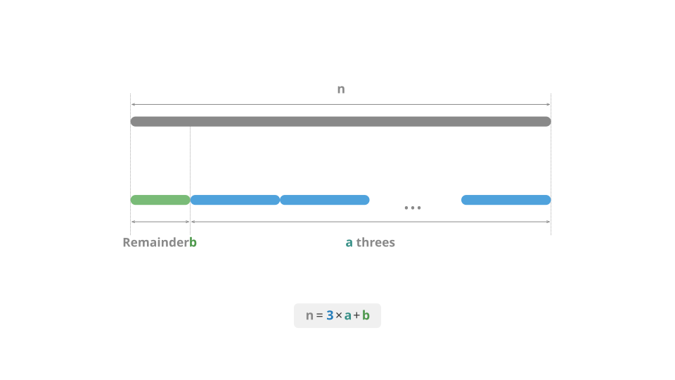

# 15.4 &nbsp; Maximum product after cutting

!!! question

    Given a positive integer $n$, write it as a sum of at least two positive integers. What is the largest possible product of those integers? Figure 15-13 illustrates the problem.

{ class="animation-figure" }

<p align="center"> Figure 15-13 &nbsp; Defining the maximum product after cutting </p>

Suppose we split $n$ into $m$ integer pieces, with piece $i$ denoted by $n_i$. Then

$$
n = \sum_{i=1}^{m}n_i
$$

Our goal is to maximize the product of all the pieces:

$$
\max(\prod_{i=1}^{m}n_i)
$$

How many pieces should we make ($m$), and how large should each piece $n_i$ be?

### 1. &nbsp; Choosing a greedy strategy

The product of two integers is often greater than their sum. If we cut a piece of size $2$ from $n$, the two pieces have product $2(n-2)$. Let's compare this product with $n$:

$$
\begin{aligned}
2(n-2) & \geq n \newline
2n - n - 4 & \geq 0 \newline
n & \geq 4
\end{aligned}
$$

As Figure 15-14 shows, when $n \geq 4$, cutting off a piece of size $2$ increases the product. **This suggests that every integer greater than or equal to $4$ should be split**.

**First greedy rule**. If a split contains a factor $\geq 4$, split it again. The final split should contain only factors of $1$, $2$, and $3$.

{ class="animation-figure" }

<p align="center"> Figure 15-14 &nbsp; Cutting increases the product </p>

Which factor is best? Of $1$, $2$, and $3$, the worst is $1$, because $1 \times (n-1) < n$ always holds. Cutting off a piece of size $1$ actually reduces the product.

As shown below, when $n = 6$, we have $3 \times 3 > 2 \times 2 \times 2$. **This means pieces of size $3$ are preferable to pieces of size $2$**.

**Second greedy rule**. A split should contain at most two factors of $2$. Three factors of $2$ can always be replaced by two factors of $3$ to obtain a larger product.

{ class="animation-figure" }

<p align="center"> Figure 15-15 &nbsp; Optimal factors for the split </p>

These observations give us the following greedy strategy.

1. Given the integer $n$, repeatedly cut off pieces of size $3$ until the remainder is $0$, $1$, or $2$.
2. If the remainder is $0$, then $n$ is a multiple of $3$, so no adjustment is needed.
3. If the remainder is $2$, keep it as a piece without splitting it further.
4. If the remainder is $1$, then because $2 \times 2 > 1 \times 3$, replace the last $3$ and the leftover $1$ with two pieces of size $2$.

### 2. &nbsp; Implementation

As Figure 15-16 shows, we can skip the loop that cuts individual pieces. Floor division gives the number $a$ of pieces of size $3$, and the remainder operation gives the leftover amount $b$. Thus:

$$
n = 3 a + b
$$

For the boundary cases $n \leq 3$, we must cut off a piece of size $1$, giving a product of $1 \times (n - 1)$.

=== "Python"

    ```python title="max_product_cutting.py"
    def max_product_cutting(n: int) -> int:
        """Greedy maximum product algorithm"""
        # When n <= 3, one piece must be 1
        if n <= 3:
            return 1 * (n - 1)
        # Greedily cut off pieces of size 3. Let a be their count and b the remainder
        a, b = n // 3, n % 3
        if b == 1:
            # If the remainder is 1, replace one pair 1 * 3 with 2 * 2
            return int(math.pow(3, a - 1)) * 2 * 2
        if b == 2:
            # If the remainder is 2, leave it as is
            return int(math.pow(3, a)) * 2
        # If the remainder is 0, no adjustment is needed
        return int(math.pow(3, a))
    ```

=== "C++"

    ```cpp title="max_product_cutting.cpp"
    /* Greedy maximum product algorithm */
    int maxProductCutting(int n) {
        // When n <= 3, one piece must be 1
        if (n <= 3) {
            return 1 * (n - 1);
        }
        // Greedily cut off pieces of size 3. Let a be their count and b the remainder
        int a = n / 3;
        int b = n % 3;
        if (b == 1) {
            // If the remainder is 1, replace one pair 1 * 3 with 2 * 2
            return (int)pow(3, a - 1) * 2 * 2;
        }
        if (b == 2) {
            // If the remainder is 2, leave it as is
            return (int)pow(3, a) * 2;
        }
        // If the remainder is 0, no adjustment is needed
        return (int)pow(3, a);
    }
    ```

=== "Java"

    ```java title="max_product_cutting.java"
    /* Greedy maximum product algorithm */
    int maxProductCutting(int n) {
        // When n <= 3, one piece must be 1
        if (n <= 3) {
            return 1 * (n - 1);
        }
        // Greedily cut off pieces of size 3. Let a be their count and b the remainder
        int a = n / 3;
        int b = n % 3;
        if (b == 1) {
            // If the remainder is 1, replace one pair 1 * 3 with 2 * 2
            return (int) Math.pow(3, a - 1) * 2 * 2;
        }
        if (b == 2) {
            // If the remainder is 2, leave it as is
            return (int) Math.pow(3, a) * 2;
        }
        // If the remainder is 0, no adjustment is needed
        return (int) Math.pow(3, a);
    }
    ```

=== "C#"

    ```csharp title="max_product_cutting.cs"
    /* Greedy maximum product algorithm */
    int MaxProductCutting(int n) {
        // When n <= 3, one piece must be 1
        if (n <= 3) {
            return 1 * (n - 1);
        }
        // Greedily cut off pieces of size 3. Let a be their count and b the remainder
        int a = n / 3;
        int b = n % 3;
        if (b == 1) {
            // If the remainder is 1, replace one pair 1 * 3 with 2 * 2
            return (int)Math.Pow(3, a - 1) * 2 * 2;
        }
        if (b == 2) {
            // If the remainder is 2, leave it as is
            return (int)Math.Pow(3, a) * 2;
        }
        // If the remainder is 0, no adjustment is needed
        return (int)Math.Pow(3, a);
    }
    ```

=== "Go"

    ```go title="max_product_cutting.go"
    /* Greedy maximum product algorithm */
    func maxProductCutting(n int) int {
        // When n <= 3, one piece must be 1
        if n <= 3 {
            return 1 * (n - 1)
        }
        // Greedily cut off pieces of size 3. Let a be their count and b the remainder
        a := n / 3
        b := n % 3
        if b == 1 {
            // If the remainder is 1, replace one pair 1 * 3 with 2 * 2
            return int(math.Pow(3, float64(a-1))) * 2 * 2
        }
        if b == 2 {
            // If the remainder is 2, leave it as is
            return int(math.Pow(3, float64(a))) * 2
        }
        // If the remainder is 0, no adjustment is needed
        return int(math.Pow(3, float64(a)))
    }
    ```

=== "Swift"

    ```swift title="max_product_cutting.swift"
    /* Greedy maximum product algorithm */
    func maxProductCutting(n: Int) -> Int {
        // When n <= 3, one piece must be 1
        if n <= 3 {
            return 1 * (n - 1)
        }
        // Greedily cut off pieces of size 3. Let a be their count and b the remainder
        let a = n / 3
        let b = n % 3
        if b == 1 {
            // If the remainder is 1, replace one pair 1 * 3 with 2 * 2
            return pow(3, a - 1) * 2 * 2
        }
        if b == 2 {
            // If the remainder is 2, leave it as is
            return pow(3, a) * 2
        }
        // If the remainder is 0, no adjustment is needed
        return pow(3, a)
    }
    ```

=== "JS"

    ```javascript title="max_product_cutting.js"
    /* Greedy maximum product algorithm */
    function maxProductCutting(n) {
        // When n <= 3, one piece must be 1
        if (n <= 3) {
            return 1 * (n - 1);
        }
        // Greedily cut off pieces of size 3. Let a be their count and b the remainder
        let a = Math.floor(n / 3);
        let b = n % 3;
        if (b === 1) {
            // If the remainder is 1, replace one pair 1 * 3 with 2 * 2
            return Math.pow(3, a - 1) * 2 * 2;
        }
        if (b === 2) {
            // If the remainder is 2, leave it as is
            return Math.pow(3, a) * 2;
        }
        // If the remainder is 0, no adjustment is needed
        return Math.pow(3, a);
    }
    ```

=== "TS"

    ```typescript title="max_product_cutting.ts"
    /* Greedy maximum product algorithm */
    function maxProductCutting(n: number): number {
        // When n <= 3, one piece must be 1
        if (n <= 3) {
            return 1 * (n - 1);
        }
        // Greedily cut off pieces of size 3. Let a be their count and b the remainder
        let a: number = Math.floor(n / 3);
        let b: number = n % 3;
        if (b === 1) {
            // If the remainder is 1, replace one pair 1 * 3 with 2 * 2
            return Math.pow(3, a - 1) * 2 * 2;
        }
        if (b === 2) {
            // If the remainder is 2, leave it as is
            return Math.pow(3, a) * 2;
        }
        // If the remainder is 0, no adjustment is needed
        return Math.pow(3, a);
    }
    ```

=== "Dart"

    ```dart title="max_product_cutting.dart"
    /* Greedy maximum product algorithm */
    int maxProductCutting(int n) {
      // When n <= 3, one piece must be 1
      if (n <= 3) {
        return 1 * (n - 1);
      }
      // Greedily cut off pieces of size 3. Let a be their count and b the remainder
      int a = n ~/ 3;
      int b = n % 3;
      if (b == 1) {
        // If the remainder is 1, replace one pair 1 * 3 with 2 * 2
        return (pow(3, a - 1) * 2 * 2).toInt();
      }
      if (b == 2) {
        // If the remainder is 2, leave it as is
        return (pow(3, a) * 2).toInt();
      }
      // If the remainder is 0, no adjustment is needed
      return pow(3, a).toInt();
    }
    ```

=== "Rust"

    ```rust title="max_product_cutting.rs"
    /* Greedy maximum product algorithm */
    fn max_product_cutting(n: i32) -> i32 {
        // When n <= 3, one piece must be 1
        if n <= 3 {
            return 1 * (n - 1);
        }
        // Greedily cut off pieces of size 3. Let a be their count and b the remainder
        let a = n / 3;
        let b = n % 3;
        if b == 1 {
            // If the remainder is 1, replace one pair 1 * 3 with 2 * 2
            3_i32.pow(a as u32 - 1) * 2 * 2
        } else if b == 2 {
            // If the remainder is 2, leave it as is
            3_i32.pow(a as u32) * 2
        } else {
            // If the remainder is 0, no adjustment is needed
            3_i32.pow(a as u32)
        }
    }
    ```

=== "C"

    ```c title="max_product_cutting.c"
    /* Greedy maximum product algorithm */
    int maxProductCutting(int n) {
        // When n <= 3, one piece must be 1
        if (n <= 3) {
            return 1 * (n - 1);
        }
        // Greedily cut off pieces of size 3. Let a be their count and b the remainder
        int a = n / 3;
        int b = n % 3;
        if (b == 1) {
            // If the remainder is 1, replace one pair 1 * 3 with 2 * 2
            return pow(3, a - 1) * 2 * 2;
        }
        if (b == 2) {
            // If the remainder is 2, leave it as is
            return pow(3, a) * 2;
        }
        // If the remainder is 0, no adjustment is needed
        return pow(3, a);
    }
    ```

=== "Kotlin"

    ```kotlin title="max_product_cutting.kt"
    /* Greedy maximum product algorithm */
    fun maxProductCutting(n: Int): Int {
        // When n <= 3, one piece must be 1
        if (n <= 3) {
            return 1 * (n - 1)
        }
        // Greedily cut off pieces of size 3. Let a be their count and b the remainder
        val a = n / 3
        val b = n % 3
        if (b == 1) {
            // If the remainder is 1, replace one pair 1 * 3 with 2 * 2
            return 3.0.pow((a - 1)).toInt() * 2 * 2
        }
        if (b == 2) {
            // If the remainder is 2, leave it as is
            return 3.0.pow(a).toInt() * 2
        }
        // If the remainder is 0, no adjustment is needed
        return 3.0.pow(a).toInt()
    }
    ```

=== "Ruby"

    ```ruby title="max_product_cutting.rb"
    ### Greedy maximum product algorithm ###
    def max_product_cutting(n)
      # When n <= 3, one piece must be 1
      return 1 * (n - 1) if n <= 3
      # Greedily cut off pieces of size 3. Let a be their count and b the remainder
      a, b = n / 3, n % 3
      # If the remainder is 1, replace one pair 1 * 3 with 2 * 2
      return (3.pow(a - 1) * 2 * 2).to_i if b == 1
      # If the remainder is 2, leave it as is
      return (3.pow(a) * 2).to_i if b == 2
      # If the remainder is 0, no adjustment is needed
      3.pow(a).to_i
    end
    ```

??? pythontutor "Visualize execution"

    <div style="height: 549px; width: 100%;"><iframe class="pythontutor-iframe" title="Visualize execution" src="https://pythontutor.com/iframe-embed.html#code=import%20math%0A%0Adef%20max_product_cutting%28n%3A%20int%29%20-%3E%20int%3A%0A%20%20%20%20%22%22%22Greedy%20maximum%20product%20algorithm%22%22%22%0A%20%20%20%20%23%20When%20n%20%3C%3D%203,%20one%20piece%20must%20be%201%0A%20%20%20%20if%20n%20%3C%3D%203%3A%0A%20%20%20%20%20%20%20%20return%201%20%2A%20%28n%20-%201%29%0A%20%20%20%20%23%20Greedily%20cut%20off%20pieces%20of%20size%203.%20Let%20a%20be%20their%20count%20and%20b%20the%20remainder%0A%20%20%20%20a,%20b%20%3D%20n%20//%203,%20n%20%25%203%0A%20%20%20%20if%20b%20%3D%3D%201%3A%0A%20%20%20%20%20%20%20%20%23%20If%20the%20remainder%20is%201,%20replace%20one%20pair%201%20%2A%203%20with%202%20%2A%202%0A%20%20%20%20%20%20%20%20return%20int%28math.pow%283,%20a%20-%201%29%29%20%2A%202%20%2A%202%0A%20%20%20%20if%20b%20%3D%3D%202%3A%0A%20%20%20%20%20%20%20%20%23%20If%20the%20remainder%20is%202,%20leave%20it%20as%20is%0A%20%20%20%20%20%20%20%20return%20int%28math.pow%283,%20a%29%29%20%2A%202%0A%20%20%20%20%23%20If%20the%20remainder%20is%200,%20no%20adjustment%20is%20needed%0A%20%20%20%20return%20int%28math.pow%283,%20a%29%29%0A%0A%22%22%22Driver%20Code%22%22%22%0Aif%20__name__%20%3D%3D%20%22__main__%22%3A%0A%20%20%20%20n%20%3D%2058%0A%0A%20%20%20%20%23%20Greedy%20algorithm%0A%20%20%20%20res%20%3D%20max_product_cutting%28n%29%0A%20%20%20%20print%28f%22The%20maximum%20product%20after%20cutting%20is%20%7Bres%7D%22%29&codeDivHeight=472&codeDivWidth=350&cumulative=false&curInstr=5&heapPrimitives=nevernest&origin=opt-frontend.js&py=311&rawInputLstJSON=%5B%5D&textReferences=false"> </iframe></div>
    <div style="margin-top: 5px;"><a href="https://pythontutor.com/iframe-embed.html#code=import%20math%0A%0Adef%20max_product_cutting%28n%3A%20int%29%20-%3E%20int%3A%0A%20%20%20%20%22%22%22Greedy%20maximum%20product%20algorithm%22%22%22%0A%20%20%20%20%23%20When%20n%20%3C%3D%203,%20one%20piece%20must%20be%201%0A%20%20%20%20if%20n%20%3C%3D%203%3A%0A%20%20%20%20%20%20%20%20return%201%20%2A%20%28n%20-%201%29%0A%20%20%20%20%23%20Greedily%20cut%20off%20pieces%20of%20size%203.%20Let%20a%20be%20their%20count%20and%20b%20the%20remainder%0A%20%20%20%20a,%20b%20%3D%20n%20//%203,%20n%20%25%203%0A%20%20%20%20if%20b%20%3D%3D%201%3A%0A%20%20%20%20%20%20%20%20%23%20If%20the%20remainder%20is%201,%20replace%20one%20pair%201%20%2A%203%20with%202%20%2A%202%0A%20%20%20%20%20%20%20%20return%20int%28math.pow%283,%20a%20-%201%29%29%20%2A%202%20%2A%202%0A%20%20%20%20if%20b%20%3D%3D%202%3A%0A%20%20%20%20%20%20%20%20%23%20If%20the%20remainder%20is%202,%20leave%20it%20as%20is%0A%20%20%20%20%20%20%20%20return%20int%28math.pow%283,%20a%29%29%20%2A%202%0A%20%20%20%20%23%20If%20the%20remainder%20is%200,%20no%20adjustment%20is%20needed%0A%20%20%20%20return%20int%28math.pow%283,%20a%29%29%0A%0A%22%22%22Driver%20Code%22%22%22%0Aif%20__name__%20%3D%3D%20%22__main__%22%3A%0A%20%20%20%20n%20%3D%2058%0A%0A%20%20%20%20%23%20Greedy%20algorithm%0A%20%20%20%20res%20%3D%20max_product_cutting%28n%29%0A%20%20%20%20print%28f%22The%20maximum%20product%20after%20cutting%20is%20%7Bres%7D%22%29&codeDivHeight=800&codeDivWidth=600&cumulative=false&curInstr=5&heapPrimitives=nevernest&origin=opt-frontend.js&py=311&rawInputLstJSON=%5B%5D&textReferences=false" target="_blank" rel="noopener noreferrer">View full screen ></a></div>

{ class="animation-figure" }

<p align="center"> Figure 15-16 &nbsp; Calculating the maximum product after cutting </p>

**The time complexity depends on how the programming language implements exponentiation**. Python, for example, offers three common ways to compute a power.

- The `**` operator and the `pow()` function both take $O(\log⁡ a)$ time.
- The `math.pow()` function calls the C library's `pow()` function, which performs floating-point exponentiation in $O(1)$ time.

The variables $a$ and $b$ use a constant amount of extra space, **so the space complexity is $O(1)$**.

### 3. &nbsp; Proof of correctness

We use proof by contradiction and consider only $n \geq 4$.

1. **All factors are $\leq 3$**. Suppose an optimal split contains a factor $x$ that is $\geq 4$. We can split it again to obtain the product $2(x-2)$, giving a larger or equal product. This contradicts the assumption.
2. **The split contains no factor of $1$**. Suppose an optimal split contains a factor of $1$. We can merge it into another piece to obtain a larger product, contradicting optimality.
3. **The split contains at most two factors of $2$**. Suppose an optimal split contains three factors of $2$. Replacing them with two factors of $3$ gives a larger product, contradicting optimality.
