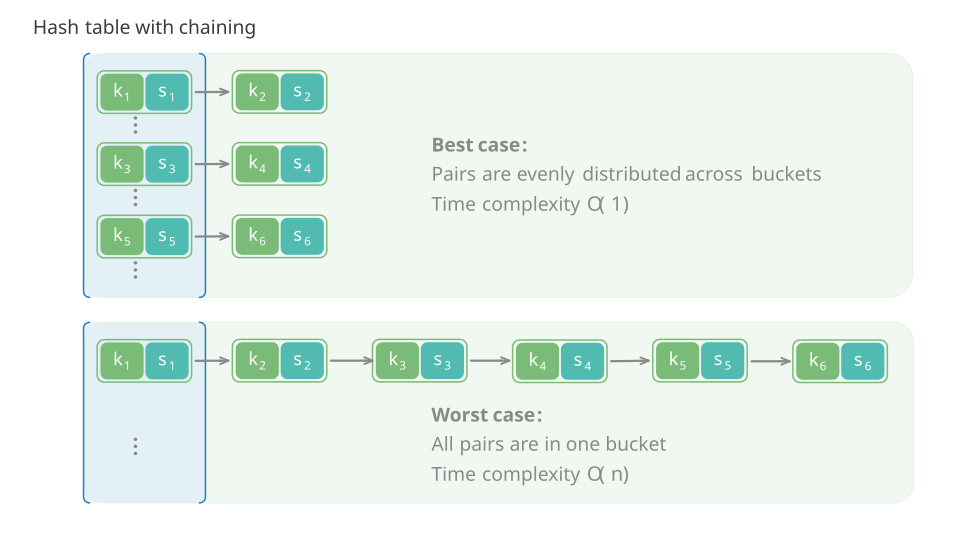

# Hash algorithms

The previous two sections explained how hash tables work and how they handle collisions. Both open addressing and chaining **keep a hash table working correctly when collisions occur, but neither reduces the number of collisions**.

Frequent collisions can sharply degrade hash table performance. The figure below shows a hash table with chaining. Ideally, the pairs are evenly distributed across buckets, giving the fastest lookups. In the worst case, all pairs land in a single bucket, and lookup time degrades to $O(n)$.



**The hash function determines how the key-value pairs are distributed**. Recall its two steps: compute the hash value, then take the remainder modulo the array length.

```shell
index = hash(key) % capacity
```

In this formula, when the table capacity `capacity` is fixed, **the hash algorithm `hash()` determines the output** and thus how the key-value pairs are distributed across the table.

To reduce the likelihood of collisions, we therefore need to focus on the design of the hash algorithm `hash()`.

## Goals of a hash algorithm

A fast, reliable hash table needs a hash algorithm with the following properties.

- **Determinism**. The same input should always produce the same output so that the table works reliably.
- **Efficiency**. Computing a hash value should be fast. The lower the cost, the more practical the table is to use.
- **Uniform distribution**. The algorithm should spread key-value pairs evenly across the table. The more uniform the distribution, the less likely a collision becomes.

Hash algorithms also have many uses beyond implementing hash tables.

- **Password storage**. To protect passwords, systems typically store a hash of each password instead of the plaintext. When a user enters a password, the system hashes it and compares the result with the stored hash. If they match, the system accepts the password.
- **Data integrity checks**. A sender can compute a hash of the data and send it along with the data. The recipient hashes the data received and compares the result with the hash received. If they match, the data is considered intact.

Cryptographic applications need stronger security properties to prevent someone from working backward from a hash, for example to recover the original password.

- **One-way operation**. It should be infeasible to work backward from the hash value to recover information about the input.
- **Collision resistance**. Finding two different inputs with the same hash value should be extremely difficult.
- **Avalanche effect**. A small change to the input should cause a large, unpredictable change in the output.

**Uniform distribution and collision resistance are distinct properties**. A uniform distribution does not guarantee collision resistance. For example, with random inputs `key`, the function `key % 100` can produce uniformly distributed outputs. Yet this algorithm is so simple that every `key` with the same last two digits gives the same output. Given a hash, it is easy to find a `key` that works and thereby defeat the password check.

## Designing a hash algorithm

Designing a hash algorithm is complex and requires balancing many factors. For less demanding applications, however, we can design simple algorithms.

- **Additive hashing** adds the ASCII codes of all the input characters and uses the sum as the hash value.
- **Multiplicative hashing** mixes the character contributions by multiplying the running hash by a constant each round and accumulating each character’s ASCII code.
- **XOR hashing** combines each input element with the running hash using XOR.
- **Rotation hashing** rotates the running hash before incorporating the ASCII code of each character.

```src
[file]{simple_hash}-[class]{}-[func]{rot_hash}
```

Each algorithm takes the result modulo the large prime $1000000007$ as its final step to keep the hash in a suitable range. Why use a prime modulus? What can go wrong with a composite modulus?

**A large prime modulus gives the best chance of distributing hash values evenly**. Because a prime shares no nontrivial factor with numbers that are not its multiples, it can reduce periodic patterns introduced by the remainder operation and help avoid collisions.

For example, suppose we choose the composite modulus $9$. It is divisible by $3$, so every `key` divisible by $3$ maps to one of just three hash values: $0$, $3$, or $6$.

$$
\begin{aligned}
\text{modulus} & = 9 \newline
\text{key} & = \{ 0, 3, 6, 9, 12, 15, 18, 21, 24, 27, 30, 33, \dots \} \newline
\text{hash} & = \{ 0, 3, 6, 0, 3, 6, 0, 3, 6, 0, 3, 6,\dots \}
\end{aligned}
$$

If the input values of `key` follow this arithmetic progression, the hashes cluster, leading to more collisions. Now set `modulus` to the prime $13$. The step between successive `key` values has no common factor greater than one with `modulus`, so the hash values are much more evenly distributed.

$$
\begin{aligned}
\text{modulus} & = 13 \newline
\text{key} & = \{ 0, 3, 6, 9, 12, 15, 18, 21, 24, 27, 30, 33, \dots \} \newline
\text{hash} & = \{ 0, 3, 6, 9, 12, 2, 5, 8, 11, 1, 4, 7, \dots \}
\end{aligned}
$$

If `key` is uniformly random, either a prime or a composite modulus can produce evenly distributed hash values. When `key` follows a periodic pattern, however, a composite modulus is more likely to produce clusters.

We therefore usually choose a prime modulus, preferably a large one, to suppress periodic patterns as much as possible and make the algorithm more robust.

## Common hash algorithms

The simple algorithms above are fragile and fall well short of the design goals. For example, addition and XOR are commutative, so additive and XOR hashing cannot distinguish strings that contain the same characters in different orders. This can increase collisions and cause security problems.

In practice, standard hash algorithms include MD5, SHA-1, SHA-2, and SHA-3. They map inputs of any length to fixed-length hash values.

Over nearly a century, hash algorithms have undergone continual refinement. Some researchers work to improve their performance, while other researchers and hackers look for security weaknesses. The table below lists common hash algorithms used in practice.

- Successful attacks against MD5 and SHA-1 have led security applications to phase them out.
- SHA-256, a member of the SHA-2 family, is among the most secure hash algorithms. It has withstood attacks to date and is widely used in security applications and protocols.
- SHA-3 has lower implementation overhead and higher computational efficiency than SHA-2, but the SHA-2 family is still more widely used.

<p align="center"> Table <id> &nbsp; Common hash algorithms </p>

|          | MD5                            | SHA-1            | SHA-2                        | SHA-3               |
| -------- | ------------------------------ | ---------------- | ---------------------------- | ------------------- |
| Year introduced | 1992                           | 1995             | 2002                         | 2008                |
| Output length | 128 bit                        | 160 bit          | 256/512 bit                  | 224/256/384/512 bit |
| Hash collisions | Relatively frequent                           | Relatively frequent             | Rare                         | Rare                |
| Security level | Low; successful attacks exist               | Low; successful attacks exist | High                           | High                  |
| Applications     | Deprecated, still used for data integrity checks | Deprecated         | Cryptocurrency transaction verification, digital signatures, and more | Can serve as an alternative to SHA-2    |

## Hash values of data structures

A hash table’s `key` can be an integer, a floating-point number, a string, or another data type. Programming languages typically provide built-in hashing for these types so a table can compute a bucket index. In Python, for example, we can call `hash()` to compute hash values for several data types.

- Integers and Booleans hash to their own numeric values.
- Hashing floating-point numbers and strings is more involved. Interested readers can explore these calculations further.
- To hash a tuple, hash each element and combine the results into a single hash value.
- An object’s hash value is based on its memory address. You can override its hash method to generate a hash based on its contents.

!!! tip

    Programming languages differ in how they define and implement their built-in hash functions.

```snippet
builtin_hash
```

??? pythontutor "Visualize execution"

    @tutor builtin_hash_tutor

In many programming languages, **only immutable objects can serve as a hash table’s `key`**. Suppose we used a list (a dynamic array) as a `key`. Changing the contents of the list would change its hash value, and we would no longer be able to look up the original `value` in the table.

A user-defined object, such as a linked list node, can be hashable even though its fields can change. **An object’s hash is typically based on its memory address**. Changes to its contents leave its address, and therefore its hash, unchanged.

You may notice different hash values when you run the program in different consoles. **Each time the Python interpreter starts, it supplies a random salt to the string hash function**. This helps prevent HashDoS attacks and makes hashing more secure.
