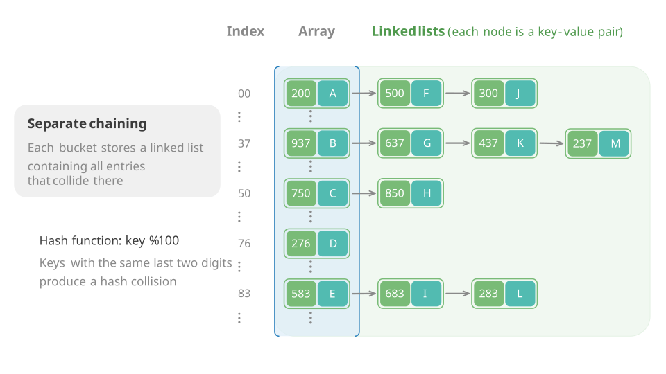
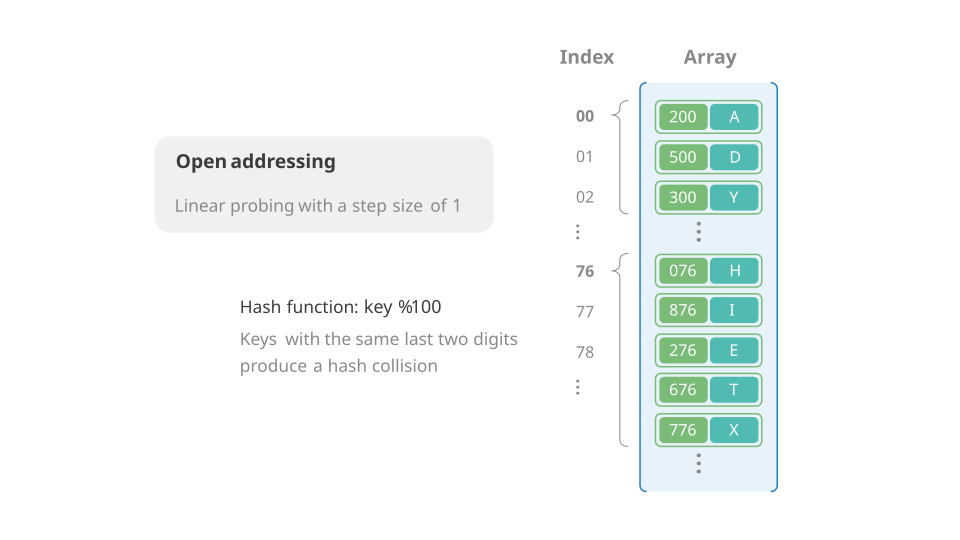
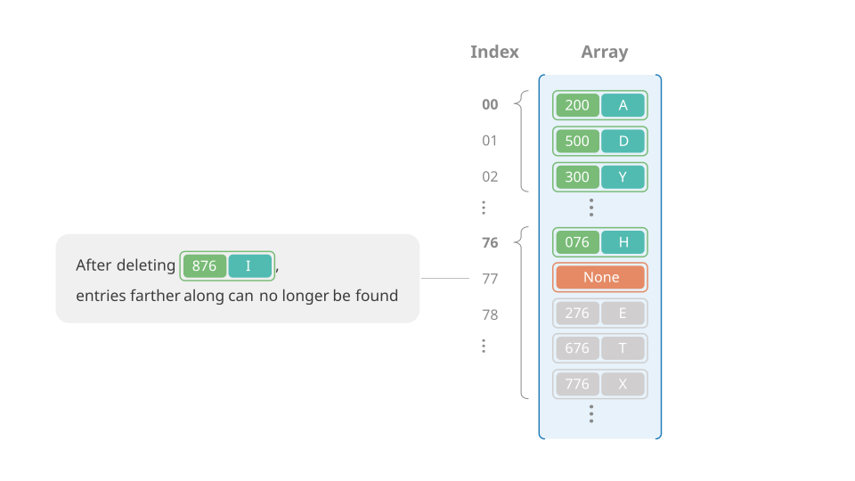

# Hash collisions

As the previous section explained, **a hash function typically has far more possible inputs than outputs**, so collisions are theoretically unavoidable. For example, if the inputs are all integers and the number of possible outputs equals the array capacity, multiple integers must map to the same bucket index.

Collisions can lead to incorrect lookup results, severely limiting the usefulness of our hash table. One solution is to expand the table whenever a collision occurs and keep expanding until the collision disappears. This brute-force approach works, but it is inefficient because resizing requires moving many entries and recomputing their hashes. We can improve efficiency with the following strategies.

1. Change the structure of the table **so it works correctly even when collisions occur**.
2. Expand the table only when necessary, once collisions become a significant problem.

The two main structural approaches are separate chaining and open addressing.

## Separate chaining

In the original table, each bucket holds only one key-value pair. With <u>separate chaining</u>, a linked list replaces the single entry. Each node holds a key-value pair, and all pairs that collide go into the same list. The figure below shows an example.



With chaining, hash table operations change as follows.

- **Lookup**. Pass `key` to the hash function to get the bucket index and access the head of its list. Walk the list, comparing each node’s key with `key` to find the target pair.
- **Insertion**. Use the hash function to locate the head of the list, then add a node containing the key-value pair to the list.
- **Deletion**. Use the hash function to reach the head of the list. Walk the list to find the target node and remove it.

Chaining has the following limitations.

- **Higher memory usage**. A linked list needs pointers to link its nodes, so it uses more memory than an array.
- **Slower lookups**. Finding a particular element requires scanning the list linearly.

The following code implements a simple hash table with chaining. Two details are worth noting.

- To simplify the code, we use lists (dynamic arrays) in place of linked lists. The hash table is an array of buckets, each of which is itself a list.
- The implementation includes a method for expanding the table. When the load factor exceeds $\frac{2}{3}$, we increase the capacity to $2$ times its previous value.

```src
[file]{hash_map_chaining}-[class]{hash_map_chaining}-[func]{}
```

If a chain grows long, $O(n)$ lookup becomes slow. **We can then replace the linked list with an AVL tree or a red-black tree**, improving lookup time to $O(\log n)$.

## Open addressing

<u>Open addressing</u> handles collisions by probing multiple positions within the table, without introducing another data structure. Common methods include linear probing, quadratic probing, and probing with multiple hash functions.

We will use linear probing to see how a hash table with open addressing works.

### Linear probing

Linear probing searches in fixed-size steps. Its operations differ from those of the basic hash table.

- **Insertion**. Compute the bucket index with the hash function. If the bucket is occupied, scan forward from that position in fixed steps (usually $1$) and insert the element in the first empty bucket.
- **Lookup**. If a collision occurs, scan forward using the same step size. When you find the matching element, return its `value`. If you reach an empty bucket, the element is absent, so return `None`.

The figure below shows how open addressing with linear probing distributes key-value pairs. With this hash function, all `key` inputs with the same last two digits map to the same bucket. Linear probing stores them successively in that bucket and those below it.



However, **linear probing tends to create clusters**. The longer a run of occupied slots, the more likely a new key is to collide with an entry in that run. Each collision can extend the run, reinforcing the pattern. Eventually, insertions, deletions, lookups, and updates all slow down.

**We cannot simply remove an element from an open-addressed hash table**. Doing so leaves an empty bucket, `None`, where a linear search will stop. Elements farther along that probe sequence become unreachable, and the program may incorrectly report that they are absent, as the figure below shows.



We can solve this problem with <u>lazy deletion</u>. Instead of simply removing the element and emptying its bucket, we **mark the bucket with a constant, `TOMBSTONE`**. Both `None` and `TOMBSTONE` represent available buckets that can hold a new pair. With linear probing, we must continue past `TOMBSTONE` because more pairs may lie farther along the probe sequence.

However, **lazy deletion can make hash table performance degrade faster**. Each deletion leaves a marker. As the number of `TOMBSTONE` markers grows, searches take longer because linear probing may have to skip several `TOMBSTONE` markers to reach the target.

To address this, record the index of the first `TOMBSTONE` encountered while probing. When you find the target, swap it with that `TOMBSTONE`. A lookup or insertion can thus move an element closer to its ideal position, the starting bucket for probing, and speed up later lookups.

The following code implements an open-addressed hash table with linear probing and lazy deletion. To make fuller use of the available space, we treat the table as a circular array: when probing passes the last slot, it continues at the first.

```src
[file]{hash_map_open_addressing}-[class]{hash_map_open_addressing}-[func]{}
```

### Quadratic probing

Like linear probing, quadratic probing is a common open addressing strategy. After a collision, the offsets are the squares of the probe numbers, $1, 4, 9, \dots$ steps, rather than fixed increments.

Quadratic probing offers the following advantages.

- Using offsets equal to the squares of the probe numbers helps alleviate the clustering associated with linear probing.
- Probing farther away for empty slots can help distribute entries more evenly.

Quadratic probing also has limitations.

- Clustering can still occur: some slots are more likely to fill than others.
- Because the offsets grow quadratically, the probes may not cover the entire table. Even if an empty bucket exists, the sequence may never reach it.

### Probing with multiple hash functions

As the name suggests, this method probes using multiple hash functions $f_1(x)$, $f_2(x)$, $f_3(x)$, $\dots$.

- **Insertion**. If $f_1(x)$ produces a collision, try $f_2(x)$, and continue through the functions until you find an empty slot and insert the element there.
- **Lookup**. Try the hash functions in the same order and return the element when you find it. If you reach an empty slot or exhaust all the functions, the element is absent, so return `None`.

Compared with linear probing, using multiple hash functions is less prone to clustering, but computing the additional hashes takes extra work.

!!! tip

    The same deletion problem applies to all three open addressing strategies: linear probing, quadratic probing, and probing with multiple hash functions. Simply clearing a deleted slot can break lookups.

## Implementation choices in programming languages

Programming languages use different strategies to implement hash tables. Here are a few examples.

- Python uses open addressing. Its dictionary, `dict`, uses a pseudorandom probe sequence.
- Java uses chaining. Since JDK 1.8, when the array in a `HashMap` has a length of at least 64 and a chain reaches length 8, the chain is converted to a red-black tree to speed up lookups.
- Starting with Go 1.24, the built-in `map` uses open addressing based on Swiss Table by default. Go 1.23 and earlier use chaining: each bucket holds up to 8 key-value pairs and links to an overflow bucket when it fills up.
