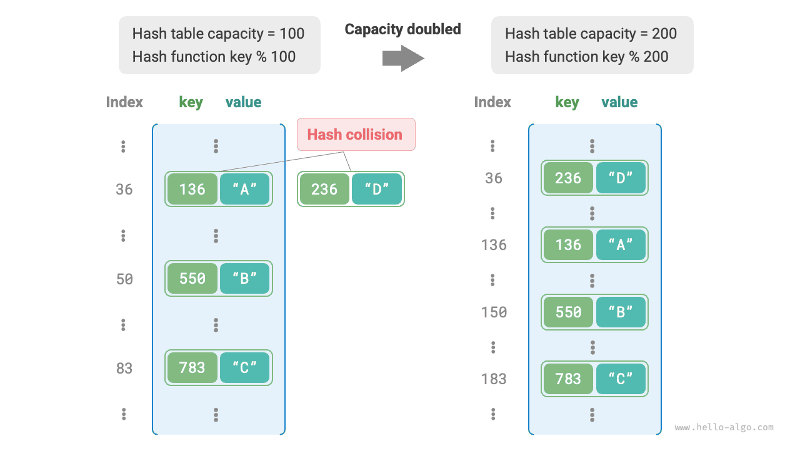

# 6.1 &nbsp; Hash tables

A <u>hash table</u>, also called a <u>hash map</u>, supports efficient lookup by mapping a `key` to a `value`. Given a key, it can retrieve the corresponding value in $O(1)$ time.

Suppose we have $n$ students, each with a name and a student ID. To support the query “given a student ID, return the corresponding name,” use the hash table shown below.

{ class="animation-figure" }

<p align="center"> Figure 6-1 &nbsp; An abstract view of hash-table lookup </p>

Arrays and linked lists also support lookup. Table 6-1 compares their efficiency.

- **Insertion**: append an element to the end of the array or linked list in $O(1)$ time.
- **Lookup**: because the array or list is unsorted, searching may require visiting every element, taking $O(n)$ time.
- **Deletion**: first find the element, then remove it from the array or list, taking $O(n)$ time.

<p align="center"> Table 6-1 &nbsp; Comparison of element-lookup efficiency </p>

<div class="center-table" markdown>

|          | Array   | Linked list   | Hash table |
| -------- | ------ | ------ | ------ |
| Find an element | $O(n)$ | $O(n)$ | $O(1)$ |
| Insert an element | $O(1)$ | $O(1)$ | $O(1)$ |
| Delete an element | $O(n)$ | $O(n)$ | $O(1)$ |

</div>

**Hash-table insertion, deletion, lookup, and updating all take $O(1)$ time**, making them highly efficient.

## 6.1.1 &nbsp; Common hash-table operations

Common operations include initialization, lookup, adding key-value pairs, and deleting pairs. Examples follow:

=== "Python"

    ```python title="hash_map.py"
    # Initialize a hash table
    hmap: dict = {}

    # Insertion
    # Add key-value pairs (key, value) to the hash table
    hmap[12836] = "小哈"
    hmap[15937] = "小啰"
    hmap[16750] = "小算"
    hmap[13276] = "小法"
    hmap[10583] = "小鸭"

    # Lookup
    # Look up key in the hash table to obtain value
    name: str = hmap[15937]

    # Deletion
    # Remove a key-value pair (key, value) from the hash table
    hmap.pop(10583)
    ```

=== "C++"

    ```cpp title="hash_map.cpp"
    /* Initialize a hash table */
    unordered_map<int, string> map;

    /* Insertion */
    // Add key-value pairs (key, value) to the hash table
    map[12836] = "小哈";
    map[15937] = "小啰";
    map[16750] = "小算";
    map[13276] = "小法";
    map[10583] = "小鸭";

    /* Lookup */
    // Look up key in the hash table to obtain value
    string name = map[15937];

    /* Deletion */
    // Remove a key-value pair (key, value) from the hash table
    map.erase(10583);
    ```

=== "Java"

    ```java title="hash_map.java"
    /* Initialize a hash table */
    Map<Integer, String> map = new HashMap<>();

    /* Insertion */
    // Add key-value pairs (key, value) to the hash table
    map.put(12836, "小哈");
    map.put(15937, "小啰");
    map.put(16750, "小算");
    map.put(13276, "小法");
    map.put(10583, "小鸭");

    /* Lookup */
    // Look up key in the hash table to obtain value
    String name = map.get(15937);

    /* Deletion */
    // Remove a key-value pair (key, value) from the hash table
    map.remove(10583);
    ```

=== "C#"

    ```csharp title="hash_map.cs"
    /* Initialize a hash table */
    Dictionary<int, string> map = new() {
        /* Insertion */
        // Add key-value pairs (key, value) to the hash table
        { 12836, "小哈" },
        { 15937, "小啰" },
        { 16750, "小算" },
        { 13276, "小法" },
        { 10583, "小鸭" }
    };

    /* Lookup */
    // Look up key in the hash table to obtain value
    string name = map[15937];

    /* Deletion */
    // Remove a key-value pair (key, value) from the hash table
    map.Remove(10583);
    ```

=== "Go"

    ```go title="hash_map_test.go"
    /* Initialize a hash table */
    hmap := make(map[int]string)

    /* Insertion */
    // Add key-value pairs (key, value) to the hash table
    hmap[12836] = "小哈"
    hmap[15937] = "小啰"
    hmap[16750] = "小算"
    hmap[13276] = "小法"
    hmap[10583] = "小鸭"

    /* Lookup */
    // Look up key in the hash table to obtain value
    name := hmap[15937]

    /* Deletion */
    // Remove a key-value pair (key, value) from the hash table
    delete(hmap, 10583)
    ```

=== "Swift"

    ```swift title="hash_map.swift"
    /* Initialize a hash table */
    var map: [Int: String] = [:]

    /* Insertion */
    // Add key-value pairs (key, value) to the hash table
    map[12836] = "小哈"
    map[15937] = "小啰"
    map[16750] = "小算"
    map[13276] = "小法"
    map[10583] = "小鸭"

    /* Lookup */
    // Look up key in the hash table to obtain value
    let name = map[15937]!

    /* Deletion */
    // Remove a key-value pair (key, value) from the hash table
    map.removeValue(forKey: 10583)
    ```

=== "JS"

    ```javascript title="hash_map.js"
    /* Initialize a hash table */
    const map = new Map();
    /* Insertion */
    // Add key-value pairs (key, value) to the hash table
    map.set(12836, '小哈');
    map.set(15937, '小啰');
    map.set(16750, '小算');
    map.set(13276, '小法');
    map.set(10583, '小鸭');

    /* Lookup */
    // Look up key in the hash table to obtain value
    let name = map.get(15937);

    /* Deletion */
    // Remove a key-value pair (key, value) from the hash table
    map.delete(10583);
    ```

=== "TS"

    ```typescript title="hash_map.ts"
    /* Initialize a hash table */
    const map = new Map<number, string>();
    /* Insertion */
    // Add key-value pairs (key, value) to the hash table
    map.set(12836, '小哈');
    map.set(15937, '小啰');
    map.set(16750, '小算');
    map.set(13276, '小法');
    map.set(10583, '小鸭');
    console.info('\nAfter insertion, the hash table is\nKey -> Value');
    console.info(map);

    /* Lookup */
    // Look up key in the hash table to obtain value
    let name = map.get(15937);
    console.info('\nLooking up student ID 15937 gives the name ' + name);

    /* Deletion */
    // Remove a key-value pair (key, value) from the hash table
    map.delete(10583);
    console.info('\nAfter deleting 10583, the hash table is\nKey -> Value');
    console.info(map);
    ```

=== "Dart"

    ```dart title="hash_map.dart"
    /* Initialize a hash table */
    Map<int, String> map = {};

    /* Insertion */
    // Add key-value pairs (key, value) to the hash table
    map[12836] = "小哈";
    map[15937] = "小啰";
    map[16750] = "小算";
    map[13276] = "小法";
    map[10583] = "小鸭";

    /* Lookup */
    // Look up key in the hash table to obtain value
    String name = map[15937];

    /* Deletion */
    // Remove a key-value pair (key, value) from the hash table
    map.remove(10583);
    ```

=== "Rust"

    ```rust title="hash_map.rs"
    use std::collections::HashMap;

    /* Initialize a hash table */
    let mut map: HashMap<i32, String> = HashMap::new();

    /* Insertion */
    // Add key-value pairs (key, value) to the hash table
    map.insert(12836, "小哈".to_string());
    map.insert(15937, "小啰".to_string());
    map.insert(16750, "小算".to_string());
    map.insert(13279, "小法".to_string());
    map.insert(10583, "小鸭".to_string());

    /* Lookup */
    // Look up key in the hash table to obtain value
    let _name: Option<&String> = map.get(&15937);

    /* Deletion */
    // Remove a key-value pair (key, value) from the hash table
    let _removed_value: Option<String> = map.remove(&10583);
    ```

=== "C"

    ```c title="hash_map.c"
    // C provides no built-in hash table
    ```

=== "Kotlin"

    ```kotlin title="hash_map.kt"
    /* Initialize a hash table */
    val map = HashMap<Int,String>()

    /* Insertion */
    // Add key-value pairs (key, value) to the hash table
    map[12836] = "小哈"
    map[15937] = "小啰"
    map[16750] = "小算"
    map[13276] = "小法"
    map[10583] = "小鸭"

    /* Lookup */
    // Look up key in the hash table to obtain value
    val name = map[15937]

    /* Deletion */
    // Remove a key-value pair (key, value) from the hash table
    map.remove(10583)
    ```

=== "Ruby"

    ```ruby title="hash_map.rb"
    # Initialize a hash table
    hmap = {}

    # Insertion
    # Add key-value pairs (key, value) to the hash table
    hmap[12836] = "小哈"
    hmap[15937] = "小啰"
    hmap[16750] = "小算"
    hmap[13276] = "小法"
    hmap[10583] = "小鸭"

    # Lookup
    # Look up key in the hash table to obtain value
    name = hmap[15937]

    # Deletion
    # Remove a key-value pair (key, value) from the hash table
    hmap.delete(10583)
    ```

??? pythontutor "Visualize execution"

    <div style="height: 549px; width: 100%;"><iframe class="pythontutor-iframe" title="Visualize execution" src="https://pythontutor.com/iframe-embed.html#code=%22%22%22Driver%20Code%22%22%22%0Aif%20__name__%20%3D%3D%20%22__main__%22%3A%0A%20%20%20%20%23%20Initialize%20a%20hash%20table%0A%20%20%20%20hmap%20%3D%20%7B%7D%0A%20%20%20%20%0A%20%20%20%20%23%20Insertion%0A%20%20%20%20%23%20Add%20key-value%20pairs%20%28key%2C%20value%29%20to%20the%20hash%20table%0A%20%20%20%20hmap%5B12836%5D%20%3D%20%22%E5%B0%8F%E5%93%88%22%0A%20%20%20%20hmap%5B15937%5D%20%3D%20%22%E5%B0%8F%E5%95%B0%22%0A%20%20%20%20hmap%5B16750%5D%20%3D%20%22%E5%B0%8F%E7%AE%97%22%0A%20%20%20%20hmap%5B13276%5D%20%3D%20%22%E5%B0%8F%E6%B3%95%22%0A%20%20%20%20hmap%5B10583%5D%20%3D%20%22%E5%B0%8F%E9%B8%AD%22%0A%20%20%20%20%0A%20%20%20%20%23%20Lookup%0A%20%20%20%20%23%20Look%20up%20key%20in%20the%20hash%20table%20to%20obtain%20value%0A%20%20%20%20name%20%3D%20hmap%5B15937%5D%0A%20%20%20%20%0A%20%20%20%20%23%20Deletion%0A%20%20%20%20%23%20Remove%20a%20key-value%20pair%20%28key%2C%20value%29%20from%20the%20hash%20table%0A%20%20%20%20hmap.pop%2810583%29&codeDivHeight=472&codeDivWidth=350&cumulative=false&curInstr=2&heapPrimitives=nevernest&origin=opt-frontend.js&py=311&rawInputLstJSON=%5B%5D&textReferences=false"> </iframe></div>
    <div style="margin-top: 5px;"><a href="https://pythontutor.com/iframe-embed.html#code=%22%22%22Driver%20Code%22%22%22%0Aif%20__name__%20%3D%3D%20%22__main__%22%3A%0A%20%20%20%20%23%20Initialize%20a%20hash%20table%0A%20%20%20%20hmap%20%3D%20%7B%7D%0A%20%20%20%20%0A%20%20%20%20%23%20Insertion%0A%20%20%20%20%23%20Add%20key-value%20pairs%20%28key%2C%20value%29%20to%20the%20hash%20table%0A%20%20%20%20hmap%5B12836%5D%20%3D%20%22%E5%B0%8F%E5%93%88%22%0A%20%20%20%20hmap%5B15937%5D%20%3D%20%22%E5%B0%8F%E5%95%B0%22%0A%20%20%20%20hmap%5B16750%5D%20%3D%20%22%E5%B0%8F%E7%AE%97%22%0A%20%20%20%20hmap%5B13276%5D%20%3D%20%22%E5%B0%8F%E6%B3%95%22%0A%20%20%20%20hmap%5B10583%5D%20%3D%20%22%E5%B0%8F%E9%B8%AD%22%0A%20%20%20%20%0A%20%20%20%20%23%20Lookup%0A%20%20%20%20%23%20Look%20up%20key%20in%20the%20hash%20table%20to%20obtain%20value%0A%20%20%20%20name%20%3D%20hmap%5B15937%5D%0A%20%20%20%20%0A%20%20%20%20%23%20Deletion%0A%20%20%20%20%23%20Remove%20a%20key-value%20pair%20%28key%2C%20value%29%20from%20the%20hash%20table%0A%20%20%20%20hmap.pop%2810583%29&codeDivHeight=800&codeDivWidth=600&cumulative=false&curInstr=2&heapPrimitives=nevernest&origin=opt-frontend.js&py=311&rawInputLstJSON=%5B%5D&textReferences=false" target="_blank" rel="noopener noreferrer">View full screen ></a></div>

There are three common ways to traverse a hash table: visit key-value pairs, keys only, or values only. Examples follow:

=== "Python"

    ```python title="hash_map.py"
    # Traverse the hash table
    # Traverse key-value pairs: key->value
    for key, value in hmap.items():
        print(key, "->", value)
    # Traverse keys only: key
    for key in hmap.keys():
        print(key)
    # Traverse values only: value
    for value in hmap.values():
        print(value)
    ```

=== "C++"

    ```cpp title="hash_map.cpp"
    /* Traverse the hash table */
    // Traverse key-value pairs: key->value
    for (auto kv: map) {
        cout << kv.first << " -> " << kv.second << endl;
    }
    // Use an iterator to traverse key->value pairs
    for (auto iter = map.begin(); iter != map.end(); iter++) {
        cout << iter->first << "->" << iter->second << endl;
    }
    ```

=== "Java"

    ```java title="hash_map.java"
    /* Traverse the hash table */
    // Traverse key-value pairs: key->value
    for (Map.Entry <Integer, String> kv: map.entrySet()) {
        System.out.println(kv.getKey() + " -> " + kv.getValue());
    }
    // Traverse keys only: key
    for (int key: map.keySet()) {
        System.out.println(key);
    }
    // Traverse values only: value
    for (String val: map.values()) {
        System.out.println(val);
    }
    ```

=== "C#"

    ```csharp title="hash_map.cs"
    /* Traverse the hash table */
    // Traverse key-value pairs: Key->Value
    foreach (var kv in map) {
        Console.WriteLine(kv.Key + " -> " + kv.Value);
    }
    // Traverse keys only: key
    foreach (int key in map.Keys) {
        Console.WriteLine(key);
    }
    // Traverse values only: value
    foreach (string val in map.Values) {
        Console.WriteLine(val);
    }
    ```

=== "Go"

    ```go title="hash_map_test.go"
    /* Traverse the hash table */
    // Traverse key-value pairs: key->value
    for key, value := range hmap {
        fmt.Println(key, "->", value)
    }
    // Traverse keys only: key
    for key := range hmap {
        fmt.Println(key)
    }
    // Traverse values only: value
    for _, value := range hmap {
        fmt.Println(value)
    }
    ```

=== "Swift"

    ```swift title="hash_map.swift"
    /* Traverse the hash table */
    // Traverse key-value pairs: Key->Value
    for (key, value) in map {
        print("\(key) -> \(value)")
    }
    // Traverse keys only: Key
    for key in map.keys {
        print(key)
    }
    // Traverse values only: Value
    for value in map.values {
        print(value)
    }
    ```

=== "JS"

    ```javascript title="hash_map.js"
    /* Traverse the hash table */
    console.info('\nTraverse key-value pairs: Key->Value');
    for (const [k, v] of map.entries()) {
        console.info(k + ' -> ' + v);
    }
    console.info('\nTraverse keys only: Key');
    for (const k of map.keys()) {
        console.info(k);
    }
    console.info('\nTraverse values only: Value');
    for (const v of map.values()) {
        console.info(v);
    }
    ```

=== "TS"

    ```typescript title="hash_map.ts"
    /* Traverse the hash table */
    console.info('\nTraverse key-value pairs: Key->Value');
    for (const [k, v] of map.entries()) {
        console.info(k + ' -> ' + v);
    }
    console.info('\nTraverse keys only: Key');
    for (const k of map.keys()) {
        console.info(k);
    }
    console.info('\nTraverse values only: Value');
    for (const v of map.values()) {
        console.info(v);
    }
    ```

=== "Dart"

    ```dart title="hash_map.dart"
    /* Traverse the hash table */
    // Traverse key-value pairs: Key->Value
    map.forEach((key, value) {
      print('$key -> $value');
    });

    // Traverse keys only: Key
    map.keys.forEach((key) {
      print(key);
    });

    // Traverse values only: Value
    map.values.forEach((value) {
      print(value);
    });
    ```

=== "Rust"

    ```rust title="hash_map.rs"
    /* Traverse the hash table */
    // Traverse key-value pairs: Key->Value
    for (key, value) in &map {
        println!("{key} -> {value}");
    }

    // Traverse keys only: Key
    for key in map.keys() {
        println!("{key}");
    }

    // Traverse values only: Value
    for value in map.values() {
        println!("{value}");
    }
    ```

=== "C"

    ```c title="hash_map.c"
    // C provides no built-in hash table
    ```

=== "Kotlin"

    ```kotlin title="hash_map.kt"
    /* Traverse the hash table */
    // Traverse key-value pairs: key->value
    for ((key, value) in map) {
        println("$key -> $value")
    }
    // Traverse keys only: key
    for (key in map.keys) {
        println(key)
    }
    // Traverse values only: value
    for (_val in map.values) {
        println(_val)
    }
    ```

=== "Ruby"

    ```ruby title="hash_map.rb"
    # Traverse the hash table
    # Traverse key-value pairs: key->value
    hmap.entries.each { |key, value| puts "#{key} -> #{value}" }

    # Traverse keys only: key
    hmap.keys.each { |key| puts key }

    # Traverse values only: value
    hmap.values.each { |val| puts val }
    ```

??? pythontutor "Visualize execution"

    <div style="height: 549px; width: 100%;"><iframe class="pythontutor-iframe" title="Visualize execution" src="https://pythontutor.com/iframe-embed.html#code=%22%22%22Driver%20Code%22%22%22%0Aif%20__name__%20%3D%3D%20%22__main__%22%3A%0A%20%20%20%20%23%20Initialize%20a%20hash%20table%0A%20%20%20%20hmap%20%3D%20%7B%7D%0A%20%20%20%20%0A%20%20%20%20%23%20Insertion%0A%20%20%20%20%23%20Add%20key-value%20pairs%20%28key%2C%20value%29%20to%20the%20hash%20table%0A%20%20%20%20hmap%5B12836%5D%20%3D%20%22%E5%B0%8F%E5%93%88%22%0A%20%20%20%20hmap%5B15937%5D%20%3D%20%22%E5%B0%8F%E5%95%B0%22%0A%20%20%20%20hmap%5B16750%5D%20%3D%20%22%E5%B0%8F%E7%AE%97%22%0A%20%20%20%20hmap%5B13276%5D%20%3D%20%22%E5%B0%8F%E6%B3%95%22%0A%20%20%20%20hmap%5B10583%5D%20%3D%20%22%E5%B0%8F%E9%B8%AD%22%0A%20%20%20%20%0A%20%20%20%20%23%20Traverse%20the%20hash%20table%0A%20%20%20%20%23%20Traverse%20key-value%20pairs%3A%20key-%3Evalue%0A%20%20%20%20for%20key%2C%20value%20in%20hmap.items%28%29%3A%0A%20%20%20%20%20%20%20%20print%28key%2C%20%22-%3E%22%2C%20value%29%0A%20%20%20%20%23%20Traverse%20keys%20only%3A%20key%0A%20%20%20%20for%20key%20in%20hmap.keys%28%29%3A%0A%20%20%20%20%20%20%20%20print%28key%29%0A%20%20%20%20%23%20Traverse%20values%20only%3A%20value%0A%20%20%20%20for%20value%20in%20hmap.values%28%29%3A%0A%20%20%20%20%20%20%20%20print%28value%29&codeDivHeight=472&codeDivWidth=350&cumulative=false&curInstr=8&heapPrimitives=nevernest&origin=opt-frontend.js&py=311&rawInputLstJSON=%5B%5D&textReferences=false"> </iframe></div>
    <div style="margin-top: 5px;"><a href="https://pythontutor.com/iframe-embed.html#code=%22%22%22Driver%20Code%22%22%22%0Aif%20__name__%20%3D%3D%20%22__main__%22%3A%0A%20%20%20%20%23%20Initialize%20a%20hash%20table%0A%20%20%20%20hmap%20%3D%20%7B%7D%0A%20%20%20%20%0A%20%20%20%20%23%20Insertion%0A%20%20%20%20%23%20Add%20key-value%20pairs%20%28key%2C%20value%29%20to%20the%20hash%20table%0A%20%20%20%20hmap%5B12836%5D%20%3D%20%22%E5%B0%8F%E5%93%88%22%0A%20%20%20%20hmap%5B15937%5D%20%3D%20%22%E5%B0%8F%E5%95%B0%22%0A%20%20%20%20hmap%5B16750%5D%20%3D%20%22%E5%B0%8F%E7%AE%97%22%0A%20%20%20%20hmap%5B13276%5D%20%3D%20%22%E5%B0%8F%E6%B3%95%22%0A%20%20%20%20hmap%5B10583%5D%20%3D%20%22%E5%B0%8F%E9%B8%AD%22%0A%20%20%20%20%0A%20%20%20%20%23%20Traverse%20the%20hash%20table%0A%20%20%20%20%23%20Traverse%20key-value%20pairs%3A%20key-%3Evalue%0A%20%20%20%20for%20key%2C%20value%20in%20hmap.items%28%29%3A%0A%20%20%20%20%20%20%20%20print%28key%2C%20%22-%3E%22%2C%20value%29%0A%20%20%20%20%23%20Traverse%20keys%20only%3A%20key%0A%20%20%20%20for%20key%20in%20hmap.keys%28%29%3A%0A%20%20%20%20%20%20%20%20print%28key%29%0A%20%20%20%20%23%20Traverse%20values%20only%3A%20value%0A%20%20%20%20for%20value%20in%20hmap.values%28%29%3A%0A%20%20%20%20%20%20%20%20print%28value%29&codeDivHeight=800&codeDivWidth=600&cumulative=false&curInstr=8&heapPrimitives=nevernest&origin=opt-frontend.js&py=311&rawInputLstJSON=%5B%5D&textReferences=false" target="_blank" rel="noopener noreferrer">View full screen ></a></div>

## 6.1.2 &nbsp; A simple implementation

Start with the simplest case: **implement a hash table using just one array**. Each slot is called a <u>bucket</u> and holds one key-value pair. A lookup finds the bucket corresponding to `key` and retrieves its `value`.

How do we locate the bucket for a key? A <u>hash function</u> maps a larger input space into a smaller output space. Here, the inputs are all possible keys, and the outputs are bucket indices. **Given a key, the hash function tells us where its key-value pair is stored in the array**.

For an input `key`, the calculation has two steps.

1. Use a hash algorithm, `hash()`, to calculate a hash value.
2. Take that value modulo the number of buckets, the array length `capacity`, to obtain the bucket index `index`.

```shell
index = hash(key) % capacity
```

Use `index` to access the bucket and retrieve `value`.

If `capacity = 100` and `hash(key) = key`, the resulting hash function is `key % 100`. Figure 6-2 illustrates it with student IDs as keys and names as values.

{ class="animation-figure" }

<p align="center"> Figure 6-2 &nbsp; How a hash function works </p>

The code below implements a simple hash table. The `Pair` class groups a `key` and `value` into a key-value pair.

=== "Python"

    ```python title="array_hash_map.py"
    class Pair:
        """Key-value pair"""

        def __init__(self, key: int, val: str):
            self.key = key
            self.val = val

    class ArrayHashMap:
        """Hash table implemented with an array"""

        def __init__(self):
            """Constructor"""
            # Initialize an array containing 100 buckets
            self.buckets: list[Pair | None] = [None] * 100

        def hash_func(self, key: int) -> int:
            """Hash function"""
            index = key % 100
            return index

        def get(self, key: int) -> str | None:
            """Lookup operation"""
            index: int = self.hash_func(key)
            pair: Pair = self.buckets[index]
            if pair is None:
                return None
            return pair.val

        def put(self, key: int, val: str):
            """Insert and update operations"""
            pair = Pair(key, val)
            index: int = self.hash_func(key)
            self.buckets[index] = pair

        def remove(self, key: int):
            """Remove operation"""
            index: int = self.hash_func(key)
            # Set to None to mark removal
            self.buckets[index] = None

        def entry_set(self) -> list[Pair]:
            """Get all key-value pairs"""
            result: list[Pair] = []
            for pair in self.buckets:
                if pair is not None:
                    result.append(pair)
            return result

        def key_set(self) -> list[int]:
            """Get all keys"""
            result = []
            for pair in self.buckets:
                if pair is not None:
                    result.append(pair.key)
            return result

        def value_set(self) -> list[str]:
            """Get all values"""
            result = []
            for pair in self.buckets:
                if pair is not None:
                    result.append(pair.val)
            return result

        def print(self):
            """Print the hash table"""
            for pair in self.buckets:
                if pair is not None:
                    print(pair.key, "->", pair.val)
    ```

=== "C++"

    ```cpp title="array_hash_map.cpp"
    /* Key-value pair */
    struct Pair {
      public:
        int key;
        string val;
        Pair(int key, string val) {
            this->key = key;
            this->val = val;
        }
    };

    /* Hash table implemented with an array */
    class ArrayHashMap {
      private:
        vector<Pair *> buckets;

      public:
        ArrayHashMap() {
            // Initialize an array containing 100 buckets
            buckets = vector<Pair *>(100);
        }

        ~ArrayHashMap() {
            // Free memory
            for (const auto &bucket : buckets) {
                delete bucket;
            }
            buckets.clear();
        }

        /* Hash function */
        int hashFunc(int key) {
            int index = key % 100;
            return index;
        }

        /* Lookup operation */
        string get(int key) {
            int index = hashFunc(key);
            Pair *pair = buckets[index];
            if (pair == nullptr)
                return "";
            return pair->val;
        }

        /* Insert operation */
        void put(int key, string val) {
            Pair *pair = new Pair(key, val);
            int index = hashFunc(key);
            buckets[index] = pair;
        }

        /* Remove operation */
        void remove(int key) {
            int index = hashFunc(key);
            // Free the memory and set the pointer to nullptr
            delete buckets[index];
            buckets[index] = nullptr;
        }

        /* Get all key-value pairs */
        vector<Pair *> pairSet() {
            vector<Pair *> pairSet;
            for (Pair *pair : buckets) {
                if (pair != nullptr) {
                    pairSet.push_back(pair);
                }
            }
            return pairSet;
        }

        /* Get all keys */
        vector<int> keySet() {
            vector<int> keySet;
            for (Pair *pair : buckets) {
                if (pair != nullptr) {
                    keySet.push_back(pair->key);
                }
            }
            return keySet;
        }

        /* Get all values */
        vector<string> valueSet() {
            vector<string> valueSet;
            for (Pair *pair : buckets) {
                if (pair != nullptr) {
                    valueSet.push_back(pair->val);
                }
            }
            return valueSet;
        }

        /* Print the hash table */
        void print() {
            for (Pair *kv : pairSet()) {
                cout << kv->key << " -> " << kv->val << endl;
            }
        }
    };
    ```

=== "Java"

    ```java title="array_hash_map.java"
    /* Key-value pair */
    class Pair {
        public int key;
        public String val;

        public Pair(int key, String val) {
            this.key = key;
            this.val = val;
        }
    }

    /* Hash table implemented with an array */
    class ArrayHashMap {
        private List<Pair> buckets;

        public ArrayHashMap() {
            // Initialize an array containing 100 buckets
            buckets = new ArrayList<>();
            for (int i = 0; i < 100; i++) {
                buckets.add(null);
            }
        }

        /* Hash function */
        private int hashFunc(int key) {
            int index = key % 100;
            return index;
        }

        /* Lookup operation */
        public String get(int key) {
            int index = hashFunc(key);
            Pair pair = buckets.get(index);
            if (pair == null)
                return null;
            return pair.val;
        }

        /* Insert operation */
        public void put(int key, String val) {
            Pair pair = new Pair(key, val);
            int index = hashFunc(key);
            buckets.set(index, pair);
        }

        /* Remove operation */
        public void remove(int key) {
            int index = hashFunc(key);
            // Set the bucket to null to mark it as removed
            buckets.set(index, null);
        }

        /* Get all key-value pairs */
        public List<Pair> pairSet() {
            List<Pair> pairSet = new ArrayList<>();
            for (Pair pair : buckets) {
                if (pair != null)
                    pairSet.add(pair);
            }
            return pairSet;
        }

        /* Get all keys */
        public List<Integer> keySet() {
            List<Integer> keySet = new ArrayList<>();
            for (Pair pair : buckets) {
                if (pair != null)
                    keySet.add(pair.key);
            }
            return keySet;
        }

        /* Get all values */
        public List<String> valueSet() {
            List<String> valueSet = new ArrayList<>();
            for (Pair pair : buckets) {
                if (pair != null)
                    valueSet.add(pair.val);
            }
            return valueSet;
        }

        /* Print the hash table */
        public void print() {
            for (Pair kv : pairSet()) {
                System.out.println(kv.key + " -> " + kv.val);
            }
        }
    }
    ```

=== "C#"

    ```csharp title="array_hash_map.cs"
    /* Key-value pair: int->string */
    class Pair(int key, string val) {
        public int key = key;
        public string val = val;
    }

    /* Hash table implemented with an array */
    class ArrayHashMap {
        List<Pair?> buckets;
        public ArrayHashMap() {
            // Initialize an array containing 100 buckets
            buckets = [];
            for (int i = 0; i < 100; i++) {
                buckets.Add(null);
            }
        }

        /* Hash function */
        int HashFunc(int key) {
            int index = key % 100;
            return index;
        }

        /* Lookup operation */
        public string? Get(int key) {
            int index = HashFunc(key);
            Pair? pair = buckets[index];
            if (pair == null) return null;
            return pair.val;
        }

        /* Insert operation */
        public void Put(int key, string val) {
            Pair pair = new(key, val);
            int index = HashFunc(key);
            buckets[index] = pair;
        }

        /* Remove operation */
        public void Remove(int key) {
            int index = HashFunc(key);
            // Set the bucket to null to mark it as removed
            buckets[index] = null;
        }

        /* Get all key-value pairs */
        public List<Pair> PairSet() {
            List<Pair> pairSet = [];
            foreach (Pair? pair in buckets) {
                if (pair != null)
                    pairSet.Add(pair);
            }
            return pairSet;
        }

        /* Get all keys */
        public List<int> KeySet() {
            List<int> keySet = [];
            foreach (Pair? pair in buckets) {
                if (pair != null)
                    keySet.Add(pair.key);
            }
            return keySet;
        }

        /* Get all values */
        public List<string> ValueSet() {
            List<string> valueSet = [];
            foreach (Pair? pair in buckets) {
                if (pair != null)
                    valueSet.Add(pair.val);
            }
            return valueSet;
        }

        /* Print the hash table */
        public void Print() {
            foreach (Pair kv in PairSet()) {
                Console.WriteLine(kv.key + " -> " + kv.val);
            }
        }
    }
    ```

=== "Go"

    ```go title="array_hash_map.go"
    /* Key-value pair */
    type pair struct {
        key int
        val string
    }

    /* Hash table implemented with an array */
    type arrayHashMap struct {
        buckets []*pair
    }

    /* Initialize the hash table */
    func newArrayHashMap() *arrayHashMap {
        // Initialize an array containing 100 buckets
        buckets := make([]*pair, 100)
        return &arrayHashMap{buckets: buckets}
    }

    /* Hash function */
    func (a *arrayHashMap) hashFunc(key int) int {
        index := key % 100
        return index
    }

    /* Lookup operation */
    func (a *arrayHashMap) get(key int) string {
        index := a.hashFunc(key)
        pair := a.buckets[index]
        if pair == nil {
            return "Not Found"
        }
        return pair.val
    }

    /* Insert operation */
    func (a *arrayHashMap) put(key int, val string) {
        pair := &pair{key: key, val: val}
        index := a.hashFunc(key)
        a.buckets[index] = pair
    }

    /* Remove operation */
    func (a *arrayHashMap) remove(key int) {
        index := a.hashFunc(key)
        // Set to nil to mark the entry as removed
        a.buckets[index] = nil
    }

    /* Get all key-value pairs */
    func (a *arrayHashMap) pairSet() []*pair {
        var pairs []*pair
        for _, pair := range a.buckets {
            if pair != nil {
                pairs = append(pairs, pair)
            }
        }
        return pairs
    }

    /* Get all keys */
    func (a *arrayHashMap) keySet() []int {
        var keys []int
        for _, pair := range a.buckets {
            if pair != nil {
                keys = append(keys, pair.key)
            }
        }
        return keys
    }

    /* Get all values */
    func (a *arrayHashMap) valueSet() []string {
        var values []string
        for _, pair := range a.buckets {
            if pair != nil {
                values = append(values, pair.val)
            }
        }
        return values
    }

    /* Print the hash table */
    func (a *arrayHashMap) print() {
        for _, pair := range a.buckets {
            if pair != nil {
                fmt.Println(pair.key, "->", pair.val)
            }
        }
    }
    ```

=== "Swift"

    ```swift title="array_hash_map.swift"
    /* Key-value pair */
    class Pair: Equatable {
        public var key: Int
        public var val: String

        public init(key: Int, val: String) {
            self.key = key
            self.val = val
        }

        public static func == (lhs: Pair, rhs: Pair) -> Bool {
            lhs.key == rhs.key && lhs.val == rhs.val
        }
    }

    /* Hash table implemented with an array */
    class ArrayHashMap {
        private var buckets: [Pair?]

        init() {
            // Initialize an array containing 100 buckets
            buckets = Array(repeating: nil, count: 100)
        }

        /* Hash function */
        private func hashFunc(key: Int) -> Int {
            let index = key % 100
            return index
        }

        /* Lookup operation */
        func get(key: Int) -> String? {
            let index = hashFunc(key: key)
            let pair = buckets[index]
            return pair?.val
        }

        /* Insert operation */
        func put(key: Int, val: String) {
            let pair = Pair(key: key, val: val)
            let index = hashFunc(key: key)
            buckets[index] = pair
        }

        /* Remove operation */
        func remove(key: Int) {
            let index = hashFunc(key: key)
            // Set to nil to mark the entry as removed
            buckets[index] = nil
        }

        /* Get all key-value pairs */
        func pairSet() -> [Pair] {
            buckets.compactMap { $0 }
        }

        /* Get all keys */
        func keySet() -> [Int] {
            buckets.compactMap { $0?.key }
        }

        /* Get all values */
        func valueSet() -> [String] {
            buckets.compactMap { $0?.val }
        }

        /* Print the hash table */
        func print() {
            for pair in pairSet() {
                Swift.print("\(pair.key) -> \(pair.val)")
            }
        }
    }
    ```

=== "JS"

    ```javascript title="array_hash_map.js"
    /* Key-value pair: Number -> String */
    class Pair {
        constructor(key, val) {
            this.key = key;
            this.val = val;
        }
    }

    /* Hash table implemented with an array */
    class ArrayHashMap {
        #buckets;
        constructor() {
            // Initialize an array containing 100 buckets
            this.#buckets = new Array(100).fill(null);
        }

        /* Hash function */
        #hashFunc(key) {
            return key % 100;
        }

        /* Lookup operation */
        get(key) {
            let index = this.#hashFunc(key);
            let pair = this.#buckets[index];
            if (pair === null) return null;
            return pair.val;
        }

        /* Insert operation */
        set(key, val) {
            let index = this.#hashFunc(key);
            this.#buckets[index] = new Pair(key, val);
        }

        /* Remove operation */
        delete(key) {
            let index = this.#hashFunc(key);
            // Set the bucket to null to mark it as deleted
            this.#buckets[index] = null;
        }

        /* Get all key-value pairs */
        entries() {
            let arr = [];
            for (let i = 0; i < this.#buckets.length; i++) {
                if (this.#buckets[i]) {
                    arr.push(this.#buckets[i]);
                }
            }
            return arr;
        }

        /* Get all keys */
        keys() {
            let arr = [];
            for (let i = 0; i < this.#buckets.length; i++) {
                if (this.#buckets[i]) {
                    arr.push(this.#buckets[i].key);
                }
            }
            return arr;
        }

        /* Get all values */
        values() {
            let arr = [];
            for (let i = 0; i < this.#buckets.length; i++) {
                if (this.#buckets[i]) {
                    arr.push(this.#buckets[i].val);
                }
            }
            return arr;
        }

        /* Print the hash table */
        print() {
            let pairSet = this.entries();
            for (const pair of pairSet) {
                console.info(`${pair.key} -> ${pair.val}`);
            }
        }
    }
    ```

=== "TS"

    ```typescript title="array_hash_map.ts"
    /* Key-value pair: Number -> String */
    class Pair {
        public key: number;
        public val: string;

        constructor(key: number, val: string) {
            this.key = key;
            this.val = val;
        }
    }

    /* Hash table implemented with an array */
    class ArrayHashMap {
        private readonly buckets: (Pair | null)[];

        constructor() {
            // Initialize an array containing 100 buckets
            this.buckets = new Array(100).fill(null);
        }

        /* Hash function */
        private hashFunc(key: number): number {
            return key % 100;
        }

        /* Lookup operation */
        public get(key: number): string | null {
            let index = this.hashFunc(key);
            let pair = this.buckets[index];
            if (pair === null) return null;
            return pair.val;
        }

        /* Insert operation */
        public set(key: number, val: string) {
            let index = this.hashFunc(key);
            this.buckets[index] = new Pair(key, val);
        }

        /* Remove operation */
        public delete(key: number) {
            let index = this.hashFunc(key);
            // Set the bucket to null to mark it as deleted
            this.buckets[index] = null;
        }

        /* Get all key-value pairs */
        public entries(): (Pair | null)[] {
            let arr: (Pair | null)[] = [];
            for (let i = 0; i < this.buckets.length; i++) {
                if (this.buckets[i]) {
                    arr.push(this.buckets[i]);
                }
            }
            return arr;
        }

        /* Get all keys */
        public keys(): (number | undefined)[] {
            let arr: (number | undefined)[] = [];
            for (let i = 0; i < this.buckets.length; i++) {
                if (this.buckets[i]) {
                    arr.push(this.buckets[i].key);
                }
            }
            return arr;
        }

        /* Get all values */
        public values(): (string | undefined)[] {
            let arr: (string | undefined)[] = [];
            for (let i = 0; i < this.buckets.length; i++) {
                if (this.buckets[i]) {
                    arr.push(this.buckets[i].val);
                }
            }
            return arr;
        }

        /* Print the hash table */
        public print() {
            let pairSet = this.entries();
            for (const pair of pairSet) {
                console.info(`${pair.key} -> ${pair.val}`);
            }
        }
    }
    ```

=== "Dart"

    ```dart title="array_hash_map.dart"
    /* Key-value pair */
    class Pair {
      int key;
      String val;
      Pair(this.key, this.val);
    }

    /* Hash table implemented with an array */
    class ArrayHashMap {
      late List<Pair?> _buckets;

      ArrayHashMap() {
        // Initialize an array containing 100 buckets
        _buckets = List.filled(100, null);
      }

      /* Hash function */
      int _hashFunc(int key) {
        final int index = key % 100;
        return index;
      }

      /* Lookup operation */
      String? get(int key) {
        final int index = _hashFunc(key);
        final Pair? pair = _buckets[index];
        if (pair == null) {
          return null;
        }
        return pair.val;
      }

      /* Insert operation */
      void put(int key, String val) {
        final Pair pair = Pair(key, val);
        final int index = _hashFunc(key);
        _buckets[index] = pair;
      }

      /* Remove operation */
      void remove(int key) {
        final int index = _hashFunc(key);
        _buckets[index] = null;
      }

      /* Get all key-value pairs */
      List<Pair> pairSet() {
        List<Pair> pairSet = [];
        for (final Pair? pair in _buckets) {
          if (pair != null) {
            pairSet.add(pair);
          }
        }
        return pairSet;
      }

      /* Get all keys */
      List<int> keySet() {
        List<int> keySet = [];
        for (final Pair? pair in _buckets) {
          if (pair != null) {
            keySet.add(pair.key);
          }
        }
        return keySet;
      }

      /* Get all values */
      List<String> values() {
        List<String> valueSet = [];
        for (final Pair? pair in _buckets) {
          if (pair != null) {
            valueSet.add(pair.val);
          }
        }
        return valueSet;
      }

      /* Print the hash table */
      void printHashMap() {
        for (final Pair kv in pairSet()) {
          print("${kv.key} -> ${kv.val}");
        }
      }
    }
    ```

=== "Rust"

    ```rust title="array_hash_map.rs"
    /* Key-value pair */
    #[derive(Debug, Clone, PartialEq)]
    pub struct Pair {
        pub key: i32,
        pub val: String,
    }

    /* Hash table implemented with an array */
    pub struct ArrayHashMap {
        buckets: Vec<Option<Pair>>,
    }

    impl ArrayHashMap {
        pub fn new() -> ArrayHashMap {
            // Initialize an array containing 100 buckets
            Self {
                buckets: vec![None; 100],
            }
        }

        /* Hash function */
        fn hash_func(&self, key: i32) -> usize {
            key as usize % 100
        }

        /* Lookup operation */
        pub fn get(&self, key: i32) -> Option<&String> {
            let index = self.hash_func(key);
            self.buckets[index].as_ref().map(|pair| &pair.val)
        }

        /* Insert operation */
        pub fn put(&mut self, key: i32, val: &str) {
            let index = self.hash_func(key);
            self.buckets[index] = Some(Pair {
                key,
                val: val.to_string(),
            });
        }

        /* Remove operation */
        pub fn remove(&mut self, key: i32) {
            let index = self.hash_func(key);
            // Set to None to mark removal
            self.buckets[index] = None;
        }

        /* Get all key-value pairs */
        pub fn entry_set(&self) -> Vec<&Pair> {
            self.buckets
                .iter()
                .filter_map(|pair| pair.as_ref())
                .collect()
        }

        /* Get all keys */
        pub fn key_set(&self) -> Vec<&i32> {
            self.buckets
                .iter()
                .filter_map(|pair| pair.as_ref().map(|pair| &pair.key))
                .collect()
        }

        /* Get all values */
        pub fn value_set(&self) -> Vec<&String> {
            self.buckets
                .iter()
                .filter_map(|pair| pair.as_ref().map(|pair| &pair.val))
                .collect()
        }

        /* Print the hash table */
        pub fn print(&self) {
            for pair in self.entry_set() {
                println!("{} -> {}", pair.key, pair.val);
            }
        }
    }
    ```

=== "C"

    ```c title="array_hash_map.c"
    /* Key-value pair: int -> string */
    typedef struct {
        int key;
        char *val;
    } Pair;

    /* Hash table implemented with an array */
    typedef struct {
        Pair *buckets[MAX_SIZE];
    } ArrayHashMap;

    /* Constructor */
    ArrayHashMap *newArrayHashMap() {
        ArrayHashMap *hmap = malloc(sizeof(ArrayHashMap));
        for (int i=0; i < MAX_SIZE; i++) {
            hmap->buckets[i] = NULL;
        }
        return hmap;
    }

    /* Destructor */
    void delArrayHashMap(ArrayHashMap *hmap) {
        for (int i = 0; i < MAX_SIZE; i++) {
            if (hmap->buckets[i] != NULL) {
                free(hmap->buckets[i]->val);
                free(hmap->buckets[i]);
            }
        }
        free(hmap);
    }

    /* Insert operation */
    void put(ArrayHashMap *hmap, const int key, const char *val) {
        Pair *Pair = malloc(sizeof(Pair));
        Pair->key = key;
        Pair->val = malloc(strlen(val) + 1);
        strcpy(Pair->val, val);

        int index = hashFunc(key);
        hmap->buckets[index] = Pair;
    }

    /* Remove operation */
    void removeItem(ArrayHashMap *hmap, const int key) {
        int index = hashFunc(key);
        free(hmap->buckets[index]->val);
        free(hmap->buckets[index]);
        hmap->buckets[index] = NULL;
    }

    /* Get all key-value pairs */
    void pairSet(ArrayHashMap *hmap, MapSet *set) {
        Pair *entries;
        int i = 0, index = 0;
        int total = 0;
        /* Count stored key-value pairs */
        for (i = 0; i < MAX_SIZE; i++) {
            if (hmap->buckets[i] != NULL) {
                total++;
            }
        }
        entries = malloc(sizeof(Pair) * total);
        for (i = 0; i < MAX_SIZE; i++) {
            if (hmap->buckets[i] != NULL) {
                entries[index].key = hmap->buckets[i]->key;
                entries[index].val = malloc(strlen(hmap->buckets[i]->val) + 1);
                strcpy(entries[index].val, hmap->buckets[i]->val);
                index++;
            }
        }
        set->set = entries;
        set->len = total;
    }

    /* Get all keys */
    void keySet(ArrayHashMap *hmap, MapSet *set) {
        int *keys;
        int i = 0, index = 0;
        int total = 0;
        /* Count stored key-value pairs */
        for (i = 0; i < MAX_SIZE; i++) {
            if (hmap->buckets[i] != NULL) {
                total++;
            }
        }
        keys = malloc(total * sizeof(int));
        for (i = 0; i < MAX_SIZE; i++) {
            if (hmap->buckets[i] != NULL) {
                keys[index] = hmap->buckets[i]->key;
                index++;
            }
        }
        set->set = keys;
        set->len = total;
    }

    /* Get all values */
    void valueSet(ArrayHashMap *hmap, MapSet *set) {
        char **vals;
        int i = 0, index = 0;
        int total = 0;
        /* Count stored key-value pairs */
        for (i = 0; i < MAX_SIZE; i++) {
            if (hmap->buckets[i] != NULL) {
                total++;
            }
        }
        vals = malloc(total * sizeof(char *));
        for (i = 0; i < MAX_SIZE; i++) {
            if (hmap->buckets[i] != NULL) {
                vals[index] = hmap->buckets[i]->val;
                index++;
            }
        }
        set->set = vals;
        set->len = total;
    }

    /* Print the hash table */
    void print(ArrayHashMap *hmap) {
        int i;
        MapSet set;
        pairSet(hmap, &set);
        Pair *entries = (Pair *)set.set;
        for (i = 0; i < set.len; i++) {
            printf("%d -> %s\n", entries[i].key, entries[i].val);
        }
        free(set.set);
    }
    ```

=== "Kotlin"

    ```kotlin title="array_hash_map.kt"
    /* Key-value pair */
    class Pair(
        var key: Int,
        var _val: String
    )

    /* Hash table implemented with an array */
    class ArrayHashMap {
        // Initialize an array containing 100 buckets
        private val buckets = arrayOfNulls<Pair>(100)

        /* Hash function */
        fun hashFunc(key: Int): Int {
            val index = key % 100
            return index
        }

        /* Lookup operation */
        fun get(key: Int): String? {
            val index = hashFunc(key)
            val pair = buckets[index] ?: return null
            return pair._val
        }

        /* Insert operation */
        fun put(key: Int, _val: String) {
            val pair = Pair(key, _val)
            val index = hashFunc(key)
            buckets[index] = pair
        }

        /* Remove operation */
        fun remove(key: Int) {
            val index = hashFunc(key)
            // Set the bucket to null to mark it as removed
            buckets[index] = null
        }

        /* Get all key-value pairs */
        fun pairSet(): MutableList<Pair> {
            val pairSet = mutableListOf<Pair>()
            for (pair in buckets) {
                if (pair != null)
                    pairSet.add(pair)
            }
            return pairSet
        }

        /* Get all keys */
        fun keySet(): MutableList<Int> {
            val keySet = mutableListOf<Int>()
            for (pair in buckets) {
                if (pair != null)
                    keySet.add(pair.key)
            }
            return keySet
        }

        /* Get all values */
        fun valueSet(): MutableList<String> {
            val valueSet = mutableListOf<String>()
            for (pair in buckets) {
                if (pair != null)
                    valueSet.add(pair._val)
            }
            return valueSet
        }

        /* Print the hash table */
        fun print() {
            for (kv in pairSet()) {
                val key = kv.key
                val _val = kv._val
                println("$key -> $_val")
            }
        }
    }
    ```

=== "Ruby"

    ```ruby title="array_hash_map.rb"
    ### Key-value pair ###
    class Pair
      attr_accessor :key, :val

      def initialize(key, val)
        @key = key
        @val = val
      end
    end

    ### Hash table implemented with an array ###
    class ArrayHashMap
      ### Constructor ###
      def initialize
        # Initialize an array containing 100 buckets
        @buckets = Array.new(100)
      end

      ### Hash function ###
      def hash_func(key)
        index = key % 100
      end

      ### Lookup operation ###
      def get(key)
        index = hash_func(key)
        pair = @buckets[index]

        return if pair.nil?
        pair.val
      end

      ### Insert operation ###
      def put(key, val)
        pair = Pair.new(key, val)
        index = hash_func(key)
        @buckets[index] = pair
      end

      ### Remove operation ###
      def remove(key)
        index = hash_func(key)
        # Set the bucket to nil to indicate removal
        @buckets[index] = nil
      end

      ### Get all key-value pairs ###
      def entry_set
        result = []
        @buckets.each { |pair| result << pair unless pair.nil? }
        result
      end

      ### Get all keys ###
      def key_set
        result = []
        @buckets.each { |pair| result << pair.key unless pair.nil? }
        result
      end

      ### Get all values ###
      def value_set
        result = []
        @buckets.each { |pair| result << pair.val unless pair.nil? }
        result
      end

      ### Print the hash table ###
      def print
        @buckets.each { |pair| puts "#{pair.key} -> #{pair.val}" unless pair.nil? }
      end
    end
    ```

??? pythontutor "Visualize execution"

    <div style="height: 549px; width: 100%;"><iframe class="pythontutor-iframe" title="Visualize execution" src="https://pythontutor.com/iframe-embed.html#code=class%20Pair%3A%0A%20%20%20%20%22%22%22Key-value%20pair%22%22%22%0A%20%20%20%20def%20__init__%28self,%20key%3A%20int,%20val%3A%20str%29%3A%0A%20%20%20%20%20%20%20%20self.key%20%3D%20key%0A%20%20%20%20%20%20%20%20self.val%20%3D%20val%0A%0A%0Aclass%20ArrayHashMap%3A%0A%20%20%20%20%22%22%22Hash%20table%20implemented%20with%20an%20array%22%22%22%0A%0A%20%20%20%20def%20__init__%28self%29%3A%0A%20%20%20%20%20%20%20%20%22%22%22Constructor%22%22%22%0A%20%20%20%20%20%20%20%20%23%20Initialize%20an%20array%20containing%2020%20buckets%0A%20%20%20%20%20%20%20%20self.buckets%3A%20list%5BPair%20%7C%20None%5D%20%3D%20%5BNone%5D%20%2A%2020%0A%0A%20%20%20%20def%20hash_func%28self,%20key%3A%20int%29%20-%3E%20int%3A%0A%20%20%20%20%20%20%20%20%22%22%22Hash%20function%22%22%22%0A%20%20%20%20%20%20%20%20index%20%3D%20key%20%25%2020%0A%20%20%20%20%20%20%20%20return%20index%0A%0A%20%20%20%20def%20get%28self,%20key%3A%20int%29%20-%3E%20str%3A%0A%20%20%20%20%20%20%20%20%22%22%22Lookup%20operation%22%22%22%0A%20%20%20%20%20%20%20%20index%3A%20int%20%3D%20self.hash_func%28key%29%0A%20%20%20%20%20%20%20%20pair%3A%20Pair%20%3D%20self.buckets%5Bindex%5D%0A%20%20%20%20%20%20%20%20if%20pair%20is%20None%3A%0A%20%20%20%20%20%20%20%20%20%20%20%20return%20None%0A%20%20%20%20%20%20%20%20return%20pair.val%0A%0A%20%20%20%20def%20put%28self,%20key%3A%20int,%20val%3A%20str%29%3A%0A%20%20%20%20%20%20%20%20%22%22%22Insert%20operation%22%22%22%0A%20%20%20%20%20%20%20%20pair%20%3D%20Pair%28key,%20val%29%0A%20%20%20%20%20%20%20%20index%3A%20int%20%3D%20self.hash_func%28key%29%0A%20%20%20%20%20%20%20%20self.buckets%5Bindex%5D%20%3D%20pair%0A%0A%20%20%20%20def%20remove%28self,%20key%3A%20int%29%3A%0A%20%20%20%20%20%20%20%20%22%22%22Remove%20operation%22%22%22%0A%20%20%20%20%20%20%20%20index%3A%20int%20%3D%20self.hash_func%28key%29%0A%20%20%20%20%20%20%20%20%23%20Set%20to%20None%20to%20mark%20removal%0A%20%20%20%20%20%20%20%20self.buckets%5Bindex%5D%20%3D%20None%0A%0A%20%20%20%20def%20entry_set%28self%29%20-%3E%20list%5BPair%5D%3A%0A%20%20%20%20%20%20%20%20%22%22%22Get%20all%20key-value%20pairs%22%22%22%0A%20%20%20%20%20%20%20%20result%3A%20list%5BPair%5D%20%3D%20%5B%5D%0A%20%20%20%20%20%20%20%20for%20pair%20in%20self.buckets%3A%0A%20%20%20%20%20%20%20%20%20%20%20%20if%20pair%20is%20not%20None%3A%0A%20%20%20%20%20%20%20%20%20%20%20%20%20%20%20%20result.append%28pair%29%0A%20%20%20%20%20%20%20%20return%20result%0A%0A%20%20%20%20def%20key_set%28self%29%20-%3E%20list%5Bint%5D%3A%0A%20%20%20%20%20%20%20%20%22%22%22Get%20all%20keys%22%22%22%0A%20%20%20%20%20%20%20%20result%20%3D%20%5B%5D%0A%20%20%20%20%20%20%20%20for%20pair%20in%20self.buckets%3A%0A%20%20%20%20%20%20%20%20%20%20%20%20if%20pair%20is%20not%20None%3A%0A%20%20%20%20%20%20%20%20%20%20%20%20%20%20%20%20result.append%28pair.key%29%0A%20%20%20%20%20%20%20%20return%20result%0A%0A%20%20%20%20def%20value_set%28self%29%20-%3E%20list%5Bstr%5D%3A%0A%20%20%20%20%20%20%20%20%22%22%22Get%20all%20values%22%22%22%0A%20%20%20%20%20%20%20%20result%20%3D%20%5B%5D%0A%20%20%20%20%20%20%20%20for%20pair%20in%20self.buckets%3A%0A%20%20%20%20%20%20%20%20%20%20%20%20if%20pair%20is%20not%20None%3A%0A%20%20%20%20%20%20%20%20%20%20%20%20%20%20%20%20result.append%28pair.val%29%0A%20%20%20%20%20%20%20%20return%20result%0A%0A%20%20%20%20def%20print%28self%29%3A%0A%20%20%20%20%20%20%20%20%22%22%22Print%20the%20hash%20table%22%22%22%0A%20%20%20%20%20%20%20%20for%20pair%20in%20self.buckets%3A%0A%20%20%20%20%20%20%20%20%20%20%20%20if%20pair%20is%20not%20None%3A%0A%20%20%20%20%20%20%20%20%20%20%20%20%20%20%20%20print%28pair.key,%20%22-%3E%22,%20pair.val%29%0A%0A%0A%22%22%22Driver%20code%22%22%22%0Aif%20__name__%20%3D%3D%20%22__main__%22%3A%0A%20%20%20%20%23%20Initialize%20the%20hash%20table%0A%20%20%20%20hmap%20%3D%20ArrayHashMap%28%29%0A%0A%20%20%20%20%23%20Insert%20operation%0A%20%20%20%20hmap.put%2812836,%20%22%E5%B0%8F%E5%93%88%22%29%0A%20%20%20%20hmap.put%2815937,%20%22%E5%B0%8F%E5%95%B0%22%29%0A%20%20%20%20hmap.put%2816750,%20%22%E5%B0%8F%E7%AE%97%22%29%0A%20%20%20%20hmap.put%2813276,%20%22%E5%B0%8F%E6%B3%95%22%29%0A%20%20%20%20hmap.put%2810583,%20%22%E5%B0%8F%E9%B8%AD%22%29%0A%0A%20%20%20%20%23%20Lookup%20operation%0A%20%20%20%20name%20%3D%20hmap.get%2815937%29%0A%0A%20%20%20%20%23%20Remove%20operation%0A%20%20%20%20hmap.remove%2810583%29%0A%0A%20%20%20%20%23%20Traverse%20the%20hash%20table%0A%20%20%20%20print%28%22%5CnTraverse%20key-value%20pairs%3A%20Key-%3EValue%22%29%0A%20%20%20%20for%20pair%20in%20hmap.entry_set%28%29%3A%0A%20%20%20%20%20%20%20%20print%28pair.key,%20%22-%3E%22,%20pair.val%29&codeDivHeight=472&codeDivWidth=350&cumulative=false&curInstr=4&heapPrimitives=nevernest&origin=opt-frontend.js&py=311&rawInputLstJSON=%5B%5D&textReferences=false"> </iframe></div>
    <div style="margin-top: 5px;"><a href="https://pythontutor.com/iframe-embed.html#code=class%20Pair%3A%0A%20%20%20%20%22%22%22Key-value%20pair%22%22%22%0A%20%20%20%20def%20__init__%28self,%20key%3A%20int,%20val%3A%20str%29%3A%0A%20%20%20%20%20%20%20%20self.key%20%3D%20key%0A%20%20%20%20%20%20%20%20self.val%20%3D%20val%0A%0A%0Aclass%20ArrayHashMap%3A%0A%20%20%20%20%22%22%22Hash%20table%20implemented%20with%20an%20array%22%22%22%0A%0A%20%20%20%20def%20__init__%28self%29%3A%0A%20%20%20%20%20%20%20%20%22%22%22Constructor%22%22%22%0A%20%20%20%20%20%20%20%20%23%20Initialize%20an%20array%20containing%2020%20buckets%0A%20%20%20%20%20%20%20%20self.buckets%3A%20list%5BPair%20%7C%20None%5D%20%3D%20%5BNone%5D%20%2A%2020%0A%0A%20%20%20%20def%20hash_func%28self,%20key%3A%20int%29%20-%3E%20int%3A%0A%20%20%20%20%20%20%20%20%22%22%22Hash%20function%22%22%22%0A%20%20%20%20%20%20%20%20index%20%3D%20key%20%25%2020%0A%20%20%20%20%20%20%20%20return%20index%0A%0A%20%20%20%20def%20get%28self,%20key%3A%20int%29%20-%3E%20str%3A%0A%20%20%20%20%20%20%20%20%22%22%22Lookup%20operation%22%22%22%0A%20%20%20%20%20%20%20%20index%3A%20int%20%3D%20self.hash_func%28key%29%0A%20%20%20%20%20%20%20%20pair%3A%20Pair%20%3D%20self.buckets%5Bindex%5D%0A%20%20%20%20%20%20%20%20if%20pair%20is%20None%3A%0A%20%20%20%20%20%20%20%20%20%20%20%20return%20None%0A%20%20%20%20%20%20%20%20return%20pair.val%0A%0A%20%20%20%20def%20put%28self,%20key%3A%20int,%20val%3A%20str%29%3A%0A%20%20%20%20%20%20%20%20%22%22%22Insert%20operation%22%22%22%0A%20%20%20%20%20%20%20%20pair%20%3D%20Pair%28key,%20val%29%0A%20%20%20%20%20%20%20%20index%3A%20int%20%3D%20self.hash_func%28key%29%0A%20%20%20%20%20%20%20%20self.buckets%5Bindex%5D%20%3D%20pair%0A%0A%20%20%20%20def%20remove%28self,%20key%3A%20int%29%3A%0A%20%20%20%20%20%20%20%20%22%22%22Remove%20operation%22%22%22%0A%20%20%20%20%20%20%20%20index%3A%20int%20%3D%20self.hash_func%28key%29%0A%20%20%20%20%20%20%20%20%23%20Set%20to%20None%20to%20mark%20removal%0A%20%20%20%20%20%20%20%20self.buckets%5Bindex%5D%20%3D%20None%0A%0A%20%20%20%20def%20entry_set%28self%29%20-%3E%20list%5BPair%5D%3A%0A%20%20%20%20%20%20%20%20%22%22%22Get%20all%20key-value%20pairs%22%22%22%0A%20%20%20%20%20%20%20%20result%3A%20list%5BPair%5D%20%3D%20%5B%5D%0A%20%20%20%20%20%20%20%20for%20pair%20in%20self.buckets%3A%0A%20%20%20%20%20%20%20%20%20%20%20%20if%20pair%20is%20not%20None%3A%0A%20%20%20%20%20%20%20%20%20%20%20%20%20%20%20%20result.append%28pair%29%0A%20%20%20%20%20%20%20%20return%20result%0A%0A%20%20%20%20def%20key_set%28self%29%20-%3E%20list%5Bint%5D%3A%0A%20%20%20%20%20%20%20%20%22%22%22Get%20all%20keys%22%22%22%0A%20%20%20%20%20%20%20%20result%20%3D%20%5B%5D%0A%20%20%20%20%20%20%20%20for%20pair%20in%20self.buckets%3A%0A%20%20%20%20%20%20%20%20%20%20%20%20if%20pair%20is%20not%20None%3A%0A%20%20%20%20%20%20%20%20%20%20%20%20%20%20%20%20result.append%28pair.key%29%0A%20%20%20%20%20%20%20%20return%20result%0A%0A%20%20%20%20def%20value_set%28self%29%20-%3E%20list%5Bstr%5D%3A%0A%20%20%20%20%20%20%20%20%22%22%22Get%20all%20values%22%22%22%0A%20%20%20%20%20%20%20%20result%20%3D%20%5B%5D%0A%20%20%20%20%20%20%20%20for%20pair%20in%20self.buckets%3A%0A%20%20%20%20%20%20%20%20%20%20%20%20if%20pair%20is%20not%20None%3A%0A%20%20%20%20%20%20%20%20%20%20%20%20%20%20%20%20result.append%28pair.val%29%0A%20%20%20%20%20%20%20%20return%20result%0A%0A%20%20%20%20def%20print%28self%29%3A%0A%20%20%20%20%20%20%20%20%22%22%22Print%20the%20hash%20table%22%22%22%0A%20%20%20%20%20%20%20%20for%20pair%20in%20self.buckets%3A%0A%20%20%20%20%20%20%20%20%20%20%20%20if%20pair%20is%20not%20None%3A%0A%20%20%20%20%20%20%20%20%20%20%20%20%20%20%20%20print%28pair.key,%20%22-%3E%22,%20pair.val%29%0A%0A%0A%22%22%22Driver%20code%22%22%22%0Aif%20__name__%20%3D%3D%20%22__main__%22%3A%0A%20%20%20%20%23%20Initialize%20the%20hash%20table%0A%20%20%20%20hmap%20%3D%20ArrayHashMap%28%29%0A%0A%20%20%20%20%23%20Insert%20operation%0A%20%20%20%20hmap.put%2812836,%20%22%E5%B0%8F%E5%93%88%22%29%0A%20%20%20%20hmap.put%2815937,%20%22%E5%B0%8F%E5%95%B0%22%29%0A%20%20%20%20hmap.put%2816750,%20%22%E5%B0%8F%E7%AE%97%22%29%0A%20%20%20%20hmap.put%2813276,%20%22%E5%B0%8F%E6%B3%95%22%29%0A%20%20%20%20hmap.put%2810583,%20%22%E5%B0%8F%E9%B8%AD%22%29%0A%0A%20%20%20%20%23%20Lookup%20operation%0A%20%20%20%20name%20%3D%20hmap.get%2815937%29%0A%0A%20%20%20%20%23%20Remove%20operation%0A%20%20%20%20hmap.remove%2810583%29%0A%0A%20%20%20%20%23%20Traverse%20the%20hash%20table%0A%20%20%20%20print%28%22%5CnTraverse%20key-value%20pairs%3A%20Key-%3EValue%22%29%0A%20%20%20%20for%20pair%20in%20hmap.entry_set%28%29%3A%0A%20%20%20%20%20%20%20%20print%28pair.key,%20%22-%3E%22,%20pair.val%29&codeDivHeight=800&codeDivWidth=600&cumulative=false&curInstr=4&heapPrimitives=nevernest&origin=opt-frontend.js&py=311&rawInputLstJSON=%5B%5D&textReferences=false" target="_blank" rel="noopener noreferrer">View full screen ></a></div>

## 6.1.3 &nbsp; Collisions and expansion

A hash function maps the input space of all possible keys into the output space of array indices. The input space is usually far larger, **so multiple inputs must theoretically map to the same output**.

For the function above, keys with the same last two digits produce the same output. Looking up student IDs 12836 and 20336 gives:

```shell
12836 % 100 = 36
20336 % 100 = 36
```

As shown below, both IDs point to the same name, which is clearly incorrect. This situation, where different inputs produce the same output, is called a <u>hash collision</u>.

{ class="animation-figure" }

<p align="center"> Figure 6-3 &nbsp; An example of a hash collision </p>

A larger table capacity $n$ makes it less likely that several keys share a bucket, reducing collisions. **Expanding the hash table can therefore reduce hash collisions**.

In the example below, `(136, A)` and `(236, D)` collide before expansion but no longer collide afterward.

{ class="animation-figure" }

<p align="center"> Figure 6-4 &nbsp; Expanding a hash table </p>

As with array expansion, expanding a hash table requires moving every pair into a new table, which is time-consuming. Because `capacity` changes, the hash function must also recalculate every pair's position, adding further computation. Programming languages therefore usually reserve enough capacity to avoid frequent expansion.

The <u>load factor</u> is the number of elements divided by the number of buckets. It measures how crowded the table is and **often serves as the trigger for expansion**. For example, in Java, a load factor above $0.75$ causes the capacity to grow to $2$ times its previous size.
