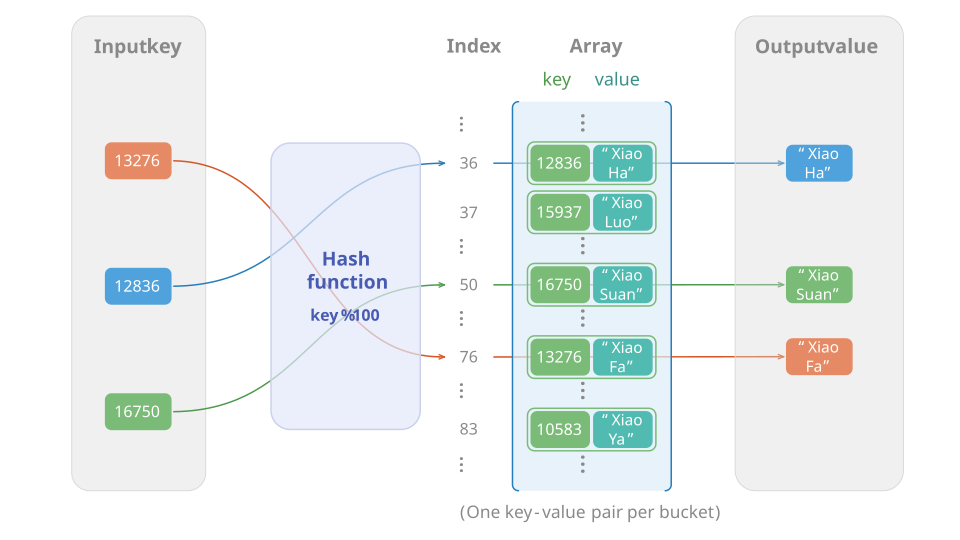
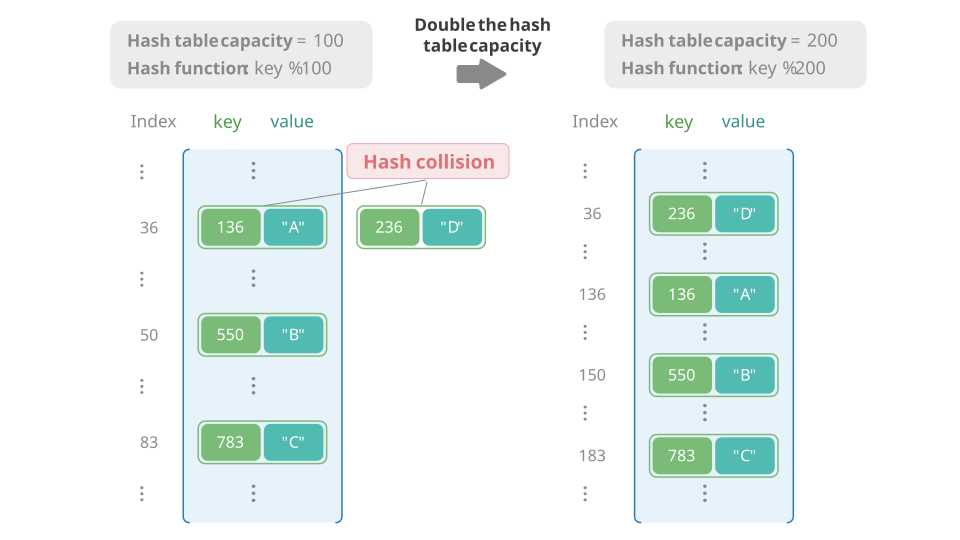

# Hash tables

A <u>hash table</u>, also called a <u>hash map</u>, supports efficient lookup by mapping a `key` to a `value`. Given a key, it can retrieve the corresponding value in $O(1)$ time.

Suppose we have $n$ students, each with a name and a student ID. To support the query “given a student ID, return the corresponding name,” use the hash table shown below.


Arrays and linked lists also support lookup. The table below compares their efficiency.

- **Insertion**: append an element to the end of the array or linked list in $O(1)$ time.
- **Lookup**: because the array or list is unsorted, searching may require visiting every element, taking $O(n)$ time.
- **Deletion**: first find the element, then remove it from the array or list, taking $O(n)$ time.

<p align="center"> Table <id> &nbsp; Comparison of element-lookup efficiency </p>

|          | Array   | Linked list   | Hash table |
| -------- | ------ | ------ | ------ |
| Find an element | $O(n)$ | $O(n)$ | $O(1)$ |
| Insert an element | $O(1)$ | $O(1)$ | $O(1)$ |
| Delete an element | $O(n)$ | $O(n)$ | $O(1)$ |

**Hash-table insertion, deletion, lookup, and updating all take $O(1)$ time**, making them highly efficient.

## Common hash-table operations

Common operations include initialization, lookup, adding key-value pairs, and deleting pairs. Examples follow:

```snippet
hash_map_operations
```

??? pythontutor "Visualize execution"

    @tutor hash_map_operations_tutor

There are three common ways to traverse a hash table: visit key-value pairs, keys only, or values only. Examples follow:

```snippet
hash_map_traversal
```

??? pythontutor "Visualize execution"

    @tutor hash_map_traversal_tutor

## A simple implementation

Start with the simplest case: **implement a hash table using just one array**. Each slot is called a <u>bucket</u> and holds one key-value pair. A lookup finds the bucket corresponding to `key` and retrieves its `value`.

How do we locate the bucket for a key? A <u>hash function</u> maps a larger input space into a smaller output space. Here, the inputs are all possible keys, and the outputs are bucket indices. **Given a key, the hash function tells us where its key-value pair is stored in the array**.

For an input `key`, the calculation has two steps.

1. Use a hash algorithm, `hash()`, to calculate a hash value.
2. Take that value modulo the number of buckets, the array length `capacity`, to obtain the bucket index `index`.

```shell
index = hash(key) % capacity
```

Use `index` to access the bucket and retrieve `value`.

If `capacity = 100` and `hash(key) = key`, the resulting hash function is `key % 100`. The figure below illustrates it with student IDs as keys and names as values.



The code below implements a simple hash table. The `Pair` class groups a `key` and `value` into a key-value pair.

```src
[file]{array_hash_map}-[class]{array_hash_map}-[func]{}
```

## Collisions and expansion

A hash function maps the input space of all possible keys into the output space of array indices. The input space is usually far larger, **so multiple inputs must theoretically map to the same output**.

For the function above, keys with the same last two digits produce the same output. Looking up student IDs 12836 and 20336 gives:

```shell
12836 % 100 = 36
20336 % 100 = 36
```

As shown below, both IDs point to the same name, which is clearly incorrect. This situation, where different inputs produce the same output, is called a <u>hash collision</u>.


A larger table capacity $n$ makes it less likely that several keys share a bucket, reducing collisions. **Expanding the hash table can therefore reduce hash collisions**.

In the example below, `(136, A)` and `(236, D)` collide before expansion but no longer collide afterward.



As with array expansion, expanding a hash table requires moving every pair into a new table, which is time-consuming. Because `capacity` changes, the hash function must also recalculate every pair's position, adding further computation. Programming languages therefore usually reserve enough capacity to avoid frequent expansion.

The <u>load factor</u> is the number of elements divided by the number of buckets. It measures how crowded the table is and **often serves as the trigger for expansion**. For example, in Java, a load factor above $0.75$ causes the capacity to grow to $2$ times its previous size.
