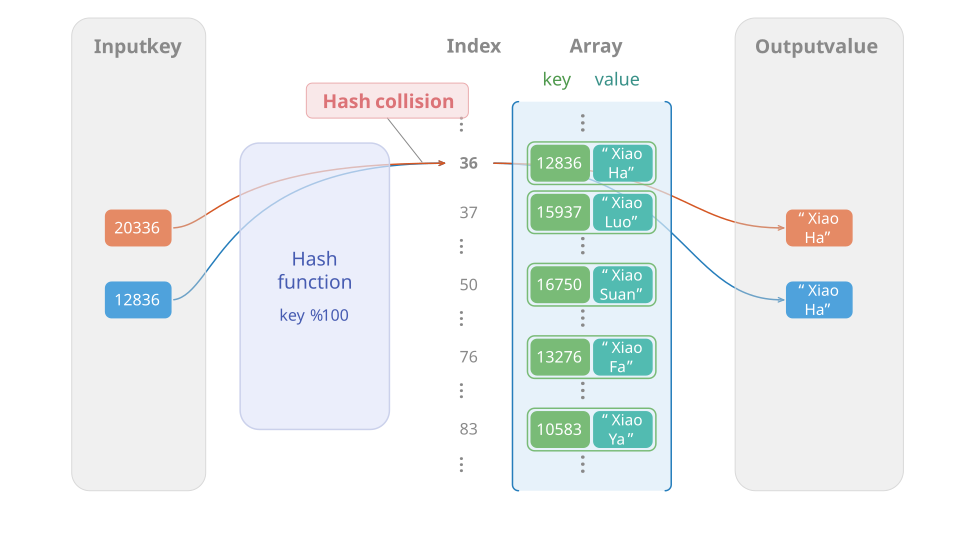

# Hash table

A <u>hash table</u>, also called a <u>hash map</u>, maps each `key` to its `value` for efficient lookup. Given a `key`, the table can retrieve the corresponding `value` in $O(1)$ time.

The figure below shows $n$ students, each with a name and a student ID. To look up a name by entering the corresponding ID, we can use the hash table shown.


Arrays and linked lists also support lookups. The table below compares their efficiency with that of a hash table.

- **Insertion**. Appending an element to the end of the array or linked list takes $O(1)$ time.
- **Lookup**. Since the array or linked list is unordered, finding a match may require scanning all the elements, taking $O(n)$ time.
- **Deletion**. First find the element, then remove it from the array or linked list. This takes $O(n)$ time.

<p align="center"> Table <id> &nbsp; Comparing element lookup efficiency </p>

|          | Array   | Linked list   | Hash table |
| -------- | ------ | ------ | ------ |
| Lookup | $O(n)$ | $O(n)$ | $O(1)$ |
| Insertion | $O(1)$ | $O(1)$ | $O(1)$ |
| Deletion | $O(n)$ | $O(n)$ | $O(1)$ |

As the table shows, **insertion, deletion, lookup, and update all take $O(1)$ time in a hash table**, making these operations highly efficient.

## Common hash table operations

Common operations include initializing a hash table, looking up a value, inserting a key-value pair, and deleting a pair. The following code illustrates these operations.

```snippet
hash_map_operations
```

??? pythontutor "Visualize execution"

    @tutor hash_map_operations_tutor

There are three common ways to iterate over a hash table: visit its key-value pairs, its keys, or its values. The following code shows all three.

```snippet
hash_map_traversal
```

??? pythontutor "Visualize execution"

    @tutor hash_map_traversal_tutor

## A simple hash table implementation

Let’s start with the simplest case and **implement a hash table using only an array**. Each slot in the array is called a <u>bucket</u> and can hold one key-value pair. To look up a value, find the bucket for `key` and retrieve `value` from it.

How do we locate the bucket for a given `key`? We use a <u>hash function</u>, which maps a large input space to a smaller output space. In a hash table, the inputs are all possible values of `key`, and the outputs are the buckets (array indices). In other words, given a `key`, **the hash function tells us where the pair for that `key` is stored in the array**.

Given a `key`, the hash function performs two steps.

1. Compute a hash value using a hash algorithm `hash()`.
2. Take the hash value modulo `capacity`, the number of buckets (the array length). This gives the bucket for `key` at array index `index`.

```shell
index = hash(key) % capacity
```

We can then use `index` to access the corresponding bucket and retrieve `value`.

Suppose the array length is `capacity = 100` and the hash algorithm is `hash(key) = key`. Then the hash function is simply `key % 100`. The figure below shows how it works with a student ID as `key` and a name as `value`.


The following code implements a simple hash table. We group `key` and `value` into a class called `Pair` to represent a key-value pair.

```src
[file]{array_hash_map}-[class]{array_hash_map}-[func]{}
```

## Hash collisions and resizing

A hash function maps the input space of all possible `key` values to the output space of array indices. The input space is typically much larger, so **some distinct inputs must map to the same output**.

For the hash function above, inputs `key` with the same last two digits produce the same result. For example, looking up student IDs 12836 and 20336 gives us the following:

```shell
12836 % 100 = 36
20336 % 100 = 36
```

As the figure below shows, both IDs point to the same name, giving an incorrect result. When different inputs produce the same output, we call it a <u>hash collision</u>.



The larger the table capacity $n$, the less likely different `key` inputs are to land in the same bucket, so fewer collisions occur. We can therefore **reduce collisions by expanding the hash table**.

In the figure below, the pairs `(136, A)` and `(236, D)` collide before expansion. After expansion, they occupy different buckets.


As with growing an array, expanding a hash table takes time because all key-value pairs must move from the old table to the new one. Because `capacity` changes, we must also use the hash function to recompute the position of every pair, adding to the cost. To avoid frequent resizing, programming languages typically reserve sufficient capacity in advance.

An important measure called the <u>load factor</u> is the number of elements in the hash table divided by the number of buckets. It indicates how severe collisions are likely to be and **often determines when to expand the table**. In Java, for example, when the load factor exceeds $0.75$, the system expands the table to $2$ times its previous capacity.
