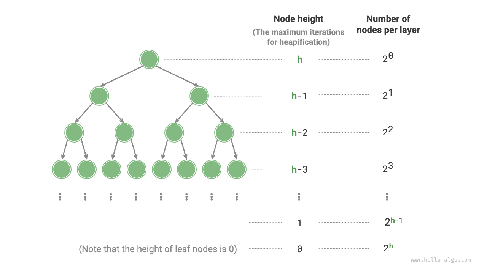

# Building a heap

Sometimes we want to construct a heap from all the elements of a list. This process is called “building a heap.”

## Building through insertion

First create an empty heap, then traverse the list and insert each element: append it to the end of the heap, then sift it upward.

Each insertion increases the heap's length by one. Since nodes are added to the binary tree from the top down, this constructs the heap “top down.”

For $n$ elements, each insertion takes $O(\log{n})$ time, so this method takes $O(n \log n)$ overall.

## Building by sifting nodes down

We can build a heap more efficiently in two steps.

1. Copy all list elements into the heap without changing their order. The heap property may not yet hold.
2. Traverse the heap in reverse level order, sifting down each non-leaf node.

**After a node is sifted down, the subtree rooted at that node is a valid heap**. Since the traversal is reversed, the heap is built “bottom up.”

Reverse traversal ensures that the subtrees below the current node are already valid heaps, which is necessary for sifting down the current node to work correctly.

**Leaf nodes have no children and are already valid heaps, so they need no sifting**. As the code below shows, the last non-leaf node is the parent of the last node. Start there and traverse backward, sifting each node down:

```src
[file]{my_heap}-[class]{max_heap}-[func]{__init__}
```

## Complexity analysis

Let us derive the time complexity of the second method.

- A complete binary tree with $n$ nodes has $(n + 1) / 2$ leaves, where $/$ denotes integer division rounded down. Therefore, $n / 2$ nodes need sifting.
- A node can move at most as far as a leaf during sifting, so the maximum number of iterations is the tree height, $\log n$.

Multiplying these gives a time complexity of $O(n \log n)$. **However, this estimate is not tight, because it ignores the fact that there are far more nodes near the bottom of the tree than near the top**.

For a more accurate calculation, assume a perfect binary tree with $n$ nodes and height $h$. This simplifies the calculation without affecting the validity of the result.



As shown above, the maximum number of sift-down iterations for a node equals its distance to a leaf, which is its height. Summing “number of nodes $\times$ node height” over all levels therefore gives **the total number of sifting iterations across all nodes**.

$$
T(h) = 2^0h + 2^1(h-1) + 2^2(h-2) + \dots + 2^{(h-1)}\times1
$$

To simplify this expression, use a standard series technique. First multiply $T(h)$ by $2$:

$$
\begin{aligned}
T(h) & = 2^0h + 2^1(h-1) + 2^2(h-2) + \dots + 2^{h-1}\times1 \newline
2 T(h) & = 2^1h + 2^2(h-1) + 2^3(h-2) + \dots + 2^{h}\times1 \newline
\end{aligned}
$$

Subtract the first expression, $T(h)$, from the shifted expression, $2 T(h)$:

$$
2T(h) - T(h) = T(h) = -2^0h + 2^1 + 2^2 + \dots + 2^{h-1} + 2^h
$$

The powers of two in $T(h)$ form a geometric series. Applying the sum formula gives:

$$
\begin{aligned}
T(h) & = 2 \frac{1 - 2^h}{1 - 2} - h \newline
& = 2^{h+1} - h - 2 \newline
& = O(2^h)
\end{aligned}
$$

A perfect binary tree of height $h$ has $n = 2^{h+1} - 1$ nodes, so $O(2^h) = O(n)$. This shows that **building a heap from an input list takes $O(n)$ time and is highly efficient**.
