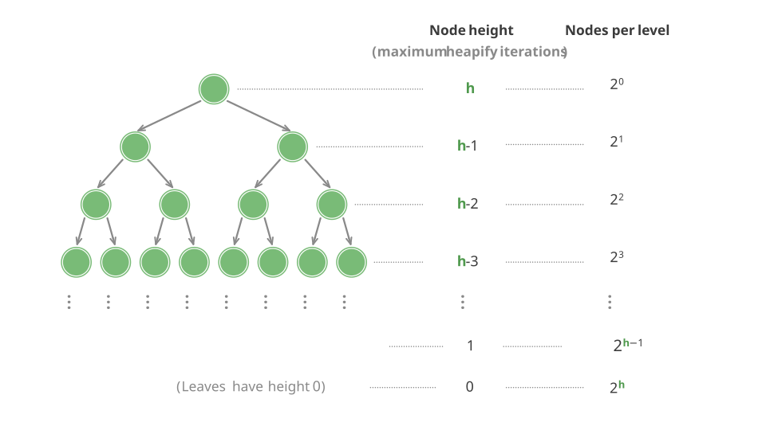

# Building a heap

Sometimes we want to construct a heap from all the elements in a list. This process is called building a heap.

## Building a heap by insertion

First create an empty heap. Traverse the list and push each element in turn: append the element to the end of the heap, then sift it up.

Each insertion increases the heap size by one. Because nodes are added to the binary tree in order from top to bottom, this method builds the heap from the top down.

For $n$ elements, each insertion takes $O(\log{n})$ time, so building a heap this way takes $O(n \log n)$ time.

## Building a heap by sifting down

We can build the heap more efficiently in two steps.

1. Place all elements in the heap in their original order. The heap property may not yet hold.
2. Traverse the heap in reverse level order, sifting down from each non-leaf node in turn.

**After a node is sifted down, the subtree rooted at its original position is a valid heap**. Because we traverse in reverse order, the heap is built from the bottom up.

Reverse traversal ensures that the subtrees below the current node are already valid heaps. This is what makes sifting down from the current node effective.

**Leaves have no children, so they are already valid heaps and need no sifting**. As the code below shows, the last non-leaf node is the parent of the last node. Start there and work backward, sifting down at each position.

```src
[file]{my_heap}-[class]{max_heap}-[func]{__init__}
```

## Complexity analysis

Let us derive the time complexity of the second method.

- A complete binary tree with $n$ nodes has $(n + 1) / 2$ leaves, where $/$ denotes floor division. The number of nodes that need sifting is therefore $n / 2$.
- A node can sift down no farther than a leaf, so the maximum number of iterations is the tree height $\log n$.

Multiplying these quantities gives a time bound of $O(n \log n)$ for building the heap. **This estimate is loose because it overlooks the fact that many more nodes are near the bottom of the tree than near the top**.

For a closer count, suppose we have a perfect binary tree with $n$ nodes and height $h$. This assumption simplifies the calculation without changing the resulting complexity.



As the figure shows, the maximum number of sift-down iterations for a node equals the distance from that node to a leaf, which is the node's height in this tree. Summing “number of nodes $\times$ node height” over all levels gives **the total number of heapify iterations in the worst case**.

$$
T(h) = 2^0h + 2^1(h-1) + 2^2(h-2) + \dots + 2^{(h-1)}\times1
$$

We can simplify the expression using a familiar series calculation. First multiply $T(h)$ by $2$ to get

$$
\begin{aligned}
T(h) & = 2^0h + 2^1(h-1) + 2^2(h-2) + \dots + 2^{h-1}\times1 \newline
2 T(h) & = 2^1h + 2^2(h-1) + 2^3(h-2) + \dots + 2^{h}\times1 \newline
\end{aligned}
$$

Shift and subtract: subtract the expression above, $T(h)$, from the following expression, $2 T(h)$, to obtain

$$
2T(h) - T(h) = T(h) = -2^0h + 2^1 + 2^2 + \dots + 2^{h-1} + 2^h
$$

The term $T(h)$ is a geometric series. Applying the sum formula gives the following time complexity:

$$
\begin{aligned}
T(h) & = 2 \frac{1 - 2^h}{1 - 2} - h \newline
& = 2^{h+1} - h - 2 \newline
& = O(2^h)
\end{aligned}
$$

A perfect binary tree of height $h$ has $n = 2^{h+1} - 1$ nodes, so the complexity is $O(2^h) = O(n)$. Thus, **building a heap from an input list takes only $O(n)$ time**.
