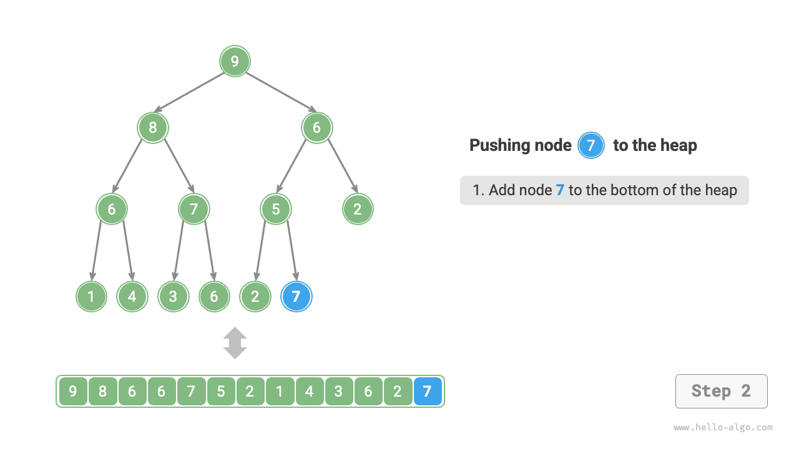
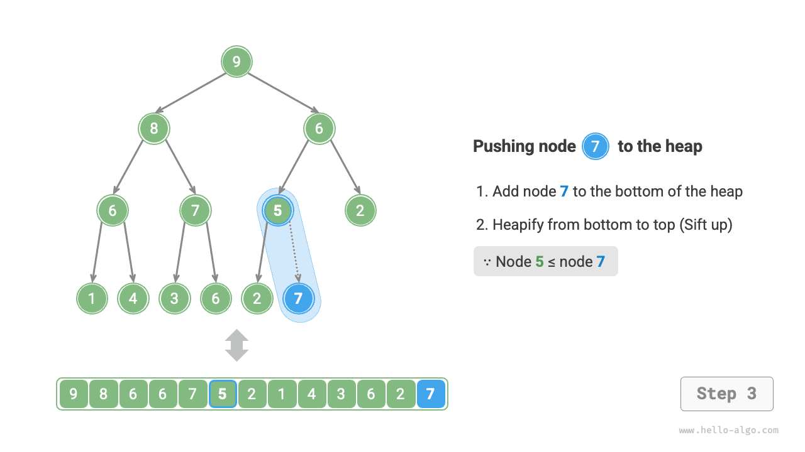
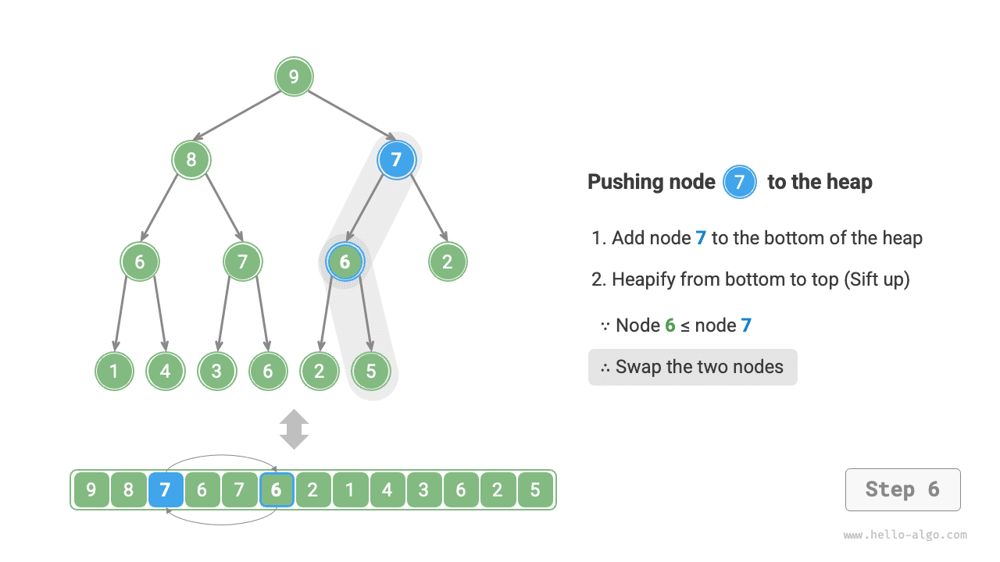
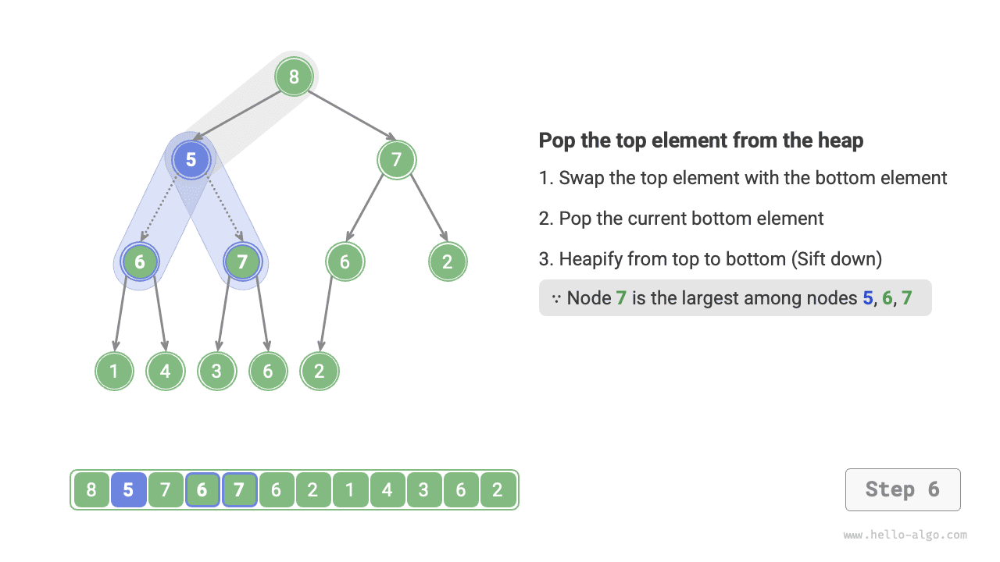
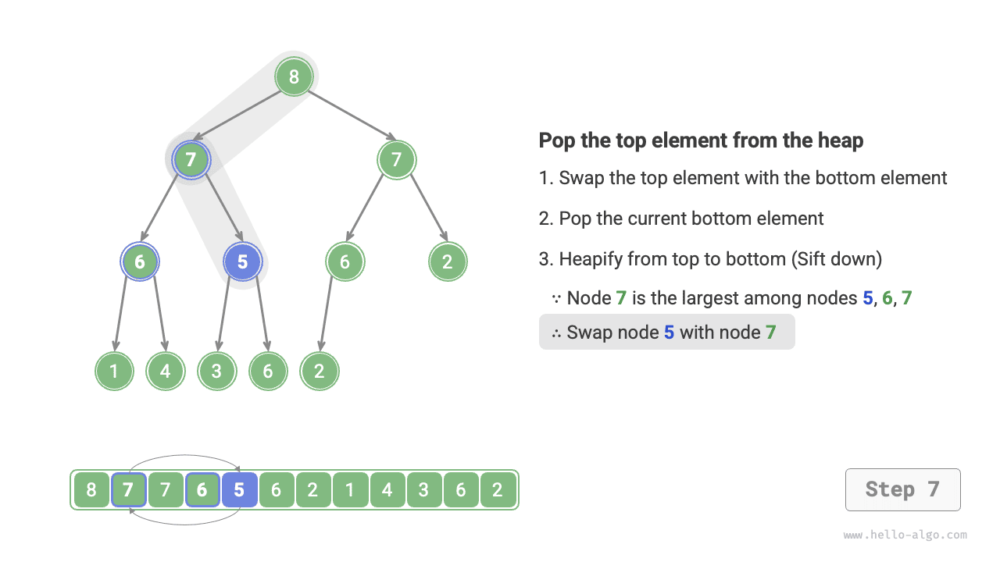
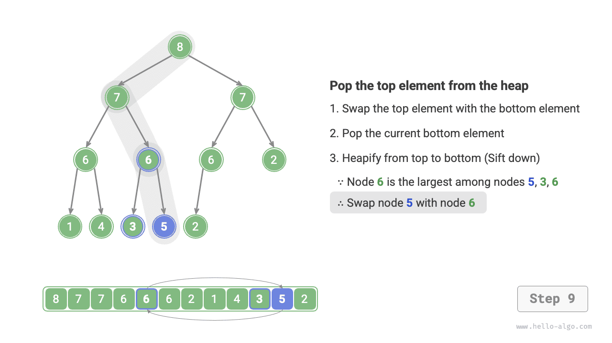

# 8.1 &nbsp; Heaps

A <u>heap</u> is a complete binary tree that satisfies a particular ordering condition. There are two main types, shown below.

- <u>Min heap</u>: every node's value is $\leq$ the values of its children.
- <u>Max heap</u>: every node's value is $\geq$ the values of its children.

{ class="animation-figure" }

<p align="center"> Figure 8-1 &nbsp; A min heap and a max heap </p>

As a special kind of complete binary tree, a heap has the following properties.

- The lowest level is filled from left to right, and all other levels are full.
- The root is the “top” of the heap, while the rightmost node on the lowest level is its “last” node.
- In a max heap or min heap, the root holds the largest or smallest value, respectively.

## 8.1.1 &nbsp; Common heap operations

Many programming languages provide a <u>priority queue</u>, an abstract data structure whose elements are removed according to priority.

**Heaps are commonly used to implement priority queues. A max heap corresponds to a priority queue that removes elements from largest to smallest**. From the user's perspective, the two can be treated as equivalent. This book therefore does not distinguish them strictly and uses the term “heap” for both.

Table 8-1 lists common operations. Method names depend on the programming language.

<p align="center"> Table 8-1 &nbsp; Efficiency of heap operations </p>

<div class="center-table" markdown>

| Method      | Description                                             | Time complexity  |
| ----------- | ------------------------------------------------ | ----------- |
| `push()`    | Insert an element                                         | $O(\log n)$ |
| `pop()`     | Remove the root element                                     | $O(\log n)$ |
| `peek()`    | Access the root: the maximum in a max heap or minimum in a min heap | $O(1)$      |
| `size()`    | Get the number of elements                                 | $O(1)$      |
| `isEmpty()` | Check whether the heap is empty                                   | $O(1)$      |

</div>

In practice, use the heap or priority-queue class provided by the language.

Just as a sorting algorithm can order values in ascending or descending order, we can switch between min heaps and max heaps by setting a `flag` or changing the `Comparator`:

=== "Python"

    ```python title="heap.py"
    # Initialize a min heap
    min_heap, flag = [], 1
    # Initialize a max heap
    max_heap, flag = [], -1

    # Python's heapq module implements a min heap by default
    # Negate elements before insertion to reverse their order and implement a max heap
    # Here, flag = 1 gives a min heap and flag = -1 gives a max heap

    # Insert elements into the heap
    heapq.heappush(max_heap, flag * 1)
    heapq.heappush(max_heap, flag * 3)
    heapq.heappush(max_heap, flag * 2)
    heapq.heappush(max_heap, flag * 5)
    heapq.heappush(max_heap, flag * 4)

    # Access the root element
    peek: int = flag * max_heap[0] # 5

    # Remove root elements
    # Removed elements form a descending sequence
    val = flag * heapq.heappop(max_heap) # 5
    val = flag * heapq.heappop(max_heap) # 4
    val = flag * heapq.heappop(max_heap) # 3
    val = flag * heapq.heappop(max_heap) # 2
    val = flag * heapq.heappop(max_heap) # 1

    # Get the heap size
    size: int = len(max_heap)

    # Check whether the heap is empty
    is_empty: bool = not max_heap

    # Build a heap from a list
    min_heap: list[int] = [1, 3, 2, 5, 4]
    heapq.heapify(min_heap)
    ```

=== "C++"

    ```cpp title="heap.cpp"
    /* Initialize a heap */
    // Initialize a min heap
    priority_queue<int, vector<int>, greater<int>> minHeap;
    // Initialize a max heap
    priority_queue<int, vector<int>, less<int>> maxHeap;

    /* Insert elements into the heap */
    maxHeap.push(1);
    maxHeap.push(3);
    maxHeap.push(2);
    maxHeap.push(5);
    maxHeap.push(4);

    /* Access the root element */
    int peek = maxHeap.top(); // 5

    /* Remove root elements */
    // Removed elements form a descending sequence
    maxHeap.pop(); // 5
    maxHeap.pop(); // 4
    maxHeap.pop(); // 3
    maxHeap.pop(); // 2
    maxHeap.pop(); // 1

    /* Get the heap size */
    int size = maxHeap.size();

    /* Check whether the heap is empty */
    bool isEmpty = maxHeap.empty();

    /* Build a heap from a list */
    vector<int> input{1, 3, 2, 5, 4};
    priority_queue<int, vector<int>, greater<int>> minHeap(input.begin(), input.end());
    ```

=== "Java"

    ```java title="heap.java"
    /* Initialize a heap */
    // Initialize a min heap
    Queue<Integer> minHeap = new PriorityQueue<>();
    // Initialize a max heap by changing the Comparator with a lambda expression
    Queue<Integer> maxHeap = new PriorityQueue<>((a, b) -> b - a);

    /* Insert elements into the heap */
    maxHeap.offer(1);
    maxHeap.offer(3);
    maxHeap.offer(2);
    maxHeap.offer(5);
    maxHeap.offer(4);

    /* Access the root element */
    int peek = maxHeap.peek(); // 5

    /* Remove root elements */
    // Removed elements form a descending sequence
    peek = maxHeap.poll(); // 5
    peek = maxHeap.poll(); // 4
    peek = maxHeap.poll(); // 3
    peek = maxHeap.poll(); // 2
    peek = maxHeap.poll(); // 1

    /* Get the heap size */
    int size = maxHeap.size();

    /* Check whether the heap is empty */
    boolean isEmpty = maxHeap.isEmpty();

    /* Build a heap from a list */
    minHeap = new PriorityQueue<>(Arrays.asList(1, 3, 2, 5, 4));
    ```

=== "C#"

    ```csharp title="heap.cs"
    /* Initialize a heap */
    // Initialize a min heap
    PriorityQueue<int, int> minHeap = new();
    // Initialize a max heap by changing the Comparer with a lambda expression
    PriorityQueue<int, int> maxHeap = new(Comparer<int>.Create((x, y) => y.CompareTo(x)));

    /* Insert elements into the heap */
    maxHeap.Enqueue(1, 1);
    maxHeap.Enqueue(3, 3);
    maxHeap.Enqueue(2, 2);
    maxHeap.Enqueue(5, 5);
    maxHeap.Enqueue(4, 4);

    /* Access the root element */
    int peek = maxHeap.Peek();//5

    /* Remove root elements */
    // Removed elements form a descending sequence
    peek = maxHeap.Dequeue();  // 5
    peek = maxHeap.Dequeue();  // 4
    peek = maxHeap.Dequeue();  // 3
    peek = maxHeap.Dequeue();  // 2
    peek = maxHeap.Dequeue();  // 1

    /* Get the heap size */
    int size = maxHeap.Count;

    /* Check whether the heap is empty */
    bool isEmpty = maxHeap.Count == 0;

    /* Build a heap from a list */
    minHeap = new PriorityQueue<int, int>([(1, 1), (3, 3), (2, 2), (5, 5), (4, 4)]);
    ```

=== "Go"

    ```go title="heap.go"
    // In Go, implement heap.Interface to build an integer max heap
    // Implementing heap.Interface also requires implementing sort.Interface
    type intHeap []any

    // Push implements the heap.Interface method for inserting an element
    func (h *intHeap) Push(x any) {
        // Push and Pop use pointer receivers
        // because they change the slice length as well as its contents.
        *h = append(*h, x.(int))
    }

    // Pop implements the heap.Interface method used to remove the root element
    func (h *intHeap) Pop() any {
        // The element to remove has been placed at the end
        last := (*h)[len(*h)-1]
        *h = (*h)[:len(*h)-1]
        return last
    }

    // Len implements a sort.Interface method
    func (h *intHeap) Len() int {
        return len(*h)
    }

    // Less implements a sort.Interface method
    func (h *intHeap) Less(i, j int) bool {
        // For a min heap, change this to a less-than comparison
        return (*h)[i].(int) > (*h)[j].(int)
    }

    // Swap implements a sort.Interface method
    func (h *intHeap) Swap(i, j int) {
        (*h)[i], (*h)[j] = (*h)[j], (*h)[i]
    }

    // Top returns the root element
    func (h *intHeap) Top() any {
        return (*h)[0]
    }

    /* Driver Code */
    func TestHeap(t *testing.T) {
        /* Initialize a heap */
        // Initialize a max heap
        maxHeap := &intHeap{}
        heap.Init(maxHeap)
        /* Insert elements into the heap */
        // Call the heap.Interface methods to add elements
        heap.Push(maxHeap, 1)
        heap.Push(maxHeap, 3)
        heap.Push(maxHeap, 2)
        heap.Push(maxHeap, 4)
        heap.Push(maxHeap, 5)

        /* Access the root element */
        top := maxHeap.Top()
        fmt.Printf("The root element is %d\n", top)

        /* Remove root elements */
        // Call the heap.Interface methods to remove elements
        heap.Pop(maxHeap) // 5
        heap.Pop(maxHeap) // 4
        heap.Pop(maxHeap) // 3
        heap.Pop(maxHeap) // 2
        heap.Pop(maxHeap) // 1

        /* Get the heap size */
        size := len(*maxHeap)
        fmt.Printf("The heap contains %d elements\n", size)

        /* Check whether the heap is empty */
        isEmpty := len(*maxHeap) == 0
        fmt.Printf("Is the heap empty: %t\n", isEmpty)
    }
    ```

=== "Swift"

    ```swift title="heap.swift"
    /* Initialize a heap */
    // Swift's Heap type supports both minimum and maximum operations and requires swift-collections
    var heap = Heap<Int>()

    /* Insert elements into the heap */
    heap.insert(1)
    heap.insert(3)
    heap.insert(2)
    heap.insert(5)
    heap.insert(4)

    /* Access the root element */
    var peek = heap.max()!

    /* Remove root elements */
    peek = heap.removeMax() // 5
    peek = heap.removeMax() // 4
    peek = heap.removeMax() // 3
    peek = heap.removeMax() // 2
    peek = heap.removeMax() // 1

    /* Get the heap size */
    let size = heap.count

    /* Check whether the heap is empty */
    let isEmpty = heap.isEmpty

    /* Build a heap from a list */
    let heap2 = Heap([1, 3, 2, 5, 4])
    ```

=== "JS"

    ```javascript title="heap.js"
    // JavaScript provides no built-in Heap class
    ```

=== "TS"

    ```typescript title="heap.ts"
    // TypeScript provides no built-in Heap class
    ```

=== "Dart"

    ```dart title="heap.dart"
    // Dart provides no built-in Heap class
    ```

=== "Rust"

    ```rust title="heap.rs"
    use std::collections::BinaryHeap;
    use std::cmp::Reverse;

    /* Initialize a heap */
    // Initialize a min heap
    let mut min_heap = BinaryHeap::<Reverse<i32>>::new();
    // Initialize a max heap
    let mut max_heap = BinaryHeap::new();

    /* Insert elements into the heap */
    max_heap.push(1);
    max_heap.push(3);
    max_heap.push(2);
    max_heap.push(5);
    max_heap.push(4);

    /* Access the root element */
    let peek = max_heap.peek().unwrap();  // 5

    /* Remove root elements */
    // Removed elements form a descending sequence
    let peek = max_heap.pop().unwrap();   // 5
    let peek = max_heap.pop().unwrap();   // 4
    let peek = max_heap.pop().unwrap();   // 3
    let peek = max_heap.pop().unwrap();   // 2
    let peek = max_heap.pop().unwrap();   // 1

    /* Get the heap size */
    let size = max_heap.len();

    /* Check whether the heap is empty */
    let is_empty = max_heap.is_empty();

    /* Build a heap from a list */
    let min_heap = BinaryHeap::from(vec![Reverse(1), Reverse(3), Reverse(2), Reverse(5), Reverse(4)]);
    ```

=== "C"

    ```c title="heap.c"
    // C provides no built-in Heap class
    ```

=== "Kotlin"

    ```kotlin title="heap.kt"
    /* Initialize a heap */
    // Initialize a min heap
    var minHeap = PriorityQueue<Int>()
    // Initialize a max heap by changing the Comparator with a lambda expression
    val maxHeap = PriorityQueue { a: Int, b: Int -> b - a }

    /* Insert elements into the heap */
    maxHeap.offer(1)
    maxHeap.offer(3)
    maxHeap.offer(2)
    maxHeap.offer(5)
    maxHeap.offer(4)

    /* Access the root element */
    var peek = maxHeap.peek() // 5

    /* Remove root elements */
    // Removed elements form a descending sequence
    peek = maxHeap.poll() // 5
    peek = maxHeap.poll() // 4
    peek = maxHeap.poll() // 3
    peek = maxHeap.poll() // 2
    peek = maxHeap.poll() // 1

    /* Get the heap size */
    val size = maxHeap.size

    /* Check whether the heap is empty */
    val isEmpty = maxHeap.isEmpty()

    /* Build a heap from a list */
    minHeap = PriorityQueue(mutableListOf(1, 3, 2, 5, 4))
    ```

=== "Ruby"

    ```ruby title="heap.rb"
    # Ruby provides no built-in Heap class
    ```

??? pythontutor "Visualize execution"

    <div style="height: 549px; width: 100%;"><iframe class="pythontutor-iframe" title="Visualize execution" src="https://pythontutor.com/iframe-embed.html#code=import%20heapq%0A%0A%22%22%22Driver%20Code%22%22%22%0Aif%20__name__%20%3D%3D%20%22__main__%22%3A%0A%20%20%20%20%23%20Initialize%20a%20min%20heap%0A%20%20%20%20min_heap%2C%20flag%20%3D%20%5B%5D%2C%201%0A%20%20%20%20%23%20Initialize%20a%20max%20heap%0A%20%20%20%20max_heap%2C%20flag%20%3D%20%5B%5D%2C%20-1%0A%20%20%20%20%0A%20%20%20%20%23%20Python%27s%20heapq%20module%20implements%20a%20min%20heap%20by%20default%0A%20%20%20%20%23%20Negate%20elements%20before%20insertion%20to%20reverse%20their%20order%20and%20implement%20a%20max%20heap%0A%20%20%20%20%23%20Here%2C%20flag%20%3D%201%20gives%20a%20min%20heap%20and%20flag%20%3D%20-1%20gives%20a%20max%20heap%0A%20%20%20%20%0A%20%20%20%20%23%20Insert%20elements%20into%20the%20heap%0A%20%20%20%20heapq.heappush%28max_heap%2C%20flag%20%2A%201%29%0A%20%20%20%20heapq.heappush%28max_heap%2C%20flag%20%2A%203%29%0A%20%20%20%20heapq.heappush%28max_heap%2C%20flag%20%2A%202%29%0A%20%20%20%20heapq.heappush%28max_heap%2C%20flag%20%2A%205%29%0A%20%20%20%20heapq.heappush%28max_heap%2C%20flag%20%2A%204%29%0A%20%20%20%20%0A%20%20%20%20%23%20Access%20the%20root%20element%0A%20%20%20%20peek%20%3D%20flag%20%2A%20max_heap%5B0%5D%20%23%205%0A%20%20%20%20%0A%20%20%20%20%23%20Remove%20root%20elements%0A%20%20%20%20%23%20Removed%20elements%20form%20a%20descending%20sequence%0A%20%20%20%20val%20%3D%20flag%20%2A%20heapq.heappop%28max_heap%29%20%23%205%0A%20%20%20%20val%20%3D%20flag%20%2A%20heapq.heappop%28max_heap%29%20%23%204%0A%20%20%20%20val%20%3D%20flag%20%2A%20heapq.heappop%28max_heap%29%20%23%203%0A%20%20%20%20val%20%3D%20flag%20%2A%20heapq.heappop%28max_heap%29%20%23%202%0A%20%20%20%20val%20%3D%20flag%20%2A%20heapq.heappop%28max_heap%29%20%23%201%0A%20%20%20%20%0A%20%20%20%20%23%20Get%20the%20heap%20size%0A%20%20%20%20size%20%3D%20len%28max_heap%29%0A%20%20%20%20%0A%20%20%20%20%23%20Check%20whether%20the%20heap%20is%20empty%0A%20%20%20%20is_empty%20%3D%20not%20max_heap%0A%20%20%20%20%0A%20%20%20%20%23%20Build%20a%20heap%20from%20a%20list%0A%20%20%20%20min_heap%20%3D%20%5B1%2C%203%2C%202%2C%205%2C%204%5D%0A%20%20%20%20heapq.heapify%28min_heap%29&codeDivHeight=472&codeDivWidth=350&cumulative=false&curInstr=3&heapPrimitives=nevernest&origin=opt-frontend.js&py=311&rawInputLstJSON=%5B%5D&textReferences=false"> </iframe></div>
    <div style="margin-top: 5px;"><a href="https://pythontutor.com/iframe-embed.html#code=import%20heapq%0A%0A%22%22%22Driver%20Code%22%22%22%0Aif%20__name__%20%3D%3D%20%22__main__%22%3A%0A%20%20%20%20%23%20Initialize%20a%20min%20heap%0A%20%20%20%20min_heap%2C%20flag%20%3D%20%5B%5D%2C%201%0A%20%20%20%20%23%20Initialize%20a%20max%20heap%0A%20%20%20%20max_heap%2C%20flag%20%3D%20%5B%5D%2C%20-1%0A%20%20%20%20%0A%20%20%20%20%23%20Python%27s%20heapq%20module%20implements%20a%20min%20heap%20by%20default%0A%20%20%20%20%23%20Negate%20elements%20before%20insertion%20to%20reverse%20their%20order%20and%20implement%20a%20max%20heap%0A%20%20%20%20%23%20Here%2C%20flag%20%3D%201%20gives%20a%20min%20heap%20and%20flag%20%3D%20-1%20gives%20a%20max%20heap%0A%20%20%20%20%0A%20%20%20%20%23%20Insert%20elements%20into%20the%20heap%0A%20%20%20%20heapq.heappush%28max_heap%2C%20flag%20%2A%201%29%0A%20%20%20%20heapq.heappush%28max_heap%2C%20flag%20%2A%203%29%0A%20%20%20%20heapq.heappush%28max_heap%2C%20flag%20%2A%202%29%0A%20%20%20%20heapq.heappush%28max_heap%2C%20flag%20%2A%205%29%0A%20%20%20%20heapq.heappush%28max_heap%2C%20flag%20%2A%204%29%0A%20%20%20%20%0A%20%20%20%20%23%20Access%20the%20root%20element%0A%20%20%20%20peek%20%3D%20flag%20%2A%20max_heap%5B0%5D%20%23%205%0A%20%20%20%20%0A%20%20%20%20%23%20Remove%20root%20elements%0A%20%20%20%20%23%20Removed%20elements%20form%20a%20descending%20sequence%0A%20%20%20%20val%20%3D%20flag%20%2A%20heapq.heappop%28max_heap%29%20%23%205%0A%20%20%20%20val%20%3D%20flag%20%2A%20heapq.heappop%28max_heap%29%20%23%204%0A%20%20%20%20val%20%3D%20flag%20%2A%20heapq.heappop%28max_heap%29%20%23%203%0A%20%20%20%20val%20%3D%20flag%20%2A%20heapq.heappop%28max_heap%29%20%23%202%0A%20%20%20%20val%20%3D%20flag%20%2A%20heapq.heappop%28max_heap%29%20%23%201%0A%20%20%20%20%0A%20%20%20%20%23%20Get%20the%20heap%20size%0A%20%20%20%20size%20%3D%20len%28max_heap%29%0A%20%20%20%20%0A%20%20%20%20%23%20Check%20whether%20the%20heap%20is%20empty%0A%20%20%20%20is_empty%20%3D%20not%20max_heap%0A%20%20%20%20%0A%20%20%20%20%23%20Build%20a%20heap%20from%20a%20list%0A%20%20%20%20min_heap%20%3D%20%5B1%2C%203%2C%202%2C%205%2C%204%5D%0A%20%20%20%20heapq.heapify%28min_heap%29&codeDivHeight=800&codeDivWidth=600&cumulative=false&curInstr=3&heapPrimitives=nevernest&origin=opt-frontend.js&py=311&rawInputLstJSON=%5B%5D&textReferences=false" target="_blank" rel="noopener noreferrer">View full screen ></a></div>

## 8.1.2 &nbsp; Implementing a heap

The following implementation is a max heap. To turn it into a min heap, reverse every ordering comparison, for example replacing $\geq$ with $\leq$. Interested readers can try this themselves.

### 1. &nbsp; Storage and representation

The binary-tree chapter showed that complete binary trees are well suited to array representation. Since a heap is a complete binary tree, **we will store it in an array**.

In an array representation, elements store node values and indices identify positions in the tree. **Index-mapping formulas take the place of node pointers**.

As shown below, a node at index $i$ has its left child at $2i + 1$, its right child at $2i + 2$, and its parent at $(i - 1) / 2$, rounded down. An out-of-bounds index represents a missing node.

{ class="animation-figure" }

<p align="center"> Figure 8-2 &nbsp; Representing and storing a heap </p>

Wrap the index formulas in functions for convenient use:

=== "Python"

    ```python title="my_heap.py"
    def left(self, i: int) -> int:
        """Get the left child index"""
        return 2 * i + 1

    def right(self, i: int) -> int:
        """Get the right child index"""
        return 2 * i + 2

    def parent(self, i: int) -> int:
        """Get the parent index"""
        return (i - 1) // 2  # Floor division
    ```

=== "C++"

    ```cpp title="my_heap.cpp"
    /* Get the left child index */
    int left(int i) {
        return 2 * i + 1;
    }

    /* Get the right child index */
    int right(int i) {
        return 2 * i + 2;
    }

    /* Get the parent index */
    int parent(int i) {
        return (i - 1) / 2; // Integer division truncates toward zero
    }
    ```

=== "Java"

    ```java title="my_heap.java"
    /* Get the left child index */
    int left(int i) {
        return 2 * i + 1;
    }

    /* Get the right child index */
    int right(int i) {
        return 2 * i + 2;
    }

    /* Get the parent index */
    int parent(int i) {
        return (i - 1) / 2; // Integer division (truncates toward zero in Java)
    }
    ```

=== "C#"

    ```csharp title="my_heap.cs"
    /* Get the left child index */
    int Left(int i) {
        return 2 * i + 1;
    }

    /* Get the right child index */
    int Right(int i) {
        return 2 * i + 2;
    }

    /* Get the parent index */
    int Parent(int i) {
        return (i - 1) / 2; // Integer division (truncates toward zero in C#)
    }
    ```

=== "Go"

    ```go title="my_heap.go"
    /* Get the left child index */
    func (h *maxHeap) left(i int) int {
        return 2*i + 1
    }

    /* Get the right child index */
    func (h *maxHeap) right(i int) int {
        return 2*i + 2
    }

    /* Get the parent index */
    func (h *maxHeap) parent(i int) int {
        // Integer division (truncates toward zero in Go)
        return (i - 1) / 2
    }
    ```

=== "Swift"

    ```swift title="my_heap.swift"
    /* Get the left child index */
    func left(i: Int) -> Int {
        2 * i + 1
    }

    /* Get the right child index */
    func right(i: Int) -> Int {
        2 * i + 2
    }

    /* Get the parent index */
    func parent(i: Int) -> Int {
        (i - 1) / 2 // Integer division truncates toward zero
    }
    ```

=== "JS"

    ```javascript title="my_heap.js"
    /* Get the left child index */
    #left(i) {
        return 2 * i + 1;
    }

    /* Get the right child index */
    #right(i) {
        return 2 * i + 2;
    }

    /* Get the parent index */
    #parent(i) {
        return Math.floor((i - 1) / 2); // Floor division
    }
    ```

=== "TS"

    ```typescript title="my_heap.ts"
    /* Get the left child index */
    left(i: number): number {
        return 2 * i + 1;
    }

    /* Get the right child index */
    right(i: number): number {
        return 2 * i + 2;
    }

    /* Get the parent index */
    parent(i: number): number {
        return Math.floor((i - 1) / 2); // Floor division
    }
    ```

=== "Dart"

    ```dart title="my_heap.dart"
    /* Get the left child index */
    int _left(int i) {
      return 2 * i + 1;
    }

    /* Get the right child index */
    int _right(int i) {
      return 2 * i + 2;
    }

    /* Get the parent index */
    int _parent(int i) {
      return (i - 1) ~/ 2; // Integer division
    }
    ```

=== "Rust"

    ```rust title="my_heap.rs"
    /* Get the left child index */
    fn left(i: usize) -> usize {
        2 * i + 1
    }

    /* Get the right child index */
    fn right(i: usize) -> usize {
        2 * i + 2
    }

    /* Get the parent index */
    fn parent(i: usize) -> usize {
        (i - 1) / 2 // Floor division
    }
    ```

=== "C"

    ```c title="my_heap.c"
    /* Get the left child index */
    int left(MaxHeap *maxHeap, int i) {
        return 2 * i + 1;
    }

    /* Get the right child index */
    int right(MaxHeap *maxHeap, int i) {
        return 2 * i + 2;
    }

    /* Get the parent index */
    int parent(MaxHeap *maxHeap, int i) {
        return (i - 1) / 2; // Integer division truncates toward zero
    }
    ```

=== "Kotlin"

    ```kotlin title="my_heap.kt"
    /* Get the left child index */
    fun left(i: Int): Int {
        return 2 * i + 1
    }

    /* Get the right child index */
    fun right(i: Int): Int {
        return 2 * i + 2
    }

    /* Get the parent index */
    fun parent(i: Int): Int {
        return (i - 1) / 2 // Integer division (truncates toward zero in Kotlin)
    }
    ```

=== "Ruby"

    ```ruby title="my_heap.rb"
    ### Get the left child index ###
    def left(i)
      2 * i + 1
    end

    ### Get the right child index ###
    def right(i)
      2 * i + 2
    end

    ### Get the parent index ###
    def parent(i)
      (i - 1) / 2     # Floor division
    end
    ```

### 2. &nbsp; Accessing the root

The heap's root is the first element of the list:

=== "Python"

    ```python title="my_heap.py"
    def peek(self) -> int:
        """Access the top element of the heap"""
        return self.max_heap[0]
    ```

=== "C++"

    ```cpp title="my_heap.cpp"
    /* Access the top element of the heap */
    int peek() {
        return maxHeap[0];
    }
    ```

=== "Java"

    ```java title="my_heap.java"
    /* Access the top element of the heap */
    int peek() {
        return maxHeap.get(0);
    }
    ```

=== "C#"

    ```csharp title="my_heap.cs"
    /* Access the top element of the heap */
    int Peek() {
        return maxHeap[0];
    }
    ```

=== "Go"

    ```go title="my_heap.go"
    /* Access the top element of the heap */
    func (h *maxHeap) peek() any {
        return h.data[0]
    }
    ```

=== "Swift"

    ```swift title="my_heap.swift"
    /* Access the top element of the heap */
    func peek() -> Int {
        maxHeap[0]
    }
    ```

=== "JS"

    ```javascript title="my_heap.js"
    /* Access the top element of the heap */
    peek() {
        return this.#maxHeap[0];
    }
    ```

=== "TS"

    ```typescript title="my_heap.ts"
    /* Access the top element of the heap */
    peek(): number {
        return this.maxHeap[0];
    }
    ```

=== "Dart"

    ```dart title="my_heap.dart"
    /* Access the top element of the heap */
    int peek() {
      return _maxHeap[0];
    }
    ```

=== "Rust"

    ```rust title="my_heap.rs"
    /* Access the top element of the heap */
    fn peek(&self) -> Option<i32> {
        self.max_heap.first().copied()
    }
    ```

=== "C"

    ```c title="my_heap.c"
    /* Access the top element of the heap */
    int peek(MaxHeap *maxHeap) {
        return maxHeap->data[0];
    }
    ```

=== "Kotlin"

    ```kotlin title="my_heap.kt"
    /* Access the top element of the heap */
    fun peek(): Int {
        return maxHeap[0]
    }
    ```

=== "Ruby"

    ```ruby title="my_heap.rb"
    ### Access the top element of the heap ###
    def peek
      @max_heap[0]
    end
    ```

??? pythontutor "Visualize execution"

    <div style="height: 549px; width: 100%;"><iframe class="pythontutor-iframe" title="Visualize execution" src="https://pythontutor.com/iframe-embed.html#code=class%20MaxHeap%3A%0A%20%20%20%20%22%22%22Max%20heap%22%22%22%0A%0A%20%20%20%20def%20__init__%28self,%20nums%3A%20list%5Bint%5D%29%3A%0A%20%20%20%20%20%20%20%20%22%22%22Constructor%22%22%22%0A%20%20%20%20%20%20%20%20%23%20Place%20the%20list%20elements%20in%20the%20heap%20without%20changing%20their%20order%0A%20%20%20%20%20%20%20%20self.max_heap%20%3D%20nums%0A%0A%20%20%20%20def%20left%28self,%20i%3A%20int%29%20-%3E%20int%3A%0A%20%20%20%20%20%20%20%20%22%22%22Get%20the%20left%20child%20index%22%22%22%0A%20%20%20%20%20%20%20%20return%202%20%2A%20i%20%2B%201%0A%0A%20%20%20%20def%20right%28self,%20i%3A%20int%29%20-%3E%20int%3A%0A%20%20%20%20%20%20%20%20%22%22%22Get%20the%20right%20child%20index%22%22%22%0A%20%20%20%20%20%20%20%20return%202%20%2A%20i%20%2B%202%0A%0A%20%20%20%20def%20parent%28self,%20i%3A%20int%29%20-%3E%20int%3A%0A%20%20%20%20%20%20%20%20%22%22%22Get%20the%20parent%20index%22%22%22%0A%20%20%20%20%20%20%20%20return%20%28i%20-%201%29%20//%202%20%20%23%20Floor%20division%0A%0A%20%20%20%20def%20size%28self%29%20-%3E%20int%3A%0A%20%20%20%20%20%20%20%20%22%22%22Get%20the%20heap%20size%22%22%22%0A%20%20%20%20%20%20%20%20return%20len%28self.max_heap%29%0A%0A%20%20%20%20def%20is_empty%28self%29%20-%3E%20bool%3A%0A%20%20%20%20%20%20%20%20%22%22%22Check%20whether%20the%20heap%20is%20empty%22%22%22%0A%20%20%20%20%20%20%20%20return%20self.size%28%29%20%3D%3D%200%0A%0A%20%20%20%20def%20peek%28self%29%20-%3E%20int%3A%0A%20%20%20%20%20%20%20%20%22%22%22Access%20the%20top%20element%20of%20the%20heap%22%22%22%0A%20%20%20%20%20%20%20%20return%20self.max_heap%5B0%5D%0A%0A%0A%22%22%22Driver%20code%22%22%22%0Aif%20__name__%20%3D%3D%20%22__main__%22%3A%0A%20%20%20%20%23%20Initialize%20a%20max%20heap%0A%20%20%20%20%23%20Note%20that%20the%20input%20array%20is%20already%20a%20valid%20heap%20%0A%20%20%20%20max_heap%20%3D%20MaxHeap%28%5B9,%208,%206,%206,%207,%205,%202,%201,%204,%203,%206,%202%5D%29%0A%0A%20%20%20%20%23%20Get%20the%20top%20element%20of%20the%20heap%0A%20%20%20%20peek%20%3D%20max_heap.peek%28%29%0A%20%20%20%20print%28f%22%5CnTop%20element%20of%20the%20heap%3A%20%7Bpeek%7D%22%29&codeDivHeight=472&codeDivWidth=350&cumulative=false&curInstr=7&heapPrimitives=nevernest&origin=opt-frontend.js&py=311&rawInputLstJSON=%5B%5D&textReferences=false"> </iframe></div>
    <div style="margin-top: 5px;"><a href="https://pythontutor.com/iframe-embed.html#code=class%20MaxHeap%3A%0A%20%20%20%20%22%22%22Max%20heap%22%22%22%0A%0A%20%20%20%20def%20__init__%28self,%20nums%3A%20list%5Bint%5D%29%3A%0A%20%20%20%20%20%20%20%20%22%22%22Constructor%22%22%22%0A%20%20%20%20%20%20%20%20%23%20Place%20the%20list%20elements%20in%20the%20heap%20without%20changing%20their%20order%0A%20%20%20%20%20%20%20%20self.max_heap%20%3D%20nums%0A%0A%20%20%20%20def%20left%28self,%20i%3A%20int%29%20-%3E%20int%3A%0A%20%20%20%20%20%20%20%20%22%22%22Get%20the%20left%20child%20index%22%22%22%0A%20%20%20%20%20%20%20%20return%202%20%2A%20i%20%2B%201%0A%0A%20%20%20%20def%20right%28self,%20i%3A%20int%29%20-%3E%20int%3A%0A%20%20%20%20%20%20%20%20%22%22%22Get%20the%20right%20child%20index%22%22%22%0A%20%20%20%20%20%20%20%20return%202%20%2A%20i%20%2B%202%0A%0A%20%20%20%20def%20parent%28self,%20i%3A%20int%29%20-%3E%20int%3A%0A%20%20%20%20%20%20%20%20%22%22%22Get%20the%20parent%20index%22%22%22%0A%20%20%20%20%20%20%20%20return%20%28i%20-%201%29%20//%202%20%20%23%20Floor%20division%0A%0A%20%20%20%20def%20size%28self%29%20-%3E%20int%3A%0A%20%20%20%20%20%20%20%20%22%22%22Get%20the%20heap%20size%22%22%22%0A%20%20%20%20%20%20%20%20return%20len%28self.max_heap%29%0A%0A%20%20%20%20def%20is_empty%28self%29%20-%3E%20bool%3A%0A%20%20%20%20%20%20%20%20%22%22%22Check%20whether%20the%20heap%20is%20empty%22%22%22%0A%20%20%20%20%20%20%20%20return%20self.size%28%29%20%3D%3D%200%0A%0A%20%20%20%20def%20peek%28self%29%20-%3E%20int%3A%0A%20%20%20%20%20%20%20%20%22%22%22Access%20the%20top%20element%20of%20the%20heap%22%22%22%0A%20%20%20%20%20%20%20%20return%20self.max_heap%5B0%5D%0A%0A%0A%22%22%22Driver%20code%22%22%22%0Aif%20__name__%20%3D%3D%20%22__main__%22%3A%0A%20%20%20%20%23%20Initialize%20a%20max%20heap%0A%20%20%20%20%23%20Note%20that%20the%20input%20array%20is%20already%20a%20valid%20heap%20%0A%20%20%20%20max_heap%20%3D%20MaxHeap%28%5B9,%208,%206,%206,%207,%205,%202,%201,%204,%203,%206,%202%5D%29%0A%0A%20%20%20%20%23%20Get%20the%20top%20element%20of%20the%20heap%0A%20%20%20%20peek%20%3D%20max_heap.peek%28%29%0A%20%20%20%20print%28f%22%5CnTop%20element%20of%20the%20heap%3A%20%7Bpeek%7D%22%29&codeDivHeight=800&codeDivWidth=600&cumulative=false&curInstr=7&heapPrimitives=nevernest&origin=opt-frontend.js&py=311&rawInputLstJSON=%5B%5D&textReferences=false" target="_blank" rel="noopener noreferrer">View full screen ></a></div>

### 3. &nbsp; Inserting an element

To insert `val`, first append it at the end of the heap. Since it may be larger than other elements, this can violate the heap property. **We must restore the property along the path from the inserted node to the root**, an operation called <u>heapifying</u>.

Start at the inserted node and **sift upward**. As shown below, compare it with its parent and swap them if the inserted value is larger. Repeat upward until the root is reached or no swap is needed.

=== "<1>"
    { class="animation-figure" }

=== "<2>"
    { class="animation-figure" }

=== "<3>"
    { class="animation-figure" }

=== "<4>"
    { class="animation-figure" }

=== "<5>"
    { class="animation-figure" }

=== "<6>"
    { class="animation-figure" }

=== "<7>"
    { class="animation-figure" }

=== "<8>"
    { class="animation-figure" }

=== "<9>"
    { class="animation-figure" }

<p align="center"> Figure 8-3 &nbsp; Steps for inserting into a heap </p>

With $n$ nodes, the tree height is $O(\log n)$, so sifting takes at most $O(\log n)$ iterations. **Insertion therefore takes $O(\log n)$ time**. The code is as follows:

=== "Python"

    ```python title="my_heap.py"
    def push(self, val: int):
        """Push an element onto the heap"""
        # Add a node
        self.max_heap.append(val)
        # Sift up
        self.sift_up(self.size() - 1)

    def sift_up(self, i: int):
        """Sift up starting from node i"""
        while True:
            # Get the parent of node i
            p = self.parent(i)
            # Stop sifting when the root has been passed or the node needs no repair
            if p < 0 or self.max_heap[i] <= self.max_heap[p]:
                break
            # Swap the two nodes
            self.swap(i, p)
            # Continue sifting up
            i = p
    ```

=== "C++"

    ```cpp title="my_heap.cpp"
    /* Push an element onto the heap */
    void push(int val) {
        // Add a node
        maxHeap.push_back(val);
        // Sift up
        siftUp(size() - 1);
    }

    /* Sift up starting from node i */
    void siftUp(int i) {
        while (true) {
            // Get the parent of node i
            int p = parent(i);
            // Stop sifting when the root has been passed or the node needs no repair
            if (p < 0 || maxHeap[i] <= maxHeap[p])
                break;
            // Swap the two nodes
            swap(maxHeap[i], maxHeap[p]);
            // Continue sifting up
            i = p;
        }
    }
    ```

=== "Java"

    ```java title="my_heap.java"
    /* Push an element onto the heap */
    void push(int val) {
        // Add a node
        maxHeap.add(val);
        // Sift up
        siftUp(size() - 1);
    }

    /* Sift up starting from node i */
    void siftUp(int i) {
        while (true) {
            // Get the parent of node i
            int p = parent(i);
            // Stop sifting when the root has been passed or the node needs no repair
            if (p < 0 || maxHeap.get(i) <= maxHeap.get(p))
                break;
            // Swap the two nodes
            swap(i, p);
            // Continue sifting up
            i = p;
        }
    }
    ```

=== "C#"

    ```csharp title="my_heap.cs"
    /* Push an element onto the heap */
    void Push(int val) {
        // Add a node
        maxHeap.Add(val);
        // Sift up
        SiftUp(Size() - 1);
    }

    /* Sift up starting from node i */
    void SiftUp(int i) {
        while (true) {
            // Get the parent of node i
            int p = Parent(i);
            // Stop sifting if the root has been passed or the node needs no adjustment
            if (p < 0 || maxHeap[i] <= maxHeap[p])
                break;
            // Swap the two nodes
            Swap(i, p);
            // Continue sifting up
            i = p;
        }
    }
    ```

=== "Go"

    ```go title="my_heap.go"
    /* Push an element onto the heap */
    func (h *maxHeap) push(val any) {
        // Add a node
        h.data = append(h.data, val)
        // Sift up
        h.siftUp(len(h.data) - 1)
    }

    /* Sift up starting from node i */
    func (h *maxHeap) siftUp(i int) {
        for true {
            // Get the parent of node i
            p := h.parent(i)
            // Stop sifting when the root has been passed or the node needs no repair
            if p < 0 || h.data[i].(int) <= h.data[p].(int) {
                break
            }
            // Swap the two nodes
            h.swap(i, p)
            // Continue sifting up
            i = p
        }
    }
    ```

=== "Swift"

    ```swift title="my_heap.swift"
    /* Push an element onto the heap */
    func push(val: Int) {
        // Add a node
        maxHeap.append(val)
        // Sift up
        siftUp(i: size() - 1)
    }

    /* Sift up starting from node i */
    func siftUp(i: Int) {
        var i = i
        while true {
            // Get the parent of node i
            let p = parent(i: i)
            // Stop when the parent index is invalid or the node already satisfies the heap order
            if p < 0 || maxHeap[i] <= maxHeap[p] {
                break
            }
            // Swap the two nodes
            swap(i: i, j: p)
            // Continue sifting up
            i = p
        }
    }
    ```

=== "JS"

    ```javascript title="my_heap.js"
    /* Push an element onto the heap */
    push(val) {
        // Add a node
        this.#maxHeap.push(val);
        // Sift up
        this.#siftUp(this.size() - 1);
    }

    /* Sift up starting from node i */
    #siftUp(i) {
        while (true) {
            // Get the parent of node i
            const p = this.#parent(i);
            // Stop sifting when the root has been passed or the node needs no repair
            if (p < 0 || this.#maxHeap[i] <= this.#maxHeap[p]) break;
            // Swap the two nodes
            this.#swap(i, p);
            // Continue sifting up
            i = p;
        }
    }
    ```

=== "TS"

    ```typescript title="my_heap.ts"
    /* Push an element onto the heap */
    push(val: number): void {
        // Add a node
        this.maxHeap.push(val);
        // Sift up
        this.siftUp(this.size() - 1);
    }

    /* Sift up starting from node i */
    siftUp(i: number): void {
        while (true) {
            // Get the parent of node i
            const p = this.parent(i);
            // Stop sifting when the root has been passed or the node needs no repair
            if (p < 0 || this.maxHeap[i] <= this.maxHeap[p]) break;
            // Swap the two nodes
            this.swap(i, p);
            // Continue sifting up
            i = p;
        }
    }
    ```

=== "Dart"

    ```dart title="my_heap.dart"
    /* Push an element onto the heap */
    void push(int val) {
      // Add a node
      _maxHeap.add(val);
      // Sift up
      siftUp(size() - 1);
    }

    /* Sift up starting from node i */
    void siftUp(int i) {
      while (true) {
        // Get the parent of node i
        int p = _parent(i);
        // Stop sifting when the root has been passed or the node needs no repair
        if (p < 0 || _maxHeap[i] <= _maxHeap[p]) {
          break;
        }
        // Swap the two nodes
        _swap(i, p);
        // Continue sifting up
        i = p;
      }
    }
    ```

=== "Rust"

    ```rust title="my_heap.rs"
    /* Push an element onto the heap */
    fn push(&mut self, val: i32) {
        // Add a node
        self.max_heap.push(val);
        // Sift up
        self.sift_up(self.size() - 1);
    }

    /* Sift up starting from node i */
    fn sift_up(&mut self, mut i: usize) {
        loop {
            // Stop sifting up if node i is already the root
            if i == 0 {
                break;
            }
            // Get the parent of node i
            let p = Self::parent(i);
            // Stop sifting up when the node already satisfies the heap property
            if self.max_heap[i] <= self.max_heap[p] {
                break;
            }
            // Swap the two nodes
            self.swap(i, p);
            // Continue sifting up
            i = p;
        }
    }
    ```

=== "C"

    ```c title="my_heap.c"
    /* Push an element onto the heap */
    void push(MaxHeap *maxHeap, int val) {
        // Normally, the number of nodes should remain below this limit
        if (maxHeap->size == MAX_SIZE) {
            printf("Heap is full!");
            return;
        }
        // Add a node
        maxHeap->data[maxHeap->size] = val;
        maxHeap->size++;

        // Sift up
        siftUp(maxHeap, maxHeap->size - 1);
    }

    /* Sift up starting from node i */
    void siftUp(MaxHeap *maxHeap, int i) {
        while (true) {
            // Get the parent of node i
            int p = parent(maxHeap, i);
            // Stop sifting when the root has been passed or the node needs no repair
            if (p < 0 || maxHeap->data[i] <= maxHeap->data[p]) {
                break;
            }
            // Swap the two nodes
            swap(maxHeap, i, p);
            // Continue sifting up
            i = p;
        }
    }
    ```

=== "Kotlin"

    ```kotlin title="my_heap.kt"
    /* Push an element onto the heap */
    fun push(_val: Int) {
        // Add a node
        maxHeap.add(_val)
        // Sift up
        siftUp(size() - 1)
    }

    /* Sift up starting from node i */
    fun siftUp(it: Int) {
        // Kotlin function parameters are immutable, so create a temporary variable
        var i = it
        while (true) {
            // Get the parent of node i
            val p = parent(i)
            // Stop sifting when the root has been passed or the node needs no repair
            if (p < 0 || maxHeap[i] <= maxHeap[p]) break
            // Swap the two nodes
            swap(i, p)
            // Continue sifting up
            i = p
        }
    }
    ```

=== "Ruby"

    ```ruby title="my_heap.rb"
    ### Push an element onto the heap ###
    def push(val)
      # Add a node
      @max_heap << val
      # Sift up
      sift_up(size - 1)
    end

    ### Sift up starting from node i ###
    def sift_up(i)
      loop do
        # Get the parent of node i
        p = parent(i)
        # Stop sifting when the root has been passed or the node needs no repair
        break if p < 0 || @max_heap[i] <= @max_heap[p]
        # Swap the two nodes
        swap(i, p)
        # Continue sifting up
        i = p
      end
    end
    ```

??? pythontutor "Visualize execution"

    <div style="height: 549px; width: 100%;"><iframe class="pythontutor-iframe" title="Visualize execution" src="https://pythontutor.com/iframe-embed.html#code=class%20MaxHeap%3A%0A%20%20%20%20%22%22%22Max%20heap%22%22%22%0A%0A%20%20%20%20def%20__init__%28self,%20nums%3A%20list%5Bint%5D%29%3A%0A%20%20%20%20%20%20%20%20%22%22%22Constructor%22%22%22%0A%20%20%20%20%20%20%20%20%23%20Place%20the%20list%20elements%20in%20the%20heap%20without%20changing%20their%20order%0A%20%20%20%20%20%20%20%20self.max_heap%20%3D%20nums%0A%0A%20%20%20%20def%20left%28self,%20i%3A%20int%29%20-%3E%20int%3A%0A%20%20%20%20%20%20%20%20%22%22%22Get%20the%20left%20child%20index%22%22%22%0A%20%20%20%20%20%20%20%20return%202%20%2A%20i%20%2B%201%0A%0A%20%20%20%20def%20right%28self,%20i%3A%20int%29%20-%3E%20int%3A%0A%20%20%20%20%20%20%20%20%22%22%22Get%20the%20right%20child%20index%22%22%22%0A%20%20%20%20%20%20%20%20return%202%20%2A%20i%20%2B%202%0A%0A%20%20%20%20def%20parent%28self,%20i%3A%20int%29%20-%3E%20int%3A%0A%20%20%20%20%20%20%20%20%22%22%22Get%20the%20parent%20index%22%22%22%0A%20%20%20%20%20%20%20%20return%20%28i%20-%201%29%20//%202%20%20%23%20Floor%20division%0A%0A%20%20%20%20def%20swap%28self,%20i%3A%20int,%20j%3A%20int%29%3A%0A%20%20%20%20%20%20%20%20%22%22%22Swap%20elements%22%22%22%0A%20%20%20%20%20%20%20%20self.max_heap%5Bi%5D,%20self.max_heap%5Bj%5D%20%3D%20self.max_heap%5Bj%5D,%20self.max_heap%5Bi%5D%0A%0A%20%20%20%20def%20size%28self%29%20-%3E%20int%3A%0A%20%20%20%20%20%20%20%20%22%22%22Get%20the%20heap%20size%22%22%22%0A%20%20%20%20%20%20%20%20return%20len%28self.max_heap%29%0A%0A%20%20%20%20def%20is_empty%28self%29%20-%3E%20bool%3A%0A%20%20%20%20%20%20%20%20%22%22%22Check%20whether%20the%20heap%20is%20empty%22%22%22%0A%20%20%20%20%20%20%20%20return%20self.size%28%29%20%3D%3D%200%0A%0A%20%20%20%20def%20push%28self,%20val%3A%20int%29%3A%0A%20%20%20%20%20%20%20%20%22%22%22Push%20an%20element%20onto%20the%20heap%22%22%22%0A%20%20%20%20%20%20%20%20%23%20Add%20a%20node%0A%20%20%20%20%20%20%20%20self.max_heap.append%28val%29%0A%20%20%20%20%20%20%20%20%23%20Sift%20up%0A%20%20%20%20%20%20%20%20self.sift_up%28self.size%28%29%20-%201%29%0A%0A%20%20%20%20def%20sift_up%28self,%20i%3A%20int%29%3A%0A%20%20%20%20%20%20%20%20%22%22%22Sift%20up%20starting%20from%20node%20i%22%22%22%0A%20%20%20%20%20%20%20%20while%20True%3A%0A%20%20%20%20%20%20%20%20%20%20%20%20%23%20Get%20the%20parent%20of%20node%20i%0A%20%20%20%20%20%20%20%20%20%20%20%20p%20%3D%20self.parent%28i%29%0A%20%20%20%20%20%20%20%20%20%20%20%20%23%20Stop%20sifting%20when%20the%20root%20has%20been%20passed%20or%20the%20node%20needs%20no%20repair%0A%20%20%20%20%20%20%20%20%20%20%20%20if%20p%20%3C%200%20or%20self.max_heap%5Bi%5D%20%3C%3D%20self.max_heap%5Bp%5D%3A%0A%20%20%20%20%20%20%20%20%20%20%20%20%20%20%20%20break%0A%20%20%20%20%20%20%20%20%20%20%20%20%23%20Swap%20the%20two%20nodes%0A%20%20%20%20%20%20%20%20%20%20%20%20self.swap%28i,%20p%29%0A%20%20%20%20%20%20%20%20%20%20%20%20%23%20Continue%20sifting%20up%0A%20%20%20%20%20%20%20%20%20%20%20%20i%20%3D%20p%0A%0A%0A%22%22%22Driver%20code%22%22%22%0Aif%20__name__%20%3D%3D%20%22__main__%22%3A%0A%20%20%20%20%23%20Initialize%20a%20max%20heap%0A%20%20%20%20%23%20Note%20that%20the%20input%20array%20is%20already%20a%20valid%20heap%0A%20%20%20%20max_heap%20%3D%20MaxHeap%28%5B9,%208,%206,%206,%207,%205,%202,%201,%204,%203,%206,%202%5D%29%0A%0A%20%20%20%20%23%20Push%20an%20element%20onto%20the%20heap%0A%20%20%20%20val%20%3D%207%0A%20%20%20%20max_heap.push%28val%29&codeDivHeight=472&codeDivWidth=350&cumulative=false&curInstr=8&heapPrimitives=nevernest&origin=opt-frontend.js&py=311&rawInputLstJSON=%5B%5D&textReferences=false"> </iframe></div>
    <div style="margin-top: 5px;"><a href="https://pythontutor.com/iframe-embed.html#code=class%20MaxHeap%3A%0A%20%20%20%20%22%22%22Max%20heap%22%22%22%0A%0A%20%20%20%20def%20__init__%28self,%20nums%3A%20list%5Bint%5D%29%3A%0A%20%20%20%20%20%20%20%20%22%22%22Constructor%22%22%22%0A%20%20%20%20%20%20%20%20%23%20Place%20the%20list%20elements%20in%20the%20heap%20without%20changing%20their%20order%0A%20%20%20%20%20%20%20%20self.max_heap%20%3D%20nums%0A%0A%20%20%20%20def%20left%28self,%20i%3A%20int%29%20-%3E%20int%3A%0A%20%20%20%20%20%20%20%20%22%22%22Get%20the%20left%20child%20index%22%22%22%0A%20%20%20%20%20%20%20%20return%202%20%2A%20i%20%2B%201%0A%0A%20%20%20%20def%20right%28self,%20i%3A%20int%29%20-%3E%20int%3A%0A%20%20%20%20%20%20%20%20%22%22%22Get%20the%20right%20child%20index%22%22%22%0A%20%20%20%20%20%20%20%20return%202%20%2A%20i%20%2B%202%0A%0A%20%20%20%20def%20parent%28self,%20i%3A%20int%29%20-%3E%20int%3A%0A%20%20%20%20%20%20%20%20%22%22%22Get%20the%20parent%20index%22%22%22%0A%20%20%20%20%20%20%20%20return%20%28i%20-%201%29%20//%202%20%20%23%20Floor%20division%0A%0A%20%20%20%20def%20swap%28self,%20i%3A%20int,%20j%3A%20int%29%3A%0A%20%20%20%20%20%20%20%20%22%22%22Swap%20elements%22%22%22%0A%20%20%20%20%20%20%20%20self.max_heap%5Bi%5D,%20self.max_heap%5Bj%5D%20%3D%20self.max_heap%5Bj%5D,%20self.max_heap%5Bi%5D%0A%0A%20%20%20%20def%20size%28self%29%20-%3E%20int%3A%0A%20%20%20%20%20%20%20%20%22%22%22Get%20the%20heap%20size%22%22%22%0A%20%20%20%20%20%20%20%20return%20len%28self.max_heap%29%0A%0A%20%20%20%20def%20is_empty%28self%29%20-%3E%20bool%3A%0A%20%20%20%20%20%20%20%20%22%22%22Check%20whether%20the%20heap%20is%20empty%22%22%22%0A%20%20%20%20%20%20%20%20return%20self.size%28%29%20%3D%3D%200%0A%0A%20%20%20%20def%20push%28self,%20val%3A%20int%29%3A%0A%20%20%20%20%20%20%20%20%22%22%22Push%20an%20element%20onto%20the%20heap%22%22%22%0A%20%20%20%20%20%20%20%20%23%20Add%20a%20node%0A%20%20%20%20%20%20%20%20self.max_heap.append%28val%29%0A%20%20%20%20%20%20%20%20%23%20Sift%20up%0A%20%20%20%20%20%20%20%20self.sift_up%28self.size%28%29%20-%201%29%0A%0A%20%20%20%20def%20sift_up%28self,%20i%3A%20int%29%3A%0A%20%20%20%20%20%20%20%20%22%22%22Sift%20up%20starting%20from%20node%20i%22%22%22%0A%20%20%20%20%20%20%20%20while%20True%3A%0A%20%20%20%20%20%20%20%20%20%20%20%20%23%20Get%20the%20parent%20of%20node%20i%0A%20%20%20%20%20%20%20%20%20%20%20%20p%20%3D%20self.parent%28i%29%0A%20%20%20%20%20%20%20%20%20%20%20%20%23%20Stop%20sifting%20when%20the%20root%20has%20been%20passed%20or%20the%20node%20needs%20no%20repair%0A%20%20%20%20%20%20%20%20%20%20%20%20if%20p%20%3C%200%20or%20self.max_heap%5Bi%5D%20%3C%3D%20self.max_heap%5Bp%5D%3A%0A%20%20%20%20%20%20%20%20%20%20%20%20%20%20%20%20break%0A%20%20%20%20%20%20%20%20%20%20%20%20%23%20Swap%20the%20two%20nodes%0A%20%20%20%20%20%20%20%20%20%20%20%20self.swap%28i,%20p%29%0A%20%20%20%20%20%20%20%20%20%20%20%20%23%20Continue%20sifting%20up%0A%20%20%20%20%20%20%20%20%20%20%20%20i%20%3D%20p%0A%0A%0A%22%22%22Driver%20code%22%22%22%0Aif%20__name__%20%3D%3D%20%22__main__%22%3A%0A%20%20%20%20%23%20Initialize%20a%20max%20heap%0A%20%20%20%20%23%20Note%20that%20the%20input%20array%20is%20already%20a%20valid%20heap%0A%20%20%20%20max_heap%20%3D%20MaxHeap%28%5B9,%208,%206,%206,%207,%205,%202,%201,%204,%203,%206,%202%5D%29%0A%0A%20%20%20%20%23%20Push%20an%20element%20onto%20the%20heap%0A%20%20%20%20val%20%3D%207%0A%20%20%20%20max_heap.push%28val%29&codeDivHeight=800&codeDivWidth=600&cumulative=false&curInstr=8&heapPrimitives=nevernest&origin=opt-frontend.js&py=311&rawInputLstJSON=%5B%5D&textReferences=false" target="_blank" rel="noopener noreferrer">View full screen ></a></div>

### 4. &nbsp; Removing the root

The root is the first element of the list. Removing it directly would change every remaining index, making it difficult to restore the heap property. To minimize index changes, use the following steps.

1. Swap the root with the last element, the rightmost leaf.
2. Remove the last element from the list. Because of the swap, this is the original root.
3. Starting at the root, **sift downward**.

As shown below, **sifting down proceeds in the opposite direction from sifting up**. Compare the root with its two children and swap it with the larger child when needed. Continue downward until a leaf is reached or no swap is necessary.

=== "<1>"
    { class="animation-figure" }

=== "<2>"
    { class="animation-figure" }

=== "<3>"
    { class="animation-figure" }

=== "<4>"
    { class="animation-figure" }

=== "<5>"
    { class="animation-figure" }

=== "<6>"
    { class="animation-figure" }

=== "<7>"
    { class="animation-figure" }

=== "<8>"
    { class="animation-figure" }

=== "<9>"
    { class="animation-figure" }

=== "<10>"
    { class="animation-figure" }

<p align="center"> Figure 8-4 &nbsp; Steps for removing the root of a heap </p>

Like insertion, removing the root takes $O(\log n)$ time. The code is as follows:

=== "Python"

    ```python title="my_heap.py"
    def pop(self) -> int:
        """Pop an element from the heap"""
        # Handle an empty heap
        if self.is_empty():
            raise IndexError("Heap is empty")
        # Swap the root with the rightmost leaf on the last level (swap the first and last elements)
        self.swap(0, self.size() - 1)
        # Remove a node
        val = self.max_heap.pop()
        # Sift down
        self.sift_down(0)
        # Return the top element of the heap
        return val

    def sift_down(self, i: int):
        """Sift down starting from node i"""
        while True:
            # Find the node with the largest value among i, l, and r, and store its index in ma
            l, r, ma = self.left(i), self.right(i), i
            if l < self.size() and self.max_heap[l] > self.max_heap[ma]:
                ma = l
            if r < self.size() and self.max_heap[r] > self.max_heap[ma]:
                ma = r
            # Stop if node i is largest or both child indices l and r are out of bounds
            if ma == i:
                break
            # Swap the two nodes
            self.swap(i, ma)
            # Continue sifting down
            i = ma
    ```

=== "C++"

    ```cpp title="my_heap.cpp"
    /* Pop an element from the heap */
    void pop() {
        // Handle an empty heap
        if (isEmpty()) {
            throw out_of_range("Heap is empty");
        }
        // Swap the root with the rightmost leaf on the last level (swap the first and last elements)
        swap(maxHeap[0], maxHeap[size() - 1]);
        // Remove a node
        maxHeap.pop_back();
        // Sift down
        siftDown(0);
    }

    /* Sift down starting from node i */
    void siftDown(int i) {
        while (true) {
            // Find the node with the largest value among i, l, and r, and store its index in ma
            int l = left(i), r = right(i), ma = i;
            if (l < size() && maxHeap[l] > maxHeap[ma])
                ma = l;
            if (r < size() && maxHeap[r] > maxHeap[ma])
                ma = r;
            // Stop if node i is largest or both child indices l and r are out of bounds
            if (ma == i)
                break;
            swap(maxHeap[i], maxHeap[ma]);
            // Continue sifting down
            i = ma;
        }
    }
    ```

=== "Java"

    ```java title="my_heap.java"
    /* Pop an element from the heap */
    int pop() {
        // Handle an empty heap
        if (isEmpty())
            throw new IndexOutOfBoundsException();
        // Swap the root with the rightmost leaf on the last level (swap the first and last elements)
        swap(0, size() - 1);
        // Remove a node
        int val = maxHeap.remove(size() - 1);
        // Sift down
        siftDown(0);
        // Return the top element of the heap
        return val;
    }

    /* Sift down starting from node i */
    void siftDown(int i) {
        while (true) {
            // Find the node with the largest value among i, l, and r, and store its index in ma
            int l = left(i), r = right(i), ma = i;
            if (l < size() && maxHeap.get(l) > maxHeap.get(ma))
                ma = l;
            if (r < size() && maxHeap.get(r) > maxHeap.get(ma))
                ma = r;
            // Stop if node i is largest or both child indices l and r are out of bounds
            if (ma == i)
                break;
            // Swap the two nodes
            swap(i, ma);
            // Continue sifting down
            i = ma;
        }
    }
    ```

=== "C#"

    ```csharp title="my_heap.cs"
    /* Pop an element from the heap */
    int Pop() {
        // Handle an empty heap
        if (IsEmpty())
            throw new IndexOutOfRangeException();
        // Swap the root with the rightmost leaf on the last level (swap the first and last elements)
        Swap(0, Size() - 1);
        // Remove a node
        int val = maxHeap.Last();
        maxHeap.RemoveAt(Size() - 1);
        // Sift down
        SiftDown(0);
        // Return the top element of the heap
        return val;
    }

    /* Sift down starting from node i */
    void SiftDown(int i) {
        while (true) {
            // Find the node with the largest value among i, l, and r, and store its index in ma
            int l = Left(i), r = Right(i), ma = i;
            if (l < Size() && maxHeap[l] > maxHeap[ma])
                ma = l;
            if (r < Size() && maxHeap[r] > maxHeap[ma])
                ma = r;
            // Stop sifting if node i has the largest value or has no children
            if (ma == i) break;
            // Swap the two nodes
            Swap(i, ma);
            // Continue sifting down
            i = ma;
        }
    }
    ```

=== "Go"

    ```go title="my_heap.go"
    /* Pop an element from the heap */
    func (h *maxHeap) pop() any {
        // Handle an empty heap
        if h.isEmpty() {
            fmt.Println("error")
            return nil
        }
        // Swap the root with the rightmost leaf on the last level (swap the first and last elements)
        h.swap(0, h.size()-1)
        // Remove a node
        val := h.data[len(h.data)-1]
        h.data = h.data[:len(h.data)-1]
        // Sift down
        h.siftDown(0)

        // Return the top element of the heap
        return val
    }

    /* Sift down starting from node i */
    func (h *maxHeap) siftDown(i int) {
        for true {
            // Find the node with the largest value among i, l, and r, and store its index in max
            l, r, max := h.left(i), h.right(i), i
            if l < h.size() && h.data[l].(int) > h.data[max].(int) {
                max = l
            }
            if r < h.size() && h.data[r].(int) > h.data[max].(int) {
                max = r
            }
            // Stop if node i is largest or both child indices l and r are out of bounds
            if max == i {
                break
            }
            // Swap the two nodes
            h.swap(i, max)
            // Continue sifting down
            i = max
        }
    }
    ```

=== "Swift"

    ```swift title="my_heap.swift"
    /* Pop an element from the heap */
    func pop() -> Int {
        // Handle an empty heap
        if isEmpty() {
            fatalError("Heap is empty")
        }
        // Swap the root with the rightmost leaf on the last level (swap the first and last elements)
        swap(i: 0, j: size() - 1)
        // Remove a node
        let val = maxHeap.remove(at: size() - 1)
        // Sift down
        siftDown(i: 0)
        // Return the top element of the heap
        return val
    }

    /* Sift down starting from node i */
    func siftDown(i: Int) {
        var i = i
        while true {
            // Find the node with the largest value among i, l, and r, and store its index in ma
            let l = left(i: i)
            let r = right(i: i)
            var ma = i
            if l < size(), maxHeap[l] > maxHeap[ma] {
                ma = l
            }
            if r < size(), maxHeap[r] > maxHeap[ma] {
                ma = r
            }
            // Stop if node i is largest or both child indices l and r are out of bounds
            if ma == i {
                break
            }
            // Swap the two nodes
            swap(i: i, j: ma)
            // Continue sifting down
            i = ma
        }
    }
    ```

=== "JS"

    ```javascript title="my_heap.js"
    /* Pop an element from the heap */
    pop() {
        // Handle an empty heap
        if (this.isEmpty()) throw new Error('Heap is empty');
        // Swap the root with the rightmost leaf on the last level (swap the first and last elements)
        this.#swap(0, this.size() - 1);
        // Remove a node
        const val = this.#maxHeap.pop();
        // Sift down
        this.#siftDown(0);
        // Return the top element of the heap
        return val;
    }

    /* Sift down starting from node i */
    #siftDown(i) {
        while (true) {
            // Find the node with the largest value among i, l, and r, and store its index in ma
            const l = this.#left(i),
                r = this.#right(i);
            let ma = i;
            if (l < this.size() && this.#maxHeap[l] > this.#maxHeap[ma]) ma = l;
            if (r < this.size() && this.#maxHeap[r] > this.#maxHeap[ma]) ma = r;
            // Stop if node i is largest or both child indices l and r are out of bounds
            if (ma === i) break;
            // Swap the two nodes
            this.#swap(i, ma);
            // Continue sifting down
            i = ma;
        }
    }
    ```

=== "TS"

    ```typescript title="my_heap.ts"
    /* Pop an element from the heap */
    pop(): number {
        // Handle an empty heap
        if (this.isEmpty()) throw new RangeError('Heap is empty');
        // Swap the root with the rightmost leaf on the last level (swap the first and last elements)
        this.swap(0, this.size() - 1);
        // Remove a node
        const val = this.maxHeap.pop();
        // Sift down
        this.siftDown(0);
        // Return the top element of the heap
        return val;
    }

    /* Sift down starting from node i */
    siftDown(i: number): void {
        while (true) {
            // Find the node with the largest value among i, l, and r, and store its index in ma
            const l = this.left(i),
                r = this.right(i);
            let ma = i;
            if (l < this.size() && this.maxHeap[l] > this.maxHeap[ma]) ma = l;
            if (r < this.size() && this.maxHeap[r] > this.maxHeap[ma]) ma = r;
            // Stop if node i is largest or both child indices l and r are out of bounds
            if (ma === i) break;
            // Swap the two nodes
            this.swap(i, ma);
            // Continue sifting down
            i = ma;
        }
    }
    ```

=== "Dart"

    ```dart title="my_heap.dart"
    /* Pop an element from the heap */
    int pop() {
      // Handle an empty heap
      if (isEmpty()) throw Exception('Heap is empty');
      // Swap the root with the rightmost leaf on the last level (swap the first and last elements)
      _swap(0, size() - 1);
      // Remove a node
      int val = _maxHeap.removeLast();
      // Sift down
      siftDown(0);
      // Return the top element of the heap
      return val;
    }

    /* Sift down starting from node i */
    void siftDown(int i) {
      while (true) {
        // Find the node with the largest value among i, l, and r, and store its index in ma
        int l = _left(i);
        int r = _right(i);
        int ma = i;
        if (l < size() && _maxHeap[l] > _maxHeap[ma]) ma = l;
        if (r < size() && _maxHeap[r] > _maxHeap[ma]) ma = r;
        // Stop if node i is largest or both child indices l and r are out of bounds
        if (ma == i) break;
        // Swap the two nodes
        _swap(i, ma);
        // Continue sifting down
        i = ma;
      }
    }
    ```

=== "Rust"

    ```rust title="my_heap.rs"
    /* Pop an element from the heap */
    fn pop(&mut self) -> i32 {
        // Handle an empty heap
        if self.is_empty() {
            panic!("Index out of bounds");
        }
        // Swap the root with the rightmost leaf on the last level (swap the first and last elements)
        self.swap(0, self.size() - 1);
        // Remove a node
        let val = self.max_heap.pop().unwrap();
        // Sift down
        self.sift_down(0);
        // Return the top element of the heap
        val
    }

    /* Sift down starting from node i */
    fn sift_down(&mut self, mut i: usize) {
        loop {
            // Find the node with the largest value among i, l, and r, and store its index in ma
            let (l, r, mut ma) = (Self::left(i), Self::right(i), i);
            if l < self.size() && self.max_heap[l] > self.max_heap[ma] {
                ma = l;
            }
            if r < self.size() && self.max_heap[r] > self.max_heap[ma] {
                ma = r;
            }
            // Stop if node i is largest or both child indices l and r are out of bounds
            if ma == i {
                break;
            }
            // Swap the two nodes
            self.swap(i, ma);
            // Continue sifting down
            i = ma;
        }
    }
    ```

=== "C"

    ```c title="my_heap.c"
    /* Pop an element from the heap */
    int pop(MaxHeap *maxHeap) {
        // Handle an empty heap
        if (isEmpty(maxHeap)) {
            printf("Heap is empty!");
            return INT_MAX;
        }
        // Swap the root with the rightmost leaf on the last level (swap the first and last elements)
        swap(maxHeap, 0, size(maxHeap) - 1);
        // Remove a node
        int val = maxHeap->data[maxHeap->size - 1];
        maxHeap->size--;
        // Sift down
        siftDown(maxHeap, 0);

        // Return the top element of the heap
        return val;
    }

    /* Sift down starting from node i */
    void siftDown(MaxHeap *maxHeap, int i) {
        while (true) {
            // Find the node with the largest value among i, l, and r, and store its index in max
            int l = left(maxHeap, i);
            int r = right(maxHeap, i);
            int max = i;
            if (l < size(maxHeap) && maxHeap->data[l] > maxHeap->data[max]) {
                max = l;
            }
            if (r < size(maxHeap) && maxHeap->data[r] > maxHeap->data[max]) {
                max = r;
            }
            // Stop if node i is largest or both child indices l and r are out of bounds
            if (max == i) {
                break;
            }
            // Swap the two nodes
            swap(maxHeap, i, max);
            // Continue sifting down
            i = max;
        }
    }
    ```

=== "Kotlin"

    ```kotlin title="my_heap.kt"
    /* Pop an element from the heap */
    fun pop(): Int {
        // Handle an empty heap
        if (isEmpty()) throw IndexOutOfBoundsException()
        // Swap the root with the rightmost leaf on the last level (swap the first and last elements)
        swap(0, size() - 1)
        // Remove a node
        val _val = maxHeap.removeAt(size() - 1)
        // Sift down
        siftDown(0)
        // Return the top element of the heap
        return _val
    }

    /* Sift down starting from node i */
    fun siftDown(it: Int) {
        // Kotlin function parameters are immutable, so create a temporary variable
        var i = it
        while (true) {
            // Find the node with the largest value among i, l, and r, and store its index in ma
            val l = left(i)
            val r = right(i)
            var ma = i
            if (l < size() && maxHeap[l] > maxHeap[ma]) ma = l
            if (r < size() && maxHeap[r] > maxHeap[ma]) ma = r
            // Stop if node i is largest or both child indices l and r are out of bounds
            if (ma == i) break
            // Swap the two nodes
            swap(i, ma)
            // Continue sifting down
            i = ma
        }
    }
    ```

=== "Ruby"

    ```ruby title="my_heap.rb"
    ### Pop an element from the heap ###
    def pop
      # Handle an empty heap
      raise IndexError, "Heap is empty" if is_empty?
      # Swap the root with the rightmost leaf on the last level (swap the first and last elements)
      swap(0, size - 1)
      # Remove a node
      val = @max_heap.pop
      # Sift down
      sift_down(0)
      # Return the top element of the heap
      val
    end

    ### Sift down starting from node i ###
    def sift_down(i)
      loop do
        # Find the node with the largest value among i, l, and r, and store its index in ma
        l, r, ma = left(i), right(i), i
        ma = l if l < size && @max_heap[l] > @max_heap[ma]
        ma = r if r < size && @max_heap[r] > @max_heap[ma]

        # Stop if node i is largest or both child indices l and r are out of bounds
        break if ma == i

        # Swap the two nodes
        swap(i, ma)
        # Continue sifting down
        i = ma
      end
    end
    ```

??? pythontutor "Visualize execution"

    <div style="height: 549px; width: 100%;"><iframe class="pythontutor-iframe" title="Visualize execution" src="https://pythontutor.com/iframe-embed.html#code=class%20MaxHeap%3A%0A%20%20%20%20%22%22%22Max%20heap%22%22%22%0A%0A%20%20%20%20def%20__init__%28self,%20nums%3A%20list%5Bint%5D%29%3A%0A%20%20%20%20%20%20%20%20%22%22%22Constructor%22%22%22%0A%20%20%20%20%20%20%20%20%23%20Place%20the%20list%20elements%20in%20the%20heap%20without%20changing%20their%20order%0A%20%20%20%20%20%20%20%20self.max_heap%20%3D%20nums%0A%0A%20%20%20%20def%20left%28self,%20i%3A%20int%29%20-%3E%20int%3A%0A%20%20%20%20%20%20%20%20%22%22%22Get%20the%20left%20child%20index%22%22%22%0A%20%20%20%20%20%20%20%20return%202%20%2A%20i%20%2B%201%0A%0A%20%20%20%20def%20right%28self,%20i%3A%20int%29%20-%3E%20int%3A%0A%20%20%20%20%20%20%20%20%22%22%22Get%20the%20right%20child%20index%22%22%22%0A%20%20%20%20%20%20%20%20return%202%20%2A%20i%20%2B%202%0A%0A%20%20%20%20def%20parent%28self,%20i%3A%20int%29%20-%3E%20int%3A%0A%20%20%20%20%20%20%20%20%22%22%22Get%20the%20parent%20index%22%22%22%0A%20%20%20%20%20%20%20%20return%20%28i%20-%201%29%20//%202%20%20%23%20Floor%20division%0A%0A%20%20%20%20def%20swap%28self,%20i%3A%20int,%20j%3A%20int%29%3A%0A%20%20%20%20%20%20%20%20%22%22%22Swap%20elements%22%22%22%0A%20%20%20%20%20%20%20%20self.max_heap%5Bi%5D,%20self.max_heap%5Bj%5D%20%3D%20self.max_heap%5Bj%5D,%20self.max_heap%5Bi%5D%0A%0A%20%20%20%20def%20size%28self%29%20-%3E%20int%3A%0A%20%20%20%20%20%20%20%20%22%22%22Get%20the%20heap%20size%22%22%22%0A%20%20%20%20%20%20%20%20return%20len%28self.max_heap%29%0A%0A%20%20%20%20def%20is_empty%28self%29%20-%3E%20bool%3A%0A%20%20%20%20%20%20%20%20%22%22%22Check%20whether%20the%20heap%20is%20empty%22%22%22%0A%20%20%20%20%20%20%20%20return%20self.size%28%29%20%3D%3D%200%0A%0A%20%20%20%20def%20pop%28self%29%20-%3E%20int%3A%0A%20%20%20%20%20%20%20%20%22%22%22Pop%20an%20element%20from%20the%20heap%22%22%22%0A%20%20%20%20%20%20%20%20%23%20Handle%20an%20empty%20heap%0A%20%20%20%20%20%20%20%20if%20self.is_empty%28%29%3A%0A%20%20%20%20%20%20%20%20%20%20%20%20raise%20IndexError%28%22Heap%20is%20empty%22%29%0A%20%20%20%20%20%20%20%20%23%20Swap%20the%20root%20with%20the%20rightmost%20leaf%20on%20the%20last%20level%20%28swap%20the%20first%20and%20last%20elements%29%0A%20%20%20%20%20%20%20%20self.swap%280,%20self.size%28%29%20-%201%29%0A%20%20%20%20%20%20%20%20%23%20Remove%20a%20node%0A%20%20%20%20%20%20%20%20val%20%3D%20self.max_heap.pop%28%29%0A%20%20%20%20%20%20%20%20%23%20Sift%20down%0A%20%20%20%20%20%20%20%20self.sift_down%280%29%0A%20%20%20%20%20%20%20%20%23%20Return%20the%20top%20element%20of%20the%20heap%0A%20%20%20%20%20%20%20%20return%20val%0A%0A%20%20%20%20def%20sift_down%28self,%20i%3A%20int%29%3A%0A%20%20%20%20%20%20%20%20%22%22%22Sift%20down%20starting%20from%20node%20i%22%22%22%0A%20%20%20%20%20%20%20%20while%20True%3A%0A%20%20%20%20%20%20%20%20%20%20%20%20%23%20Find%20the%20node%20with%20the%20largest%20value%20among%20i,%20l,%20and%20r,%20and%20store%20its%20index%20in%20ma%0A%20%20%20%20%20%20%20%20%20%20%20%20l,%20r,%20ma%20%3D%20self.left%28i%29,%20self.right%28i%29,%20i%0A%20%20%20%20%20%20%20%20%20%20%20%20if%20l%20%3C%20self.size%28%29%20and%20self.max_heap%5Bl%5D%20%3E%20self.max_heap%5Bma%5D%3A%0A%20%20%20%20%20%20%20%20%20%20%20%20%20%20%20%20ma%20%3D%20l%0A%20%20%20%20%20%20%20%20%20%20%20%20if%20r%20%3C%20self.size%28%29%20and%20self.max_heap%5Br%5D%20%3E%20self.max_heap%5Bma%5D%3A%0A%20%20%20%20%20%20%20%20%20%20%20%20%20%20%20%20ma%20%3D%20r%0A%20%20%20%20%20%20%20%20%20%20%20%20%23%20Stop%20if%20node%20i%20is%20largest%20or%20both%20child%20indices%20l%20and%20r%20are%20out%20of%20bounds%0A%20%20%20%20%20%20%20%20%20%20%20%20if%20ma%20%3D%3D%20i%3A%0A%20%20%20%20%20%20%20%20%20%20%20%20%20%20%20%20break%0A%20%20%20%20%20%20%20%20%20%20%20%20%23%20Swap%20the%20two%20nodes%0A%20%20%20%20%20%20%20%20%20%20%20%20self.swap%28i,%20ma%29%0A%20%20%20%20%20%20%20%20%20%20%20%20%23%20Continue%20sifting%20down%0A%20%20%20%20%20%20%20%20%20%20%20%20i%20%3D%20ma%0A%0A%0A%22%22%22Driver%20code%22%22%22%0Aif%20__name__%20%3D%3D%20%22__main__%22%3A%0A%20%20%20%20%23%20Initialize%20a%20max%20heap%0A%20%20%20%20%23%20Note%20that%20the%20input%20array%20is%20already%20a%20valid%20heap%0A%20%20%20%20max_heap%20%3D%20MaxHeap%28%5B9,%208,%207,%206,%207,%206,%202,%201,%204,%203,%206,%202,%205%5D%29%0A%0A%20%20%20%20%23%20Pop%20the%20top%20element%20from%20the%20heap%0A%20%20%20%20peek%20%3D%20max_heap.pop%28%29&codeDivHeight=472&codeDivWidth=350&cumulative=false&curInstr=8&heapPrimitives=nevernest&origin=opt-frontend.js&py=311&rawInputLstJSON=%5B%5D&textReferences=false"> </iframe></div>
    <div style="margin-top: 5px;"><a href="https://pythontutor.com/iframe-embed.html#code=class%20MaxHeap%3A%0A%20%20%20%20%22%22%22Max%20heap%22%22%22%0A%0A%20%20%20%20def%20__init__%28self,%20nums%3A%20list%5Bint%5D%29%3A%0A%20%20%20%20%20%20%20%20%22%22%22Constructor%22%22%22%0A%20%20%20%20%20%20%20%20%23%20Place%20the%20list%20elements%20in%20the%20heap%20without%20changing%20their%20order%0A%20%20%20%20%20%20%20%20self.max_heap%20%3D%20nums%0A%0A%20%20%20%20def%20left%28self,%20i%3A%20int%29%20-%3E%20int%3A%0A%20%20%20%20%20%20%20%20%22%22%22Get%20the%20left%20child%20index%22%22%22%0A%20%20%20%20%20%20%20%20return%202%20%2A%20i%20%2B%201%0A%0A%20%20%20%20def%20right%28self,%20i%3A%20int%29%20-%3E%20int%3A%0A%20%20%20%20%20%20%20%20%22%22%22Get%20the%20right%20child%20index%22%22%22%0A%20%20%20%20%20%20%20%20return%202%20%2A%20i%20%2B%202%0A%0A%20%20%20%20def%20parent%28self,%20i%3A%20int%29%20-%3E%20int%3A%0A%20%20%20%20%20%20%20%20%22%22%22Get%20the%20parent%20index%22%22%22%0A%20%20%20%20%20%20%20%20return%20%28i%20-%201%29%20//%202%20%20%23%20Floor%20division%0A%0A%20%20%20%20def%20swap%28self,%20i%3A%20int,%20j%3A%20int%29%3A%0A%20%20%20%20%20%20%20%20%22%22%22Swap%20elements%22%22%22%0A%20%20%20%20%20%20%20%20self.max_heap%5Bi%5D,%20self.max_heap%5Bj%5D%20%3D%20self.max_heap%5Bj%5D,%20self.max_heap%5Bi%5D%0A%0A%20%20%20%20def%20size%28self%29%20-%3E%20int%3A%0A%20%20%20%20%20%20%20%20%22%22%22Get%20the%20heap%20size%22%22%22%0A%20%20%20%20%20%20%20%20return%20len%28self.max_heap%29%0A%0A%20%20%20%20def%20is_empty%28self%29%20-%3E%20bool%3A%0A%20%20%20%20%20%20%20%20%22%22%22Check%20whether%20the%20heap%20is%20empty%22%22%22%0A%20%20%20%20%20%20%20%20return%20self.size%28%29%20%3D%3D%200%0A%0A%20%20%20%20def%20pop%28self%29%20-%3E%20int%3A%0A%20%20%20%20%20%20%20%20%22%22%22Pop%20an%20element%20from%20the%20heap%22%22%22%0A%20%20%20%20%20%20%20%20%23%20Handle%20an%20empty%20heap%0A%20%20%20%20%20%20%20%20if%20self.is_empty%28%29%3A%0A%20%20%20%20%20%20%20%20%20%20%20%20raise%20IndexError%28%22Heap%20is%20empty%22%29%0A%20%20%20%20%20%20%20%20%23%20Swap%20the%20root%20with%20the%20rightmost%20leaf%20on%20the%20last%20level%20%28swap%20the%20first%20and%20last%20elements%29%0A%20%20%20%20%20%20%20%20self.swap%280,%20self.size%28%29%20-%201%29%0A%20%20%20%20%20%20%20%20%23%20Remove%20a%20node%0A%20%20%20%20%20%20%20%20val%20%3D%20self.max_heap.pop%28%29%0A%20%20%20%20%20%20%20%20%23%20Sift%20down%0A%20%20%20%20%20%20%20%20self.sift_down%280%29%0A%20%20%20%20%20%20%20%20%23%20Return%20the%20top%20element%20of%20the%20heap%0A%20%20%20%20%20%20%20%20return%20val%0A%0A%20%20%20%20def%20sift_down%28self,%20i%3A%20int%29%3A%0A%20%20%20%20%20%20%20%20%22%22%22Sift%20down%20starting%20from%20node%20i%22%22%22%0A%20%20%20%20%20%20%20%20while%20True%3A%0A%20%20%20%20%20%20%20%20%20%20%20%20%23%20Find%20the%20node%20with%20the%20largest%20value%20among%20i,%20l,%20and%20r,%20and%20store%20its%20index%20in%20ma%0A%20%20%20%20%20%20%20%20%20%20%20%20l,%20r,%20ma%20%3D%20self.left%28i%29,%20self.right%28i%29,%20i%0A%20%20%20%20%20%20%20%20%20%20%20%20if%20l%20%3C%20self.size%28%29%20and%20self.max_heap%5Bl%5D%20%3E%20self.max_heap%5Bma%5D%3A%0A%20%20%20%20%20%20%20%20%20%20%20%20%20%20%20%20ma%20%3D%20l%0A%20%20%20%20%20%20%20%20%20%20%20%20if%20r%20%3C%20self.size%28%29%20and%20self.max_heap%5Br%5D%20%3E%20self.max_heap%5Bma%5D%3A%0A%20%20%20%20%20%20%20%20%20%20%20%20%20%20%20%20ma%20%3D%20r%0A%20%20%20%20%20%20%20%20%20%20%20%20%23%20Stop%20if%20node%20i%20is%20largest%20or%20both%20child%20indices%20l%20and%20r%20are%20out%20of%20bounds%0A%20%20%20%20%20%20%20%20%20%20%20%20if%20ma%20%3D%3D%20i%3A%0A%20%20%20%20%20%20%20%20%20%20%20%20%20%20%20%20break%0A%20%20%20%20%20%20%20%20%20%20%20%20%23%20Swap%20the%20two%20nodes%0A%20%20%20%20%20%20%20%20%20%20%20%20self.swap%28i,%20ma%29%0A%20%20%20%20%20%20%20%20%20%20%20%20%23%20Continue%20sifting%20down%0A%20%20%20%20%20%20%20%20%20%20%20%20i%20%3D%20ma%0A%0A%0A%22%22%22Driver%20code%22%22%22%0Aif%20__name__%20%3D%3D%20%22__main__%22%3A%0A%20%20%20%20%23%20Initialize%20a%20max%20heap%0A%20%20%20%20%23%20Note%20that%20the%20input%20array%20is%20already%20a%20valid%20heap%0A%20%20%20%20max_heap%20%3D%20MaxHeap%28%5B9,%208,%207,%206,%207,%206,%202,%201,%204,%203,%206,%202,%205%5D%29%0A%0A%20%20%20%20%23%20Pop%20the%20top%20element%20from%20the%20heap%0A%20%20%20%20peek%20%3D%20max_heap.pop%28%29&codeDivHeight=800&codeDivWidth=600&cumulative=false&curInstr=8&heapPrimitives=nevernest&origin=opt-frontend.js&py=311&rawInputLstJSON=%5B%5D&textReferences=false" target="_blank" rel="noopener noreferrer">View full screen ></a></div>

## 8.1.3 &nbsp; Common applications

- **Priority queues**: Heaps are usually the first choice for implementing priority queues. Enqueueing and dequeueing both take $O(\log n)$ time, and building a heap takes $O(n)$.
- **Heap sort**: Build a heap from a dataset, then repeatedly remove its root to obtain sorted data. In practice, a more elegant implementation is usually used; see the heap-sort section.
- **Finding the largest $k$ elements**: This is both a classic algorithm problem and a common application, such as selecting the 10 hottest news stories for Weibo's trending list or the 10 best-selling products.
