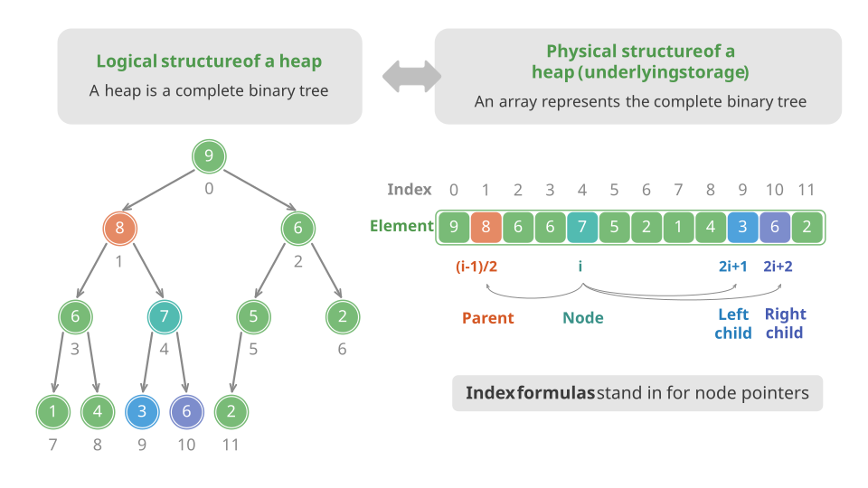
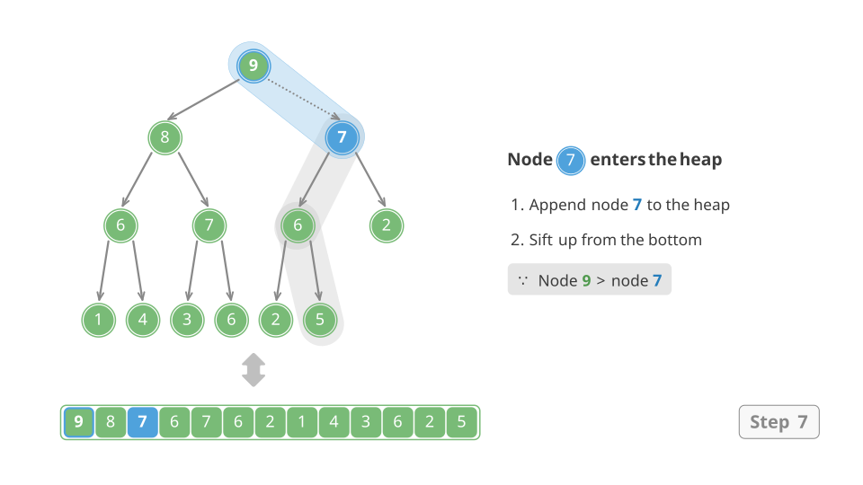
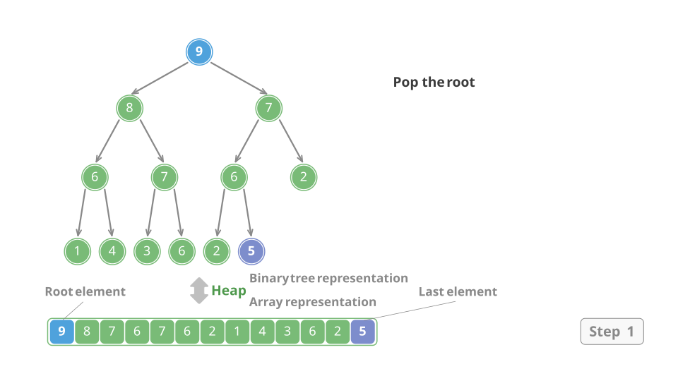
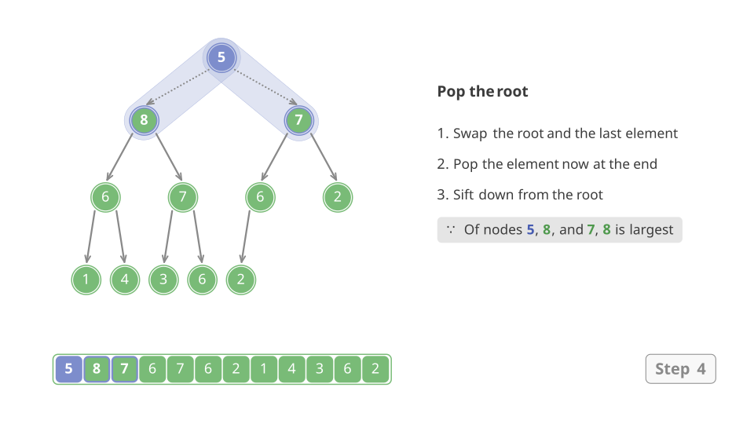
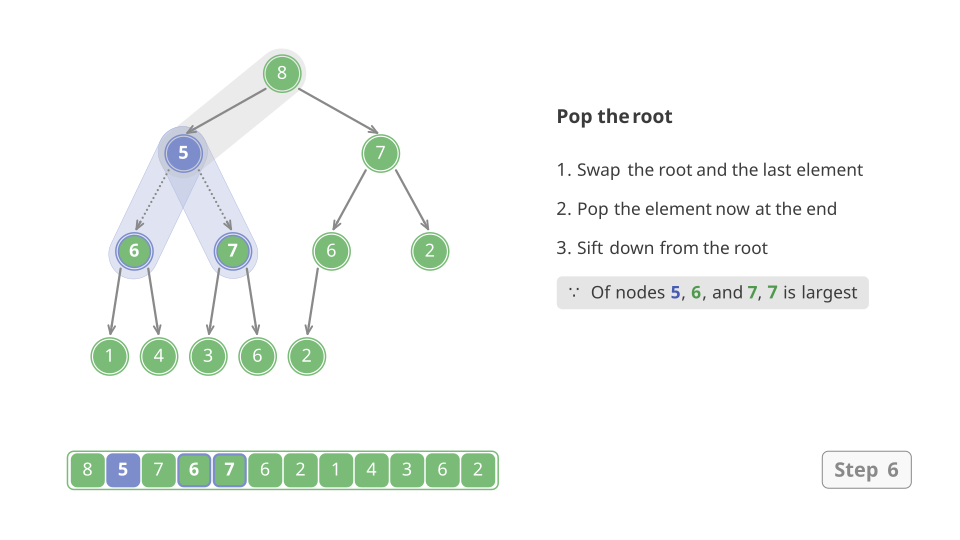
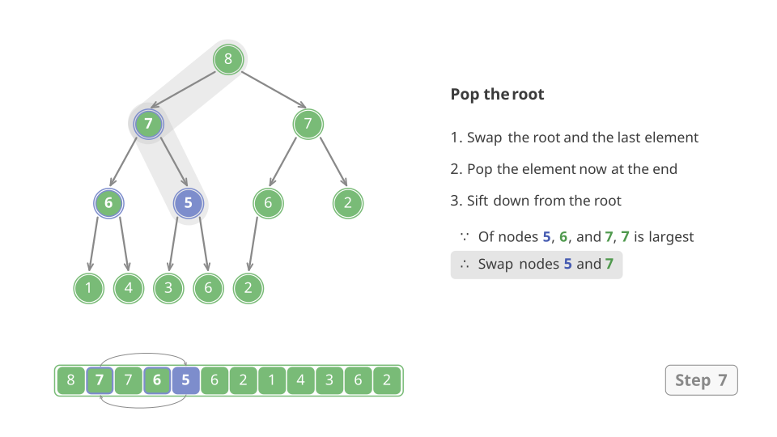
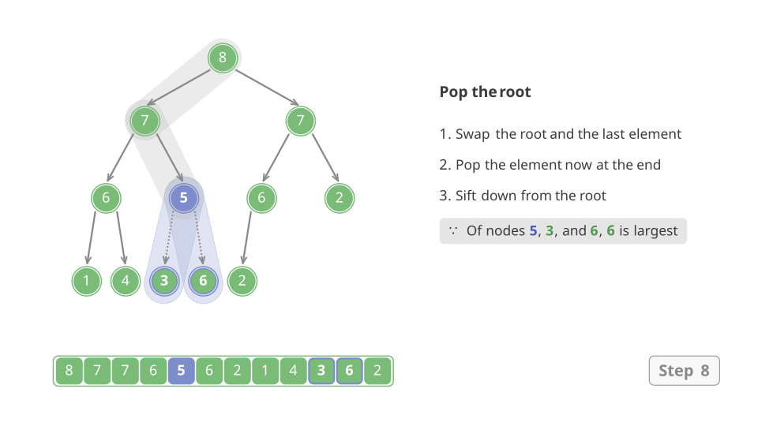
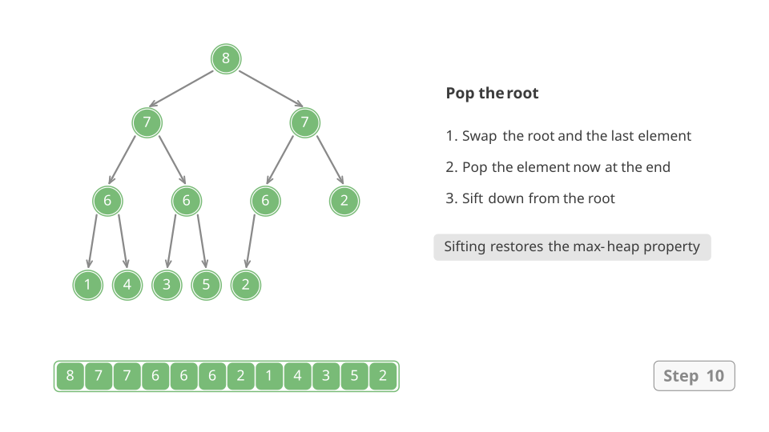

# Heap

A <u>heap</u> is a complete binary tree that satisfies an ordering rule. The two main types are shown below.

- <u>Min-heap</u>: For every parent-child pair, the parent's value $\leq$ the child's value.
- <u>Max-heap</u>: For every parent-child pair, the parent's value $\geq$ the child's value.


As a special case of a complete binary tree, a heap has the following properties.

- The bottom level fills from left to right. Every other level is full.
- The root of the tree is the top of the heap. The rightmost node on the bottom level is the last element of the heap.
- In a max-heap the root holds the maximum value, and in a min-heap it holds the minimum.

## Common heap operations

Many programming languages provide a <u>priority queue</u>, an abstract data structure that orders queue elements by priority.

**Heaps commonly implement priority queues. A max-heap acts as a priority queue whose elements are removed from largest to smallest**. From the user's perspective, we can treat a priority queue and a heap as equivalent here. This book uses the term “heap” for both.

The table below lists common heap operations. Method names depend on the programming language.

<p align="center"> Table <id> &nbsp; Efficiency of heap operations </p>

| Method name      | Description                                             | Time complexity  |
| ----------- | ------------------------------------------------ | ----------- |
| `push()`    | Push an element onto the heap                                         | $O(\log n)$ |
| `pop()`     | Pop the root                                     | $O(\log n)$ |
| `peek()`    | Access the root element (the maximum in a max-heap or the minimum in a min-heap) | $O(1)$      |
| `size()`    | Get the number of elements in the heap                                 | $O(1)$      |
| `isEmpty()` | Check whether the heap is empty                                   | $O(1)$      |

In practice, we can use the heap or priority queue class supplied by the programming language.

Much as a sort can be set to ascending or descending order, we can switch between a min-heap and a max-heap by setting a `flag` or changing the `Comparator`, as shown below.

```snippet
heap_operations
```

??? pythontutor "Visualize execution"

    @tutor heap_operations_tutor

## Implementing a heap

We implement a max-heap below. To turn it into a min-heap, reverse all value comparisons, for example by replacing $\geq$ with $\leq$. Try implementing this version yourself.

### Heap storage and representation

As we saw in the chapter on binary trees, arrays are well suited to complete binary trees. A heap is a complete binary tree, **so we will store it in an array**.

In an array representation of a binary tree, each element holds a node value, and its index gives the node's position in the tree. **Index formulas take the place of node pointers**.

As the figure shows, for a node at index $i$, the left child is at $2i + 1$, the right child is at $2i + 2$, and the parent is at $(i - 1) / 2$ (using floor division). An out-of-bounds index indicates an empty position or a missing node.



We can put the index formulas in functions for later use.

```src
[file]{my_heap}-[class]{max_heap}-[func]{parent}
```

### Peek at the root

The root element of the heap is the root of the binary tree and the first element of the list.

```src
[file]{my_heap}-[class]{max_heap}-[func]{peek}
```

### Push an element onto the heap

To insert `val`, first append it to the end of the heap. Since `val` may be larger than other elements, the heap property may no longer hold. **We need to repair the nodes along the path from the inserted node to the root**. Restoring the heap property is called <u>heapifying</u>.

Starting at the inserted node, **sift up from the bottom**. As shown below, compare the inserted node with its parent. If the inserted node is larger, swap them. Repeat up the tree until there is no parent left to check or no swap is needed.

=== "<1>"
    

=== "<2>"
    

=== "<3>"
    

=== "<4>"
    

=== "<5>"
    

=== "<6>"
    

=== "<7>"
    

=== "<8>"
    

=== "<9>"
    

With $n$ nodes, the tree has height $O(\log n)$. Sifting therefore takes at most $O(\log n)$ iterations, and **pushing an element onto a heap takes $O(\log n)$ time**. The code follows.

```src
[file]{my_heap}-[class]{max_heap}-[func]{sift_up}
```

### Pop the root

The heap root is the root of the binary tree and the first element of the list. Removing the first element directly would change every remaining node's index and make the heap hard to repair. To minimize index changes, use the following steps.

1. Swap the root with the last element (the rightmost leaf).
2. Remove the last element from the list. After the swap, this is the original root.
3. Starting at the root, **sift down toward the leaves**.

As the figure below shows, **sifting down moves in the opposite direction from sifting up**. Compare the root with its children and swap with the larger child if necessary. Repeat at the new position until there are no more children or no swap is needed.

=== "<1>"
    

=== "<2>"
    

=== "<3>"
    

=== "<4>"
    

=== "<5>"
    

=== "<6>"
    

=== "<7>"
    

=== "<8>"
    

=== "<9>"
    

=== "<10>"
    

As with insertion, popping the root takes $O(\log n)$ time. The code follows.

```src
[file]{my_heap}-[class]{max_heap}-[func]{sift_down}
```

## Common applications of heaps

- **Priority queues**: A heap is usually the first choice for implementing a priority queue. Enqueueing and dequeueing each take $O(\log n)$ time, and building the heap takes $O(n)$. All three operations are efficient.
- **Heapsort**: Given a collection of values, build a heap and repeatedly pop its root to obtain the values in sorted order. In practice, we usually use a more elegant implementation, described in the section on heapsort.
- **Finding the $k$ largest elements**: This classic algorithm problem also arises in practice, for example when selecting the ten most popular news stories for Weibo's trending list or the ten best-selling products.
