# Heaps

A <u>heap</u> is a complete binary tree that satisfies a particular ordering condition. There are two main types, shown below.

- <u>Min heap</u>: every node's value is $\leq$ the values of its children.
- <u>Max heap</u>: every node's value is $\geq$ the values of its children.

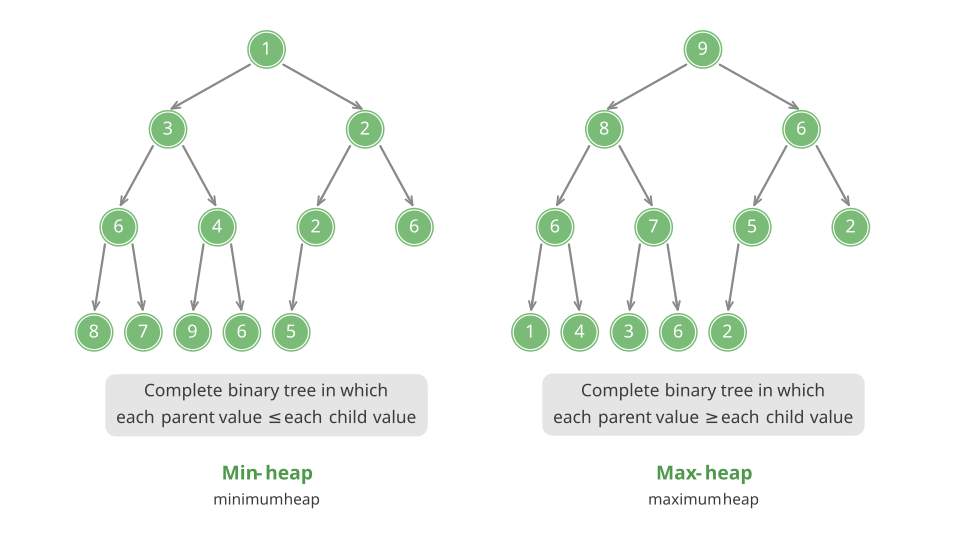

As a special kind of complete binary tree, a heap has the following properties.

- The lowest level is filled from left to right, and all other levels are full.
- The root is the “top” of the heap, while the rightmost node on the lowest level is its “last” node.
- In a max heap or min heap, the root holds the largest or smallest value, respectively.

## Common heap operations

Many programming languages provide a <u>priority queue</u>, an abstract data structure whose elements are removed according to priority.

**Heaps are commonly used to implement priority queues. A max heap corresponds to a priority queue that removes elements from largest to smallest**. From the user's perspective, the two can be treated as equivalent. This book therefore does not distinguish them strictly and uses the term “heap” for both.

The table below lists common operations. Method names depend on the programming language.

<p align="center"> Table <id> &nbsp; Efficiency of heap operations </p>

| Method      | Description                                             | Time complexity  |
| ----------- | ------------------------------------------------ | ----------- |
| `push()`    | Insert an element                                         | $O(\log n)$ |
| `pop()`     | Remove the root element                                     | $O(\log n)$ |
| `peek()`    | Access the root: the maximum in a max heap or minimum in a min heap | $O(1)$      |
| `size()`    | Get the number of elements                                 | $O(1)$      |
| `isEmpty()` | Check whether the heap is empty                                   | $O(1)$      |

In practice, use the heap or priority-queue class provided by the language.

Just as a sorting algorithm can order values in ascending or descending order, we can switch between min heaps and max heaps by setting a `flag` or changing the `Comparator`:

```snippet
heap_operations
```

??? pythontutor "Visualize execution"

    @tutor heap_operations_tutor

## Implementing a heap

The following implementation is a max heap. To turn it into a min heap, reverse every ordering comparison, for example replacing $\geq$ with $\leq$. Interested readers can try this themselves.

### Storage and representation

The binary-tree chapter showed that complete binary trees are well suited to array representation. Since a heap is a complete binary tree, **we will store it in an array**.

In an array representation, elements store node values and indices identify positions in the tree. **Index-mapping formulas take the place of node pointers**.

As shown below, a node at index $i$ has its left child at $2i + 1$, its right child at $2i + 2$, and its parent at $(i - 1) / 2$, rounded down. An out-of-bounds index represents a missing node.


Wrap the index formulas in functions for convenient use:

```src
[file]{my_heap}-[class]{max_heap}-[func]{parent}
```

### Accessing the root

The heap's root is the first element of the list:

```src
[file]{my_heap}-[class]{max_heap}-[func]{peek}
```

### Inserting an element

To insert `val`, first append it at the end of the heap. Since it may be larger than other elements, this can violate the heap property. **We must restore the property along the path from the inserted node to the root**, an operation called <u>heapifying</u>.

Start at the inserted node and **sift upward**. As shown below, compare it with its parent and swap them if the inserted value is larger. Repeat upward until the root is reached or no swap is needed.

=== "<1>"
    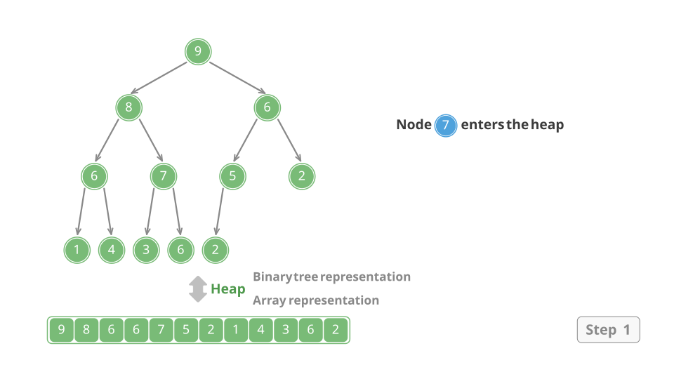

=== "<2>"
    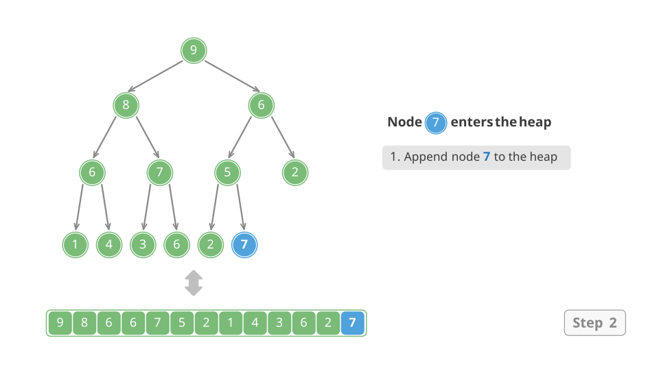

=== "<3>"
    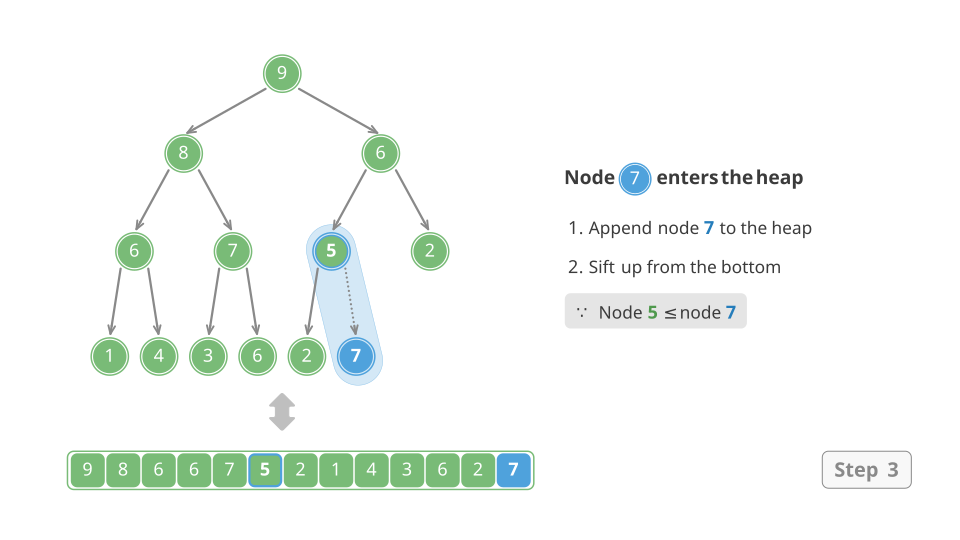

=== "<4>"
    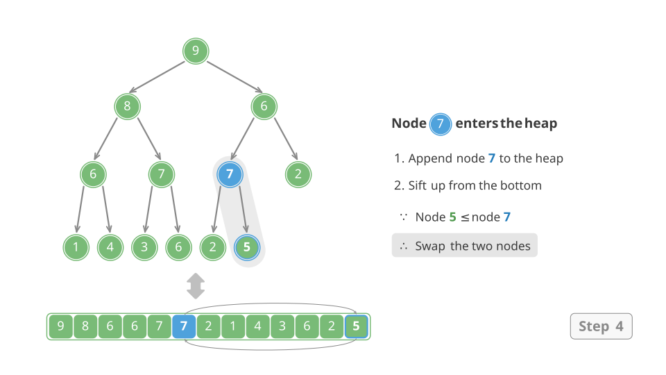

=== "<5>"
    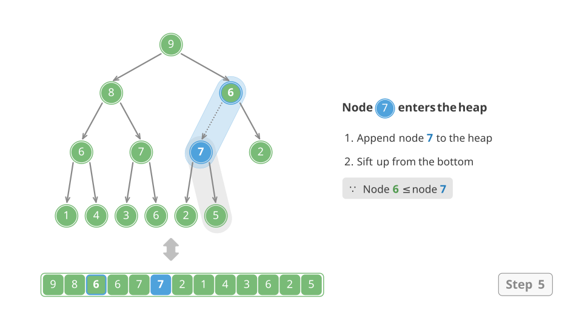

=== "<6>"
    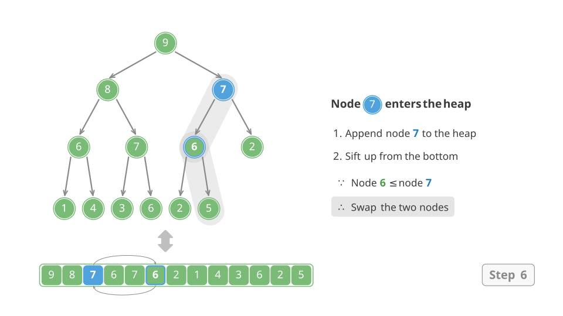

=== "<7>"
    

=== "<8>"
    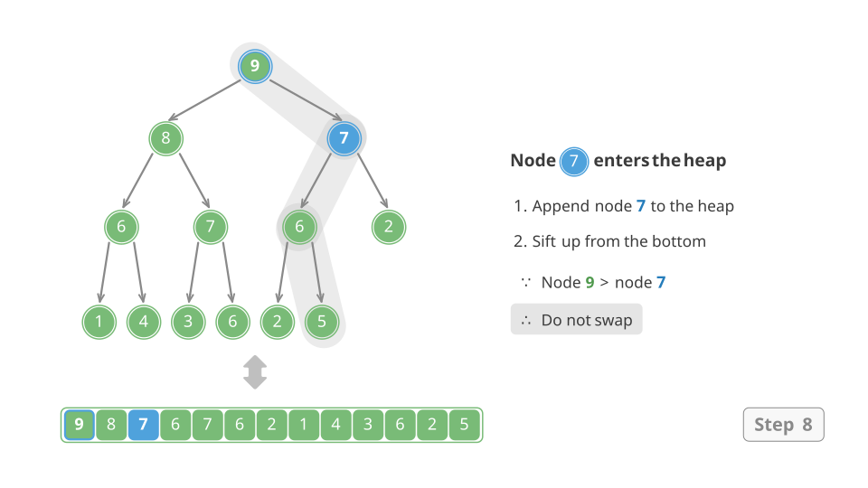

=== "<9>"
    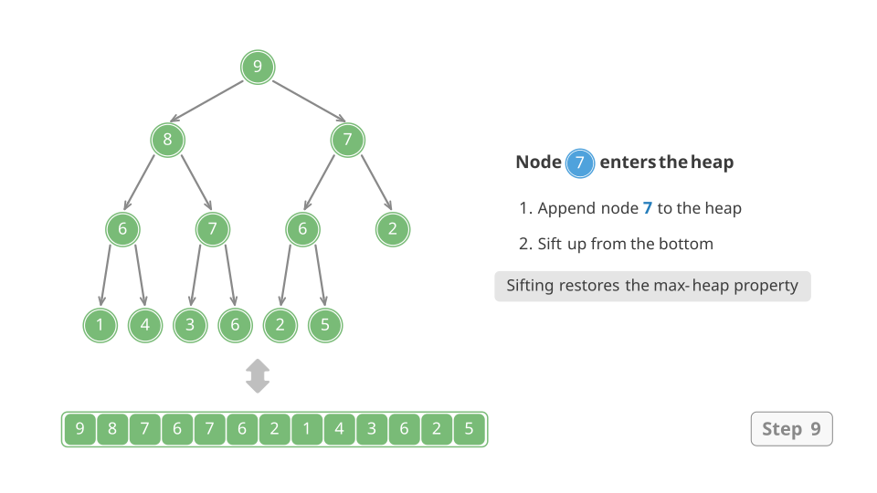

With $n$ nodes, the tree height is $O(\log n)$, so sifting takes at most $O(\log n)$ iterations. **Insertion therefore takes $O(\log n)$ time**. The code is as follows:

```src
[file]{my_heap}-[class]{max_heap}-[func]{sift_up}
```

### Removing the root

The root is the first element of the list. Removing it directly would change every remaining index, making it difficult to restore the heap property. To minimize index changes, use the following steps.

1. Swap the root with the last element, the rightmost leaf.
2. Remove the last element from the list. Because of the swap, this is the original root.
3. Starting at the root, **sift downward**.

As shown below, **sifting down proceeds in the opposite direction from sifting up**. Compare the root with its two children and swap it with the larger child when needed. Continue downward until a leaf is reached or no swap is necessary.

=== "<1>"
    

=== "<2>"
    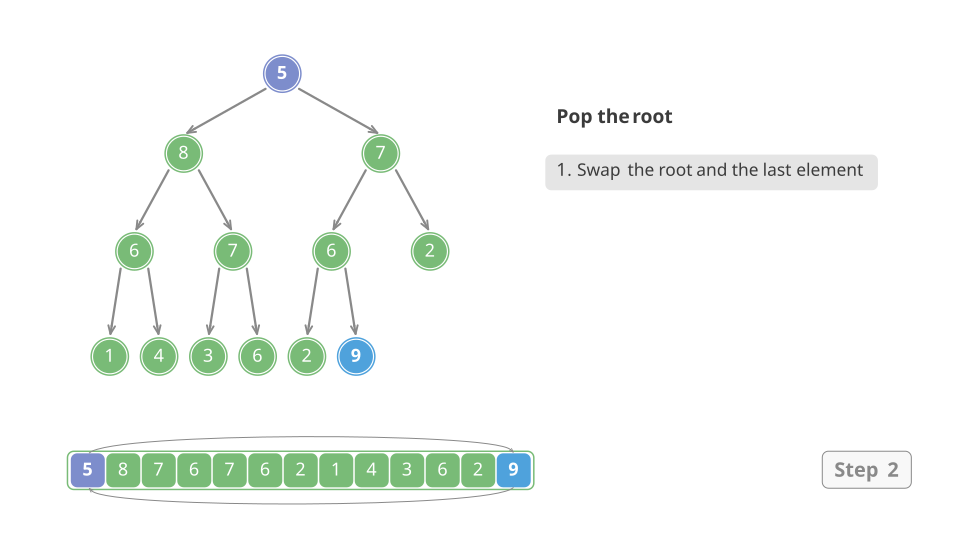

=== "<3>"
    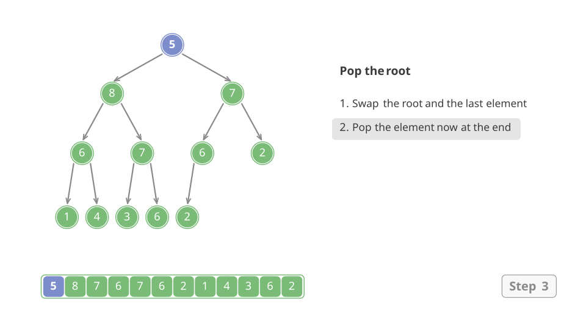

=== "<4>"
    

=== "<5>"
    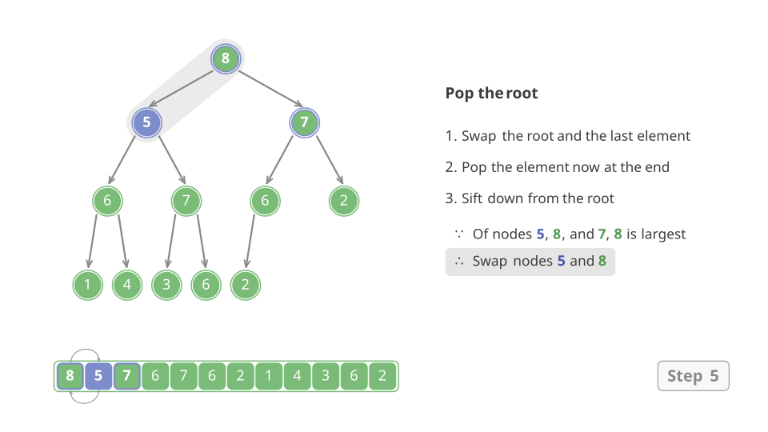

=== "<6>"
    

=== "<7>"
    

=== "<8>"
    

=== "<9>"
    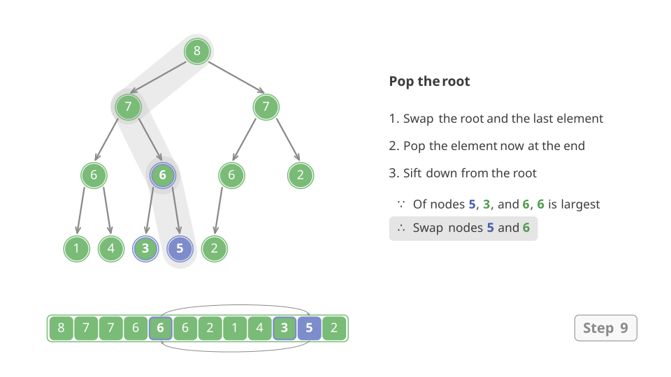

=== "<10>"
    

Like insertion, removing the root takes $O(\log n)$ time. The code is as follows:

```src
[file]{my_heap}-[class]{max_heap}-[func]{sift_down}
```

## Common applications

- **Priority queues**: Heaps are usually the first choice for implementing priority queues. Enqueueing and dequeueing both take $O(\log n)$ time, and building a heap takes $O(n)$.
- **Heap sort**: Build a heap from a dataset, then repeatedly remove its root to obtain sorted data. In practice, a more elegant implementation is usually used; see the heap-sort section.
- **Finding the largest $k$ elements**: This is both a classic algorithm problem and a common application, such as selecting the 10 hottest news stories for Weibo's trending list or the 10 best-selling products.
