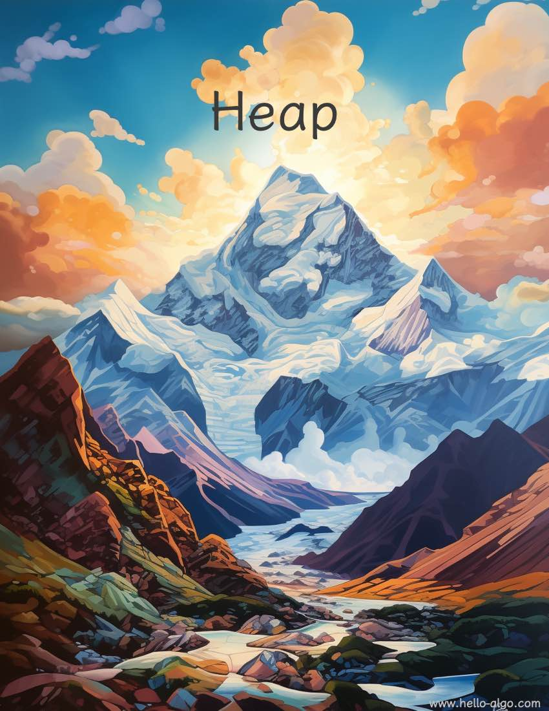

# Heaps

!!! abstract

    Heaps are like mountain ranges, their peaks rising in tiers of different shapes.
    
    The summits stand at different heights, and the highest is always the first to catch the eye.
