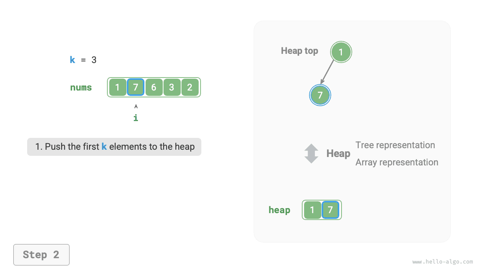
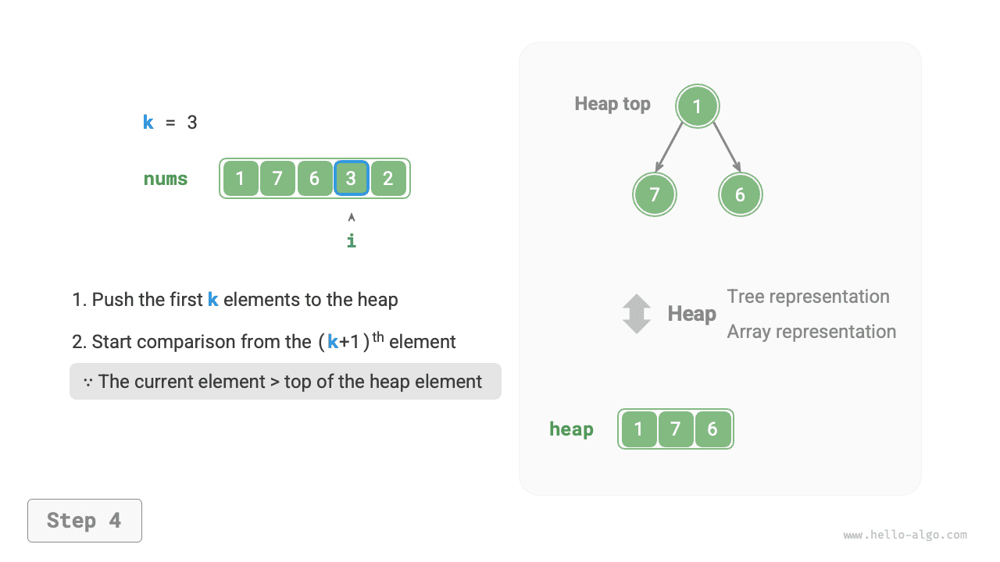
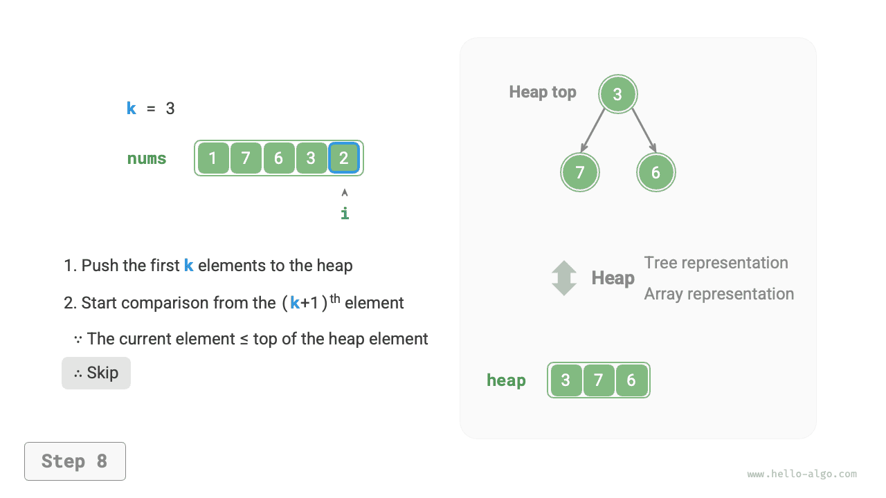
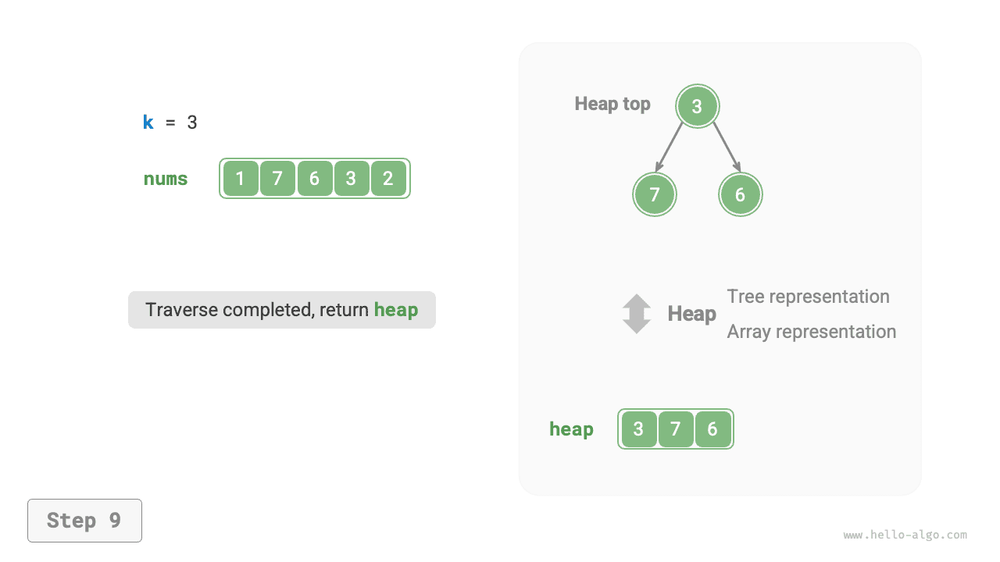

# The top-k problem

!!! question

    Given an unsorted array `nums` of length $n$, return its largest $k$ elements.

We first introduce two straightforward solutions, then a more efficient solution using a heap.

## Method 1: Repeated selection

As shown below, scan the array $k$ times, selecting the $1$st, $2$nd, $\dots$, and $k$th largest elements in successive rounds. This takes $O(nk)$ time.

This method is suitable only when $k \ll n$. As $k$ approaches $n$, its time complexity approaches $O(n^2)$, making it very slow.


!!! tip

    When $k = n$, this produces a fully sorted sequence and is equivalent to selection sort.

## Method 2: Sorting

As shown below, sort `nums` and return its rightmost $k$ elements. This takes $O(n \log n)$ time.

This method does more work than necessary: we need only the largest $k$ elements, not a sorted order for all the others.


## Method 3: A heap

A heap solves the top-k problem more efficiently, following the steps below.

1. Initialize a min heap, whose root holds its smallest element.
2. Insert the first $k$ array elements into the heap one by one.
3. Starting with element $k + 1$, if the current element is larger than the root, remove the root and insert the current element.
4. After the traversal, the heap contains the largest $k$ elements.

=== "<1>"
    

=== "<2>"
    

=== "<3>"
    

=== "<4>"
    

=== "<5>"
    

=== "<6>"
    

=== "<7>"
    

=== "<8>"
    

=== "<9>"
    

An implementation follows:

```src
[file]{top_k}-[class]{}-[func]{top_k_heap}
```

There are $n$ rounds of heap insertion and removal to consider, and the heap has at most $k$ elements, so the time complexity is $O(n \log k)$. This is highly efficient: when $k$ is small, the complexity approaches $O(n)$; when $k$ is large, it does not exceed $O(n \log n)$.

This approach also suits dynamic data streams. As new data arrives, we can maintain the heap to update the largest $k$ elements continuously.
