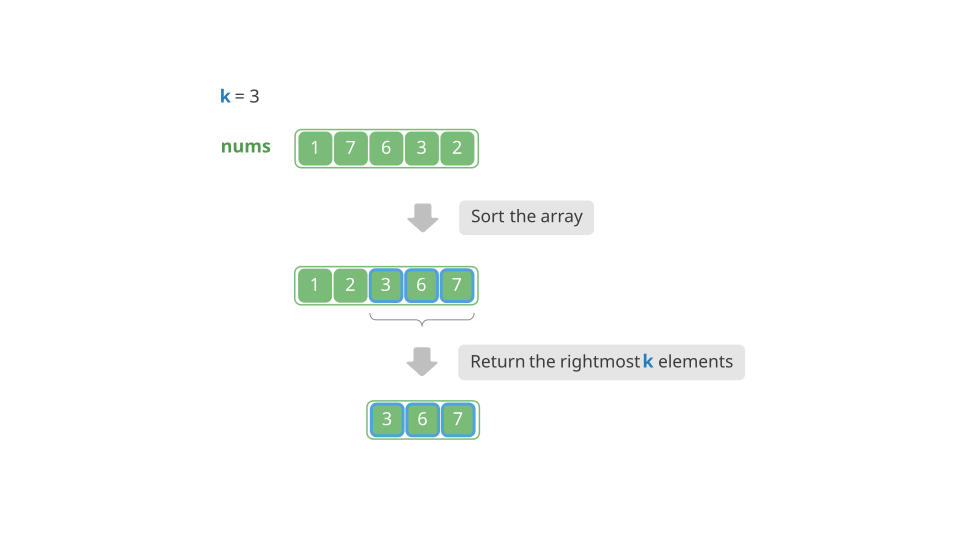
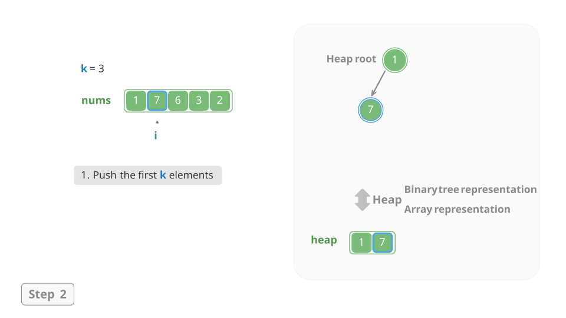
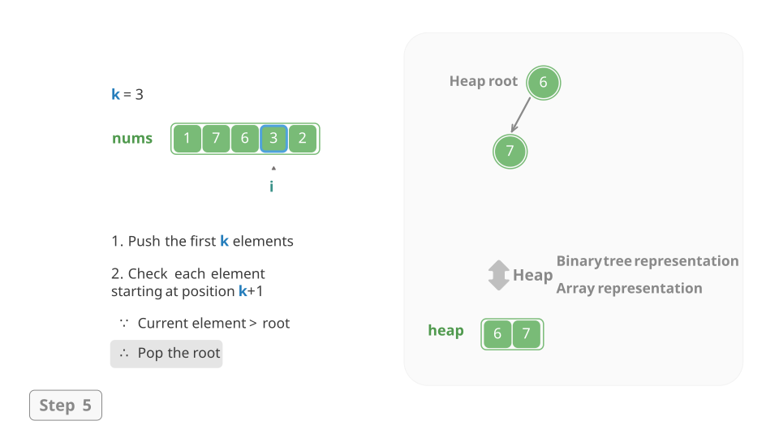

# 8.3 &nbsp; The top-k problem

!!! question

    Given an unsorted array `nums` of length $n$, return its $k$ largest elements.

We begin with two straightforward solutions, then consider a more efficient approach using a heap.

## 8.3.1 &nbsp; Method 1: repeated selection

Make $k$ passes over the array, as shown below. On successive passes, extract the elements with descending ranks $1$, $2$, $\dots$, $k$. This takes $O(nk)$ time.

This method is suitable only when $k \ll n$. As $k$ approaches $n$, the time complexity approaches $O(n^2)$, making the method very slow.

{ class="animation-figure" }

<p align="center"> Figure 8-6 &nbsp; Finding the k largest elements by repeated scans </p>

!!! tip

    When $k = n$, the result is a fully sorted sequence. The algorithm is then equivalent to selection sort.

## 8.3.2 &nbsp; Method 2: sorting

As the figure shows, we can sort the array `nums` and return the rightmost $k$ elements. This takes $O(n \log n)$ time.

This method does more work than necessary. We only need the $k$ largest elements and have no need to sort the rest.

{ class="animation-figure" }

<p align="center"> Figure 8-7 &nbsp; Finding the k largest elements by sorting </p>

## 8.3.3 &nbsp; Method 3: using a heap

A heap can solve the top-k problem more efficiently, as shown in Figure 8-8.

1. Initialize a min-heap, whose root holds its smallest element.
2. Push the first $k$ array elements onto the heap in order.
3. Starting with element number $k + 1$, compare each element with the root. If it is larger, pop the root and push the current element.
4. After the traversal, the heap contains the $k$ largest elements.

=== "<1>"
    { class="animation-figure" }

=== "<2>"
    { class="animation-figure" }

=== "<3>"
    { class="animation-figure" }

=== "<4>"
    { class="animation-figure" }

=== "<5>"
    { class="animation-figure" }

=== "<6>"
    { class="animation-figure" }

=== "<7>"
    { class="animation-figure" }

=== "<8>"
    { class="animation-figure" }

=== "<9>"
    { class="animation-figure" }

<p align="center"> Figure 8-8 &nbsp; Finding the k largest elements using a heap </p>

Here is the implementation:

=== "Python"

    ```python title="top_k.py"
    def top_k_heap(nums: list[int], k: int) -> list[int]:
        """Find the k largest elements in the array using a heap"""
        # Initialize a min-heap
        heap = []
        # Push the first k array elements onto the heap
        for i in range(k):
            heapq.heappush(heap, nums[i])
        # Starting with element k+1, keep the heap size at k
        for i in range(k, len(nums)):
            # If the current element exceeds the root, pop the root and push the current element
            if nums[i] > heap[0]:
                heapq.heappop(heap)
                heapq.heappush(heap, nums[i])
        return heap
    ```

=== "C++"

    ```cpp title="top_k.cpp"
    /* Find the k largest elements in the array using a heap */
    priority_queue<int, vector<int>, greater<int>> topKHeap(vector<int> &nums, int k) {
        // Initialize a min-heap
        priority_queue<int, vector<int>, greater<int>> heap;
        // Push the first k array elements onto the heap
        for (int i = 0; i < k; i++) {
            heap.push(nums[i]);
        }
        // Starting with element k+1, keep the heap size at k
        for (int i = k; i < nums.size(); i++) {
            // If the current element exceeds the root, pop the root and push the current element
            if (nums[i] > heap.top()) {
                heap.pop();
                heap.push(nums[i]);
            }
        }
        return heap;
    }
    ```

=== "Java"

    ```java title="top_k.java"
    /* Find the k largest elements in the array using a heap */
    Queue<Integer> topKHeap(int[] nums, int k) {
        // Initialize a min-heap
        Queue<Integer> heap = new PriorityQueue<Integer>();
        // Push the first k array elements onto the heap
        for (int i = 0; i < k; i++) {
            heap.offer(nums[i]);
        }
        // Starting with element k+1, keep the heap size at k
        for (int i = k; i < nums.length; i++) {
            // If the current element exceeds the root, pop the root and push the current element
            if (nums[i] > heap.peek()) {
                heap.poll();
                heap.offer(nums[i]);
            }
        }
        return heap;
    }
    ```

=== "C#"

    ```csharp title="top_k.cs"
    /* Find the k largest elements in the array using a heap */
    PriorityQueue<int, int> TopKHeap(int[] nums, int k) {
        // Initialize a min-heap
        PriorityQueue<int, int> heap = new();
        // Push the first k array elements onto the heap
        for (int i = 0; i < k; i++) {
            heap.Enqueue(nums[i], nums[i]);
        }
        // Starting with element k+1, keep the heap size at k
        for (int i = k; i < nums.Length; i++) {
            // If the current element exceeds the root, pop the root and push the current element
            if (nums[i] > heap.Peek()) {
                heap.Dequeue();
                heap.Enqueue(nums[i], nums[i]);
            }
        }
        return heap;
    }
    ```

=== "Go"

    ```go title="top_k.go"
    /* Find the k largest elements in the array using a heap */
    func topKHeap(nums []int, k int) *minHeap {
        // Initialize a min-heap
        h := &minHeap{}
        heap.Init(h)
        // Push the first k array elements onto the heap
        for i := 0; i < k; i++ {
            heap.Push(h, nums[i])
        }
        // Starting with element k+1, keep the heap size at k
        for i := k; i < len(nums); i++ {
            // If the current element exceeds the root, pop the root and push the current element
            if nums[i] > h.Top().(int) {
                heap.Pop(h)
                heap.Push(h, nums[i])
            }
        }
        return h
    }
    ```

=== "Swift"

    ```swift title="top_k.swift"
    /* Find the k largest elements in the array using a heap */
    func topKHeap(nums: [Int], k: Int) -> [Int] {
        // Initialize a min-heap from the first k elements
        var heap = Heap(nums.prefix(k))
        // Starting with element k+1, keep the heap size at k
        for i in nums.indices.dropFirst(k) {
            // If the current element exceeds the root, pop the root and push the current element
            if nums[i] > heap.min()! {
                _ = heap.removeMin()
                heap.insert(nums[i])
            }
        }
        return heap.unordered
    }
    ```

=== "JS"

    ```javascript title="top_k.js"
    /* Push an element onto the heap */
    function pushMinHeap(maxHeap, val) {
        // Negate the elements
        maxHeap.push(-val);
    }

    /* Pop an element from the heap */
    function popMinHeap(maxHeap) {
        // Negate the elements
        return -maxHeap.pop();
    }

    /* Peek at the root */
    function peekMinHeap(maxHeap) {
        // Negate the elements
        return -maxHeap.peek();
    }

    /* Retrieve the elements in the heap */
    function getMinHeap(maxHeap) {
        // Negate the elements
        return maxHeap.getMaxHeap().map((num) => -num);
    }

    /* Find the k largest elements in the array using a heap */
    function topKHeap(nums, k) {
        // Initialize a min-heap
        // Negate all values so the max-heap acts as a min-heap
        const maxHeap = new MaxHeap([]);
        // Push the first k array elements onto the heap
        for (let i = 0; i < k; i++) {
            pushMinHeap(maxHeap, nums[i]);
        }
        // Starting with element k+1, keep the heap size at k
        for (let i = k; i < nums.length; i++) {
            // If the current element exceeds the root, pop the root and push the current element
            if (nums[i] > peekMinHeap(maxHeap)) {
                popMinHeap(maxHeap);
                pushMinHeap(maxHeap, nums[i]);
            }
        }
        // Return the elements in the heap
        return getMinHeap(maxHeap);
    }
    ```

=== "TS"

    ```typescript title="top_k.ts"
    /* Push an element onto the heap */
    function pushMinHeap(maxHeap: MaxHeap, val: number): void {
        // Negate the elements
        maxHeap.push(-val);
    }

    /* Pop an element from the heap */
    function popMinHeap(maxHeap: MaxHeap): number {
        // Negate the elements
        return -maxHeap.pop();
    }

    /* Peek at the root */
    function peekMinHeap(maxHeap: MaxHeap): number {
        // Negate the elements
        return -maxHeap.peek();
    }

    /* Retrieve the elements in the heap */
    function getMinHeap(maxHeap: MaxHeap): number[] {
        // Negate the elements
        return maxHeap.getMaxHeap().map((num: number) => -num);
    }

    /* Find the k largest elements in the array using a heap */
    function topKHeap(nums: number[], k: number): number[] {
        // Initialize a min-heap
        // Negate all values so the max-heap acts as a min-heap
        const maxHeap = new MaxHeap([]);
        // Push the first k array elements onto the heap
        for (let i = 0; i < k; i++) {
            pushMinHeap(maxHeap, nums[i]);
        }
        // Starting with element k+1, keep the heap size at k
        for (let i = k; i < nums.length; i++) {
            // If the current element exceeds the root, pop the root and push the current element
            if (nums[i] > peekMinHeap(maxHeap)) {
                popMinHeap(maxHeap);
                pushMinHeap(maxHeap, nums[i]);
            }
        }
        // Return the elements in the heap
        return getMinHeap(maxHeap);
    }
    ```

=== "Dart"

    ```dart title="top_k.dart"
    /* Find the k largest elements in the array using a heap */
    MinHeap topKHeap(List<int> nums, int k) {
      // Initialize a min-heap and push the first k elements of the array onto it
      MinHeap heap = MinHeap(nums.sublist(0, k));
      // Starting with element k+1, keep the heap size at k
      for (int i = k; i < nums.length; i++) {
        // If the current element exceeds the root, pop the root and push the current element
        if (nums[i] > heap.peek()) {
          heap.pop();
          heap.push(nums[i]);
        }
      }
      return heap;
    }
    ```

=== "Rust"

    ```rust title="top_k.rs"
    /* Find the k largest elements in the array using a heap */
    fn top_k_heap(nums: Vec<i32>, k: usize) -> BinaryHeap<Reverse<i32>> {
        // BinaryHeap is a max-heap. Use Reverse to reverse the ordering and obtain a min-heap
        let mut heap = BinaryHeap::<Reverse<i32>>::new();
        // Push the first k array elements onto the heap
        for &num in nums.iter().take(k) {
            heap.push(Reverse(num));
        }
        // Starting with element k+1, keep the heap size at k
        for &num in nums.iter().skip(k) {
            // If the current element exceeds the root, pop the root and push the current element
            if num > heap.peek().unwrap().0 {
                heap.pop();
                heap.push(Reverse(num));
            }
        }
        heap
    }
    ```

=== "C"

    ```c title="top_k.c"
    /* Push an element onto the heap */
    void pushMinHeap(MaxHeap *maxHeap, int val) {
        // Negate the elements
        push(maxHeap, -val);
    }

    /* Pop an element from the heap */
    int popMinHeap(MaxHeap *maxHeap) {
        // Negate the elements
        return -pop(maxHeap);
    }

    /* Peek at the root */
    int peekMinHeap(MaxHeap *maxHeap) {
        // Negate the elements
        return -peek(maxHeap);
    }

    /* Retrieve the elements in the heap */
    int *getMinHeap(MaxHeap *maxHeap) {
        // Negate each heap element and store it in the res array
        int *res = (int *)malloc(maxHeap->size * sizeof(int));
        for (int i = 0; i < maxHeap->size; i++) {
            res[i] = -maxHeap->data[i];
        }
        return res;
    }

    /* Find the k largest elements in an array using a heap */
    int *topKHeap(int *nums, int sizeNums, int k) {
        // Initialize a min-heap
        // Negate all values so the max-heap acts as a min-heap
        int *empty = (int *)malloc(0);
        MaxHeap *maxHeap = newMaxHeap(empty, 0);
        // Push the first k array elements onto the heap
        for (int i = 0; i < k; i++) {
            pushMinHeap(maxHeap, nums[i]);
        }
        // Starting with element k+1, keep the heap size at k
        for (int i = k; i < sizeNums; i++) {
            // If the current element exceeds the root, pop the root and push the current element
            if (nums[i] > peekMinHeap(maxHeap)) {
                popMinHeap(maxHeap);
                pushMinHeap(maxHeap, nums[i]);
            }
        }
        int *res = getMinHeap(maxHeap);
        // Free the memory
        delMaxHeap(maxHeap);
        return res;
    }
    ```

=== "Kotlin"

    ```kotlin title="top_k.kt"
    /* Find the k largest elements in the array using a heap */
    fun topKHeap(nums: IntArray, k: Int): Queue<Int> {
        // Initialize a min-heap
        val heap = PriorityQueue<Int>()
        // Push the first k array elements onto the heap
        for (i in 0..<k) {
            heap.offer(nums[i])
        }
        // Starting with element k+1, keep the heap size at k
        for (i in k..<nums.size) {
            // If the current element exceeds the root, pop the root and push the current element
            if (nums[i] > heap.peek()) {
                heap.poll()
                heap.offer(nums[i])
            }
        }
        return heap
    }
    ```

=== "Ruby"

    ```ruby title="top_k.rb"
    ### Find the k largest elements in the array using a heap ###
    def top_k_heap(nums, k)
      # Initialize a min-heap
      # Negate all values so the max-heap acts as a min-heap
      max_heap = MaxHeap.new([])

      # Push the first k array elements onto the heap
      for i in 0...k
        push_min_heap(max_heap, nums[i])
      end

      # Starting with element k+1, keep the heap size at k
      for i in k...nums.length
        # If the current element exceeds the root, pop the root and push the current element
        if nums[i] > peek_min_heap(max_heap)
          pop_min_heap(max_heap)
          push_min_heap(max_heap, nums[i])
        end
      end

      get_min_heap(max_heap)
    end
    ```

??? pythontutor "Visualize execution"

    <div style="height: 549px; width: 100%;"><iframe class="pythontutor-iframe" title="Visualize execution" src="https://pythontutor.com/iframe-embed.html#code=import%20heapq%0A%0Adef%20top_k_heap%28nums%3A%20list%5Bint%5D,%20k%3A%20int%29%20-%3E%20list%5Bint%5D%3A%0A%20%20%20%20%22%22%22Find%20the%20k%20largest%20elements%20in%20the%20array%20using%20a%20heap%22%22%22%0A%20%20%20%20%23%20Initialize%20a%20min-heap%0A%20%20%20%20heap%20%3D%20%5B%5D%0A%20%20%20%20%23%20Push%20the%20first%20k%20array%20elements%20onto%20the%20heap%0A%20%20%20%20for%20i%20in%20range%28k%29%3A%0A%20%20%20%20%20%20%20%20heapq.heappush%28heap,%20nums%5Bi%5D%29%0A%20%20%20%20%23%20Starting%20with%20element%20k%2B1,%20keep%20the%20heap%20size%20at%20k%0A%20%20%20%20for%20i%20in%20range%28k,%20len%28nums%29%29%3A%0A%20%20%20%20%20%20%20%20%23%20If%20the%20current%20element%20exceeds%20the%20root,%20pop%20the%20root%20and%20push%20the%20current%20element%0A%20%20%20%20%20%20%20%20if%20nums%5Bi%5D%20%3E%20heap%5B0%5D%3A%0A%20%20%20%20%20%20%20%20%20%20%20%20heapq.heappop%28heap%29%0A%20%20%20%20%20%20%20%20%20%20%20%20heapq.heappush%28heap,%20nums%5Bi%5D%29%0A%20%20%20%20return%20heap%0A%0A%22%22%22Driver%20Code%22%22%22%0Aif%20__name__%20%3D%3D%20%22__main__%22%3A%0A%20%20%20%20nums%20%3D%20%5B1,%207,%206,%203,%202%5D%0A%20%20%20%20k%20%3D%203%0A%0A%20%20%20%20res%20%3D%20top_k_heap%28nums,%20k%29&codeDivHeight=472&codeDivWidth=350&cumulative=false&curInstr=6&heapPrimitives=nevernest&origin=opt-frontend.js&py=311&rawInputLstJSON=%5B%5D&textReferences=false"> </iframe></div>
    <div style="margin-top: 5px;"><a href="https://pythontutor.com/iframe-embed.html#code=import%20heapq%0A%0Adef%20top_k_heap%28nums%3A%20list%5Bint%5D,%20k%3A%20int%29%20-%3E%20list%5Bint%5D%3A%0A%20%20%20%20%22%22%22Find%20the%20k%20largest%20elements%20in%20the%20array%20using%20a%20heap%22%22%22%0A%20%20%20%20%23%20Initialize%20a%20min-heap%0A%20%20%20%20heap%20%3D%20%5B%5D%0A%20%20%20%20%23%20Push%20the%20first%20k%20array%20elements%20onto%20the%20heap%0A%20%20%20%20for%20i%20in%20range%28k%29%3A%0A%20%20%20%20%20%20%20%20heapq.heappush%28heap,%20nums%5Bi%5D%29%0A%20%20%20%20%23%20Starting%20with%20element%20k%2B1,%20keep%20the%20heap%20size%20at%20k%0A%20%20%20%20for%20i%20in%20range%28k,%20len%28nums%29%29%3A%0A%20%20%20%20%20%20%20%20%23%20If%20the%20current%20element%20exceeds%20the%20root,%20pop%20the%20root%20and%20push%20the%20current%20element%0A%20%20%20%20%20%20%20%20if%20nums%5Bi%5D%20%3E%20heap%5B0%5D%3A%0A%20%20%20%20%20%20%20%20%20%20%20%20heapq.heappop%28heap%29%0A%20%20%20%20%20%20%20%20%20%20%20%20heapq.heappush%28heap,%20nums%5Bi%5D%29%0A%20%20%20%20return%20heap%0A%0A%22%22%22Driver%20Code%22%22%22%0Aif%20__name__%20%3D%3D%20%22__main__%22%3A%0A%20%20%20%20nums%20%3D%20%5B1,%207,%206,%203,%202%5D%0A%20%20%20%20k%20%3D%203%0A%0A%20%20%20%20res%20%3D%20top_k_heap%28nums,%20k%29&codeDivHeight=800&codeDivWidth=600&cumulative=false&curInstr=6&heapPrimitives=nevernest&origin=opt-frontend.js&py=311&rawInputLstJSON=%5B%5D&textReferences=false" target="_blank" rel="noopener noreferrer">View full screen ></a></div>

There are $n$ rounds in which elements can be pushed or popped, and the heap size is at most $k$. The time complexity is therefore $O(n \log k)$. This method is efficient: for small $k$, the time complexity approaches $O(n)$, and even for large $k$ it stays within $O(n \log n)$.

This method also works with a data stream. As new values arrive, we can keep updating the heap so that it always contains the $k$ largest elements seen so far.
