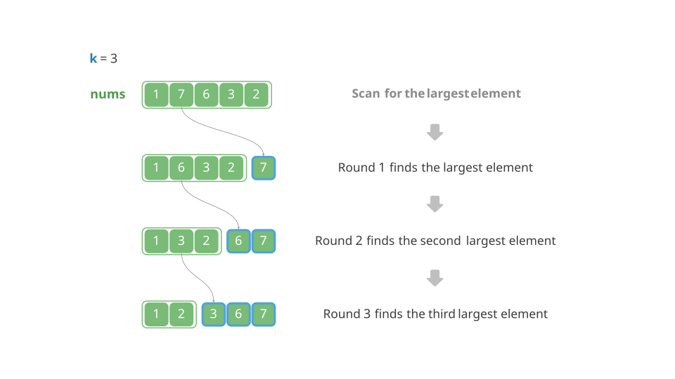
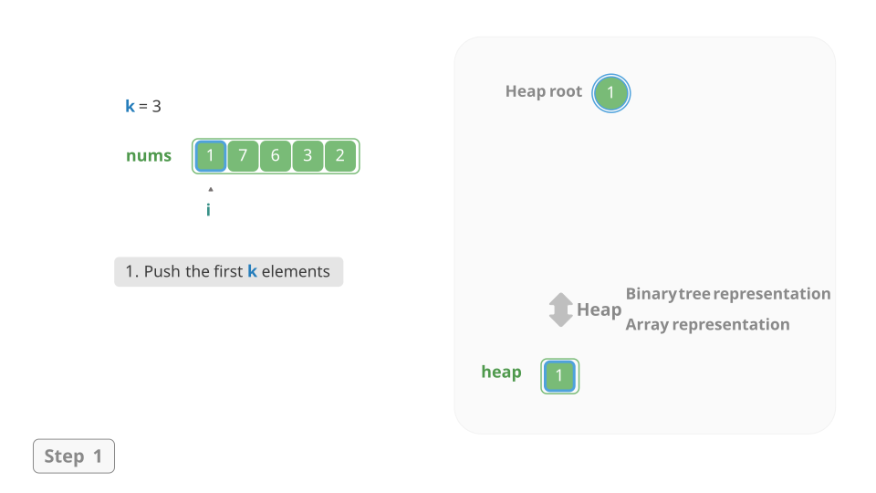
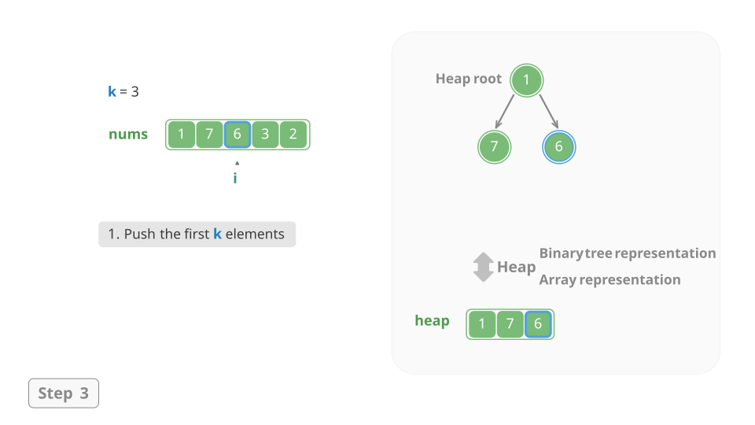
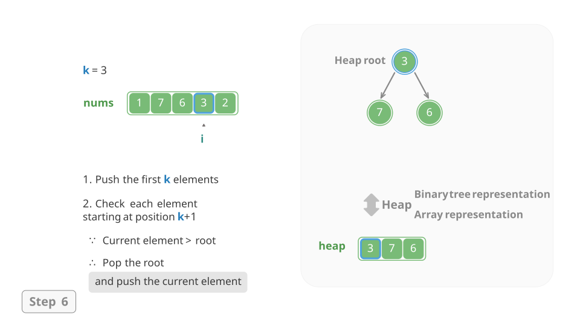
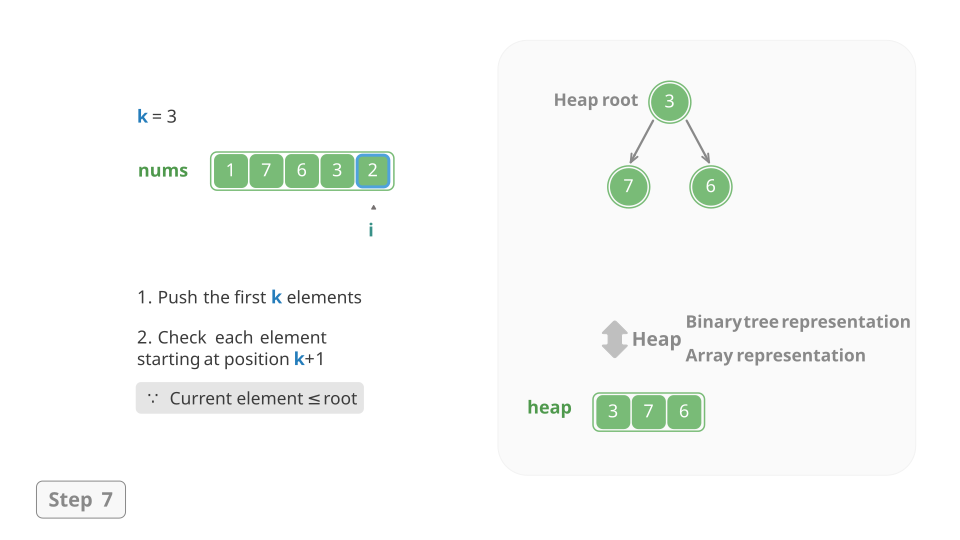
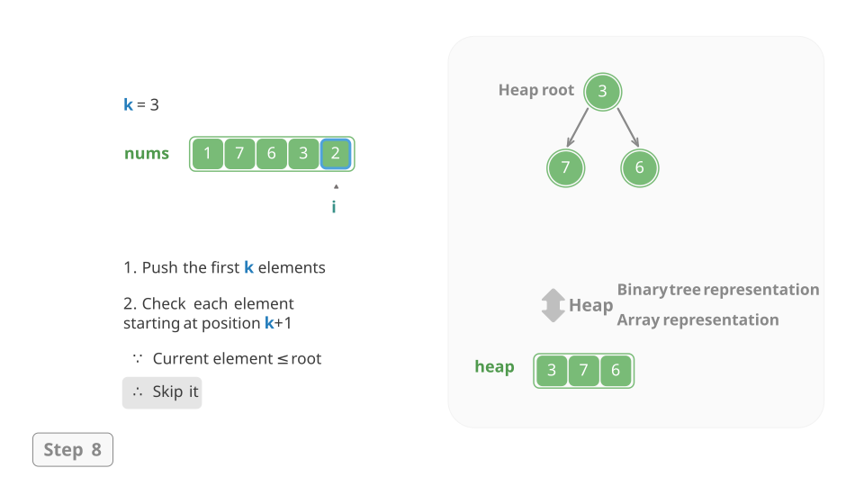
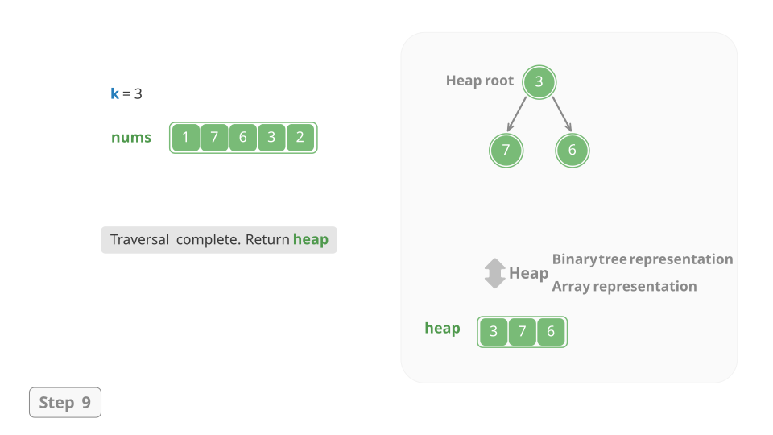

# The top-k problem

!!! question

    Given an unsorted array `nums` of length $n$, return its $k$ largest elements.

We begin with two straightforward solutions, then consider a more efficient approach using a heap.

## Method 1: repeated selection

Make $k$ passes over the array, as shown below. On successive passes, extract the elements with descending ranks $1$, $2$, $\dots$, $k$. This takes $O(nk)$ time.

This method is suitable only when $k \ll n$. As $k$ approaches $n$, the time complexity approaches $O(n^2)$, making the method very slow.



!!! tip

    When $k = n$, the result is a fully sorted sequence. The algorithm is then equivalent to selection sort.

## Method 2: sorting

As the figure shows, we can sort the array `nums` and return the rightmost $k$ elements. This takes $O(n \log n)$ time.

This method does more work than necessary. We only need the $k$ largest elements and have no need to sort the rest.


## Method 3: using a heap

A heap can solve the top-k problem more efficiently, as shown in the figure below.

1. Initialize a min-heap, whose root holds its smallest element.
2. Push the first $k$ array elements onto the heap in order.
3. Starting with element number $k + 1$, compare each element with the root. If it is larger, pop the root and push the current element.
4. After the traversal, the heap contains the $k$ largest elements.

=== "<1>"
    

=== "<2>"
    

=== "<3>"
    

=== "<4>"
    

=== "<5>"
    

=== "<6>"
    

=== "<7>"
    

=== "<8>"
    

=== "<9>"
    

Here is the implementation:

```src
[file]{top_k}-[class]{}-[func]{top_k_heap}
```

There are $n$ rounds in which elements can be pushed or popped, and the heap size is at most $k$. The time complexity is therefore $O(n \log k)$. This method is efficient: for small $k$, the time complexity approaches $O(n)$, and even for large $k$ it stays within $O(n \log n)$.

This method also works with a data stream. As new values arrive, we can keep updating the heap so that it always contains the $k$ largest elements seen so far.
