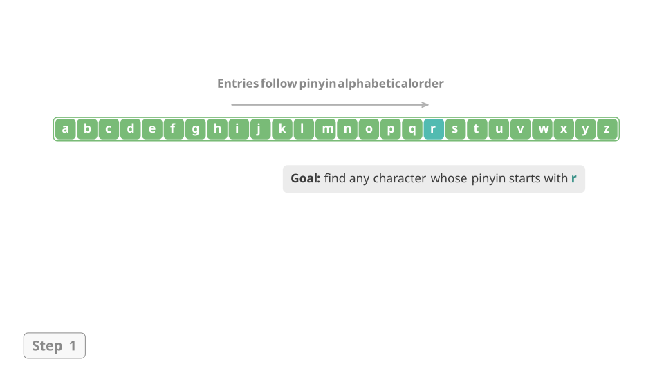
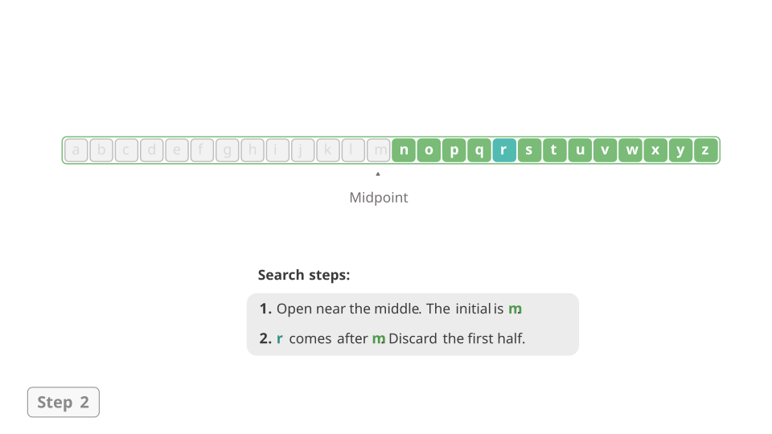
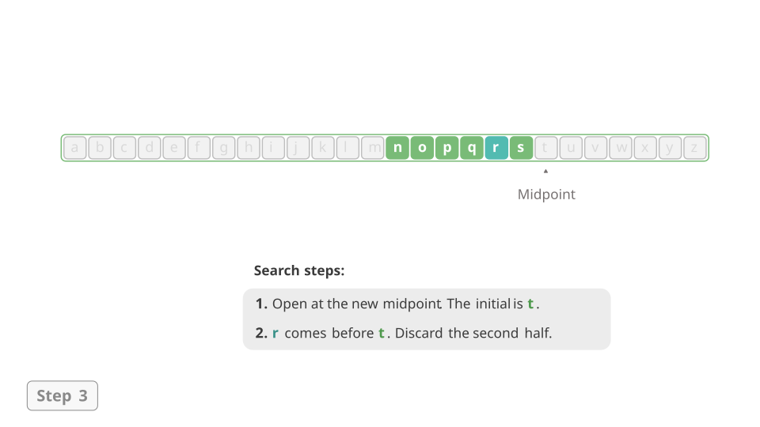
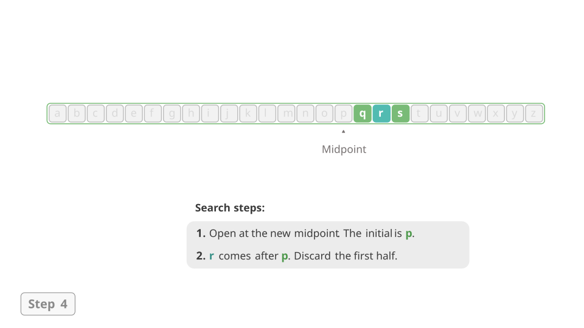
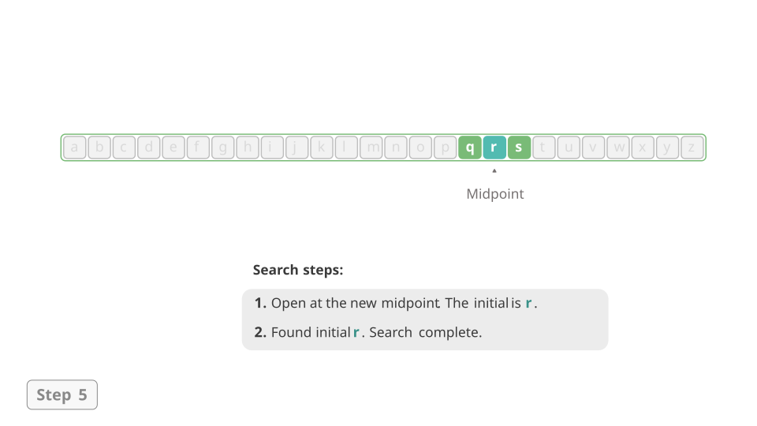
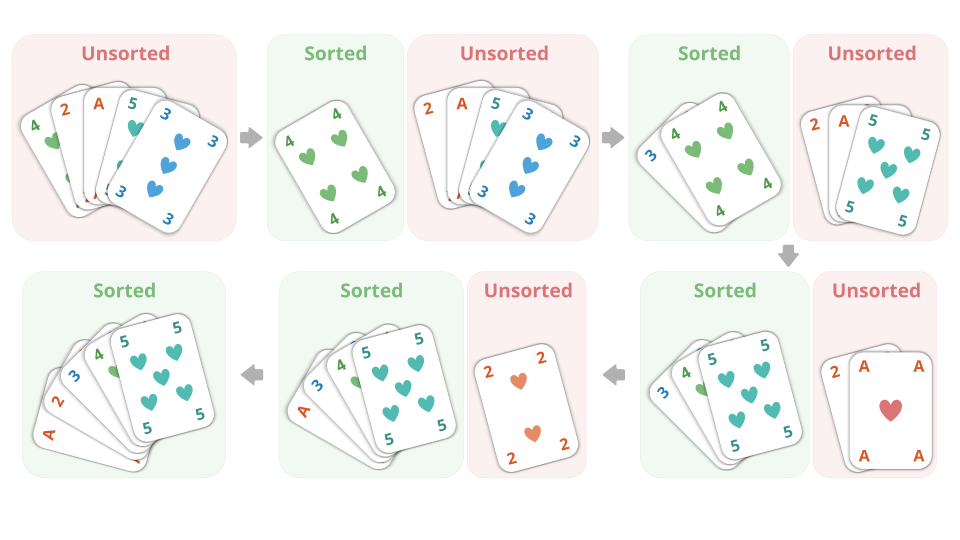
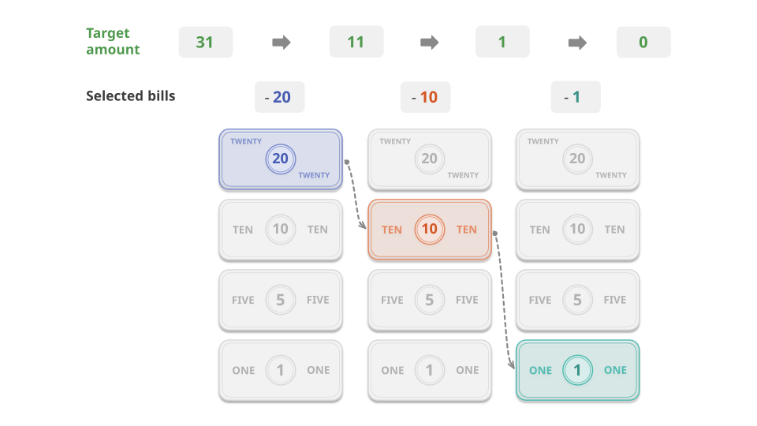

# Algorithms are everywhere

When we hear the word “algorithm,” we naturally think of mathematics. Yet many algorithms require little advanced math. They rely on basic reasoning that we use every day.

Before we explore algorithms formally, consider this: **you have already learned many algorithms without realizing it, and you routinely apply them in daily life**. Let's look at a few examples.

**Example 1: Looking up a character in a dictionary**. In a Chinese dictionary ordered by pinyin, each character has a pinyin spelling, and entries follow alphabetical order by that spelling. To find a character whose pinyin begins with $r$, we might proceed as shown in the figure.

1. Open the dictionary roughly halfway through and check the initial letter on that page. Suppose it is $m$.
2. Since $r$ comes after $m$ in the pinyin alphabet, rule out the first half of the dictionary and narrow the search to the second half.
3. Repeat steps `1.` and `2.` until you find a page with the initial $r$.

=== "<1>"
    

=== "<2>"
    

=== "<3>"
    

=== "<4>"
    

=== "<5>"
    

This elementary-school skill is an example of the famous binary search algorithm. In terms of data structures, we can think of the dictionary as a sorted array. In terms of algorithms, the steps we use to look up a character form a binary search.

**Example 2: Sorting playing cards**. At the start of a round of cards, we arrange our hand from lowest to highest. The figure shows one way to do it.

1. Divide the hand into a sorted section and an unsorted section. Initially, treat the single leftmost card as sorted.
2. Take a card from the unsorted section and insert it in the correct position in the sorted section. The two leftmost cards are now in order.
3. Repeat step `2.`, inserting one unsorted card into the sorted section each time, until the entire hand is sorted.

This method of arranging cards is insertion sort. It is efficient on small data sets, and many programming languages use it as part of their library sorting routines.

**Example 3: Making change**. Suppose you buy an item for $69$ yuan and hand the cashier $100$ yuan. The cashier owes you $31$ yuan and might reason through the steps in the figure almost without thinking.

1. The available bills smaller than $31$ yuan have denominations of $1$, $5$, $10$, and $20$ yuan.
2. Take the largest bill that fits, $20$ yuan. That leaves $31 - 20 = 11$ yuan.
3. Of the bills that now fit, take the largest, $10$ yuan. That leaves $11 - 10 = 1$ yuan.
4. Of the bills that now fit, take the largest, $1$ yuan. That leaves $1 - 1 = 0$ yuan.
5. Complete the change with bills totaling $20 + 10 + 1 = 31$ yuan.

At every step we made the choice that looked best at that moment: use the largest bill that fits. This gave us a valid way to make change. In algorithmic terms, this is a greedy algorithm.

From cooking a meal to navigating between stars, almost every problem involves an algorithm. With computers, we can write programs that store data structures in memory and use CPUs and GPUs to execute algorithms. This lets us bring real-world problems to a computer and solve a variety of complex tasks more efficiently.

!!! tip

    If data structures, algorithms, arrays, and binary search still feel unfamiliar, read on. This book will guide you into the world of data structures and algorithms.
