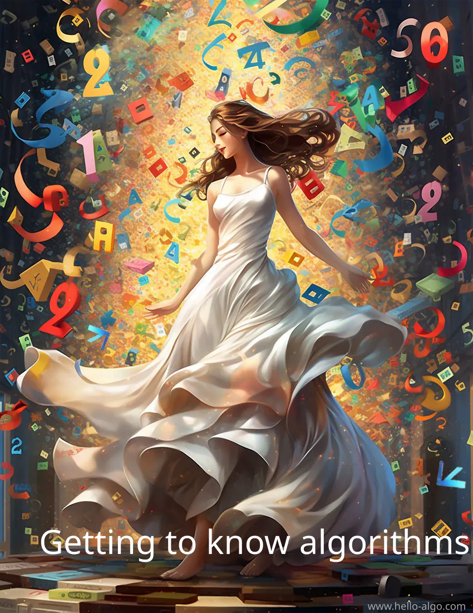

# Chapter 1. &nbsp; Introduction to algorithms

{ class="cover-image" }

!!! abstract

    A young woman dances among strands of data, her skirt swirling to the rhythm of algorithms.
    
    She invites you to dance. Follow her steps into a world of logic and beauty.

## In this chapter

- [1.1 &nbsp; Algorithms are everywhere](algorithms_are_everywhere.md)
- [1.2 &nbsp; What is an algorithm?](what_is_dsa.md)
- [1.3 &nbsp; Summary](summary.md)
