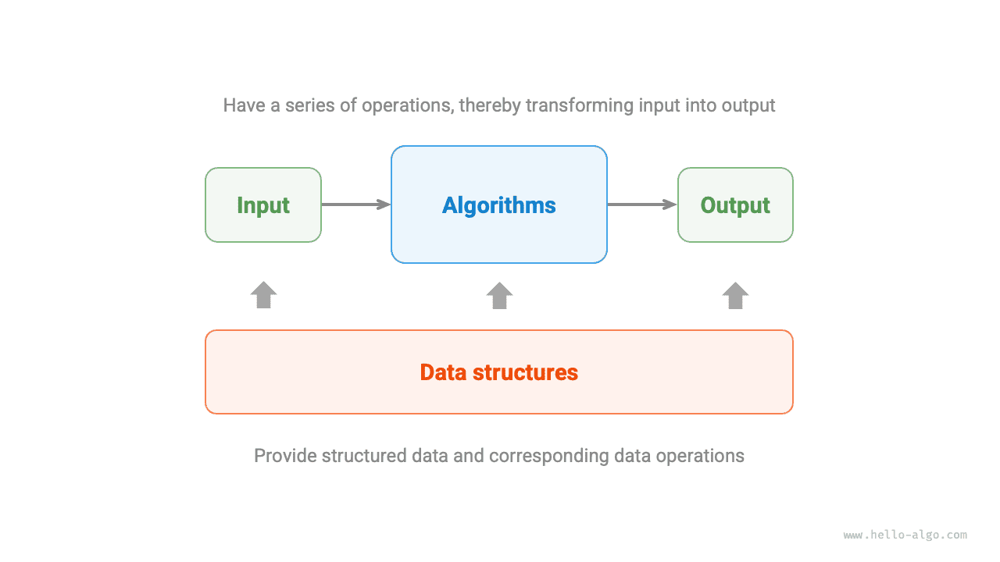

# What is an algorithm?

## Definition of an algorithm

An <u>algorithm</u> is a set of instructions or steps that solves a specific problem within a finite time. It has the following properties.

- The problem is well defined, with clear definitions of its inputs and outputs.
- The algorithm is feasible: it can finish within a finite number of steps, using finite time and memory.
- Every step has a definite meaning. Given the same inputs and execution conditions, the output is always the same.

## Definition of a data structure

A <u>data structure</u> is a way of organizing and storing data. It encompasses the data itself, the relationships between data items, and the methods used to operate on them. Its design aims to achieve the following goals.

- Use as little space as possible to conserve computer memory.
- Make data operations as fast as possible, including access, insertion, deletion, and updating.
- Provide a concise representation of data and its logical relationships so that algorithms can run efficiently.

**Designing a data structure involves tradeoffs**. Improving one aspect often requires compromising another. Here are two examples.

- Compared with arrays, linked lists make insertion and deletion easier, at the expense of data access speed.
- Compared with linked lists, graphs provide richer information about logical relationships but require more memory.

## The relationship between data structures and algorithms

As the figure below shows, data structures and algorithms are closely intertwined in three ways.

- Data structures are the foundation of algorithms. They provide algorithms with data in a structured form and methods for operating on that data.
- Algorithms bring data structures to life. A data structure by itself only stores information; it must be combined with an algorithm to solve a specific problem.
- An algorithm can often be implemented using different data structures, but its efficiency may vary greatly. Choosing the right data structure is crucial.

Data structures and algorithms are like assembling the building blocks shown in the figure below. A set of building blocks includes not only many pieces but also detailed assembly instructions. By following those instructions step by step, we can build an intricate model.

The table below describes this analogy in detail.

 Table <id> &nbsp; Comparing data structures and algorithms to building blocks 

| Data structures and algorithms | Building blocks                                 |
| -------------- | ---------------------------------------- |
| Input data       | Unassembled blocks                             |
| Data structure       | How the blocks are organized, including their shapes, sizes, and connections |
| Algorithm           | A sequence of steps for assembling the blocks into the desired form       |
| Output data       | The finished model                                 |

Data structures and algorithms are independent of programming languages. This is why the book can provide implementations in multiple languages.

!!! tip "A common shorthand"

    In everyday discussions, we often shorten “data structures and algorithms” to “algorithms.” For example, the familiar algorithm problems on LeetCode actually test knowledge of both data structures and algorithms.
