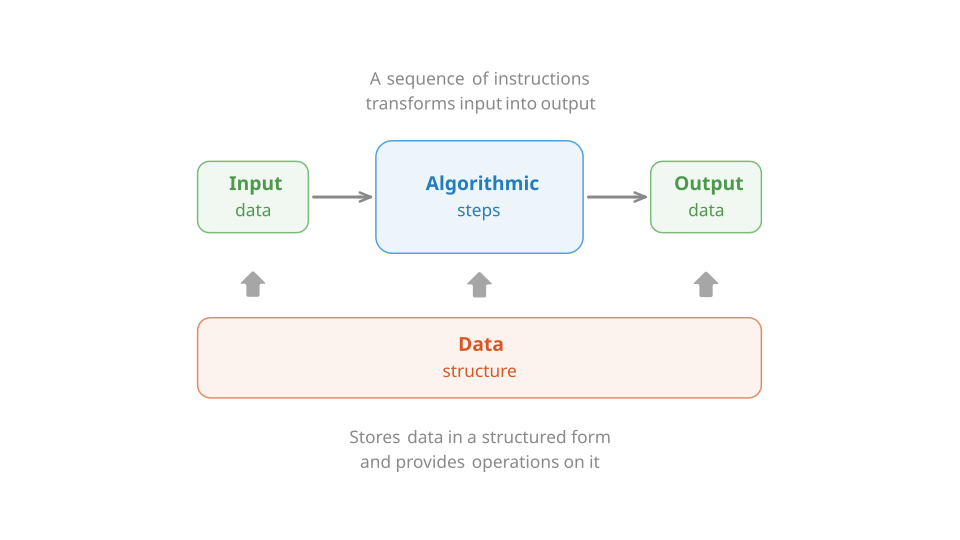

# What is an algorithm?

## Defining an algorithm

An <u>algorithm</u> is a set of instructions or steps that solves a specific problem in finite time. It has the following characteristics.

- The problem is clearly specified, with well-defined inputs and outputs.
- The steps are feasible and can be completed in a finite number of steps using finite time and memory.
- Each step has a definite meaning. Given the same input and execution conditions, the output is always the same.

## Defining a data structure

A <u>data structure</u> is a way of organizing and storing data. It encompasses the data itself, relationships among the data, and the operations available on it. Its design has several goals.

- Use as little space as possible to conserve memory.
- Make operations such as accessing, adding, deleting, and updating data as fast as possible.
- Provide a concise representation of the data and its logical relationships so that algorithms can run efficiently.

**Designing a data structure involves trade-offs**. Improving one aspect often requires a compromise elsewhere. Consider two examples.

- Compared with an array, a linked list makes insertion and deletion more convenient at the cost of slower access.
- Compared with a linked list, a graph captures richer relationships but requires more memory.

## How data structures and algorithms work together

The figure illustrates the close connection between data structures and algorithms. It shows up in three ways.

- Data structures provide the foundation for algorithms. They organize data in memory and provide ways to operate on it.
- Algorithms put data structures to work. A data structure on its own stores information. Combined with an algorithm, it can solve a particular problem.
- An algorithm can often be implemented with different data structures, but the resulting implementations can vary greatly in efficiency. Choosing a suitable structure is essential.

Think of assembling a model from building blocks, as in the figure. A kit comes with many pieces and a detailed instruction booklet. Follow the instructions one step at a time and the pieces become a finished model.

The table spells out the analogy.

 Table <id> &nbsp; Data structures and algorithms as a building-block set 

| Data structures and algorithms | Building-block set                                 |
| -------------- | ---------------------------------------- |
| Input data       | Loose blocks                             |
| Data structure       | How the blocks are organized, including their shapes, sizes, and connections |
| Algorithm           | Steps for assembling the blocks into the desired shape       |
| Output data       | Assembled model                                 |

Data structures and algorithms are independent of any particular programming language. This is what allows the book to give implementations in multiple languages.

!!! tip "A common shorthand"

    In practice, people often shorten “data structures and algorithms” to “algorithms.” The familiar LeetCode algorithm problems, for example, test knowledge of both.
