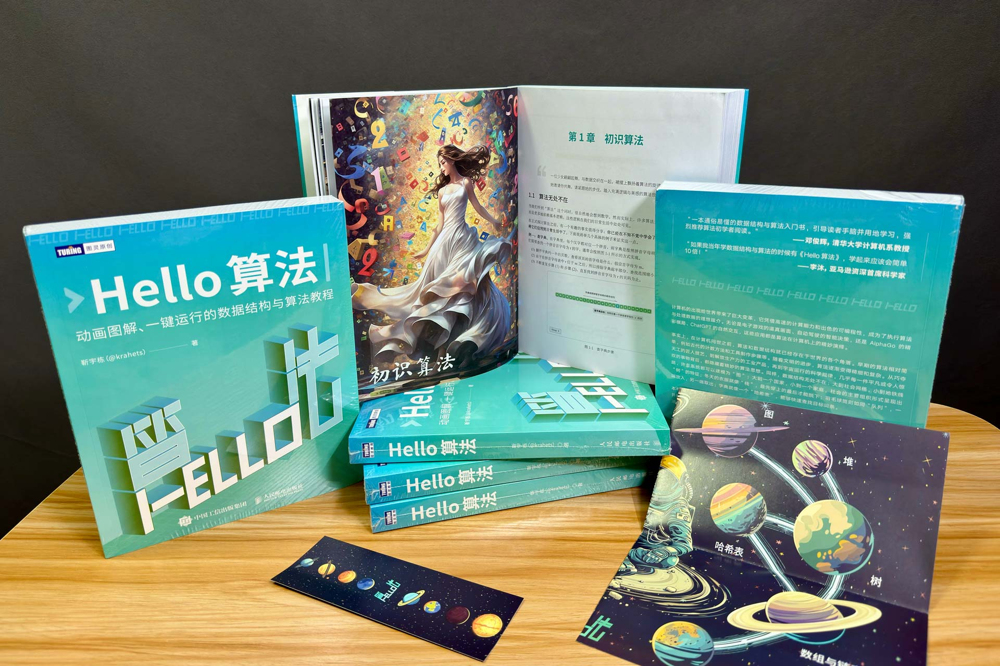

# Print edition (Chinese)

After a long period of refinement, the Simplified Chinese print edition of *Hello Algo* is finally here! A line of poetry captures how I feel:

Chase the wind and moon without pause; beyond the open plains lie the mountains of spring.

{ class="animation-figure" }

The following video introduces the print edition and shares some of my thoughts on:

- The importance of learning data structures and algorithms.
- Why I chose Python for the print edition.
- What sharing knowledge means to me.

> I am new to making videos. Please show your support with a like, a coin, and a favorite—thank you!

    <iframe src="//player.bilibili.com/player.html?aid=1051597767&bvid=BV1QH4y157uC&cid=1462564112&p=1&autoplay=0" scrolling="no" border="0" frameborder="no" framespacing="0" allowfullscreen="true"> </iframe>

Here are some snapshots of the print edition:

{ class="animation-figure" }

{ class="animation-figure" }

## Strengths and limitations

Here are a few things about the print edition that may pleasantly surprise you:

- Full-color printing makes the most of the book's animation-style illustrations.
- Carefully selected paper reproduces colors faithfully while preserving the distinctive feel of a printed book.
- Formatting is more standardized than in the web edition; for example, formulas in figures are italicized.
- A fold-out mind map and bookmarks are included at no extra cost.
- The print, web, and PDF editions have synchronized content, so you can switch freely between them.

!!! tip

    Synchronizing the print and web editions is difficult, so there may be minor differences. Thank you for your understanding!

Of course, there are also a few points to consider before buying:

- The book uses Python, which may not be your main language. You can treat Python as pseudocode and focus on understanding the ideas.
- Full-color printing greatly improves the reading experience for illustrations and code, but costs somewhat more than black-and-white printing.

!!! tip

    “Print quality” and “price” are like “time efficiency” and “space efficiency” in algorithms: it is difficult to optimize both. In my view, print quality corresponds to time efficiency and deserves greater priority.

## Where to buy

If you are interested in the Simplified Chinese print edition, consider getting a copy. We have arranged a 50% discount on the new book. Follow [this link](https://3.cn/1X-qmTD3) or scan the QR code below:

{ class="animation-figure" }

## Afterword

At first, I underestimated the work involved in publishing a print edition. I assumed that as long as the open-source project was well maintained, some form of automation could generate the printed book. Experience showed that producing a printed book differs greatly from updating an open-source project, and moving between the two requires considerable extra work.

There is still a long road from a first draft to a manuscript ready for publication. It takes close collaboration and sustained refinement by the author and the publisher's planning, editorial, design, and marketing teams. My thanks go to Turing's commissioning editor Junhua Wang and everyone at Posts & Telecom Press and Turing Community who took part in publishing this book!

I hope this book will help you!
