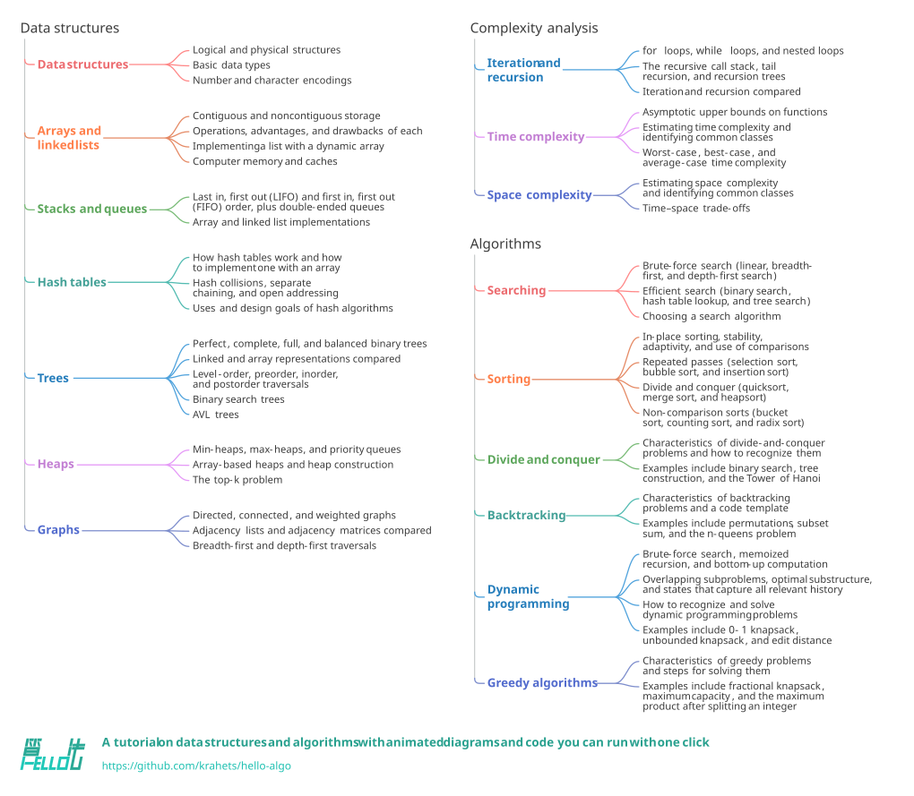

# 0.1 &nbsp; About this book

This project aims to create a free, open-source introduction to data structures and algorithms for beginners.

- Animated illustrations throughout the book explain ideas in manageable steps and guide beginners through the landscape of data structures and algorithms.
- You can run the source code with one click, build your programming skills through practice, and see how algorithms work and how data structures are implemented.
- We encourage readers to learn from one another. Ask questions and share your insights in the comments so everyone can learn from the discussion.

## 0.1.1 &nbsp; Who this book is for

If you've never studied algorithms, this book is for you. It's also for you if you've solved a few practice problems but your grasp of data structures and algorithms still comes and goes.

If you've already solved quite a few problems and know most of the common types, the book can help you review what you know and see how it fits together. Use the repository's source code as a problem-solving toolkit or an algorithm dictionary.

If you're an experienced algorithm designer, we'd love to hear your suggestions or have you [contribute to the book](../chapter_appendix/contribution.md).

!!! success "Prerequisites"

    You need a basic grounding in at least one programming language and should be able to read and write simple code.

## 0.1.2 &nbsp; What the book covers

The figure gives an overview of the book.

- **Complexity analysis** covers the criteria and methods for evaluating data structures and algorithms. It explains how to estimate time and space complexity and gives common growth rates and examples.
- **Data structures** covers basic data types and ways to classify data structures. For arrays, linked lists, stacks, queues, hash tables, trees, heaps, graphs, and more, we explore definitions, strengths and weaknesses, common operations and variants, typical applications, and implementations.
- **Algorithms** covers searching, sorting, divide and conquer, backtracking, dynamic programming, and greedy algorithms. We discuss what each technique does, its strengths and weaknesses, its efficiency and applications, and how to apply it to example problems.

{ class="animation-figure" }

 Figure 0-1 &nbsp; Overview of the book 

## 0.1.3 &nbsp; Acknowledgments

This book continues to improve through the work of many open-source contributors. Thank you to everyone who has contributed time and effort. In the order generated by GitHub, they are krahets, coderonion, Gonglja, nuomi1, Reanon, justin-tse, hpstory, danielsss, curtishd, night-cruise, S-N-O-R-L-A-X, rongyi, msk397, gvenusleo, khoaxuantu, rivertwilight, K3v123, gyt95, zhuoqinyue, yuelinxin, Zuoxun, mingXta, Phoenix0415, FangYuan33, GN-Yu, longsizhuo, pengchzn, QiLOL, Cathay-Chen, guowei-gong, xBLACKICEx, IsChristina, JoseHung, qualifier1024, hello-ikun, magentaqin, Guanngxu, thomasq0, sunshinesDL, L-Super, Transmigration-zhou, WSL0809, Slone123c, lhxsm, yuan0221, what-is-me, theNefelibatas, Shyam-Chen, sangxiaai, longranger2, codeberg-user, xiongsp, JeffersonHuang, prinpal, seven1240, Wonderdch, malone6, xiaomiusa87, gaofer, bluebean-cloud, a16su, SamJin98, hongyun-robot, nanlei, XiaChuerwu, yd-j, iron-irax, mgisr, steventimes, junminhong, heshuyue, danny900714, Nigh, Dr-XYZ, MolDuM, XC-Zero, reeswell, PXG-XPG, NI-SW, Horbin-Magician, Enlightenus, YangXuanyi, xjr7670, beatrix-chan, DullSword, qq909244296, iStig, boloboloda, hts0000, gledfish, fbigm, echo1937, jiaxianhua, wenjianmin, keshida, kilikilikid, lclc6, lwbaptx, linyejoe2, liuxjerry, szu17dmy, dshlstarr, Yucao-cy, coderlef, czruby, bongbongbakudan, beintentional, ZongYangL, ZhongYuuu, ZhongGuanbin, hezhizhen, linzeyan, ZJKung, JTCPOWI, KawaiiAsh, luluxia, xb534, ztkuaikuai, yw-1021, ElaBosak233, baagod, zhouLion, yishangzhang, yi427, yanedie, yabo083, weibk, wangwang105, th1nk3r-ing, tao363, 4yDX3906, syd168, sslmj2020, smilelsb, siqyka, selear, sdshaoda, Xi-Row, popozhu, nuquist19, noobcodemaker, XiaoK29, chadyi, lyl625760, lucaswangdev, llql1211, 0130w, shanghai-Jerry, EJackYang, Javesun99, eltociear, lipusheng, KNChiu, BlindTerran, ShiMaRing, lovelock, FreddieLi, FloranceYeh, fanchenggang, gltianwen, goerll, nedchu, curly210102, CuB3y0nd, KraHsu, CarrotDLaw, youshaoXG, bubble9um, Asashishi, Asa0oo0o0o, fanenr, eagleanurag, akshiterate, 52coder, foursevenlove, KorsChen, hopkings2008, yang-le, realwujing, Evilrabbit520, Umer-Jahangir, Turing-1024-Lee, Suremotoo, paoxiaomooo, Chieko-Seren, Senrian, Allen-Scai, 19santosh99, ymmmas, Risuntsy, Richard-Zhang1019, RafaelCaso, qingpeng9802, primexiao, Urbaner3, codetypess, nidhoggfgg, MwumLi, CreatorMetaSky, martinx, ZnYang2018, hugtyftg, logan-qiu, psychelzh, Kunchen-Luo, Keynman, and KeiichiKasai.

The code reviewers, in alphabetical order, were coderonion, curtishd, Gonglja, gvenusleo, hpstory, justin-tse, khoaxuantu, krahets, night-cruise, nuomi1, Reanon, and rongyi. Thank you for the time and care you put into keeping the code consistent and idiomatic across languages.

The English edition was reviewed by yuelinxin, K3v123, magentaqin, QiLOL, Phoenix0415, SamJin98, yanedie, RafaelCaso, pengchzn, and thomasq0. The Japanese edition was reviewed by eltociear, the Russian edition by И. А. Шевкун and Yuyan Huang, and the Traditional Chinese edition by Shyam-Chen and Dr-XYZ. Thank you all for helping this book reach a wider audience.

zhongfq developed the tool that generates the EPUB edition. Thank you for giving readers another way to enjoy the book.

Many people helped me along the way as I wrote this book.

- Thank you to my mentor at work, Dr. Xi Li. During one long conversation, you encouraged me to “get moving,” strengthening my resolve to write the book.
- Thank you to my girlfriend, Paopao, the book's first reader. Your suggestions from the perspective of someone new to algorithms made it more accessible to beginners.
- Thank you to Tengbao, Qibao, and Feibao for coming up with a name that brings back the memory of writing that first line of code: “Hello World!”
- Thank you to Xiaoquan for your professional advice on intellectual property, which played an important part in shaping this open-source book.
- Thank you to Su Tong for designing the beautiful cover and logo and patiently revising them through all my exacting requests.
- Thank you to @squidfunk for the typesetting advice and for developing the open-source documentation theme [Material-for-MkDocs](https://github.com/squidfunk/mkdocs-material).

While writing, I read many textbooks and articles on data structures and algorithms. They gave me excellent examples to follow and helped ensure the accuracy and quality of this book. I'm grateful to all the teachers and authors whose work paved the way.

This book encourages learning by thinking and doing. A major inspiration was [Dive into Deep Learning](https://github.com/d2l-ai/d2l-zh), a book I wholeheartedly recommend.

**My heartfelt thanks to my parents. Your constant support and encouragement gave me the opportunity to do something I find so rewarding**.
