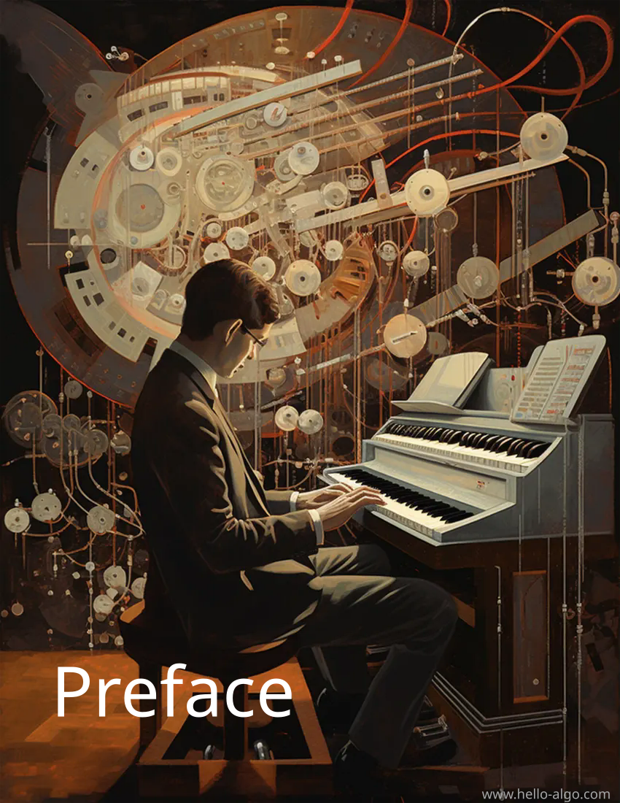

# Chapter 0. &nbsp; Preface

{ class="cover-image" }

!!! abstract

    Algorithms are like a symphony, each line of code flowing in rhythm.
    
    May this book play softly in your mind and leave a melody all its own.

## In this chapter

- [0.1 &nbsp; About this book](about_the_book.md)
- [0.2 &nbsp; How to use this book](suggestions.md)
- [0.3 &nbsp; Summary](summary.md)
