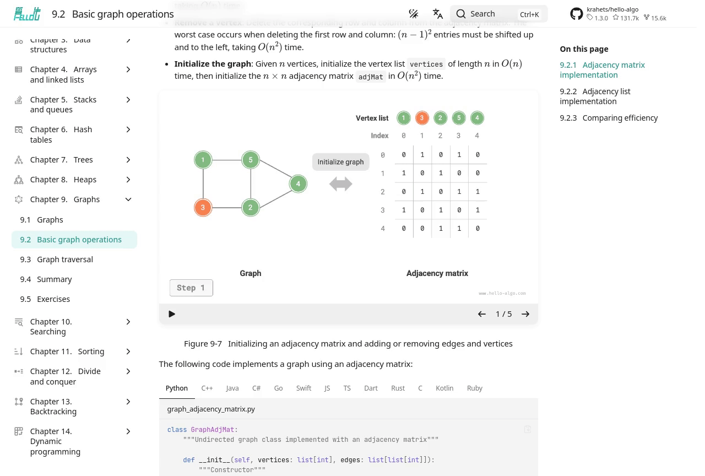
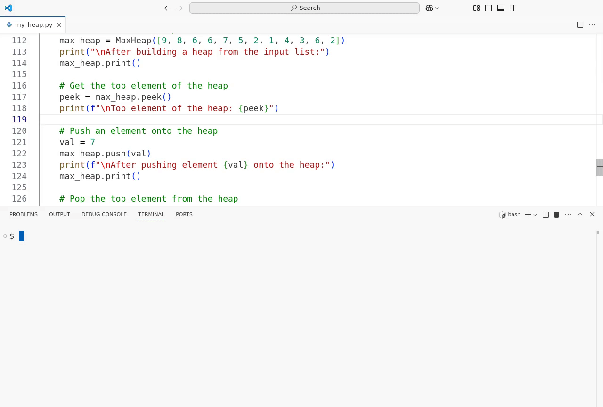
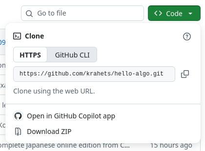
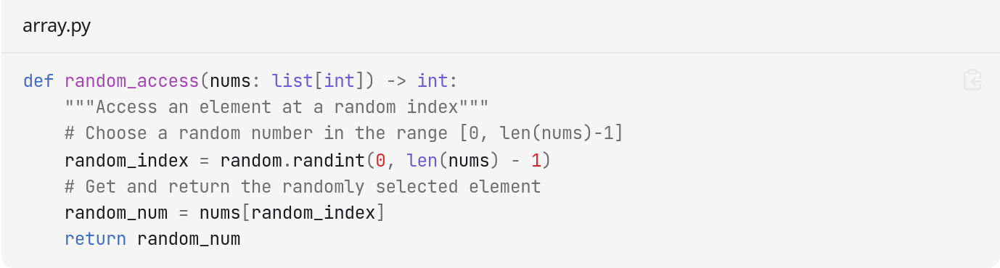
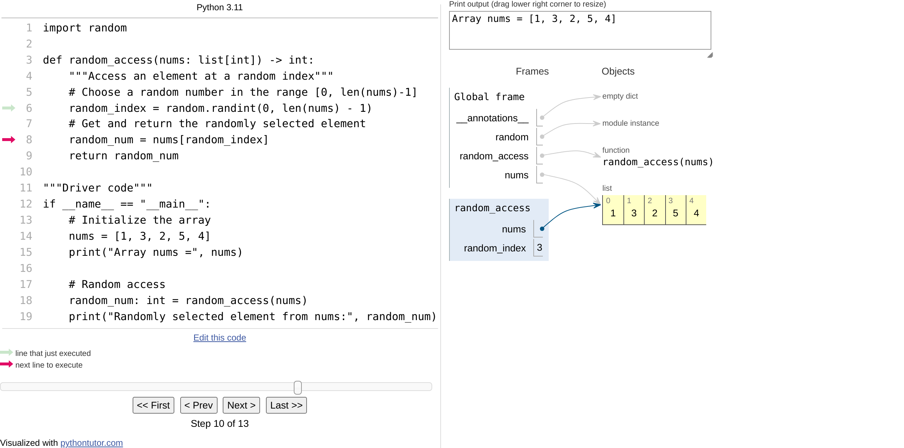
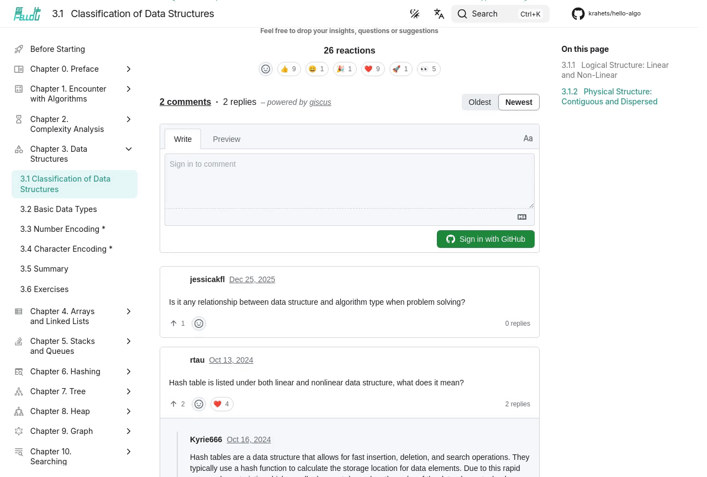

# How to use this book

!!! tip

    For the best reading experience, we recommend reading this section in full.

## Writing conventions

- Sections with `*` after the title are optional and cover more difficult material. If your time is limited, you can skip them at first.
- Technical terms appear in bold in the print and PDF editions or are underlined in the web edition, such as <u>array</u>. Remembering these terms will help you read technical literature.
- Key points and summary statements appear in **bold** and deserve particular attention.
- Words and phrases used in a specific sense appear in “quotation marks” to avoid ambiguity.
- When terminology differs between programming languages, this book follows Python; for example, it uses `None` to represent a null value.
- For a more compact layout, this book sometimes departs from a language's usual commenting conventions. Comments fall into three main categories: heading comments, explanatory comments, and multiline comments.

=== "Python"

    ```python title=""
    """Heading comment identifying a function, class, test case, and so on"""
    
    # Explanatory comment describing the code in detail
    
    """
    Multiline
    comment
    """
    ```

=== "C++"

    ```cpp title=""
    /* Heading comment identifying a function, class, test case, and so on */
    
    // Explanatory comment describing the code in detail
    
    /**
     * Multiline
     * comment
     */
    ```

=== "Java"

    ```java title=""
    /* Heading comment identifying a function, class, test case, and so on */
    
    // Explanatory comment describing the code in detail
    
    /**
     * Multiline
     * comment
     */
    ```

=== "C#"

    ```csharp title=""
    /* Heading comment identifying a function, class, test case, and so on */
    
    // Explanatory comment describing the code in detail
    
    /**
     * Multiline
     * comment
     */
    ```

=== "Go"

    ```go title=""
    /* Heading comment identifying a function, class, test case, and so on */
    
    // Explanatory comment describing the code in detail
    
    /**
     * Multiline
     * comment
     */
    ```

=== "Swift"

    ```swift title=""
    /* Heading comment identifying a function, class, test case, and so on */
    
    // Explanatory comment describing the code in detail
    
    /**
     * Multiline
     * comment
     */
    ```

=== "JS"

    ```javascript title=""
    /* Heading comment identifying a function, class, test case, and so on */
    
    // Explanatory comment describing the code in detail
    
    /**
     * Multiline
     * comment
     */
    ```

=== "TS"

    ```typescript title=""
    /* Heading comment identifying a function, class, test case, and so on */
    
    // Explanatory comment describing the code in detail
    
    /**
     * Multiline
     * comment
     */
    ```

=== "Dart"

    ```dart title=""
    /* Heading comment identifying a function, class, test case, and so on */
    
    // Explanatory comment describing the code in detail
    
    /**
     * Multiline
     * comment
     */
    ```

=== "Rust"

    ```rust title=""
    /* Heading comment identifying a function, class, test case, and so on */

    // Explanatory comment describing the code in detail
    
    // Multiline
    // comment
    ```

=== "C"

    ```c title=""
    /* Heading comment identifying a function, class, test case, and so on */
    
    // Explanatory comment describing the code in detail
    
    /**
     * Multiline
     * comment
     */
    ```

=== "Kotlin"

    ```kotlin title=""
    /* Heading comment identifying a function, class, test case, and so on */
    
    // Explanatory comment describing the code in detail
    
    /**
     * Multiline
     * comment
     */
    ```

=== "Ruby"

    ```ruby title=""
    ### Heading comment identifying a function, class, test case, and so on ###

    # Explanatory comment describing the code in detail
    
    # Multiline
    # comment
    ```

## Learn efficiently with animated illustrations

Compared with text, videos and images convey information in a denser, more structured form that is easier to understand. In this book, **key and difficult concepts are presented mainly through animated illustrations**, with text providing explanations and additional detail.

When a passage includes an animated illustration like the one below, **focus on the illustration and use the text to support it**, drawing on both to understand the material.



## Deepen your understanding through coding

The accompanying code is hosted in the [GitHub repository](https://github.com/krahets/hello-algo). As the figure below shows, **the source code includes test cases and can be run with one click**.

If time permits, **we recommend typing out the code yourself while referring to the examples**. If your study time is limited, at least read and run all the code.

Writing code often teaches us more than reading it. **To truly learn, learn by doing**.



Getting ready to run the code involves three main steps.

**Step 1: Set up a local programming environment**. Follow the [tutorial](../chapter_appendix/installation.md) in the appendix. If your environment is already set up, skip this step.

**Step 2: Clone or download the repository**. Visit the [GitHub repository](https://github.com/krahets/hello-algo). If you have [Git](https://git-scm.com/downloads) installed, clone the repository with the following command:

```shell
git clone https://github.com/krahets/hello-algo.git
```

Alternatively, click “Download ZIP” in the location shown below to download the code as an archive, then extract it on your computer.



**Step 3: Run the source code**. As shown below, when a code block has a filename at the top, you can find the corresponding source file in the repository's `en/codes` folder. These files can be run with one click, saving unnecessary debugging time so you can focus on learning.



In addition to running code locally, **the web edition supports visual execution of Python code** through [pythontutor](https://pythontutor.com/). Click “Visualize execution” beneath a code block to expand the view and watch the algorithm run. You can also click “View full screen” for a larger display, as shown in the figure below.



## Learn together through questions and discussion

As you read, do not simply skip concepts you have not understood. **You are welcome to ask questions in the comments**. My fellow contributors and I will do our best to answer, usually within two days.

As shown below, every section in the web edition has a comments area at the bottom. I hope you will read it regularly. Other readers' questions can reveal gaps in your own understanding and encourage deeper thought. I also hope you will generously answer their questions, share your insights, and help them make progress.



## A learning path for algorithms

Broadly speaking, learning data structures and algorithms can be divided into three stages.

1. **Stage 1: Learn the fundamentals**. Become familiar with the properties and uses of data structures, and study how different algorithms work, their steps, applications, and efficiency.
2. **Stage 2: Solve practice problems**. We recommend starting with popular problems and solving at least 100 to become familiar with common algorithmic problems. When you first begin, forgetting what you have learned may be a challenge, but this is normal. Review problems according to the “Ebbinghaus forgetting curve”; after 3–5 rounds of repetition, they will usually be firmly in memory. See this [GitHub repository](https://github.com/krahets/LeetCode-Book) for recommended problem lists and practice plans.
3. **Stage 3: Build a systematic understanding**. Read algorithm articles, problem-solving frameworks, and textbooks to keep expanding your knowledge. In your practice, try more advanced strategies: group problems by topic, solve one problem in several ways, or apply one solution to several problems. You can find advice on these strategies in various communities.

As the figure below shows, this book mainly covers “Stage 1,” helping you approach Stages 2 and 3 more efficiently.


