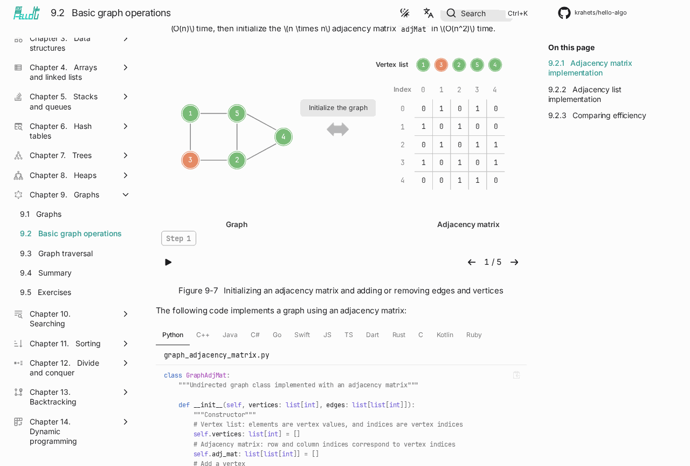
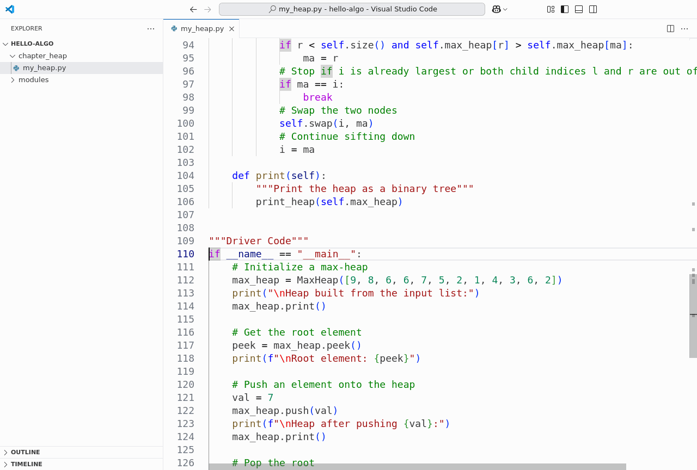
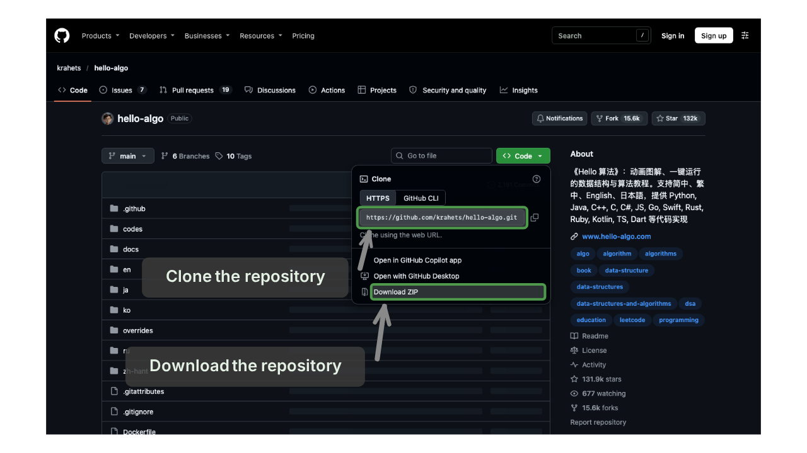
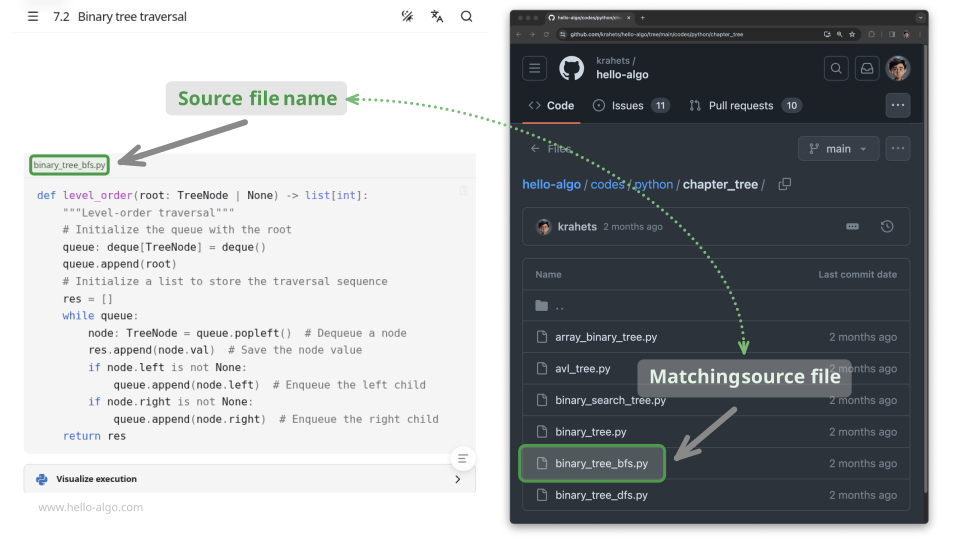
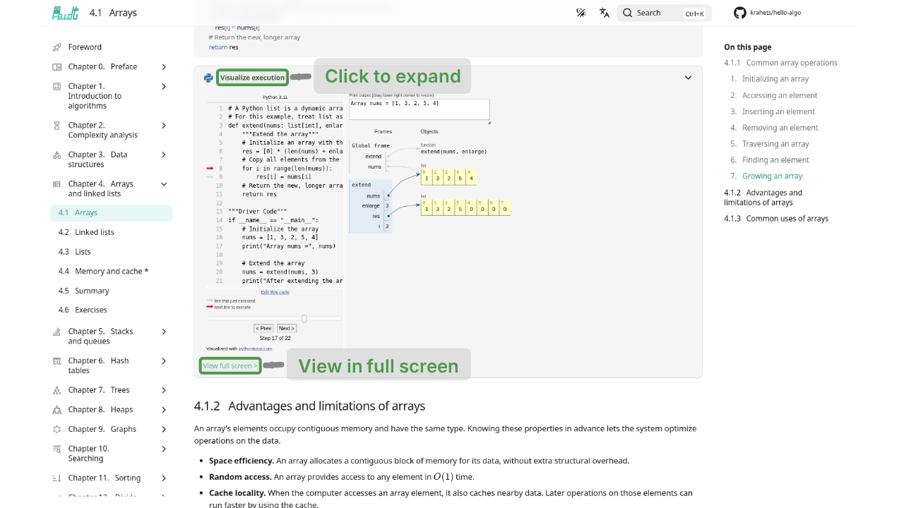
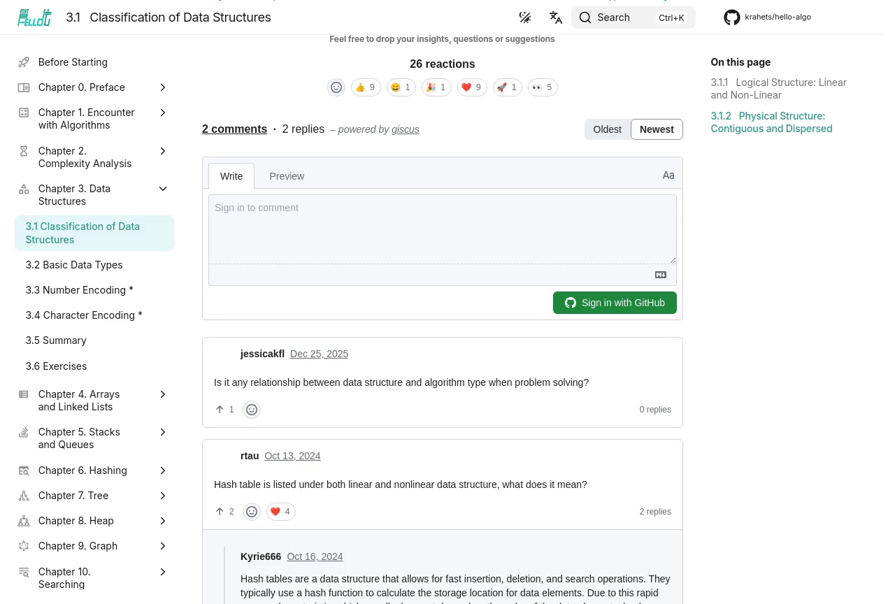
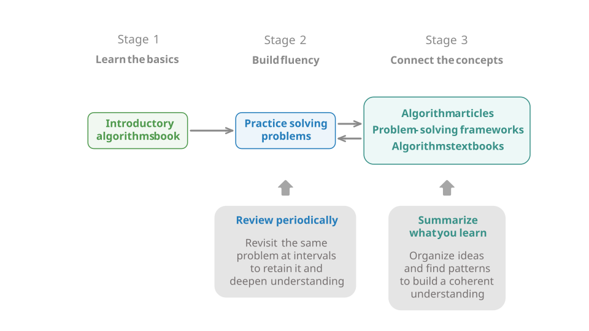

# 0.2 &nbsp; How to use this book

!!! tip

    For the best reading experience, take a few minutes to read this section in full.

## 0.2.1 &nbsp; Conventions

- Sections marked with `*` after the title are optional and cover more challenging material. If your time is limited, you can skip them on a first pass.
- Technical terms such as <u>array</u> appear in bold in the print and PDF editions and are underlined in the web edition. Learning these terms will make the literature easier to read.
- Key points and summary statements appear in **bold**. Give these passages particular attention.
- Quotation marks identify words or phrases used in a particular sense to avoid ambiguity.
- When terminology varies by language, the book follows Python's convention. For instance, we use `None` to indicate the absence of a value.
- To keep the layout compact, we sometimes depart from a language's usual commenting conventions. The book mainly uses heading comments, explanatory comments, and multiline comments.

=== "Python"

    ```python title=""
    """Heading comment for a function, class, test case, etc."""

    # Explanatory comment about the code

    """
    Multiline
    comment
    """
    ```

=== "C++"

    ```cpp title=""
    /* Heading comment for a function, class, test case, etc. */

    // Explanatory comment about the code

    /**
     * Multiline
     * comment
     */
    ```

=== "Java"

    ```java title=""
    /* Heading comment for a function, class, test case, etc. */

    // Explanatory comment about the code

    /**
     * Multiline
     * comment
     */
    ```

=== "C#"

    ```csharp title=""
    /* Heading comment for a function, class, test case, etc. */

    // Explanatory comment about the code

    /**
     * Multiline
     * comment
     */
    ```

=== "Go"

    ```go title=""
    /* Heading comment for a function, class, test case, etc. */

    // Explanatory comment about the code

    /**
     * Multiline
     * comment
     */
    ```

=== "Swift"

    ```swift title=""
    /* Heading comment for a function, class, test case, etc. */

    // Explanatory comment about the code

    /**
     * Multiline
     * comment
     */
    ```

=== "JS"

    ```javascript title=""
    /* Heading comment for a function, class, test case, etc. */

    // Explanatory comment about the code

    /**
     * Multiline
     * comment
     */
    ```

=== "TS"

    ```typescript title=""
    /* Heading comment for a function, class, test case, etc. */

    // Explanatory comment about the code

    /**
     * Multiline
     * comment
     */
    ```

=== "Dart"

    ```dart title=""
    /* Heading comment for a function, class, test case, etc. */

    // Explanatory comment about the code

    /**
     * Multiline
     * comment
     */
    ```

=== "Rust"

    ```rust title=""
    /* Heading comment for a function, class, test case, etc. */

    // Explanatory comment about the code

    // Multiline
    // comment
    ```

=== "C"

    ```c title=""
    /* Heading comment for a function, class, test case, etc. */

    // Explanatory comment about the code

    /**
     * Multiline
     * comment
     */
    ```

=== "Kotlin"

    ```kotlin title=""
    /* Heading comment for a function, class, test case, etc. */

    // Explanatory comment about the code

    /**
     * Multiline
     * comment
     */
    ```

=== "Ruby"

    ```ruby title=""
    ### Heading comment for a function, class, test case, etc. ###

    # Explanatory comment about the code

    # Multiline
    # comment
    ```

## 0.2.2 &nbsp; Learning with animated illustrations

Compared with text, videos and images can present more information and show its structure more clearly, making it easier to understand. **The book uses animated illustrations as its main way of presenting important or difficult ideas**, with text to explain and supplement them.

When a passage includes an animation like the one below, **start with the illustration and use the text to fill in the details**. Read the two together.

{ class="animation-figure" }

<p align="center"> Figure 0-2 &nbsp; Example of an animated illustration </p>

## 0.2.3 &nbsp; Deepening your understanding through code

The code for this book is hosted in its [GitHub repository](https://github.com/krahets/hello-algo). As shown below, **the source code comes with test cases and runs with one click**.

If you have time, **try typing out the code yourself with the examples as a guide**. If time is short, at least read through and run all the code.

Writing code often teaches you more than reading it. **Learning happens when you try it yourself**.

{ class="animation-figure" }

<p align="center"> Figure 0-3 &nbsp; Running a code example </p>

There are three steps to getting the code running.

**Step 1: Set up a local programming environment**. Follow the [installation tutorial](../chapter_appendix/installation.md) in the appendix. If you already have an environment set up, skip this step.

**Step 2: Clone or download the repository**. Go to the [GitHub repository](https://github.com/krahets/hello-algo). If you have [Git](https://git-scm.com/downloads) installed, run the following command to clone it:

```shell
git clone https://github.com/krahets/hello-algo.git
```

You can also click “Download ZIP” at the location shown below to download the code as an archive, then extract it locally.

{ class="animation-figure" }

<p align="center"> Figure 0-4 &nbsp; Cloning the repository or downloading the code </p>

**Step 3: Run the source code**. When a code block has a file name at the top, look for the matching source file in the repository's `codes` folder, as shown below. You can run the file with one click, saving setup and debugging time so you can focus on the material.

{ class="animation-figure" }

<p align="center"> Figure 0-5 &nbsp; Code block and its source file </p>

In addition to running code locally, **you can watch Python code run step by step in the web edition**, powered by [Python Tutor](https://pythontutor.com/). Click “Visualize execution” below a code block to expand the view and follow the algorithm as it runs. Click “View full screen” for a larger view.

{ class="animation-figure" }

<p align="center"> Figure 0-6 &nbsp; Visualizing Python code execution </p>

## 0.2.4 &nbsp; Learning together through questions and discussion

When you encounter an idea you haven't understood, take the time to work through it. **You're welcome to ask questions in the comments**. My fellow contributors and I will do our best to help, usually within two days.

As shown below, each chapter of the web edition has a comment section at the bottom. I encourage you to spend time there. Seeing what other readers ask can reveal gaps in your understanding and spark deeper questions. I also hope you'll answer questions and share your insights to help others make progress.

{ class="animation-figure" }

<p align="center"> Figure 0-7 &nbsp; Example of the comment section </p>

## 0.2.5 &nbsp; A learning path for algorithms

Broadly speaking, learning data structures and algorithms has three stages.

1. **Stage 1: Learn the basics**. Get to know the features and uses of different data structures. Learn how algorithms work, what steps they take, where they are useful, and how efficient they are.
2. **Stage 2: Practice solving problems**. Start with popular problems and work through at least 100 to get familiar with the main types. Forgetting things on your first pass is a common and entirely normal challenge. Use the Ebbinghaus forgetting curve to guide your review. After three to five rounds of repetition, a problem will usually stick. See this [GitHub repository](https://github.com/krahets/LeetCode-Book) for recommended problems and practice plans.
3. **Stage 3: Connect the concepts**. Read algorithm articles, problem-solving frameworks, and textbooks to extend and organize your knowledge. In practice sessions, try working by topic, solving one problem several ways, or using one approach for several problems. Online communities have accounts of how others have used these strategies.

As the figure shows, this book mainly covers stage 1. Its goal is to prepare you to learn more efficiently in stages 2 and 3.

{ class="animation-figure" }

<p align="center"> Figure 0-8 &nbsp; A learning path for algorithms </p>
