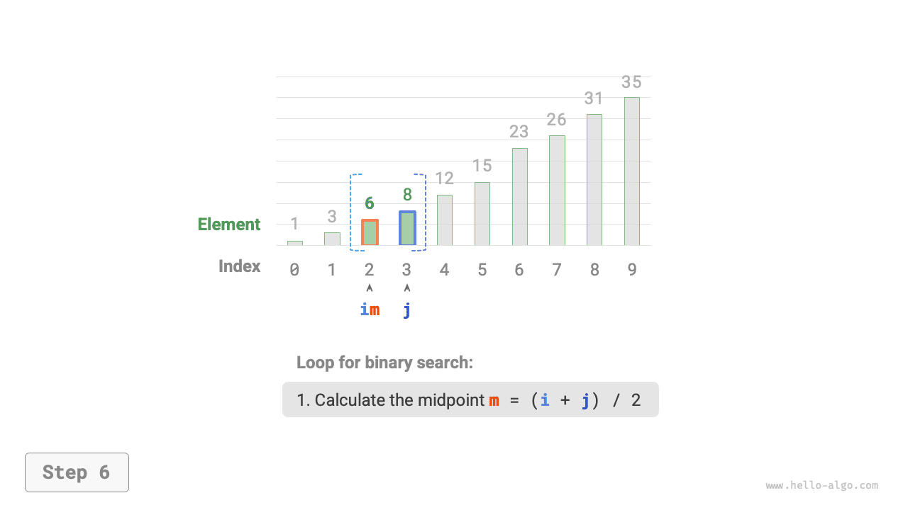

# Binary search

<u>Binary search</u> is an efficient search algorithm based on divide and conquer. It uses the ordering of the data to halve the search range each round, continuing until it finds the target element or the search interval becomes empty.

!!! question

    Given an array `nums` of length $n$, with distinct elements arranged in ascending order, find and return the index of `target`. If the array does not contain this element, return $-1$. An example is shown below.


As shown below, initialize pointers $i = 0$ and $j = n - 1$ to the first and last elements, respectively. They represent the search interval $[0, n - 1]$. Square brackets denote a closed interval, which includes its endpoints.

Next, repeat the following two steps.

1. Calculate the midpoint index $m = \lfloor {(i + j) / 2} \rfloor$, where $\lfloor \: \rfloor$ denotes rounding down.
2. Compare `nums[m]` with `target`. There are three cases.
    1. If `nums[m] < target`, then `target` lies in $[m + 1, j]$, so set $i = m + 1$.
    2. If `nums[m] > target`, then `target` lies in $[i, m - 1]$, so set $j = m - 1$.
    3. If `nums[m] = target`, we have found `target`, so return index $m$.

If the array does not contain the target, the search interval eventually becomes empty. Return $-1$ in this case.

=== "<1>"
    

=== "<2>"
    

=== "<3>"
    

=== "<4>"
    

=== "<5>"
    

=== "<6>"
    

=== "<7>"
    

Because $i$ and $j$ are both of type `int`, **$i + j$ may exceed the range of `int`**. To avoid integer overflow, we usually calculate the midpoint using $m = \lfloor {i + (j - i) / 2} \rfloor$.

The implementation is shown below:

```src
[file]{binary_search}-[class]{}-[func]{binary_search}
```

**Time complexity is $O(\log n)$**: the search interval is halved each round, so the loop runs $\log_2 n$ times.

**Space complexity is $O(1)$**: pointers $i$ and $j$ use constant space.

## Ways to represent the interval

Besides the closed interval above, another common representation is a “left-closed, right-open” interval, written $[0, n)$. It includes the left endpoint but excludes the right endpoint. With this representation, $[i, j)$ is empty when $i = j$.

We can implement an equivalent binary search algorithm using this representation:

```src
[file]{binary_search}-[class]{}-[func]{binary_search_lcro}
```

As shown below, the two interval representations require different initialization, loop conditions, and operations for narrowing the interval.

Since a closed interval includes both endpoints, the operations that narrow the interval through pointers $i$ and $j$ are symmetric. This makes mistakes less likely, **so we generally recommend the closed-interval version**.


## Strengths and limitations

Binary search performs well in both time and space.

- Binary search is time-efficient. Its logarithmic time complexity offers a significant advantage for large datasets. For example, when $n = 2^{20}$, linear search requires $2^{20} = 1048576$ iterations, whereas binary search needs only $\log_2 2^{20} = 20$.
- Binary search requires no extra storage. It uses less space than search algorithms that rely on additional storage, such as hash lookup.

However, binary search is not suitable in every situation, mainly for the following reasons.

- Binary search requires sorted data. Sorting unsorted input solely to perform a binary search is not worthwhile, because sorting usually takes $O(n \log n)$ time, more than either linear or binary search. When insertions are frequent, preserving the array's order requires inserting each element at a specific position, an expensive $O(n)$ operation.
- Binary search is suitable only for arrays. It needs to jump between nonadjacent elements, which is inefficient in a linked list. It is therefore unsuitable for linked lists and data structures based on them.
- Linear search performs better on small datasets. Each iteration of linear search needs only one comparison. Binary search needs one addition, one division, 1–3 comparisons, and one more addition or subtraction, totaling 4–6 elementary operations. When $n$ is small, linear search can therefore be faster.
