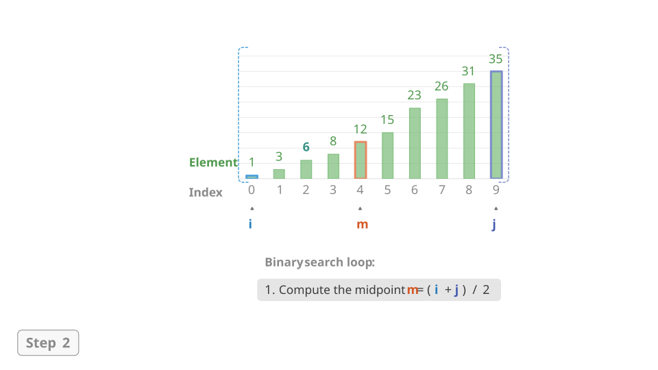
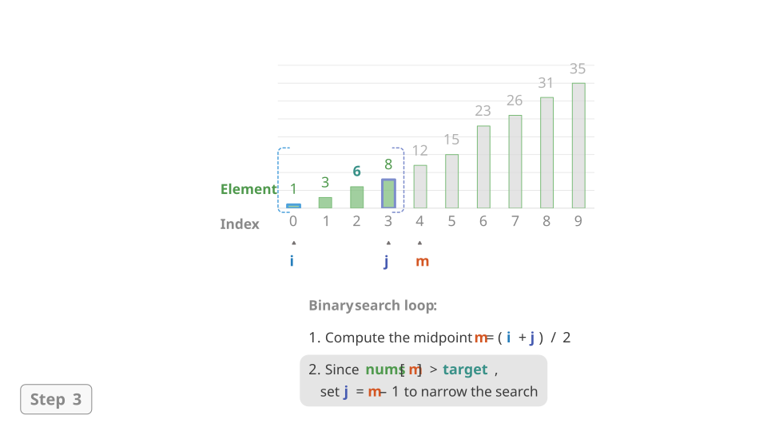
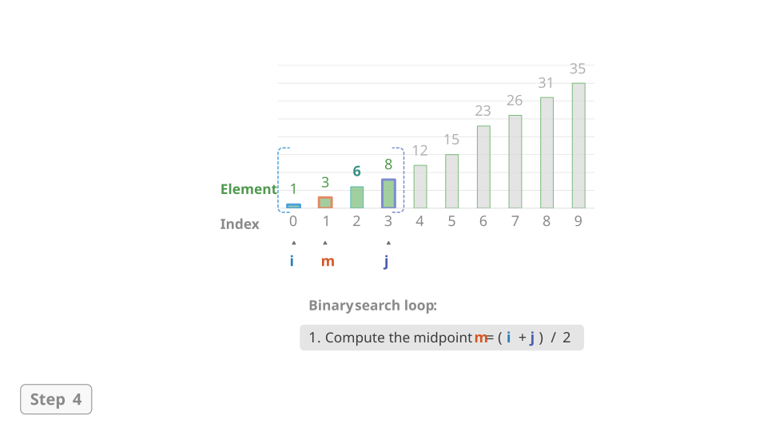
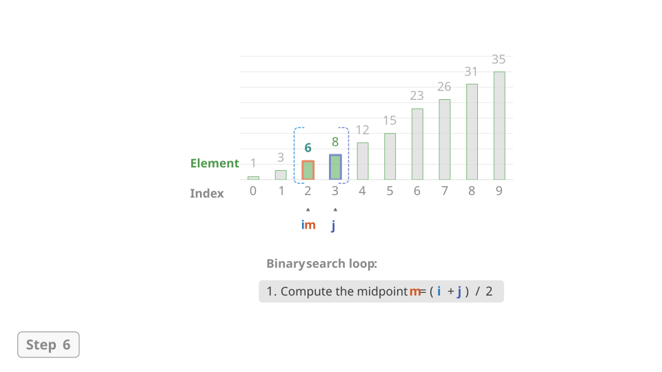
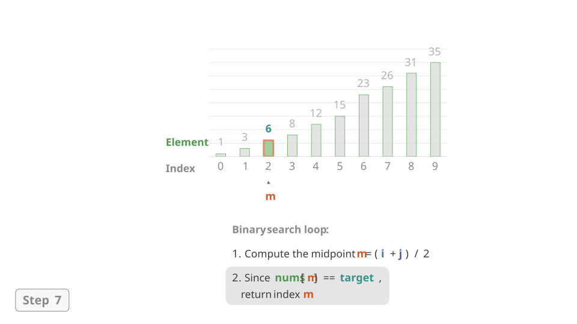
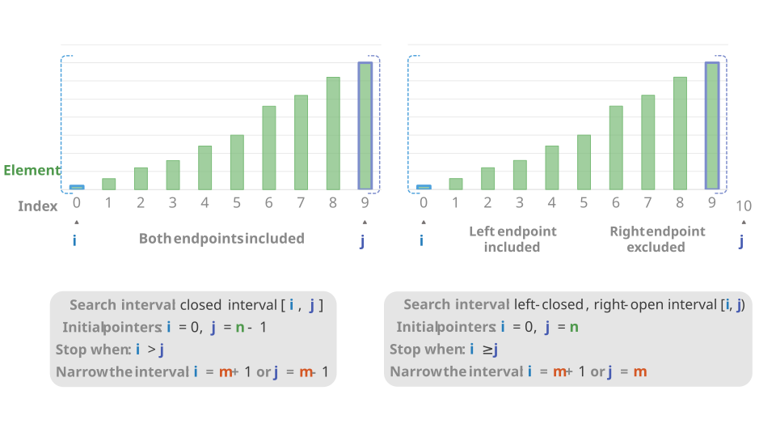

# 10.1 &nbsp; Binary search

<u>Binary search</u> is an efficient search algorithm based on divide and conquer. It uses the sorted order of the data to halve the search range at each iteration until it finds the target or the interval is empty.

!!! question

    Given an array `nums` of length $n$ with distinct elements in ascending order, find and return the index of `target`. If the array does not contain the target, return $-1$. Figure 10-1 shows an example.

{ class="animation-figure" }

<p align="center"> Figure 10-1 &nbsp; Sample data for binary search </p>

As Figure 10-2 shows, initialize pointers $i = 0$ and $j = n - 1$ at the first and last elements of the array. They define the search interval $[0, n - 1]$. The square brackets denote a closed interval, which includes both endpoints.

Repeat the following two steps.

1. Compute the midpoint index $m = \lfloor {(i + j) / 2} \rfloor$, where $\lfloor \: \rfloor$ means rounding down.
2. Compare `nums[m]` with `target`. There are three cases.
    1. If `nums[m] < target`, any match for `target` must be in $[m + 1, j]$, so set $i = m + 1$.
    2. If `nums[m] > target`, any match for `target` must be in $[i, m - 1]$, so set $j = m - 1$.
    3. If `nums[m] = target`, we have found `target`. Return index $m$.

If the array does not contain the target, the search interval eventually becomes empty. Return $-1$.

=== "<1>"
    { class="animation-figure" }

=== "<2>"
    { class="animation-figure" }

=== "<3>"
    { class="animation-figure" }

=== "<4>"
    { class="animation-figure" }

=== "<5>"
    { class="animation-figure" }

=== "<6>"
    { class="animation-figure" }

=== "<7>"
    { class="animation-figure" }

<p align="center"> Figure 10-2 &nbsp; Steps of binary search </p>

Since $i$ and $j$ both have type `int`, **their sum $i + j$ may exceed the range of `int`**. To avoid integer overflow, we usually compute the midpoint as $m = \lfloor {i + (j - i) / 2} \rfloor$.

The following code implements the search:

=== "Python"

    ```python title="binary_search.py"
    def binary_search(nums: list[int], target: int) -> int:
        """Binary search on a closed interval"""
        # Initialize the closed interval [0, n-1] with i at the first element and j at the last
        i, j = 0, len(nums) - 1
        # Stop when the search interval is empty (i > j)
        while i <= j:
            # Python integers can grow as large as memory allows, so overflow is not a concern here
            m = (i + j) // 2  # Compute the midpoint index m
            if nums[m] < target:
                i = m + 1  # Any match must lie in [m+1, j]
            elif nums[m] > target:
                j = m - 1  # Any match must lie in [i, m-1]
            else:
                return m  # Found the target. Return its index
        return -1  # Target not found. Return -1
    ```

=== "C++"

    ```cpp title="binary_search.cpp"
    /* Binary search on a closed interval */
    int binarySearch(vector<int> &nums, int target) {
        // Initialize the closed interval [0, n-1] with i at the first element and j at the last
        int i = 0, j = nums.size() - 1;
        // Stop when the search interval is empty (i > j)
        while (i <= j) {
            int m = i + (j - i) / 2; // Compute the midpoint index m
            if (nums[m] < target)    // Any match must lie in [m+1, j]
                i = m + 1;
            else if (nums[m] > target) // Any match must lie in [i, m-1]
                j = m - 1;
            else // Found the target. Return its index
                return m;
        }
        // Target not found. Return -1
        return -1;
    }
    ```

=== "Java"

    ```java title="binary_search.java"
    /* Binary search on a closed interval */
    int binarySearch(int[] nums, int target) {
        // Initialize the closed interval [0, n-1] with i at the first element and j at the last
        int i = 0, j = nums.length - 1;
        // Stop when the search interval is empty (i > j)
        while (i <= j) {
            int m = i + (j - i) / 2; // Compute the midpoint index m
            if (nums[m] < target) // Any match must lie in [m+1, j]
                i = m + 1;
            else if (nums[m] > target) // Any match must lie in [i, m-1]
                j = m - 1;
            else // Found the target. Return its index
                return m;
        }
        // Target not found. Return -1
        return -1;
    }
    ```

=== "C#"

    ```csharp title="binary_search.cs"
    /* Binary search on a closed interval */
    int BinarySearch(int[] nums, int target) {
        // Initialize the closed interval [0, n-1] with i at the first element and j at the last
        int i = 0, j = nums.Length - 1;
        // Stop when the search interval is empty (i > j)
        while (i <= j) {
            int m = i + (j - i) / 2;   // Compute the midpoint index m
            if (nums[m] < target)      // Any match must lie in [m+1, j]
                i = m + 1;
            else if (nums[m] > target) // Any match must lie in [i, m-1]
                j = m - 1;
            else                       // Found the target. Return its index
                return m;
        }
        // Target not found. Return -1
        return -1;
    }
    ```

=== "Go"

    ```go title="binary_search.go"
    /* Binary search on a closed interval */
    func binarySearch(nums []int, target int) int {
        // Initialize the closed interval [0, n-1] with i at the first element and j at the last
        i, j := 0, len(nums)-1
        // Stop when the search interval is empty (i > j)
        for i <= j {
            m := i + (j-i)/2      // Compute the midpoint index m
            if nums[m] < target { // Any match must lie in [m+1, j]
                i = m + 1
            } else if nums[m] > target { // Any match must lie in [i, m-1]
                j = m - 1
            } else { // Found the target. Return its index
                return m
            }
        }
        // Target not found. Return -1
        return -1
    }
    ```

=== "Swift"

    ```swift title="binary_search.swift"
    /* Binary search on a closed interval */
    func binarySearch(nums: [Int], target: Int) -> Int {
        // Initialize the closed interval [0, n-1] with i at the first element and j at the last
        var i = nums.startIndex
        var j = nums.endIndex - 1
        // Stop when the search interval is empty (i > j)
        while i <= j {
            let m = i + (j - i) / 2 // Compute the midpoint index m
            if nums[m] < target { // Any match must lie in [m+1, j]
                i = m + 1
            } else if nums[m] > target { // Any match must lie in [i, m-1]
                j = m - 1
            } else { // Found the target. Return its index
                return m
            }
        }
        // Target not found. Return -1
        return -1
    }
    ```

=== "JS"

    ```javascript title="binary_search.js"
    /* Binary search on a closed interval */
    function binarySearch(nums, target) {
        // Initialize the closed interval [0, n-1] with i at the first element and j at the last
        let i = 0,
            j = nums.length - 1;
        // Stop when the search interval is empty (i > j)
        while (i <= j) {
            // Compute the midpoint index m, rounding down with parseInt()
            const m = parseInt(i + (j - i) / 2);
            if (nums[m] < target)
                // Any match must lie in [m+1, j]
                i = m + 1;
            else if (nums[m] > target)
                // Any match must lie in [i, m-1]
                j = m - 1;
            else return m; // Found the target. Return its index
        }
        // Target not found. Return -1
        return -1;
    }
    ```

=== "TS"

    ```typescript title="binary_search.ts"
    /* Binary search on a closed interval */
    function binarySearch(nums: number[], target: number): number {
        // Initialize the closed interval [0, n-1] with i at the first element and j at the last
        let i = 0,
            j = nums.length - 1;
        // Stop when the search interval is empty (i > j)
        while (i <= j) {
            // Compute the midpoint index m
            const m = Math.floor(i + (j - i) / 2);
            if (nums[m] < target) {
                // Any match must lie in [m+1, j]
                i = m + 1;
            } else if (nums[m] > target) {
                // Any match must lie in [i, m-1]
                j = m - 1;
            } else {
                // Found the target. Return its index
                return m;
            }
        }
        return -1; // Target not found. Return -1
    }
    ```

=== "Dart"

    ```dart title="binary_search.dart"
    /* Binary search on a closed interval */
    int binarySearch(List<int> nums, int target) {
      // Initialize the closed interval [0, n-1] with i at the first element and j at the last
      int i = 0, j = nums.length - 1;
      // Stop when the search interval is empty (i > j)
      while (i <= j) {
        int m = i + (j - i) ~/ 2; // Compute the midpoint index m
        if (nums[m] < target) {
          // Any match must lie in [m+1, j]
          i = m + 1;
        } else if (nums[m] > target) {
          // Any match must lie in [i, m-1]
          j = m - 1;
        } else {
          // Found the target. Return its index
          return m;
        }
      }
      // Target not found. Return -1
      return -1;
    }
    ```

=== "Rust"

    ```rust title="binary_search.rs"
    /* Binary search on a closed interval */
    fn binary_search(nums: &[i32], target: i32) -> i32 {
        // Initialize the closed interval [0, n-1] with i at the first element and j at the last
        let mut i = 0;
        let mut j = nums.len() as i32 - 1;
        // Stop when the search interval is empty (i > j)
        while i <= j {
            let m = i + (j - i) / 2; // Compute the midpoint index m
            if nums[m as usize] < target {
                // Any match must lie in [m+1, j]
                i = m + 1;
            } else if nums[m as usize] > target {
                // Any match must lie in [i, m-1]
                j = m - 1;
            } else {
                // Found the target. Return its index
                return m;
            }
        }
        // Target not found. Return -1
        return -1;
    }
    ```

=== "C"

    ```c title="binary_search.c"
    /* Binary search on a closed interval */
    int binarySearch(int *nums, int len, int target) {
        // Initialize the closed interval [0, n-1] with i at the first element and j at the last
        int i = 0, j = len - 1;
        // Stop when the search interval is empty (i > j)
        while (i <= j) {
            int m = i + (j - i) / 2; // Compute the midpoint index m
            if (nums[m] < target)    // Any match must lie in [m+1, j]
                i = m + 1;
            else if (nums[m] > target) // Any match must lie in [i, m-1]
                j = m - 1;
            else // Found the target. Return its index
                return m;
        }
        // Target not found. Return -1
        return -1;
    }
    ```

=== "Kotlin"

    ```kotlin title="binary_search.kt"
    /* Binary search on a closed interval */
    fun binarySearch(nums: IntArray, target: Int): Int {
        // Initialize the closed interval [0, n-1] with i at the first element and j at the last
        var i = 0
        var j = nums.size - 1
        // Stop when the search interval is empty (i > j)
        while (i <= j) {
            val m = i + (j - i) / 2 // Compute the midpoint index m
            if (nums[m] < target) // Any match must lie in [m+1, j]
                i = m + 1
            else if (nums[m] > target) // Any match must lie in [i, m-1]
                j = m - 1
            else  // Found the target. Return its index
                return m
        }
        // Target not found. Return -1
        return -1
    }
    ```

=== "Ruby"

    ```ruby title="binary_search.rb"
    ### Binary search on a closed interval ###
    def binary_search(nums, target)
      # Initialize the closed interval [0, n-1] with i at the first element and j at the last
      i, j = 0, nums.length - 1

      # Stop when the search interval is empty (i > j)
      while i <= j
        # Ruby integers can grow as large as memory allows, so overflow is not a concern here
        m = (i + j) / 2   # Compute the midpoint index m
      
        if nums[m] < target
          i = m + 1 # Any match must lie in [m+1, j]
        elsif nums[m] > target
          j = m - 1 # Any match must lie in [i, m-1]
        else
          return m  # Found the target. Return its index
        end
      end

      -1  # Target not found. Return -1
    end
    ```

??? pythontutor "Visualize execution"

    <div style="height: 549px; width: 100%;"><iframe class="pythontutor-iframe" title="Visualize execution" src="https://pythontutor.com/iframe-embed.html#code=def%20binary_search%28nums%3A%20list%5Bint%5D,%20target%3A%20int%29%20-%3E%20int%3A%0A%20%20%20%20%22%22%22Binary%20search%20on%20a%20closed%20interval%22%22%22%0A%20%20%20%20%23%20Initialize%20the%20closed%20interval%20%5B0,%20n-1%5D%20with%20i%20at%20the%20first%20element%20and%20j%20at%20the%20last%0A%20%20%20%20i,%20j%20%3D%200,%20len%28nums%29%20-%201%0A%20%20%20%20%23%20Stop%20when%20the%20search%20interval%20is%20empty%20%28i%20%3E%20j%29%0A%20%20%20%20while%20i%20%3C%3D%20j%3A%0A%20%20%20%20%20%20%20%20%23%20Python%20integers%20can%20grow%20as%20large%20as%20memory%20allows,%20so%20overflow%20is%20not%20a%20concern%20here%0A%20%20%20%20%20%20%20%20m%20%3D%20%28i%20%2B%20j%29%20//%202%20%20%23%20Compute%20the%20midpoint%20index%20m%0A%20%20%20%20%20%20%20%20if%20nums%5Bm%5D%20%3C%20target%3A%0A%20%20%20%20%20%20%20%20%20%20%20%20i%20%3D%20m%20%2B%201%20%20%23%20Any%20match%20must%20lie%20in%20%5Bm%2B1,%20j%5D%0A%20%20%20%20%20%20%20%20elif%20nums%5Bm%5D%20%3E%20target%3A%0A%20%20%20%20%20%20%20%20%20%20%20%20j%20%3D%20m%20-%201%20%20%23%20Any%20match%20must%20lie%20in%20%5Bi,%20m-1%5D%0A%20%20%20%20%20%20%20%20else%3A%0A%20%20%20%20%20%20%20%20%20%20%20%20return%20m%20%20%23%20Found%20the%20target.%20Return%20its%20index%0A%20%20%20%20return%20-1%20%20%23%20Target%20not%20found.%20Return%20-1%0A%0A%0A%22%22%22Driver%20Code%22%22%22%0Aif%20__name__%20%3D%3D%20%22__main__%22%3A%0A%20%20%20%20target%20%3D%206%0A%20%20%20%20nums%20%3D%20%5B1,%203,%206,%208,%2012,%2015,%2023,%2026,%2031,%2035%5D%0A%0A%20%20%20%20%23%20Binary%20search%20on%20a%20closed%20interval%0A%20%20%20%20index%20%3D%20binary_search%28nums,%20target%29%0A%20%20%20%20print%28%22Index%20of%20target%206%20%3D%20%22,%20index%29&codeDivHeight=472&codeDivWidth=350&cumulative=false&curInstr=5&heapPrimitives=nevernest&origin=opt-frontend.js&py=311&rawInputLstJSON=%5B%5D&textReferences=false"> </iframe></div>
    <div style="margin-top: 5px;"><a href="https://pythontutor.com/iframe-embed.html#code=def%20binary_search%28nums%3A%20list%5Bint%5D,%20target%3A%20int%29%20-%3E%20int%3A%0A%20%20%20%20%22%22%22Binary%20search%20on%20a%20closed%20interval%22%22%22%0A%20%20%20%20%23%20Initialize%20the%20closed%20interval%20%5B0,%20n-1%5D%20with%20i%20at%20the%20first%20element%20and%20j%20at%20the%20last%0A%20%20%20%20i,%20j%20%3D%200,%20len%28nums%29%20-%201%0A%20%20%20%20%23%20Stop%20when%20the%20search%20interval%20is%20empty%20%28i%20%3E%20j%29%0A%20%20%20%20while%20i%20%3C%3D%20j%3A%0A%20%20%20%20%20%20%20%20%23%20Python%20integers%20can%20grow%20as%20large%20as%20memory%20allows,%20so%20overflow%20is%20not%20a%20concern%20here%0A%20%20%20%20%20%20%20%20m%20%3D%20%28i%20%2B%20j%29%20//%202%20%20%23%20Compute%20the%20midpoint%20index%20m%0A%20%20%20%20%20%20%20%20if%20nums%5Bm%5D%20%3C%20target%3A%0A%20%20%20%20%20%20%20%20%20%20%20%20i%20%3D%20m%20%2B%201%20%20%23%20Any%20match%20must%20lie%20in%20%5Bm%2B1,%20j%5D%0A%20%20%20%20%20%20%20%20elif%20nums%5Bm%5D%20%3E%20target%3A%0A%20%20%20%20%20%20%20%20%20%20%20%20j%20%3D%20m%20-%201%20%20%23%20Any%20match%20must%20lie%20in%20%5Bi,%20m-1%5D%0A%20%20%20%20%20%20%20%20else%3A%0A%20%20%20%20%20%20%20%20%20%20%20%20return%20m%20%20%23%20Found%20the%20target.%20Return%20its%20index%0A%20%20%20%20return%20-1%20%20%23%20Target%20not%20found.%20Return%20-1%0A%0A%0A%22%22%22Driver%20Code%22%22%22%0Aif%20__name__%20%3D%3D%20%22__main__%22%3A%0A%20%20%20%20target%20%3D%206%0A%20%20%20%20nums%20%3D%20%5B1,%203,%206,%208,%2012,%2015,%2023,%2026,%2031,%2035%5D%0A%0A%20%20%20%20%23%20Binary%20search%20on%20a%20closed%20interval%0A%20%20%20%20index%20%3D%20binary_search%28nums,%20target%29%0A%20%20%20%20print%28%22Index%20of%20target%206%20%3D%20%22,%20index%29&codeDivHeight=800&codeDivWidth=600&cumulative=false&curInstr=5&heapPrimitives=nevernest&origin=opt-frontend.js&py=311&rawInputLstJSON=%5B%5D&textReferences=false" target="_blank" rel="noopener noreferrer">View full screen ></a></div>

**Time complexity: $O(\log n)$**. Each iteration halves the interval, so the loop takes $\log_2 n$ iterations.

**Space complexity: $O(1)$**. The pointers $i$ and $j$ take up a constant amount of space.

## 10.1.1 &nbsp; Representing the search interval

Another common convention is a left-closed, right-open interval such as $[0, n)$. It includes its left endpoint and excludes its right endpoint. With this convention, $[i, j)$ is empty when $i = j$.

We can use this convention to implement binary search with the same behavior:

=== "Python"

    ```python title="binary_search.py"
    def binary_search_lcro(nums: list[int], target: int) -> int:
        """Binary search on a left-closed, right-open interval"""
        # Initialize [0, n) with i at the first element and j one past the last
        i, j = 0, len(nums)
        # Stop when the search interval is empty (i = j)
        while i < j:
            m = (i + j) // 2  # Compute the midpoint index m
            if nums[m] < target:
                i = m + 1  # Any match must lie in [m+1, j)
            elif nums[m] > target:
                j = m  # Any match must lie in [i, m)
            else:
                return m  # Found the target. Return its index
        return -1  # Target not found. Return -1
    ```

=== "C++"

    ```cpp title="binary_search.cpp"
    /* Binary search on a left-closed, right-open interval */
    int binarySearchLCRO(vector<int> &nums, int target) {
        // Initialize [0, n) with i at the first element and j one past the last
        int i = 0, j = nums.size();
        // Stop when the search interval is empty (i = j)
        while (i < j) {
            int m = i + (j - i) / 2; // Compute the midpoint index m
            if (nums[m] < target)    // Any match must lie in [m+1, j)
                i = m + 1;
            else if (nums[m] > target) // Any match must lie in [i, m)
                j = m;
            else // Found the target. Return its index
                return m;
        }
        // Target not found. Return -1
        return -1;
    }
    ```

=== "Java"

    ```java title="binary_search.java"
    /* Binary search on a left-closed, right-open interval */
    int binarySearchLCRO(int[] nums, int target) {
        // Initialize [0, n) with i at the first element and j one past the last
        int i = 0, j = nums.length;
        // Stop when the search interval is empty (i = j)
        while (i < j) {
            int m = i + (j - i) / 2; // Compute the midpoint index m
            if (nums[m] < target) // Any match must lie in [m+1, j)
                i = m + 1;
            else if (nums[m] > target) // Any match must lie in [i, m)
                j = m;
            else // Found the target. Return its index
                return m;
        }
        // Target not found. Return -1
        return -1;
    }
    ```

=== "C#"

    ```csharp title="binary_search.cs"
    /* Binary search on a left-closed, right-open interval */
    int BinarySearchLCRO(int[] nums, int target) {
        // Initialize [0, n) with i at the first element and j one past the last
        int i = 0, j = nums.Length;
        // Stop when the search interval is empty (i = j)
        while (i < j) {
            int m = i + (j - i) / 2;   // Compute the midpoint index m
            if (nums[m] < target)      // Any match must lie in [m+1, j)
                i = m + 1;
            else if (nums[m] > target) // Any match must lie in [i, m)
                j = m;
            else                       // Found the target. Return its index
                return m;
        }
        // Target not found. Return -1
        return -1;
    }
    ```

=== "Go"

    ```go title="binary_search.go"
    /* Binary search on a left-closed, right-open interval */
    func binarySearchLCRO(nums []int, target int) int {
        // Initialize [0, n) with i at the first element and j one past the last
        i, j := 0, len(nums)
        // Stop when the search interval is empty (i = j)
        for i < j {
            m := i + (j-i)/2      // Compute the midpoint index m
            if nums[m] < target { // Any match must lie in [m+1, j)
                i = m + 1
            } else if nums[m] > target { // Any match must lie in [i, m)
                j = m
            } else { // Found the target. Return its index
                return m
            }
        }
        // Target not found. Return -1
        return -1
    }
    ```

=== "Swift"

    ```swift title="binary_search.swift"
    /* Binary search on a left-closed, right-open interval */
    func binarySearchLCRO(nums: [Int], target: Int) -> Int {
        // Initialize [0, n) with i at the first element and j one past the last
        var i = nums.startIndex
        var j = nums.endIndex
        // Stop when the search interval is empty (i = j)
        while i < j {
            let m = i + (j - i) / 2 // Compute the midpoint index m
            if nums[m] < target { // Any match must lie in [m+1, j)
                i = m + 1
            } else if nums[m] > target { // Any match must lie in [i, m)
                j = m
            } else { // Found the target. Return its index
                return m
            }
        }
        // Target not found. Return -1
        return -1
    }
    ```

=== "JS"

    ```javascript title="binary_search.js"
    /* Binary search on a left-closed, right-open interval */
    function binarySearchLCRO(nums, target) {
        // Initialize [0, n) with i at the first element and j one past the last
        let i = 0,
            j = nums.length;
        // Stop when the search interval is empty (i = j)
        while (i < j) {
            // Compute the midpoint index m, rounding down with parseInt()
            const m = parseInt(i + (j - i) / 2);
            if (nums[m] < target)
                // Any match must lie in [m+1, j)
                i = m + 1;
            else if (nums[m] > target)
                // Any match must lie in [i, m)
                j = m;
            // Found the target. Return its index
            else return m;
        }
        // Target not found. Return -1
        return -1;
    }
    ```

=== "TS"

    ```typescript title="binary_search.ts"
    /* Binary search on a left-closed, right-open interval */
    function binarySearchLCRO(nums: number[], target: number): number {
        // Initialize [0, n) with i at the first element and j one past the last
        let i = 0,
            j = nums.length;
        // Stop when the search interval is empty (i = j)
        while (i < j) {
            // Compute the midpoint index m
            const m = Math.floor(i + (j - i) / 2);
            if (nums[m] < target) {
                // Any match must lie in [m+1, j)
                i = m + 1;
            } else if (nums[m] > target) {
                // Any match must lie in [i, m)
                j = m;
            } else {
                // Found the target. Return its index
                return m;
            }
        }
        return -1; // Target not found. Return -1
    }
    ```

=== "Dart"

    ```dart title="binary_search.dart"
    /* Binary search on a left-closed, right-open interval */
    int binarySearchLCRO(List<int> nums, int target) {
      // Initialize [0, n) with i at the first element and j one past the last
      int i = 0, j = nums.length;
      // Stop when the search interval is empty (i = j)
      while (i < j) {
        int m = i + (j - i) ~/ 2; // Compute the midpoint index m
        if (nums[m] < target) {
          // Any match must lie in [m+1, j)
          i = m + 1;
        } else if (nums[m] > target) {
          // Any match must lie in [i, m)
          j = m;
        } else {
          // Found the target. Return its index
          return m;
        }
      }
      // Target not found. Return -1
      return -1;
    }
    ```

=== "Rust"

    ```rust title="binary_search.rs"
    /* Binary search on a left-closed, right-open interval */
    fn binary_search_lcro(nums: &[i32], target: i32) -> i32 {
        // Initialize [0, n) with i at the first element and j one past the last
        let mut i = 0;
        let mut j = nums.len() as i32;
        // Stop when the search interval is empty (i = j)
        while i < j {
            let m = i + (j - i) / 2; // Compute the midpoint index m
            if nums[m as usize] < target {
                // Any match must lie in [m+1, j)
                i = m + 1;
            } else if nums[m as usize] > target {
                // Any match must lie in [i, m)
                j = m;
            } else {
                // Found the target. Return its index
                return m;
            }
        }
        // Target not found. Return -1
        return -1;
    }
    ```

=== "C"

    ```c title="binary_search.c"
    /* Binary search on a left-closed, right-open interval */
    int binarySearchLCRO(int *nums, int len, int target) {
        // Initialize [0, n) with i at the first element and j one past the last
        int i = 0, j = len;
        // Stop when the search interval is empty (i = j)
        while (i < j) {
            int m = i + (j - i) / 2; // Compute the midpoint index m
            if (nums[m] < target)    // Any match must lie in [m+1, j)
                i = m + 1;
            else if (nums[m] > target) // Any match must lie in [i, m)
                j = m;
            else // Found the target. Return its index
                return m;
        }
        // Target not found. Return -1
        return -1;
    }
    ```

=== "Kotlin"

    ```kotlin title="binary_search.kt"
    /* Binary search on a left-closed, right-open interval */
    fun binarySearchLCRO(nums: IntArray, target: Int): Int {
        // Initialize [0, n) with i at the first element and j one past the last
        var i = 0
        var j = nums.size
        // Stop when the search interval is empty (i = j)
        while (i < j) {
            val m = i + (j - i) / 2 // Compute the midpoint index m
            if (nums[m] < target) // Any match must lie in [m+1, j)
                i = m + 1
            else if (nums[m] > target) // Any match must lie in [i, m)
                j = m
            else  // Found the target. Return its index
                return m
        }
        // Target not found. Return -1
        return -1
    }
    ```

=== "Ruby"

    ```ruby title="binary_search.rb"
    ### Binary search on a left-closed, right-open interval ###
    def binary_search_lcro(nums, target)
      # Initialize [0, n) with i at the first element and j one past the last
      i, j = 0, nums.length

      # Stop when the search interval is empty (i = j)
      while i < j
        # Compute the midpoint index m
        m = (i + j) / 2

        if nums[m] < target
          i = m + 1 # Any match must lie in [m+1, j)
        elsif nums[m] > target
          j = m # Any match must lie in [i, m)
        else
          return m  # Found the target. Return its index
        end
      end

      -1  # Target not found. Return -1
    end
    ```

??? pythontutor "Visualize execution"

    <div style="height: 549px; width: 100%;"><iframe class="pythontutor-iframe" title="Visualize execution" src="https://pythontutor.com/iframe-embed.html#code=def%20binary_search_lcro%28nums%3A%20list%5Bint%5D,%20target%3A%20int%29%20-%3E%20int%3A%0A%20%20%20%20%22%22%22Binary%20search%20on%20a%20left-closed,%20right-open%20interval%22%22%22%0A%20%20%20%20%23%20Initialize%20%5B0,%20n%29%20with%20i%20at%20the%20first%20element%20and%20j%20one%20past%20the%20last%0A%20%20%20%20i,%20j%20%3D%200,%20len%28nums%29%0A%20%20%20%20%23%20Stop%20when%20the%20search%20interval%20is%20empty%20%28i%20%3D%20j%29%0A%20%20%20%20while%20i%20%3C%20j%3A%0A%20%20%20%20%20%20%20%20m%20%3D%20%28i%20%2B%20j%29%20//%202%20%20%23%20Compute%20the%20midpoint%20index%20m%0A%20%20%20%20%20%20%20%20if%20nums%5Bm%5D%20%3C%20target%3A%0A%20%20%20%20%20%20%20%20%20%20%20%20i%20%3D%20m%20%2B%201%20%20%23%20Any%20match%20must%20lie%20in%20%5Bm%2B1,%20j%29%0A%20%20%20%20%20%20%20%20elif%20nums%5Bm%5D%20%3E%20target%3A%0A%20%20%20%20%20%20%20%20%20%20%20%20j%20%3D%20m%20%20%23%20Any%20match%20must%20lie%20in%20%5Bi,%20m%29%0A%20%20%20%20%20%20%20%20else%3A%0A%20%20%20%20%20%20%20%20%20%20%20%20return%20m%20%20%23%20Found%20the%20target.%20Return%20its%20index%0A%20%20%20%20return%20-1%20%20%23%20Target%20not%20found.%20Return%20-1%0A%0A%0A%22%22%22Driver%20Code%22%22%22%0Aif%20__name__%20%3D%3D%20%22__main__%22%3A%0A%20%20%20%20target%20%3D%206%0A%20%20%20%20nums%20%3D%20%5B1,%203,%206,%208,%2012,%2015,%2023,%2026,%2031,%2035%5D%0A%0A%20%20%20%20%23%20Binary%20search%20on%20a%20left-closed,%20right-open%20interval%0A%20%20%20%20index%20%3D%20binary_search_lcro%28nums,%20target%29%0A%20%20%20%20print%28%22Index%20of%20target%206%20%3D%20%22,%20index%29&codeDivHeight=472&codeDivWidth=350&cumulative=false&curInstr=5&heapPrimitives=nevernest&origin=opt-frontend.js&py=311&rawInputLstJSON=%5B%5D&textReferences=false"> </iframe></div>
    <div style="margin-top: 5px;"><a href="https://pythontutor.com/iframe-embed.html#code=def%20binary_search_lcro%28nums%3A%20list%5Bint%5D,%20target%3A%20int%29%20-%3E%20int%3A%0A%20%20%20%20%22%22%22Binary%20search%20on%20a%20left-closed,%20right-open%20interval%22%22%22%0A%20%20%20%20%23%20Initialize%20%5B0,%20n%29%20with%20i%20at%20the%20first%20element%20and%20j%20one%20past%20the%20last%0A%20%20%20%20i,%20j%20%3D%200,%20len%28nums%29%0A%20%20%20%20%23%20Stop%20when%20the%20search%20interval%20is%20empty%20%28i%20%3D%20j%29%0A%20%20%20%20while%20i%20%3C%20j%3A%0A%20%20%20%20%20%20%20%20m%20%3D%20%28i%20%2B%20j%29%20//%202%20%20%23%20Compute%20the%20midpoint%20index%20m%0A%20%20%20%20%20%20%20%20if%20nums%5Bm%5D%20%3C%20target%3A%0A%20%20%20%20%20%20%20%20%20%20%20%20i%20%3D%20m%20%2B%201%20%20%23%20Any%20match%20must%20lie%20in%20%5Bm%2B1,%20j%29%0A%20%20%20%20%20%20%20%20elif%20nums%5Bm%5D%20%3E%20target%3A%0A%20%20%20%20%20%20%20%20%20%20%20%20j%20%3D%20m%20%20%23%20Any%20match%20must%20lie%20in%20%5Bi,%20m%29%0A%20%20%20%20%20%20%20%20else%3A%0A%20%20%20%20%20%20%20%20%20%20%20%20return%20m%20%20%23%20Found%20the%20target.%20Return%20its%20index%0A%20%20%20%20return%20-1%20%20%23%20Target%20not%20found.%20Return%20-1%0A%0A%0A%22%22%22Driver%20Code%22%22%22%0Aif%20__name__%20%3D%3D%20%22__main__%22%3A%0A%20%20%20%20target%20%3D%206%0A%20%20%20%20nums%20%3D%20%5B1,%203,%206,%208,%2012,%2015,%2023,%2026,%2031,%2035%5D%0A%0A%20%20%20%20%23%20Binary%20search%20on%20a%20left-closed,%20right-open%20interval%0A%20%20%20%20index%20%3D%20binary_search_lcro%28nums,%20target%29%0A%20%20%20%20print%28%22Index%20of%20target%206%20%3D%20%22,%20index%29&codeDivHeight=800&codeDivWidth=600&cumulative=false&curInstr=5&heapPrimitives=nevernest&origin=opt-frontend.js&py=311&rawInputLstJSON=%5B%5D&textReferences=false" target="_blank" rel="noopener noreferrer">View full screen ></a></div>

As Figure 10-3 shows, the choice of interval changes how we initialize binary search, test the loop condition, and narrow the interval.

A closed interval includes both endpoints, so the updates that narrow the interval using $i$ and $j$ are symmetric. This makes mistakes less likely, which is why **we generally recommend the closed-interval convention**.

{ class="animation-figure" }

<p align="center"> Figure 10-3 &nbsp; Two ways to define the search interval </p>

## 10.1.2 &nbsp; Advantages and limitations

Binary search is efficient in both time and space.

- Binary search is fast. Its logarithmic time complexity gives it a substantial advantage on large datasets. For example, with $n = 2^{20}$ elements, linear search takes $2^{20} = 1048576$ iterations, while binary search needs only $\log_2 2^{20} = 20$.
- Binary search needs no additional storage for the data. It uses less space than methods that require an auxiliary structure, such as hash lookup.

Binary search has several limitations to consider.

- Binary search requires sorted data. If the input is unsorted, sorting it just to run a search costs more than it saves. Sorting algorithms typically take $O(n \log n)$ time, more than either linear or binary search. Frequent insertions are also expensive: keeping the array sorted requires inserting each element at a particular position, which takes $O(n)$ time.
- Binary search applies only to arrays. It needs to jump between nonconsecutive elements. Those jumps are inefficient in a linked list, making binary search a poor fit for linked lists and structures built on them.
- Linear search performs better on small inputs. Each iteration of linear search requires just one test. An iteration of binary search requires one addition, one division, one to three tests, and one more addition or subtraction, for a total of four to six basic operations. When $n$ is small, linear search is therefore faster.
